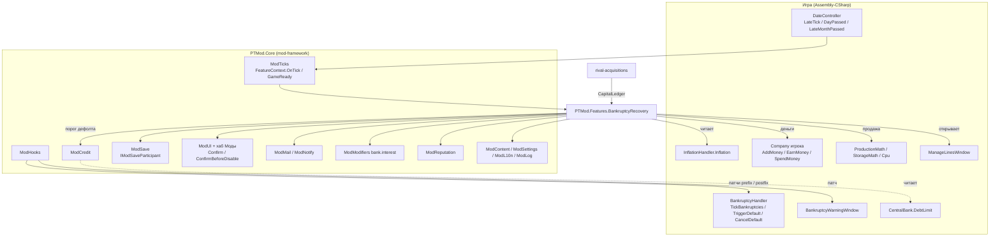
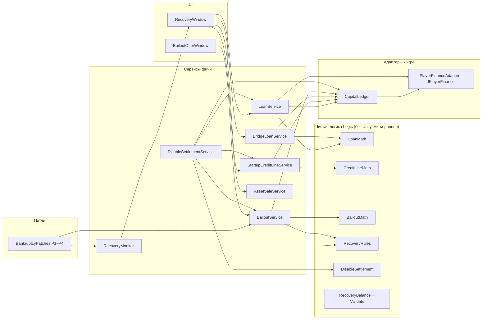
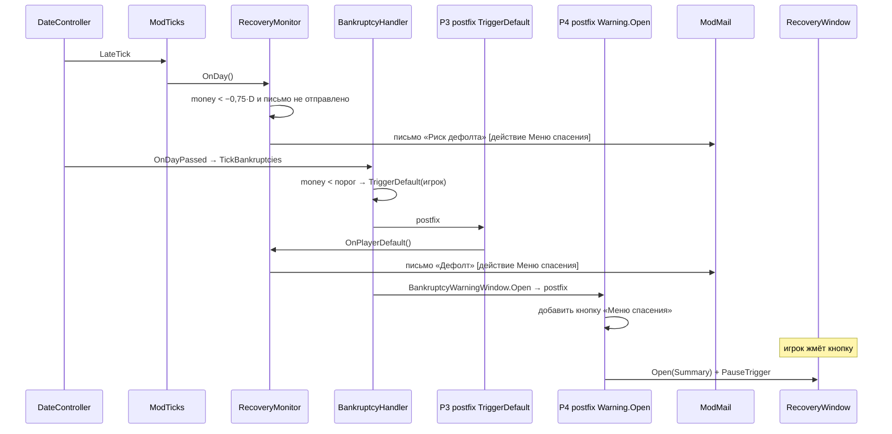
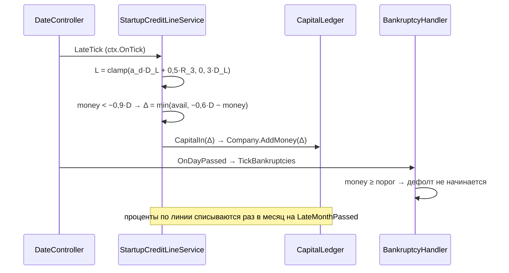
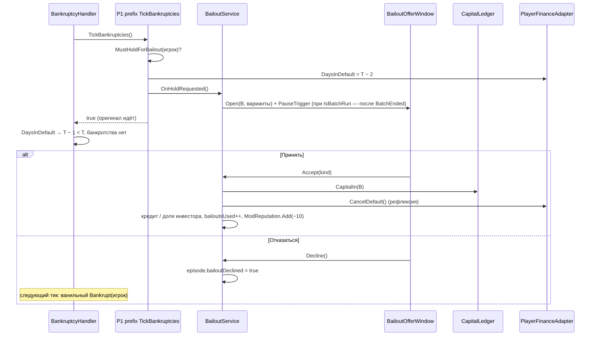
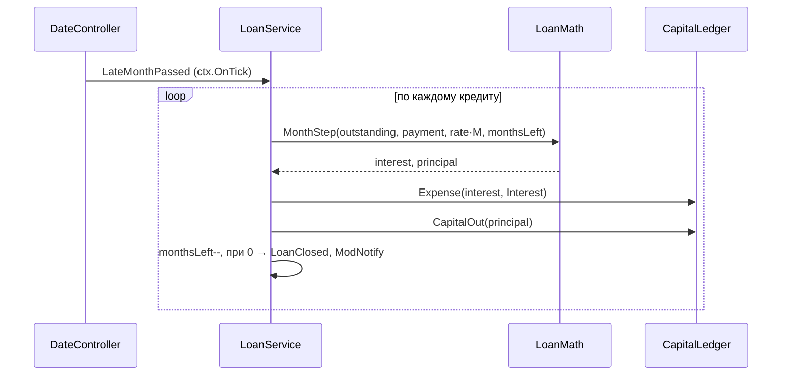
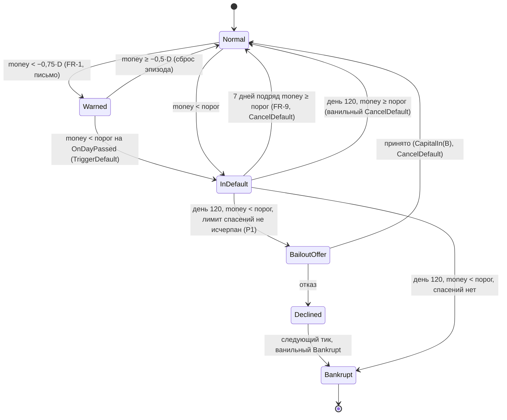

# Design: bankruptcy-recovery

## Document Information

- **Feature Name**: bankruptcy-recovery (I02)
- **Version**: 0.3
- **Date**: 2026-10-11
- **Author**: Dex719
- **Status**: Draft v0.3 — доработка после QA; решение владельца по FR-12 п. 5 (2026-10-11). v0.2 одобрена к реализации владельцем 2026-10-10
- **Reviewers**: владелец проекта; автор `mod-framework` (сигнатуры Core, `ModCredit`, `ModMail`); автор `rival-acquisitions` (общий `CapitalLedger`)
- **Related Documents**: `requirements.md`, `tasks.md` этой спеки; `mod/requests/bankruptcy-recovery.md` (запросы, отступления и проверки по кускам); `.kiro/steering/context.md`; `.kiro/steering/owner-decisions.md`; `.kiro/specs/mod-framework/design.md` (контракт Core); решения `0002` (Harmony), `0003` (тулчейн и тесты), `0004` (боковой файл), `0005` (UI из шаблонов), `0006` (контент-JSON); `pt-modding/CODEMAP.md` (разделы Bank, CompanySystem, Production)
- **Изменения v0.3** (после QA, 2026-10-11):
  - D9 переписано: перевод остатка в обычный долг делается только при выключении фичи в окне «Моды» во время игры; при любом другом выключении код фичи не вызывается, это принятое ограничение (ядро не меняем), в D9 описано, что происходит на самом деле;
  - из таблицы тиков и `GameReady(Loaded)` убран перевод при загрузке сейва, из «Error Handling» и «Migration» убраны обещания такого перевода;
  - `Settle` закрывает открытую кредитную линию всегда, даже без выборки (FR-12 п. 4); `DisableSettlementService` — класс с экземпляром, не статический;
  - досрочное погашение — целиком или частью (ползунок доли остатка, FR-10 п. 3); сумма «Взять»/«Погасить» по линии выбирается ползунком доли, сумма пишется на кнопке;
  - в раздел «Результаты спайка (TSK-003)» перенесён текст из `mod/requests/bankruptcy-recovery.md`, п. 3;
  - «Ручные сценарии»: флаг отладки `debug.recovery`, поправлены M6 (два дня после кнопок), M7 и M10 п. 6.

## Overview

Фича живёт в `PTMod.Features.BankruptcyRecovery` и работает только с компанией игрока (`Player.Instance.Company`). Она не меняет ни один ванильный порог и ни одну формулу банка. Вместо этого она:

1. **Добавляет деньги как «деньги + обязательство».** Займы зачисляются через `Company.AddMoney` (капитальная операция, мимо отчёта о прибылях и налога), проценты и комиссии списываются через `Company.SpendMoney(…, ExpenseOrigin.Interest)`. Так кредитная линия и бридж-кредит сдвигают баланс игрока от порога дефолта, не трогая сам порог.
2. **Перехватывает один момент ванильного цикла банкротства:** день, когда игрок должен стать банкротом. Префикс `BankruptcyHandler.TickBankruptcies` удерживает счётчик дефолта игрока и открывает предложение спасения.
3. **Строит меню спасения** поверх ванильных механизмов продажи (`ProductionMath.SaleCost`, `StorageMath.SellStock`, `Cpu.TriggerRetirement`, `ManageLinesWindow`) без новых цен.
4. **Безопасно выключается.** Обязательства мода не замораживаются: при выключении фичи в окне «Моды» во время игры остаток переводится в обычный долг игры (после подтверждения в хабе). Выключение иначе (правка файла настроек, сейв при выключенной фиче, удаление мода, недоступная фича) ничего не переводит: код фичи не вызывается, ядро не меняется (D9).

Все числа — в `Content/bankruptcy-recovery/balance.json`, состояние — в секции `bankruptcy-recovery` бокового файла `ModSave` (`IModSaveParticipant`; версию секции `_schema` пишет и читает ядро).

> Сервисы Core используются по контракту `mod-framework/design.md`: `FeatureContext`, `TickPhase`, `ModTicks`, `ModSave`/`IModSaveParticipant`, `ModUI`, `ModMail`, `ModNotify`, `ModModifiers`, `ModReputation`, `ModCredit`, `ModHooks`, `ModContent`, `ModSettings`, `ModL10n`, `ModLog`. Свои счётчики ошибок, флаги `Enabled`, блоки ID писем и собственные подписки на события `DateController` фича не ведёт.

### Design Goals

- **Нулевое влияние на ИИ:** ни один патч не меняет состояние компаний ИИ; `CentralBank.DebtLimit` и `BankruptcyHandler.defaultTimeLimit` только читаются.
- **Ванильные цены и окна** там, где они уже есть: мод не изобретает своих цен на линии и склад.
- **Цена каждого решения видна до подтверждения** (превью, `ModUI.Confirm`).
- **Безопасный отказ:** при любой ошибке банкротство идёт ванильным путём.
- **Без бесплатных денег там, где фича работает:** выключение в окне «Моды» и повторное включение не делают кредит беспроцентным. Вне окна «Моды» (правка файла настроек, сейв при выключенной фиче, удалённый мод) защиты нет: принятое ограничение, ядро не меняется (D9).
- **Чистая логика отделена от игры:** формулы и правила — публичные статические классы `Logic` без Unity, покрыты тестами мини-раннера.

### Key Design Decisions

- **D1. Займ = деньги + обязательство, порог не трогаем.** Тело займа — `Company.AddMoney(+A)`, возврат тела — `Company.AddMoney(−p)`, проценты и комиссии — `SpendMoney(Interest)`. Порог дефолта читается из `ModCredit` (`ThresholdOf(игрок)`, `PlayerDebtLimit()`): то, что применяет игра с учётом P9/P10 ядра.
  - *Отвергнуто:* собственный порог дефолта для игрока через transpiler `BankruptcyHandler.TickBankruptcies` (ядро уже держит P10; два transpiler'а конфликтуют; UI игры — `Money.UpdateMoneyText`, `MoneyBalance.UpdateUI` — продолжал бы рисовать другой порог).
  - *Отвергнуто:* изменение `CentralBank.DebtLimit` — одно глобальное значение, сдвинуло бы порог дефолта, резервы и поведение всех ИИ (`AIBehaviourResearch.Reserves`, `AIBehaviourFinance.OnTick`, `AIBehaviourProduction.Expand`).
  - *Отвергнуто:* чтение `CentralBank.Instance.DebtLimit` напрямую: при активном P10 порог игрока другой (испытание «Жёсткий кредит»), предупреждение и автозаём считались бы от неверного значения.
- **D2. Капитальные операции мимо отчёта о прибылях.** Тело займа через `EarnMoney` попало бы в выручку месяца и облагалось бы налогом (`TaxationHandler.HandleTaxes` берёт 25 % от прибыли прошлого месяца). `Company.AddMoney` двигает только баланс. Проценты — расход (`ExpenseOrigin.Interest`) и уменьшают налог, как в ванили.
  - *Отвергнуто:* `EarnMoney(…, RevenueOrigin.Interest)` для тела займа (ложная прибыль и налог).
- **D3. Последний шанс — префикс `TickBankruptcies` с удержанием счётчика.** Префикс ставит `DaysInDefault` игрока в `defaultTimeLimit − 2`; ванильный цикл увеличивает его до `defaultTimeLimit − 1` и не проверяет банкротство. Окно предложения модальное (пауза), поэтому следующего тика до решения нет. Во время пакетного прогона (`IsBatchRun`) счётчик удерживается на каждом дне, а окно открывается после `BatchEnded`.
  - *Отвергнуто:* префикс `BankruptcyHandler.Bankrupt`, возвращающий `false`: ванильный `TickBankruptcies` всё равно вызвал бы `OnCompanyWentBankrupt` для игрока сразу после `Bankrupt`, и подписчики (в том числе других фич) получили бы ложное событие банкротства.
  - *Отвергнуто:* «откат» после банкротства: `IsBankrupt` имеет `private set`, а `BankruptcyWindow` уже открыто.
- **D4. Досрочный выход из дефолта — постфикс + ванильный `CancelDefault`** (через рефлексию). Мод не переписывает ванильное правило, а только вызывает штатный метод отмены, когда серия восстановления достигла `streakDays`. Отключается настройкой `EarlyExit`.
  - *Отвергнуто:* transpiler, исправляющий ветку `DaysInDefault < defaultTimeLimit` (меняет поведение ИИ тоже, конфликтует с P10 ядра).
- **D5. Вход в меню — кнопка в ванильном окне предупреждения + действие письма + хаб.** Ванильное `BankruptcyWarningWindow` не заменяется, только дополняется кнопкой. Письмо несёт многоразовое действие `ModMailAction` «Меню спасения» (письмо не закрывается).
  - *Отвергнуто:* своё окно вместо ванильного (ломает привычный поток и звук, конфликт с `BankruptcyWarningWindow.OnDisable`, который ставит паузу).
- **D6. Продажа активов — ванильная математика и окна.** Линии — как `ManageLinesWindow.SellLines`, склад — `StorageMath.SellStock`, снятие — `Cpu.TriggerRetirement`, выход в fabless — ванильное окно `ManageLinesWindow` → `FablessConfirmationWindow`.
  - *Отвергнуто:* собственные «аварийные» цены (новые числа без опоры в игре, расхождение с ванильными окнами).
- **D7. Лимиты привязаны к `ModCredit` и выручке `R_3`, с полом.** Лимиты растут с инфляцией вместе с банком (`D = ModCredit.PlayerDebtLimit()`), коэффициенты зависят от сложности (контент). База лимитов `D_L = max(D, floorBase × Inflation)` страхует от случая, когда `CentralBank.DebtLimit` держится на полу 1 000 000 $ всю игру.
  - *Отвергнуто:* фиксированные суммы в долларах (обесцениваются к 1990-м: `DebtLimit` растёт с ~8 млн до ~650 млн к 2000 году).
- **D8. `CapitalLedger` — общий компонент.** Он без патчей и работает даже при выключенной фиче. `rival-acquisitions` использует его для оплаты сделок, чтобы правила денежных операций были одни. Журнал `CapitalLedger` принадлежит `bankruptcy-recovery` и хранится в её секции; операции других фич пишутся только в `ModLog` (у `rival-acquisitions` свой журнал сделок).
- **D9. Обязательства переводятся в обычный долг при выключении фичи в окне «Моды» во время игры; при любом другом выключении ничего не переводится (принятое ограничение).**
  - *Выключение в окне «Моды» во время игры.* Хаб вызывает провайдер `FeatureContext.ConfirmBeforeDisable` и, если он вернул не `null`, показывает `ModUI.Confirm`; затем `OnDisabled` списывает остаток (`Σ` остатков кредитов + выборка по линии + остаток договора с инвестором) через `CapitalLedger.CapitalOut` одной операцией и закрывает кредиты, **открытую кредитную линию (даже если по ней ничего не выбрано)** и договор. Программное выключение (`ModFeatures.SetEnabled(false)` в игре) подтверждения не спрашивает, но перевод выполняет. Для договора с инвестором переводится остаток потолка `cap − paid` (договорный максимум), чтобы выключение никогда не было дешевле исполнения договора. Счётчик спасений и дата последнего бридж-кредита сохраняются, закрытая линия повторно не открывается — переключатель не даёт новых денег. Если обязательств нет вовсе (нет кредитов, выборки и договора), `Settle` ничего не закрывает и вопроса нет: линия, которой не пользовались, остаётся. Линия в состоянии «не открыта» не затрагивается.
  - *Любое другое выключение — решение владельца 2026-10-11: ядро не меняем, код фичи не вызывается.* Это: правка `ptmod_settings.json` вне игры; сейв, загруженный при выключенной фиче (переключатель общий для всех сейвов, а кредиты лежат в конкретном: выключив фичу в окне «Моды» в одной партии, игрок переведёт в долг только её обязательства); удалённый мод; фича `Unavailable` (самопроверка не нашла цель патча) или `Faulted` (счётчик ошибок). У такой фичи ядро не вызывает `Register`, `ModHooks.Raise` пропускает её обработчики (`GameReady`, тики, `AfterRead`), патчи сняты, а `OnDisabled` под `ModHooks.Guard` не выполняется для `Faulted`/`Unavailable`; сырую секцию неактивной фичи ядро ей не отдаёт. Поэтому перевода «при загрузке сейва» нет. Что происходит на самом деле (проверено по `ModSave`, `SideFileModel`, `ModFeatures`, `ModHooks`):
    1. **Секция остаётся в боковом файле без изменений.** `SideFileModel.Apply` откладывает секцию неактивного или незарегистрированного владельца как есть, `Build` пишет её обратно при каждом сохранении (passthrough). Если фича стала `Unavailable`/`Faulted` в середине игры, ядро (обработчик смены состояния фичи в `ModSave` → `SideFileModel.CaptureParticipant`) запоминает её последнее состояние и пишет его.
    2. **Деньги у игрока остаются, долга нет.** Кредиты были зачислены на баланс (`CapitalIn`) и остаются там. Пока фича неактивна, нет ни платежей, ни процентов, ни выборок по линии, ни записей в журнале: кредиты мода становятся беспроцентными и бессрочными. Защиты от этого нет: игра одиночная, а выключение правкой файла — осознанное действие игрока (того же рода, что чит).
    3. **Повторное включение** (в окне «Моды»): ядро отдаёт участнику секцию из файла (`ModSave` → `SideFileModel.RestoreParticipant`). Кредиты, выборка по линии и договор на месте с теми остатками и числом месяцев, что были в сейве. Платежи и проценты за время выключения не начисляются и не копятся; график продолжается с ближайшего 1-го числа (срок кредита как бы растягивается), счётчик спасений и дата последнего бридж-кредита прежние. Календарные даты идут: если `closesOn` линии прошёл, ближайший `LateMonthPassed` переведёт остаток в срочный кредит (FR-7 п. 7). Отметки перевода (`settled*` в `ModSave.Flags`) пишет только настоящий перевод, поэтому после выключения вне окна их нет и они ничего не стирают.
    4. **Мод удалён:** боковой файл остаётся на диске, но игра его не читает; обязательства исчезают вместе с ним (FR-12 п. 7), деньги остаются.
    5. **Уведомлений и записей в журнале нет**: фича не работает.

    README предупреждает: «выключайте фичу в окне «Моды» и перед удалением мода».
  - *Повторное включение после перевода в окне «Моды».* Фича не полагается на то, что ядро отдаёт свежую копию секции. Ядро запоминает состояние участника после `OnDisabled` (`CaptureParticipant`), и сейв, записанный при выключенной фиче, несёт переведённое состояние; сверх этого фича страхуется двумя слоями: отметки `settled*` в `ModSave.Flags` (`SettlementMarks`: переведённые кредиты не возвращаются, закрытая линия остаётся закрытой, счётчик спасений и пауза бридж-кредита не падают; применяются после каждой выдачи секции, после загрузки и на `GameReady`) и состояние, сохранённое на одну партию (`RecoverySaveSection.Freeze`/`TakeFrozen`). «Партия» узнаётся по объекту `ModSave.FileHeader`: `SideFileModel.Apply` создаёт новый при каждом чтении бокового файла (по коду; в игре не проверено, сценарий M10).
  - *Отвергнуто:* точка в ядре для выключенных фич (вроде `ctx.OnLoadWhileOff(Action<JsonObject>)` или метода, отдающего сырую секцию неактивной фичи) — владелец решил ядро не менять. *Отвергнуто:* перевод «из памяти» неактивного участника — его состояние при загрузке другого сейва не обновляется (`SideFileModel.Apply` неактивных не трогает), перевод списал бы долги чужой партии. *Отвергнуто:* чтение файла из фичи — файлы читает только ядро (Security).
  - *Отвергнуто:* заморозка обязательств при выключении в окне «Моды» (нет процентов и платежей) — беспроцентные деньги: взять кредит и выключить фичу. Вне окна «Моды» заморозка есть сама собой, и это принятое ограничение (см. выше).
  - *Отвергнуто:* запрет `SupportsHotToggle` при долге — игрок застрянет с включённой фичей, а проверка нужна всё равно.
  - *Отвергнуто:* пересчёт процентов «за пропущенный период» при включении — сложно и не защищает от удаления мода.
- **D10. Лимиты мода не умножаются на `bank.creditLimit` повторно.** Множитель канала уже учтён в `ModCredit.PlayerDebtLimit()` один раз (решение владельца: без двойного применения). Пороги ИИ в `AIBehaviour*` этим множителем не затрагиваются.
- **D11. Проценты по линии — раз в месяц.** На `TickPhase.LateMonthPassed` списывается `drawn × r × M / 12` одной строкой в статье «Проценты» (решение владельца: месячные проценты проще читать в отчёте). Дневной тик нужен только для лимита, автозайма и предупреждения.
  - *Отвергнуто:* дневное начисление с накоплением в счётчике (лишнее поле состояния, выгода манёвра внутри месяца мала).
- **D12. Точка входа — `[ModFeature]`.** `BankruptcyRecoveryFeature : IModFeature` объявляет патчи, тики, участника сейва, параметры подфич, страницу хаба и подтверждение выключения в `Register(FeatureContext)`. Новая игра и загрузка — `ModTicks.GameReady(NewGame | Loaded)`, а не `Player.OnNewGame` и `SaveHandler.OnLoaded`.

## Architecture

### System Context



### High-Level Architecture



### Используемые сервисы PTMod.Core

| Сервис | Для чего |
|---|---|
| `FeatureContext` / `ModFeatures` | Точка входа `IModFeature`: `ctx.Patch`, `ctx.OnTick`, `ctx.SaveParticipant`, `ctx.Param`, `ctx.HubPage`, `ctx.ConfirmBeforeDisable`; состояние фичи (`ModFeatures.IsActive`) |
| `ModHooks` | Регистрация патчей P1–P4, самопроверка целей (в том числе приватных членов для рефлексии), `ModHooks.Guard` на телах патчей, счётчик ошибок и `Faulted` — на стороне ядра |
| `ModTicks` | `ctx.OnTick(TickPhase.LateTick, …)` (автозаём, предупреждение, лимит линии), `ctx.OnTick(TickPhase.LateMonthPassed, …)` (проценты, платежи); `ModTicks.GameReady` (новая игра, загрузка); `ModTicks.IsBatchRun` / `BatchEnded`; защиты перемотки и загрузки — по умолчанию |
| `ModSave` | Секция `bankruptcy-recovery` через `IModSaveParticipant` (состояние кредитов, эпизода, журнала); поле `_schema` ведёт ядро |
| `ModContent` | `Content/bankruptcy-recovery/balance.json` (`LoadConfig`) |
| `ModSettings` | Параметры подфич (`ctx.Param`): `preWarning`, `startupCredit`, `bridgeLoan`, `bailout`, `earlyExit`; вкл/выкл фичи и флаг отладки — на стороне ядра |
| `ModUI` | Меню спасения, окно предложения, `ModUI.Confirm` (подтверждения), `ModUI.Tooltip` (причины недоступности), кнопка в `BankruptcyWarningWindow`, страница хаба «Финансы» |
| `ModMail` / `ModNotify` | Письма «Риск дефолта» и «Дефолт» (`Critical`, теги `rec:prewarning`, `rec:default`, действие «Меню спасения»), уведомления о погашении, автозайме и переводе в обычный долг |
| `ModModifiers` | Чтение канала `bank.interest` для игрока — множитель ставок кредитов мода (записей и провайдеров фича не регистрирует) |
| `ModReputation` | `Add(игрок, −10, "rec.reputation.bailout")` при спасении |
| `ModCredit` | `PlayerDebtLimit()`, `ThresholdOf(игрок)`, `IsPerCompanyActive` — единственный источник порога дефолта |
| `ModL10n` / `ModLog` | Строки ru/en (префикс `rec.`); лог `[PTMod] [bankruptcy-recovery] …` |

### Technology Stack

| Слой | Технология | Обоснование |
|---|---|---|
| Логика | C# latest, Roslyn `csc` из VS Build Tools (решение 0003); `Logic` — общее подмножество API .NET Framework 4.8 и `mscorlib` Unity (без `init`, `record`, `Index`, `Range`) | Сборка `mod/build/PTMod.dll` через `python mod/build.py` |
| Патчи | Harmony 2.3.6 (решение 0002) | Приватные методы `BankruptcyHandler` и `BankruptcyWarningWindow.Open` |
| Рефлексия | `HarmonyLib.AccessTools` | Вызов `CancelDefault`, чтение `defaultTimeLimit` |
| UI | `ModUI` на шаблонах игры (решение 0005) | Родной вид, темы, пауза |
| Хранилище | `ModSave` (решение 0004) | Сейв игры остаётся ванильным |
| Контент | `ModContent` JSON (решение 0006) | Баланс без пересборки |
| Тесты | Свой мини-раннер на .NET Framework 4.8 (`[Test]`, `[Covers]`, `Assert.*`), `python mod/build.py --tests` | Чистая логика без Unity; xUnit не используется |

## Components and Interfaces

Пространство имён: `PTMod.Features.BankruptcyRecovery` (чистая логика — `PTMod.Features.BankruptcyRecovery.Logic`). Каталог: `mod/src/PTMod/Features/BankruptcyRecovery/` (логика — `…/Logic/`). Тесты — `mod/tests/PTMod.Tests/Features/BankruptcyRecovery/`.

### BankruptcyRecoveryFeature

**Purpose**: точка входа фичи по контракту ядра: объявляет патчи, тики, участника сейва, параметры, страницу хаба и подтверждение выключения; владеет состоянием.

```csharp
[ModFeature]
public sealed class BankruptcyRecoveryFeature : IModFeature
{
    public const string FeatureId = "bankruptcy-recovery";
    public string Id => FeatureId;
    public string NameKey => "rec.feature.name";
    public string DescriptionKey => "rec.feature.description";
    public string[] DependsOn => new string[0];     // жёстких зависимостей нет
    public bool EnabledByDefault => true;
    public bool SupportsHotToggle => true;

    internal static BankruptcyRecoveryFeature Instance { get; private set; }
    internal RecoveryBalance Balance { get; private set; }   // ModContent.LoadConfig, после Validate()
    internal RecoveryState State { get; private set; }       // секция ModSave
    internal IPlayerFinance Finance { get; private set; }    // PlayerFinanceAdapter

    public void Register(FeatureContext ctx)
    {
        ctx.Patch(typeof(BankruptcyPatches));                              // P1–P4
        ctx.OnTick(TickPhase.LateTick, RecoveryTicks.OnDay);               // автозаём, лимит, предупреждение
        ctx.OnTick(TickPhase.LateMonthPassed, RecoveryTicks.OnMonth);      // проценты, платежи, гашение, срок линии, инвестор
        ctx.SaveParticipant(new RecoverySaveParticipant(this));
        ctx.Param(ParamSpecs.PreWarning);  ctx.Param(ParamSpecs.StartupCredit);   // ParamType.Bool, по умолчанию true
        ctx.Param(ParamSpecs.BridgeLoan);  ctx.Param(ParamSpecs.Bailout);
        ctx.Param(ParamSpecs.EarlyExit);
        ctx.HubPage("rec.hub.title", RecoveryHubPage.Build);               // раздел «Финансы»
        ctx.ConfirmBeforeDisable(DisableSettlementService.BuildConfirmation);
        ModTicks.GameReady += OnGameReady;                                 // NewGame / Loaded: открыть линию, применить отметки перевода (только пока фича Enabled)
    }

    public void OnEnabled();      // линия, если состояние «не открыта» и срок не вышел; сбросить сессионные флаги
    public void OnDisabled();     // DisableSettlementService.Settle("disabled"): остаток → обычный долг (выключение в окне «Моды»); снять удержание счётчика
    void OnGameReady(GameReadyReason reason);
}

public enum SubFeature { PreWarning, StartupCredit, BridgeLoan, Bailout, EarlyExit }
```

**Implementation Notes**:
- Первый шаг каждого обработчика тика и патча — проверка `ModFeatures.IsActive(FeatureId)` (горячее выключение действует сразу) и, для подфичи, `ModSettings.GetBool(FeatureId, key)`.
- Патчи и обработчики вызываются через `ModHooks.Guard(FeatureId, siteId, …)`: исключение не попадает в игру, счётчик ошибок ведёт ядро.
- `IsEnabled(SubFeature)`: фича активна и параметр подфичи `true`. Подфича управляет только **новыми** операциями; обслуживание уже взятых кредитов идёт всегда, пока фича включена (FR-12 п. 2).
- Обработчик `ModTicks.GameReady` подписан в `Register` и, как все обработчики событий, вызывается ядром (`ModHooks.Raise`) только пока фича `Enabled`: открывает линию, применяет отметки перевода и сбрасывает сессионные флаги. Для `Disabled`/`Unavailable`/`Faulted` не вызываются ни он, ни `Register`, ни тики: перевода обязательств при загрузке сейва нет (FR-12 п. 5, D9: принятое ограничение, ядро не меняется). Конструктор фичи отрабатывает для каждой найденной фичи, поэтому бэкенд `CapitalLedger` регистрируется в нём.

### RecoveryApi (публичный, для UI и других спек)

```csharp
public static class RecoveryApi
{
    public static bool IsActive { get; }                         // ModFeatures.IsActive("bankruptcy-recovery")
    public static RecoverySummary GetSummary();                  // баланс, порог, дефицит, дни, долг, ближайший платёж
    public static IReadOnlyList<LoanView> GetLoans();
    public static CreditLineView GetCreditLine();
    public static int BailoutsUsed { get; }
    public static void OpenMenu(RecoveryTab tab = RecoveryTab.Summary);

    public static event Action<LoanView> LoanOpened;
    public static event Action<LoanView> LoanClosed;
    public static event Action<BailoutKind> BailoutAccepted;     // для статистики; флаг assisted спасение не ставит
}

public enum RecoveryTab { Summary, Assets, Loans, Journal }
public enum BailoutKind { RescueLoan, InvestorShare }
public enum LoanKind { Bridge, Term, RescueLoan }

public struct RecoverySummary
{
    public double Money, DebtLimit, DeficitToThreshold, LoansOutstanding, NextPayment;
    public bool InDefault; public int DaysToBankruptcy; public string NextPaymentDate;
}
public struct LoanView { public string Id; public LoanKind Kind; public double Outstanding, AnnualRate, Payment; public int MonthsLeft; }
public struct CreditLineView { public bool Open; public double Limit, Drawn, Available; public string ClosesOn; public bool AutoDraw; }
```

### CapitalLedger (общий с rival-acquisitions)

**Purpose**: единые правила денежных операций мода. Без патчей; работает даже при выключенной фиче.

```csharp
public static class CapitalLedger
{
    // Капитальные операции: мимо отчёта о прибылях и налога (Company.AddMoney)
    public static void CapitalIn(string featureId, double amount, string op, string details);   // +баланс
    public static void CapitalOut(string featureId, double amount, string op, string details);  // −баланс
    // Расходы через отчёт (Company.SpendMoney): проценты, комиссии, доля инвестора
    public static void Expense(string featureId, double amount, ExpenseOrigin origin, string op, string details);
    // Доходы через отчёт (Company.EarnMoney): например, выручка от продажи линий
    public static void Revenue(string featureId, double amount, RevenueOrigin origin, string op, string details);

    // Журнал bankruptcy-recovery (записи с featureId == "bankruptcy-recovery"), последние 200
    public static IReadOnlyList<JournalEntryData> Journal { get; }
    public const int JournalCapacity = 200;
}
```

**Implementation Notes**:
- Только компания игрока: `Player.Instance.Company` приводится к `Company` (для `AddMoney`). Для ИИ методы не предназначены; ИИ-деньги в `rival-acquisitions` меняются через `ICompany.set_MoneyAmount` и в журнал не пишутся.
- `featureId` — вызывающая фича: операции `bankruptcy-recovery` попадают в её журнал (кольцевой буфер на 200 записей, FR-10), операции других фич — только в `ModLog` (`[PTMod] [<featureId>] INFO capital: …`).
- Суммы — `double`, в игру уходит `(float)`; суммы `≤ 0`, `NaN`, `∞` отклоняются с записью в `ModLog`.

### IPlayerFinance / PlayerFinanceAdapter

```csharp
internal interface IPlayerFinance
{
    double Money { get; }                 // Player.Instance.Company.MoneyAmount
    double DebtLimit { get; }             // ModCredit.PlayerDebtLimit() — порог дефолта игрока без знака
    double Threshold { get; }             // ModCredit.ThresholdOf(игрок): отрицательное число
    double Inflation { get; }             // InflationHandler.Instance.Inflation
    bool IsInDefault { get; }             // ICompany.IsInDefault
    bool IsBankrupt { get; }
    int DaysInDefault { get; set; }       // ICompany.DaysInDefault (публичный сеттер)
    int DefaultTimeLimit { get; }         // BankruptcyHandler.defaultTimeLimit (рефлексия, 120)
    int Difficulty { get; }               // Player.Instance.DifficultyLevel
    DateTime Today { get; }               // ModTicks.Today
    DateTime FoundationDate { get; }      // Company.FoundationDate (Date → DateTime)
    int ProductionCapacity { get; }       // Company.Factory.ProductionCapacity
    double SalesRevenueLastFullMonths(int months);  // Σ RevenueBySales + RevenueByContracts
    double NetProfitOfMonth(int year, int month);   // TotalRevenues − TotalExpenses отчёта месяца
    double InterestMultiplier { get; }    // ModModifiers.Get(ModChannels.BankInterest, {Company = игрок})
    void CancelDefault();                 // BankruptcyHandler.CancelDefault(игрок) через AccessTools
}
```

**Implementation Notes**:
- Отчёты ищутся в `CompanyFinance.Reports` по паре `Year`/`Month` (а не по индексу), потому что порядок обработчиков `LateMonthPassed` (наш и `CompanyFinance.NewReport`) не определён.
- Порог и `DebtLimit` читаются при каждом обращении (без кэша дольше тика); `CentralBank.Instance.DebtLimit` напрямую не читается.
- В тестах подменяется `FakePlayerFinance`.

### Чистая логика

Все типы `Logic` публичные (мини-раннер видит их без `InternalsVisibleTo`) и перечислены в `[Covers]` соответствующих тестов.

```csharp
namespace PTMod.Features.BankruptcyRecovery.Logic
{
    public static class LoanMath
    {
        public static double AnnuityPayment(double principal, double annualRate, int months);
        public static double MonthlyInterest(double outstanding, double annualRate);   // outstanding × annualRate / 12
        public static LoanStep MonthStep(double outstanding, double payment, double annualRate, int monthsLeft);
    }
    public struct LoanStep { public double Interest; public double Principal; public double OutstandingAfter; }

    public static class CreditLineMath
    {
        public static double LimitBase(double debtLimit, double inflation, double floorBase);          // max(D, floorBase × I) = D_L
        public static double Limit(StartupCreditConfig c, int difficulty, double limitBase, double r3);
        public static double AutoDraw(StartupCreditConfig c, double money, double debtLimit, double available);
        public static double Sweep(StartupCreditConfig c, double money, double drawn);
        public static bool IsWindowOpen(StartupCreditConfig c, DateTime foundation, DateTime today);   // foundation ≤ today < foundation + years
    }

    public static class BailoutMath
    {
        public static double Amount(BailoutConfig c, double money, double debtLimit);
        public static int Allowed(BailoutConfig c, int difficulty);                                    // perGameByDifficulty[d]
        public static double InvestorPayment(InvestorConfig c, double monthProfit, double paid, double cap);
    }

    public static class RecoveryRules
    {
        public static bool MustHoldForBailout(in BankruptcyView v, int bailoutsUsed, int bailoutsAllowed, bool declined);
        public static PreWarningDecision PreWarning(in BankruptcyView v, bool alreadySent, PreWarningConfig c);
        public static int NextRecoveryStreak(in BankruptcyView v, int streak);
        public static Eligibility CanTakeBridge(in BankruptcyView v, bool hasActiveBridge, DateTime? lastClosed, BridgeConfig c);
    }

    public static class DisableSettlement
    {
        // Сумма, которая становится обычным долгом при выключении фичи (D9)
        public static double Total(IReadOnlyList<LoanData> loans, double lineDrawn, InvestorShareData investor);
        public static DisableBreakdown Breakdown(IReadOnlyList<LoanData> loans, double lineDrawn, InvestorShareData investor);
    }
    public struct DisableBreakdown { public double Loans, LineDrawn, InvestorRemainder, Total; }

    public readonly struct BankruptcyView
    {
        public readonly double Money, DebtLimit;          // DebtLimit — порог без знака (ModCredit); порог дефолта = −DebtLimit
        public readonly bool InDefault, IsBankrupt;
        public readonly int DaysInDefault, DefaultTimeLimit; public readonly DateTime Today;
    }
    public enum PreWarningDecision { None, Send, Reset }
    public struct Eligibility { public bool Ok; public string ReasonKey; }
}
```

### Сервисы

```csharp
internal sealed class LoanService
{
    public LoanView Open(LoanKind kind, double principal, double annualRate, int months, string op);
    public void OnMonth();                  // LateMonthPassed: платёж по каждому кредиту
    public PrepayResult Prepay(string loanId, double amount);   // весь остаток или часть, без штрафа (FR-10 п. 3); сумма режется до остатка, баланс должен её покрывать
    public double Outstanding { get; }
}

internal sealed class StartupCreditLineService
{
    public void EnsureOpened();             // GameReady(NewGame|Loaded) и OnEnabled: состояние «не открыта» + срок не вышел + подфича включена
    public void OnDay();                    // LateTick: лимит, автозаём
    public void OnMonth();                  // LateMonthPassed: проценты, гашение sweep, закрытие по сроку → срочный кредит
    public void Draw(double amount);
    public void Repay(double amount);
    public double Limit { get; } public double Available { get; }
}

internal sealed class BridgeLoanService
{
    public Eligibility Check();
    public double MaxAmount();
    public void Take(double amount);        // CapitalIn(A), Expense(fee), LoanService.Open(Bridge)
}

internal sealed class BailoutService
{
    public bool IsOfferOpen { get; }
    public void OnHoldRequested();          // из P1: открыть BailoutOfferWindow один раз (при IsBatchRun — после BatchEnded)
    public void Accept(BailoutKind kind);   // CapitalIn(B), CancelDefault, счётчик, репутация
    public void Decline();                  // флаг эпизода bailoutDeclined = true
    public void OnMonth();                  // доля инвестора
}

internal sealed class AssetSaleService
{
    public IReadOnlyList<WaferLinesView> ListWafers();               // Company.WaferSizes + Factory.AmountOfLines
    public LineSaleQuote QuoteLines(WaferSize wafer, int lines);     // ProductionMath.SaleCost, предупреждения
    public void SellLines(LineSaleQuote q);                          // RemoveProductionLines + EarnMoney(Sales)
    public IReadOnlyList<CpuAssetView> ListCpus();                   // не снятые CPU игрока, сортировка по марже
    public StockQuote QuoteStock(Cpu cpu);                           // StorageMath.Income
    public void SellStock(Cpu cpu);                                  // StorageMath.SellStock
    public RetireQuote QuoteRetire(Cpu cpu);                         // ContractHelper.FinesFromContracts + StorageMath.Income
    public void Retire(Cpu cpu);                                     // Cpu.TriggerRetirement
    public DivisionQuote QuoteDivision();                            // ProductionMath.ManufacturingDivisionValue
    public void OpenManageLines();                                   // активирует окно ManageLinesWindow.Instance
}

internal sealed class RecoveryMonitor
{
    public void OnDay();                    // LateTick: предупреждение FR-1
    public void OnPlayerDefault();          // из P3: письмо rec:default
}

internal sealed class DisableSettlementService               // класс с экземпляром: ему нужно окружение фичи (RecoveryEnvironment), статических членов нет
{
    public DisableConfirmation BuildConfirmation();          // null, если обязательств нет (ConfirmBeforeDisable)
    public SettleResult Settle(string reason);               // только OnDisabled (выключение в окне «Моды», SetEnabled(false) в игре): CapitalOut(Total), закрыть кредиты/открытую линию/договор, журнал
}
```

**Implementation Notes**:
- Продажа линий повторяет приватный `ManageLinesWindow.SellLines`: `ProductionMath.SaleCost(N, W)`, `Company.RemoveProductionLines(N, W)`, `Company.EarnMoney(…, RevenueOrigin.Sales)`, затем `ManageLinesWindow.UpdateWafers()`. Верхняя граница `N`: `AmountOfLines(W)`, минус 1, если это вся мощность (как `ManageLinesWindow.UpdateSlider`).
- Предупреждение о контрактах: сравнить мощность после продажи с `ContractHelper.ContractedProductionLines(Player.Instance)`; если меньше — показать риск штрафов.
- Опция «Продать производство» неактивна при `IsFoundry`, `ProductionCapacity < 1` или `DifficultyLevel == 5` (условия кнопки `sellDivisionButton` в `ManageLinesWindow.UpdateUI`).
- `BuildConfirmation` возвращает `DisableConfirmation { MessageKey = "rec.disable.confirm", Args = [остаток, баланс после, предупреждение о дефолте], ConfirmLabelKey = "rec.disable.confirmLabel" }`; суммы уже отформатированы `StringFormatter.FloatToMoney`.
- `Settle` идемпотентна: после выполнения обязательств нет, повторный вызов ничего не делает. Порядок: пересчёт `Total` → `CapitalOut(Total)` одной операцией → очистка `loans`, открытая `creditLine` (`state = "closed"`, `closedReason = "disabled"`, даже если `drawn = 0`; линия в состоянии «не открыта» не меняется), `investorShare.active = false` → `lastBridgeClosedOn = сегодня`, если закрывался бридж-кредит → отметки перевода (`SettlementMarks`) → запись журнала `disable.convert` → `ModNotify`. Если обязательств нет вовсе, ничего не закрывается: меняются только отметки (счётчик спасений и пауза бридж-кредита переживают переключатель).
- `Settle` не вызывается из `GameReady`: у неактивной фичи этого обработчика нет (D9).

### Патчи Harmony

| # | Цель `Class.Method` | Тип | Что меняет | Порядок / конфликты |
|---|---|---|---|---|
| P1 | `BankruptcyHandler.TickBankruptcies` | prefix (всегда возвращает `true`) | Только игрок: если `RecoveryRules.MustHoldForBailout` — ставит `DaysInDefault = defaultTimeLimit − 2` и просит `BailoutService` открыть предложение (один раз). Пока предложение открыто — удерживает счётчик каждый вызов | `Priority.High`. Ядро держит на этом же методе transpiler P10 (порог дефолта по компании): они совместимы, потому что prefix выполняется до оригинала, а порог берётся из `ModCredit.ThresholdOf`; резерв ядра касается только transpiler'а. Другие фичи этот метод не патчат; `rival-acquisitions` использует только событие `OnCompanyWentBankrupt` |
| P2 | `BankruptcyHandler.TickBankruptcies` | postfix | Только игрок: серия досрочного выхода (FR-9); при `streak ≥ streakDays` → `CancelDefault(игрок)` через рефлексию | Выполняется после оригинала; не трогает ИИ |
| P3 | `BankruptcyHandler.TriggerDefault` | postfix | Если `company.IsPlayer`: `RecoveryMonitor.OnPlayerDefault()` (письмо) | `rival-acquisitions` ставит свой postfix на ветку `!IsPlayer`; независимы, порядок не важен |
| P4 | `BankruptcyWarningWindow.Open` | postfix | Один раз за сцену добавляет в окно кнопку «Меню спасения» (клон `ButtonUI` через `ModUI`) | Флаг `hasShownWarningToThePlayer` в коде не сбрасывается после первого показа, поэтому ванильное окно появляется только в первом эпизоде после загрузки сцены. Если окно не показано, постфикс ничего не делает; основной вход в меню — действие письма (FR-2) и хаб |

Все четыре патча: первой строкой `ModFeatures.IsActive`, тело в `ModHooks.Guard`; prefix при сбое возвращает `true` (ванильный путь).

**Члены игры, используемые через рефлексию** (проверяются самопроверкой `ModHooks`):

| Член | Вид | Зачем |
|---|---|---|
| `BankruptcyHandler.CancelDefault(ICompany)` | private method | Снять дефолт игрока при спасении (FR-8) и досрочном выходе (FR-9) — ванильный баннер «успех» и звук |
| `BankruptcyHandler.defaultTimeLimit` | private field `int` | Порог дней дефолта (120) для правил FR-8 и сводки |

### Подписки и тики

| Источник | Обработчик | Защиты |
|---|---|---|
| `ctx.OnTick(TickPhase.LateTick, …)` | `StartupCreditLineService.OnDay` (лимит, автозаём), `RecoveryMonitor.OnDay` (предупреждение) | Перемотка и загрузка пропускаются ядром (`TickOptions.None`); фича/подфича выключена → выход; игрок банкрот → выход |
| `ctx.OnTick(TickPhase.LateMonthPassed, …)` | `LoanService.OnMonth`, `StartupCreditLineService.OnMonth`, `BailoutService.OnMonth` | Те же; отчёты ищутся по `Year`/`Month` |
| `ModTicks.GameReady` (`NewGame`) | `StartupCreditLineService.EnsureOpened` | Приходит после перемотки; подписка статическая (в `Register`), переустанавливать её на сцене не нужно |
| `ModTicks.GameReady` (`Loaded`) | сброс сессионных флагов («предложение открыто», кэш месяца); `DropFrozen` и `Reconcile` (отметки перевода, D9); `EnsureOpened` для сейва без секции | Только пока фича `Enabled` (D9: у неактивной фичи обработчик не вызывается, перевода нет). Нет файла/секции → значения по умолчанию |
| `IModSaveParticipant.Read` / `Write` | `RecoverySaveParticipant` | Версию секции (`_schema`) ведёт ядро |
| `ModTicks.BatchEnded` | `BailoutService`: открыть отложенное окно предложения | Только если удержание было запрошено в пакетном прогоне |

Порядок дня важен: `LateTick` (автозаём) идёт до `DayPassed` (`BankruptcyHandler.TickBankruptcies`), поэтому автозаём успевает поднять баланс до проверки дефолта.

## Data Models

### Состояние (секция ModSave)

Участник `RecoverySaveParticipant : IModSaveParticipant` (`SectionId = "bankruptcy-recovery"`, `SchemaVersion = 1`) переводит DTO в `JsonObject` и обратно через `ModJson.From`/`ModJson.Bind`. Поля версии (`schema`) в DTO нет: `_schema` пишет и читает ядро.

```csharp
[Serializable] public sealed class RecoveryState      // PTMod.Features.BankruptcyRecovery.Logic
{
    public CreditLineData creditLine = new CreditLineData();
    public List<LoanData> loans = new List<LoanData>();
    public int bailoutsUsed;
    public InvestorShareData investorShare = new InvestorShareData();
    public EpisodeData episode = new EpisodeData();
    public string lastBridgeClosedOn = "";          // "yyyy-MM-dd" или ""
    public int nextLoanSeq = 1;
    public List<JournalEntryData> journal = new List<JournalEntryData>();
}

[Serializable] public sealed class CreditLineData
{
    public string state = "none";                   // "none" (не открывалась) | "open" | "closed"
    public string opensOn = ""; public string closesOn = "";
    public double drawn; public bool autoDraw = true;
    public string closedReason = "";                // "expired" (остаток → срочный кредит) | "disabled" (остаток → обычный долг)
}

[Serializable] public sealed class LoanData
{
    public string id; public string kind;            // "Bridge" | "Term" | "RescueLoan"
    public double principal; public double outstanding; public double annualRate;
    public int monthsTotal; public int monthsLeft; public double payment; public string openedOn;
}

[Serializable] public sealed class InvestorShareData
{
    public bool active; public double amount; public double share;
    public int monthsLeft; public double paid; public double cap;
}

[Serializable] public sealed class EpisodeData
{
    public bool preWarningSent; public bool defaultMailSent;
    public int recoveryStreak; public bool bailoutDeclined;
    // флаг «предложение открыто» НЕ сохраняется (сессионный)
}

[Serializable] public sealed class JournalEntryData
{
    public string date; public string op; public double amount; public string details;
}
```

**Validation Rules** (при чтении `ModSave`): `drawn ≥ 0`; `state` ∈ {`none`, `open`, `closed`}; у кредита `0 ≤ outstanding ≤ principal × 1,01`, `0 ≤ annualRate ≤ 2`, `0 ≤ monthsLeft ≤ monthsTotal ≤ 120`; `0 ≤ share ≤ 1`; даты разбираются `yyyy-MM-dd`, иначе запись отбрасывается с `ModLog`. Секцию новее мода ядро отдаёт как значения по умолчанию и сохраняет исходную без изменений.

**Relationships**: состояние принадлежит одному сейву (боковой файл `<save>.ptmod.json`). Ссылок на объекты игры нет: только деньги и даты. ID писем не хранится: письма ищутся по тегу (`ModMail.Find`).

### Пример секции бокового файла

Ядро добавляет в каждую секцию служебное поле версии (`_schema`); в DTO фичи его нет.

```json
{
  "schema": 1,
  "modVersion": "0.1.0",
  "features": {
    "bankruptcy-recovery": {
      "creditLine": { "state": "open", "opensOn": "1975-01-01", "closesOn": "1978-01-01",
                      "drawn": 2660000.0, "autoDraw": true, "closedReason": "" },
      "loans": [
        { "id": "bridge-1", "kind": "Bridge", "principal": 8400000.0, "outstanding": 6527277.0,
          "annualRate": 0.30, "monthsTotal": 12, "monthsLeft": 9, "payment": 818892.0,
          "openedOn": "1976-03-01" }
      ],
      "bailoutsUsed": 0,
      "investorShare": { "active": false, "amount": 0.0, "share": 0.0, "monthsLeft": 0, "paid": 0.0, "cap": 0.0 },
      "episode": { "preWarningSent": true, "defaultMailSent": true, "recoveryStreak": 0, "bailoutDeclined": false },
      "lastBridgeClosedOn": "",
      "nextLoanSeq": 2,
      "journal": [
        { "date": "1976-03-01", "op": "bridge.open", "amount": 8400000.0, "details": "12m @ 30%" },
        { "date": "1976-03-01", "op": "bridge.fee", "amount": -420000.0, "details": "" },
        { "date": "1976-04-01", "op": "loan.payment", "amount": -818892.0, "details": "bridge-1" }
      ]
    }
  }
}
```

### Контент: `Content/bankruptcy-recovery/balance.json`

Версия `schema` здесь — версия файла контента (`ModContent.LoadConfig(…, supportedSchema)`), а не секции сейва.

```json
{
  "schema": 1,
  "limits": { "floorBase": 2000000.0 },
  "preWarning": { "thresholdDebtLimitShare": 0.75, "resetDebtLimitShare": 0.5 },
  "earlyExit": { "streakDays": 7 },
  "startupCredit": {
    "years": 3,
    "baseDebtLimitShareByDifficulty": [1.5, 1.25, 1.0, 0.75, 0.5, 0.25],
    "revenueShare": 0.5,
    "capDebtLimitShare": 3.0,
    "annualRate": 0.10,
    "autoDrawTriggerShare": 0.9,
    "autoDrawTargetShare": 0.6,
    "sweepShare": 0.25,
    "termMonths": 24,
    "termAnnualRate": 0.15
  },
  "bridgeLoan": {
    "eligibleDebtLimitShare": 0.75,
    "baseDebtLimitShare": 1.0,
    "revenueShare": 0.25,
    "fee": 0.05,
    "annualRate": 0.30,
    "months": 12,
    "cooldownDays": 180
  },
  "bailout": {
    "perGameByDifficulty": [2, 1, 1, 1, 1, 0],
    "targetDebtLimitShare": 0.25,
    "loan": { "annualRate": 0.40, "months": 36 },
    "investor": { "profitShare": 0.30, "months": 60, "capMultiple": 3.0, "expenseOrigin": "Royalties" },
    "reputationDelta": -10
  },
  "assets": { "minLinesLeft": 1 }
}
```

| Поле | Допустимо | По умолчанию | Что задаёт |
|---|---|---|---|
| `limits.floorBase` | 0…1e9 | 2 000 000 | Пол базы лимитов: `D_L = max(D, floorBase × Inflation)` |
| `*.annualRate` | 0…2 | см. выше | Годовая ставка до множителя `bank.interest` |
| `*DebtLimitShare` | 0…10 | см. выше | Доля от `D` (порога дефолта игрока) |
| `baseDebtLimitShare`, `baseDebtLimitShareByDifficulty` | 0…10 | см. выше | Доля от базы лимитов `D_L` |
| `*ByDifficulty` | массив из 6 значений ≥ 0 | см. выше | Индекс — `Player.DifficultyLevel` (0…5); `perGameByDifficulty` — целые |
| `months`, `termMonths` | 1…120 | 12 / 24 / 36 / 60 | Срок аннуитета |
| `fee`, `revenueShare`, `sweepShare`, `profitShare` | 0…1 | см. выше | Доли |
| `streakDays` | 1…120 | 7 | Дней подряд выше порога |
| `cooldownDays` | 0…3650 | 180 | Пауза между бридж-кредитами |
| `expenseOrigin` | `Royalties` \| `Interest` | `Royalties` | Статья расхода доли инвестора (решение владельца: `Royalties`) |

Битая запись (вне диапазона, не тот тип) → значение по умолчанию поля + строка в `ModLog`.

## Формулы и баланс

Обозначения: `D = ModCredit.PlayerDebtLimit()` (порог дефолта игрока без знака, живое значение; ровно то, что применяет игра), `I = InflationHandler.Instance.Inflation`, `D_L = max(D, floorBase × I)` — база лимитов мода, `M = ModModifiers`-канал `bank.interest` для игрока (по умолчанию 1), `money = Company.MoneyAmount` игрока, `T = BankruptcyHandler.defaultTimeLimit = 120`, `R_3` — выручка от продаж и контрактов (`RevenueBySales + RevenueByContracts`) за 3 последних полных месяца.

### Ванильная основа (не меняется модом)

- **Порог дефолта** (`CentralBank.UpdateCreditLimit`): `DebtLimit = max(1 000 000, baseCreditLimit × I² × (1,5 + clamp(год − 1971, 0, 60) / 25) − 17 500 000)`, `I = InflationHandler.Inflation` (десятилетия: 1970-е 0,5; 1980-е 2,0; 1990-е 3,0; 2000-е 5,0; 2010-е 6,5). Ядро может умножить его на `bank.creditLimit` глобально (P9) и по компании (P10); `ModCredit.PlayerDebtLimit()` отдаёт итог.
- **Ориентиры `D` при `baseCreditLimit = 1e7`**: 1971 — 1,0 млн; 1975 — 8,4 млн; 1977 — 24,3 млн; 1980 — 56,9 млн; 1985 — 111,2 млн; 1990 — 185,9 млн; 2000 — 647,5 млн; 2010 — 1 275 млн. Если `baseCreditLimit = 0` (не восстановлен из сцены), `DebtLimit = 1 000 000` всю игру — проверяет спайк TSK-003; тогда лимиты держит пол `floorBase × I` (1980-е: 4 млн, 1990-е: 6 млн).
- **Проценты банка на минус** (`CentralBank.TaxInterest`): `|money| × 0,25 / 365 × Modifiers.GetModifier(6)` в день — 25 % годовых. Мод это не меняет; кредиты мода сравниваются с этой ставкой.
- **Дефолт и банкротство** (`BankruptcyHandler.TickBankruptcies`): `money < порог` → дефолт; на `DaysInDefault ≥ 120` → банкротство, если `money < порог`, иначе `CancelDefault`.

### Предупреждение (FR-1)

- Отправить, если `¬InDefault ∧ money < −0,75·D ∧ ¬preWarningSent`.
- Сбросить эпизод, если `money ≥ −0,5·D`.

### Стартовая кредитная линия (FR-7)

- Окно: `FoundationDate ≤ today < FoundationDate + 3 года`; срок закрытия `closesOn`.
- Лимит: `L = clamp(a_d·D_L + 0,5·R_3, 0, 3·D_L)`, `a_d = [1,5; 1,25; 1,0; 0,75; 0,5; 0,25][DifficultyLevel]`.
- Свободно: `avail = max(0, L − drawn)`.
- Автозаём (в `LateTick`): если `money < −0,9·D` → `Δ = min(avail, −0,6·D − money)`, `CapitalIn(Δ)`, `drawn += Δ`.
- Проценты раз в месяц (`LateMonthPassed`): `drawn × 0,10·M / 12` → `Expense(Interest)`.
- Гашение раз в месяц после процентов: `rep = min(drawn, 0,25·max(0, money))` → `CapitalOut(rep)`.
- После срока (`today ≥ closesOn`): новые выборки закрыты; на `LateMonthPassed` после процентов `drawn` → срочный кредит, аннуитет 24 мес. под `0,15·M`.
- **Пример (нормально, 1975):** `D = 8,4 млн`, `D_L = 8,4 млн`, `R_3 = 0` → `L = 8,4 млн`. Через полгода CPU продаёт 1,5 млн/мес → `R_3 = 4,5 млн` → `L = 10,65 млн`. Баланс −7,7 млн < −7,56 млн → автозаём 2,66 млн → баланс −5,04 млн. Проценты при `drawn = 2,66 млн`: ≈ 22 167 $ в месяц (одна строка в отчёте) против ≈ 103 600 $ в месяц, которые банк взял бы с −5,04 млн.
- **Пример пола:** `DebtLimit = 1 млн` (пол банка), 1985 год (`I = 2,0`) → `D_L = max(1, 2 × 2,0) = 4 млн`, `L = 4 млн`; автозаём срабатывает от `−0,9 млн`.

### Аннуитет (FR-6, FR-7, FR-8)

- `i = r·M / 12`; `P = A·i / (1 − (1 + i)^(−n))`; при `i = 0` → `P = A / n`.
- Месячный шаг: `interest = outstanding·i` → `Expense(Interest)`; `principal = min(outstanding, P − interest)` (в последнем месяце — весь остаток) → `CapitalOut(principal)`.

### Бридж-кредит (FR-6)

- Доступен, если `(money < −0,75·D ∨ InDefault) ∧ нет активного ∧ (today − lastBridgeClosedOn ≥ 180 дн.) ∧ подфича включена`.
- `A_max = 1,0·D_L + 0,25·R_3`; игрок выбирает 25/50/75/100 % (`SliderUI`).
- Комиссия `0,05·A` → `Expense(Interest)`; кредит: `r = 0,30·M`, `n = 12`.
- **Пример:** `D = D_L = 8,4 млн`, `A = 8,4 млн`, `i = 0,025` → `P ≈ 818 892 $`; всего выплат ≈ 9,83 млн + комиссия 0,42 млн.

### Последний шанс (FR-8)

- Условие удержания (P1): `IsPlayer ∧ InDefault ∧ DaysInDefault + 1 ≥ T ∧ money < ThresholdOf(игрок) ∧ bailoutsUsed < Allowed[d] ∧ ¬bailoutDeclined` → `DaysInDefault := T − 2`. `Allowed = [2, 1, 1, 1, 1, 0]`.
- Сумма: `B = 0,25·D − money` (баланс после — `+0,25·D`, выше порога).
- «Кредит спасения»: аннуитет `n = 36`, `r = 0,40·M`.
- «Доля инвестора»: каждый месяц `pay = min(cap − paid, 0,30·max(0, profit_prev))`, `cap = 3·B`, 60 месяцев → `Expense(Royalties)`.
- После принятия: `CapitalIn(B)`, `CancelDefault(игрок)`, `bailoutsUsed += 1`, `ModReputation.Add(игрок, −10, "rec.reputation.bailout")`.
- **Пример (1977):** `D = 24,3 млн`, `money = −30 млн` → `B = 36,075 млн`; кредит спасения: `P ≈ 1 735 600 $/мес`, всего ≈ 62,5 млн; доля инвестора: при прибыли 4 млн/мес платёж 1,2 млн/мес, потолок 108,2 млн.

### Досрочный выход (FR-9)

- `streak = (InDefault ∧ money ≥ ThresholdOf(игрок)) ? streak + 1 : 0`; при `streak ≥ 7` → `CancelDefault(игрок)`, `streak = 0`.

### Выключение фичи (FR-12, D9)

- `Total = Σ outstanding(loans) + drawn(creditLine) + max(0, cap − paid)(investorShare)`.
- `OnDisabled` (выключение в окне «Моды» во время игры): `CapitalOut(Total)`; баланс после = `money − Total`; если оно ниже порога — подтверждение предупреждает о риске дефолта. Закрываются кредиты, **открытая** линия (при любой выборке, в том числе нулевой) и договор. Если обязательств нет (`Total = 0` и нет кредитов, выборки, договора), ничего не закрывается.
- **Пример:** баланс +2 млн, бридж-кредит с остатком 5 млн → баланс −3 млн, дальше ванильные 25 % годовых банка на минус; кредит закрыт, `lastBridgeClosedOn = сегодня`; если рядом была открытая линия с нулевой выборкой, она закрыта тоже (`closed`/`disabled`) и не откроется снова.
- **Вне окна «Моды»** (правка файла настроек, сейв при выключенной фиче, удалённый мод, `Unavailable`/`Faulted`) формул нет: перевода нет, баланс не меняется, платежи и проценты стоят, пока фича неактивна (D9).

### Что из ванили мод меняет

Ничего из формул и констант. Мод меняет только **поток денег игрока** (новые операции через `AddMoney`/`SpendMoney`/`EarnMoney`) и **один момент** цикла банкротства игрока (удержание счётчика в P1, вызов `CancelDefault` в P2).

## Результаты спайка (TSK-003)

Спайк выполнен **статически** 2026-10-10 (игру запускать нельзя): декомпилят `pt-modding\code`, сериализованные значения сцены `pt-modding\data`, `CODEMAP.md` и исходники ядра (`Core\Hooks`, `Core\Credit`). Рантайм-часть остаётся владельцу (ниже, «Не проверено»; задача TSK-003 закрывается ручной проверкой TSK-020). Текст перенесён сюда из `mod/requests/bankruptcy-recovery.md`, п. 3 (2026-10-11).

**Приватные цели `BankruptcyHandler` — найдены.**

- `BankruptcyHandler : MonoBehaviour`. `TickBankruptcies()`, `TriggerDefault(ICompany)`, `CancelDefault(ICompany)`, `Bankrupt(ICompany)`, `UpdateUI()` — `private`,
  экземплярные, по одной перегрузке; `Instance` — `public static`.
- `defaultTimeLimit` — `[SerializeField] private int`; значение сцены `level1` = **120** (`data\ProcessorTycoon.Bank.BankruptcyHandler.json`).
- Значит `AccessTools.Method(typeof(BankruptcyHandler), "CancelDefault", new[] { typeof(ProcessorTycoon.CompanySystem.ICompany) })` и
  `AccessTools.Field(typeof(BankruptcyHandler), "defaultTimeLimit")` находят цели; вызывать нужно на `BankruptcyHandler.Instance`.
- `CancelDefault(игрок)`: `DaysInDefault = 0` (`IsInDefault` это `DaysInDefault >= 1`), прячет `bankruptcyEvent` (баннер «Bankruptcy in N days»), включает
  `bankruptcySuccess` на 10 с, звук 5. Для ИИ — только `DaysInDefault = 0`. Баннер дефолта, таким образом, снимается самим методом.
- `TickBankruptcies` подписан на `DateController.OnDayPassed` (лямбда `<Start>b__20_0`) и зовёт `this.TriggerDefault`, `this.Bankrupt`, `this.CancelDefault` — патч P3
  (postfix `TriggerDefault`) сработает. Для P1: prefix ставит `DaysInDefault = defaultTimeLimit − 2`, метод увеличит до `T − 1`, проверка `DaysInDefault < T` проходит, ветка
  банкротства пропущена; `UpdateUI` покажет «1 день».
- Порядок дня (CODEMAP, `DateController.TriggerTicks`): `OnTick` (`CentralBank.UpdateCreditLimit`) → `OnLateTick` (`ctx.OnTick(LateTick)`, автозаём) → `OnDayPassed`
  (`TickBankruptcies`). Автозаём успевает поднять баланс до проверки дефолта, а `DebtLimit` к этому моменту свежий. `OnLateMonthPassed` — в день 1, после `OnMonthPassed`.

**Совместимость prefix и postfix с transpiler'ом P10 ядра — `ModHooks` их примет.**

- В `ReservedTargets` P10 и P11 заведены как `Channel(..., PatchKind.Transpiler)`: `Kinds = { Transpiler }`. `ReservedTarget.Rejects("bankruptcy-recovery", Prefix | Postfix)` даёт
  `false` (`Covers` ложно); правило «второй transpiler на методе» (внутренний `OtherTranspiler` в `ModHooks`) считается только для `PatchKind.Transpiler`.
- Harmony оборачивает оригинал prefix'ом и postfix'ом, не меняя его IL, поэтому шаблон P10 (локальная `V_0` пишется один раз после `get_DebtLimit; neg`, читается трижды в
  цикле) не затрагивается. Патчи ядра и фичи живут в разных экземплярах Harmony (`ptmod.mod-framework`, `ptmod.bankruptcy-recovery`).
- Порог читается через `ModCredit.ThresholdOf(игрок)` (учитывает P9/P10), `CentralBank.DebtLimit` напрямую не читается.

**Реальный `DebtLimit` — не застревает на 1 000 000; `limits.floorBase` оставлен 2 000 000.**

- `CentralBank`: сериализованное значение автосвойства `<DebtLimit>k__BackingField` в сцене = **10 000 000**; `Awake` копирует его в `baseCreditLimit`, дальше
  `UpdateCreditLimit()` каждый день: `DebtLimit = max(1e6, baseCreditLimit × I × (I × (1,5 + clamp(год − 1971, 0, 60) / 25)) − 17,5e6)`.
- `I = InflationHandler.Inflation` — линейная интерполяция между десятилетиями (1970-е 0,5; 1980-е 2,0; 1990-е 3,0; 2000-е 5,0; 2010-е 6,5; 2020-е 7,5; 2030-е 8,5) по доле
  десятилетия, прошедшей с 1 января (`DateHelper.DecadeTransitionValue`).
- Расчёт на 1 января (множители `bank.creditLimit` = 1, т. е. `ModCredit.PlayerDebtLimit()` = `DebtLimit`). Годы старта новой игры — 1975, 1980, …, 2000 (`MenuGameSetup`):

  | Дата | `I` | `D` = `DebtLimit` | `floorBase × I` (2 млн) | `D_L = max(D, floorBase × I)` |
  |---|---|---|---|---|
  | 1971-01-01 | 0,649 | 1 000 000 (пол банка) | 1 298 356 | 1 298 356 |
  | 1974-01-01 | 1,100 | 2 087 356 | 2 199 178 | 2 199 178 |
  | 1975-01-01 | 1,250 | 8 420 448 | 2 499 178 | 8 420 448 |
  | 1980-01-01 | 2,000 | 56 900 000 | 4 000 000 | 56 900 000 |
  | 1985-01-01 | 2,500 | 111 221 782 | 4 999 452 | 111 221 782 |
  | 1990-01-01 | 3,000 | 185 900 000 | 6 000 000 | 185 900 000 |
  | 1995-01-01 | 4,000 | 375 992 172 | 7 998 904 | 375 992 172 |
  | 2000-01-01 | 5,000 | 647 500 000 | 10 000 000 | 647 500 000 |

  (Ориентир для 1985 года — 111,22 млн; в разделе «Формулы и баланс» он округлён до 111,2 млн.) Пол `limits.floorBase` действует только в 1971–1974 годах
  и при очень сильном множителе `bank.creditLimit` < 1 (испытание «Жёсткий кредит»); для стартов 1975+ он не срабатывает. **Решение: `floorBase = 2 000 000` без изменений
  в `balance.json`.** Если `baseCreditLimit` в игре окажется 0 (значение сцены не восстановилось), `DebtLimit` = 1 000 000 всю игру, и пол держит лимиты (1980-е: 4 млн,
  1990-е: 6 млн) — запасной сценарий design работает как описано.

**`BankruptcyWarningWindow`.**

- `Open()` — `public`; ставит `gameObject.SetActive(true)`, `hasShownWarningToThePlayer = true`, звук 4; при повторном вызове выходит сразу (флаг после первого показа не
  сбрасывается, как и сказано в Edge Cases спеки требований (п. 13); при загрузке сейва в дефолте флаг ставится сразу).
- На объекте `BankruptcyWarningWindow` сцены `level1` есть `PauseTrigger`; `OnDisable` после первой инициализации зовёт `DateController.ResumeAndOverride(0)` (пауза). Закрытие
  окна оставляет игру на паузе; порядок пауз при открытии нашего меню из этого окна проверяется в игре (сценарий M2).
- Для кнопки есть готовый путь: `ModUI.Button(Transform parent, string text, Action onClick, ...)` — клон `Widget.Button` в любой родитель.

**`ExpenseOrigin`** содержит `Royalties` (2) и `Interest` (6), так что `expenseOrigin` из `balance.json` разбирается через `Enum.Parse` без таблицы.

**Не проверено (нужен запуск игры — владелец/интегратор):**

1. Строки `Player.log` со значениями `CentralBank.DebtLimit` и `ModCredit.PlayerDebtLimit()` на 1975-01-01, 1980-01-01, 1985-01-01 новой игры (цифры выше — расчёт по формуле
   и данным сцены, подтвердить в игре).
2. Фактическое применение prefix и postfix вместе с P10 (`ModHooks.Report` по `BankruptcyHandler.TickBankruptcies` — это сделает самопроверка TSK-010/TSK-018; спайк 0002
   `mod/spikes/harmonyspike` ставит на тот же метод пустой transpiler).
3. Вызов `CancelDefault(игрок)` в живой игре: исчезает ли баннер, появляется ли «успех» (по коду — да).
4. Клон `ButtonUI` в `BankruptcyWarningWindow`: раскладка окна в коде неизвестна (дерево сцены), положение и размер кнопки подбираются в игре (TSK-010/TSK-015, сценарий M2).

Код `Debug/SpikeProbe.cs` не создан намеренно: пункты 1–4 закрываются без отдельного пробника. Пункт 1: при флаге отладки `debug.recovery` отладочная сборка пишет в `Player.log` строку `debug: threshold on <дата>: D = …, D_L = …, inflation = …` на `GameReady` (новая игра после перемотки, загрузка) и показывает те же числа на странице фичи в хабе (TSK-019); сам `CentralBank.DebtLimit` фича не читает (правило FR-11 п. 2, архитектурный тест ядра), а `ModCredit.PlayerDebtLimit()` равен ему при множителях ядра, равных 1. Пункты 2–3 закрывают самопроверка и сценарий M2, пункт 4 — реализация P4 (TSK-010) и сценарий M2. Временный код, который нельзя запустить, остался бы в репозитории без пользы.

## UI

Все окна строит `ModUI` клоном шаблона окна игры (рамка, `ThemeableTopBar`, `ButtonClose`, `WindowDrag`); тема — через `ThemeManager.Instance`; модальность — `PauseTrigger`. Подтверждения — `ModUI.Confirm`, подсказки — `ModUI.Tooltip` (собственных мостов к `TooltipHandler` и собственных диалогов подтверждения нет). Деньги форматируются `StringFormatter.FloatToMoney`.

### Меню спасения (`RecoveryWindow`)

- **Вкладки** (`ButtonUI` как переключатели): «Сводка», «Активы», «Кредиты», «Журнал».
- **Сводка:** строки `InfoText` — баланс, порог дефолта, дефицит, «До банкротства: N дн.» / «Не в дефолте», долг по кредитам мода, ближайший платёж (дата и сумма). Кнопки быстрых действий: «Взять из линии», «Бридж-кредит», «Продать линии».
- **Активы:**
  - «Линии»: `DropdownUI` (пластина и число линий), `SliderUI` (N), `InfoText` (выручка, мощность «X → Y», предупреждение о контрактах), `ButtonUI` «Продать».
  - «Склад и CPU»: строки CPU (имя, склад, выручка склада, штраф при снятии) с кнопками «Распродать склад» и «Снять с производства».
  - «Производство»: `InfoText` со стоимостью подразделения, `ButtonUI` «Открыть управление линиями».
- **Кредиты:** таблица кредитов (вид, остаток, ставка, платёж, месяцев осталось) и над ней `SliderUI` «Досрочное погашение, % остатка» (5–100 %, шаг 5, по умолчанию 100): в каждой строке кнопка «Погасить <сумма>», где сумма — выбранная доля остатка этого кредита (на 100 % весь остаток; `AmountSteps.PrepayAmount`), неактивна, если доля меньше доллара или баланс не покрывает сумму; частичное погашение не меняет платёж и число месяцев (кредит закроется раньше, когда остаток исчерпан), вопрос показывает, сколько останется долга; блок линии (лимит / выбрано / свободно / закрытие, `SliderUI` **доли** (5–100 %) от доступного лимита для «Взять» и от погашаемого долга для «Погасить»: ползунок ядра показывает число, а не деньги, поэтому сумма пишется на кнопке; доля одна для обеих кнопок; `ToggleUI` «Автозаём»); блок бридж-кредита (`SliderUI` 25–100 % от `A_max`, условия, «Взять»).
- **Журнал:** последние 50 записей.
- **Подтверждение** (`ModUI.Confirm`, двухшаговое): операция, сумма, баланс после, побочные эффекты; «Да» / «Нет». Недоступные кнопки неактивны, причина — в подсказке и под кнопкой.

### Предложение спасения (`BailoutOfferWindow`)

Модальное окно с паузой: сумма `B`, баланс после, два варианта (`ButtonUI` с условиями под каждым), «Отказаться — объявить банкротство». Закрыть окно крестиком = отказ не засчитывается: окно откроется снова на следующем тике удержания (защита от случайного закрытия).

### Прочее

- Кнопка «Меню спасения» в ванильном `BankruptcyWarningWindow` (P4).
- Страница фичи в хабе «Моды» (`ctx.HubPage`, раздел «Финансы») → «Меню спасения»; в отладочной сборке при флаге `debug.recovery` — отладочный блок (TSK-019): порог сейчас (`D`, `D_L`, инфляция, дата), строка с результатом и семь кнопок «Баланс = k × D» (k: −0,8; −0,95; −1,1; −1,2; +0,1) и «DaysInDefault = N» (N: 1; 118). Кнопка пишет в журнал фичи запись с кодом `debug.balance`/`debug.days` и примечанием `debug: …` и строку в `Player.log`; в релизной сборке блока и кода нет, без флага блок не строится и кнопки не работают.
- Письма `ModMail` (`Critical`): «Риск дефолта» (FR-1, тег `rec:prewarning`), «Компания в дефолте» (FR-2, тег `rec:default`) — с многоразовым действием «Меню спасения» (`ModMailAction`, обработчик `ModMail.RegisterActionHandler`).
- `ModNotify`: «Кредит погашен», «Взято из кредитной линии: X» (автозаём), «Обязательства переведены в обычный долг: X».
- Подтверждение выключения фичи в хабе: `ModUI.Confirm` с текстом `rec.disable.confirm`.

### Ключи строк (`mod/src/PTMod/L10n/ru/bankruptcy-recovery.json`, `…/en/bankruptcy-recovery.json`; префикс `rec.`)

| Ключ | ru | en |
|---|---|---|
| `feature.name` | Спасение от банкротства | Bankruptcy recovery |
| `feature.description` | Меню спасения, кредитная линия, бридж-кредит и последний шанс | Recovery menu, credit line, bridge loan and last resort |
| `hub.title` | Финансы | Finance |
| `param.preWarning` / `param.startupCredit` / `param.bridgeLoan` / `param.bailout` / `param.earlyExit` | Предупреждение о риске дефолта / Стартовая кредитная линия / Бридж-кредит / Последний шанс / Досрочный выход из дефолта | Default risk warning / Startup credit line / Bridge loan / Last resort / Early exit from default |
| `menu.title` | Меню спасения | Recovery options |
| `menu.open` | Меню спасения | Recovery options |
| `tab.summary` / `tab.assets` / `tab.loans` / `tab.journal` | Сводка / Активы / Кредиты / Журнал | Summary / Assets / Loans / Journal |
| `summary.threshold` | Порог дефолта: {0} | Default threshold: {0} |
| `summary.deficit` | До порога: {0} | To threshold: {0} |
| `summary.daysLeft` | До банкротства: {0} дн. | Bankruptcy in {0} days |
| `summary.notInDefault` | Не в дефолте | Not in default |
| `lines.sell` | Продать {0} лин. ({1}) за {2} | Sell {0} lines ({1}) for {2} |
| `lines.contractsWarning` | Мощность меньше линий под контракты: возможны штрафы | Capacity below contracted lines: fines possible |
| `lines.minOne` | Нужна минимум 1 линия | At least 1 line must remain |
| `cpu.sellStock` | Распродать склад: +{0} | Sell stock: +{0} |
| `cpu.retire` | Снять с производства (штраф {0}) | Retire (fine {0}) |
| `bridge.title` | Бридж-кредит | Bridge loan |
| `bridge.terms` | {0} на {1} мес. под {2}% годовых, платёж {3}/мес. | {0} for {1} months at {2}% APR, {3}/month |
| `bridge.unavailable.active` | Бридж-кредит уже взят | A bridge loan is already active |
| `credit.title` | Стартовая кредитная линия | Startup credit line |
| `credit.state` | Лимит {0}, выбрано {1}, свободно {2}, до {3} | Limit {0}, drawn {1}, available {2}, until {3} |
| `credit.autodraw` | Автозаём у порога дефолта | Auto-draw near default threshold |
| `bailout.title` | Последний шанс | Last resort |
| `bailout.loan` | Кредит спасения: {0} на {1} мес. под {2}% | Rescue loan: {0} for {1} months at {2}% |
| `bailout.investor` | Доля инвестора: {0}% прибыли {1} мес. (не больше {2}) | Investor share: {0}% of profit for {1} months (max {2}) |
| `bailout.decline` | Отказаться — объявить банкротство | Decline — declare bankruptcy |
| `reputation.bailout` | Спасение от банкротства | Bankruptcy bailout |
| `mail.prewarning.subject` | Риск дефолта | Default risk |
| `mail.prewarning.body` | Баланс {0} близок к порогу дефолта {1}. Откройте меню спасения. | Balance {0} is close to the default threshold {1}. Open recovery options. |
| `mail.default.subject` | Компания в дефолте | Company in default |
| `mail.action.openMenu` | Меню спасения | Recovery options |
| `confirm.title` | Подтвердите операцию | Confirm operation |
| `confirm.after` | Баланс после: {0} | Balance after: {0} |
| `disable.confirm` | Непогашенные обязательства ({0}) станут обычным долгом банка. Баланс после: {1}.{2} | Outstanding obligations ({0}) will become ordinary bank debt. Balance after: {1}.{2} |
| `disable.defaultRisk` | Баланс окажется ниже порога дефолта. | The balance will fall below the default threshold. |
| `disable.confirmLabel` | Выключить и перевести в долг | Disable and convert to debt |
| `notify.converted` | Обязательства переведены в обычный долг: {0} | Obligations converted to ordinary debt: {0} |

### Sequence: предупреждение → дефолт → меню



### Sequence: автозаём до проверки банкротства



### Sequence: последний шанс



### Sequence: месячные платежи



### Sequence: выключение фичи

```mermaid
sequenceDiagram
    participant U as Игрок
    participant HUB as Хаб Моды
    participant F as BankruptcyRecoveryFeature
    participant DSS as DisableSettlementService
    participant CL as CapitalLedger
    U->>HUB: выключить фичу
    HUB->>F: ConfirmBeforeDisable provider
    F->>DSS: BuildConfirmation()
    DSS-->>HUB: сумма, баланс после, риск дефолта (или null)
    HUB->>U: ModUI.Confirm
    alt Да
        HUB->>F: OnDisabled()
        F->>DSS: Settle()
        DSS->>CL: CapitalOut(Total)
        DSS->>DSS: закрыть кредиты, линию, договор; журнал; ModNotify
    else Нет
        HUB->>U: фича остаётся включённой
    end
```

### State: эпизод дефолта игрока



## Error Handling

| Ситуация | Поведение | Видно игроку |
|---|---|---|
| Исключение в патче P1–P4 или обработчике тика | `ModHooks.Guard`: перехват, `ModLog` со стеком, счётчик ядра; после `hooks.faultThreshold` фича `Faulted` до перезапуска; P1 при сбое не удерживает счётчик (ванильный путь) | Уведомление ядра «Фича отключена из-за ошибки» |
| Самопроверка не нашла цель патча или член рефлексии | Фича `Unavailable`; код фичи не вызывается, обязательства из сейва ничего не делают (платежей и процентов нет), секция остаётся в файле без изменений (D9: принятое ограничение) | Строка в хабе «Моды»: «недоступна (несовместимая версия игры)» |
| Окно предложения не построилось | `BailoutService` снимает удержание; банкротство ванильное | Ванильное `BankruptcyWindow` |
| Старый сейв без секции | Значения по умолчанию; линия — по FR-7 п. 8 | — |
| Секция с `_schema` новее мода | Ядро сохраняет секцию как есть и отдаёт фиче значения по умолчанию | Строка в хабе |
| Битая запись кредита в `ModSave` | Запись отброшена, `ModLog` | — |
| Битый `balance.json` | Значения по умолчанию по полям, `ModLog` | — |
| Фича выключена в окне «Моды» посреди игры | Подтверждение в хабе; `OnDisabled` переводит обязательства в обычный долг, закрывает кредиты, открытую линию и договор; патчи пропускают работу; удержание P1 снято | Уведомление о переводе; кредитов на вкладке больше нет |
| Фича выключена иначе (правка `ptmod_settings.json`, сейв при выключенной фиче, `Faulted`) | Код фичи не вызывается; перевода нет; секция остаётся в файле; деньги кредитов остаются на балансе без платежей и процентов; при включении в окне «Моды» обязательства продолжаются с места остановки (D9) | Ничего; README требует выключать фичу в окне «Моды» |
| Подфича выключена | Новые операции подфичи недоступны, существующие кредиты обслуживаются | Кнопки подфичи неактивны с причиной |
| Мод удалён без выключения фичи | Ванильный сейв грузится; кредиты мода исчезают вместе с боковым файлом, деньги остаются | README (требование: выключить фичу в окне «Моды» перед удалением) |
| `Player.Instance`, `CentralBank.Instance` или `InflationHandler.Instance` = null (смена сцены) | Обработчик выходит без действий | — |

**Logging Strategy**: ошибки — `[PTMod] [bankruptcy-recovery] ERROR <операция>: <исключение>` (формат `ModLog`); аудит — каждая денежная операция в журнал фичи (ModSave), при флаге отладки дублируется в `ModLog`; производительность — при флаге отладки среднее время `OnDay` за 365 тиков раз в игровой год.

## Security Considerations

- **Валидация контента и сейва:** диапазоны из таблицы контента и правил `RecoveryState`; некорректное значение не применяется.
- **Нет сети, нет внешних процессов.** Файлы — только боковой файл сейва и файлы настроек/профиля (через Core).
- **Рефлексия ограничена** двумя членами `BankruptcyHandler`, проверенными самопроверкой.
- **Защита от лазеек:** выключение фичи в окне «Моды» и повторное включение не дают денег (D9; выключение вне окна «Моды» оставляет деньги кредитов без долга, пока фича неактивна, — принятое ограничение); число спасений и кулдаун бридж-кредита сохраняются; кнопки отключаются, пока операция недоступна, чтобы не создавать двойных займов двойным кликом (операция выполняется один раз на подтверждение).

## Performance Considerations

| Где | Работа | Бюджет |
|---|---|---|
| `LateTick` | 1 чтение `D`, `money`, `R_3` (кэш на месяц), 2–3 сравнения, ≤ 1 операция денег | ≤ 0,05 мс, 0 аллокаций |
| `TickBankruptcies` P1/P2 | Только ветка игрока, O(1) | ≤ 0,01 мс |
| `LateMonthPassed` | ≤ 5 кредитов + линия + доля инвестора; пересчёт кэша `R_3` | ≤ 0,5 мс |
| Открытие меню | Список CPU игрока (обычно < 50), пластины (≤ 7) | ≤ 50 мс |

`R_3` кэшируется на месяц (пересчёт в `LateMonthPassed`), чтобы не обходить отчёты каждый день.

## Testing Strategy

### Юнит-тесты чистой логики (`mod/tests/PTMod.Tests/Features/BankruptcyRecovery/`; мини-раннер ядра, `python mod/build.py --tests` или `python mod/build_feature.py bankruptcy-recovery --tests`)

Атрибуты `[Test]`, `[Covers(typeof(X))]`, проверки `Assert.True/False/Equal/NotEqual/Near/InRange/Throws<T>/Fail`; каждый публичный тип `Logic` указан в `[Covers]`.

- `LoanMathTests`: аннуитет `A = 8 400 000, r = 0,30, n = 12` → `P = 818 892 ± 1`; `r = 0` → `A/n`; сумма тел по графику = `A`; последний месяц гасит остаток полностью; месячный процент `2 660 000 × 0,10 / 12 = 22 166,67`.
- `CreditLineMathTests`: лимит для всех 6 сложностей; верхняя граница `3·D_L`; `LimitBase`: `max(D, floorBase × I)` (пример пола: `D = 1 млн`, `I = 2,0` → 4 млн); автозаём из примера (−7,7 млн → +2,66 млн); автозаём не превышает `avail`; `Sweep` при отрицательном балансе = 0; окно 3 года (граница дня).
- `BailoutMathTests`: `B` из примера 1977 = 36 075 000; `Allowed` для сложностей 0…5 = `[2,1,1,1,1,0]`; платёж инвестору при убытке = 0; потолок `cap`.
- `RecoveryRulesTests`: удержание только для игрока (`IsPlayer = false` → `false`); не удерживать после отказа, при исчерпанном лимите (в том числе `Allowed = 0` на сложности 5); предупреждение: отправка/повтор/сброс; серия выхода; доступность бридж-кредита (активный, кулдаун 180 дней).
- `DisableSettlementTests`: `Total` = остатки кредитов + выборка + `cap − paid`; пустое состояние → 0 (подтверждения нет); договор с инвестором на пределе `cap` → 0; `Breakdown` складывается в `Total`.
- `RecoveryBalanceTests`: валидация каждого поля (включая `limits.floorBase`, длину массивов `*ByDifficulty`), значения по умолчанию при ошибках.
- `RecoveryStateSerializationTests`: round-trip DTO ↔ `JsonObject` (`ModJson.From`/`Bind`) без поля версии; отсутствующая секция; состояние линии `none`/`open`/`closed`; битые даты; чтение примера бокового файла из этого документа. Случаи «секция без `_schema`» и «`_schema` новее» проверяет ядро (mod-framework/TSK-016).
- `AiIsolationTests`: правила и сервисы не выполняют действий для `IsPlayer = false`.
- `DisableSettlementEngineTests`, `DisableFlowTests`: перевод и закрытие линии (в том числе открытой без выборки, FR-12 п. 4), идемпотентность, «никогда не богаче», повторное включение на настоящем `SideFileModel` ядра.
- `AmountStepsTests`, `LoanBookTests`: доля остатка при досрочном погашении (`PrepayAmount`), частичное и полное погашение (FR-10 п. 3).
- `RecoveryDebugEngineTests`, `RecoveryDebugSourceTests` (TSK-019, в сборке тестов под `PTMOD_DEBUG`): кнопки «Баланс = k × D» и «DaysInDefault = N» доводят игрока до состояний сценариев M1, M2, M5, M6, M7, пишут в журнал запись `debug.*` с пометкой, не трогают остальное состояние; файлы отладки целиком внутри `#if PTMOD_DEBUG`, блок строится и работает только с флагом.

### Самопроверка на старте (через `ModHooks`)

- Существуют `BankruptcyHandler.TickBankruptcies`, `BankruptcyHandler.TriggerDefault`, `BankruptcyHandler.CancelDefault(ICompany)`, поле `BankruptcyHandler.defaultTimeLimit`, `BankruptcyWarningWindow.Open`, `ManageLinesWindow.UpdateWafers`, `StorageMath.SellStock`, `StorageMath.Income`, `ContractHelper.FinesFromContracts(Cpu)`, `ProductionMath.SaleCost`, `ProductionMath.ManufacturingDivisionValue`, `Company.AddMoney`, `InflationHandler.Inflation`.
- Prefix и postfix на `BankruptcyHandler.TickBankruptcies` допустимы (резерв ядра — только transpiler).
- Результат — строка в `Player.log` и статус фичи в хабе.

### Ручные сценарии в игре (выполняет владелец)

Подготовка: отладочная сборка (`python mod\build.py --game-dir …`; в релизной сборке (`--release`) отладки нет вовсе). В `ptmod_settings.json` включить флаг `"debug": { "recovery": true }` — на странице фичи в хабе («Моды» → «Финансы») под кнопкой «Меню спасения» появится отладочный блок (TSK-019): порог сейчас (`D`, `D_L`, инфляция, дата), строка результата и кнопки «Баланс = k × D» (k: −0,8; −0,95; −1,1; −1,2; +0,1) и «DaysInDefault = N» (N: 1; 118). Каждое нажатие пишет в журнал фичи (вкладка «Журнал») запись «Отладка: баланс» или «Отладка: дни дефолта» с примечанием `debug: …` и строку в `Player.log`; на старте новой игры и при загрузке сейва `Player.log` получает строку `debug: threshold on <дата>: D = …, D_L = …, inflation = …` (числа для TSK-003: запускать новые игры 1975, 1980 и 1985 годов). Кнопка «DaysInDefault = N» пишет только счётчик: баннер дефолта и окно предупреждения она не включает (для «настоящего» дефолта сначала «Баланс = −1,1 × D» и один день, как в M2, **при выключенном автозаёме**, см. ниже), а значение не ниже 120 урезает до 119. Для сценариев с подтверждением выключения достаточно хаба.

**Автозаём и «настоящий» дефолт.** В новой игре стартовая линия открыта, а переключатель «Автозаём у порога дефолта» включён по умолчанию (`RecoveryState.autoDraw = true`). Автозаём работает в `LateTick`, до `TickBankruptcies` (раздел «Подписки и тики»): если баланс ниже `−0,9·D`, линия поднимает его до `−0,6·D`, пока хватает свободного лимита. Лимит линии в 1975 году на «нормально» `a_d·D_L ≈ 8,4 млн`, а до `−0,6·D` не хватает `0,5·D ≈ 4,2 млн`, поэтому после «Баланс = −1,1 × D» и одного дня дефолт не начнётся: `TriggerDefault` не вызывается, окна предупреждения и письма «Дефолт» нет. Поэтому **перед сценариями M2, M4, M6 и M7 (всем, где нужен настоящий дефолт) выключите автозаём**: «Меню спасения» (хаб «Моды» → «Финансы», либо письмо) → вкладка «Кредиты» → блок «Стартовая кредитная линия» → переключатель «Автозаём у порога дефолта» в положение «выключен». Состояние переключателя лежит в сейве и от сценария к сценарию не сбрасывается: для M5 (там автозаём как раз проверяется) включите его обратно или начните новую игру. Если линии нет (сейв без неё, линия закрыта, подфича «Стартовая линия» выключена), автозаём не работает и выключать нечего. Запасной путь без переключателя: выбрать линию целиком («Взять» на 100 %), тогда свободного лимита нет (пока он не вырос от выручки CPU) и автозаём ничего не даёт; но тогда в кредитах остаётся долг по линии, и числа M4 и M10 сдвигаются (проценты одной строкой в отчёте месяца), поэтому основной путь — выключатель. Тот же совет написан в подсказке отладочного блока (`rec.debug.hint`).

- **M1. Предупреждение и меню.** 1) Новая игра, «нормально», 1975. 2) Отладка: «Баланс = −0,8 × D». 3) Дать пройти 1 дню. **Ожидается:** письмо «Риск дефолта». 4) Нажать действие в письме. **Ожидается:** меню открыто, время на паузе, сводка показывает баланс, порог, «Не в дефолте»; письмо осталось, действие можно нажать снова.
- **M2. Дефолт и кнопка в окне предупреждения.** 1) **Выключить «Автозаём у порога дефолта»** (меню → «Кредиты» → «Стартовая кредитная линия»; иначе линия поднимет баланс до −0,6 × D раньше проверки банкротства и дефолта не будет, см. «Подготовку»). 2) Отладка: «Баланс = −1,1 × D». 3) Дать пройти 1 дню. **Ожидается:** ванильное окно предупреждения с кнопкой «Меню спасения», письмо «Дефолт». 4) Нажать кнопку. **Ожидается:** меню, «До банкротства: 119 дн.».
- **M3. Продажа активов.** 1) В меню → «Активы» → продать 2 линии. **Ожидается:** баланс вырос на сумму из превью; в ванильном окне управления линиями мощность уменьшилась на 2. 2) Распродать склад CPU. **Ожидается:** склад 0, +29 $ за штуку. 3) Снять CPU с контрактом. **Ожидается:** штраф в отчёте «Штрафы», CPU исчез из окна производства.
- **M4. Бридж-кредит.** 1) Настоящий дефолт, как в M2 (автозаём выключен), → «Кредиты» → 100 %. (Бридж-кредит доступен и без дефолта, при балансе ниже −0,75 × D: «Баланс = −0,8 × D» подойдёт и при включённом автозаёме, он срабатывает только ниже −0,9 × D.) **Ожидается:** баланс +A − 5 %; строка кредита 12 мес. 2) Промотать до 1-го числа. **Ожидается:** в финансах месяца есть «Проценты», баланс уменьшился на платёж из превью. 3) Сохранить, загрузить. **Ожидается:** кредит на месте, график тот же.
- **M5. Стартовая линия и автозаём.** 1) Новая игра (автозаём включён по умолчанию; если его выключали для M2, M4, M6, M7, включить обратно или взять новую игру). **Ожидается:** «Кредиты» — линия с лимитом `a_d × D_L`, закрытие через 3 года, переключатель «Автозаём у порога дефолта» включён. 2) Отладка: «Баланс = −0,95 × D». 3) Пройти 1 день. **Ожидается:** уведомление «Взято из кредитной линии», баланс ≈ −0,6 × D, дефолта нет. 4) Дойти до 1-го числа. **Ожидается:** в отчёте месяца одна строка «Проценты» по линии.
- **M6. Последний шанс.** 1) Настоящий дефолт, как в M2: выключить «Автозаём у порога дефолта» (иначе шаг 1 не даст дефолта и баннера), отладка «Баланс = −1,1 × D», пройти 1 день. 2) Отладка: «Баланс = −1,2 × D», «DaysInDefault = 118». 3) Пройти 2 дня: первый день игра доводит счётчик до 119 (окно ещё не открывается: правило P1 срабатывает, когда следующий шаг дойдёт до 120), на втором P1 удерживает счётчик. **Ожидается:** на втором дне окно предложения, время на паузе. 4) «Кредит спасения». **Ожидается:** баланс ≈ +0,25 × D, баннер дефолта сменился на «успех», кредит 36 мес. 5) Сохранить/загрузить — состояние сохранено. 6) В другом прогоне (из сейва до шага 4) — «Отказаться». **Ожидается:** на следующем дне ванильное `BankruptcyWindow`. 7) Прогон на сложности «невозможно»: **Ожидается:** окна нет, ванильное банкротство. 8) «Следующий месяц» с шага 2. **Ожидается:** окно открывается после завершения пакета, банкротства нет.
- **M7. Досрочный выход.** 1) Настоящий дефолт, как в M2 (выключить «Автозаём у порога дефолта», «Баланс = −1,1 × D», 1 день), затем отладка «Баланс = +0,1 × D». 2) Пройти 7 дней. **Ожидается:** баннер «успех», дефолт снят до 120-го дня.
- **M8. Изоляция ИИ.** 1) Сыграть 2 года с включённой фичей на «очень сложно». **Ожидается:** в журнале и `Player.log` нет операций мода над ИИ; ИИ-банкротства идут ванильными тостами.
- **M9. Совместимость.** 1) Загрузить сейв, сделанный без мода. **Ожидается:** без ошибок; линия открыта, только если с основания прошло < 3 лет. 2) Удалить мод без выключения фичи (`install.py` restore), загрузить сейв с кредитами. **Ожидается:** сейв грузится, кредитов нет (документировано).
- **M10. Выключение фичи.** 1) Взять бридж-кредит и выбрать из линии (M4, M5). 2) В хабе выключить фичу. **Ожидается:** окно подтверждения с суммой, балансом после и (если баланс окажется ниже порога) предупреждением о дефолте. 3) «Нет». **Ожидается:** фича включена, кредиты на месте. 4) Снова выключить, «Да». **Ожидается:** баланс уменьшился на сумму из окна, кредитов нет, банк начисляет ванильные проценты на минус. 5) Включить фичу. **Ожидается:** бридж-кредит недоступен до конца кулдауна, линия не открывается, счётчик спасений прежний. 6) Взять бридж-кредит, сохранить, выйти из игры, выключить фичу правкой `ptmod_settings.json`, запустить игру, загрузить сейв. **Ожидается:** перевода и уведомления нет (принятое ограничение, FR-12 п. 5), баланс прежний, за месяц игры платежей и процентов по кредиту нет, в хабе фича «Выключена». 7) Включить фичу в окне «Моды». **Ожидается:** кредит на месте с прежним остатком и числом месяцев, ближайшее 1-е число списывает обычный платёж, за время выключения ничего не накопилось. 8) Мод снять без выключения фичи (`install.py` restore), загрузить сейв. **Ожидается:** сейв грузится, кредитов нет, деньги на балансе (README об этом предупреждает).

### Совместимость сейвов (автоматически)

- Round-trip секции (`RecoveryStateSerializationTests`).
- Чтение примера бокового файла из этого документа.
- Секция другой фичи в том же файле не теряется (проверка через `ModSave` из `mod-framework`).

## Migration and Compatibility

- **Старые сейвы:** секции нет → состояние по умолчанию (линия `none`); стартовая линия открывается при `GameReady(Loaded)` только если `today − FoundationDate < 3 года` (на остаток срока).
- **Миграции схемы:** версию секции хранит и сверяет ядро (`_schema`, `SchemaVersion = 1`); будущие миграции — внутри `Read(section, schema)` участника.
- **Удаление мода:** ванильный сейв не содержит данных мода; кредиты исчезают, деньги остаются (документируется; безопасный путь — выключить фичу в окне «Моды» перед удалением, тогда остаток станет обычным долгом).
- **Обновление игры:** приватные цели проверяет самопроверка; при несовпадении фича `Unavailable`, игра работает ванильно, обязательства из сейва ничего не делают (платежей и процентов нет), секция остаётся в файле и оживает, когда выйдет совместимая версия мода (D9: принятое ограничение).
- **Совместимость с другими фичами:** `rival-acquisitions` использует `CapitalLedger` и ставит postfix на тот же `BankruptcyHandler.TriggerDefault` (ветка ИИ); `scenarios-achievements` может слушать `RecoveryApi.BailoutAccepted` для статистики (assisted спасение не ставит); `press-reviews` применяет игровой эффект репутации (причина `rec.reputation.bailout`); ядро держит на `TickBankruptcies` transpiler P10 — патчи этой фичи (prefix/postfix) с ним совместимы.

## Новые каналы ModModifiers

Нет. Фича только читает стандартный канал `bank.interest` (для игрока) как множитель ставок кредитов мода; записей и провайдеров не регистрирует. Канал `bank.creditLimit` в лимитах мода не применяется повторно (решение владельца). Вклад в `market.rating.cpu` и `popularity.gain` — 0 (фича рыночных эффектов не поставляет).

## Трассировка FR → компоненты / патчи / задачи

| FR | Компоненты | Патчи / подписки | Задачи |
|---|---|---|---|
| FR-1 | `RecoveryMonitor`, `RecoveryRules.PreWarning` | `TickPhase.LateTick` | TSK-006, TSK-015, TSK-020 |
| FR-2 | `RecoveryWindow`, `RecoveryMonitor`, `RecoveryApi` | P3, P4 | TSK-010, TSK-013, TSK-015 |
| FR-3 | `AssetSaleService` (линии) | — | TSK-012, TSK-013 |
| FR-4 | `AssetSaleService` (склад, снятие) | — | TSK-012, TSK-013 |
| FR-5 | `AssetSaleService.OpenManageLines` | — | TSK-012, TSK-013 |
| FR-6 | `BridgeLoanService`, `LoanService`, `LoanMath`, `CapitalLedger` | `TickPhase.LateMonthPassed` | TSK-004, TSK-005, TSK-006, TSK-007, TSK-008, TSK-014 |
| FR-7 | `StartupCreditLineService`, `CreditLineMath`, `LoanService` | `LateTick`, `LateMonthPassed`, `GameReady` | TSK-005, TSK-007, TSK-009, TSK-014 |
| FR-8 | `BailoutService`, `BailoutMath`, `RecoveryRules`, `BailoutOfferWindow` | P1, `LateMonthPassed`, `BatchEnded` | TSK-003, TSK-006, TSK-010, TSK-011, TSK-015 |
| FR-9 | `RecoveryRules.NextRecoveryStreak`, `PlayerFinanceAdapter.CancelDefault` | P2 | TSK-003, TSK-006, TSK-010 |
| FR-10 | `CapitalLedger`, `LoanBook.Prepay`, `AmountSteps`, `RecoveryWindow` (вкладки «Кредиты», «Журнал») | — | TSK-007, TSK-008, TSK-014 |
| FR-11 | Все патчи (ветка `IsPlayer`), `RecoveryRules` | P1–P3 | TSK-006, TSK-010, TSK-018, TSK-020 |
| FR-12 | `RecoveryBalance`, `BankruptcyRecoveryFeature`, `DisableSettlement`, `DisableSettlementEngine`, `DisableSettlementService` | `ConfirmBeforeDisable`, `OnDisabled` (п. 5: вне окна «Моды» вызова нет, D9) | TSK-001, TSK-002, TSK-006, TSK-008, TSK-017, TSK-022 |
| Поддержка проверки | `RecoveryDebugEngine`, `RecoveryDebugActions` (только `PTMOD_DEBUG`) | страница фичи в хабе, флаг `debug.recovery` | TSK-019 |
| NFR-1…7 | все | все | TSK-016…TSK-021 |
