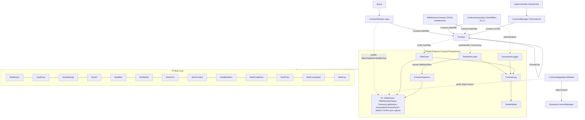
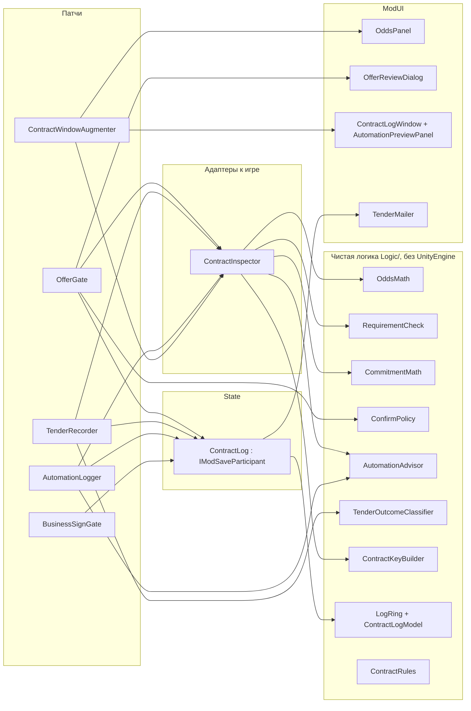
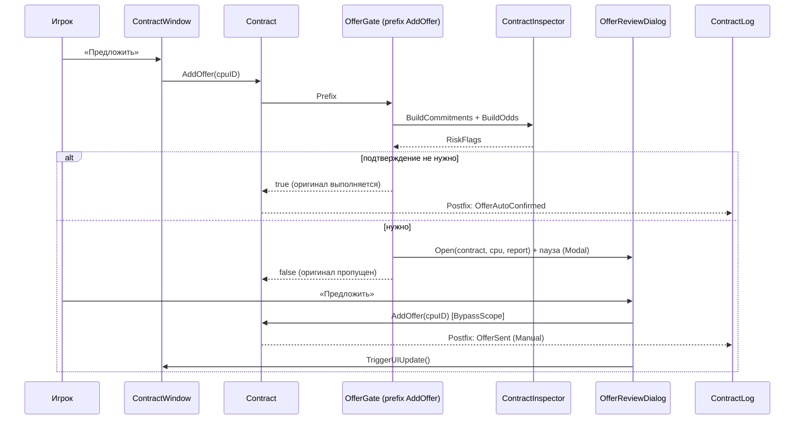
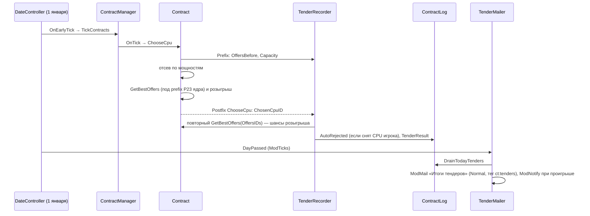
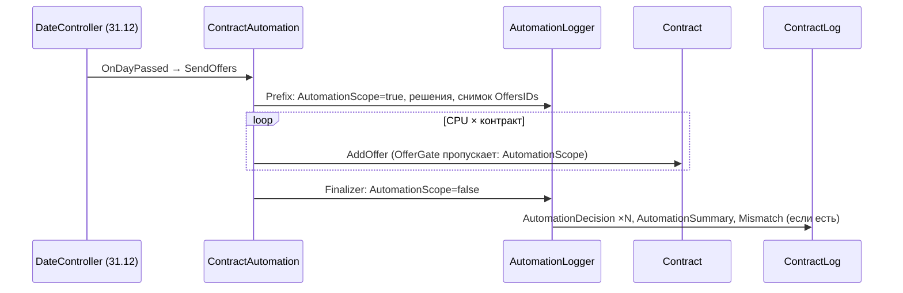

# Design: contract-transparency

## Document Information

- **Feature Name**: contract-transparency
- **Version**: 0.2
- **Date**: 2026-10-10
- **Author**: Dex719
- **Status**: Draft v0.2 — одобрено к реализации владельцем 2026-10-10
- **Reviewers**: владелец проекта
- **Related Documents**: `requirements.md` (FR-1…FR-14, NFR-1…NFR-7), `tasks.md`, `.kiro/steering/context.md`, `.kiro/steering/owner-decisions.md`, решения `0002` (Harmony), `0003` (тулчейн: Roslyn `csc`, мини-раннер), `0004` (ModSave), `0005` (ModUI), `0006` (контент JSON), спека `mod-framework` (v0.2)

## Overview

Фича почти полностью **только читает** состояние игры. Она перехватывает пять точек контрактной системы:

- ручную отправку предложения: prefix на `Contract.AddOffer` — единственная точка, где фича меняет поток (откладывает вызов до подтверждения);
- прогон автоматики: prefix и финализатор на `ContractAutomation.SendOffers`;
- розыгрыш: prefix и postfix на `Contract.ChooseCpu`. Точные шансы, с которыми игра разыграла контракт, postfix получает повторным вызовом приватного `Contract.GetBestOffers`; патча на `GetBestOffers` у фичи нет — метод закреплён ядром (P23), `ModHooks` отклонил бы такой патч;
- окно контрактов: postfix на `ContractWindow.Start` и `ContractWindow.UpdateProbabilityText`;
- подпись BusinessContract: prefix на `ContractNegotiationWindow.SignContract`.

Расчёты вынесены в чистые статические классы без ссылок на Unity и игру (`Logic/`). Их покрывают тесты мини-раннера (`python mod/build.py --tests`). Адаптер `ContractInspector` собирает входные данные из объектов игры. Источник истины — сама игра: шансы берутся вызовом `Contract.GetBestOffers`, допуск IPS — из поля `Contract.mipsToleranceMultiplier`, итог требований сверяется с `Contract.FailsAtAnyRequirement`, разбивка множителей модов — из `ModModifiers.Explain` с контрактом в контексте.

### Design Goals
- Объяснить каждое число контрактов формулой игры. Расхождения ловятся и логируются, а не скрываются (FR-12).
- Не менять баланс и случайность: тот же сейв с фичей и без неё даёт одинаковые розыгрыши (кроме отложенного ручного предложения).
- Ноль работы в обычном игровом дне. Вся работа — по клику игрока, раз в год (автоматика и розыгрыш) или при сохранении и загрузке.
- Любой сбой — откат к ванильному поведению.

### Key Design Decisions

- **D1. Перехват ручного предложения — prefix на `Contract.AddOffer`, а не патч лямбды окна.**
  - Источник вызова определяем так: CPU принадлежит игроку (`Cpu.Company.IsPlayer`); не идёт прогон автоматики (флаг ставит prefix `ContractAutomation.SendOffers`); не стоит флаг обхода (`OfferGate.BypassScope`).
  - После подтверждения мод сам вызывает `Contract.AddOffer` под флагом обхода и обновляет окно через публичный `ContractWindow.TriggerUIUpdate`.
  - *Отвергнуто:* патч `ContractWindow.<Start>b__50_3` — имя лямбды сгенерировано компилятором и хрупко. Подмена `ButtonUI.OnClick` у `sendOfferButton` — нужна рефлексия по приватному полю и порядок подписчиков.
- **D2. Шансы — вызовом приватного `Contract.GetBestOffers`, а не копией формулы; разбивка множителей — `ModModifiers.Explain` с контрактом.**
  - Так в разбор автоматически попадают все провайдеры канала `contract.signChance`. Prefix ядра (P23) кладёт контракт в `ModifierContext.Contract` при любом вызове `GetBestOffers`, в том числе из мода, поэтому контрактозависимые множители (например, предпочтение OEM из `platform-generations`) видны так же, как в розыгрыше. Копия формулы (`OddsMath.VanillaChance`) нужна только для «ванильного» столбца и для сверки.
  - *Отвергнуто:* только своя копия — расходится с модами и с будущими правками. Обход через рефлексию поля контекста — не нужен после доработки ядра.
- **D3. Итоги тендера — prefix и postfix на `Contract.ChooseCpu`; шансы розыгрыша — повторным вызовом `GetBestOffers`.**
  - Prefix `ChooseCpu` снимает копию `OffersIDs` до отсева и числа мощностей. Postfix читает `ChosenCpuID` и пересобирает список шансов тем же `GetBestOffers(OffersIDs)`: после отсева `OffersIDs` уже тот список, по которому игра разыграла контракт, а метод не меняет состояние контракта.
  - *Отвергнуто:* postfix на `Contract.GetBestOffers` — цель закреплена за ядром (P23, резерв «канал»): фича стала бы `Unavailable`. Хук на `ContractManager.PromoteContractToActive` / `RemoveContract` — не видит проигравших и отсев; `RemoveContract` вызывается до `Terminated = true` (CODEMAP, Gotchas).
- **D4. Журнал — в боковом файле `ModSave` с кольцевым буфером; версию секции ведёт ядро (`_schema`).**
  - *Отвергнуто:* поле в `Player` / `PlayerPreferences` — запрещено конвенцией. Отдельный файл журнала — лишняя синхронизация с сейвом. Своё поле `schema` в DTO — версию секции пишет и читает ядро.
- **D5. Режим подтверждения — глобальная настройка `ModSettings`, а не сейв.**
  - Это предпочтение игрока, а не состояние партии.
  - *Отвергнуто:* хранить в секции `ModSave` — режим «прыгал» бы между сейвами.
- **D6. Одна сводка в день итогов вместо всплывающего окна на каждый проигрыш (решение владельца).**
  - Почти все розыгрыши проходят 1 января (пакет контрактов создаётся на `OnYearPassed`, рассмотрение — через 12 месяцев). Десятки окон подряд мешают. Письмо — приоритета `Normal` с тегом `ct:tenders:<yyyy-MM-dd>` и многоразовым действием «Открыть журнал» (`ModMailAction`); блоков ID писем нет.
- **D7. Ключ контракта — составной `ContractKey`.**
  - У `Contract` нет уникального ID: `ContractID` — индекс шаблона в списке десятилетия (`ContractInstantiator.AddNewContracts`), по `CODEMAP` он ещё и зависит от порядка пула.
  - *Отвергнуто:* ссылка на объект `Contract` — не переживает загрузку.
- **D8. Подтверждение подписи BusinessContract — через `ModUI.Confirm`, подтверждение предложения — собственное модальное окно.**
  - У подписи сделки нет переключателя «больше не спрашивать» и таблицы рисков, хватает текста и пары кнопок. Предложение показывает много чисел, предупреждения и переключатель, поэтому ему нужно окно `WindowTemplate.Modal`.
  - *Отвергнуто:* второе собственное окно для сделок — лишний код.
- **D9. Компании в чистой логике — строковые ключи `ModCompanies.KeyOf`.**
  - `ICompany` не объявляет `SaveID` (он у `ISaveID`), а ключ `player` / `ai:<UniqueID>` уже стабилен и пригоден для журнала. Если ключа нет (`null`), адаптер подставляет `sid:<ISaveID.SaveID>`.

## Architecture

### System Context



### High-Level Architecture



### Используемые сервисы PTMod.Core

| Сервис | Для чего |
|---|---|
| `ModHooks` | Регистрация патчей из таблицы ниже, изоляция ошибок (`Guard`), самопроверка целей и приватных членов; `Raise` для событий фичи |
| `ModSettings` | `confirmMode`, `showActualProbability`, `notifyTenderLoss`, `logAutomation` (`ctx.Param`); переключатель фичи ведёт хаб |
| `ModSave` | Секция `contract-transparency` (`IModSaveParticipant`): журнал, итоги тендеров, счётчики. Версию секции (`_schema`) пишет и читает ядро |
| `ModContent` | `Content/contract-transparency/rules.json`: пороги рисков, лимиты журнала, порог маржи ИИ |
| `ModUI` | Окна на шаблоне окна игры, `ButtonUI`, `ToggleUI`, `DropdownUI`, `InfoText`, `ModUI.Confirm` (подпись сделки), `ModUI.Tooltip`, хаб «Моды». Пауза — `WindowTemplate.Modal` |
| `ModMail` | Письмо-сводка «Итоги тендеров»: `Tag = ct:tenders:<дата>`, `MailPriority.Normal`, действие `open-log` (`ModMailAction`), `RegisterActionHandler`, `Find` по тегу |
| `ModNotify` | Уведомление о проигранных тендерах; уведомление об аварийном отключении фичи делает ядро |
| `ModL10n` | Строки `ct.*` (ru, en) |
| `ModModifiers` | `ModModifiers.Explain("contract.signChance", {Company, CompanyKey, Cpu, Contract})` — разложение множителя шанса по фичам (`AppliedModifier.FeatureId`, `ReasonKey`, `ReasonArgs`, `Multiplier`; признаки `IsBalanceCapped`, `IsFuseCapped`) |
| `ModCompanies` | `KeyOf(ICompany)` — ключи компаний в логике и журнале |
| `ModConditions` | Типы предикатов `ct.offersSent` и `ct.tendersWon` с параметром `atLeast` (FR-14) |
| `ModTicks` | `ctx.OnTick(TickPhase.DayPassed, …)`: сброс буфера итогов в сводку; `IsFastForwarding`, `IsLoading`, `IsBatchRun` — защиты патчей |
| `ModLog` | Расхождения с игрой, исключения, замеры времени |

### Technology Stack

| Слой | Технология | Обоснование |
|---|---|---|
| Патчи | Harmony 2.3.x (через `ModHooks`) | Решение 0002; нужен доступ к приватным `ChooseCpu`, `SendOffers`, `SignContract` |
| Чистая логика | C# latest, общее подмножество API .NET Framework 4.8 и `mscorlib` Unity (без `init`, `record`, `Index`, `Range`), без ссылок на `UnityEngine` | Решение 0003; тестируется мини-раннером в `mod/tests/PTMod.Tests/ContractTransparency/` без игры |
| UI | `ModUI` (клоны окон игры) | Решение 0005 |
| Данные | `ModSave` (JSON) + `ModContent` (JSON) | Решения 0004, 0006 |

## Components and Interfaces

Пространство имён: `PTMod.Features.ContractTransparency` (файлы в `mod/src/PTMod/Features/ContractTransparency/`, чистая логика — в `.../Logic/`). Типы игры: `ProcessorTycoon.ContractSystem.Contract`, `ProcessorTycoon.Hardware.Cpu`, `ProcessorTycoon.CompanySystem.ICompany`.

> API `PTMod.Core` — по `mod-framework/design.md` v0.2 (`IModFeature`, `FeatureContext`, `[ModPatch]`, `ModHooks.Guard`/`Raise`, `IModSaveParticipant`, `ModTicks`/`TickPhase`, `ModSettings`/`ParamSpec`, `ModContent.LoadConfig`, `ModUI.CreateWindow`/`Confirm`, `ModMail.Send`/`RegisterActionHandler`, `ModNotify.Show`, `ModModifiers.Explain`, `ModConditions.Register`, `ModCompanies.KeyOf`). Обращения к фреймворку собраны в `ContractTransparencyFeature` и адаптерах, так что изменение API правится в одном месте.

### Component 1: ContractTransparencyFeature

**Purpose**: точка входа фичи.

**Responsibilities**:
- регистрирует патчи, настройки, секцию сохранения, предикаты, обработчик действий письма и пункт хаба;
- включает и выключает фичу на лету (FR-13).

```csharp
[PTMod.Core.ModFeature]
public sealed class ContractTransparencyFeature : PTMod.Core.IModFeature
{
    public const string FeatureId = "contract-transparency";
    public string Id => FeatureId;
    public string NameKey => "ct.hub.name";
    public string DescriptionKey => "ct.hub.description";
    public string[] DependsOn => new string[0];         // жёстких зависимостей нет; связи с platform-generations, press-reviews мягкие
    public bool EnabledByDefault => true;
    public bool SupportsHotToggle => true;              // FR-13.1
    public static ContractTransparencyFeature Instance { get; private set; }
    public bool IsActive => PTMod.Core.ModFeatures.IsActive(FeatureId);  // Enabled и не Faulted
    public ContractRules Rules { get; private set; }    // ModContent.LoadConfig(FeatureId, "rules.json", 1)
    public ContractLog Log { get; private set; }        // IModSaveParticipant
    /// ctx.Patch(typeof(OfferGate)), ctx.Patch(typeof(TenderRecorder)), ctx.Patch(typeof(AutomationLogger)),
    /// ctx.Patch(typeof(ContractWindowAugmenter)), ctx.Patch(typeof(BusinessSignGate));
    /// ctx.OnTick(TickPhase.DayPassed, TenderMailer.OnDayPassed); ctx.SaveParticipant(Log);
    /// ctx.Param(...) ×4 (см. «Настройки»); ctx.HubPage("ct.hub.name", BuildHubPage);
    /// ModMail.RegisterActionHandler(FeatureId, TenderMailer.OnMailAction);
    /// ModConditions.Register("ct.offersSent", FeatureId, ...), ModConditions.Register("ct.tendersWon", FeatureId, ...)
    public void Register(PTMod.Core.FeatureContext ctx);
    public void OnEnabled();                            // показать кнопки «Почему?» и «Журнал» в открытом окне
    public void OnDisabled();                           // FR-13.4: закрыть экран проверки, скрыть кнопки
}
```

Сбои патчей учитывает `ModHooks.Guard`. По достижении `hooks.faultThreshold` (5) фича получает состояние `Faulted` — собственного счётчика у фичи нет (NFR-2). Патчи не пересоздаются при выключении: ядро снимает и ставит их само (`SupportsHotToggle`).

### Component 2: OddsMath (чистая логика)

**Purpose**: шансы и фактическая вероятность по алгоритму `Contract.ChooseCpu` / `Contract.GetBestOffers` / `Contract.CpuOffer.DefineChance`.

```csharp
public struct OfferInput
{
    public string CompanyKey;   // ModCompanies.KeyOf(cpu.Company); если null — "sid:" + ISaveID.SaveID
    public int CpuId;           // Cpu.SaveID
    public float Ips;           // Cpu.Ips
    public int FirstSeenIndex;  // порядок первого появления компании в OffersIDs (тай-брейк)
}

public struct OfferOdds
{
    public string CompanyKey;
    public int CpuId;
    public float Ips;
    public int VanillaChance;            // clamp(round(100*Ips/Sum),1,100)
    public int GameChance;               // из Contract.GetBestOffers (с модами); = VanillaChance если нет данных
    public int DrawPosition;             // 0 = первое в очереди
    public double ActualProbability;     // P_i
}

public static class OddsMath
{
    /// Лучший CPU каждой компании; порядок компаний = порядок первого появления (как в GetBestOffers).
    public static List<OfferInput> BestPerCompany(IReadOnlyList<OfferInput> offers);
    /// Правило Contract.ChanceToSign: удалить предложения компании кандидата, добавить кандидата.
    public static List<OfferInput> WithCandidate(IReadOnlyList<OfferInput> offers, OfferInput candidate);
    public static int VanillaChance(float ips, float sumBestIps);
    /// Стабильная сортировка по убыванию IPS (LINQ OrderByDescending стабилен).
    public static List<OfferOdds> DrawOrder(IReadOnlyList<OfferInput> best, IReadOnlyList<int> gameChances);
    /// P_i = q_i * Π_{j<i}(1-q_j) / (1 - Π_all(1-q_j)); если Π_all = 1 (все q = 0) — все P = 0.
    public static double[] SequentialProbabilities(IReadOnlyList<int> chancesInDrawOrder);
    /// IPS кандидата для целевого шанса s ∈ (0,1): s/(1-s) * sumOthersBestIps.
    public static float IpsForChance(double targetChance01, float sumOthersBestIps);
    /// Пессимистичная оценка (FR-11): добавить возможных участников и пересчитать P.
    public static double PessimisticProbability(IReadOnlyList<OfferInput> best, IReadOnlyList<OfferInput> potential, string candidateCompanyKey, int candidateCpuId);
}
```

### Component 3: RequirementCheck (чистая логика)

**Purpose**: три проверки `Contract.AddOffer` / `Contract.FailsAtAnyRequirement` / `Contract.IsRequestedPackage` с числами (FR-1).

```csharp
public enum RequirementKind { Ips, Power, Package }

public struct RequirementResult
{
    public RequirementKind Kind;
    public bool Passed;
    public float Actual, Limit, Required;   // Ips: Actual=cpu.Ips, Limit=MinIps*tol, Required=MinIps
    public float Gap, GapPercent;           // недостача/превышение
}

public static class RequirementCheck
{
    public static RequirementResult Ips(float cpuIps, float minIps, float tolerance);
    public static RequirementResult Power(float cpuPower, float maxPower);
    /// packageType: 0 Any, 1 DIP/PLCC, 2 PGA/LGA (Contract.PackageType)
    public static RequirementResult Package(int packageType, bool isDip, bool isPlcc, bool isPgaOrLga);
    public static bool AnyFailed(IReadOnlyList<RequirementResult> results);
}
```

### Component 4: CommitmentMath (чистая логика)

**Purpose**: обязательства, прибыль, мощности, штрафы и флаги риска для экрана проверки (FR-3).

```csharp
[System.Flags]
public enum RiskFlags
{
    None = 0, CapacityShortNow = 1, Overcommit = 2, NegativeProfit = 4, BelowAutomationMargin = 8,
    LowActualChance = 16, BreakFineExceedsCash = 32, AutoRejectWillWithdraw = 64
}

public struct CommitmentInput
{
    public int Units; public float PaymentPerUnit, FinePerUnit;
    public float RealUnitCostAtPayment;      // Cpu.RealUnitCostWithNewPrice(PaymentPerUnit)
    public int RequiredLines;                // ProductionMath.RequiredProductionLines(cpu, Units)
    public int CapacityLines;                // FactoryBase.ProductionCapacity производителя
    public int ContractedLines;              // ContractHelper.ContractedProductionLines(manufacturer.Owner)
    public int PendingOfferLines;            // ContractHelper.FutureProductionLinesDemand(owner) без этого контракта
    public int TermDays;                     // DateController.DaysUntil(Acceptance, Termination)
    public int TermMonths;
    public bool AutomateRejection;           // Player.AutomateRejection («Автоотмена предложений»)
    public int AutomationMarginPercent;      // Player.ContractProfitMargin
    public float CompanyCash;                // ICompany.MoneyAmount
    public double ActualProbability;         // из OddsMath
}

public struct CommitmentReport
{
    public float MonthlyProfit, TermProfit, Margin;
    public int FreeLinesNow, FreeLinesAfterPending, LinesShortNow;
    public float DailyUnits, BreakFineAtStart, DailyShortfallFine;
    public RiskFlags Risks;
}

public static class CommitmentMath
{
    public static CommitmentReport Evaluate(CommitmentInput input, ContractRules rules);
}
```

### Component 5: ConfirmPolicy и AutomationAdvisor (чистая логика)

```csharp
public enum ConfirmMode { Always, Risky, Never }   // 0, 1 (по умолчанию), 2

public static class ConfirmPolicy
{
    public static bool NeedsConfirmation(ConfirmMode mode, RiskFlags risks); // Always:true; Risky: risks!=None; Never:false
}

public enum AutomationDecision
{
    WillOffer, AlreadyOffered, SkippedRetired, SkippedNotForContracts,
    SkippedMargin, RejectedByRequirements, AutomationOff
}

public struct AutomationInput
{
    public bool AutomateContracts, CpuRetired, CpuSellOnContracts, AlreadyOffered, FailsRequirements;
    public float PaymentPerUnit, RealUnitCostAtPayment;
    public int MarginPercent;
}

public static class AutomationAdvisor
{
    /// Порядок проверок как в ContractAutomation.SendOffers + молчаливый отсев Contract.AddOffer.
    public static AutomationDecision Decide(AutomationInput input, out float margin);
}
```

### Component 6: ContractInspector (адаптер к игре)

**Purpose**: собрать входные данные из `Contract`/`Cpu`, вызвать приватные члены игры, сверить с публичными методами (FR-12), получить разбивку множителей у ядра.

```csharp
public sealed class ContractInspector
{
    public bool IsAvailable { get; }                         // все приватные члены найдены
    public float ToleranceMultiplier(Contract contract);     // поле Contract.mipsToleranceMultiplier
    public List<OfferInput> CurrentOffers(Contract contract); // OffersIDs -> OfferInput (null CPU -> пропуск + ModLog)
    /// Вызов Contract.GetBestOffers(List<int>) через AccessTools; чтение Contract.CpuOffer.Cpu/Chance.
    /// Вызов идёт под prefix P23 ядра, поэтому ModifierContext.Contract заполнен, как в розыгрыше.
    public List<KeyValuePair<int, int>> GameChances(Contract contract, List<int> offerIds); // (cpuId, chance)
    public OddsReport BuildOdds(Contract contract, Cpu candidate);          // FR-2 (+сверка с ChanceToSign, Explain)
    public RequirementReport BuildRequirements(Contract contract, Cpu cpu); // FR-1 (+сверка с FailsAtAnyRequirement)
    public CommitmentReport BuildCommitments(Contract contract, Cpu cpu, double actualProbability); // FR-3
    public List<OfferInput> PotentialAiBidders(Contract contract);          // FR-11
    public static string CompanyKeyOf(ICompany company);      // ModCompanies.KeyOf или "sid:<ISaveID.SaveID>"
    public static string ContractKey(Contract contract);      // ContractKeyBuilder.Build(Company, AcceptanceDate, Units, PaymentPerUnit, ContractType)
    public static string ContractLabel(Contract contract);    // "Apple — Computer, 52 000 шт./мес."
}

public sealed class OddsReport
{
    public List<OfferOdds> Rows;           // в порядке розыгрыша
    public int CandidateGameChance;        // = ChanceToSign(cpu) после сверки
    public double CandidateActual;
    public float ModMultiplier;            // GameChance / VanillaChance кандидата
    public List<ModifierSourceRow> ModSources; // из ModifierBreakdown: FeatureId, ReasonKey, ReasonArgs, Multiplier
    public bool ModsCapped;                // IsBalanceCapped || IsFuseCapped -> «(ограничено)»
    public float IpsFor50, IpsForFirstInQueue;
    public List<int> ShadowedOwnCpuIds;
    public bool MismatchWithGame;          // FR-12.2
}
```

### Component 7: OfferGate (патч)

**Purpose**: двухшаговое подтверждение ручных предложений (FR-3, FR-4).

```csharp
internal static class OfferGate
{
    [System.ThreadStatic] internal static bool BypassScope;      // мод сам вызывает AddOffer
    internal static bool AutomationScope;                        // ставит AutomationLogger
    /// Prefix Contract.AddOffer(int cpuID). false = не выполнять оригинал. Тело — в ModHooks.Guard(…, fallback: true).
    [PTMod.Core.ModPatch(typeof(Contract), "AddOffer", PTMod.Core.PatchKind.Prefix, Priority = 800 /* Harmony Priority.First */)]
    internal static bool Prefix(Contract __instance, int cpuID);
    /// Postfix Contract.AddOffer: если OffersIDs вырос — запись "отправлено" и событие OfferSent.
    internal static void Postfix(Contract __instance, int cpuID, bool __state);
    internal static void ConfirmAndSend(Contract contract, int cpuId, OfferSource source);
}
public enum OfferSource { Manual, ManualAutoConfirmed, Automation, Api }
```

Логика prefix:

1. Если фича неактивна, идёт обход, активна автоматика или CPU не игрока — вернуть `true`.
2. Иначе построить `RiskFlags` через `ContractInspector`.
3. Если `ConfirmPolicy.NeedsConfirmation(...)` = false — вернуть `true` и пометить источник `ManualAutoConfirmed`.
4. Иначе открыть `OfferReviewDialog` и вернуть `false`.
5. Любое исключение — вернуть `true` (NFR-2).

### Component 8: TenderRecorder (патчи)

**Purpose**: итоги тендеров и журнал автоотмены предложений (FR-5, FR-7).

```csharp
internal static class TenderRecorder
{
    internal static ChooseCpuCapture Current;   // не null только внутри ChooseCpu
    [PTMod.Core.ModPatch(typeof(Contract), "ChooseCpu", PTMod.Core.PatchKind.Prefix)]
    internal static void ChooseCpuPrefix(Contract __instance);   // копия OffersIDs, мощности по каждому CPU; выход при IsFastForwarding/IsLoading
    [PTMod.Core.ModPatch(typeof(Contract), "ChooseCpu", PTMod.Core.PatchKind.Postfix)]
    internal static void ChooseCpuPostfix(Contract __instance);  // ChosenCpuID; отсев = до \ после; шансы = Inspector.GameChances(contract, OffersIDs); TenderResult, если участвовал игрок
}

internal sealed class ChooseCpuCapture
{
    public List<int> OffersBefore;
    public Dictionary<int, CapacitySnapshot> Capacity; // cpuId -> (required, contracted, capacity, manufacturerName)
    public List<KeyValuePair<int, int>> DrawChances;   // заполняет postfix повторным вызовом GetBestOffers
}

/// Чистая логика (Logic/TenderOutcomeClassifier.cs): исход по входным данным без обращения к игре.
public static class TenderOutcomeClassifier
{
    public static TenderOutcome Classify(TenderFacts facts);    // Won; Lost: outbid / autoReject / shadowed / retired; Void: noOffers / retired
}
```

### Component 9: AutomationLogger (патч)

```csharp
internal static class AutomationLogger
{
    internal static void SendOffersPrefix(ContractAutomation __instance, out AutomationRun __state); // решения AutomationAdvisor + снимок OffersIDs
    internal static System.Exception SendOffersFinalizer(System.Exception __exception, AutomationRun __state); // сброс AutomationScope, сверка до/после, записи журнала
    internal static List<AutomationPreviewRow> Preview();     // FR-9: те же решения без отправки
}
```

### Component 10: ContractLog и TenderMailer

Модель журнала — чистая логика (тестируется без Unity), `ContractLog` — тонкий адаптер к `ModSave`.

```csharp
// Logic/ContractLogModel.cs
public sealed class ContractLogModel
{
    public void Reset();                                 // новая игра, нет секции, секция новее
    public void Add(LogEntry entry);                     // кольцевой буфер rules.log.capacity (LogRing)
    public void AddTender(TenderResultDto tender);       // + буфер "новые итоги сегодня"
    public IReadOnlyList<LogEntry> Query(LogFilter filter);
    public IReadOnlyList<TenderResultDto> DrainTodayTenders();
    public ContractTransparencySave ToSave();
    public void FromSave(ContractTransparencySave save, int schema, ContractRules rules); // миграция по schema от ядра, обрезка по лимитам
}
public enum LogFilter { All, Manual, Automation, AutoReject, Tenders, Business }

public sealed class ContractLog : PTMod.Core.IModSaveParticipant
{
    public string SectionId => "contract-transparency";
    public int SchemaVersion => 1;                       // поле _schema пишет и читает ядро
    public ContractLogModel Model { get; }
    public void ResetToDefaults();                                  // новая игра, нет секции, секция новее
    public void Read(PTMod.Core.Logic.Json.JsonObject section, int schema); // ModJson.Bind<ContractTransparencySave> + Model.FromSave
    public PTMod.Core.Logic.Json.JsonObject Write();                // ModJson.From(Model.ToSave()); БЕЗ _schema
}

internal sealed class TenderMailer
{
    /// ctx.OnTick(TickPhase.DayPassed): если DrainTodayTenders непуст — ModMail.Send (Tag ct:tenders:<yyyy-MM-dd>,
    /// Priority Normal, Actions [open-log]) и ModNotify при проигрышах. Показ в перемотку, загрузку и пакетный прогон откладывает ядро.
    internal void OnDayPassed();
    /// ModMail.RegisterActionHandler: actionId "open-log" -> ContractLogWindow.Open(LogFilter.Tenders); письмо не закрывается.
    internal void OnMailAction(PTMod.Core.ModMailRecord mail, string actionId);
}
```

### Component 11: UI

| Окно / элемент | Шаблон и компоненты `ModUI` | Открывается |
|---|---|---|
| `ContractWindowAugmenter` | Кнопки «Почему?» и «Журнал» — `ModUI.Button` в контейнере рядом с `ContractWindow.probabilityText` («Вероятность:») | postfix `ContractWindow.Start` |
| `OddsPanel` | `ModUI.CreateWindow("ct.odds", WindowTemplate.Panel, "ct.odds.title", 560×520)`; `ModUI.Info` — строки требований; `ModUI.ScrollView` + `ModUI.VerticalList` — таблица предложений; блок «что изменить»; блок «возможные участники» (FR-11); `ModUI.Tooltip` на формулах и на строках источников множителя | «Почему?» |
| `OfferReviewDialog` | `ModUI.CreateWindow("ct.review", WindowTemplate.Modal, "ct.review.title", 600×560)` (модальный шаблон держит паузу); `ModUI.Info` обязательств; список предупреждений; `ModUI.Toggle` «Больше не спрашивать для безопасных»; `ModUI.Button` «Предложить» (`ButtonStyle.CallToAction`), «Отмена» | prefix `Contract.AddOffer` |
| `ContractLogWindow` | `ModUI.CreateWindow("ct.log", WindowTemplate.Panel, "ct.log.title", 720×560)`; `ModUI.Dropdown` фильтра; `ModUI.ScrollView` записей; панель подробностей; вкладка «Предпросмотр автоматики» с кнопкой «Обновить» | «Журнал», хаб «Моды», действие `open-log` в письме (`ModMail.RegisterActionHandler`) |
| Подтверждение подписи сделки | `ModUI.Confirm` с заголовком `ct.business.title`, текстом условий и подписью «Подписать» (`yesKey` = `ct.business.sign`); `onYes` вызывает исходную подпись под флагом `BusinessSignGate.BypassScope`, `onNo` ничего не делает; окно переговоров остаётся открытым | prefix `ContractNegotiationWindow.SignContract` |
| Настройки | `ctx.HubPage`: `ModUI.Toggle` ×3, `ModUI.Dropdown` режима (FR-13.3), кнопка «Контракты: журнал» | хаб «Моды» |

Тема — через `ThemeManager.Instance` (переприменение темы на смену `ThemeManager.OnThemeChanged` делает ядро); цвета плюса и минуса — `Colors.Instance.DynamicPositiveColor` / `DynamicNegativeColor`, как в `ContractWindow.UpdateTheme`.

### Component 12: ContractTransparencyEvents и предикаты (Could, FR-14)

```csharp
public static class ContractTransparencyEvents
{
    public static event System.Action<string, int, OfferSource> OfferSent;        // contractKey, cpuId, источник
    public static event System.Action<TenderResultDto> TenderResolved;            // не в перемотке и не при загрузке
    // Поднимаются через PTMod.Core.ModHooks.Raise: исключение подписчика изолируется и засчитывается его фиче.
}
```

Предикаты `ct.offersSent` и `ct.tendersWon` (параметр `atLeast`) регистрируются в `Register` через `ModConditions.Register(type, FeatureId, factory)`; имя с префиксом `ct.` обязательно (`ModIds.IsPredicateNameAllowed`), иначе ядро отклонит регистрацию. Счётчики `offersSent` и `tendersWon` лежат в секции `ModSave`.

## Патчи Harmony

Ни одна цель не закреплена за ядром (`ModHooks.IsReserved` возвращает `false`): `Contract.AddOffer`, `Contract.ChooseCpu`, `ContractAutomation.SendOffers`, `ContractWindow.*`, `ContractNegotiationWindow.SignContract` свободны.

| Цель (Class.Method игры) | Тип | Что меняет | Порядок / конфликты |
|---|---|---|---|
| `Contract.AddOffer(int)` | prefix | Ручное предложение игрока при нужном подтверждении не выполняется, открывается экран проверки (FR-3, FR-4). Остальные вызовы проходят без изменений | `Priority.First`: решение до чужих prefix'ов. При ошибке — `true`. Обход повторного вызова — `OfferGate.BypassScope` |
| `Contract.AddOffer(int)` | postfix | Запись «отправлено» и событие `OfferSent`, если `OffersIDs` вырос (FR-6, FR-14) | Только чтение |
| `ContractAutomation.SendOffers()` (private) | prefix | Ставит `AutomationScope`, считает решения, снимает `OffersIDs` (FR-6) | Только чтение + флаг |
| `ContractAutomation.SendOffers()` (private) | finalizer | Снимает `AutomationScope` даже при исключении; сверяет до и после; пишет журнал | Возвращает исходное исключение (не глушит ошибки игры) |
| `Contract.ChooseCpu()` (private) | prefix | Снимок `OffersIDs` и мощностей (FR-5, FR-7) | Только чтение |
| `Contract.ChooseCpu()` (private) | postfix | Итог тендера, шансы розыгрыша (повторный вызов `GetBestOffers`), отсев, буфер сводки | Только чтение |
| `ContractWindow.Start()` (private) | postfix | Добавляет кнопки «Почему?» и «Журнал», запоминает экземпляр окна | UI; при ошибке кнопок нет, игра работает |
| `ContractWindow.UpdateProbabilityText()` (private) | postfix | Дописывает «(факт. N %)» в `probabilityText` (FR-2.8) | Только если `cpuFailedAtAnyRequirement` = false |
| `ContractNegotiationWindow.SignContract()` (private) | prefix | Откладывает подпись до подтверждения `ModUI.Confirm` (FR-10) | Обход — `BusinessSignGate.BypassScope` |
| `ContractNegotiationWindow.SignContract()` (private) | postfix | Запись «Сделка подписана» | Только чтение |

Не патчится: `Contract.ChanceToSign` (только вызывается), `Contract.GetBestOffers` (закреплён ядром, P23; фича его вызывает через `AccessTools`), `Contract.CpuOffer.DefineChance` (P8), `ContractManager.*`, `ContractSeller.*`, `AIBehaviourContract.OnTick`, `DateController.NextMonth` (P21: признак пакетного прогона даёт `ModTicks.IsBatchRun`).

## Подписки на события

| Событие | Обработчик | Защиты (перемотка/загрузка/пакетный прогон) |
|---|---|---|
| `ctx.OnTick(TickPhase.DayPassed, …)` (`TickOptions.None`) | `TenderMailer.OnDayPassed`: сводка за день | Не срабатывает при `ModTicks.IsFastForwarding` и `ModTicks.IsLoading` (поведение `ModTicks` по умолчанию). В пакетном прогоне вызывается по дням, а показ письма и уведомления ядро откладывает до `ModTicks.BatchEnded` |
| `IModSaveParticipant.Read` (ядро, на `SaveHandler.OnLoaded`) | `ContractLog.Read` | Нет секции, новая игра или секция новее (`_schema` больше `SchemaVersion`) — `ResetToDefaults` (пустой журнал); будущая секция сохраняется ядром нетронутой |
| `IModSaveParticipant.Write` (ядро, после `SaveSystem.Save`, P12 `mod-framework`) | `ContractLog.Write` | — |
| `ModMail.RegisterActionHandler` | `TenderMailer.OnMailAction`: действие `open-log` | Письмо не закрывается; при выключенной фиче ядро делает кнопки неактивными |
| `ThemeManager.OnThemeChanged` (подписку и переприменение темы ведёт ядро) | Перекраска открытых окон фичи | Только если окно открыто |
| `ModSettings.Changed` / `ModFeatures.StateChanged` | Применение режима; `OnDisabled` закрывает открытый экран проверки (FR-13.4) | — |

`TenderRecorder` дополнительно сам проверяет `ModTicks.IsFastForwarding` и `ModTicks.IsLoading`: патчи `ChooseCpu` срабатывают и в перемотке, но там ничего не пишут (FR-5.5).

## Data Models

### DTO состояния (секция ModSave)

Поля версии в секции нет: `_schema` пишет и читает ядро.

```csharp
[System.Serializable] public sealed class ContractTransparencySave
{
    public List<LogEntry> log = new List<LogEntry>();
    public List<TenderResultDto> tenders = new List<TenderResultDto>();
    public int offersSent;      // FR-14
    public int tendersWon;      // FR-14
}

[System.Serializable] public sealed class LogEntry
{
    public string date;         // "1986-01-01"
    public string type;         // OfferSent | OfferCancelledOnReview | OfferAutoConfirmed | AutomationDecision | AutomationSummary | AutoRejected | TenderResult | BusinessSigned | Mismatch
    public string source;       // Manual | Automation | Api | Game
    public string contractKey;
    public string contractLabel;
    public int cpuId;
    public string cpuName;
    public string reasonKey;    // ключ ModL10n, например "ct.reason.margin"
    public List<KV> data = new List<KV>(); // числа для подробностей
}
[System.Serializable] public sealed class KV { public string k; public string v; }

[System.Serializable] public sealed class TenderResultDto
{
    public string contractKey, contractLabel, date;
    public string outcome;          // Won | Lost | Void
    public string reasonKey;        // ct.tender.outbid | ct.tender.autoReject | ct.tender.shadowed | ct.tender.retired | ct.tender.noOffers
    public int playerCpuId; public string playerCpuName;
    public int playerGameChance; public float playerActual;
    public int winnerCpuId; public string winnerCompany, winnerCpuName;
    public List<OfferRowDto> offers = new List<OfferRowDto>();
    public List<PrunedRowDto> pruned = new List<PrunedRowDto>();
}
[System.Serializable] public sealed class OfferRowDto { public string company, cpu; public float ips; public int chance; public float actual; }
[System.Serializable] public sealed class PrunedRowDto { public string company, cpu; public int required, contracted, capacity; }
```

**Validation Rules**: версию секции проверяет ядро: `_schema` больше `SchemaVersion` — ядро сохраняет секцию как есть (passthrough) и вызывает `ResetToDefaults`, фича работает с пустым журналом и пишет `ModLog`. Строки обрезаются до 128 символов. `log.Count` ≤ `rules.log.capacity`. Итоги старше `tenderHistoryYears` удаляются при загрузке.

### Пример секции бокового файла

```json
{
  "schema": 1,
  "features": {
    "contract-transparency": {
      "_schema": 1,
      "offersSent": 7,
      "tendersWon": 3,
      "log": [
        {
          "date": "1985-12-31", "type": "AutomationDecision", "source": "Automation",
          "contractKey": "Apple|1986-1|52000|299|1", "contractLabel": "Apple — Computer, 52 000/мес.",
          "cpuId": 4108, "cpuName": "Z-286", "reasonKey": "ct.reason.margin",
          "data": [ {"k":"margin","v":"0.35"}, {"k":"threshold","v":"0.40"}, {"k":"payment","v":"299"}, {"k":"unitCost","v":"194.4"} ]
        }
      ],
      "tenders": [
        {
          "contractKey": "Apple|1986-1|52000|299|1", "contractLabel": "Apple — Computer, 52 000/мес.",
          "date": "1986-01-01", "outcome": "Lost", "reasonKey": "ct.tender.outbid",
          "playerCpuId": 4110, "playerCpuName": "Z-386", "playerGameChance": 40, "playerActual": 0.211,
          "winnerCpuId": 3977, "winnerCompany": "Intel", "winnerCpuName": "i386",
          "offers": [ {"company":"Intel","cpu":"i386","ips":60.0,"chance":60,"actual":0.789},
                      {"company":"Игрок","cpu":"Z-386","ips":40.0,"chance":40,"actual":0.211} ],
          "pruned": []
        }
      ]
    }
  }
}
```

Поле `_schema` в секции записало ядро; в DTO фичи его нет, а `Write()` фичи его не возвращает.

### Контент `Content/contract-transparency/rules.json`

```json
{
  "schema": 1,
  "risk": {
    "lowActualChance": 0.10,
    "useAutomationMarginAsThreshold": true,
    "breakFineVsCashRatio": 1.0
  },
  "log": { "capacity": 500, "tenderHistoryYears": 10 },
  "ai": { "contractMarginThreshold": 0.45 },
  "display": { "percentDecimals": 0, "actualPercentDecimals": 0 }
}
```

- `schema` здесь — версия файла контента (`ModContent.LoadConfig(…, supportedSchema)`), а не версия секции `ModSave`.
- `ai.contractMarginThreshold` — копия литерала `0.45f` из `AIBehaviourContract.OnTick`. Используется только в оценке FR-11, баланс не меняет.
- Валидация: `0 < lowActualChance < 1`; `capacity` от 50 до 5000; `tenderHistoryYears` от 1 до 60. Битое значение — дефолт и `ModLog`.

### Настройки `ModSettings` (глобальные, `ParamSpec`)

Вкл/выкл фичи — переключатель хаба (`ModSettings.IsFeatureEnabled("contract-transparency")`). Параметры объявляются через `ctx.Param`:

| Key | `ParamType` | Default | Min…Max | Смысл |
|---|---|---|---|---|
| `confirmMode` | Int | 1 | 0…2 | 0 — Всегда, 1 — Только рискованные (по умолчанию, решение владельца), 2 — Никогда (FR-4) |
| `showActualProbability` | Bool | 1 | — | Дописывать «(факт. N %)» (FR-2.8) |
| `notifyTenderLoss` | Bool | 1 | — | Уведомление о проигрышах (FR-5.4) |
| `logAutomation` | Bool | 1 | — | Журнал автоматики (FR-6) |

## Формулы и баланс

Фича **не меняет** ни одной формулы игры. Ниже — формулы игры, которые она воспроизводит или показывает (по `CODEMAP`, раздел «Market simulation and contracts», и `code/ProcessorTycoon/ContractSystem/Contract.cs`).

| # | Что | Формула | Источник в игре |
|---|---|---|---|
| F1 | Требования | `Ips ≥ MinIps × mipsToleranceMultiplier` (0.75 из конструктора); `PowerConsumption ≤ MaxPowerConsumption`; корпус: 0 — любой, 1 — `IsDip`/`IsPlcc`, 2 — `IsPgaOrLga` | `Contract.AddOffer`, `Contract.FailsAtAnyRequirement`, `Contract.IsRequestedPackage` |
| F2 | Лучшее предложение компании | CPU с максимальным `Ips` среди предложенных этой компанией; компании — в порядке первого появления в `OffersIDs` | `Contract.GetBestOffers` |
| F3 | Шанс | `Chance = clamp(RoundToInt(100 × Ips / ΣIps_лучших), 1, 100)`; моды могут умножать (канал `contract.signChance`, `mod-framework`, P8) | `Contract.CpuOffer.DefineChance` |
| F4 | Шанс для окна | Предложения компании кандидата заменяются кандидатом, затем F2–F3; 100, если предложений нет | `Contract.ChanceToSign` |
| F5 | Розыгрыш | Предложения по убыванию `Ips` (стабильно); в проходе *i* выбирается, если `Chance_i ≥ rand[1..100]`; проходы повторяются. Отсюда `P_i = q_i·Π_{j<i}(1−q_j) / (1 − Π_all(1−q_j))`, `q = Chance/100` | `Contract.ChooseCpu` |
| F6 | Отсев по мощностям | Удалить предложение, если `ContractedProductionLines(Manufacturer.Owner) + RequiredProductionLines(cpu, Units) > Manufacturer.Factory.ProductionCapacity`; для игрока — только при `AutomateRejection` | `Contract.ChooseCpu`, `ProductionMath.RequiredProductionLines`, `ContractHelper.ContractedProductionLines` |
| F7 | Снятый CPU | Если выбранный CPU `IsRetired` — `ChosenCpuID = −1`, контракт удаляется | `Contract.ChooseCpu`, `Contract.OnTick` |
| F8 | Прибыль | `Units × (PaymentPerUnit − RealUnitCost)` в месяц (окно); маржа `(Payment − RealUnitCostWithNewPrice(Payment)) / Payment` | `ContractWindow.UpdateCurrentCpu`, `Cpu.RealUnitCostWithNewPrice` |
| F9 | Правило автоматики | Отправить, если маржа ≥ `ContractProfitMargin / 100` (по умолчанию 40 %), CPU не снят и `SellOnContracts` | `ContractAutomation.SendOffers` |
| F10 | Штраф за недопоставку | `FinePerUnit × missed`, `FinePerUnit = 2 × PaymentPerUnit`, спрос в день `Units / 30` | `ContractSeller.SellContracts`, `Contract.Setup` |
| F11 | Штраф за разрыв | `(Units / 30) × daysLeft²` | `ContractHelper.FinesFromContract` |

Производные величины мода:

- **Фактическая вероятность** — F5.
  - Две компании, IPS 60 и 40: шансы 60/40, `Π_all = 0.4·0.6 = 0.24`, `P = 0.6/0.76 = 78.9 %` и `0.16/0.76 = 21.1 %`.
  - IPS 1000 и 1: шансы 100/1, `P = 100 %` и `0 %`.
  - Равные IPS 50/50: `P = 0.5/0.75 = 66.7 %` у предложившего раньше и `33.3 %` у второго.
- **IPS для шанса 50 %** = `ΣIPS_других`. **IPS для первого места в очереди** = `max(IPS_других) + ε` (при равенстве — побеждает более раннее предложение).
- **Штраф за разрыв в первый день** = `(Units/30) × D²`, `D = DateController.DaysUntil(AcceptanceDate, TerminationDate)`. Пример: 50 000 шт., D = 730 → 1 666.7 × 532 900 ≈ 888.2 млн $.
- **Риски** (числа из `rules.json`):
  - `CapacityShortNow`: `RequiredLines > Capacity − Contracted`;
  - `Overcommit`: `RequiredLines > Capacity − Contracted − PendingOfferLines`;
  - `NegativeProfit`: `MonthlyProfit < 0`;
  - `BelowAutomationMargin`: `Margin < ContractProfitMargin/100` (если `useAutomationMarginAsThreshold`);
  - `LowActualChance`: `P < lowActualChance` (0.10);
  - `BreakFineExceedsCash`: `BreakFineAtStart > breakFineVsCashRatio × MoneyAmount`;
  - `AutoRejectWillWithdraw`: `AutomateRejection ∧ CapacityShortNow`.
- **Вклад других фич в шанс** — произведение множителей `contract.signChance` по провайдерам и записям; предохранитель канала [0; 5], балансового диапазона нет. Разбивка — `ModModifiers.Explain`, мод её только показывает.

## UI

### Ключи строк (примеры)

Термины совпадают с переводом `ptru`: кнопки игры «Предложить» / «Отозвать», поле «Вероятность:», переключатели «Автоотмена предложений» и «Автоподписание контрактов».

| Ключ | ru | en |
|---|---|---|
| `ct.btn.why` | Почему? | Why? |
| `ct.btn.log` | Журнал | Log |
| `ct.btn.send` | Предложить | Send offer |
| `ct.mail.openLog` | Открыть журнал | Open log |
| `ct.odds.title` | Шанс подписи: разбор | Signing chance breakdown |
| `ct.req.ips` | IPS: {0} из допустимых {1} ({2} % от требуемых {3}) | IPS: {0} of allowed {1} ({2}% of required {3}) |
| `ct.req.ips.fail` | Не хватает {0} ({1} %) | Short by {0} ({1}%) |
| `ct.req.power.fail` | Превышение {0} Вт | Over by {0} W |
| `ct.req.package.fail` | Нужен корпус {0}, у CPU — {1} | Requires {0}, CPU has {1} |
| `ct.odds.actual` | {0} (факт. {1}) | {0} (actual {1}) |
| `ct.odds.mods` | Модификаторы модов: ×{0} | Mod modifiers: ×{0} |
| `ct.odds.capped` | (ограничено) | (capped) |
| `ct.odds.shadowed` | Учитывается только ваш сильнейший CPU: {0} | Only your strongest CPU counts: {0} |
| `ct.odds.hint50` | Для шанса 50 % нужен IPS ≥ {0} | For a 50% chance you need IPS ≥ {0} |
| `ct.odds.hintFirst` | Чтобы разыгрываться первым, нужен IPS > {0} | To be drawn first you need IPS > {0} |
| `ct.odds.noOffers` | Предложений пока нет. ИИ подаёт их ежемесячно до {0} | No offers yet. AI bids monthly until {0} |
| `ct.review.title` | Проверка перед отправкой предложения | Review before sending the offer |
| `ct.review.breakFine` | Штраф за разрыв в первый день: {0} | Break fine on day one: {0} |
| `ct.risk.capacity` | Не хватает {0} линий производства | Short {0} production lines |
| `ct.risk.autoReject` | Автоотмена снимет предложение в дату рассмотрения | Auto-cancel will withdraw this offer on review date |
| `ct.review.dontAsk` | Больше не спрашивать для безопасных | Don't ask again for safe offers |
| `ct.business.title` | Подписать контракт? | Sign the contract? |
| `ct.business.sign` | Подписать | Sign |
| `ct.tender.mail.title` | Итоги тендеров {0} | Tender results {0} |
| `ct.tender.lost.outbid` | проигран: победил {0} с {1}; ваш шанс {2} (факт. {3}) | lost: {0} won with {1}; your chance {2} (actual {3}) |
| `ct.reason.margin` | пропущено: маржа {0} < порога {1} | skipped: margin {0} < threshold {1} |
| `ct.reason.autoReject` | снято автоотменой: нужно {0}, занято {1} из {2} | withdrawn by auto-cancel: need {0}, used {1} of {2} |

## Sequence Diagrams

### Ручное предложение с подтверждением (FR-3, FR-4)



### Розыгрыш и сводка (FR-5, FR-7)



### Прогон автоматики 31 декабря (FR-6)



## Error Handling

| Категория | Где | Поведение |
|---|---|---|
| Исключение в prefix `Contract.AddOffer` | `OfferGate` (`ModHooks.Guard`, fallback `true`) | Ванильная отправка, `ModLog`, сбой учтён ядром |
| Исключение в патчах `ChooseCpu` / `SendOffers` | `TenderRecorder`, `AutomationLogger` (`ModHooks.Guard`) | Глотается на границе хука, итог не записывается, `ModLog`. Финализатор `SendOffers` всегда сбрасывает `AutomationScope` |
| `hooks.faultThreshold` (5) сбоев за сессию | circuit breaker `ModHooks` | Фича → `Faulted` (ваниль до перезапуска), одно уведомление от ядра по `ModFeatures.StateChanged` |
| Не найден приватный член (самопроверка) | `ContractInspector.IsAvailable` | Разбор, экран и дописывание вероятности выключены; журнал автоматики и итоги работают, если их цели найдены. Если не найден `Contract.GetBestOffers`, итог тендера записывается без списка шансов |
| `CpuDataProvider.GetCpu` → `null` | `ContractInspector.CurrentOffers` | Строка «неизвестный CPU», предупреждение в `ModLog` |
| Старый сейв без секции | `ContractLog.ResetToDefaults` | Пустой журнал |
| Секция с `_schema` новее мода | ядро `ModSave` → `ResetToDefaults` | Секция сохраняется ядром как есть (не перезаписывается), журнал в памяти пуст, `ModLog` |
| Битый `rules.json` (оверрайд игрока) | `ModContent.LoadConfig` | Поле — дефолт, запись в `ModLog` |
| Фичу выключили при открытом экране | `OnDisabled` | Экран закрывается, предложение не отправлено |
| Контракт исчез, пока открыт экран | `OfferReviewDialog` | Перед отправкой проверка `ContractManager.ContractExists`; если нет — сообщение и закрытие |
| Провайдер канала без причины | `OddsPanel` | Строка «{фича} ×k» без текста причины (E13) |

### Logging Strategy
- **Ошибки**: `ModLog.Error("contract-transparency", "<hook>: <exception>")` (формат строки `[PTMod] [contract-transparency] ERROR …` формирует ядро).
- **Расхождения**: `ModLog.Warn` с ключом контракта, CPU, числами мода и игры.
- **Замеры**: время разбора, `ChooseCpu`-записи и прогона автоматики — `ModLog.Debug` (только при `ModSettings.VerboseLog`).

## Security Considerations

- Без сети, без внешних файлов, кроме контента `ModContent` и бокового файла `ModSave`.
- Валидация контента и сейва: типы, диапазоны, длина строк, максимум записей. Неизвестные поля игнорируются. Ничего из сейва не исполняется и не интерпретируется как код.
- Тексты из сейва (`contractLabel`, `cpuName`) экранируются от TMP-разметки (`<`, `>`) перед выводом.

## Performance Considerations

| Операция | Частота | Бюджет | Как |
|---|---|---|---|
| `TenderMailer.OnDayPassed` | ежедневно | ≤ 0.05 мс | Проверка `Count == 0` |
| Разбор шанса | по клику | ≤ 5 мс (14 предложений) | Один вызов `GetBestOffers`, один `Explain`, O(n log n) |
| Prefix `AddOffer` (ручной) | по клику | ≤ 5 мс | Тот же расчёт |
| Prefix `AddOffer` (ИИ, автоматика) | ~сотни в год | ≤ 2 мкс | Ранний выход по флагу и `IsPlayer` |
| `ChooseCpu` prefix + postfix | ~20 в год | ≤ 1 мс на контракт | Снимок + один повторный `GetBestOffers` + один проход |
| Прогон автоматики | 1 в год | ≤ 20 мс (50 CPU × 20 контрактов) | O(CPU × контракты) |
| Сохранение журнала | при сохранении | ≤ 10 мс (500 записей) | Сериализация DTO |

## Testing Strategy

### Unit Testing (`mod/tests/PTMod.Tests/ContractTransparency/`, мини-раннер ядра: `python mod/build.py --tests`)

Каждый публичный тип `Logic/` указан в `[Covers(typeof(X))]`; проверки — `Assert.Equal/Near/True/Throws<T>`.

- `OddsMathTests`:
  - примеры из «Формул»: 60/40 → 78.9/21.1; 50/30/20 → 69.4/20.8/9.7; 1000/1 → 100/0; 50/50 → 66.7/33.3;
  - клампы 1 и 100; пустой список; одна компания → 100 %;
  - `WithCandidate` заменяет все CPU компании (по `CompanyKey`); `IpsForChance(0.5, 60) = 60`.
- `RequirementCheckTests`: границы `Ips == MinIps × 0.75` (проходит), `Power == Max` (проходит); корпус 0/1/2 × DIP/PLCC/PGA.
- `CommitmentMathTests`: штраф 50 000 / 730 дней ≈ 888 166 667; все 7 флагов риска по отдельности и в сочетании.
- `ConfirmPolicyTests`: матрица режим × риски.
- `AutomationAdvisorTests`: порядок проверок как в `SendOffers`; маржа 0.35 при пороге 40 → `SkippedMargin`; провал требований → `RejectedByRequirements`.
- `TenderOutcomeTests` (`TenderOutcomeClassifier`): 7 случаев — Won; Lost: outbid, autoReject, shadowed, retired; Void: noOffers, retired.
- `ContractKeyTests`: стабильность ключа и экранирование `|` в имени клиента.
- `ContractLogModelTests`: кольцевой буфер (520 → 500), фильтры, удаление итогов старше N лет, сериализация и десериализация туда-обратно, `FromSave` с пустым и частично битым DTO.
- `ContractRulesTests`: значения по умолчанию, выход за диапазон → дефолт.

### Самопроверка на старте (через `ModHooks`)
- Цели патчей найдены: `Contract.AddOffer`, `Contract.ChooseCpu`, `ContractAutomation.SendOffers`, `ContractWindow.Start`, `ContractWindow.UpdateProbabilityText`, `ContractNegotiationWindow.SignContract`; ни одна не закреплена за ядром (`ModHooks.IsReserved` = false).
- Приватные члены найдены: поле `Contract.mipsToleranceMultiplier`; метод `Contract.GetBestOffers` (вызывается, не патчится); вложенный тип `Contract.CpuOffer` со свойствами `Cpu`, `Chance`; поля `ContractWindow.currentContract`, `currentCpu`, `probabilityText`, `cpuFailedAtAnyRequirement`, `sendOfferButton`; поля `ContractNegotiationWindow.currentProvider`, `currentClient`, `duration`, `productionCapacity`, `markupPrice`, `providerFines`, `clientFines`, `exclusivity`, `acceptanceScore`.
- Отсутствие члена отключает только зависящую часть фичи (см. Error Handling).

### Ручные сценарии в игре (выполняет владелец)

| # | Шаги | Ожидаемый результат |
|---|---|---|
| M1 | Новая игра 1980, Normal. Создать CPU с IPS ниже требований контракта. Открыть «Контракты», выбрать контракт и CPU, нажать «Почему?» | Красная строка IPS с числами; игра пишет «(Too Low)» в той же строке; «шанс 0 %» |
| M2 | Режим «Только рискованные». Выбрать контракт, которому не хватает линий. «Предложить» → «Отмена» | Экран проверки с «Не хватает N линий»; после «Отмена» предложение не отправлено, в журнале «отменено» |
| M3 | Тот же контракт → «Предложить» на экране | Видна кнопка «Отозвать», в журнале «отправлено (вручную)»; процент окна «N % (факт. M %)» |
| M4 | Найти контракт с предложением ИИ. Сравнить процент окна и шанс в разборе для 5 контрактов | Шанс игры в разборе = процент окна; фактическая вероятность считается по формуле (сверить на калькуляторе для 2 предложений) |
| M5 | Включить автоподписание, порог 40 %. Открыть «Журнал → Предпросмотр». Промотать до 31 декабря | Предпросмотр совпадает с журналом за 31.12; число «отправлено» = числу новых предложений в окне |
| M6 | Промотать до 1 января | Одно уведомление при проигрыше и письмо «Итоги тендеров»; в проигранных указан победитель; действие письма «Открыть журнал» открывает журнал на «Итогах», письмо остаётся открытым |
| M7 | Включить автоотмену предложений, загрузить фабрику контрактами, подать предложение без свободных линий, дождаться рассмотрения | Запись «снято автоотменой: нужно N, занято M из K» |
| M8 | Открыть переговоры с литейщиком, «Подписать контракт» → «Нет», затем «Подписать контракт» → «Подписать» | В первый раз сделки нет; во второй сделка есть, в журнале «Сделка подписана» |
| M9 | Сохранить, выйти в меню, загрузить | Журнал на месте; режим подтверждения прежний |
| M10 | Выключить фичу в хабе «Моды», отправить предложение | Без экрана, без «(факт.)», без кнопок «Почему?» и «Журнал» |
| M11 | Удалить `<save>.ptmod.json`, загрузить сейв | Сейв грузится, журнал пуст, ошибок в `Player.log` нет |
| M12 | `install.py` — снять моды, загрузить тот же сейв | Ванильная игра грузит сейв без ошибок |
| M13 | Декабрь, нажать «Следующий месяц» так, чтобы 1 января попало в пакетный прогон, при проигранных тендерах | В журнале итоги по дням; письмо и уведомление пришли один раз, после завершения прогона |
| M14 | (если включена `platform-generations`) Открыть «Почему?» у контракта Computer для CPU нового и CPU старого поколения | Строка «Модификаторы модов: ×k» и под ней «platform-generations: …» с текстом причины и множителем контракта |

### Совместимость сейвов
- Тест `ContractLogModelTests.LoadsWithoutSection` — секции нет (`Reset`), получаем пустой журнал.
- Случай «секция новее мода» (`_schema` 99) и сохранение чужих секций проверяет ядро (AC-5.5, AC-5.6, TSK-016 `mod-framework`); фича получает `ResetToDefaults` и не перезаписывает секцию. Фикстуры с `_schema` 1 и 99 — в `SaveCompatibilityTests` (TSK-021).
- Ручные M9, M11, M12.

### Performance Testing
- Замер `ModLog`-таймером на 365 днях обычной игры (метрика из Success Criteria) и на прогоне автоматики с 50 CPU (создаются читами игры `EnableCheats`).

## Migration and Compatibility

- **Первый запуск на старом сейве**: секции нет → пустой журнал. Итоги прошлых тендеров не восстанавливаются: в игре нет данных о проигравших.
- **Удаление мода**: сейв игры не меняется; боковой файл можно удалить.
- **Схема**: `SchemaVersion = 1`. Миграции — `ContractLogModel.FromSave(save, schema, rules)` по версии, которую передаёт ядро.
- **Совместимость с другими фичами**:
  - канал `contract.signChance` из `mod-framework` показывается, но не меняется; контракт в контексте даёт P23;
  - `first-year-onboarding` может слушать `ContractTransparencyEvents.OfferSent` и использовать предикаты `ct.*`;
  - `platform-generations` и `press-reviews` видны строками множителей с причинами из своих провайдеров;
  - `rival-personalities` может менять поведение ИИ в `AIBehaviourContract.OnTick` — разбор от этого не зависит, он читает фактические предложения.
- **Русификатор**: тексты окна игры (`(Too Low)` и т. п.) переводит `ptru`. Фича дописывает свой текст после игрового и строк игры не трогает; термины мода совпадают с `ptru` (NFR-4).

## Трассировка FR → компоненты / патчи / задачи

| FR | Компоненты | Патчи / подписки | Задачи |
|---|---|---|---|
| FR-1 | `RequirementCheck`, `ContractInspector`, `OddsPanel` | `ContractWindow.Start` (кнопка) | TSK-004, TSK-005, TSK-011, TSK-012 |
| FR-2 | `OddsMath`, `ContractInspector` (`GameChances`, `Explain`), `OddsPanel`, `ContractWindowAugmenter` | `ContractWindow.UpdateProbabilityText`, вызов `Contract.GetBestOffers` | TSK-003, TSK-005, TSK-011, TSK-012 |
| FR-3 | `CommitmentMath`, `OfferGate`, `OfferReviewDialog` | prefix/postfix `Contract.AddOffer` | TSK-004, TSK-007, TSK-013 |
| FR-4 | `ConfirmPolicy`, `OfferGate`, настройки | prefix `Contract.AddOffer` | TSK-002, TSK-007, TSK-013 |
| FR-5 | `TenderRecorder`, `TenderOutcomeClassifier`, `ContractLog`, `TenderMailer` | `Contract.ChooseCpu`, `TickPhase.DayPassed`, действие письма | TSK-008, TSK-010 |
| FR-6 | `AutomationAdvisor`, `AutomationLogger`, `ContractLog` | `ContractAutomation.SendOffers` | TSK-009 |
| FR-7 | `TenderRecorder`, `ContractLog` | `Contract.ChooseCpu` | TSK-008 |
| FR-8 | `ContractLog`, `ContractLogModel`, `ContractLogWindow` | `ModSave` | TSK-006, TSK-014 |
| FR-9 | `AutomationLogger.Preview`, `AutomationPreviewPanel` | — | TSK-015 |
| FR-10 | `BusinessSignGate`, `ModUI.Confirm` | `ContractNegotiationWindow.SignContract` | TSK-016 |
| FR-11 | `OddsMath.PessimisticProbability`, `ContractInspector.PotentialAiBidders` | — | TSK-017 |
| FR-12 | `ContractInspector` (сверка), самопроверка | все | TSK-005, TSK-020 |
| FR-13 | `ContractTransparencyFeature`, настройки | — | TSK-001, TSK-002 |
| FR-14 | `ContractTransparencyEvents`, предикаты `ct.*` | `Contract.AddOffer` postfix, `ChooseCpu` postfix | TSK-018 |
| NFR-1 | все | — | TSK-020, TSK-022 |
| NFR-2 | `OfferGate`, `ModHooks.Guard` (circuit breaker ядра) | все | TSK-001, TSK-007, TSK-020 |
| NFR-3 | `ContractLog`, `ContractLogModel` | `ModSave` | TSK-006, TSK-021 |
| NFR-4 | L10n | — | TSK-019 |
| NFR-5 | UI | — | TSK-011…TSK-014 |
| NFR-6 | `ContractLogModel` | — | TSK-006 |
| NFR-7 | `ContractLogModel.FromSave`, `ContractRules`, UI-экранирование | `ModSave`, `ModContent` | TSK-002, TSK-006, TSK-021 |
