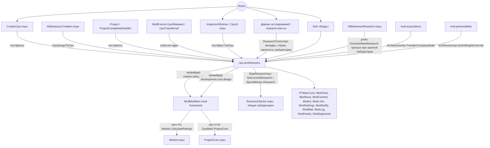
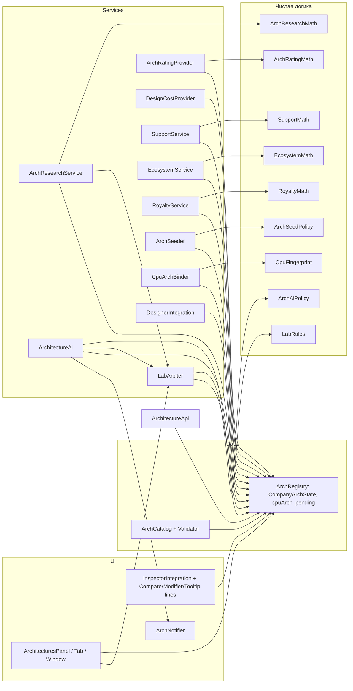
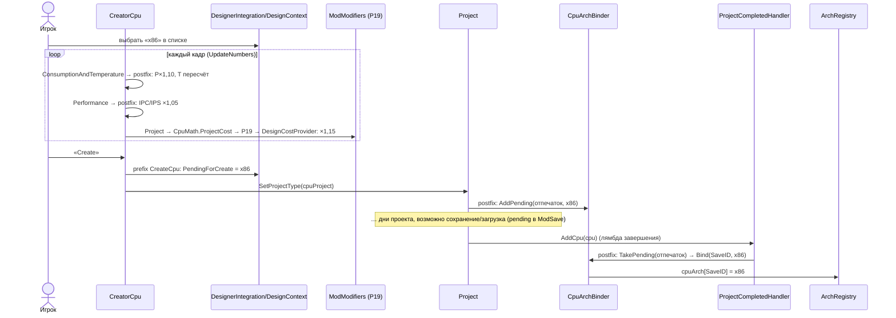
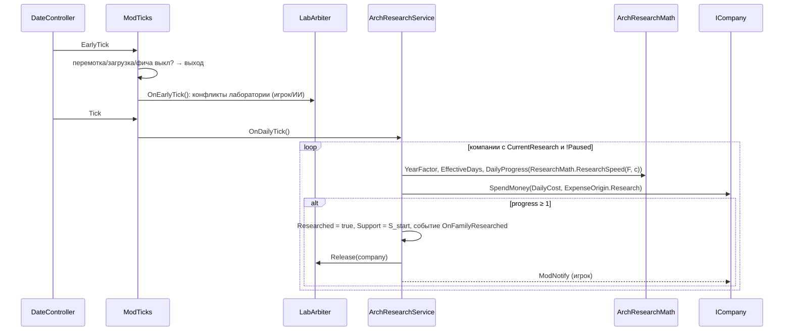
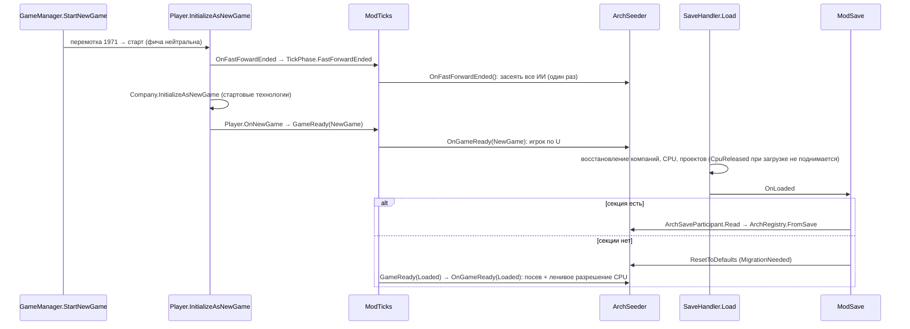

# Design: cpu-architectures

## Document Information

- **Feature Name**: cpu-architectures
- **Version**: 0.2
- **Date**: 2026-10-10
- **Author**: Dex719
- **Status**: Draft v0.2 — одобрено к реализации владельцем 2026-10-10
- **Reviewers**: владелец проекта
- **Related Documents**: `requirements.md` (FR-1…FR-16, NFR-1…NFR-7), `tasks.md`, `.kiro/steering/context.md`, `.kiro/steering/owner-decisions.md`, решения `0002`–`0006`; ядро — `.kiro/specs/mod-framework/design.md`; API вкладок и занятости лаборатории — `.kiro/specs/research-tree-ux/design.md` (`ResearchTreeUxApi`)

## Overview

Архитектуры — собственная модель мода поверх игры. Мод не трогает `TechnologyType`, `Technology` и формулы `ResearchSector` (D1). Он ведёт для каждой компании:

- состояние семейств: исследовано или нет, прогресс, поддержка, уровень финансирования;
- текущее исследование архитектуры, которое занимает **общую лабораторию** (D2);
- активную архитектуру (для ИИ).

Ещё он хранит словарь «`Cpu.SaveID` → архитектура». Всё это лежит в секции `cpu-architectures` бокового файла `ModSave` (участник `IModSaveParticipant`, версию секции пишет ядро).

Точка входа — `[ModFeature] sealed class ArchitecturesFeature : IModFeature`. С игрой фича связана в пяти местах:

1. **Тики** через `FeatureContext.OnTick`: `EarlyTick` — арбитр лаборатории; `Tick` — прогресс и стоимость исследования архитектур; `DayPassed` — обновление панели; `MonthPassed` — экосистема, поддержка, роялти, решения ИИ; `FastForwardEnded` — посев ИИ при новой игре.
2. **Дизайн CPU**: постфиксы конструктора (`CreatorCpu.Performance`, `CreatorCpu.ConsumptionAndTemperature`) и ИИ (`DataConverter.CpuDesignToCpu`); стоимость проекта — провайдер канала `development.cost.design` (патч P19 на `CpuMath.ProjectCost` принадлежит ядру). Множители «запекаются» в CPU при создании, как и все его характеристики (D3).
3. **Привязка CPU**: постфиксы `Project.SetProjectType(SaveObject.CpuProject)` и `ProjectCompletedHandler.AddCpu` (игрок), событие `ModEvents.CpuReleased` (ИИ), ленивое разрешение по умолчанию (D4, D7).
4. **Рынок**: провайдер стандартного канала `market.rating.cpu` в `ModModifiers`. Патч `Market.CalculateRatings` (P4) делает `mod-framework`, фича отдаёт только множитель на CPU и сегмент (D5).
5. **Лаборатория**: вызовы публичного API `ResearchSector.StopResearching` / `SetCurrentResearch` и единственный prefix на `AIBehaviourResearch.ChooseANewResearch`, который не даёт ИИ выбрать технологию, пока лаборатория занята архитектурой (D2).

UI: вкладка «Архитектуры» через `ResearchTreeUxApi` (или окно в хабе), выпадающий список в конструкторе CPU, текст архитектуры в инспекторе (`CpuUI.SetCpu` уже имеет поле «Architecture» = «Default»), строки в окне сравнения и в панели модификаторов `research-tree-ux`, признак «лаборатория занята».

Реализация разбита на **этап 1 (MVP)**: FR-1…FR-9; поддержка, экосистема, расширения и роялти дают ×1 / 0. И на **этап 2 (полная)**: FR-10…FR-16 включают `f_sup`, `f_eco`, `f_ext`, опыт ISA, роялти x86 и адаптивный ИИ. Схема данных `ModSave` с первого этапа содержит поля этапа 2, чтобы не мигрировать сейвы между этапами.

### Design Goals

- Ни одного нового поля в классах игры; совместимость сейвов в обе стороны (NFR-3).
- Предсказуемый баланс: все числа в JSON, вклад в `market.rating.cpu` в [0,80; 1,20] (NFR-4); итоговый предел произведения всех фич — [0,5; 2,0], его ставит ядро.
- Одинаковые правила для игрока и ИИ (FR-6.3, FR-16.4): множители, общая лаборатория, роялти.
- Детерминированные решения ИИ, без случайности (NFR-4).
- Минимальная поверхность патчей: фича не патчит ни одну зарезервированную ядром цель (`Company.AddCpu`, `AICompany.AddCpu`, `CpuMath.ProjectCost`, `Market.CalculateRatings`); из методов, которых ядро не закрыло, — конструктор, привязка проектов, инспектор, `DataConverter.CpuDesignToCpu` и `AIBehaviourResearch.ChooseANewResearch`.
- Каждая часть (конструктор, инспектор, рынок, ИИ, UI, интерфейс лаборатории) отключается независимо при сбое самопроверки (NFR-2).

### Key Design Decisions

- **D1. Своя модель исследований вместо объектов `Technology`.**
  - *Отвергнуто:* новое значение `TechnologyType` или runtime-объекты `Technology`. `ResearchSector.researches` индексируется по `Technology.ID`, а ID раздаёт `TechnologyIDInitializer` по порядку сцены — новые ID сдвигают сохранённые исследования и ломают ванильные сейвы. `Technology.Awake` определяет тип только по 7 компонентам железа. Плюс пришлось бы добавлять поля в `SaveObject`.
- **D2. Общая лаборатория: архитектура занимает единственный слот `ResearchSector` вместо технологии (решение владельца).** Пока идёт исследование архитектуры, `ResearchSector.CurrentResearch()` = null: игра не двигает прогресс технологий и не списывает за них деньги (прогресс прерванной технологии хранит игра в `ResearchSector.Research`, ничего не теряется). Скорость и стоимость архитектуры считаются по формулам лаборатории (`ResearchMath.ResearchSpeed`, `Modifiers.GetModifier(ResearchCost)`) с финансированием `ResearchSector.Funding`. Без патчей `ResearchSector`:
  - **Игрок**: запуск архитектуры при занятой технологии — подтверждение `ModUI.Confirm`, затем `StopResearching`, запоминание `ResumeTechnologyId` и скрытие панели текущего исследования (`CurrentResearchUI`: приватные `targetTechnology` и `Hide`, иначе её `FixedUpdate` перезаписывала бы `ResearchSector.Funding`). Если игрок сам выбрал технологию (родной `ResearchSector.SetCurrentResearch(Technology)`), арбитр на `TickPhase.EarlyTick` (до начисления прогресса) приостанавливает архитектуру — последний выбор побеждает. Освобождая лабораторию, фича возвращает прерванную технологию (`SetCurrentResearch(Technology)` + `CurrentResearchUI.SetTechnology`).
  - **ИИ**: prefix `AIBehaviourResearch.ChooseANewResearch` пропускает выбор технологии (`return false`), пока `LabArbiter.IsOccupiedByArchitecture(company)`; метод только пропускается, его цикл выбора не затрагивается. Если патч не применился, часть `Ai` выключена (ИИ не исследует архитектуры).
  - *Отвергнуто:* параллельная ветка со своим слайдером (прежнее D2 v0.1; владелец выбрал общую лабораторию); патчи `ResearchSector.SetCurrentResearch`/`Update` (риск конфликтов, `CurrentResearchUI.FixedUpdate` перезаписывает `Funding` каждый кадр); переписывание логики `AIBehaviourResearch` (ловушка бесконечного цикла из CODEMAP); «виртуальная технология» с нулевым финансированием технологии (UI-слайдер игры перезаписывает финансирование).
- **D3. Множители дизайна применяются один раз при создании CPU.**
  - *Отвергнуто:* множитель IPS «на лету» на рынке. Инспектор, контракты (`Contract.AddOffer` сравнивает `cpu.Ips` с `MinIps`), таблицы CPU и обзоры прессы видели бы разные цифры. Игра сама хранит `Ipc`/`Ips`/`PowerConsumption` в CPU и не пересчитывает их.
- **D4. Привязка CPU → архитектура в `ModSave` по `Cpu.SaveID` плюс ожидающие «отпечатки» проектов.** Игрок — собственный момент фичи `ProjectCompletedHandler.AddCpu` (проект завершён), ИИ — событие ядра `ModEvents.CpuReleased` (один postfix ядра на `AICompany.AddCpu`, не при загрузке и не при перемотке).
  - *Отвергнуто:* неиспользуемое поле `SaveObject.Cpu.CoreDesignID` (запись мод-состояния в сейв игры нарушает контракт); привязка по ссылке на объект `Cpu` (проект в работе пересоздаётся при загрузке `SaveObjectInstantiator.InstantiateFromSave(SaveObject.CpuProject)` новым объектом); собственные патчи на `Company.AddCpu`/`AICompany.AddCpu` (отклоняются `ModHooks`: службу занимает `ModEvents`).
- **D5. Рыночный эффект — множитель рейтинга CPU на сегмент через единственный провайдер стандартного канала `market.rating.cpu`.** Ядро уже передаёт сегмент в контексте (`ModifierContext.Segment`), поэтому отдельные каналы по сегментам не нужны (и никто бы их не прочитал).
  - *Отвергнуто:* `market.demand.<segment>` (меняет размер сегмента целиком, не различает CPU); множитель популярности (накопительный, медленно затухает, трудно балансировать); множитель IPS (см. D3); отдельные новые каналы на каждый сегмент.
- **D6. Устаревание собственной ISA — плавное снижение сродства (`fade`) 1985–1995 в потребительских сегментах.**
  - *Отвергнуто:* жёсткий запрет `proprietary` после 1990 года (ломает ранние сейвы и встраиваемый рынок).
- **D7. Ленивое разрешение архитектуры по умолчанию** (по владельцу и году выпуска) для CPU без привязки: старые сейвы, CPU из перемотки, CPU, созданные при выключенной фиче.
  - *Отвергнуто:* массовая разметка при загрузке (лишняя работа, не покрывает CPU, появившиеся позже).
- **D8. Нейтральность во время перемотки новой игры; посев после неё.** Состояние ИИ засевается один раз на `TickPhase.FastForwardEnded` (событие `DateController.OnFastFowardEnded` приходит после сброса `IsFastFowardSimulating`, но до `Company.InitializeAsNewGame`), состояние игрока — на `ModTicks.GameReady` (причина `NewGame`), когда стартовые технологии уже применены.
  - *Отвергнуто:* работа во время перемотки — меняет историю соперников 1971 → старт (банкротства, слияния), требует исключения из защиты `ModTicks`.
- **D9. ИИ — собственная месячная политика мода; из патчей `AIBehaviour*` только пропуск выбора технологии при занятой лаборатории.**
  - *Отвергнуто:* замена `AIBehaviourResearch.ChooseANewResearch` (приватный, бесконечный цикл при нулевых шансах; метода выбора шансов уровня `AIBehaviourResearch` в игре нет — есть только вложенный `AIBehaviourResearch.ResearchChoice.DefineChance`); правка шансов технологий.
- **D10. Предпочтения ИИ сопоставляются по `AICompany.UniqueID` (исторической компании) с записью `default` (решение владельца).** `UniqueID` — индекс компании в `CompanySpawner.historicalCompanies`; отображаемое имя берёт игра (русификатор, `translation/brands.json`), логика на переводимые строки не опирается.
  - *Отвергнуто:* сопоставление по имени (ломается при переводе и переименовании).
- **D11. Поддержка сходится к цели уровня (`S += (T − S) × r`).**
  - *Отвергнуто:* линейное «+рост −затухание» (быстро упирается в 0 или 100, плохо балансируется).
- **D12. Два этапа (MVP → полная) с единой схемой данных.** На этапе 1 `f_sup` = `f_eco` = `f_ext` = 1, роялти нет, а поля поддержки уже пишутся (посев FR-8.6). Переход на этап 2 не требует миграции сейвов.
- **D13. Стоимость проекта — провайдер канала `development.cost.design` (решение владельца).** Множитель `design.devCost × (1 + незрелость)` виден в `Explain` и подчиняется предохранителю канала [0,25; 4,0]; провайдер O(1) (≤ 5 мкс), без кеша.
  - *Отвергнуто:* собственный postfix на `CpuMath.ProjectCost` (цель закреплена за ядром и отклоняется `ModHooks`; второй, неучтённый путь на ту же формулу).
- **D14. Роялти x86 без лицензии — месячный расчёт по доходу x86-CPU.** Держатели лицензии — `AICompany.UniqueID` 0 и 1 (Intel и AMD, как `CompanyHelper.IsInlet`/`IsEMD`); при банкротстве любого из них игра выставляет `LicenseHelper.X86LicenseHasBeenRevoked`, и роялти исчезают. Запрета нет; ванильная «невезучесть» Cyrix (×6 к стоимости исследований) не меняется.
  - *Отвергнуто:* запрет x86 для компаний без лицензии (решение владельца: без запрета); наценка к стоимости проекта (не связана с продажами x86-CPU); продажа лицензий ISA (I17, вне объёма).
- **D15. Сегмент — тип `Segment` ядра, классификация — `ModSegments`.** Фича не определяет «основной сегмент» сама: доли сегментов ИИ считаются по продажам (`CpuBase.MarketData.SoldByHighEnd` …), запасной вариант — `ModSegments.Classify(cpu)`.
  - *Отвергнуто:* `AIBehaviourCreation.MainMarket` как источник основного сегмента (приватное состояние ИИ, свой классификатор).

## Architecture

### System Context



### High-Level Architecture



### Technology Stack

| Слой | Технология | Обоснование |
|---|---|---|
| Патчи | Harmony 2.3.6 через `ModHooks` (`[ModPatch]`, `ModHooks.Guard`) | решение 0002 |
| Тики | `FeatureContext.OnTick` (`EarlyTick`, `Tick`, `DayPassed`, `MonthPassed`, `FastForwardEnded`), `ModTicks.GameReady` | защита от перемотки и загрузки, порядок дня |
| События | `ModEvents.CpuReleased`, `ModEvents.CpuTransferred` | один postfix ядра на выпуск CPU |
| Состояние | `ModSave`, секция `cpu-architectures` (`IModSaveParticipant`) | решение 0004; версию секции ведёт ядро |
| Контент | `ModContent`: `architectures.json`, `balance.json`, `ai-preferences.json` | решение 0006 |
| Рынок и стоимость | провайдеры `ModModifiers` стандартных каналов `market.rating.cpu`, `development.cost.design` | патчи формул делает ядро |
| Сегмент | `Segment`, `ModSegments` | единый классификатор ядра |
| UI | `ModUI` + `ResearchTreeUxApi` | решение 0005; общая точка расширения дерева |
| Тесты | `mod/tests/PTMod.Tests/CpuArchitectures/` (мини-раннер .NET Framework 4.8) | чистая логика без Unity и типов игры |

### Используемые сервисы PTMod.Core

`ModHooks` (патчи, `Guard`, `ReportFault`, самопроверка), `ModTicks` (`FeatureContext.OnTick` на фазы `EarlyTick`, `Tick`, `DayPassed`, `MonthPassed`, `FastForwardEnded`; `GameReady`; `IsFastForwarding`), `ModEvents` (`CpuReleased`, `CpuTransferred`), `ModSave`, `ModContent`, `ModModifiers` (`RegisterReasonedProvider` для `market.rating.cpu` и `development.cost.design`, `Invalidate`, `Explain` для чтения), `ModSegments` (`Classify`), `ModCompanies` (`KeyOf`, `All`), `ModUI` (панель, окно-фолбэк, выпадающий список в конструкторе, `Confirm`, `Tooltip`, хаб), `ModL10n`, `ModSettings` (`ParamSpec`), `ModNotify`, `ModMail` (этап 2, вехи экосистемы), `ModLog`, `ModFeatures`. `ModRandom` не используется (решения детерминированы).

## Components and Interfaces

Пространство имён — `PTMod.Features.CpuArchitectures`. Каталог — `mod/src/PTMod/Features/CpuArchitectures/`; чистая логика — `.../Logic/` (без `UnityEngine` и без типов `Assembly-CSharp`; сегмент — `Segment` ядра).

### Component 1: ArchitecturesFeature

```csharp
namespace PTMod.Features.CpuArchitectures
{
    [ModFeature]
    public sealed class ArchitecturesFeature : IModFeature
    {
        public const string FeatureId = "cpu-architectures";
        public string Id => FeatureId;
        public string NameKey => "arch.feature.name";
        public string DescriptionKey => "arch.feature.desc";
        public string[] DependsOn => new string[0];   // жёстких зависимостей нет: research-tree-ux, platform-generations, rival-* — мягкие связи
        public bool EnabledByDefault => true;
        public bool SupportsHotToggle => true;        // FR-9.2

        public void Register(FeatureContext ctx);     // см. таблицу ниже
        public void OnEnabled();                      // ModModifiers.Invalidate; панель и список конструктора снова доступны
        public void OnDisabled();                     // пауза исследования игрока, возврат лаборатории (FR-9.2), Invalidate

        public static ArchitecturesFeature Instance { get; }
        public ArchStage Stage { get; }               // MVP | Full — из balance.json "stage" (для поэтапного выпуска)
        public ArchParts Parts { get; }               // прошедшие самопроверку части
        public float RatingStrength { get; }          // ParamSpec ratingStrength 0..1,5 (FR-9.1)
        public bool IsNeutralNow { get; }             // !Enabled || ModTicks.IsFastForwarding
    }
    public enum ArchStage { Mvp = 1, Full = 2 }
    [System.Flags] public enum ArchParts { None = 0, Research = 1, Designer = 2, Binder = 4, Market = 8, Inspector = 16, Ai = 32, Ui = 64, LabUi = 128 }
}
```

`Register(FeatureContext ctx)` делает:

| Вызов | Что объявляет |
|---|---|
| `ctx.Patch(typeof(DesignerPatches))` | postfix `CreatorCpu.Initialize`, `CreatorCpu.UpdateUI`, `CreatorCpu.ConsumptionAndTemperature`, `CreatorCpu.Performance`; prefix + postfix `CreatorCpu.CreateCpu` |
| `ctx.Patch(typeof(AiDesignPatches))` | postfix `DataConverter.CpuDesignToCpu` |
| `ctx.Patch(typeof(BinderPatches))` | postfix `Project.SetProjectType(SaveObject.CpuProject)`, postfix `ProjectCompletedHandler.AddCpu` |
| `ctx.Patch(typeof(InspectorPatches))` | postfix `CpuUI.SetCpu` |
| `ctx.Patch(typeof(LabPatches))` | prefix `AIBehaviourResearch.ChooseANewResearch` (`Optional`: сбой отключает только часть `Ai`) |
| `ctx.OnTick(TickPhase.EarlyTick, …)` | `LabArbiter.OnEarlyTick` — арбитраж конфликтов лаборатории |
| `ctx.OnTick(TickPhase.Tick, …)` | `ArchResearchService.OnDailyTick` — прогресс и стоимость |
| `ctx.OnTick(TickPhase.DayPassed, …)` | обновление панели, если видна |
| `ctx.OnTick(TickPhase.MonthPassed, …)` | один обработчик, порядок: экосистема → поддержка → роялти → решения ИИ → сброс кеша рейтинга |
| `ctx.OnTick(TickPhase.FastForwardEnded, …)` | `ArchSeeder.OnFastForwardEnded` — посев ИИ (D8) |
| `ModTicks.GameReady += …` | `NewGame`: посев игрока; `Loaded`: миграция старого сейва |
| `ModEvents.CpuReleased += …`, `ModEvents.CpuTransferred += …` | привязка CPU ИИ; сброс кеша рейтинга при переносе |
| `ctx.SaveParticipant(new ArchSaveParticipant())` | секция `cpu-architectures` |
| `ctx.Param(…)` | `ratingStrength` (Float 0–1,5, по умолчанию 1,0), `notifications` (Bool, true) |
| `ctx.HubPage("arch.hub.title", BuildHubPage)` | кнопка «Архитектуры» (запасное окно, FR-3.2) |
| `ModModifiers.RegisterReasonedProvider(FeatureId, ModChannels.MarketRatingCpu, …)` | провайдер рейтинга (D5) |
| `ModModifiers.RegisterReasonedProvider(FeatureId, ModChannels.DevelopmentCostDesign, …)` | провайдер стоимости проекта (D13) |
| `ResearchTreeUxApi.RegisterTab` / `RegisterCompareRows` / `RegisterModifierLines` / `RegisterTechTooltipLines` / `RegisterLabOccupancy` | безусловно; `research-tree-ux` сама решает, показывать ли (FR-7.6) |

Провайдеры и записи регистрируются один раз; `OnEnabled`/`OnDisabled` их не пересоздают (ядро пропускает провайдеры выключенной фичи). Прямых подписок на `DateController`, `Player.OnNewGame`, `SaveHandler.*` и собственных счётчиков ошибок нет.

### Component 2: ArchCatalog + ArchCatalogValidator

```csharp
public sealed class ArchFamily
{
    public string Id;                 // "x86"
    public string Isa;                // "x86" | "arm" | "risc" | "riscv" | "own"
    public string NameKey, DescKey;   // ModL10n
    public int Year;
    public string[] Requires;
    public ResearchDef Research;      // baseDays, monthlyCost
    public DesignDef Design;          // ipc, power, devCost
    public float[] Affinity;          // [4] в порядке Segment: HighEnd, MidRange, LowEnd, Industries
    public FadeDef Fade;              // null, кроме proprietary
    public SupportDef Support;        // upkeepPerMonth, decayRate, targetCap, eraCost[]
}
public sealed class ResearchDef { public float BaseDays; public float MonthlyCost; }
public sealed class DesignDef { public float Ipc = 1, Power = 1, DevCost = 1; }
public sealed class FadeDef { public int FromYear, ToYear; public float Min; public int[] Segments; }   // значения Segment: 0 HighEnd … 3 Industries
public sealed class SupportDef { public float UpkeepPerMonth; public float DecayRate; public float TargetCap = 100; public float[][] EraCost; }

public sealed class ArchCatalog
{
    public IReadOnlyList<ArchFamily> Families { get; }
    public ArchFamily Get(string id);           // null, если нет
    public ArchFamily Default { get; }          // "proprietary"
    public static ArchCatalog Load(IModContent content, IModLog log);   // ModContent.LoadRecords<…>
}

public static class ArchCatalogValidator // чистая логика
{
    public static ValidationResult Validate(IReadOnlyList<ArchFamily> raw); // повторы id, неизвестные зависимости, циклы, диапазоны
}
```

### Component 3: ArchRegistry (состояние)

```csharp
public sealed class ArchRegistry
{
    public CompanyArchState GetOrNull(int companySaveId);
    public CompanyArchState GetOrSeed(ICompany company);          // ленивый посев (FR-8.4)
    public string ResolveCpu(Cpu cpu);                             // привязка или DefaultFor (FR-5.3), кэширует
    public void Bind(int cpuSaveId, string familyId);
    public void AddPending(CpuFingerprint fp, string familyId);
    public string TakePending(CpuFingerprint fp);                  // FIFO по совпадающему отпечатку
    public bool MigrationNeeded { get; }                           // секции не было → посев на GameReady(Loaded)
    public ArchSaveData ToSave(); public static ArchRegistry FromSave(ArchSaveData data, ArchCatalog catalog);
    public event System.Action<int> OnCompanyStateChanged;         // → ModModifiers.Invalidate рейтинга компании
}

public sealed class CompanyArchState
{
    public int CompanyId; public bool IsPlayer;
    public string Active;                    // активная (ИИ) / последняя выбранная в конструкторе (игрок)
    public string CurrentResearch;           // семейство, занимающее лабораторию; null — нет
    public bool Paused;                      // FR-2.5, FR-2.6, FR-7.4
    public PauseReason PauseReason;
    public int ResumeTechnologyId = -1;      // технология, прерванная архитектурой (Technology.ID); -1 — нет
    public Dictionary<string, FamilyState> Families;
}
public enum PauseReason { None, TechnologyChosen, Default, NoFunds, FeatureDisabled }
public sealed class FamilyState
{
    public string Id; public bool Researched; public float Progress;
    public int ResearchedYear, ResearchedMonth;   // для «незрелых инструментов» (FR-12.3)
    public float Support;                         // 0..100
    public SupportTier Tier = SupportTier.Off;
}
public enum SupportTier { Off, Low, Normal, High }

internal sealed class ArchSaveParticipant : IModSaveParticipant   // адаптер к ModSave
{
    public string SectionId => "cpu-architectures";
    public int SchemaVersion => 1;                 // _schema пишет и читает ядро
    public void ResetToDefaults();                 // пустое состояние, MigrationNeeded = true
    public void Read(Logic.Json.JsonObject section, int schema);   // ModJson.Bind<ArchSaveData>
    public Logic.Json.JsonObject Write();          // ModJson.From(ToSave()), без _schema
}
```

Финансирования в состоянии компании больше нет: финансирование архитектуры — это `ResearchSector.Funding` лаборатории (игрок задаёт слайдером блока, ИИ — таблицей по сложности при старте).

### Component 4: ArchResearchMath + LabRules + ArchResearchService + LabArbiter

```csharp
public static class ArchResearchMath // чистая логика
{
    // Копия TechnologyTimeUpdater.UpdateTechnologyTimes для года семейства
    public static float YearFactor(int familyYear, int daysUntilFamilyYear, int daysSinceFamilyYearStart, int currentYear,
                                   float penaltyPerYear, float bonusPerYear, float bonusCap);
    public static float EffectiveDays(float baseDays, float yearFactor, float isaFactor);
    public static float DailyProgress(float researchSpeed, float effectiveDays);   // researchSpeed = ResearchMath.ResearchSpeed(F, company)
    public static float DailyCost(float monthlyCost, float costModifier, float funding); // costModifier = Modifiers.GetModifier(ResearchCost, company)
    public static int EtaDays(float progress, float dailyProgress);                 // -1 = «∞»
    public static bool IsAvailable(ArchFamily f, IReadOnlyDictionary<string, FamilyState> s);
}

public enum LabStatus { Free, Technology, Architecture, ArchitecturePaused }
public enum ConflictResolution { None, PauseArchitecture, StopTechnology }

public static class LabRules // чистая логика общей лаборатории (D2)
{
    public static LabStatus Status(bool hasTechnology, bool hasArchitecture, bool paused);
    public static bool NeedsConfirmation(bool isPlayer, bool hasTechnology);                 // FR-2.1: игроку — подтверждение
    public static bool CanInterruptForAi(int technologyDaysLeft, int noInterruptDays);       // FR-7.1: осталось > noInterruptDays
    // Арбитраж на EarlyTick: архитектура активна, а лаборатория содержит технологию
    public static ConflictResolution ResolveConflict(bool isPlayer, bool architectureActive, bool hasTechnology);
    public static float AiFunding(int difficulty, float[] table);                           // 0,6 / 0,8 / 1,0 / 1,3 / 1,6
    public static float PlayerFundingLimit(bool innovationEffort);                           // 1,0 или 5,0 (слайдер 1–100 % / до 500 %)
}

internal sealed class ArchResearchService
{
    public void OnDailyTick();     // TickPhase.Tick: все компании с CurrentResearch != null и !Paused
    public StartResult Start(ICompany company, string familyId, bool interruptConfirmed);   // FR-2.1 (через LabArbiter.Occupy)
    public void Stop(ICompany company);                     // FR-2.7 (через LabArbiter.Release)
    public void Resume(ICompany company, bool interruptConfirmed);   // «Продолжить»
    public void SetFunding(ICompany company, float funding);// пишет ResearchSector.Funding игрока в пределах LabRules.PlayerFundingLimit
}

internal sealed class LabArbiter // общая лаборатория
{
    public LabStatus StatusOf(ICompany company);
    public bool IsOccupiedByArchitecture(ICompany company);        // true: фича включена, не перемотка, CurrentResearch != null && !Paused — для prefix AIBehaviourResearch.ChooseANewResearch
    public void OnEarlyTick();                                      // FR-2.5: конфликт → пауза архитектуры (игрок) / остановка технологии (ИИ)
    public void Occupy(ICompany company, string familyId);          // запомнить ResumeTechnologyId, ResearchSector.StopResearching, скрыть CurrentResearchUI (игрок)
    public void Release(ICompany company, PauseReason reason);      // вернуть прерванную технологию (игрок), уведомление (FR-2.8)
}

internal sealed class LabOccupancySource : PTMod.Features.ResearchTreeUx.ILabOccupancySource   // IsLabBusy / BusyText для research-tree-ux
{ }

internal static class LabUiSync // доступ к приватным членам CurrentResearchUI (часть LabUi)
{
    public static bool HideStalePanel();     // targetTechnology = null + Hide(); false — членов нет, LabUi выключена
    public static void SyncFundingFromSector(); // необязательный CurrentResearchUI.LoadFunding
}
```

**Implementation Notes.** `Occupy` для игрока: запоминает `ResearchSector.CurrentResearch()` (если есть), вызывает `ResearchSector.StopResearching()`, затем `LabUiSync.HideStalePanel()`. Если `LabUi` недоступна, фича не прерывает технологию игрока: кнопка «Исследовать» неактивна с подсказкой «Остановите текущее исследование». `Release` для игрока: если `ResumeTechnologyId` ≥ 0, технология не исследована и не заблокирована — `ResearchSector.SetCurrentResearch(Technology)`, `LabUiSync.SyncFundingFromSector()` (если есть), `CurrentResearchUI.SetTechnology(Technology)`, `ModNotify`. Для ИИ `Release` лабораторию не трогает: игра сама выберет технологию (prefix перестаёт пропускать выбор). `OnEarlyTick` стоит в `EarlyTick`, то есть раньше `AIBehaviourTick` и `OnTick` (прогресс и стоимость технологий), поэтому ни день прогресса, ни расход на технологию при конфликте не начисляются.

### Component 5: ArchRatingMath + ArchRatingProvider

```csharp
public sealed class RatingInputs
{
    public float Affinity;        // A[s]
    public float Fade;            // fade(Y, s)
    public float Support;         // S владельца (этап 1: 50)
    public float Ecosystem;       // E семейства (этап 1: не используется)
    public int CoreCount; public bool Smt;
    public bool StageFull;
}
public static class ArchRatingMath // чистая логика
{
    public static float Fade(FadeDef fade, int year, Segment segment);
    public static float SupportFactor(float s, RatingConfig c);      // 0,90 + 0,20 × s/100
    public static float EcosystemFactor(float e, RatingConfig c);    // 0,95 + 0,10 × √e
    public static float ExtensionFactor(float s, ExtensionDef x);    // lerp(penalty, 1, min(1, s/required))
    public static float Multiplier(RatingInputs i, RatingConfig c, IReadOnlyList<ExtensionDef> ext); // clamp [0,80; 1,20]
    public static float ApplyStrength(float m, float strength);      // 1 + (m − 1) × k
}

internal sealed class ArchRatingProvider
{
    // ModModifiers.RegisterReasonedProvider(FeatureId, ModChannels.MarketRatingCpu, Provide) — один провайдер на все сегменты
    public void Register();
    private ProviderResult Provide(ModifierContext ctx);   // ctx.Cpu, ctx.Segment; Segment.Any / Cpu == null / IsNeutralNow → 1,0; ReasonKey = "arch.reason.rating"
    public void InvalidateAll();                           // ModModifiers.Invalidate(ModChannels.MarketRatingCpu)
    public void InvalidateCompany(ICompany company);       // ModModifiers.Invalidate(ModChannels.MarketRatingCpu, ModCompanies.KeyOf(company))
}
```

Дневной кеш по ключу (канал, компания, CPU, сегмент) ведёт ядро; провайдер вызывается не чаще раза в день на ключ (≤ 1 200 вызовов), собственного кеша множителей у фичи нет. `ReasonArgs` — заранее собранный массив с названием семейства (хранится в `ArchRegistry` на семейство, без аллокаций на вызов).

### Component 6: DesignerIntegration + DesignCostProvider (конструктор CPU)

```csharp
internal static class DesignContext
{
    public static string PlayerSelectedFamily;     // из выпадающего списка
    public static string PendingForCreate;         // захватывается prefix CreatorCpu.CreateCpu, сбрасывается после
    public static DesignDef ForCompany(ICompany c); // игрок → выбранное; ИИ → активное; нейтрально → 1/1/1
    public static float ImmatureCostFactor(ICompany c, string familyId); // этап 2, FR-12.3
}

internal static class DesignCostProvider // провайдер канала development.cost.design (патч P19 принадлежит ядру)
{
    // ModModifiers.RegisterReasonedProvider(FeatureId, ModChannels.DevelopmentCostDesign, Provide)
    public static ProviderResult Provide(ModifierContext ctx);
    // ctx.Company: игрок → DesignContext.PlayerSelectedFamily; ИИ → активная архитектура по ModCompanies.KeyOf(ctx.Company);
    // нейтрально (перемотка, фича выключена) → 1,0; значение = design.devCost × (1 + незрелость); O(1), ≤ 5 мкс; ядро не кеширует
}

internal sealed class DesignerIntegration
{
    public void OnCreatorInitialized(CreatorCpu creator); // клон coreCountDropdown → «Архитектура», строка прогноза рейтинга
    public void OnCreatorUiUpdated(CreatorCpu creator);   // обновить опции (исследованные семейства игрока)
}
```

### Component 7: CpuFingerprint + CpuArchBinder

```csharp
public readonly struct CpuFingerprint : System.IEquatable<CpuFingerprint>
{
    public readonly int CompanyId; public readonly string Name; public readonly int Year; public readonly float Ips;
    public bool Matches(CpuFingerprint other, float relTolerance = 1e-4f); // Ips с относительным допуском (JSON round-trip)
    public static CpuFingerprint From(SaveObject.CpuProject p);  // CompanyID, Name, Year, Ips
    public static CpuFingerprint From(Cpu cpu);                  // Company.SaveID, Name, Year, Ips
}

internal sealed class CpuArchBinder
{
    public void OnProjectTyped(SaveObject.CpuProject project);   // postfix Project.SetProjectType(SaveObject.CpuProject)
    public void OnPlayerCpuCompleted(Cpu cpu);                   // postfix ProjectCompletedHandler.AddCpu — собственный момент фичи
    // ModEvents.CpuReleased: ИИ-выпуск; duringFastForward = true → пропуск (D7 даст архитектуру лениво); isVariant → архитектура базового CPU;
    // для игрока — страховка: ResolveCpu, чтобы CPU без привязки получил её при выпуске
    public void OnCpuReleased(ICompany owner, Cpu cpu, bool isVariant, bool duringFastForward);
    public void OnCpuTransferred(ICompany from, ICompany to, Cpu cpu);   // привязка не меняется (по SaveID); Invalidate рейтинга обеих компаний
}
```

### Component 8: ArchSeedPolicy + ArchSeeder

```csharp
public static class ArchSeedPolicy // чистая логика
{
    public static SeedResult SeedAi(ArchCatalog cat, AiPreference pref, int year, SeedConfig cfg);
    public static SeedResult SeedPlayer(ArchCatalog cat, int unlockYear, SeedConfig cfg);
    public static string DefaultForCpu(ArchCatalog cat, AiPreference prefOrNull, bool isPlayer, int cpuYear, SeedConfig cfg);
}
public sealed class SeedResult { public List<string> Researched; public string Active; public Dictionary<string, float> Support; public Dictionary<string, SupportTier> Tiers; }

internal sealed class ArchSeeder
{
    public void OnFastForwardEnded();                  // TickPhase.FastForwardEnded: засеять все существующие ИИ один раз (идемпотентно по наличию состояния)
    public void OnGameReady(GameReadyReason reason);   // NewGame: игрок (U по ResearchSector) и ИИ без состояния; Loaded: миграция старого сейва (FR-8.3), если MigrationNeeded
}
```

### Component 9: ArchAiPolicy + ArchitectureAi

```csharp
public sealed class AiPreference { public int UniqueId; public string Key; public bool IsDefault; public Dictionary<string, float> Weights; public int LagYears; }

public sealed class AiView // снимок ИИ для чистой логики
{
    public int CompanyId; public int UniqueId; public float Money; public float CostModifier; public int Difficulty; public int Year;
    public float[] SegmentShare;              // 4 доли продаж за 3 месяца в порядке Segment (этап 2); без продаж — по ModSegments.Classify цен CPU, иначе 0,25
    public int TechnologyDaysLeft;            // осталось дней текущей технологии лаборатории; -1 — лаборатория свободна
    public CompanyArchState State;
}
public sealed class AiDecision { public string StartResearch; public float Funding; public bool Pause; public bool DeferInterrupt; public string NewActive; public Dictionary<string, SupportTier> Tiers; }

public static class ArchAiPolicy // чистая логика
{
    public static AiPreference Match(IReadOnlyList<AiPreference> prefs, int uniqueId);   // по UniqueId, иначе запись default
    public static AiDecision DecideMvp(AiView ai, AiPreference pref, ArchCatalog cat, AiConfig cfg);
    public static AiDecision DecideFull(AiView ai, AiPreference pref, ArchCatalog cat, AiConfig cfg,
                                        IReadOnlyDictionary<string, float> ecosystem, RatingConfig rc);
    public static float Attractiveness(...);  // FR-14.1
}

internal sealed class ArchitectureAi
{
    // MonthPassed: ModCompanies.All → AICompany, кроме IsFoundry/IsBankrupt; собирает AiView (доли продаж по CpuBase.MarketData.SoldByHighEnd … и ModSegments.Classify), применяет AiDecision
    public void OnMonth();
}
```

### Component 10: SupportMath + SupportService (этап 2)

```csharp
public static class SupportMath // чистая логика
{
    public static float Next(float s, SupportTier tier, SupportDef def, TierTable t);   // S + (T − S) × r, T ≤ targetCap
    public static float MonthlyUpkeep(SupportDef def, SupportTier tier, int year, float inflation, TierTable t);
    public static float EraCost(float[][] eraCost, int year);                           // кусочно-линейно, вне диапазона — крайние
    public static float Forecast(float s, SupportTier tier, SupportDef def, TierTable t, int months);
}
internal sealed class SupportService
{
    public void OnMonth();   // все компании: обновить S, списать содержание, дефолт игрока → «выкл» (FR-10.6)
    public void SetTier(ICompany company, string familyId, SupportTier tier);
}
```

### Component 11: EcosystemMath + EcosystemService (этап 2)

```csharp
public static class EcosystemMath // чистая логика
{
    // salesByFamily: сумма (Sold[i] + SoldByContracts[i]) за окно по CPU каждой архитектуры
    public static Dictionary<string, float> Shares(IReadOnlyDictionary<string, long> salesByFamily, string fallbackFamily);
}
internal sealed class EcosystemService
{
    public IReadOnlyDictionary<string, float> Current { get; }   // E по семействам
    public IReadOnlyDictionary<string, float> YearAgo { get; }   // для «изменения за 12 мес.» (только в памяти, пересчитывается)
    public void OnMonth();  // CpuDataProvider.Instance.GetAllCpus() → ResolveCpu → суммы окна CpuBase.MarketData.Sold + SoldByContracts
}
```

### Component 12: RoyaltyMath + RoyaltyService (этап 2, FR-16)

```csharp
public static class RoyaltyMath // чистая логика
{
    public static float Royalty(float x86IncomeLastMonth, float rate);            // rate × income, не меньше 0
    public static float[] Distribute(float royalty, int liveHolders);             // поровну; 0 держателей → пустой массив
    public static bool IsHolder(int uniqueId, int[] holderIds);                   // x86License.holderIds
}
internal sealed class RoyaltyService
{
    // MonthPassed (этап 2): пропуск при LicenseHelper.Instance.X86LicenseHasBeenRevoked и при перемотке;
    // доход = Σ CpuBase.MarketData.Income[Count − 2] по CPU компании семейств с Isa == x86License.isa;
    // SpendMoney(royalty, ExpenseOrigin.Royalties), живым держателям EarnMoney(share, RevenueOrigin.Royalties)
    public void OnMonth();
    public float LastMonthRoyaltyOf(ICompany company);                            // для строки панели (FR-16.6)
}
```

### Component 13: UI — ArchitecturesPanel, вкладка и окно

```csharp
internal sealed class ArchitecturesPanel // общий контент
{
    public RectTransform Build(RectTransform parent);  // блок лаборатории, карточки семейств, (этап 2) поддержка, роялти, соперники
    public void Refresh();                             // раз в день (TickPhase.DayPassed), если видна
}
internal sealed class LabStatusBlock                   // FR-3.4/3.5: строка состояния лаборатории, прогресс, ETA, слайдер ResearchSector.Funding, «Остановить»/«Продолжить»
{ }
internal sealed class ArchitecturesTab : PTMod.Features.ResearchTreeUx.IResearchTabProvider
{
    // TabId = "cpu-architectures", TitleKey = "arch.tab.title", Order = 200; IsAvailable() = фича Enabled
}
internal sealed class ArchitecturesWindow { public static void Open(); }   // страница хаба «Моды», если research-tree-ux неактивна
```

### Component 14: InspectorIntegration и строки research-tree-ux

```csharp
internal static class InspectorIntegration { public static void OnCpuShown(CpuUI ui, Cpu cpu); } // postfix CpuUI.SetCpu
internal sealed class ArchCompareRows : PTMod.Features.ResearchTreeUx.ICompareRowProvider { }     // «Архитектура», «Множитель рейтинга»
internal sealed class ArchModifierLines : PTMod.Features.ResearchTreeUx.IModifierLineSource { }   // исследование и содержание
internal sealed class ArchTechTooltipLines : PTMod.Features.ResearchTreeUx.ITechTooltipLineSource { } // Multicore: требуемая поддержка (этап 2)
```

### Component 15: ArchitectureApi (для других фич)

```csharp
public static class ArchitectureApi
{
    public static bool IsActive { get; }
    public static string GetArchitectureId(Cpu cpu);                 // ResolveCpu
    public static string GetActiveArchitectureId(ICompany company);
    public static float GetRatingMultiplier(Cpu cpu, Segment segment);   // только вклад этой фичи, без других провайдеров
    public static void TransferCompanyState(ICompany from, ICompany to, bool mergeKeepBest); // для rival-acquisitions
    public static void SetAiWeightOverride(ICompany company, string familyId, float? weight); // для rival-personalities
    public static event System.Action<ICompany, string> OnFamilyResearched;
    public static event System.Action<ICompany, string, string> OnActiveChanged;              // компания, было, стало
}
```

## Патчи Harmony

Цели не входят в зарезервированные ядром (`ModHooks.IsReserved` = false); тела патчей обёрнуты в `ModHooks.Guard`.

| Цель (`Class.Method` игры) | Тип | Что меняет | Порядок / конфликты | Этап |
|---|---|---|---|---|
| `CreatorCpu.Initialize` | postfix | клонирует `coreCountDropdown` (`DropdownUI`) в выпадающий список «Архитектура» и `InfoText` прогноза рейтинга; подписка `OnValueChanged` → `DesignContext.PlayerSelectedFamily` | только эта фича; `Initialize` вызывается через 0,2 с после `Start` | 1 |
| `CreatorCpu.UpdateUI` | postfix | обновляет опции списка (исследованные семейства игрока) | — | 1 |
| `CreatorCpu.ConsumptionAndTemperature` | postfix | `consumption ×= design.power`; `temperature = CpuMath.Temperature(consumption, currentPackage)` | идёт в `UpdateNumbers` до `FailureRate` → брак считается от новой температуры | 1 |
| `CreatorCpu.Performance` | postfix | `ipc`, `ips`, `ipsWithoutBottleneck` × `design.ipc` | текст «multicore ratio» считается внутри метода до постфикса — не меняется (это отношение ядер, не IPC архитектуры) | 1 |
| `CreatorCpu.CreateCpu` | prefix + postfix | prefix: `DesignContext.PendingForCreate = PlayerSelectedFamily`; postfix сбрасывает значение | — | 1 |
| `Project.SetProjectType(SaveObject.CpuProject)` | postfix | вне загрузки: `AddPending(отпечаток, семейство)`; семейство = `PendingForCreate` для игрока или активное ИИ | при `GameManager.IsLoading` — пропуск; источник истины — `ModSave` | 1 |
| `ProjectCompletedHandler.AddCpu` | postfix | игрок: `TakePending` → `Bind(cpu.SaveID, …)`; нет совпадения → `ResolveCpu` | собственный момент фичи (проект завершён, до окна выпуска); вызывается и для проектов, восстановленных из сейва | 1 |
| `DataConverter.CpuDesignToCpu` | postfix | ИИ: `Ipc`, `Ips` × `ipc`; `PowerConsumption` × `power`; `Temperature = CpuMath.Temperature(PowerConsumption, Package)`; `FailureRate` не пересчитывается (упрощение, задокументировано) | единственный вызывающий — `AIBehaviourCreation.CreateCpu`; при перемотке — нейтрально | 1 |
| `CpuUI.SetCpu` | postfix | `architectureText.Text` = название архитектуры | `research-tree-ux` этот метод не патчит | 1 |
| `AIBehaviourResearch.ChooseANewResearch` | prefix | `return false` (пропуск выбора технологии), пока `LabArbiter.IsOccupiedByArchitecture(___company)`; иначе `true` | приватный метод; `Optional`: сбой делает недоступной только часть `Ai`; другие фичи этот метод не патчат | 1 |

**Не патчится фичей** (цели закреплены ядром): `Company.AddCpu` и `AICompany.AddCpu` (выпуск CPU ИИ — событие `ModEvents.CpuReleased`), `CpuMath.ProjectCost` (стоимость проекта — провайдер `development.cost.design`), `Market.CalculateRatings` (рейтинг — провайдер `market.rating.cpu`).

Методы игры, которые фича только вызывает: `ResearchMath.ResearchSpeed`, `Modifiers.GetModifier`, `ICompany.SpendMoney`, `ICompany.EarnMoney`, `CpuMath.Temperature`, `ResearchSector.StopResearching`, `ResearchSector.SetCurrentResearch`, `ResearchSector.CurrentResearch`, `ResearchSector.TimeLeftOf`, `CurrentResearchUI.SetTechnology`, `DataFinder.FindCompany`, `CpuDataProvider.GetAllCpus`, `ResearchDataProvider.GetAllTechnologies`, `ResearchSector.IsUnlocked`, `DateController.DaysUntilYear`, `DateController.DaysSince`, `DropdownUI.UpdateOptions`, `DropdownUI.SetSelected`, `CompanyHelper.IsInlet`, `CompanyHelper.IsEMD`.

Приватные члены через `AccessTools` (самопроверка): `CreatorCpu.ipc`, `.ips`, `.ipsWithoutBottleneck`, `.consumption`, `.temperature`, `.currentPackage`, `.coreCountDropdown`; `CpuUI.architectureText`; `AIBehaviourResearch.company` (инъекция `___company`); для части `LabUi` — `CurrentResearchUI.targetTechnology` и метод `CurrentResearchUI.Hide`, необязательно `CurrentResearchUI.LoadFunding`.

## Подписки на события

| Источник | Обработчик | Защиты (перемотка / загрузка) |
|---|---|---|
| `FeatureContext.OnTick(TickPhase.EarlyTick)` | `LabArbiter.OnEarlyTick` (игрок и ИИ) | ядро: пропуск при `IsFastFowardSimulating`, `GameManager.IsLoading` и пока фича не `Enabled` |
| `FeatureContext.OnTick(TickPhase.Tick)` | `ArchResearchService.OnDailyTick` (игрок и ИИ) | то же |
| `FeatureContext.OnTick(TickPhase.MonthPassed)` | по порядку: `EcosystemService.OnMonth` (этап 2) → `SupportService.OnMonth` (этап 2) → `RoyaltyService.OnMonth` (этап 2) → `ArchitectureAi.OnMonth` → `ArchRatingProvider.InvalidateAll` | то же; фаза `MonthPassed` идёт после `EarlyMonthPassed`, где `MarketDataHandler` открывает новый месяц, поэтому `Count − 2` — последний полный месяц |
| `FeatureContext.OnTick(TickPhase.DayPassed)` | `ArchitecturesPanel.Refresh` (если видна) | то же |
| `FeatureContext.OnTick(TickPhase.FastForwardEnded)` | `ArchSeeder.OnFastForwardEnded` — посев ИИ | приходит после сброса `IsFastFowardSimulating`; один раз за новую игру |
| `ModTicks.GameReady(NewGame)` | `ArchSeeder.OnGameReady`: посев игрока | `Company.InitializeAsNewGame` уже применила стартовые технологии; если `ResearchSector` не готов — отложить на первый `DayPassed` |
| `ModTicks.GameReady(Loaded)` | `ArchSeeder.OnGameReady`: миграция при `MigrationNeeded` | после восстановления проектов и CPU |
| `ModEvents.CpuReleased` | `CpuArchBinder.OnCpuReleased` | ядро не поднимает событие при загрузке и не чаще раза на CPU; `duringFastForward` → пропуск |
| `ModEvents.CpuTransferred` | `CpuArchBinder.OnCpuTransferred` | — |
| `IModSaveParticipant.Read` / `Write` | `ArchRegistry.FromSave` / `ToSave`; нет секции → `ResetToDefaults` и `MigrationNeeded` | вызывает `ModSave` на `SaveHandler.OnLoaded` и в P12 (`SaveSystem.Save`) |
| `ThemeManager.OnThemeChanged` | перекрасить панель (через `ModUI`) | переподписку на новой сцене делает ядро |
| `ModSettings.Changed` (`ratingStrength`) | `ArchRatingProvider.InvalidateAll` | — |
| `ModFeatures.StateChanged` | перестроить кнопку запасного окна (`research-tree-ux` включена или нет) | — |

Включение и выключение фичи (`OnEnabled`/`OnDisabled`) вызывает ядро по переключателю хаба.

## Каналы ModModifiers

Фича **не объявляет каналов** (`DeclareChannel` не вызывается): оба канала уже есть в реестре ядра. Она только регистрирует провайдеры один раз в `Register` (порядок `Register` фич не важен).

| Канал | Провайдер | Контекст | Вклад фичи (min–max) | Кто читает |
|---|---|---|---|---|
| `market.rating.cpu` | `ArchRatingProvider` (`RegisterReasonedProvider`, `ReasonKey` = `arch.reason.rating`) | `Cpu`, `Segment` (индекс популяции из P4), `Company` | [0,80; 1,20]; при ручке силы 150 % — [0,70; 1,30]; при ручке 0 % — 1,0 | патч P4 ядра на `Market.CalculateRatings` |
| `development.cost.design` | `DesignCostProvider` (`RegisterReasonedProvider`, `ReasonKey` = `arch.reason.devCost`) | `Company`, `Design` (пакет, техпроцесс, память, частота) | `design.devCost` (по умолчанию 0,80–1,15; допустимо [0,5; 2,0]) × (1 + незрелость до 0,25) ≈ [0,80; 1,44] | патч P19 ядра на `CpuMath.ProjectCost` |
| `research.speed`, `research.cost` | не регистрируются | — | действуют на фичу автоматически: она вызывает `ResearchMath.ResearchSpeed` и `Modifiers.GetModifier(ResearchCost, …)` | `Modifiers.GetModifier` (P1) |
| `popularity.gain` | не регистрируется | — | вклада нет | — |

Семантика рейтинга: множитель к `CpuRatings.Overall` CPU в сегменте после расчёта цены и PGA, до `NormalizeRatings`/`DiluteRatings`; итог канала = произведение провайдеров и записей всех фич, затем **балансовый диапазон ядра [0,5; 2,0]** на CPU (на канал пишут также `platform-generations`, `historical-events`, `design-flaw-recalls`, синергия GPU) и предохранитель [0; 5]. Нулевой рейтинг остаётся нулевым. Смена состояния внутри дня (привязка CPU, выпуск, поддержка) сбрасывается `ModModifiers.Invalidate(ModChannels.MarketRatingCpu[, companyKey])`.

## Data Models

### ModSave: секция `cpu-architectures`

```csharp
public sealed class ArchSaveData     // DTO для ModJson.Bind / ModJson.From; поля версии нет — _schema пишет и читает ядро
{
    public bool seeded;
    public List<CompanyArchSave> companies = new List<CompanyArchSave>();
    public List<CpuArchSave> cpuArch = new List<CpuArchSave>();
    public List<PendingSave> pending = new List<PendingSave>();
    public List<AiOverrideSave> aiOverrides = new List<AiOverrideSave>();     // ArchitectureApi.SetAiWeightOverride
    public List<MilestoneSave> milestones = new List<MilestoneSave>();         // FR-15.3: пройденные пороги экосистемы
}
public sealed class CompanyArchSave
{ public int companyId; public bool isPlayer; public string active; public string current; public bool paused; public string pauseReason = "none";
  public int resumeTech = -1; public List<FamilySave> families; }
public sealed class FamilySave
{ public string id; public bool researched; public float progress; public int researchedYear; public int researchedMonth; public float support; public string tier = "off"; }
public sealed class CpuArchSave { public int cpu; public string arch; }
public sealed class PendingSave { public int company; public string name; public int year; public float ips; public string arch; }
public sealed class AiOverrideSave { public int company; public string arch; public float weight; }
public sealed class MilestoneSave { public string arch; public int threshold; }
```

Списки вместо словарей сохранены ради стабильного порядка записей (биндер `ModJson` умеет и словари). Поле версии секции фича не хранит: `_schema` дописывает и читает `ModSave`; секция без `_schema` читается как версия 1, секция новее мода отдаётся фиче как значения по умолчанию, а исходная записывается обратно как есть. Пример (`companyId` — `ICompany.SaveID`):

```json
{
  "schema": 1,
  "modVersion": "0.9.0",
  "features": {
    "cpu-architectures": {
      "seeded": true,
      "companies": [
        {
          "companyId": 3, "isPlayer": true, "active": "x86", "current": "risc", "paused": false, "pauseReason": "none", "resumeTech": 41,
          "families": [
            { "id": "proprietary", "researched": true,  "progress": 1.0,    "researchedYear": 1971, "researchedMonth": 1, "support": 31.5, "tier": "off" },
            { "id": "x86",         "researched": true,  "progress": 1.0,    "researchedYear": 1981, "researchedMonth": 6, "support": 58.2, "tier": "normal" },
            { "id": "risc",        "researched": false, "progress": 0.4213, "researchedYear": 0,    "researchedMonth": 0, "support": 0,    "tier": "off" }
          ]
        },
        {
          "companyId": 17, "isPlayer": false, "active": "x86", "current": null, "paused": false, "pauseReason": "none", "resumeTech": -1,
          "families": [
            { "id": "proprietary", "researched": true, "progress": 1.0, "researchedYear": 1971, "researchedMonth": 1, "support": 12.0, "tier": "off" },
            { "id": "x86",         "researched": true, "progress": 1.0, "researchedYear": 1978, "researchedMonth": 9, "support": 68.9, "tier": "normal" }
          ]
        }
      ],
      "cpuArch": [ { "cpu": 1043, "arch": "x86" }, { "cpu": 1057, "arch": "proprietary" } ],
      "pending": [ { "company": 3, "name": "PT-386", "year": 1987, "ips": 5600000.0, "arch": "x86" } ],
      "aiOverrides": [],
      "milestones": [ { "arch": "x86", "threshold": 25 }, { "arch": "x86", "threshold": 50 } ]
    }
  }
}
```

Валидация при загрузке: неизвестный `arch`/`id` → запись сохраняется как есть, но в расчётах множитель 1 и предупреждение; `progress` ∈ [0; 1]; `support` ∈ [0; 100]; `tier` ∈ {off, low, normal, high}; `pauseReason` ∈ {none, technology, default, funds, disabled}; `resumeTech` ∈ [−1; число технологий − 1]; не больше 5 000 `cpuArch` и 200 `pending` (лишнее отбрасывается с предупреждением). Запись с ошибкой отбрасывается, остальные читаются.

### Контент: `Content/cpu-architectures/architectures.json`

Поле `schema` в файлах контента — версия формата контента для `ModContent`, не версия секции сейва.

```json
{
  "schema": 1,
  "families": [
    { "id": "proprietary", "isa": "own", "nameKey": "arch.family.proprietary.name", "descKey": "arch.family.proprietary.desc",
      "year": 1971, "requires": [], "research": { "baseDays": 0, "monthlyCost": 0 },
      "design": { "ipc": 1.00, "power": 1.00, "devCost": 1.00 },
      "affinity": [1.00, 1.00, 1.00, 1.00],
      "fade": { "fromYear": 1985, "toYear": 1995, "min": 0.90, "segments": [0, 1, 2] },
      "support": { "upkeepPerMonth": 300000, "decayRate": 0.05, "targetCap": 60 } },
    { "id": "x86", "isa": "x86", "nameKey": "arch.family.x86.name", "descKey": "arch.family.x86.desc",
      "year": 1978, "requires": [], "research": { "baseDays": 240, "monthlyCost": 5000000 },
      "design": { "ipc": 1.05, "power": 1.10, "devCost": 1.15 },
      "affinity": [1.05, 1.08, 1.05, 0.95],
      "support": { "upkeepPerMonth": 1500000, "decayRate": 0.06 } },
    { "id": "risc", "isa": "risc", "nameKey": "arch.family.risc.name", "descKey": "arch.family.risc.desc",
      "year": 1986, "requires": [], "research": { "baseDays": 300, "monthlyCost": 15000000 },
      "design": { "ipc": 1.12, "power": 0.90, "devCost": 1.05 },
      "affinity": [1.10, 0.95, 0.92, 1.05],
      "support": { "upkeepPerMonth": 1000000, "decayRate": 0.05 } },
    { "id": "arm", "isa": "arm", "nameKey": "arch.family.arm.name", "descKey": "arch.family.arm.desc",
      "year": 1987, "requires": [], "research": { "baseDays": 240, "monthlyCost": 8000000 },
      "design": { "ipc": 0.95, "power": 0.65, "devCost": 0.85 },
      "affinity": [0.90, 0.95, 1.05, 1.10],
      "support": { "upkeepPerMonth": 600000, "decayRate": 0.04, "eraCost": [[1987, 1.3], [2000, 1.0], [2010, 0.6]] } },
    { "id": "x86_64", "isa": "x86", "nameKey": "arch.family.x86_64.name", "descKey": "arch.family.x86_64.desc",
      "year": 2003, "requires": ["x86"], "research": { "baseDays": 360, "monthlyCost": 150000000 },
      "design": { "ipc": 1.10, "power": 1.05, "devCost": 1.10 },
      "affinity": [1.10, 1.08, 1.05, 0.95],
      "support": { "upkeepPerMonth": 4000000, "decayRate": 0.06 } },
    { "id": "arm64", "isa": "arm", "nameKey": "arch.family.arm64.name", "descKey": "arch.family.arm64.desc",
      "year": 2011, "requires": ["arm"], "research": { "baseDays": 300, "monthlyCost": 120000000 },
      "design": { "ipc": 1.08, "power": 0.70, "devCost": 0.95 },
      "affinity": [0.95, 1.02, 1.08, 1.10],
      "support": { "upkeepPerMonth": 2500000, "decayRate": 0.04 } },
    { "id": "riscv", "isa": "riscv", "nameKey": "arch.family.riscv.name", "descKey": "arch.family.riscv.desc",
      "year": 2014, "requires": [], "research": { "baseDays": 180, "monthlyCost": 50000000 },
      "design": { "ipc": 1.03, "power": 0.75, "devCost": 0.80 },
      "affinity": [0.90, 0.92, 1.00, 1.10],
      "support": { "upkeepPerMonth": 1500000, "decayRate": 0.05 } }
  ]
}
```

Ориентиры масштаба (данные игры): стоимость технологий в месяц — DRAM (1980) 3M, SDR (1990) 10M, DDR (2000) 30M, 130nm (2001) 80M, DDR6 (2028) 400M; время — 110–240 дней. Значения `affinity` заданы в порядке `Segment`: HighEnd, MidRange, LowEnd, Industries; `fade.segments` — значения `Segment` (0 HighEnd … 2 LowEnd).

### Контент: `Content/cpu-architectures/balance.json`

```json
{
  "schema": 1,
  "stage": 1,
  "research": { "penaltyPerYear": 3.5, "bonusPerYear": 0.15, "bonusCap": 0.75, "isaExperienceFactor": 0.6 },
  "rating": { "clampMin": 0.80, "clampMax": 1.20, "supportBase": 0.90, "supportSpan": 0.20,
              "ecoBase": 0.95, "ecoSpan": 0.10, "mvpSupport": 50 },
  "support": {
    "tiers": {
      "off":    { "target": 0,  "rate": null, "cost": 0.0 },
      "low":    { "target": 40, "rate": 0.10, "cost": 0.5 },
      "normal": { "target": 70, "rate": 0.10, "cost": 1.0 },
      "high":   { "target": 95, "rate": 0.10, "cost": 2.0 }
    },
    "startOnResearch": 30, "inheritSameIsa": 0.5
  },
  "ecosystem": { "windowMonths": 12, "fallbackFamily": "proprietary", "milestones": [25, 50, 75] },
  "migration": { "immatureMonths": 12, "immatureDevCost": 0.25 },
  "extensions": [
    { "id": "multicore", "trigger": "coreCount", "minCores": 2, "requiredSupport": 40, "penalty": 0.92 },
    { "id": "smt",       "trigger": "smt",                       "requiredSupport": 50, "penalty": 0.95 }
  ],
  "ai": { "fundingByDifficulty": [0.6, 0.8, 1.0, 1.3, 1.6], "reserveMonths": 6, "noInterruptTimeLeftDays": 30,
          "switchMargin": 1.10, "switchMinSupport": 35, "normalTierReserveMonths": 12,
          "candidateEcoForLowTier": 0.2, "salesWindowMonths": 3 },
  "seed": { "playerPath": ["proprietary", "x86", "x86_64"],
            "aiActiveSupport": 60, "aiOtherSupport": 35, "playerNewestSupport": 50, "playerOtherSupport": 30 },
  "x86License": { "isa": "x86", "holderIds": [0, 1], "royaltyRate": 0.03 }
}
```

Нейтральность перемотки — политика владельца, а не настройка (в `balance.json` её нет). Финансирование архитектуры игрока задаёт слайдер лаборатории (`ResearchSector.Funding`), поэтому границ финансирования в контенте нет; `ai.fundingByDifficulty` записывается в `ResearchSector.Funding` ИИ при старте архитектуры. `x86License` действует с этапа 2.

### Контент: `Content/cpu-architectures/ai-preferences.json`

Компании заданы по `AICompany.UniqueID` (индекс в `CompanySpawner.historicalCompanies`), `id` — слаг записи; отображаемое имя берёт игра.

```json
{
  "schema": 1,
  "companies": [
    { "id": "intel",             "uniqueId": 0,  "lagYears": 0, "weights": { "proprietary": 0.2, "x86": 1.0, "x86_64": 1.0, "arm": 0.1, "arm64": 0.1 } },
    { "id": "amd",               "uniqueId": 1,  "lagYears": 1, "weights": { "proprietary": 0.2, "x86": 1.0, "x86_64": 1.2, "arm": 0.2, "arm64": 0.3 } },
    { "id": "zilog",             "uniqueId": 2,  "lagYears": 3, "weights": { "proprietary": 1.0, "arm": 0.5 } },
    { "id": "texas-instruments", "uniqueId": 3,  "lagYears": 2, "weights": { "proprietary": 1.0, "arm": 1.0, "arm64": 0.8, "riscv": 0.5 } },
    { "id": "ibm",               "uniqueId": 4,  "lagYears": 0, "weights": { "proprietary": 1.0, "risc": 1.2, "x86": 0.3 } },
    { "id": "fairchild",         "uniqueId": 5,  "lagYears": 3, "weights": { "proprietary": 1.0, "risc": 0.4, "arm": 0.4 } },
    { "id": "toshiba",           "uniqueId": 6,  "lagYears": 2, "weights": { "proprietary": 0.8, "arm": 1.0, "arm64": 1.0, "riscv": 0.6 } },
    { "id": "motorola",          "uniqueId": 7,  "lagYears": 1, "weights": { "proprietary": 1.0, "risc": 1.0, "arm": 0.6, "arm64": 0.6 } },
    { "id": "cyrix",             "uniqueId": 10, "lagYears": 1, "weights": { "proprietary": 0.2, "x86": 1.0 } },
    { "id": "via",               "uniqueId": 11, "lagYears": 2, "weights": { "proprietary": 0.3, "x86": 1.0, "x86_64": 0.8 } },
    { "id": "digital-devices",   "uniqueId": 12, "lagYears": 0, "weights": { "proprietary": 1.0, "risc": 1.2 } },
    { "id": "default", "default": true,          "lagYears": 2, "weights": { "proprietary": 1.0, "x86": 0.6, "risc": 0.4, "arm": 0.6, "x86_64": 0.6, "arm64": 0.6, "riscv": 0.4 } }
  ]
}
```

Соответствие `uniqueId` реальным компаниям (как в русификаторе): 0 Intel, 1 AMD, 2 Zilog, 3 Texas Instruments, 4 IBM, 5 Fairchild, 6 Toshiba, 7 Motorola, 10 Cyrix, 11 VIA, 12 Digital Devices. GlobalFoundries (8) и TSMC (9) — foundry, они не проектируют CPU и пропускаются по `IsFoundry`. Валидация: веса ∈ [0; 3]; `lagYears` ∈ [0; 10]; `uniqueId` ∈ [0; 99], уникален; ровно одна запись `default` (без `uniqueId`); `id` уникальны; неизвестные `id` семейств — предупреждение и пропуск веса. Интерфейс `IContentRecord.Id` — поле `id`.

## Формулы и баланс

Обозначения: Y — текущий год, F — финансирование лаборатории (`ResearchSector.Funding`), s — сегмент (`Segment`: 0 HighEnd, 1 MidRange, 2 LowEnd, 3 Industries), S — поддержка владельца CPU для его архитектуры, E — экосистема архитектуры.

### Исследование (FR-2, FR-12) — общая лаборатория, формулы повторяют игру

| Величина | Формула | Связь с игрой |
|---|---|---|
| Годовой множитель | `Year > Y`: `1 + 3,5 × DaysUntilYear(Year)/365`; `Year < Y`: `1 − clamp((DaysSince(1 янв. Year) − 365)/365 × 0,15, 0, 0,75)`; иначе 1 | копия `TechnologyTimeUpdater.UpdateTechnologyTimes` (`penaltyPerYear` 350, `bonusPerYear` 15) |
| Эффективные дни | `effDays = baseDays × годовой × isa`, `isa` = 0,6 при исследованной семье той же ISA (этап 2), иначе 1 | новая константа (`isaExperienceFactor`) |
| Прогресс в день | `ResearchMath.ResearchSpeed(F, company) / effDays` = √F × M0 / effDays | та же формула, что `ResearchSector.Research.AddProgress`; M0 = 1,05 для компании типа IDM + канал `research.speed` |
| Стоимость в день | `monthlyCost × Modifiers.GetModifier(ResearchCost, company) / 30 × F` → `SpendMoney(…, ExpenseOrigin.Research)` | как `ResearchSector.Team.GetTotalCost`; Cyrix платит ×6 (M4); игра при `CurrentResearch()` = null не списывает за технологии ничего (`ResearchSector.UpdateCosts`), двойного расхода нет |
| Финансирование игрока | слайдер блока: 1–100 % (до 500 % при `ResearchSector.InnovationEffort`) → `ResearchSector.Funding` | как слайдер `CurrentResearchUI` |
| Финансирование ИИ | 0,6 / 0,8 / 1,0 / 1,3 / 1,6 по `Player.DifficultyLevel` 0…4, записывается в `ResearchSector.Funding` при старте архитектуры | своя таблица (у игры `AIBehaviourResearch.GetMaxFunding` — до 5,0) |
| Прерывание технологии ИИ | допустимо, если `ResearchSector.TimeLeftOf(technology) > noInterruptTimeLeftDays` (30 дней) | оценка по методу игры |

Пример: x86 в 1980 году, компания типа IDM, F = 1: годовой 0,85 → 204 дн. / 1,05 = **194 дня**, 166 667 в день, ≈ 32,3M всего.

### Дизайн CPU (FR-4, FR-12) — меняет расчёт конструктора и CPU ИИ при создании

| Величина | Формула | Что меняется в игре |
|---|---|---|
| IPC, IPS | `× design.ipc` | поля `CreatorCpu.ipc`, `.ips`, `.ipsWithoutBottleneck` после `CpuMath.Ipc` → `CpuMath.MulticoreIpc` → `CpuMath.Ips`; у ИИ — `Cpu.Ipc`, `Cpu.Ips` после `DataConverter.CpuDesignToCpu` |
| Потребление | `× design.power` | `CreatorCpu.consumption` после `CpuMath.Consumption`; у ИИ — `Cpu.PowerConsumption` |
| Температура | `CpuMath.Temperature(P′, package)` = clamp(35 + P′ × (1,5 − (ThermalEfficiency − 1)), 35, 9999) | пересчёт формулы игры с новой мощностью; у игрока брак (`CpuMath.FailureRate`) считается после — от новой температуры |
| Стоимость проекта | результат `CpuMath.ProjectCost` × `M(development.cost.design)`, `M` = `design.devCost × (1 + 0,25 × max(0, 1 − мес/12))` | провайдер канала `development.cost.design` (патч P19 ядра); результат игры уже содержит `Modifiers.GetModifier(DevelopmentCost)` — fabless ×0,67; без кеша |

Пример (AC-4.1): IPC 10 → 10,5; 20 Вт → 22 Вт; 50M → 57,5M на x86.

### Рейтинг на рынке (FR-6, FR-10, FR-11, FR-13) — провайдер канала `market.rating.cpu`

```
fade(Y, s)  = s ∈ fade.segments ? lerp(1, fade.min, InverseLerp(fade.fromYear, fade.toYear, Y)) : 1
f_sup(S)    = 0,90 + 0,20 × S / 100                         // этап 1: S = 50 → 1,00
f_eco(E)    = 0,95 + 0,10 × √E                              // этап 1: 1,00
f_ext       = Π по расширениям CPU lerp(penalty, 1, min(1, S / requiredSupport))   // этап 1: 1,00
m           = clamp(A[s] × fade × f_sup × f_eco × f_ext, 0,80, 1,20)
m′          = 1 + (m − 1) × силу (ParamSpec ratingStrength, 0..1,5)
```

Действие в игре: рейтинг CPU в сегменте (`Overall`) × (произведение всех провайдеров и записей канала, ограниченное ядром до [0,5; 2,0]) до `NormalizeRatings`/`DiluteRatings`. Вклад фичи — `m′` ∈ [0,80; 1,20] (при ручке 150 % — [0,70; 1,30]). Разбавление `Overall²/T` при одинаковом множителе всех CPU компании даёт линейный эффект; доля покупателей CPU пропорциональна `Popularities[s] × Overall / ratingSum` (`Market.CalculatePotentialBuyers`).

Примеры (этап 2, 1996 год, ВС):

| CPU | A | fade | S → f_sup | E → f_eco | m |
|---|---|---|---|---|---|
| x86, S = 70, E = 0,80 | 1,05 | 1,00 | 1,040 | 1,039 | **1,135** |
| RISC, S = 60, E = 0,10 | 1,10 | 1,00 | 1,020 | 0,982 | **1,102** |
| proprietary, S = 40, E = 0,05 | 1,00 | 0,90 | 0,980 | 0,972 | **0,857** |
| ARM, S = 50, E = 0,05 | 0,90 | 1,00 | 1,000 | 0,972 | **0,875** |

В «Промышленности» те же компании: ARM 1,10 × 0,972 = **1,069**; x86 0,95 × 1,04 × 1,039 = **1,027**; proprietary 1,0 × 0,98 × 0,972 = **0,953**.

### Поддержка (FR-10) — новая механика, деньги через `SpendMoney`

```
S′ = S + (min(T_tier, targetCap) − S) × r_tier ;  r_off = decayRate семейства
upkeep = upkeepPerMonth × c_tier × eraCost(Y) × InflationHandler.Instance.Inflation  → SpendMoney(…, ExpenseOrigin.Development)
c = {off 0; low 0,5; normal 1; high 2};  T = {0; 40; 70; 95};  r = 0,10
```

Сходимость: «обычный» с 30 → 59 за 12 мес. (AC-10.1); «выкл» ARM 60 → 37 за 12 мес. (AC-10.2). Стоимость «обычного» x86 в 1990 году ≈ 1,5M × инфляцию в месяц — порядка 15–50 % месячной стоимости одной технологии того времени.

### Экосистема (FR-11)

```
sales_a = Σ_{cpu: arch = a} Σ_{i = Count−13}^{Count−2} (CpuBase.MarketData.Sold[i] + CpuBase.MarketData.SoldByContracts[i])
E_a     = sales_a / Σ_b sales_b ;  если Σ = 0 → E_proprietary = 1, остальные 0
```

Окно «последние полные месяцы» — как `MarketDataProvider.TakeSoldAtPeriod` (индексы до `Count − 2`).

### Опыт ISA и переход (FR-12)

```
S_start(новое) = max(startOnResearch = 30, inheritSameIsa = 0,5 × max S семейств той же ISA)
immature(мес)  = 0,25 × max(0, 1 − мес / 12)       → множитель стоимости проекта (1 + immature) в провайдере development.cost.design
```

### ИИ (FR-7, FR-14)

```
Кандидаты исследования: доступные (зависимости есть), w_a > 0, Year_a + lag ≤ Y
Выбор: argmax w_a × (1 + E_a)  [этап 1: E = 0];  ничья → меньший год, затем id
Старт, если Money ≥ reserveMonths(6) × monthlyCost_a × M4  и  (лаборатория свободна  или  TimeLeftOf(технология) > 30 дней);  пауза, если Money < 0
Активная (этап 1): argmax_{исследованные} w_a, ничья → новее
att_a (этап 2) = w_a × Σ_s share_s × A_a[s] × fade_a(Y, s) × f_eco(E_a) × f_sup(S_a)
share_s: доли продаж за 3 месяца (CpuBase.MarketData.SoldByHighEnd/MidRange/LowEnd/Industries); нет продаж → голоса ModSegments.Classify цен CPU; нет CPU → 0,25
Смена активной (этап 2): att_best ≥ 1,10 × att_active и S_best ≥ 35
Уровни поддержки ИИ (этап 2): активная — normal, если Money ≥ 12 × upkeep(normal), иначе low;
  кандидат с E ≥ 0,2 — low; прочие — off
```

### Посев (FR-8)

```
Игрок: U = max Technology.Year среди ResearchSector.IsUnlocked; исследованы playerPath с Year ≤ U (+ proprietary);
       S: самое новое 50 (normal), прочие 30 (off); Active = самое новое
ИИ:    исследованы {a: w_a > 0, Year_a + lag ≤ Y} ∪ зависимости ∪ {proprietary}; Active = argmax w (ничья → новее);
       S: активная 60 (normal), прочие 35 (off)
CPU без привязки: ИИ → argmax w среди {Year_a + lag ≤ cpu.Year}; игрок → самое новое из playerPath с Year ≤ cpu.Year
```

### Роялти x86 (FR-16, этап 2)

```
income_c  = Σ_{cpu: Company = c, Isa(arch(cpu)) = x86} CpuBase.MarketData.Income[Count − 2]
royalty_c = royaltyRate × income_c                    (royaltyRate = 0,03; c ∉ holderIds; X86LicenseHasBeenRevoked → 0)
payee     = royalty_c / n_живых_держателей             → EarnMoney(…, RevenueOrigin.Royalties); списание c — SpendMoney(…, ExpenseOrigin.Royalties)
```

Пример (AC-16.1): доход x86-CPU игрока 10M → роялти 300k, Intel и AMD получают по 150k.

## UI

| Элемент | Где | Компоненты `ModUI` / игры | FR |
|---|---|---|---|
| Вкладка «Архитектуры» | дерево исследований, `ResearchTreeUxApi.RegisterTab` (`Order` 200) | контент `ArchitecturesPanel` | FR-3 |
| Окно «Архитектуры» | страница хаба «Моды» (если `research-tree-ux` неактивна) | окно `ModUI` с тем же `ArchitecturesPanel` | FR-3.2 |
| Блок лаборатории | верх панели | `InfoText` (состояние), `ProgressBar`, `InfoText` ETA/стоимость, `SliderUI` финансирования лаборатории, `ButtonUI` «Остановить» / «Продолжить» | FR-3.4, FR-3.5, FR-2 |
| Подтверждение прерывания технологии | поверх панели | `ModUI.Confirm` | FR-2.1 |
| Карточка семейства | сетка в панели | TMP-тексты, `InfoText` (множители, сродство), `ButtonUI` «Исследовать», подсказка `ModUI.Tooltip` | FR-3.3 |
| Поддержка (этап 2) | панель, раздел «Программная поддержка» | на семейство: `ProgressBar` 0–100, `DropdownUI` уровня, `InfoText` стоимость/прогноз, доля экосистемы | FR-10.7, FR-11.4 |
| Роялти x86 (этап 2) | панель, под поддержкой | `InfoText` | FR-16.6 |
| Соперники (этап 2) | панель, раздел «Соперники» | таблица `InfoText` | FR-15.1 |
| Список «Архитектура» в конструкторе | `CreatorCpu`, рядом со списком ядер | клон `coreCountDropdown` (`DropdownUI`) | FR-4.1 |
| Прогноз рейтинга в конструкторе | под списком | `InfoText` | FR-4.7, FR-12.4, FR-13.2 |
| Поле «Architecture» инспектора | `CpuUI.architectureText` (родное) | — | FR-5.4 |
| Строки сравнения и модификаторов, занятость лаборатории | окна `research-tree-ux` | через API | FR-5.5, FR-2.10 |
| Страница в хабе «Моды» | хаб «Моды» | параметры `ratingStrength` (слайдер 0–150 %) и `notifications` (переключатель) строит ядро по `ParamSpec`; кнопка «Архитектуры» — `ctx.HubPage` | FR-9.1 |

### Ключи `ModL10n` (примеры)

| Ключ | ru | en |
|---|---|---|
| `arch.feature.name` | Архитектуры процессоров | CPU architectures |
| `arch.feature.desc` | Семейства ISA, исследование в общей лаборатории, поддержка ПО и экосистема | ISA families, shared-lab research, software support and ecosystem |
| `arch.hub.title` | Архитектуры | Architectures |
| `arch.param.ratingStrength` | Сила влияния архитектур на рынок | Architecture market impact |
| `arch.param.notifications` | Уведомления об архитектурах | Architecture notifications |
| `arch.tab.title` | Архитектуры | Architectures |
| `arch.family.proprietary.name` | Собственная ISA | Proprietary ISA |
| `arch.family.x86.name` | x86 (CISC) | x86 (CISC) |
| `arch.family.risc.name` | RISC (MIPS, PowerPC, SPARC) | RISC (MIPS, PowerPC, SPARC) |
| `arch.family.arm.name` | ARM (энергоэффективная RISC) | ARM (low-power RISC) |
| `arch.family.x86_64.name` | x86-64 | x86-64 |
| `arch.family.arm64.name` | ARM64 (ARMv8) | ARM64 (ARMv8) |
| `arch.family.riscv.name` | RISC-V (открытая ISA) | RISC-V (open ISA) |
| `arch.family.x86.desc` | Сложная, но совместимая с огромной базой ПК-программ. Дороже в разработке и горячее. | Complex but compatible with a huge PC software base. Costlier to design and hotter. |
| `arch.card.research` | Исследовать | Research |
| `arch.card.stop` | Остановить | Stop |
| `arch.card.resume` | Продолжить | Resume |
| `arch.status.locked` | Требует: {0} | Requires: {0} |
| `arch.status.paused` | Приостановлено: {0} | Paused: {0} |
| `arch.lab.free` | Лаборатория свободна | The lab is free |
| `arch.lab.tech` | Лаборатория занята технологией «{0}» | The lab is busy with technology "{0}" |
| `arch.lab.arch` | Лаборатория занята архитектурой «{0}» | The lab is busy with architecture "{0}" |
| `arch.lab.busyText` | Архитектура «{0}» — {1} | Architecture "{0}" — {1} |
| `arch.lab.confirm` | Лаборатория занята технологией «{0}». Остановить её (прогресс сохранится) и начать исследование «{1}»? | The lab is busy with "{0}". Stop it (progress is kept) and start researching "{1}"? |
| `arch.lab.pausedTech` | Исследование архитектуры приостановлено: лаборатория занята технологией «{0}» | Architecture research paused: the lab is busy with "{0}" |
| `arch.lab.returned` | Лаборатория вернулась к исследованию «{0}» | The lab is back to researching "{0}" |
| `arch.lab.stopTechFirst` | Остановите текущее исследование | Stop the current research first |
| `arch.effects` | IPC ×{0} · мощность ×{1} · разработка ×{2} | IPC ×{0} · power ×{1} · design cost ×{2} |
| `arch.segments` | ВС ×{0} · СС ×{1} · НС ×{2} · Пром ×{3} | HE ×{0} · MR ×{1} · LE ×{2} · Ind ×{3} |
| `arch.reason.rating` | Архитектура {0} | Architecture {0} |
| `arch.reason.devCost` | Проект на архитектуре {0} | Project on architecture {0} |
| `arch.designer.label` | Архитектура | Architecture |
| `arch.designer.rating` | Рейтинг по сегментам: {0} | Segment rating: {0} |
| `arch.designer.immature` | Незрелые инструменты: +{0} % к стоимости, осталось {1} мес. | Immature toolchain: +{0}% cost, {1} mo left |
| `arch.designer.extWarn` | {0} раскроется при поддержке ≥ {1} (сейчас {2}) | {0} unlocks at support ≥ {1} (now {2}) |
| `arch.inspector.unknown` | Неизвестная ({0}) | Unknown ({0}) |
| `arch.support.title` | Программная поддержка | Software support |
| `arch.support.tier.off` / `.low` / `.normal` / `.high` | Выкл / Низкая / Обычная / Высокая | Off / Low / Normal / High |
| `arch.support.cost` | {0}/мес, через 12 мес.: {1} | {0}/mo, in 12 mo: {1} |
| `arch.eco.share` | Экосистема: {0} ({1} за год) | Ecosystem: {0} ({1} YoY) |
| `arch.royalty.line` | Роялти x86: {0}/мес | x86 royalty: {0}/mo |
| `arch.notify.researched` | Архитектура «{0}» исследована | Architecture "{0}" researched |
| `arch.notify.switch` | {0} переходит на {1} | {0} switches to {1} |
| `arch.notify.defaultTiers` | Дефолт: поддержка ПО отключена | Default: software support turned off |
| `arch.mail.eco.subject` | Экосистема {0} превысила {1} % | {0} ecosystem passed {1}% |

## Sequence-диаграммы

### Создание CPU игроком и привязка архитектуры



Для ИИ вместо двух последних шагов: `AICompany.AddCpu` → postfix ядра P20 → `ModEvents.CpuReleased(owner, cpu, isVariant, duringFastForward)` → `CpuArchBinder.OnCpuReleased` → `TakePending` → `Bind`.

### Запуск архитектуры в общей лаборатории и конфликт

```mermaid
sequenceDiagram
    actor Pl as Игрок
    participant PAN as ArchitecturesPanel
    participant RS as ArchResearchService
    participant LA as LabArbiter
    participant RSec as ResearchSector игры
    participant UI as CurrentResearchUI игры
    Pl->>PAN: «Исследовать» x86
    alt в лаборатории технология
        PAN->>Pl: ModUI.Confirm «Остановить технологию и начать?»
        Pl->>PAN: Да
    end
    PAN->>RS: Start(player, x86, подтверждено)
    RS->>LA: Occupy(player, x86)
    LA->>RSec: запомнить CurrentResearch, StopResearching()
    LA->>UI: LabUiSync.HideStalePanel()
    Note over RSec: CurrentResearch() = null — игра не двигает технологии и не списывает за них
    loop каждый день
      LA->>LA: EarlyTick: игрок выбрал технологию? → пауза архитектуры
      RS->>RSec: Tick: прогресс += ResearchSpeed(F) / effDays; SpendMoney(Research)
    end
    RS->>LA: Release(player) — завершение или «Остановить»
    LA->>RSec: SetCurrentResearch(прерванная технология)
    LA->>UI: SetTechnology(технология)
```

### Ежедневное исследование архитектур



### Рейтинг на рынке

```mermaid
sequenceDiagram
    participant M as Market.CalculateRatings
    participant FW as mod-framework (P4)
    participant RP as ArchRatingProvider
    participant RTM as ArchRatingMath
    M->>M: Overall по формуле игры (сегмент populationIndex)
    M->>FW: postfix
    loop CPU рынка
        FW->>FW: дневной кеш (канал, компания, CPU, сегмент)
        alt нет в кеше
            FW->>RP: market.rating.cpu(ctx: Cpu, Segment)
            RP->>RTM: Multiplier(A, fade, f_sup, f_eco, f_ext) → ApplyStrength
            RP-->>FW: ProviderResult m′ + ReasonKey
        end
        FW->>M: Overall ×= Π провайдеров и записей (балансовый диапазон [0,5; 2,0])
    end
```

### Месячный цикл (этап 2)

```mermaid
sequenceDiagram
    participant MT as ModTicks (MonthPassed)
    participant ES as EcosystemService
    participant SS as SupportService
    participant RYS as RoyaltyService
    participant AI as ArchitectureAi
    participant RP as ArchRatingProvider
    MT->>ES: OnMonth: окна продаж по CPU → E_a
    MT->>SS: OnMonth: S′, upkeep → SpendMoney(Development); дефолт игрока → off
    MT->>RYS: OnMonth: доход x86-CPU → SpendMoney(Royalties) / EarnMoney держателям
    MT->>AI: OnMonth: DecideFull по каждой ИИ (исследование, активная, уровни)
    AI-->>AI: OnActiveChanged → ModNotify (FR-15.2)
    MT->>RP: InvalidateAll
```

### Новая игра и загрузка старого сейва



## Error Handling

| Ситуация | Поведение |
|---|---|
| Исключение в постфиксе/провайдере/обработчике | `ModHooks.Guard`: счётчик и `ModLog.Error` ведёт ядро; постфиксы конструктора и ИИ не меняют поля (ванильные значения), провайдеры возвращают 1 |
| Самопроверка не нашла приватное поле `CreatorCpu` | часть `Designer` выключена: список не появляется, множители игроку не применяются (ИИ — тоже, для честности); в логе причина |
| Нет `CpuUI.architectureText` | часть `Inspector` выключена |
| Нет `AIBehaviourResearch.ChooseANewResearch` или поля `company` | часть `Ai` выключена: ИИ не исследует архитектуры (без пропуска выбора технологии лаборатория ИИ не может быть занята) |
| Нет `CurrentResearchUI.targetTechnology` / `Hide` | часть `LabUi` выключена: фича не прерывает технологию игрока; «Исследовать» активна только при свободной лаборатории |
| Невалидный контент | пропуск записей (FR-1.3); нет `proprietary` — фича выключена (FR-1.4) |
| Старый сейв | миграция FR-8.3 |
| Битая запись в секции | запись отбрасывается с предупреждением, остальные читаются |
| Секция новее мода | ядро: значения по умолчанию, исходная секция записывается как есть; мод мигрирует в памяти, в хабе предупреждение, изменения сессии не сохраняются |
| CPU ссылается на удалённое семейство | «Неизвестная (id)», множитель 1, привязка не удаляется |
| Фича выключена посреди игры | FR-9.2: провайдеры пропускаются ядром, постфиксы — ранний выход, списаний нет, UI скрыт, лаборатория возвращена |
| Прерванная технология недоступна к моменту возврата | лаборатория остаётся свободной, уведомление не показывается |
| Игрок выбрал технологию при активной архитектуре | `EarlyTick`: пауза архитектуры (`PauseReason` = technology), уведомление |
| Деньги ушли в минус в момент списания | списание выполняется (как у игры), дефолт обрабатывается FR-2.6/FR-10.6 |
| `ResearchSector` игрока ещё не инициализирован при `GameReady(NewGame)` (неизвестный порядок `Company.Start`) | посев игрока откладывается на первый `DayPassed` после старта |
| Держатели лицензии x86 обанкротились | `LicenseHelper.X86LicenseHasBeenRevoked` → роялти не начисляются |

## Security

- Без сети. Файлы — только через `ModContent`, `ModSave`, `ModSettings`.
- Валидация контента: диапазоны множителей [0,5; 2,0], сродства [0,7; 1,3], годы 1971–2050, `baseDays` 0–3 650, `monthlyCost` ≥ 0 и ≤ 1e12, ацикличность зависимостей, ≤ 32 семейств, `id` — `[a-z0-9_]{1,32}`; предпочтения ИИ: `uniqueId` ∈ [0; 99], `royaltyRate` ∈ [0; 0,3], `holderIds` — целые ≥ 0, ≤ 8 элементов.
- Валидация сейва: диапазоны полей, лимиты длины списков (см. Data Models), строки `id` по той же маске; неверное — отбрасывается с предупреждением.
- Тексты карточек — только ключи `ModL10n`; rich-text формирует мод.

## Performance

| Операция | Бюджет | Как |
|---|---|---|
| Дневной тик исследований и арбитр лаборатории | ≤ 0,1 мс | ≤ 14 компаний × O(1); без аллокаций |
| Рейтинг: вызовы провайдера | ≤ 0,2 мс/день | дневной кеш ядра по (канал, компания, CPU, сегмент); ≤ 1 200 вызовов/день; провайдер — словарные поиски без аллокаций |
| Стоимость проекта: провайдер `development.cost.design` | ≤ 5 мкс на вызов | кеш `DesignDef` выбранного семейства; ядро не кеширует (значения зависят от проекта) |
| Месячный цикл | ≤ 3 мс | экосистема: ≤ 300 CPU × 12 месяцев; поддержка: ≤ 14 × 7; роялти: ≤ 300 CPU; ИИ: ≤ 13 решений |
| Постфиксы конструктора | ≤ 0,05 мс/кадр | закешированный `DesignDef` выбранного семейства; доступ к полям через `FieldRef` |
| Обновление панели | ≤ 3 мс/день | только если видна |

## Testing Strategy

### Юнит-тесты чистой логики (`mod/tests/PTMod.Tests/CpuArchitectures/`, мини-раннер)

Запуск — `python mod/build.py --tests`; каждый публичный тип `Features/CpuArchitectures/Logic/**` указан в `[Covers]`.

| Тест | Что проверяет |
|---|---|
| `ArchCatalogValidatorTests` | повтор `id`, неизвестная зависимость, цикл, диапазоны, отсутствие `proprietary` |
| `ArchResearchMathTests` | годовой множитель (будущее/прошлое/текущее, предел 0,75), x86 в 1980 → 194 дня, `baseDays` = 0, стоимость с M4 = 6 (Cyrix), ETA при F → 0 |
| `LabRulesTests` | статусы лаборатории, подтверждение только игроку при технологии, `CanInterruptForAi` (30 дней), `ResolveConflict` (игрок → пауза архитектуры, ИИ → остановка технологии), финансирование ИИ по сложности, предел слайдера с инновациями |
| `ArchRatingMathTests` | `fade` 1984/1990/1996, `f_sup`, `f_eco`, `f_ext`, клэмп [0,80; 1,20] на сетке параметров, ручка силы 0 и 1,5, таблица примеров из «Формул» |
| `RatingStackingTests` | максимальный вклад фичи 1,30 (ручка 150 %) в произведении с вкладами других фич упирается в балансовый диапазон ядра [0,5; 2,0] (`BalanceRange` из mod-framework/TSK-059); минимальный 0,70 не ниже 0,5 |
| `CpuFingerprintTests` | совпадение после JSON round-trip (допуск 1e-4), FIFO для дублей |
| `ArchSeedPolicyTests` | игрок U = 1993 → x86; ИИ 2008: Intel (UniqueID 0) → x86_64, Texas Instruments (3) → arm; `default`; CPU по умолчанию |
| `ArchAiPolicyTests` | MVP: выбор по весу, `Match` по `UniqueId` и `default`, резерв, отложенный старт при `DeferInterrupt`, пауза, смена активной; полная: привлекательность (доли сегментов, запасной вариант `ModSegments.Classify`), порог 1,10 и S ≥ 35, уровни поддержки |
| `SupportMathTests` | AC-10.1 (≈59), AC-10.2 (≈37), `targetCap` 60, `eraCost` интерполяция, прогноз |
| `EcosystemMathTests` | AC-11.1, пустые продажи → фолбэк |
| `RoyaltyMathTests` | AC-16.1 (10M → 300k, по 150k держателям), нет живых держателей, доход 0, держатель освобождён от роялти |
| `SaveDataTests` | round-trip, отсутствующая секция, неверные значения и лимиты, `resumeTech`, секция без поля версии (версию добавляет ядро) |
| `ContentDefaultsTests` | встроенные JSON проходят валидацию (включая `uniqueId` и `x86License`) |
| `L10nKeysTests` | все ключи `arch.*` в `ru` и `en` |
| `BalanceSimulationTests` (этап 2) | см. ниже |

### Балансовая симуляция (этап 2, TSK-029)

Офлайн-прогон чистой логики 1975–2025 по месяцам: 11 ИИ-проектировщиков с предпочтениями из контента (Cyrix и VIA появляются в 1987–1988). Продажи моделируются упрощённо: доля компании в сегменте ∝ m. Проверяются метрики из `requirements.md`: x86 активна у ≥ 3 из 5 «ПК-компаний» (Intel, AMD, Cyrix, VIA, IBM) к 1995; ARM/ARM64 — у ≥ 2 из 3 «встраиваемых» (Texas Instruments, Toshiba, Zilog) к 2015; вклад m ∈ [0,80; 1,20] всегда; до 1985 года ни одно семейство не даёт > +20 % к `proprietary`. Это проверка формул, а не замена игре; эффект общей лаборатории (замедление технологий ИИ на время архитектур) в модель не входит и проверяется вручную (M13).

### Самопроверка на старте

`ModHooks` проверяет цели патчей (`CreatorCpu.Initialize`, `CreatorCpu.UpdateUI`, `CreatorCpu.ConsumptionAndTemperature`, `CreatorCpu.Performance`, `CreatorCpu.CreateCpu`, `Project.SetProjectType(SaveObject.CpuProject)`, `ProjectCompletedHandler.AddCpu`, `DataConverter.CpuDesignToCpu`, `CpuUI.SetCpu`, `AIBehaviourResearch.ChooseANewResearch`) и приватные поля (список выше); наличие провайдерного связывания каналов `market.rating.cpu` и `development.cost.design` (`ModModifiers.IsDeclared`). Итог — `ArchParts` в `Player.log`.

### Ручные сценарии в игре (выполняет владелец)

**Этап 1 (MVP):**

| # | Шаги | Ожидаемый результат |
|---|---|---|
| M1 | Новая игра 1971, компания типа IDM. Открыть дерево → вкладка «Архитектуры» | 7 карточек; `proprietary` исследована; x86 «будущая» (1978) с большим штрафом времени; строка лаборатории |
| M2 | В январе 1979, пока идёт технология, нажать «Исследовать» у x86, подтвердить, финансирование 100 % | Технология остановлена (прогресс сохранён), панель текущего исследования скрыта; ETA ≈ 229 дн. (240 / 1,05); в финансах статья «Research» заменила расход технологии на ≈ 5M/мес |
| M3 | Дождаться завершения; затем повторить запуск и посреди исследования выбрать технологию в дереве | Уведомление «Архитектура x86 исследована», лаборатория вернулась к прерванной технологии, в конструкторе появился список «Архитектура»; при выборе технологии на следующий день архитектура приостановлена, «Продолжить» возвращает её и останавливает технологию |
| M4 | В конструкторе переключать proprietary ↔ x86 на одном дизайне | IPC/IPS +5 %, мощность +10 %, температура выше, стоимость проекта +15 %; строка прогноза рейтинга меняется |
| M5 | Создать CPU на x86, сохраниться посреди проекта, загрузиться, дождаться выпуска | Инспектор показывает «x86» вместо «Default» |
| M6 | Инспектор → CPU Intel 1985+ | Архитектура «x86»; у Motorola — «Собственная ISA» или RISC (после 1987) |
| M7 | Новая игра со стартом 1995 | У игрока исследована x86, в конструкторе по умолчанию x86; соперники засеяны (инспектор) |
| M8 | Загрузить сейв, сделанный без мода; затем выключить фичу в хабе; затем удалить мод и загрузить сейв с модом | Миграция без ошибок; при выключении — «Default» в инспекторе, нет списаний, лаборатория вернулась к технологии; без мода сейв грузится в ваниль |

**Этап 2 (полная версия):**

| # | Шаги | Ожидаемый результат |
|---|---|---|
| M9 | Поставить поддержку x86 на «Высокую» | Стоимость в месяц ×2, шкала растёт к 95; прогноз через 12 мес. совпадает с фактом ±1 |
| M10 | Выключить поддержку ARM на 2 года | Поддержка падает (≈ 60 → 22), строка рейтинга в конструкторе для ARM падает |
| M11 | Исследовать x86-64 при поддержке x86 = 80 | Время исследования ×0,6; стартовая поддержка 40; 12 мес. «незрелые инструменты» в конструкторе |
| M12 | Четырёхъядерный CPU при поддержке 20 | Предупреждение в конструкторе; множитель рейтинга ниже на ≈ 4 % |
| M13 | Наблюдать 1990–2000 | Motorola/IBM/Digital Devices переходят на RISC (уведомления); экосистема x86 растёт; письма при 25/50 %; технологии ИИ на время архитектур стоят (общая лаборатория), затем возобновляются |
| M14 | Довести компанию до дефолта | Все уровни поддержки игрока → «выкл», уведомление; исследование архитектуры на паузе |
| M15 | Игрок без лицензии x86 продаёт x86-CPU | В конце месяца списание роялти 3 % в статье «Royalties», Intel и AMD получают поровну; после банкротства обоих — роялти нет |

### Совместимость сейвов

`SaveDataTests` + сценарий M8: (1) сейв без мода → с модом; (2) сейв с модом → ванильная игра; (3) сейв с модом этапа 1 → мод этапа 2 (схема одна, миграция не нужна); (4) сейв с выключенной фичей → включение.

## Migration and Compatibility

- **Старые сейвы**: посев и ленивое разрешение CPU (FR-8.3, D7). Характеристики старых CPU не меняются (множители дизайна только при создании).
- **Удаление мода**: сейв ванильный; CPU, созданные с модом, сохраняют «запечённые» IPC/мощность — это нормальные значения для игры. Прерванная архитектурой технология остаётся с сохранённым прогрессом в самом сейве игры; если мод удалён во время исследования архитектуры, лаборатория ванильного сейва свободна, технологию нужно выбрать заново.
- **Этап 1 → этап 2**: одна версия секции; поля поддержки записываются с этапа 1; переключение `balance.json "stage"` включает формулы этапа 2.
- **Русификатор**: тексты фичи — `ModL10n`; предпочтения ИИ привязаны к `AICompany.UniqueID`, поэтому перевод названий компаний (`translation/brands.json`: Inlet → Intel, EMD → AMD и т. д.) логику не затрагивает.
- **`research-tree-ux`**: потребитель API (вкладка, строки, `ILabOccupancySource`); без неё — окно в хабе (FR-3.2); лаборатория при этом остаётся общей, но без строки «Лаборатория занята» в списке исследований.
- **`platform-generations`**: оба мода дают множители рейтинга и стоимости проекта (`development.cost.design`); они перемножаются в `ModModifiers`, общий предел — балансовый диапазон ядра [0,5; 2,0] для рейтинга.
- **`rival-acquisitions`**: при покупке ИИ вызывает `ArchitectureApi.TransferCompanyState` (объединение: исследованное — объединение, поддержка — максимум); привязки CPU не меняются (по `SaveID`); `ModEvents.CpuTransferred` сбрасывает кеш рейтинга.
- **`rival-personalities`**: может менять веса через `ArchitectureApi.SetAiWeightOverride` (хранится в `aiOverrides`).
- **`historical-events` / `market-shocks`**: могут использовать `ArchitectureApi.GetArchitectureId` в условиях событий (например, «экспортный контроль RISC-V»); эффектов этой спеки не меняют.

## Трассировка FR → компоненты / патчи / задачи

| FR | Компоненты | Патчи / подписки | Задачи |
|---|---|---|---|
| FR-1 | `ArchCatalog`, `ArchCatalogValidator` | `ModContent` | TSK-002 |
| FR-2 | `ArchResearchMath`, `ArchResearchService`, `LabRules`, `LabArbiter`, `LabUiSync` | `TickPhase.EarlyTick`, `TickPhase.Tick`; prefix `AIBehaviourResearch.ChooseANewResearch` | TSK-004, TSK-005, TSK-034 |
| FR-3 | `ArchitecturesPanel`, `LabStatusBlock`, `ArchitecturesTab`, `ArchitecturesWindow` | `ResearchTreeUxApi.RegisterTab`, `RegisterLabOccupancy`; `TickPhase.DayPassed` | TSK-012, TSK-013 |
| FR-4 | `DesignContext`, `DesignerIntegration`, `DesignCostProvider` | `CreatorCpu.Initialize`, `.UpdateUI`, `.ConsumptionAndTemperature`, `.Performance`, `.CreateCpu`; `DataConverter.CpuDesignToCpu`; канал `development.cost.design` | TSK-009, TSK-010 |
| FR-5 | `CpuFingerprint`, `CpuArchBinder`, `ArchRegistry`, `ArchSaveParticipant`, `InspectorIntegration`, `ArchCompareRows` | `Project.SetProjectType(SaveObject.CpuProject)`, `ProjectCompletedHandler.AddCpu`, `ModEvents.CpuReleased`, `ModEvents.CpuTransferred`, `CpuUI.SetCpu`; `ModSave` | TSK-003, TSK-008, TSK-011 |
| FR-6 | `ArchRatingMath`, `ArchRatingProvider` | провайдер канала `market.rating.cpu`; `ModModifiers.Invalidate` | TSK-006, TSK-007 |
| FR-7 | `ArchAiPolicy` (MVP), `ArchitectureAi`, `LabArbiter` | `TickPhase.MonthPassed`; prefix `AIBehaviourResearch.ChooseANewResearch` | TSK-016, TSK-017, TSK-034 |
| FR-8 | `ArchSeedPolicy`, `ArchSeeder` | `TickPhase.FastForwardEnded`; `ModTicks.GameReady`; `ModSave` | TSK-014, TSK-015 |
| FR-9 | `ArchitecturesFeature`, `ParamSpec` | `ModSettings`, `ModFeatures` | TSK-001, TSK-007, TSK-018 |
| FR-10 | `SupportMath`, `SupportService`, UI поддержки | `TickPhase.MonthPassed` | TSK-021, TSK-022, TSK-023 |
| FR-11 | `EcosystemMath`, `EcosystemService` | `TickPhase.MonthPassed` | TSK-024 |
| FR-12 | `ArchResearchMath` (isa), `DesignContext.ImmatureCostFactor`, `SupportService` | провайдер канала `development.cost.design` | TSK-025 |
| FR-13 | `ArchRatingMath.ExtensionFactor`, `DesignerIntegration`, `ArchTechTooltipLines` | — | TSK-026 |
| FR-14 | `ArchAiPolicy.DecideFull` | `TickPhase.MonthPassed`; `ModSegments` | TSK-027 |
| FR-15 | `ArchitecturesPanel` (соперники), `ArchNotifier` | `ModNotify`, `ModMail` | TSK-028 |
| FR-16 | `RoyaltyMath`, `RoyaltyService` | `TickPhase.MonthPassed`; `LicenseHelper.X86LicenseHasBeenRevoked` | TSK-035 |
| NFR-1…7 | все | — | TSK-001, TSK-019, TSK-020, TSK-029, TSK-030, TSK-031, TSK-032, TSK-033 |
