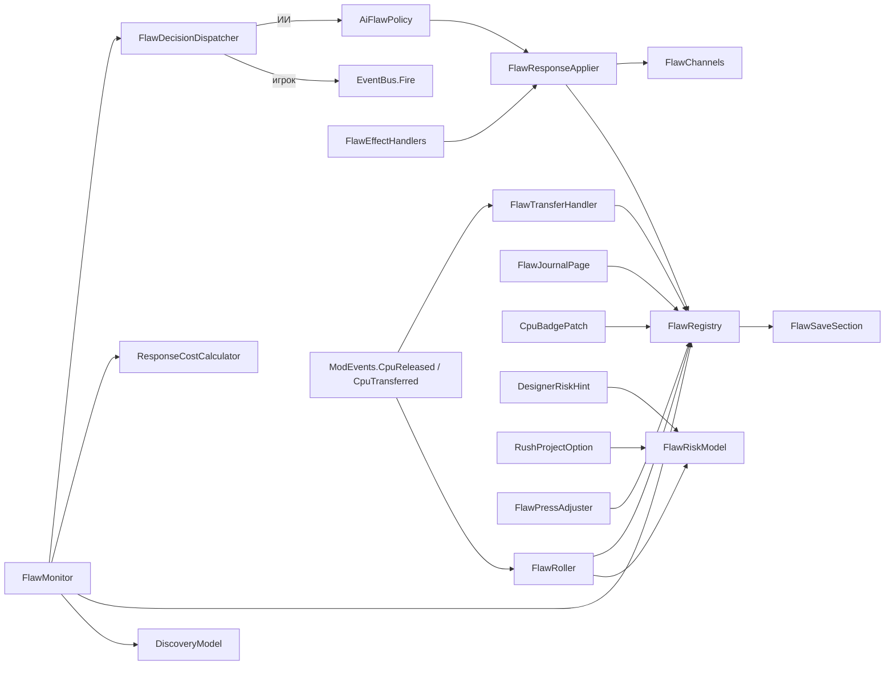
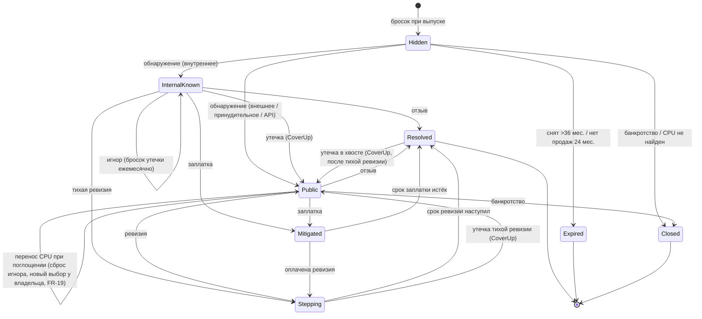
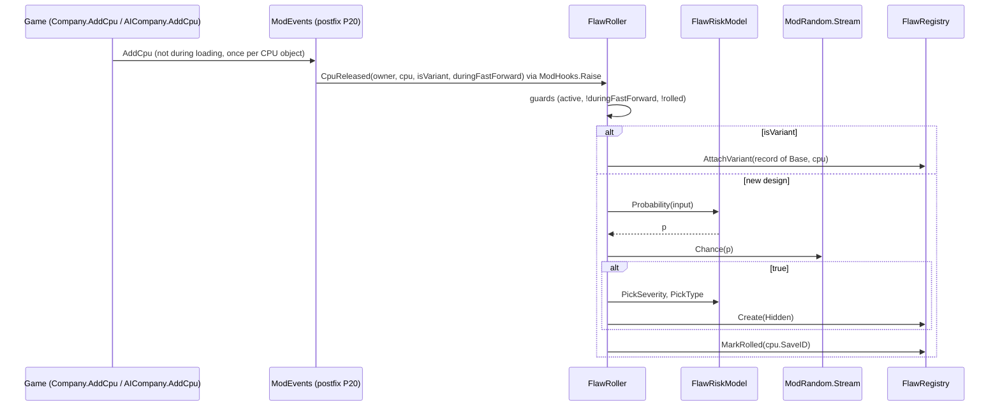
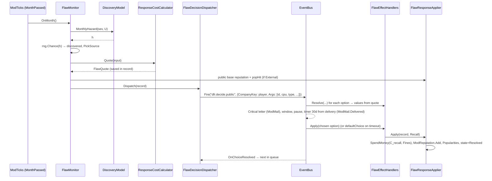
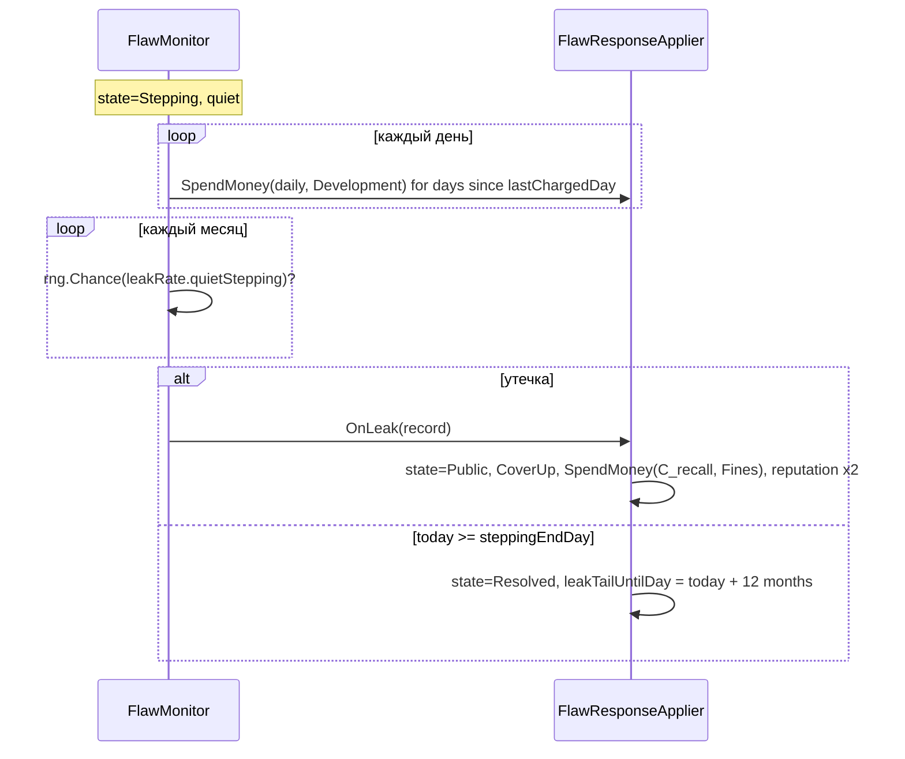
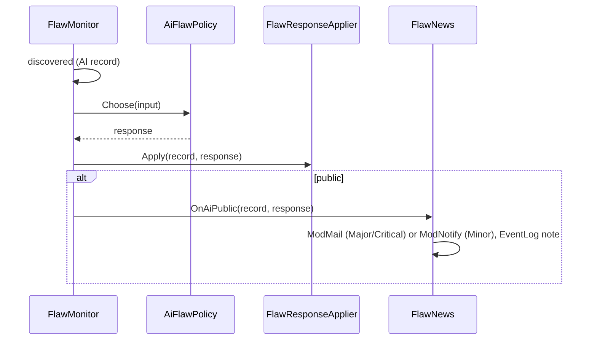

# Design: design-flaw-recalls

## Document Information

- **Feature Name**: design-flaw-recalls — скрытый брак в выпущенных CPU
- **Version**: 0.2
- **Date**: 2026-10-10
- **Author**: Dex719
- **Status**: Draft v0.2 — одобрено к реализации владельцем 2026-10-10
- **Reviewers**: владелец форка
- **Related Documents**:
  - `requirements.md` (эта папка);
  - `.kiro/steering/context.md` — архитектурный контракт `PTMod.Core`;
  - `.kiro/steering/owner-decisions.md` — решения владельца (внесены, см. `requirements.md`, «Решения по умолчанию»);
  - `.kiro/specs/mod-framework/design.md` — `IModFeature`, `ModTicks`, `ModSave`, `ModModifiers` (канал `market.rating.cpu` с областью CPU), `ModReputation`, `ModCompanies`, `ModEvents`, `ModMail`, `ModCredit`, `ModUI`;
  - `.kiro/specs/event-system/design.md` — `EventBus.Fire` / `EventFireContext`, `IEventEffectHandler`, `EventEffects`, `EventLog`;
  - `.kiro/specs/press-reviews/design.md` — `PressReviewsApi`, `IReviewAdjuster`, подписка на `FlawRegistry`;
  - `.kiro/specs/historical-events/design.md` — потребитель `FlawRegistry.ForceFlaw`;
  - `.kiro/specs/rival-personalities/design.md` — потребитель `FlawRegistry.SetResponseBias` и `OnFlawStateChanged` (осторожность ИИ);
  - `.kiro/specs/rival-acquisitions/design.md` — источник `ModEvents.CpuTransferred`;
  - решения 0002, 0004, 0005, 0006.

## Overview

Фича — класс `DesignFlawRecallsFeature : IModFeature` в `PTMod.Features.DesignFlawRecalls`. Жизненный цикл инцидента:

1. **Выпуск.**
   - Подписка на `ModEvents.CpuReleased` (событие единственного postfix ядра P20 на `Company.AddCpu` и `AICompany.AddCpu`) вызывает `FlawRoller`. Собственных патчей на `AddCpu` у фичи нет.
   - Он считает вероятность (`FlawRiskModel`) и бросает поток `ModRandom.Stream("design-flaw-recalls")`.
   - При успехе создаётся `FlawRecord` в состоянии `Hidden`.
   - При `ModEvents.CpuTransferred` (поглощение) запись переходит к новому владельцу (`FlawTransferHandler`).
2. **Месяц.** `FlawMonitor` по `ModTicks` (`TickPhase.MonthPassed`) бросает обнаружение (`DiscoveryModel`), утечки и истечение.
3. **Обнаружение.**
   - `ResponseCostCalculator` один раз считает котировку `FlawQuote` и сохраняет её в записи.
   - Игроку `FlawDecisionDispatcher` вызывает `EventBus.Fire(eventId, new EventFireContext { CompanyKey = "player", Args = [...] })`; первый аргумент — `recordId`.
   - ИИ решает сразу через `AiFlawPolicy`.
4. **Реакция.**
   - Движок предвычисляет эффекты вариантов через `Resolve` обработчиков `FlawRecall`, `FlawStepping`, `FlawSoftwarePatch`, `FlawIgnore`. Они берут числа из котировки, поэтому окно показывает ровно те суммы, что будут списаны.
   - После выбора `Apply` вызывает `FlawResponseApplier`. Он:
     - списывает деньги;
     - меняет репутацию (`ModReputation.Add`) и популярность;
     - добавляет записи `ModModifiers` (`market.rating.cpu` для CPU, `contract.signChance` для компании);
     - разрывает OEM-контракты.
5. **День.** `FlawMonitor` (`TickPhase.DayPassed`) ведёт ревизии и списания. Сроки хранятся датами окончания.
6. **Сохранение.** Секция `design-flaw-recalls` бокового файла через `IModSaveParticipant`; версию секции (`_schema`) пишет и читает ядро. Множители каналов сохраняет сам `ModModifiers` как записи со сроком.
7. **Спешка.** Необязательный переключатель «Ускоренный проект» в конструкторе (`RushProjectOption`) сокращает срок проекта и повышает риск; признак привязывается к CPU при завершении проекта.

### Design Goals

- Брак — следствие решений в конструкторе, а не случайный налог: вероятность растёт от измеримых параметров дизайна.
- Цена каждой реакции известна до выбора и совпадает с применённой (одна котировка).
- Никаких патчей формул рынка: только канал `market.rating.cpu` с областью CPU и `contract.signChance` с областью компании (`mod-framework`).
- Никаких собственных патчей на общие хуки ядра: выпуск и перенос CPU приходят событиями `ModEvents`, пакетный прогон — `ModTicks.IsBatchRun`.
- Симметрия игрок/ИИ: одни правила, разная точка принятия решения.
- Полное отключение и удаление без следов в игровом сейве (кроме уже применённых денег и популярности).

### Key Design Decisions

- **D1. Скрытый брак — отдельный бросок, а не порог `FailureRate`.**
  - IDEAS предлагает ежемесячно проверять порог `Cpu.FailureRate`. Но `FailureRate` фиксируется при создании дизайна (CODEMAP, Gotchas раздела Hardware). Месячная проверка была бы детерминированной: каждый агрессивный CPU «ломается» всегда.
  - Выбрано: один бросок при выпуске с вероятностью от `FailureRate` и других факторов, затем отложенное обнаружение.
- **D2. Бросок при выпуске (событие ядра `ModEvents.CpuReleased`), а не в конструкторе.**
  - Выпуск — общая точка игрока (`ProjectReleaseWindow.ReleaseCpu` → `Company.AddCpu`) и ИИ (`AIBehaviourCreation` → `AICompany.AddCpu`). У CPU уже есть `SaveID`, цена и производитель.
  - Событие поднимает единственный postfix ядра P20; правило «не при загрузке, не чаще одного раза на объект CPU» держит ядро. Фича получает `isVariant` и `duringFastForward` готовыми.
  - Отвергнуто: собственные постфиксы на `Company.AddCpu` и `AICompany.AddCpu` (цели закреплены за службой ядра, `ModHooks` отклонит патч; в v0.1 пять фич делали это по-разному).
  - Отвергнуто: постфикс `CreatorCpu.CreateCpu`. Покрывает только игрока, `SaveID` ещё не назначен, отменённый проект оставил бы мусорную запись.
  - Цена решения: нужно множество уже брошенных `SaveID` (`rolledCpuIds`) на случай мода, добавленного посреди партии; от `IsLoading` фича больше не защищается сама.
- **D3. Окно выбора — из `event-system`.**
  - Таймер, пауза, журнал, очередь (`maxPendingChoices`) и восстановление после загрузки уже решены в движке.
  - Отвергнуто: своё модальное окно.
  - Таймер считается от даты доставки письма (`max(firedDay, DeliveredOn) + timerDays`, движок подписан на `ModMail.Delivered`): письмо может прийти позже срабатывания из-за дневного лимита почты, а выбор идёт приоритетом `Critical` в обход лимита.
  - Доступность заплатки и игнора выражается разными определениями событий (`*.nopatch`, `*.leaked`), а не динамическим `requires`.
  - Аргументы текстов позиционные (`EventFireContext.Args`, `{0}`, `{1}`…).
- **D4. Потеря производительности при заплатке — запись `ModModifiers.Add` на канал `market.rating.cpu` с областью `ModifierScope.Cpu(saveId)`.**
  - Канал в `mod-framework` объявлен с `perCpu` и `perSegment`. Его постфикс (P4) умножает `Cpu.Ratings.Overall` до `Market.NormalizeRatings` и `Market.DiluteRatings`.
  - Отвергнуто: менять `CpuBase.Ips`. Значение сохраняется в ванильный сейв навсегда, ломает контракты (`Contract.AddOffer` проверяет `Ips`) и нормализацию рынка.
  - Отвергнуто: свой патч `Market.CalculateRatings` — метод зарезервирован каналом (`ModHooks.IsReservedByChannel`).
- **D5. Статьи расходов — существующие `ExpenseOrigin`.**
  - Отзыв, претензии и иски — `ExpenseOrigin.Fines` (7); ревизия и заплатка — `ExpenseOrigin.Development` (4).
  - Отвергнуто: `(ExpenseOrigin)9`. `CompanyFinance.Report.RegisterExpense` разбирает origin по `switch`.
  - Отвергнуто: `Company.AddMoney` (мимо отчётов и налогов).
- **D6. Ревизия — отсчёт мода, а не игровой `Project`.**
  - Отвергнуто: проект через `TimerScheduler`. Попадёт в ванильный сейв (`SaveObject.CpuProjects`) и после удаления мода восстановится как непонятный проект CPU.
- **D7. Реакция OEM — `ContractManager.RemoveContract` (без штрафа) и `contract.signChance` для компании.**
  - Отвергнуто: `ContractManager.BreakAllContracts`. Он списывает штраф с поставщика, а уходит клиент.
  - Отвергнуто: «пауза поставок». `ContractSeller.SellContracts` начислит штраф за недопоставку (`FinePerUnit`).
- **D8. ИИ решает в фиче (`AiFlawPolicy`), без `EventBus`.**
  - Внутренний брак ИИ должен оставаться скрытым от игрока. Экземпляр события ИИ попал бы в `EventLog`.
  - Решение зависит от запаса денег относительно динамической котировки. Политика по умолчанию движка (`aiMinCashMultiple`) считает только эффекты `Money`.
  - Запас денег = `MoneyAmount − ModCredit.ThresholdOf(company)` (порог дефолта берётся только из `ModCredit`, не из `CentralBank.DebtLimit`).
  - `rival-personalities` влияет через необязательный интерфейс `IFlawResponseBias`, который регистрирует вызовом `FlawRegistry.SetResponseBias` (порядок множителей: Recall, Stepping, Patch, Ignore). Осторожность ИИ при проектировании после брака — тоже у неё (решение владельца), данные берутся из `OnFlawStateChanged`. Публичные решения ИИ попадают в журнал через `FlawNews`.
- **D9. Котировка считается один раз** и хранится в записи. `Resolve` обработчиков берёт числа из неё. Это устраняет главный риск I13 — расхождение показанного и применённого.
- **D10. Варианты (`isVariant` / `Cpu.Base`) наследуют брак базового CPU:** один кристалл — один дефект. Признак спешки тоже наследуется от базового.
- **D11. Компании — по ключу `ModCompanies.KeyOf` (`player` / `ai:<UniqueID>`), CPU — по `SaveID`.** Сохранение `SaveID` компании не подтверждено (D7 `mod-framework`).
- **D12. Сроки — даты окончания** (день от 1971-01-01, как в `event-system`), а не счётчики вызовов (рекомендация `ModTicks`). Пропущенные во время загрузки дни ревизии доплачиваются при следующем тике. Пока фича выключена, ревизия не идёт: при включении `steppingEndDay` и `lastChargedDay` сдвигаются на число дней паузы (`today − lastActiveDay`). Срок заплатки — календарный, как у записи `ModModifiers` (её фреймворк не удаляет и не пересоздаёт).
- **D13. Записи `ModModifiers` выключенной фичи не удаляются и не пересоздаются.**
  - Правило применимости ядра (записи хранятся, но не применяются; провайдеры пропускаются) покрывает выключение: `OnDisabled` не вызывает `RemoveAll`, `OnEnabled` ничего не восстанавливает.
  - Отвергнуто: `RemoveAll` в `OnDisabled` и повторное создание в `OnEnabled` (v0.1) — теряются исходные сроки `ExpiresOn`.
- **D14. Причины репутации и модификаторов — ключи L10n фичи** (`dfr.rep.*`, `dfr.mod.*`), идентификатор записи пишется в `ModLog`. Так `Explain` и история репутации показывают переведённый текст, а префикс соответствует таблице ядра.
- **D15. Спешка проекта — патчи конструктора (Optional) и свой признак на CPU.**
  - `CreatorCpu.Project` (приватный) считает `projectCost` и `projectTime`; postfix уменьшает срок на `rush.timeCut` и увеличивает стоимость на `rush.costMultiplier`, если переключатель включён.
  - Привязка к CPU: `SaveID` нового CPU присваивается только при завершении проекта (`CreatorCpu.CreateCpu` → замыкание `<>c__DisplayClass92_0` → `ProjectCompletedHandler.AddCpu`), поэтому признак хранится как ожидающий проект (имя CPU и плановая дата завершения) и превращается в `rushCpuIds` при `ProjectCompletedHandler.AddCpu`.
  - Отвергнуто: менять игровой `Project` или `SaveObject.CpuProject` (попадут в ванильный сейв).
- **D16. Перенос CPU при поглощении — запись следует за базовым CPU** (`ModEvents.CpuTransferred`); штрафные эффекты уровня компании (`contract.signChance`, дренаж репутации, иск) не наследуются, чтобы поглощение не переносило чужие репутационные штрафы.

## Architecture

### System Context

```mermaid
graph TB
    subgraph Game["Processor Tycoon (Assembly-CSharp)"]
        AddCpu["Company.AddCpu / AICompany.AddCpu"]
        DC["DateController (OnMonthPassed, OnDayPassed)"]
        Contracts["ContractManager / ContractHelper"]
        Money["ICompany.SpendMoney"]
        CpuData["CpuBase (FailureRate, Temperature, MarketData, Popularities)"]
        SalesUI["CpuSalesUI"]
        Creator["CreatorCpu"]
        PCH["ProjectCompletedHandler.AddCpu"]
    end
    subgraph Core["PTMod.Core (mod-framework)"]
        Feat["IModFeature / FeatureContext"]
        Ticks[ModTicks]
        Save[ModSave]
        Mods["ModModifiers (market.rating.cpu, contract.signChance)"]
        Rep[ModReputation]
        Comp[ModCompanies]
        Rand[ModRandom]
        Content[ModContent]
        UI["ModUI / HubPage"]
        Mail["ModMail / ModNotify"]
        Evs["ModEvents (CpuReleased, CpuTransferred)"]
        Cred[ModCredit]
    end
    subgraph ES["event-system"]
        Bus[EventBus]
        Eff[EventEffects]
        Log[EventLog]
    end
    DFR["design-flaw-recalls"]
    PR["press-reviews"]
    HE["historical-events"]
    RP["rival-personalities (опционально)"]
    RA["rival-acquisitions (источник CpuTransferred)"]

    AddCpu -- "postfix P20 ядра" --> Evs
    Evs -- "CpuReleased / CpuTransferred" --> DFR
    RA -- "RaiseCpuTransferred" --> Evs
    DC --> Ticks --> DFR
    DFR --> Mods
    DFR --> Money
    DFR --> Contracts
    DFR --> CpuData
    DFR --> Rep
    DFR --> Bus
    Eff --> DFR
    DFR --> Mail
    DFR --> UI
    DFR --> Cred
    HE -- FlawRegistry.ForceFlaw --> DFR
    PR -- FlawRegistry.TryReveal / OnFlawStateChanged --> DFR
    DFR -- IReviewAdjuster --> PR
    RP -. "SetResponseBias(IFlawResponseBias)" .-> DFR
    DFR -. "OnFlawStateChanged" .-> RP
    SalesUI -- postfix --> DFR
    Creator -- "postfix / prefix (Optional)" --> DFR
    PCH -- "postfix (Optional)" --> DFR
```



### High-Level Architecture



Чистая логика (без Unity и игры, покрывается тестами; каждый публичный тип в `[Covers]`):
- `FlawRiskModel`, `DiscoveryModel`, `ResponseCostCalculator`;
- `AiFlawPolicy`, `FlawStateMachine`, `FlawContentValidator`, `RushMath`.

Адаптеры к игре — `GameCpuView`, `GameCompanyView`.

### Technology Stack

| Слой | Технология | Обоснование |
|---|---|---|
| Регистрация | `[ModFeature] IModFeature.Register(FeatureContext)` | контракт `mod-framework` |
| События ядра | `ModEvents.CpuReleased`, `ModEvents.CpuTransferred` (подписка в `Register`) | замена собственных патчей на `AddCpu`; ядро изолирует ошибки (`ModHooks.Raise`) |
| Патчи | Harmony через `ctx.Patch` / `[ModPatch]`, тела в `ModHooks.Guard`; только UI-постфиксы и патчи конструктора (все `Optional`) | решение 0002 |
| Время | `ctx.OnTick(TickPhase.MonthPassed / DayPassed)` | защиты от перемотки и загрузки |
| Состояние | `IModSaveParticipant`, секция `design-flaw-recalls`; `_schema` пишет ядро | решение 0004 |
| Множители | `ModModifiers.Add` (сохраняемые записи со сроком, не удаляются при выключении фичи) | D4, D7, D13 |
| Письма | `ModMail.Send` (`Normal`, теги `dfr:*`), `ModNotify.ShowKey` | приоритеты и квоты ядра |
| Порог дефолта | `ModCredit.ThresholdOf` | единый источник порога |
| Контент | `ModContent.LoadConfig` / `LoadRecords`, `Content/design-flaw-recalls/*.json` | решение 0006 |
| Выбор | `event-system` | D3 |
| UI | `ctx.HubPage`, `ModUI`, постфиксы на UI игры | решение 0005 |
| Случайность | `ModRandom.Stream("design-flaw-recalls")` | NFR-6 |

## Components and Interfaces

Все типы — в `namespace PTMod.Features.DesignFlawRecalls`.

### Component 1: DesignFlawRecallsFeature

```csharp
[ModFeature]
public sealed class DesignFlawRecallsFeature : IModFeature
{
    public string Id => "design-flaw-recalls";
    public string NameKey => "dfr.feature.name";
    public string DescriptionKey => "dfr.feature.desc";
    public string[] DependsOn => new[] { "event-system" };      // hard: decisions UI
    public bool EnabledByDefault => true;
    public bool SupportsHotToggle => true;

    public void Register(FeatureContext ctx);
    // ctx.Patch(typeof(CpuBadgePatch)); ctx.Patch(typeof(DesignerRiskHint)); ctx.Patch(typeof(RushProjectPatches));   // все Optional
    // ModEvents.CpuReleased += roller.OnCpuReleased; ModEvents.CpuTransferred += transfer.OnCpuTransferred;          // изоляцию ошибок даёт ModHooks.Raise
    // ctx.OnTick(TickPhase.MonthPassed, monitor.OnMonth); ctx.OnTick(TickPhase.DayPassed, monitor.OnDay);
    // ctx.SaveParticipant(saveSection); ctx.Param(...) x5; ctx.HubPage("dfr.journal.title", journal.Build);
    // EventEffects.Register("FlawRecall", ...) x4; PressBridge.Attach() if ModFeatures.IsActive("press-reviews")
    // ModTicks.GameReady += OnGameReady (сверка записей ModModifiers, подписка на BankruptcyHandler.OnCompanyWentBankrupt)
    public void OnEnabled();    // сдвиг сроков ревизии на длительность паузы (lastActiveDay); записи ModModifiers НЕ пересоздаются
    public void OnDisabled();   // запоминает lastActiveDay; записи ModModifiers НЕ удаляются (хранятся и не применяются)

    public static FlawRegistry Registry { get; }                // public API entry for other features
}
```

Параметры `ModSettings` (`ctx.Param`): `aiFlaws` (Bool, true), `showRiskHint` (Bool, true), `rushEnabled` (Bool, true), `flawFrequency` (Float, 1.0, 0.5–2.0, шаг 0.1), `debug` (Bool, false). Ключи параметров — полный slug фичи (`design-flaw-recalls`).

### Component 2: FlawRiskModel (чистая логика)

**Purpose**: вероятность, тяжесть и тип брака (FR-2, FR-3, FR-14).

```csharp
public struct FlawRiskInput
{
    public float FailureRate;      // CpuBase.FailureRate
    public float Frequency;        // CpuBase.Frequency
    public float MaxFrequency;     // ICompany.get_MaxFrequency() + ResearchModifiers.FrequencyIncrease (owner, at release)
    public float Temperature;      // CpuBase.Temperature
    public float SafeTemperature;  // IPackage.get_SafeTemperature()
    public float NodeProgress;     // Cpu.Manufacturer.CurrentNodeLearningProgress(cpu.ProcessNode)
    public bool  HasNodeRecord;    // manufacturer has NodeOptimization for this node
    public int   Year;             // release year
    public int   Difficulty;       // Player.DifficultyLevel (0..5)
    public bool  IsAi;
    public bool  Rush;             // CPU created with "rush project" (FR-20); always false for AI
}

public struct FlawRiskFactors { public float FR, OC, TH, NI, RS; }

public static class FlawRiskModel
{
    public static FlawRiskFactors Factors(FlawRiskInput input, FlawBalance b);
    public static float Probability(FlawRiskInput input, FlawBalance b, float settingsMultiplier);
    public static FlawSeverity PickSeverity(float probability, FlawBalance b, IModRng rng);
    public static FlawTypeDef PickType(FlawRiskFactors f, int year, IReadOnlyList<FlawTypeDef> types, IModRng rng);
}
```

`IModRng` — интерфейс `PTMod.Core` (`ModRandom.Stream`). В тестах — детерминированный фейк.

### Component 3: FlawRoller

**Purpose**: бросок при выпуске (FR-1).

- Вход — событие ядра `ModEvents.CpuReleased(owner, cpu, isVariant, duringFastForward)`. Загрузку сейва ядро отсекает само (события нет при `GameManager.get_IsLoading`).
- Защиты:
  - фича активна (`ModFeatures.IsActive`; ядро и так пропускает обработчики неактивных фич);
  - `duringFastForward == false` (политика владельца: перемотка нейтральна, запись не создаётся);
  - `SaveID` ещё не броскался (`rolledCpuIds`);
  - для ИИ включён параметр `aiFlaws`.
- Если `isVariant`, CPU привязывается к записи базового CPU (D10); без записи у базового вариант считается исправным.
- Иначе собрать `FlawRiskInput` (`GameCpuView`; `Rush` — из `rushCpuIds`), бросить, создать запись.

```csharp
internal sealed class FlawRoller
{
    // subscriber of ModEvents.CpuReleased; body in ModHooks.Guard; the core already isolates handler exceptions
    internal void OnCpuReleased(ICompany owner, Cpu cpu, bool isVariant, bool duringFastForward);
}
```

### Component 4: FlawRegistry (публичный API)

**Purpose**: хранилище записей и API для других фич (FR-13). Доступ — `DesignFlawRecallsFeature.Registry`.

```csharp
public sealed class FlawRegistry
{
    public bool TryReveal(int cpuSaveId, DiscoverySource source);
    public bool ForceFlaw(int cpuSaveId, string typeId, FlawSeverity severity, DiscoverySource discovery);
    public IReadOnlyList<FlawRecordView> GetKnownFlaws(ICompany company);   // only non-Hidden
    public IReadOnlyList<FlawRecordView> GetAllKnownFlaws();
    public FlawRecordView FindByCpu(int cpuSaveId);                          // null if none or Hidden
    public event Action<FlawRecordView> OnFlawStateChanged;                 // press-reviews, rival-personalities, journal

    // Single slot for the optional AI response bias (rival-personalities calls it in Register/OnEnabled; null clears).
    public void SetResponseBias(IFlawResponseBias bias);

    internal FlawRecord Create(string companyKey, Cpu cpu, FlawTypeDef type, FlawSeverity sev, float risk);
    internal void AttachVariant(FlawRecord record, Cpu variant);
    internal bool WasRolled(int cpuSaveId);
    internal void MarkRolled(int cpuSaveId);
    internal bool IsRush(int cpuSaveId);                                    // rushCpuIds
    internal void MoveOwner(FlawRecord record, string newCompanyKey);       // FlawTransferHandler
    internal IEnumerable<FlawRecord> Active { get; }                        // not Resolved/Expired/Closed
}

public sealed class FlawRecordView   // read-only snapshot
{
    public int Id; public string CompanyKey; public int BaseCpuId; public IReadOnlyList<int> CpuIds;
    public string TypeId; public FlawSeverity Severity; public FlawState State;
    public FlawResponse Response; public DiscoverySource Source; public bool CoverUp;
    public int DaysLeft; public float SpentTotal; public float IpsLoss;
    public int PublicSinceDay;      // day (from 1971-01-01) when the flaw became Public; 0 if never (rival-personalities caution)
}
```

### Component 5: DiscoveryModel (чистая логика)

**Purpose**: шанс обнаружения, источник, принудительность, истечение, утечка (FR-4).

```csharp
public static class DiscoveryModel
{
    public static float MonthlyHazard(FlawSeverity sev, long unitsSold, FlawBalance b);
    public static bool IsForced(FlawSeverity sev, int monthsSinceRelease, long unitsSold, FlawBalance b);
    public static bool IsExpired(bool retired, int monthsSinceRetired, int monthsSinceRelease, long unitsSold, FlawBalance b);
    public static DiscoverySource PickSource(FlawSeverity sev, IModRng rng, FlawBalance b); // Internal | External
    public static float LeakRate(FlawResponse response, bool steppingDone, FlawBalance b);
}
```

### Component 6: FlawMonitor

**Purpose**: месячный и дневной цикл (FR-4, FR-7, FR-8, FR-9).

```csharp
internal sealed class FlawMonitor
{
    internal void OnMonth();   // TickPhase.MonthPassed
    internal void OnDay();     // TickPhase.DayPassed
}
```

- `OnMonth` — для каждой активной записи по порядку `Id`:
  1. закрыть, если владелец обанкротился (`ICompany.get_IsBankrupt`, ключ не разрешается `ModCompanies.Resolve`) или CPU не найден (`CpuDataProvider.Instance.GetCpu` → null);
  2. `Hidden`: истечение, принудительное обнаружение, бросок `h`;
  3. `InternalKnown` с игнором или тихой ревизией: бросок утечки;
  4. публичный игнор: дренаж репутации, бросок иска;
  5. хвост утечки после тихой ревизии.
- `OnDay` — ревизия: за каждый день от `lastChargedDay` до сегодня `SpendMoney(steppingDailyCost, Development)`. При `today ≥ steppingEndDay` — завершение. Заплатка завершается при `today ≥ mitigationEndDay`; запись `ModModifiers` истекает сама. В конце тика `lastActiveDay = today`.
- `OnResume` (из `OnEnabled` и `GameReady(Loaded)`) — `pause = today − lastActiveDay − 1`; если `pause > 0`, сдвинуть `steppingEndDay` и `lastChargedDay` активных ревизий на `pause` (ревизия не шла, пока фича была выключена; день, в который фича включена, оплачивается как обычный); `mitigationEndDay` и сроки утечек не сдвигаются (календарные, как у записей `ModModifiers`).
- Пакетный прогон (`ModTicks.IsBatchRun`): `OnDay` и `OnMonth` вызываются по дням как обычно; письма и окна откладывает ядро до `BatchEnded`, так что монитор не проверяет признак сам.

### Component 7: ResponseCostCalculator (чистая логика)

```csharp
public struct QuoteInput
{
    public FlawSeverity Severity; public FlawTypeDef Type;
    public long AffectedUnits;       // sum of MarketData.Sold + SoldByContracts over affected CPUs
    public int  StockUnits;          // sum of MarketData.Stock over affected CPUs
    public float RealUnitCost;       // Cpu.get_RealUnitCost() of base CPU
    public float Price;              // CpuBase.Price of base CPU (if 0: max price among variants)
    public float DevelopmentCost;    // CpuBase.DevelopmentCost of base CPU
    public float InflationNow;       // InflationHandler.Instance.Inflation
    public float InflationAtRelease; // stored in record
    public float Revenue12m;         // sum of last 12 closed CompanyFinance.Report.TotalRevenues
    public int  Year;
}

public sealed class FlawQuote
{
    public float RecallCost; public bool RecallCapped;
    public float SteppingCost; public int SteppingDays; public float SteppingDailyCost;
    public float ResidualClaimsCost;
    public bool  PatchAvailable; public float PatchCost; public float PatchIpsLoss; public int PatchMonths;
    public float ClassActionCost;
    public float OemCancelChance; public float IgnoreSignChanceMultiplier;
    public int   ReputationRecall, ReputationStepping, ReputationPatch, ReputationIgnore;
    public long  AffectedUnits;
}

public static class ResponseCostCalculator
{
    public static FlawQuote Quote(QuoteInput input, FlawBalance b);
}
```

### Component 8: FlawDecisionDispatcher

**Purpose**: доставка решения игроку или ИИ (FR-5, FR-11).

- Игрок:
  - выбрать определение по ситуации и доступности заплатки (`dfr.decide.public`, `.public.nopatch`, `.internal`, `.internal.nopatch`, `.leaked`, `.leaked.nopatch`);
  - вызвать `EventBus.Fire(id, new EventFireContext { CompanyKey = "player", Args = args, IgnoreConditions = true })`;
  - `Args`: `[0]` `recordId`, `[1]` имя CPU, `[2]` тип, `[3]` тяжесть, `[4]` затронуто единиц, `[5]` котировка отзыва, `[6]` ревизии, `[7]` дней ревизии, `[8]` заплатки, `[9]` % потерь, `[10]` месяцев заплатки (отформатированы `StringFormatter.FloatToMoney`).
- Если `Fire` вернул не `Fired`/`Scheduled` (например, `Disabled`), применить `defaultChoice` и отправить письмо `ModMail` (`MailPriority.Normal`, `Tag = "dfr:auto:<recordId>"`, ключи `dfr.mail.auto.*`); ID письма фича в записи не хранит (письмо информационное).
- Письмо выбора отправляет движок (`Critical`, тег `es:<instanceId>`); фича связывает экземпляр с записью по `Args[0]` и своих писем выбора не шлёт. Таймер выбора считает движок от даты доставки письма (`ModMail.Delivered`).
- Очередь (FR-5 п. 6):
  - собственная очередь `pendingDecisionQueue`;
  - движок дополнительно ограничивает число ожидающих выборов (`maxPendingChoices`);
  - следующее решение отправляется по `EventBus.OnChoiceResolved`.
- Для публичного брака — запись `ModModifiers.Add(feature, "contract.signChance", ModifierScope.Company(key), 0.8, timerDays + pendingGraceDays, "dfr.mod.pending")`. Она снимается при решении; страховочный срок `pendingGraceDays` (14) покрывает задержку доставки письма. После загрузки сверка (`FlawChannels.Reconcile`) снимает такие записи у записей, которые уже не ждут решения.
- ИИ: `AiFlawPolicy.Choose` → `FlawResponseApplier.Apply`.

```csharp
internal sealed class FlawDecisionDispatcher
{
    internal void Dispatch(FlawRecord record);
    internal void OnChoiceResolved(EventInstance instance, string choiceId, bool auto);  // EventBus.OnChoiceResolved
}
```

### Component 9: FlawEffectHandlers

**Purpose**: типы эффектов `event-system` (FR-6–FR-9).

```csharp
// IEventEffectHandler (event-system): Type, Validate, Resolve, Apply, Describe
internal abstract class FlawEffectBase : IEventEffectHandler
{
    public abstract string Type { get; }
    public bool Validate(EventEffect spec, IList<string> errors);                 // no params required
    public AppliedEffect Resolve(EventEffect spec, EventContext ctx);             // recordId = ctx.Instance.Data.args[0];
                                                                                  // value = quote cost (negative = spend)
    public void Apply(AppliedEffect effect, EventContext ctx);                    // FlawResponseApplier.Apply(record, response, auto)
    public EffectText Describe(AppliedEffect effect);                             // "dfr.fx.recall" + formatted cost, etc.
}
internal sealed class FlawRecallEffect : FlawEffectBase        { public override string Type => "FlawRecall"; }
internal sealed class FlawSteppingEffect : FlawEffectBase      { public override string Type => "FlawStepping"; }
internal sealed class FlawSoftwarePatchEffect : FlawEffectBase { public override string Type => "FlawSoftwarePatch"; }
internal sealed class FlawIgnoreEffect : FlawEffectBase        { public override string Type => "FlawIgnore"; }
```

`Apply` идемпотентен: если запись уже не ждёт решения (например, повтор после загрузки), он пишет `ModLog.Warn` и ничего не делает.

### Component 10: FlawResponseApplier

```csharp
internal sealed class FlawResponseApplier
{
    internal void Apply(FlawRecord record, FlawResponse response, bool automatic);
    internal void OnLeak(FlawRecord record);                    // InternalKnown/Stepping/Resolved(tail) -> Public + CoverUp
    internal void CompleteStepping(FlawRecord record);
    internal void ExpireMitigation(FlawRecord record);
    internal void FundSteppingForMitigated(FlawRecord record);  // FR-8 п. 5
}
```

- Деньги — через `ICompany.SpendMoney(value, origin)` (`Company.SpendMoney` / `AICompany.SpendMoney`).
- Репутация — через `ModReputation.Add(company, delta, reasonKey)`, где `reasonKey` — ключ L10n фичи: `dfr.rep.public`, `dfr.rep.recall`, `dfr.rep.stepping`, `dfr.rep.patch`, `dfr.rep.ignore`, `dfr.rep.drain`, `dfr.rep.leak` (D14). Идентификатор записи пишется в `ModLog.Info`.
- Популярность — прямое умножение `CpuBase.Popularities[k]`; индекс `k` = `(int)Segment` (0 HighEnd, 1 MidRange, 2 LowEnd, 3 Industries).

### Component 11: FlawChannels

**Purpose**: записи `ModModifiers` (FR-5 п. 5, FR-8, FR-9).

```csharp
internal sealed class FlawChannels
{
    // market.rating.cpu, scope Cpu(saveId), reasonKey "dfr.mod.patch": returns entryId stored in the record
    internal string AddCpuRating(int cpuSaveId, float multiplier, int durationDays, int recordId);
    // contract.signChance, scope Company(key), reasonKey "dfr.mod.pending" | "dfr.mod.ignore"
    internal string AddSignChance(string companyKey, float multiplier, int durationDays, int recordId, string reasonKey);
    internal void Remove(string entryId);                 // ModModifiers.Remove
    internal void RemoveAllOfRecord(FlawRecord record);   // bankruptcy, funded stepping
    internal void RemoveCompanyEntries(FlawRecord record); // CpuTransferred: only company-scoped entries
    internal void Reconcile();                            // after GameReady(Loaded): warn about lost ids, drop stale "pending" entries
}
```

Записи сохраняет `ModModifiers` (секция ядра) и снимает по сроку. Выключенная фича их не применяет (правило применимости `mod-framework`), поэтому снимать их при выключении не нужно и нельзя (D13): `RemoveAll` в `OnDisabled` не вызывается, `OnEnabled` записи не пересоздаёт. `ModModifiers.Add`/`Remove` сами сбрасывают дневной кеш канала, отдельный `Invalidate` не нужен.

### Component 12: AiFlawPolicy (чистая логика)

```csharp
public struct AiDecisionInput
{
    public bool IsPublic; public bool PatchAvailable;
    public float CashHeadroom;          // company.MoneyAmount - ModCredit.ThresholdOf(company)  (the threshold is negative)
    public FlawQuote Quote;
    public float[] BiasMultipliers;     // optional IFlawResponseBias; null = 1.0
}
public static class AiFlawPolicy
{
    public static FlawResponse Choose(AiDecisionInput input, AiPolicyDef def, IModRng rng);
}

public interface IFlawResponseBias       // optional, implemented by rival-personalities; registered via FlawRegistry.SetResponseBias
{
    float[] Multipliers(ICompany company, bool isPublic);   // [recall, stepping, patch, ignore]; null or wrong length = all 1.0
}
```

Вызов `bias.Multipliers` идёт внутри `ModHooks.Guard` (исключение → множители 1.0 и счётчик ошибок вызывающей фичи). Фича не патчит `AIBehaviourCreation.AcceptableFailureRate`: осторожность ИИ после брака ведёт `rival-personalities` по `FlawRegistry.OnFlawStateChanged` (решение владельца).

### Component 13: FlawNews

```csharp
internal sealed class FlawNews
{
    // Major/Critical: ModMail.Send(MailPriority.Normal, Tag = "dfr:news:<recordId>"); Minor: ModNotify.ShowKey("design-flaw-recalls", "dfr.news.rival.title", ...)
    internal void OnAiPublic(FlawRecord record, FlawResponse response);
    internal void OnPlayerAutoChoice(FlawRecord record);                // note "решено автоматически"
}
```

Показ писем и уведомлений во время перемотки, загрузки и пакетного прогона откладывает ядро (`ModMail`, `ModNotify`); при `duringFastForward` записей и новостей нет.

### Component 14: FlawJournalPage (UI)

**Purpose**: страница «Брак и отзывы» в хабе «Моды» (FR-12), `ctx.HubPage("dfr.journal.title", build)`.
- Вкладки через `ModUI.Button`: «Мои CPU», «Соперники».
- Строки через `ModUI.Info` в `ModUI.ScrollView`.
- Кнопка «Профинансировать ревизию» с подтверждением `ModUI.Confirm`.
- Отладочная кнопка «Принудительный брак у CPU…» (`ModUI.Dropdown` + `Button`) — только при `debug = true` и в отладочной сборке, для ручных сценариев владельца.

### Component 15: CpuBadgePatch, DesignerRiskHint и RushProjectOption (UI-патчи)

- `CpuBadgePatch` (Should, FR-12 п. 3):
  - постфикс `CpuSalesUI.UpdateDailyTexts`;
  - дописывает к имени CPU `<color=#hex>[Брак: статус]</color>`, цвет из `Colors.Instance.DynamicNegativeHex`.
- `DesignerRiskHint` (Could, FR-14):
  - постфикс `CreatorCpu.UpdateInfoTexts`;
  - строка «Риск скрытого брака: ~N %»;
  - значения читаются из приватных полей `CreatorCpu` (`failureRate`, `frequency`, `maxFrequency`, `temperature`, `currentPackage`, `currentLithography`, `nodeManufacturer`) через `AccessTools`; признак спешки берётся из `RushProjectOption.IsOn`.
- `RushProjectOption` (Should, FR-20) — патчи `RushProjectPatches`, все `Optional`:
  - постфикс `CreatorCpu.Project` (приватный): если переключатель включён, `projectTime = max(1, round(projectTime × (1 − timeCut)))`, `projectCost *= costMultiplier` (поля `projectTime`, `projectCost` — через `AccessTools`/`___`-инъекцию); `UpdateInfoTexts` затем показывает изменённые значения;
  - переключатель — `ModUI.Toggle` «Ускоренный проект» в панели конструктора; при переключении вызывается пересчёт конструктора (приватный `CreatorCpu.UpdateUI` через `AccessTools`); если родитель в сцене не найден (самопроверка), переключатель не создаётся и опция недоступна (FR-20 п. 5);
  - prefix `CreatorCpu.CreateCpu`: если переключатель включён, запоминает ожидающий проект `{ name = nameInput.text, plannedEndDay = today + projectTime }` (после postfix `Project` значение `projectTime` уже сокращено);
  - postfix `ProjectCompletedHandler.AddCpu(Cpu cpu)`: ищет ожидающий проект по имени CPU и дате завершения (допуск ±3 дня), при совпадении заносит `cpu.SaveID` в `rushCpuIds` и удаляет ожидающий проект;
  - после выпуска CPU `FlawRoller` берёт признак из `rushCpuIds`; вариант CPU наследует признак базового;
  - ИИ спешку не использует. Чистая логика пересчёта — `RushMath` (`ApplyTime`, `ApplyCost`) с тестами.

### Component 15a: FlawTransferHandler (ModEvents.CpuTransferred)

**Purpose**: FR-19.

```csharp
internal sealed class FlawTransferHandler
{
    // subscriber of ModEvents.CpuTransferred(from, to, cpu); body in ModHooks.Guard
    internal void OnCpuTransferred(ICompany from, ICompany to, Cpu cpu);
}
```

- Находит активную запись по `cpu.SaveID` (индекс «базовый CPU → запись»). Вариант (`Cpu.Base != null`) игнорируется: запись следует за базовым.
- `FlawRegistry.MoveOwner(record, ModCompanies.KeyOf(to))`; `FlawChannels.RemoveCompanyEntries(record)` снимает записи уровня компании (`contract.signChance`), записи уровня CPU (`market.rating.cpu`) остаются.
- `Hidden`, `InternalKnown` (без реакции), `Stepping`, `Mitigated` — состояние и сроки сохраняются; монитор дальше списывает ревизию с нового владельца (`ModCompanies.Resolve(record.CompanyKey)`).
- `Public` с игнором — сбросить `ignoreDrainUntilDay`, `suitFiled`, `CoverUp` и вызвать `FlawDecisionDispatcher.Dispatch(record)`: игрок получает выбор `dfr.decide.public*`, ИИ — `AiFlawPolicy`.
- Порядок событий `rival-acquisitions`: `CpuTransferred` для всех CPU поднимается раньше вызова `OnCompanyWentBankrupt` для поглощённой компании. Если порядок нарушен, запись закрывается по FR-4 п. 5 с записью в лог.

### Component 16: FlawPressAdjuster (связь с press-reviews)

**Purpose**: FR-18.

```csharp
internal sealed class FlawPressAdjuster : IReviewAdjuster   // press-reviews API
{
    public string Id => "design-flaw-recalls";
    public void Adjust(Cpu cpu, ReviewDraft draft);   // known, not closed flaw: draft.OverallAdjustment += -8 (Minor) / -15 (Major, Critical)
}                                                     // + draft.Notes "press.note.knownFlaw"
```

Регистрируется `PressReviewsApi.RegisterAdjuster`, если `ModFeatures.IsActive("press-reviews")`. Статьи о браке публикует сама `press-reviews` по `OnFlawStateChanged`, фича их не дублирует.

### Component 17: FlawSaveSection и FlawContentValidator

- `FlawSaveSection : IModSaveParticipant` — `SectionId = "design-flaw-recalls"`, `SchemaVersion = 1` (свойство участника), `Read(section, schema)` / `Write()` через `ModJson.Bind`/`ModJson.From`, `ResetToDefaults`. Поле `_schema` пишет и читает ядро; в DTO фичи поля версии нет, `Write()` его не возвращает.
- `FlawContentValidator` — диапазоны (раздел Security), значения по умолчанию, ошибки в `ModLog`.

## Патчи Harmony

Все патчи фичи — UI и конструктор, все `Optional` (сбой не делает фичу `Unavailable`, соответствующая возможность отключается). Патчей на `Company.AddCpu` и `AICompany.AddCpu` нет: выпуск и перенос CPU приходят событиями ядра (`ModHooks` такие патчи отклоняет).

| Цель (`Class.Method`) | Тип | Что меняет | Порядок и конфликты |
|---|---|---|---|
| `CpuSalesUI.UpdateDailyTexts` | postfix, `Optional` | Пометка брака на карточке (FR-12 п. 3) | Только текст имени; `Priority` 200 (после других модов) |
| `CreatorCpu.UpdateInfoTexts` | postfix, `Optional` | Строка оценки риска (FR-14, Could) | `research-tree-ux`, `cpu-architectures` могут патчить конструктор; `Priority` 200 |
| `CreatorCpu.Project` (приватный) | postfix, `Optional` | Срок и стоимость проекта при включённой спешке (FR-20) | `cpu-architectures` меняет стоимость проекта в канале `development.cost.design` внутри `CpuMath.ProjectCost`; множители коммутативны, порядок не важен |
| `CreatorCpu.CreateCpu` (приватный) | prefix, `Optional` | Запоминает ожидающий проект со спешкой (FR-20) | Оригинал не пропускается |
| `ProjectCompletedHandler.AddCpu` | postfix, `Optional` | Превращает ожидающий проект в `SaveID` в `rushCpuIds` (FR-20) | `cpu-architectures` тоже слушает этот момент: независимы |

Патча на `Market.CalculateRatings` нет: метод зарезервирован каналом `market.rating.cpu` (D4). Патча на `AIBehaviourCreation.AcceptableFailureRate` нет: осторожность ИИ — зона `rival-personalities`.

## Подписки на события

| Событие | Обработчик | Защиты |
|---|---|---|
| `ModEvents.CpuReleased` | `FlawRoller.OnCpuReleased` | Ядро: не при загрузке, не чаще 1 раза на CPU; фича: `duringFastForward` → без записи |
| `ModEvents.CpuTransferred` | `FlawTransferHandler.OnCpuTransferred` | Ядро изолирует исключения (`ModHooks.Raise`); `CpuReleased` при переносе не поднимается |
| `TickPhase.MonthPassed` | `FlawMonitor.OnMonth` | `ModTicks`: не при перемотке и загрузке; фича активна |
| `TickPhase.DayPassed` | `FlawMonitor.OnDay` | То же; доплата пропущенных дней по датам (D12) |
| `ModTicks.GameReady` | `FlawMonitor.OnResume`, `FlawChannels.Reconcile`, переподписка на `BankruptcyHandler.OnCompanyWentBankrupt` | Один раз на сцену (игра обнуляет события при смене сцены) |
| `ModSave` (участник) | `FlawSaveSection.Read/Write/ResetToDefaults` | Ядро: `Read` после `SaveHandler.OnLoaded`, `Write` в postfix `SaveSystem.Save` (P12) |
| `EventBus.OnChoiceResolved` | `FlawDecisionDispatcher.OnChoiceResolved` | Только события `dfr.*` |
| `BankruptcyHandler.OnCompanyWentBankrupt` | закрыть записи компании, снять её записи `ModModifiers` | Переподписка на каждую загрузку (объект сцены) через `ModTicks.GameReady` |
| `ModFeatures.StateChanged` | `OnEnabled` / `OnDisabled` | — |

## Data Models

### Перечисления

```csharp
public enum FlawSeverity { Minor = 0, Major = 1, Critical = 2 }
public enum FlawState { Hidden = 0, InternalKnown = 1, Public = 2, Stepping = 3, Mitigated = 4, Resolved = 5, Expired = 6, Closed = 7 }
public enum DiscoverySource { None = 0, Internal = 1, External = 2, Leak = 3, Forced = 4, Api = 5 }
public enum FlawResponse { None = 0, Recall = 1, Stepping = 2, Patch = 3, Ignore = 4 }
```

### Диаграмма состояний



### Секция `ModSave` (`features["design-flaw-recalls"]`)

Дни — целые дни от 1971-01-01, как в `event-system`. Поле версии секции (`_schema`) пишет и читает ядро (`IModSaveParticipant.SchemaVersion = 1`); в DTO его нет.

```csharp
public sealed class FlawSaveData
{
    public int nextRecordId = 1;
    public int lastActiveDay;                                  // last tick of OnDay while enabled (pause shift, D12)
    public List<int> rolledCpuIds = new List<int>();           // FR-1 п. 5
    public List<int> rushCpuIds = new List<int>();             // FR-20: CPUs created with "rush project"
    public List<RushProjectDto> rushProjects = new List<RushProjectDto>();   // FR-20: pending (not yet completed) rush projects
    public List<FlawRecordDto> records = new List<FlawRecordDto>();
    public List<int> pendingDecisionQueue = new List<int>();   // FR-5 п. 6
}

public sealed class RushProjectDto { public string companyKey; public string cpuName; public int plannedEndDay; }

public sealed class FlawRecordDto
{
    public int id; public string companyKey; public int baseCpuId;
    public List<int> cpuIds;            // base + variants
    public string typeId;
    public int severity, state, source, response;
    public bool coverUp, automaticChoice, suitFiled, quietStepping;
    public float riskAtRelease, inflationAtRelease;
    public int releaseDay, discoveredDay, publicSinceDay;
    public long unitsAtDiscovery;
    public FlawQuoteDto quote;          // D9
    public int steppingEndDay, lastChargedDay; public float steppingDailyCost;
    public int mitigationEndDay; public float ipsLoss;
    public int ignoreDrainUntilDay, leakTailUntilDay;
    public List<string> modifierEntryIds;   // ModModifiers entries (market.rating.cpu, contract.signChance)
    public float spentTotal;
}
public sealed class FlawQuoteDto { /* поля FlawQuote один в один */ }
```

Пример секции (без поля версии; `_schema` добавит ядро при записи):

```json
{
  "nextRecordId": 4,
  "lastActiveDay": 17010,
  "rolledCpuIds": [1012, 1013, 2044, 2051],
  "rushCpuIds": [2051],
  "rushProjects": [ { "companyKey": "player", "cpuName": "Nova 3", "plannedEndDay": 17240 } ],
  "records": [
    {
      "id": 3, "companyKey": "player", "baseCpuId": 2044, "cpuIds": [2044, 2059],
      "typeId": "security", "severity": 1, "state": 4, "source": 2, "response": 3,
      "coverUp": false, "automaticChoice": false, "suitFiled": false, "quietStepping": false,
      "riskAtRelease": 0.167, "inflationAtRelease": 6.6,
      "releaseDay": 16860, "discoveredDay": 17167, "publicSinceDay": 17167,
      "unitsAtDiscovery": 3200000,
      "quote": {
        "RecallCost": 254600000, "RecallCapped": false,
        "SteppingCost": 30000000, "SteppingDays": 90, "SteppingDailyCost": 333333.3,
        "ResidualClaimsCost": 72000000,
        "PatchAvailable": true, "PatchCost": 7250000, "PatchIpsLoss": 0.12, "PatchMonths": 18,
        "ClassActionCost": 57600000, "OemCancelChance": 0.3, "IgnoreSignChanceMultiplier": 0.85,
        "ReputationRecall": 2, "ReputationStepping": -1, "ReputationPatch": -2, "ReputationIgnore": -8,
        "AffectedUnits": 3200000
      },
      "steppingEndDay": 0, "lastChargedDay": 0, "steppingDailyCost": 0,
      "mitigationEndDay": 17707, "ipsLoss": 0.12,
      "ignoreDrainUntilDay": 0, "leakTailUntilDay": 0,
      "modifierEntryIds": ["m-000017"],
      "spentTotal": 7250000
    }
  ],
  "pendingDecisionQueue": []
}
```

### Контент: `Content/design-flaw-recalls/flaws.json`

```json
{
  "schema": 1,
  "risk": {
    "base": 0.02, "kFailureRate": 0.20, "kOverclock": 0.30, "kThermal": 0.60, "kNodeImmaturity": 0.08, "kRush": 0.06,
    "overclockCap": 0.5, "unknownNodeImmaturity": 0.5, "pMax": 0.5, "aiRiskMultiplier": 1.0,
    "difficultyMultiplier": [0.5, 0.75, 1.0, 1.15, 1.3, 1.5],
    "era": [ { "fromYear": 1971, "toYear": 1984, "multiplier": 0.8 },
             { "fromYear": 1985, "toYear": 1999, "multiplier": 1.0 },
             { "fromYear": 2000, "toYear": 2030, "multiplier": 1.1 } ]
  },
  "severity": { "baseWeights": [0.60, 0.30, 0.10], "shiftMajor": 2.0, "shiftCritical": 4.0 },
  "discovery": {
    "hBase": [0.02, 0.04, 0.07], "kUnits": 1.0, "unitsRef": 100000, "hMax": 0.35,
    "maxHiddenMonths": [48, 36, 24],
    "qInternal": [0.65, 0.55, 0.40],
    "expireAfterRetiredMonths": 36, "expireNoSalesMonths": 24,
    "leakRate": { "ignore": 0.06, "quietStepping": 0.03, "tail": 0.015 }, "leakTailMonths": 12
  },
  "responses": {
    "timerDays": 30,
    "pendingSignChanceMultiplier": 0.8,
    "pendingGraceDays": 14,
    "recall": { "returnRate": [0.10, 0.25, 0.45], "logisticsShareOfPrice": 0.15,
                "fixedCostBase": 2000000, "stockReworkShare": 0.5, "capShareOfRevenue12m": 0.30 },
    "stepping": { "costShareOfDevCost": [0.15, 0.25, 0.35], "days": [60, 90, 120],
                  "residualShareOfRecall": 0.30 },
    "patch": { "costShareOfDevCost": 0.03, "fixedCostBase": 500000, "months": [12, 18, 24] },
    "ignore": { "oemCancel": [0.10, 0.30, 0.60], "signChance": [0.95, 0.85, 0.70], "signChanceMonths": 12,
                "classAction": [0.0, 0.05, 0.10], "suitShareOfRevenue": 0.03, "drainMonths": 12, "drainPerMonth": -1 },
    "popHit": { "public": [0.02, 0.04, 0.08], "recall": [0.0, 0.01, 0.02], "stepping": [0.01, 0.02, 0.04],
                "patch": [0.01, 0.02, 0.03], "ignore": [0.05, 0.12, 0.20] }
  },
  "reputation": {
    "publicBase": [-2, -5, -10],
    "recall": [1, 2, 4], "steppingPublic": [0, -1, -3], "steppingQuiet": [0, 0, 0],
    "patch": [-1, -2, -4], "ignorePublic": [-3, -8, -15],
    "coverUpMultiplier": 2.0
  },
  "press": { "overallAdjustment": [-8, -15, -15] },
  "types": [
    { "id": "arith",     "nameKey": "dfr.type.arith",     "fromYear": 1971, "toYear": 2030, "weight": 3,
      "weightByOverclock": 0, "weightByThermal": 0,
      "patchable": true, "patchFromYear": 1995, "ipsLoss": [0.03, 0.06, 0.10], "recallable": true },
    { "id": "stability", "nameKey": "dfr.type.stability", "fromYear": 1971, "toYear": 2030, "weight": 3,
      "weightByOverclock": 5, "weightByThermal": 0,
      "patchable": true, "patchFromYear": 1990, "ipsLoss": [0.08, 0.12, 0.18], "recallable": true },
    { "id": "thermal",   "nameKey": "dfr.type.thermal",   "fromYear": 1971, "toYear": 2030, "weight": 2,
      "weightByOverclock": 0, "weightByThermal": 5,
      "patchable": true, "patchFromYear": 1985, "ipsLoss": [0.06, 0.10, 0.15], "recallable": true },
    { "id": "security",  "nameKey": "dfr.type.security",  "fromYear": 2015, "toYear": 2030, "weight": 2,
      "weightByOverclock": 0, "weightByThermal": 0,
      "patchable": true, "patchFromYear": 2015, "ipsLoss": [0.05, 0.12, 0.25], "recallable": true }
  ],
  "aiPolicy": {
    "public":   { "recall": 0.30, "stepping": 0.30, "patch": 0.25, "ignore": 0.15 },
    "internal": { "recall": 0.15, "stepping": 0.45, "patch": 0.15, "ignore": 0.25 },
    "recallRequiresHeadroomFactor": 1.5
  },
  "rush": { "timeCut": 0.25, "costMultiplier": 1.10 }
}
```

Осторожности ИИ в контенте нет (блок `aiCaution` v0.1 удалён): она ведётся в `rival-personalities`. Параметр `pendingGraceDays` — страховочный срок записи ожидания реакции сверх `timerDays` (D3).

### Контент: `Content/design-flaw-recalls/events.json` (схема `event-system`)

Пак регистрируется `EventRegistry.RegisterPack("design-flaw-recalls", "content/design-flaw-recalls", new PackOptions { SettingsFeatureId = "design-flaw-recalls" })`. Пример одного события; остальные пять отличаются набором кнопок и текстом.

```json
{
  "schema": 1,
  "events": [
    {
      "id": "dfr.decide.public",
      "category": "design-flaw",
      "title": { "key": "dfr.event.public.title" },
      "text":  { "key": "dfr.event.public.body" },
      "cause": { "key": "dfr.event.public.cause" },
      "trigger": { "type": "Manual" },
      "targets": { "type": "Specific", "companyKey": "player" },
      "important": true,
      "timerDays": 30,
      "defaultChoice": "patch",
      "choices": [
        { "id": "recall",   "textKey": "dfr.choice.recall",   "effects": [ { "type": "FlawRecall",        "params": {} } ] },
        { "id": "stepping", "textKey": "dfr.choice.stepping", "effects": [ { "type": "FlawStepping",      "params": {} } ] },
        { "id": "patch",    "textKey": "dfr.choice.patch",    "effects": [ { "type": "FlawSoftwarePatch", "params": {} } ] },
        { "id": "ignore",   "textKey": "dfr.choice.ignore",   "effects": [ { "type": "FlawIgnore",        "params": {} } ] }
      ]
    }
  ]
}
```

- У `*.nopatch` нет кнопки `patch`, `defaultChoice` = `ignore` (решение владельца: по истечении таймера — заплатка, если доступна, иначе игнор).
- У `dfr.decide.leaked*` нет кнопки `ignore`, `defaultChoice` = `patch` (или `stepping` в варианте `nopatch`).
- Все шесть событий имеют `important: true`: движок шлёт письмо приоритета `Critical` (в обход дневного лимита почты) и открывает окно с паузой; ID событий несут префикс `dfr.` (проверка `ModIds.IsEventIdAllowed`).

### Data Flow: бросок при выпуске



## Каналы ModModifiers

Новых каналов фича не объявляет. Используются стандартные каналы `mod-framework`:

| Канал | Область | Запись | Кто читает |
|---|---|---|---|
| `market.rating.cpu` | `ModifierScope.Cpu(cpuSaveId)` (сегмент `Any`) | `ModModifiers.Add("design-flaw-recalls", "market.rating.cpu", Cpu(id), 1 − ipsLoss, days, "dfr.mod.patch", { cpuName })` | патч P4 `mod-framework` на `Market.CalculateRatings`: `Overall × M` до `NormalizeRatings`/`DiluteRatings` |
| `contract.signChance` | `ModifierScope.Company(key)` | ожидание реакции × 0.8 на `timerDays + pendingGraceDays` (причина `dfr.mod.pending`); игнор × `signChance[sev]` на 12 мес. (причина `dfr.mod.ignore`) | патч P8 `mod-framework` на `Contract.CpuOffer.DefineChance` (шанс выбора CPU в `Contract.ChooseCpu`) |

Записи не удаляются при выключении фичи (D13): ядро хранит их и не применяет.

**Максимальный вклад фичи** (предел суммарного эффекта задаёт ядро):

| Канал | Диапазон вклада одной записи | Худший случай одновременно | Комментарий |
|---|---|---|---|
| `market.rating.cpu` | [0,75; 1,00] при контенте по умолчанию (`ipsLoss` ≤ 0,25 у `security`/`Critical`); жёсткий предел валидатора [0,50; 1,00] | на один CPU действует одна запись заплатки: ≥ 0,75 | рейтинг не повышается; общий балансовый диапазон ядра [0,5; 2,0] на CPU, `Explain` дописывает «(ограничено)»; в тестах эффекта учитывать ограничение |
| `contract.signChance` | ожидание 0,80; игнор [0,70; 0,95] | 0,80 × 0,70 = 0,56 | предохранитель канала [0,0; 5,0], балансового диапазона нет |
| `popularity.gain` | не используется | — | популярность снижается разовым умножением `CpuBase.Popularities` (FR-10) |

## Формулы и баланс

Обозначения: `b` — значения из `flaws.json`, `sev` — индекс тяжести 0–2.

### 1. Вероятность скрытого брака (новая формула; читает результаты формул игры)

```
FR = CpuBase.FailureRate                      // result of CpuMath.FailureRate at design time
fMax = owner.MaxFrequency + owner.ResearchModifiers.FrequencyIncrease
                                              // same expression as CreatorCpu.UpdateUI (ceiling without overclock x1.5)
OC = clamp(cpu.Frequency / fMax - 1, 0, b.overclockCap)          // > 0 only for overclocked designs
Ts = min(cpu.Package.SafeTemperature, 95)     // same Ts as CpuMath.FailureRate
TH = clamp((cpu.Temperature - Ts) / Ts, 0, 1)
NI = HasNodeRecord ? 1 - cpu.Manufacturer.CurrentNodeLearningProgress(cpu.ProcessNode) : b.unknownNodeImmaturity
                                              // NodeOptimization.Progress, grown by WaferCostUpdater.ApplyYieldLearning
RS = (cpu is in rushCpuIds) ? 1 : 0           // FR-20; always 0 for AI
p_raw = b.base + b.kFailureRate*FR + b.kOverclock*OC + b.kThermal*TH + b.kNodeImmaturity*NI + b.kRush*RS
p = clamp(p_raw * b.difficultyMultiplier[Player.DifficultyLevel] * b.era(year) * (isAi ? b.aiRiskMultiplier : 1)
          * settings.flawFrequency, 0, b.pMax)
```

Множитель сложности `Player.DifficultyLevel` одинаков для игрока и ИИ (политика владельца: правила для ИИ не ослабляются), `aiRiskMultiplier` по умолчанию 1.0.

Игровые формулы не меняются. Типичные значения:

| Дизайн | FR | OC | TH | NI | p (сложность 2) |
|---|---|---|---|---|---|
| 1980, одно ядро, без разгона | 0.18 | 0 | 0 | 0.4 | (0.02+0.036+0.032)·0.8 = 0.070 |
| 1980, то же со спешкой (RS = 1) | 0.18 | 0 | 0 | 0.4 | (0.02+0.036+0.032+0.06)·0.8 = 0.118 |
| 1998, разгон 25 %, горячий | 0.30 | 0.25 | 0.05 | 0.6 | 0.02+0.06+0.075+0.03+0.048 = 0.233 |
| 2018, 8 ядер, зрелый 14 нм | 0.58 | 0 | 0 | 0.2 | (0.02+0.116+0.016)·1.1 = 0.167 |
| 2005, разгон 50 %, перегрев 20 % | 0.45 | 0.5 | 0.2 | 0.8 | (0.02+0.09+0.15+0.12+0.064)·1.1 = 0.488 |

### 2. Тяжесть и тип

```
w = [b.baseWeights[0], b.baseWeights[1]*(1 + b.shiftMajor*p), b.baseWeights[2]*(1 + b.shiftCritical*p)]
severity = WeightedIndex(w)
typeWeight(t) = t.weight * (1 + t.weightByOverclock*OC) * (1 + t.weightByThermal*TH), only if t.fromYear <= year <= t.toYear
```

Пример: p = 0.233 → веса [0.60, 0.44, 0.19] → вероятности [0.49, 0.36, 0.15].

### 3. Обнаружение (читает `CpuBase.MarketData`, который пишет `MarketDataHandler.RegisterDailyCpuSales`)

```
U = sum over affected CPUs of (sum(MarketData.Sold) + sum(MarketData.SoldByContracts))
h = min(b.hMax, b.hBase[sev] * (1 + b.kUnits * log10(1 + U / b.unitsRef)))
forced if monthsSinceRelease >= b.maxHiddenMonths[sev] and U > 0
source = Internal with probability b.qInternal[sev], else External
```

| Тяжесть | U = 100 тыс. | U = 1 млн | U = 10 млн |
|---|---|---|---|
| Minor | 0.026 | 0.041 | 0.060 |
| Major | 0.052 | 0.082 | 0.120 |
| Critical | 0.091 | 0.143 | 0.210 |

Ожидаемое время до обнаружения `Major` при 1 млн единиц: 1/0.082 ≈ 12 месяцев (метрика requirements: 6–18).

### 4. Котировка реакций (новые расходы через `ICompany.SpendMoney`)

```
unitCost = baseCpu.RealUnitCost        // Cpu.get_RealUnitCost -> CpuMath.RealUnitCost
price    = baseCpu.Price > 0 ? baseCpu.Price : max(variant.Price)
I        = InflationHandler.Instance.Inflation
perUnit  = unitCost + b.recall.logisticsShareOfPrice * price

C_recall = U * b.recall.returnRate[sev] * perUnit
         + Stock * b.recall.stockReworkShare * unitCost
         + b.recall.fixedCostBase * I
C_recall = min(C_recall, b.recall.capShareOfRevenue12m * Revenue12m)   // cap enabled: 30% of 12-month revenue (owner decision)

devCostNow = baseCpu.DevelopmentCost * (I / inflationAtRelease)  // DevelopmentCost = CpuMath.ProjectCost(...) incl. the multipliers of the development.cost / development.cost.design channels and the rush premium
C_step  = b.stepping.costShareOfDevCost[sev] * devCostNow
D_step  = b.stepping.days[sev]
daily   = C_step / D_step                                         // ExpenseOrigin.Development
C_resid = b.stepping.residualShareOfRecall * U_final * b.recall.returnRate[sev] * perUnit   // public stepping only, at completion

C_patch = b.patch.costShareOfDevCost * devCostNow + b.patch.fixedCostBase * I   // ExpenseOrigin.Development
m_patch = 1 - type.ipsLoss[sev], months = b.patch.months[sev]

C_suit  = b.ignore.suitShareOfRevenue * U * price                 // ExpenseOrigin.Fines, at most once
Revenue12m = sum of TotalRevenues of 12 closed CompanyFinance.Reports (indices Count-13..Count-2)
```

Пример `Major`, 1994 год:
- исходные данные: U = 2 000 000, Stock = 0, `RealUnitCost` 60, цена 400, I = 3.0, `DevelopmentCost` 80 млн при I_release = 2.8;
- `C_recall` = 2e6 · 0.25 · 120 + 2e6 · 3.0 = 66 млн;
- `C_step` = 0.25 · 80e6 · (3.0/2.8) ≈ 21.4 млн за 90 дней;
- `C_patch` = 0.03 · 85.7e6 + 0.5e6 · 3.0 ≈ 4.1 млн, множитель рейтинга 0.94 (тип `arith`) на 18 месяцев;
- иск при игноре: 0.03 · 2e6 · 400 = 24 млн.

### 5. Влияние множителя заплатки на продажи

Множитель умножает `Overall` CPU в `Market.CalculateRatings` (патч P4 `mod-framework`, до `NormalizeRatings` и `DiluteRatings`). Покупатели CPU: `PB = buyers · Popularities[seg] · Overall / ratingSum` (`Market.CalculatePotentialBuyers`).
- **Единственный CPU компании в сегменте.** `DiluteRatings` сохраняет `Overall` (`Overall²/Overall`). Доля CPU падает примерно в `m / (1 − s + s·m)` раз, где `s` — его доля `ratingSum`. При m = 0.88 и s = 0.3 продажи CPU ≈ −9 %.
- **Несколько CPU компании в сегменте.** Дилюция перераспределяет покупателей к её исправным CPU.

### 6. Последствия для OEM и популярности

```
OEM cancel: for each contract in ContractHelper.ContractsWithCpu(cpu): if rng.Chance(b.ignore.oemCancel[sev]) -> ContractManager.RemoveContract(contract)
signChance(company) x b.responses.pendingSignChanceMultiplier while decision pending (public)
signChance(company) x b.ignore.signChance[sev] for b.ignore.signChanceMonths after public ignore
Popularities[k] *= (1 - hit) for each affected CPU; the game floor 0.05 for non-old CPUs
    is re-applied next day by Market.UpdatePopularities
```

### 7. Репутация (через `ModReputation.Add`; игровой эффект — `press-reviews`)

| Событие | Minor | Major | Critical |
|---|---|---|---|
| Брак стал публичным | −2 | −5 | −10 |
| Отзыв | +1 | +2 | +4 |
| Ревизия (публичная) | 0 | −1 | −3 |
| Ревизия (тихая) | 0 | 0 | 0 |
| Заплатка | −1 | −2 | −4 |
| Игнор (публичный) | −3 | −8 | −15, плюс −1 в месяц до 12 месяцев |
| Сокрытие | (база + реакция) × 2 | | |

Итог для `Major`: отзыв −3, публичная ревизия −6, заплатка −7, игнор −13 и до −12 дренажа. Реакция важнее дефекта, как в FDIV.

### 8. Политика ИИ

```
weights = aiPolicy[isPublic ? "public" : "internal"]
if !PatchAvailable: weights.patch = 0
if CashHeadroom < b.aiPolicy.recallRequiresHeadroomFactor * Quote.RecallCost: weights.recall = 0
weights *= IFlawResponseBias.Multipliers(company, isPublic) (optional; order Recall, Stepping, Patch, Ignore)
choice = WeightedIndex(weights); all zero -> Ignore
CashHeadroom = company.MoneyAmount - ModCredit.ThresholdOf(company)     // ThresholdOf is negative: money plus the debt limit the game really applies
```

Пример смещения: базовые веса публичного брака [0.30, 0.30, 0.25, 0.15] × [0.5, 1, 1, 2] = [0.15, 0.30, 0.25, 0.30].

### 9. Пресса (через `PressReviewsApi`)

```
FlawPressAdjuster.Adjust(cpu, draft): if FindByCpu(cpu.SaveID) known and not Resolved/Expired/Closed:
    draft.OverallAdjustment += b.press.overallAdjustment[sev]   // -8 / -15 / -15, within press limit +-20
```

### 10. Осторожность ИИ после брака (FR-17; ведёт `rival-personalities`, не эта фича)

Фича не меняет `AIBehaviourCreation.AcceptableFailureRate` (решение владельца). Она отдаёт данные: `FlawRegistry.OnFlawStateChanged` с `FlawRecordView.PublicSinceDay`, `Severity`, `CompanyKey`. `rival-personalities` держит у себя множитель и срок осторожности (ориентир v0.1: ×0,85 на 24 месяца после публичного `Major`/`Critical`).

Игровые пороги (CODEMAP, AI Formulas): HighEnd 0.5/0.65, MidRange 0.3/0.55, LowEnd 0.2/0.35, Industries 0.15.

### 11. Спешка проекта (FR-20)

```
projectTime' = max(1, round(projectTime * (1 - b.rush.timeCut)))     // CreatorCpu.Project postfix, only if the toggle is on
projectCost' = projectCost * b.rush.costMultiplier
```

Пример: проект 400 дней и 80 млн → 300 дней и 88 млн (в месяц: 6,0 → 8,8 млн). Вероятность брака растёт на `kRush × множители сложности и эпохи` (1980, сложность 2: +0.048). `DevelopmentCost` CPU хранит стоимость со спешкой, поэтому ревизия и заплатка (доли `DevelopmentCost`) дороже на тот же процент.

## UI

### Окно решения (из `event-system`)

- Заголовок `{1}: {2}` — CPU и тип.
- Тело: тяжесть, источник, затронутые единицы, ожидание OEM.
- `cause` — пояснение, как работает реакция.
- Под кнопками движок показывает `Describe` эффекта: сумма, срок, потери.
- Пауза — средствами окна `event-system` (`important: true`).

### Страница «Брак и отзывы» (`FlawJournalPage`)

- Страница хаба (`ctx.HubPage`).
- Строки: CPU, компания, тип, тяжесть, статус, реакция, осталось дней, затраты.
- Тема — общая логика `ModUI` (`ThemeManager.Instance`).

### Пометка на карточке и подсказка в конструкторе

См. Component 15.

### Ключи `ModL10n`

Аргументы позиционные (`string.Format`): в текстах событий — индексы `EventFireContext.Args`.

| Ключ | ru | en |
|---|---|---|
| `dfr.feature.name` | Брак и отзывы CPU | CPU flaws and recalls |
| `dfr.feature.desc` | Скрытый брак выпущенных CPU: отзыв, ревизия, заплатка или игнор | Hidden flaws in released CPUs: recall, new stepping, patch or ignore |
| `dfr.event.public.title` | Брак в {1}: {2} | Flaw in {1}: {2} |
| `dfr.event.public.body` | Пресса сообщает о дефекте ({3}). Затронуто единиц: {4}. OEM-клиенты ждут вашей реакции. | The press reports a defect ({3}). Affected units: {4}. OEM clients await your response. |
| `dfr.event.public.cause` | Отзыв дорог сейчас, но восстанавливает доверие. Заплатка дешева, но снижает производительность. Игнор ударит по клиентам и репутации. | A recall costs now but restores trust. A patch is cheap but cuts performance. Ignoring hurts clients and reputation. |
| `dfr.event.internal.title` | Инженеры нашли дефект в {1} | Engineers found a defect in {1} |
| `dfr.event.internal.body` | Публика пока не знает. Тихое исправление дешевле, но утечка ударит сильнее. | The public does not know yet. A quiet fix is cheaper, but a leak will hurt more. |
| `dfr.event.leaked.title` | Утечка: скрытый дефект {1} стал известен | Leak: the hidden defect in {1} is public |
| `dfr.choice.recall` / `.stepping` / `.patch` / `.ignore` | Отзыв / Ревизия / Заплатка / Игнорировать | Recall / New stepping / Patch / Ignore |
| `dfr.fx.recall` | Расход {0} (отзыв) | Cost {0} (recall) |
| `dfr.fx.stepping` | Расход {0} за {1} дн. | Cost {0} over {1} days |
| `dfr.fx.patch` | Расход {0}; производительность −{1}% на {2} мес. | Cost {0}; performance −{1}% for {2} mo. |
| `dfr.fx.ignore` | Риск: уход OEM-клиентов {0}%, иск до {1} | Risk: OEM loss {0}%, lawsuit up to {1} |
| `dfr.severity.0` / `.1` / `.2` | незначительный / серьёзный / критический | minor / major / critical |
| `dfr.type.arith` / `.stability` / `.thermal` / `.security` | ошибка вычислений / нестабильность на частоте / перегрев и деградация / уязвимость безопасности | arithmetic erratum / clock instability / thermal degradation / security vulnerability |
| `dfr.journal.title` | Брак и отзывы | Flaws and recalls |
| `dfr.journal.fundStepping` | Профинансировать ревизию — {0}, {1} дн. | Fund a new stepping — {0}, {1} days |
| `dfr.badge` | Брак: {0} | Flaw: {0} |
| `dfr.hint.risk` | Риск скрытого брака: ~{0}% | Hidden flaw risk: ~{0}% |
| `dfr.news.rival.title` | {0}: дефект в {1} | {0}: defect in {1} |
| `dfr.news.rival.body` | {0} признала дефект ({2}, {3}) и выбрала: {4}. | {0} admitted a defect ({2}, {3}) and chose: {4}. |
| `dfr.log.auto` | Решение принято автоматически: истёк срок | Decision made automatically: time ran out |
| `dfr.mail.auto.title` / `.body` | Автоматическое решение по браку {0} / Движок событий недоступен, применена реакция по умолчанию: {1}. Расход: {2}. | Automatic decision on flaw {0} / The event engine is unavailable; the default response was applied: {1}. Cost: {2}. |
| `dfr.rep.public` / `.recall` / `.stepping` / `.patch` / `.ignore` / `.drain` / `.leak` | Брак стал публичным / Отзыв / Ревизия / Заплатка / Игнор брака / Дренаж репутации / Утечка скрытого брака | Flaw became public / Recall / New stepping / Patch / Flaw ignored / Reputation drain / Hidden flaw leaked |
| `dfr.mod.patch` / `.pending` / `.ignore` | Программная заплатка: {0} / Ожидание реакции на брак / Игнорирование брака | Software patch: {0} / Awaiting a flaw response / Flaw ignored |
| `dfr.rush.toggle` | Ускоренный проект | Rush project |
| `dfr.rush.tooltip` | Срок −{0}%, стоимость +{1}%, выше риск скрытого брака | Time −{0}%, cost +{1}%, higher risk of a hidden flaw |

## Sequence-диаграммы

### Обнаружение и решение игрока



### Тихая ревизия и утечка



### Брак ИИ



## Error Handling

| Ситуация | Поведение |
|---|---|
| Исключение в постфиксе `CpuSalesUI`, `CreatorCpu`, `ProjectCompletedHandler` | Тело в `ModHooks.Guard`: оригинал уже отработал (postfix), `ModLog.Error` с `SaveID`, счётчик circuit breaker `mod-framework` |
| Исключение в обработчике `ModEvents.CpuReleased` / `CpuTransferred` | `ModHooks.Raise` изолирует обработчик и засчитывает ошибку фиче; бросок или перенос этой записи пропущен, `ModLog.Error` с `SaveID` |
| Исключение в `OnMonth` или `OnDay` для одной записи | Пропустить запись, лог, продолжить остальные; 3 подряд для записи → `Closed` с причиной в логе |
| Исключение в `IFlawResponseBias.Multipliers` | Множители 1.0, ошибка засчитывается фиче-вызывающей через `ModHooks.Guard` |
| Цели патчей конструктора не найдены (`CreatorCpu.Project`, `CreateCpu`) | Переключатель спешки и подсказка риска выключены, одно предупреждение в лог; фича работает |
| `CpuReleased` для CPU, чей базовый CPU без записи (`isVariant`) | Вариант считается исправным, записи нет |
| Исключение в обработчике эффекта | Запись остаётся в ожидании, лог; движок помечает эффект `Failed` |
| CPU не найден | Запись `Closed` (FR-4 п. 5) |
| Нет секции (старый сейв) | `ResetToDefaults` + все текущие `SaveID` в `rolledCpuIds` (FR-16 п. 3) |
| Секция со схемой новее мода | Ядро вызывает `ResetToDefaults` и сохраняет исходную секцию как есть (`SideFileStatus.Newer`, `_schema` новее `SchemaVersion`); фича выключается для этого сейва, `ModNotify` |
| Секция без `_schema` (ручная правка) | Ядро читает её как версию 1 с предупреждением; фича ничего не делает |
| Фича выключена посреди партии | Записи `ModModifiers` фичи хранятся и не применяются (правило применимости; не удаляются, срок идёт по календарю); ревизия стоит и не оплачивается, при включении сроки сдвигаются на длительность паузы (D12, NFR-2); записи брака сохраняются |
| Битый `flaws.json` | Встроенные значения по умолчанию + `ModLog.Error`; битый тип пропускается; без типов — запасной `arith` |
| Нет событий `dfr.decide.*` | Самопроверка: фича `Unavailable` (выбор показать нельзя) |
| `event-system` выключена | Фича не активируется (`DependsOn`). Если движок выключен посреди партии, `Fire` вернёт `Disabled`: применяется `defaultChoice` + письмо `ModMail` (`Normal`, тег `dfr:auto:<recordId>`) |
| Брак обнаружен в пакетном прогоне (`IsBatchRun`) | Записи и котировки создаются как обычно; показ письма и окна откладывает ядро/движок до `BatchEnded`, таймер — от доставки |
| Брак обнаружен во время перемотки новой игры | Невозможно: записей, созданных при `duringFastForward`, нет; месячные тики в перемотку не вызываются |

## Security

- Без сети, без внешних процессов.
- Валидация контента (`FlawContentValidator`):
  - вероятности и доли в [0, 1];
  - множители в [0, 10];
  - дни в [1, 3650], месяцы в [1, 120];
  - массивы по тяжести длиной ровно 3, `difficultyMultiplier` длиной 6;
  - годы в [1971, 2030];
  - `id` типов уникальны;
  - ключи `nameKey` существуют (`ModL10n.Has`, иначе предупреждение), начинаются с `dfr.` (`ModIds.IsL10nKeyAllowed`);
  - `ipsLoss` ≤ 0.5;
  - `risk.kRush` в [0, 1], `rush.timeCut` в [0, 0.5], `rush.costMultiplier` в [1, 2], `responses.pendingGraceDays` в [0, 365].
- Валидация сейва:
  - `state`, `severity`, `response` в диапазоне enum;
  - дни ≥ 0;
  - суммы — конечные числа, иначе запись `Closed`;
  - `rushProjects[].companyKey` соответствует `^(player|ai:\d+)$`, `plannedEndDay` ≥ 0.
- Пользовательский контент из `ModContent.OverrideRoot` проходит ту же валидацию.

## Performance

| Операция | Частота | Сложность | Бюджет |
|---|---|---|---|
| Множители `market.rating.cpu` | ≈ 720 вызовов в день | правило `Cpu` у фреймворка + кеш на день | вклад фичи ≈ 0 (кеш `ModModifiers`) |
| `FlawMonitor.OnDay` | день | O(активных ревизий и заплаток) ≤ 30 | ≤ 0.05 мс |
| `FlawMonitor.OnMonth` | месяц | O(записей × месяцев продаж) ≈ 500 × 120 | ≤ 2 мс |
| Бросок при выпуске (`ModEvents.CpuReleased`) | на CPU | O(типов) | ≤ 0.1 мс |
| `FlawTransferHandler` (`CpuTransferred`) | на перенесённый CPU | O(1) (индекс «базовый CPU → запись») | пренебрежимо |
| `CpuBadgePatch` | на карточку, раз в день | O(1) (словарь `SaveID → запись`) | пренебрежимо |
| `RushProjectPatches` (`CreatorCpu.Project`) | при каждом пересчёте конструктора | O(1) | пренебрежимо |

Сумма `U` кэшируется в записи раз в месяц.

## Testing Strategy

### Юнит-тесты (`mod/tests/PTMod.Tests/DesignFlawRecalls/`, мини-раннер ядра, без Unity)

Тесты помечены `[Test]`, каждый публичный тип `Logic/` указан в `[Covers(typeof(X))]`; запуск — `python mod/build.py --tests`. `IModRng` в тестах — детерминированный фейк.

- `FlawRiskModelTests`: примеры из таблицы формулы 1 (включая строку со спешкой, `RS = 1`); ограничение `pMax`; `unknownNodeImmaturity`; множители сложности 0 и 5; `aiRiskMultiplier`.
- `FlawPickTests`: распределение тяжести на 100 000 бросков с фиксированным сидом (±1 %); окно лет у `security`; запасной `arith`.
- `DiscoveryModelTests`: таблица `h`; принудительное обнаружение; истечение; `LeakRate`.
- `ResponseCostCalculatorTests`: пример 1994 года; потолок отзыва; инфляционная поправка; нулевая цена; недоступная заплатка.
- `AiFlawPolicyTests`: отсечение отзыва по запасу (запас = `MoneyAmount − ModCredit.ThresholdOf`, порог — фейк); нет заплатки; множители `IFlawResponseBias` ([0.5, 1, 1, 2] даёт [0.15, 0.30, 0.25, 0.30]); все веса 0 → игнор.
- `FlawStateMachineTests`: все переходы диаграммы (включая перенос при поглощении), запрет недопустимых.
- `FlawSaveSectionTests`: круговая сериализация (без поля версии в данных); пустая секция; неизвестные поля; `NaN`; `Write()` не содержит `_schema`.
- `FlawContentValidatorTests`: каждый диапазон из Security (включая `kRush`, `rush.*`, `pendingGraceDays`).
- `FlawEffectHandlersTests`: `Resolve` берёт числа из котировки (`Describe` = котировка); `Apply` идемпотентен.
- `FlawRollerTests`: `duringFastForward` → записи нет; `isVariant` без записи базового → записи нет; повторный `CpuReleased` для того же `SaveID` → бросок один.
- `FlawPauseTests`: `OnResume` сдвигает `steppingEndDay`/`lastChargedDay` на `today − lastActiveDay − 1`; заплатка не сдвигается.
- `FlawTransferTests`: перенос записи в `Hidden`, `Stepping`, `Public`+игнор; вариант игнорируется.
- `RushMathTests`: 400 дней и 80 млн → 300 дней и 88 млн; минимум 1 день.
- `FlawBalanceSimulationTests`: 10 000 синтетических дизайнов; средняя p в [0.08, 0.15]; доля `Critical` ≤ 20 %; среднее время до обнаружения `Major` при U = 1 млн в [6, 18] месяцев.

### Самопроверка на старте

- Цели патчей (все `Optional`): `CpuSalesUI.UpdateDailyTexts`, `CreatorCpu.UpdateInfoTexts`, `CreatorCpu.Project`, `CreatorCpu.CreateCpu`, `ProjectCompletedHandler.AddCpu`. Патчей на `Company.AddCpu` и `AICompany.AddCpu` у фичи нет.
- Приватные поля `CreatorCpu` (`projectTime`, `projectCost` и поля подсказки) находятся через `AccessTools`; иначе подсказка и переключатель спешки выключаются с одним предупреждением.
- 6 событий `dfr.decide.*` есть в паке; 4 типа эффектов зарегистрированы.
- Канал `market.rating.cpu` объявлен с `PerCpu = true`; `contract.signChance` объявлен.
- Все ключи L10n и ID событий начинаются с `dfr.` (проверка `ModIds`); подписки на `ModEvents.CpuReleased` и `ModEvents.CpuTransferred` установлены.

### Ручные сценарии в игре (выполняет владелец)

Подготовка: в хабе «Моды» → настройки фичи → `debug` включён (кнопка в странице «Брак и отзывы»).

1. **Бросок при выпуске.**
   - Шаги: новая игра 1980, сложность 2; спроектировать CPU с разгоном и максимальной частотой; выпустить.
   - Ожидаемо: в `Player.log` строка `[PTMod] [design-flaw-recalls] INFO roll cpu=<id> p=0.xx result=<bool>`; страница журнала пуста (брак скрыт).
2. **Принудительный публичный брак.**
   - Шаги: «Принудительный брак» → свой CPU, `Major`, внешнее обнаружение.
   - Ожидаемо: игра на паузе; окно с 4 кнопками и суммами под ними; на карточке CPU пометка «Брак: публичный».
3. **Отзыв.**
   - Шаги: нажать «Отзыв».
   - Ожидаемо: деньги уменьшились ровно на сумму под кнопкой; в финансовом отчёте месяца сумма в строке «Штрафы»; статус «Решено (отзыв)»; пометка исчезла.
4. **Заплатка и рейтинг.**
   - Шаги: повторить сценарий 2 с другим CPU, выбрать «Заплатка»; сравнить продажи за месяц до и после.
   - Ожидаемо: журнал показывает «Заплатка, −N %, осталось M дн.»; в «Диагностике» хаба (`ModModifiers.Explain`) есть запись `market.rating.cpu` для этого CPU; продажи ниже; после сохранения и загрузки срок продолжает уменьшаться.
5. **Ревизия с ежедневным списанием.**
   - Шаги: принудительный брак, «Ревизия».
   - Ожидаемо: каждый день растёт «Разработка» на `C_step/D_step`; через `D_step` дней статус «Решено».
6. **Игнор и OEM.**
   - Шаги: CPU с 2+ активными OEM-контрактами; принудительный `Critical`; «Игнорировать».
   - Ожидаемо: часть контрактов прекращена (игровой попап «контракт прекращён»), штраф не списан; репутация в хабе снизилась.
7. **Таймер.**
   - Шаги: принудительный брак; не выбирать; ждать 30 дней после получения письма.
   - Ожидаемо: применена реакция по умолчанию (заплатка, если доступна, иначе игнор); в журнале событий «решено автоматически».
8. **ИИ.**
   - Шаги: принудительный `Critical` у CPU AMD, внешнее обнаружение.
   - Ожидаемо: письмо «AMD: дефект в …» с реакцией; строка во вкладке «Соперники».
9. **Сейвы.**
   - Шаги: сохранить при активной заплатке; снять мод (`install.py --restore`); загрузить; вернуть мод; загрузить.
   - Ожидаемо: без мода сейв грузится, CPU продаются без множителя; с модом заплатка восстановлена с оставшимся сроком.
10. **Выключение посреди игры.**
    - Шаги: выключить фичу в хабе при активной ревизии и активной заплатке; подождать 10 дней; включить.
    - Ожидаемо: пока фича выключена, списания по ревизии прекратились, пометки исчезли, множитель не действует; записи `ModModifiers` не пересоздавались (в «Диагностике» тот же срок окончания); после включения ревизия продолжилась, её срок сдвинут на 10 дней, а срок заплатки остался прежним.
11. **Спешка.**
    - Шаги: в конструкторе включить «Ускоренный проект»; создать проект; дождаться завершения и выпустить CPU.
    - Ожидаемо: срок на 25 % короче, стоимость на 10 % выше, подсказка риска выше на ~5 п. п.; в логе `roll cpu=<id> p=0.xx` с учётом `kRush`; цель патчей конструктора найдена (иначе переключателя нет, одно предупреждение).
12. **Поглощение CPU с дефектом** (после готовности `rival-acquisitions`).
    - Шаги: поглотить ИИ с `Hidden` браком у CPU.
    - Ожидаемо: запись в журнале «Мои CPU» принадлежит игроку после обнаружения; броска при переносе нет.
13. **Пакетный прогон.**
    - Шаги: нажать «Следующий месяц», когда назревает обнаружение (принудительный брак перед нажатием).
    - Ожидаемо: письмо и окно показываются один раз после прогона; таймер отсчитывается от доставки.

### Совместимость сейвов

- Сейв 0.2.3 без бокового файла → загрузка, сохранение → в боковом файле секция с `_schema: 1` (поле пишет ядро), пустые `records`, `rolledCpuIds` = все текущие CPU.
- Боковой файл с секцией, фича выключена → секция сохраняется без изменений (решение 0004).

## Migration and Compatibility

- **Схема 1** — первая. Миграции — в `FlawSaveSection.Read(section, schema)` по шагам 1→2→…; версию `schema` читает и передаёт ядро (`_schema`).
- **Старые сейвы.** CPU, выпущенные до появления мода, не получают бросок (`rolledCpuIds` заполняется всеми существующими `SaveID` при первой загрузке без секции; `CpuDataProvider.Instance.GetAllCpus()`).
- **Удаление мода.**
  - Ванильный сейв не содержит полей мода.
  - Деньги и популярность, изменённые реакциями, остаются: это обычные игровые значения.
  - Записи `ModModifiers` живут в боковом файле и без мода не действуют.
- **Совместимость с русификатором.** Патчи методов, не строк; тексты мода — в `ModL10n`.
- **Связанные спеки.**
  - `press-reviews`: вызывает `TryReveal`, подписана на `OnFlawStateChanged`; фича регистрирует `IReviewAdjuster`.
  - `historical-events`: вызывает `ForceFlaw` (FDIV 1994, Meltdown 2018).
  - `rival-personalities` (мягкая связь, в `DependsOn` не входит): регистрирует `IFlawResponseBias` через `FlawRegistry.SetResponseBias` в `Register`/`OnEnabled`, снимает в `OnDisabled`; сама патчит `AIBehaviourCreation.AcceptableFailureRate` по данным `OnFlawStateChanged` (FR-17).
  - `rival-acquisitions`: поднимает `ModEvents.CpuTransferred` (через `ModEvents.RaiseCpuTransferred`) до вызова `OnCompanyWentBankrupt` для поглощённой компании; запись брака следует за CPU (FR-19).
  - `cpu-architectures`, `platform-generations`: меняют стоимость проекта в канале `development.cost.design`; множитель спешки применяется отдельно, порядок не важен.
  - Порядок волны 2: `event-system` → эта спека → `historical-events`.

## Трассировка FR → компоненты, патчи, задачи

| FR | Компоненты | Патчи и подписки | Задачи |
|---|---|---|---|
| FR-1 | `FlawRoller`, `FlawRegistry` | `ModEvents.CpuReleased` | TSK-006 |
| FR-2 | `FlawRiskModel`, `GameCpuView` | — | TSK-004 |
| FR-3 | `FlawRiskModel.PickSeverity/PickType` | — | TSK-005 |
| FR-4 | `DiscoveryModel`, `FlawMonitor` | `TickPhase.MonthPassed`, `BankruptcyHandler.OnCompanyWentBankrupt` | TSK-007, TSK-008 |
| FR-5 | `FlawDecisionDispatcher`, `events.json` | `EventBus.Fire`, `EventBus.OnChoiceResolved`, `contract.signChance` | TSK-010 |
| FR-6 | `FlawRecallEffect`, `FlawResponseApplier` | — | TSK-009, TSK-011 |
| FR-7 | `FlawSteppingEffect`, `FlawMonitor.OnDay` | `TickPhase.DayPassed` | TSK-009, TSK-011 |
| FR-8 | `FlawSoftwarePatchEffect`, `FlawChannels` | `market.rating.cpu` (область CPU) | TSK-009, TSK-012, TSK-014 |
| FR-9 | `FlawIgnoreEffect`, `FlawChannels` | `ContractManager.RemoveContract`, `contract.signChance` | TSK-009, TSK-012 |
| FR-10 | `FlawResponseApplier` | `ModReputation.Add`, `CpuBase.Popularities` | TSK-013 |
| FR-11 | `AiFlawPolicy`, `FlawNews` | `ModEvents.CpuReleased`, `ModCredit.ThresholdOf`, `ModMail`, `ModNotify` | TSK-015, TSK-016 |
| FR-12 | `FlawJournalPage`, `CpuBadgePatch` | `CpuSalesUI.UpdateDailyTexts` (postfix) | TSK-017, TSK-018 |
| FR-13 | `FlawRegistry` (API) | — | TSK-020 |
| FR-14 | `DesignerRiskHint` | `CreatorCpu.UpdateInfoTexts` (postfix) | TSK-019 |
| FR-15 | `FlawContentValidator`, `DesignFlawRecallsFeature` | `ModSettings` (`ctx.Param`), `ModContent` | TSK-001, TSK-002 |
| FR-16 | `FlawSaveSection` | `IModSaveParticipant` (`_schema` — ядро) | TSK-003 |
| FR-17 | `FlawRegistry.SetResponseBias`, `IFlawResponseBias`, `FlawRecordView.PublicSinceDay` | `OnFlawStateChanged` | TSK-021 |
| FR-18 | `FlawPressAdjuster` | `PressReviewsApi.RegisterAdjuster` | TSK-026 |
| FR-19 | `FlawTransferHandler`, `FlawChannels.RemoveCompanyEntries` | `ModEvents.CpuTransferred` | TSK-027 |
| FR-20 | `RushMath`, `RushProjectOption`, `FlawRiskModel` (`RS`) | `CreatorCpu.Project`, `CreatorCpu.CreateCpu`, `ProjectCompletedHandler.AddCpu` | TSK-028, TSK-029 |
| NFR-1–6 | все | самопроверка | TSK-022, TSK-023, TSK-024, TSK-025 |
| NFR-7 | `FlawContentValidator`, `FlawSaveSection` | — | TSK-002, TSK-003 |
| NFR-8 | `FlawChannels`, контент `flaws.json` | `market.rating.cpu`, `contract.signChance` | TSK-014, TSK-023 |
