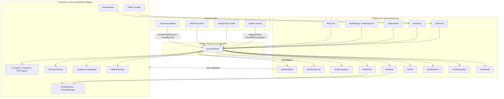
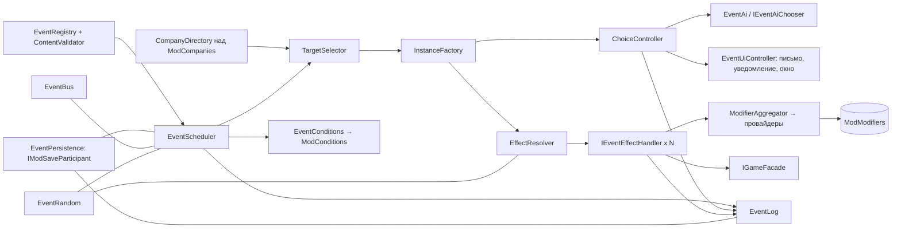
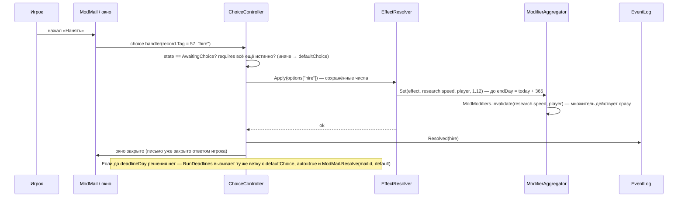
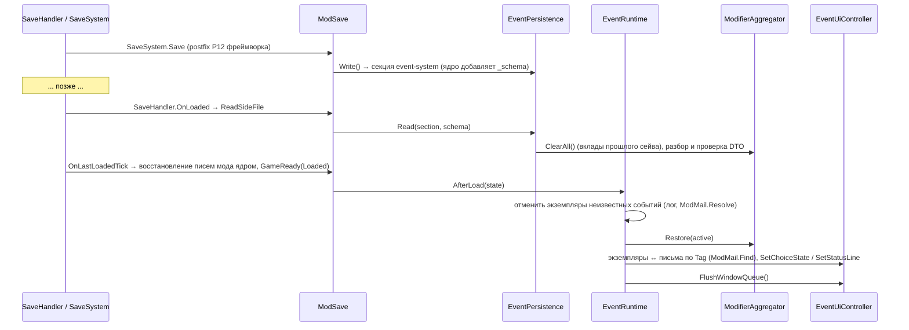
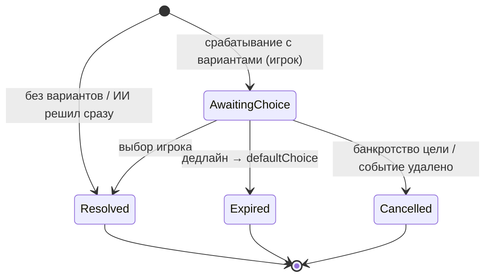

# Design: event-system

## Document Information

- **Feature Name**: event-system — движок событий с выбором, таймером и журналом
- **Version**: 0.2
- **Date**: 2026-10-10
- **Author**: Dex719
- **Status**: Draft v0.2 — одобрено к реализации владельцем 2026-10-10
- **Reviewers**: владелец проекта; авторы `market-shocks`, `design-flaw-recalls`, `historical-events`, `rival-personalities`
- **Related Documents**:
  - [requirements.md](requirements.md), [tasks.md](tasks.md);
  - `.kiro/steering/context.md`, `.kiro/steering/owner-decisions.md`, решения `0003`–`0006`;
  - `.kiro/specs/mod-framework/design.md` (API `PTMod.Core` v0.2);
  - `pt-modding/CODEMAP.md` (разделы Time, Market, Save, UI).

## Overview

Движок — фича `event-system` (`[ModFeature] sealed class EventSystemFeature : IModFeature`, пространство имён `PTMod.Features.EventSystem`) поверх сервисов `PTMod.Core`. Собственных патчей Harmony у него нет. Работает раз в игровой день в фазе `TickPhase.DayPassed` (`FeatureContext.OnTick`). Защиты `ModTicks` не дают ему работать во время перемотки и загрузки. За день он:

1. снимает истёкшие эффекты и обновляет кривые;
2. срабатывает отложенные цепочки;
3. закрывает просроченные выборы вариантом по умолчанию;
4. проверяет триггеры и проводит лотереи категорий.

Сработавшее событие создаёт экземпляр (или группу экземпляров) на компанию-цель. Все числа эффектов вычисляются **один раз** при создании и хранятся в `AppliedEffect`. Письмо, окно, журнал и само применение берут числа только оттуда (D1).

Свои формулы игры движок не патчит. Временные эффекты отдают вклад в каналы `ModModifiers` через **провайдеры** (`ModModifiers.RegisterReasonedProvider`, по одному на канал), а формулы читают каналы патчами `mod-framework` (D4). Разовые эффекты вызывают публичные методы игры:
- `ICompany.SpendMoney` / `ICompany.EarnMoney`;
- `CpuBase.Popularities`;
- `ResearchSector.TechnologyAsResearch(...).Progress`;
- `ModReputation.Add`.

Состояние хранится в секции `event-system` бокового файла (`IModSaveParticipant`; версию секции `_schema` ведёт ядро). Случайность — поток `ModRandom.Stream("event-system/daily")` с фиксированным расходом чисел за день и локальные производные генераторы от `ModRandom.WorldSeed` (D5). Контент-паки других фич регистрируют события, типы эффектов и предикаты в своём `Register` через `EventRegistry`, `EventEffects` и `EventConditions` (D10); движок читает контент паков один раз, на первом `ModTicks.GameReady` после `Register` всех фич. Предикаты попадают в общий каталог `ModConditions` под префиксом `es.` (движок) или префиксом фичи-владельца.

Письма идут через `ModMail` с приоритетами и тегом `es:<instanceId>`; срок выбора считается от дня доставки письма (`ModMail.Delivered`) и показывается строкой статуса письма (`ModMail.SetStatusLine`). Пакетный прогон `DateController.NextMonth` движок не патчит: он читает `ModTicks.IsBatchRun` и `ModTicks.BatchEnded`.

### Design Goals

- **Текст = эффект.** Показанное число и применённое — одно поле.
- **Видимый таймер.** Дедлайн в игровых днях, обратный отсчёт в окне, строке статуса письма и журнале, напоминание.
- **Расширяемость.** Четыре контент-спеки работают без правок движка.
- **Честность к ИИ.** Те же правила целей и эффектов для игрока и соперников; эффекты для ИИ не ослабляются.
- **Безопасность для сейва и игры.** Только `ModSave`, ни одного исключения в код игры (`ModHooks.Guard`), заморозка при выключении.
- **Дёшево по времени.** Обычный день ≤ 0,3 мс.

### Key Design Decisions

| # | Решение | Почему | Отвергнутые альтернативы |
|---|---|---|---|
| D1 | Эффекты вычисляются при срабатывании (`Resolve`) для **всех** вариантов, хранятся в `AppliedEffect`, применяются без пересчёта | Главная жалоба игроков (I13): текст и эффект расходятся. Игрок видит точную цену каждого варианта до выбора | Вычислять при применении — число меняется между показом и применением. Вычислять дважды — тот же риск |
| D2 | Таймер в игровых днях; дедлайн = `max(firedDay, deliveredDay) + timerDays` (день доставки — по `ModMail.Delivered`); ведёт его движок, письмо отправляется без срока `ModMail` (`TimeoutDays = 0`), оставшиеся дни выводятся строкой статуса `ModMail.SetStatusLine`, закрывает письмо `ModMail.Resolve`; модальное окно с паузой — только для `important` или по настройке | Не зависит от скорости и FPS. Таймер движка умеет замораживаться (пакетный прогон, выключение фичи или пака), таймер письма — нет. От доставки, а не от срабатывания: письмо может прийти позже (перемотка, загрузка, пакетный прогон), и срок не должен съедаться. Пауза в каждом событии раздражает | Срок письма `ModMailMessage.TimeoutDays` — не знает о заморозке, два источника правды. Дедлайн от `firedDay` — письмо «опаздывает». Реальное время — зависит от скорости. Всегда модально — ломает темп |
| D3 | Основной носитель — письмо `ModMail` с кнопками и приоритетом (`Critical` для выбора, `Normal` для события без выбора, `Low` для новостей об ИИ); плюс уведомление `ModNotify` и опциональное модальное окно `ModUI` | Письмо не пропадает и переживает загрузку. `Critical` идёт в обход дневного лимита писем и не теряется среди новостей. Попап игры (`Popup`) — только текст и закрывается сам через 15 с (`Popup.Update`, `closeSeconds = 15`) | Только попап — событие теряется. Только окно — нельзя «решить позже». Все письма одного приоритета — выбор опаздывает из-за дневного лимита |
| D4 | Временные эффекты — вклады в провайдеры `ModModifiers` (один провайдер на канал, регистрируется один раз, с причиной для `Explain`; произведение вкладов с пределами событий) | Не дублирует патчи `mod-framework`. Кривые паков меняют вклад каждый день без перезаписи сохраняемых записей. Состояние в одном месте — секции движка. Каналы объявлены реестром ядра до `Register` фич, порядок регистрации не важен | Сохраняемые записи `ModModifiers.Add` — состояние в двух местах, кривые требуют удалять и добавлять запись ежедневно. Свои патчи формул — запрещены для зарезервированных методов (`ModHooks.IsReserved`). Временное снятие линий `Company.RemoveProductionLines` — пересчёт `OperatingCost`, штрафы `BusinessHelper.HandleFoundryServicesFines` |
| D5 | Дневной поток `ModRandom.Stream("event-system/daily")` с фиксированным расходом (3 числа на категорию); производные генераторы `hash(WorldSeed, ключ)` для эффектов и триггеров | Добавление контента или изменение условий не сдвигает последовательность. Перезагрузка не перебрасывает события | `System.Random` / `UnityEngine.Random` — игра сеет их от времени (CODEMAP: Market Gotchas, «Randomness»). Именованный поток `ModRandom` на каждый экземпляр — тысячи сохраняемых потоков. Переменный расход — любое изменение сдвигает всё |
| D6 | `DailyChance` — лотерея категории: 1 бросок «будет ли событие», затем выбор по `weight` | Частота задаётся категорией и не растёт с числом событий. Темп категории (`minGapDays`, `maxActive`) — в одном месте | Независимый шанс на каждое событие — частота растёт с размером контента |
| D7 | Компания — ключ `ModCompanies` (`player` / `ai:<UniqueID>`); день — целое число дней от 1971-01-01 | Общий ключ фреймворка (`ModReputation`, `ModModifiers`). `JsonUtility` и сравнение дат не нужны | `SaveID` компании — сохранение не подтверждено (CODEMAP: Save Uncertain). Имя компании — игрок может переименовать |
| D8 | В группе `AllCompanies` эффекты события с `scope: "Global"` применяются один раз, выборы — у каждой компании | Глобальный шок рынка один, а подготовиться к нему каждая компания может по-своему | Применять на каждую компанию — глобальный множитель возводился бы в степень числа компаний |
| D9 | Цепочки — эффект `FireEvent` с задержкой; ветвления — эксклюзивные группы шанса (`params.exclusiveGroup`) | Без полиморфизма в определениях | Вложенные эффекты внутри `params` — сложная валидация. Отдельное поле `outcomes` — меняет контракт `EventChoice` |
| D10 | Выключение фичи или отдельного пака — заморозка: вклады в провайдеры (всех или только пака, по `instanceId → packId`) не действуют, состояние стоит; `OnDisabled` / `OnEnabled` провайдеры и вклады не удаляют и не пересоздают (правило ядра: записи и провайдеры выключенной фичи хранятся и пропускаются). Сроки эффектов абсолютные, дедлайны выборов игрока при включении сдвигаются на длительность выключения | Не ломает сейв, обратимо, без «двойного» применения; согласовано с правилом ядра для выключенных фич | Откат эффектов (вернуть деньги) — неоднозначно. Продолжать в фоне — нарушает «выключено». `ModModifiers.RemoveAll` в `OnDisabled` с пересозданием в `OnEnabled` — теряет исходные сроки |
| D11 | Пакетный прогон `DateController.NextMonth` — признак ядра `ModTicks.IsBatchRun` и событие `ModTicks.BatchEnded`: таймеры игрока не убывают (дедлайн +1 за каждый день прогона), окна откладываются до `BatchEnded`; собственного патча нет | `NextMonth` прогоняет до 31 дня в одном кадре без флага перемотки (CODEMAP: Time Gotchas) — выбор сгорел бы, игрок его не увидел. Один патч ядра (P21) вместо трёх локальных (замечание `batch-run-flag-duplication`); `ModMail` и `ModNotify` сами откладывают показ | Свой prefix/postfix на `NextMonth` (закрыт для фич: `ModHooks.IsReserved`). Считать таймер в реальном времени — см. D2. Ничего не делать — события теряются |
| D12 | Условия — узлы `ModConditions` (синтаксис `type` / `all` / `any` / `not`); предикаты движка регистрируются в общем каталоге под префиксом `es.` | Один язык условий на все фичи; предикаты истории событий доступны сценариям и обучению; префикс исключает коллизии с будущими предикатами ядра (замечание `id-prefix-convention`) | Свой язык условий — дублирование `ModConditions`. Предикаты без префикса — `ModConditions.Register` их отклонит |
| D13 | Изменение вклада в канал сопровождается `ModModifiers.Invalidate(channel, companyKey)` | Множитель от выбора, сделанного на паузе, действует сразу, а не со следующего игрового дня (закрывает вопрос владельцу 9 v0.1) | Ждать смены дня — игрок видит старое время исследования после выбора «Нанять» |
| D14 | Политика ИИ — цепочка `EventAi.AddChooser(chooser, priority)`: список по убыванию приоритета, побеждает первый ненулевой ответ, иначе политика по умолчанию | Несколько фич (`historical-events`, `rival-personalities`) задают политику для разных событий; решение владельца | `SetChooser` — одна политика, вторая регистрация перетирает первую |
| D15 | `Severity` пака применяется при `Resolve`, и итог зажимается пределами канала (`channelLimits`) | Показанное и применённое совпадают на любой интенсивности, включая «Хаос» ×2 | Зажимать при агрегации — письмо обещает ×0,1, а канал отдаёт ×0,4 |

## Architecture

### System Context



### High-Level Architecture



| Компонент | Ответственность |
|---|---|
| `EventSystemFeature` | `[ModFeature] IModFeature`: регистрация тиков (`ctx.OnTick`), участника сейва, параметров и страницы хаба через `FeatureContext`, подписки на события ядра; без патчей Harmony; `OnEnabled` / `OnDisabled` |
| `EventRuntime` | Жизненный цикл: новая игра и загрузка (`ModTicks.GameReady`), заморозка, пакетный прогон (`ModTicks.IsBatchRun`, `ModTicks.BatchEnded`), доставка писем (`ModMail.Delivered`), состояние паков (`ModFeatures.StateChanged`) |
| `EventRegistry` + `ContentValidator` | Загрузка паков (`ModContent.LoadRecords`, `ModContent.LoadConfig`), валидация, индекс по `id` и категориям |
| `EventScheduler` | Дневной цикл, триггеры, лотереи категорий, темп, отложенные `FireEvent` |
| `CompanyDirectory` | Обёртка над `ModCompanies.All` / `KeyOf` / `Resolve` + веса целей |
| `TargetSelector` | Выбор целей и групп со взвешиванием |
| `EventConditions` | Фасад над `ModConditions`: разбор, вычисление для подлежащего, регистрация предикатов паков |
| `InstanceFactory` | Создание экземпляров, предвычисление эффектов всех вариантов |
| `EffectResolver` | `Resolve` / `Apply` / `Tick` / `Remove` / `Restore` через обработчики; шанс и эксклюзивные группы |
| `ModifierAggregator` | Вклады эффектов; провайдер `ModModifiers` на каждый используемый канал; пределы событий |
| `ChoiceController` | Таймеры, дедлайны (от доставки письма), доступность вариантов (`requires`, порог дефолта), решение игрока, решение ИИ (цепочка chooser'ов), отмены |
| `EventUiController` | Письмо (`ModMail`: приоритет, тег, строка статуса, состояние кнопок), уведомления, модальное окно, напоминания, очередь окон |
| `EventLog` + `EventLogWindow` | Записи, окно «Журнал событий» |
| `EventPersistence` | `IModSaveParticipant` секции `event-system`, миграции по `_schema` |
| `EventRandom` | Дневной поток `ModRandom` и производные генераторы |
| `EventBus` | Публичный API: `Fire`, события шины |
| `IGameFacade` | Тонкий адаптер к классам игры (для тестов без Unity) |

### Используемые сервисы PTMod.Core

| Сервис | Для чего |
|---|---|
| `ModFeatures` / `FeatureContext` | Регистрация фичи: `OnTick`, `SaveParticipant`, `Param`, `HubPage`; горячее выключение; `ModFeatures.StateChanged` — выключатели паков |
| `ModTicks` | Фаза `TickPhase.DayPassed` (дневной цикл); `GameReady(NewGame|Loaded)`; `IsFastForwarding`, `IsLoading`, `IsBatchRun`, `BatchEnded`, `Today` |
| `ModSave` | Участник секции `event-system` (версию `_schema` ведёт ядро) |
| `ModModifiers` | `RegisterReasonedProvider` на каналы (один раз), `Invalidate`, `Get` / `Explain` в тестах и самопроверке; каналы объявлены реестром ядра |
| `ModConditions` | `Parse`, `Evaluate(condition, subject)`, `Register` предикатов движка и паков (имена `<prefix>.<name>`) |
| `ModCompanies` | Список компаний, ключи `player` / `ai:<UniqueID>` |
| `ModMail` | `Send` с вариантами, приоритетом и `Tag`, `RegisterChoiceHandler`, `Resolve`, `Get`, `Find`, `Delivered`, `SetChoiceState`, `Refresh`, `SetStatusLine` |
| `ModNotify` | `ShowKey` — новое событие, напоминание, автоматическое решение (откладывается ядром при пакетном прогоне) |
| `ModUI` | Модальное окно выбора (`WindowTemplate.Modal`), окно журнала (`WindowTemplate.Panel`), страница хаба, подсказки (`ModUI.Tooltip`) |
| `ModRandom` | `Stream("event-system/daily")`, `WorldSeed` |
| `ModContent` | `LoadRecords` / `LoadConfig` паков, переопределение из `PTMod/content/` |
| `ModReputation` | Эффект `Reputation` (`Add`) |
| `ModCredit` | `ThresholdOf(company)` — порог дефолта для доступности варианта с тратой |
| `ModIds` | `IsEventIdAllowed` — проверка ID событий пака по префиксу |
| `ModSettings` | Параметры (`ParamSpec`), флаг отладки `debug.events` (только отладочная сборка) |
| `ModL10n` | Строки `es.*`, `LocText`, `LanguageChanged` |
| `ModHooks` | `Guard` / `ReportFault` на границах; патчей у движка нет |
| `ModLog` | `[PTMod] [event-system] …` |

### Technology Stack

| Слой | Технология | Обоснование |
|---|---|---|
| Логика | C# latest, Roslyn `csc` из VS Build Tools; `Logic` — общее подмножество API .NET Framework 4.8 и `mscorlib` Unity (без `init`, `record`, `Index`/`Range`) | Решение 0003 (обновлено) |
| Патчи | Нет собственных; формулы читают патчи ядра через `ModModifiers` | Решение 0002; замечание `batch-run-flag-duplication` |
| Данные | JSON через `ModContent` / `ModJson` | Решение 0006 |
| Состояние | `ModSave` (боковой файл) | Решение 0004 |
| UI | `ModUI` (клоны окон игры, `ButtonUI`, `InfoText`, `ToggleUI`, `DropdownUI`, TMP-текст) | Решение 0005 |
| Тесты | Свой мини-раннер .NET Framework 4.8 (`[Test]`, `[Covers]`, `Assert.*`) в `mod/tests/PTMod.Tests/Features/EventSystem/`, запуск `python mod/build.py --tests` | Чистая логика за `IGameFacade`, фейки `IModRng` и `IGameState` |

## Components and Interfaces

Все типы ниже — в `namespace PTMod.Features.EventSystem`. Код — C# latest (решение 0003), но публичный контракт для других фич остаётся простым: без `init`, `record`, кортежей в сигнатурах. `JsonObject`, `JsonNode` — из `PTMod.Core.Logic.Json`; `LocText`, `ICondition`, `ConditionContext`, `IModRng`, `MailPriority` — из `PTMod.Core`.

### Точка входа фичи

```csharp
[ModFeature]
public sealed class EventSystemFeature : IModFeature
{
    public string Id { get { return "event-system"; } }
    public string NameKey { get { return "es.feature.name"; } }
    public string DescriptionKey { get { return "es.feature.desc"; } }
    public string[] DependsOn { get { return new string[0]; } }     // жёстких зависимостей нет
    public bool EnabledByDefault { get { return true; } }
    public bool SupportsHotToggle { get { return true; } }
    public void Register(FeatureContext ctx);   // см. ниже
    public void OnEnabled();                    // сдвиг дедлайнов выборов игрока на время выключения; доустановка deliveredDay по ModMail.Find для писем, доставленных во время выключения; пересчёт кнопок писем
    public void OnDisabled();                   // запомнить день выключения; провайдеры и вклады НЕ трогать (правило ядра)
}
```

`Register(ctx)`, в порядке:
1. `ctx.SaveParticipant(new EventPersistence())` — секция `event-system`, `SchemaVersion = 1`;
2. `ctx.OnTick(TickPhase.DayPassed, scheduler.ProcessDay)` — дневной цикл;
3. `ctx.Param(...)`: `frequency` (Int 0..3, по умолчанию 2 = «Обычно»), `pauseAllChoices` (Bool, false), `rivalNews` (Bool, true); `ctx.HubPage("es.hub.title", EventSettingsPage.Build)`;
4. регистрация API для других фич: `EventEffects.Register` стандартных типов, `EventConditions.Register` предикатов `es.*`, пак `event-system` (`EventRegistry.RegisterPack("event-system", "event-system", options)`);
5. подписки на события ядра (ядро само пропускает обработчики выключенной фичи): `ModTicks.GameReady`, `ModTicks.BatchEnded`, `ModMail.Delivered`, `ModFeatures.StateChanged`, `ModL10n.LanguageChanged`; `ModMail.RegisterChoiceHandler("event-system", ChoiceController.OnPlayerChoice)`.

Контент паков движок читает не в `Register`, а на первом `ModTicks.GameReady` сессии: к этому моменту `Register` всех фич выполнен, и порядок регистрации фич не влияет на результат. Провайдеры `ModModifiers` регистрируются лениво при первом вкладе в канал (повторная регистрация того же делегата игнорируется ядром); `OnEnabled` / `OnDisabled` их не пересоздают.

### Контентная модель (контракт)

```csharp
public enum EventTriggerType { Date, DailyChance, Condition, Manual }
public enum EventTargetType { Player, RandomAI, AllCompanies, Specific, RandomCompany } // RandomCompany — расширение
public enum TargetWeighting { Uniform, FactoryCapacity, MarketShare, QuarterlyRevenue }

public sealed class EventDefinition : IContentRecord
{
    public string id;
    public string category;
    public LocText title;
    public LocText text;
    public LocText cause;              // «почему это случилось»
    public EventTrigger trigger;
    public ICondition conditions;      // узел ModConditions; null — всегда истина
    public float weight = 1f;
    public int cooldownDays;
    public bool oncePerGame;
    public EventTargetSpec targets;
    public EventChoice[] choices;      // пусто — событие без выбора
    public int timerDays;
    public string defaultChoice;
    public EventEffect[] effects;      // применяются при срабатывании всегда
    public bool important;             // модальное окно с паузой
    public bool notifyPlayer;          // новость игроку, если цель — ИИ
    public string packId;              // заполняет реестр
    public string Id { get { return id; } }
}

public sealed class EventTrigger
{
    public EventTriggerType type;
    public int year; public int month; public int day;   // Date
    public int graceDays = 31;                           // Date
    public float chance = 1f;                            // Condition: шанс при истинных условиях
    public string checkEvery = "Month";                  // Condition: "Day" | "Month"
    public bool edge;                                    // Condition: только переход false -> true
}

public sealed class EventTargetSpec
{
    public EventTargetType type;
    public string companyKey;          // Specific: "player" | "ai:<UniqueID>"
    public ICondition filter;          // проверяется для каждой кандидатки
    public TargetWeighting weighting;
}

public sealed class EventChoice
{
    public string id;
    public string textKey;
    public EventEffect[] effects;
    public ICondition requires;
    public float aiWeight = 1f;
    public float aiMinCashMultiple;    // ИИ берёт вариант, только если деньги >= k * стоимость
}

public sealed class EventEffect
{
    public string type;
    public IEffectParams @params;      // JSON-объект "params"
    public int durationDays;
}

public interface IEffectParams          // адаптер над JsonObject
{
    bool Has(string key);
    float GetFloat(string key, float fallback);
    int GetInt(string key, int fallback);
    bool GetBool(string key, bool fallback);
    string GetString(string key, string fallback);
    FloatRange GetRange(string key, FloatRange fallback);   // число или [lo, hi]
    JsonObject Raw { get; }
}
public struct FloatRange { public float Lo; public float Hi; }
```

Определения строятся из `JsonObject` функцией-маппером для `ModContent.LoadRecords` (поля `conditions`, `filter`, `requires` → `ModConditions.Parse`).

Общие ключи `params` (читает движок, не обработчик):

| Ключ | Тип | По умолчанию | Смысл |
|---|---|---|---|
| `scope` | `"Target"` / `"Global"` | `Target` | На компанию-цель или на весь рынок |
| `chance` | float 0..1 | 1 | Шанс срабатывания эффекта (бросок при `Resolve`) |
| `exclusiveGroup` | string | — | Эксклюзивная группа внутри варианта |
| `scalable` | bool | false | Эффект масштабируется `PackOptions.Severity` |

### Runtime-модель

```csharp
public sealed class EventContext
{
    public EventDefinition Definition;
    public EventInstance Instance;     // null при проверке условий до создания
    public ICompany Company;           // null для scope Global
    public string CompanyKey;          // "player" | "ai:<UniqueID>" | "global"
    public int Today;                  // дни от 1971-01-01
    public IModRng Rng;                // производный генератор экземпляра
    public IGameFacade Game;
    public IEffectModifiers Contributions; // доступ обработчиков (в т. ч. паков) к агрегатору вкладов
}

public interface IEffectModifiers
{
    // текущий вклад эффекта в канал; агрегатор перемножает вклады, применяет пределы
    // и сбрасывает дневной кеш канала (ModModifiers.Invalidate) при изменении
    void Set(AppliedEffect effect, string channel, string companyKey, float multiplier);
    void Clear(AppliedEffect effect);
    bool WasClamped(string channel, string companyKey);
    float LimitMin(string channel);    // нижний предел канала (самый узкий из channelLimits паков)
    float LimitMax(string channel);    // верхний предел — для зажима при Resolve (D15)
}

public sealed class EventInstance          // runtime-обёртка над EventInstanceDto
{
    public EventInstanceDto Data;
    public EventDefinition Definition;
    public bool IsPlayer { get; }
    public int DaysLeft(int today);
}

public interface IGameFacade
{
    int Today { get; }                                         // ModTicks.Today → дни от 1971-01-01
    float Inflation { get; }                                   // InflationHandler.Instance.Inflation
    IList<CompanyRef> Companies { get; }                       // ModCompanies.All (без банкротов)
    float QuarterlyRevenue(ICompany c);                        // CompanyFinance.QuarterlyRevenue(), 0 при Reports.Count < 3
    int FactoryLines(ICompany c);                              // c.Factory.ProductionCapacity
    float MarketShare(ICompany c);                             // MarketDataProvider.Instance.MarketShare(c)
    float Money(ICompany c);                                   // ICompany.get_MoneyAmount
    void Spend(ICompany c, float amount, ExpenseOrigin origin); // ICompany.SpendMoney
    void Earn(ICompany c, float amount, RevenueOrigin origin);  // ICompany.EarnMoney
    IList<Cpu> MarketCpus(ICompany c);                         // CpuDataProvider.Instance.GetAllCpus(): Company == c, IsReleased, !IsRetired, SellOnMarket
    ResearchSector.Research CurrentResearch(ICompany c);       // c.ResearchSector.TechnologyAsResearch(c.ResearchSector.CurrentResearch())
    float DefaultThreshold(ICompany c);                        // ModCredit.ThresholdOf(c): отрицательный порог дефолта
    bool IsTopByMarketShare(ICompany c, int n);                // входит ли ИИ-компания в n лидеров по MarketDataProvider.MarketShare (игрок не считается)
    bool InBatch { get; }                                      // ModTicks.IsBatchRun: идёт DateController.NextMonth
}

public struct CompanyRef { public string Key; public ICompany Company; public bool IsPlayer; }
```

### Обработчики эффектов (точка расширения)

```csharp
public interface IEventEffectHandler
{
    string Type { get; }
    bool Validate(EventEffect spec, IList<string> errors);       // при загрузке контента
    AppliedEffect Resolve(EventEffect spec, EventContext ctx);   // все броски и формулы — один раз
    void Apply(AppliedEffect effect, EventContext ctx);          // разовое действие или старт
    EffectText Describe(AppliedEffect effect);                   // ключ L10n + аргументы из сохранённых чисел
}

public interface ITimedEffectHandler : IEventEffectHandler
{
    void Tick(AppliedEffect effect, EventContext ctx);           // ежедневно, пока активен (кривые)
    void Remove(AppliedEffect effect, EventContext ctx);         // истечение, отмена, выключение
    void Restore(AppliedEffect effect, EventContext ctx);        // после загрузки / включения
}

// необязательно: текущее значение меняющегося эффекта для вкладки «Активные эффекты»
public interface ICurveEffectHandler
{
    float ValueAt(AppliedEffect effect, int today);
}

public struct EffectText { public string Key; public string[] Args; }

public static class EventEffects
{
    public static void Register(string type, IEventEffectHandler handler);
    public static IEventEffectHandler Get(string type);
    public static IList<string> RegisteredTypes { get; }
    // применить эффект вне события (стадии без выбора, решения ИИ в других фичах):
    // создаётся служебный экземпляр kind = Direct с eventId = sourceId — сохранение, истечение и журнал работают как обычно
    public static AppliedEffect ApplyDirect(EventEffect spec, string companyKey, string sourceId, string[] args);
}
```

Обработчики, которые поставляет движок:

| Тип | Класс | Таймер | Что делает |
|---|---|---|---|
| `Money` | `MoneyEffect` | нет | Сумма по формуле (см. «Формулы»), `ICompany.SpendMoney` / `ICompany.EarnMoney`; баланс может уйти в минус (как у трат игры); `Earn` без `origin` идёт как `RevenueOrigin.Interest` |
| `ModifierTimed` | `ModifierTimedEffect` | да | Вклад-множитель на канал через `IEffectModifiers`; `scalable` — после `Severity` значение зажимается пределами канала |
| `FactoryOutput` | `FactoryOutputEffect` | да | Сахар: `ModifierTimed` на `production.output`, scope `Target` |
| `MarketDemand` | `MarketDemandEffect` | да | Сахар: `ModifierTimed` на `market.demand.<segment>` (или все 4), scope `Global` |
| `Popularity` | `PopularityEffect` | нет | `CpuBase.Popularities[k] += δ` с ограничением [0,05; 1,0] |
| `Reputation` | `ReputationEffect` | нет | `ModReputation.Add(company, δ, reason)`; причина — ключ L10n заголовка события (`title.Key`), для события с inline-текстом — `es.reason.event` (правило ядра: причины — ключи L10n своей фичи) |
| `ResearchProgress` | `ResearchProgressEffect` | нет | `Research.Progress = min(Progress + δ, 0.99)` |
| `SendMail` | `SendMailEffect` | нет | Информационное письмо игроку через `ModMail.Send` (без вариантов) |
| `FireEvent` | `FireEventEffect` | нет | Ставит отложенное срабатывание в `scheduled` |

### Условия

```csharp
public delegate bool EventPredicate(JsonObject args, ConditionContext ctx);   // ctx.Subject — компания-цель

public static class EventConditions
{
    // регистрирует тип в ModConditions (ownerFeature — ID фичи-владельца);
    // type — только "<prefix>.<name>" с префиксом владельца (ModIds.IsPredicateNameAllowed), иначе ModConditions.Register отклонит
    public static void Register(string type, string ownerFeature, EventPredicate predicate);
    public static ICondition Parse(JsonNode node, List<string> errors, string path);   // → ModConditions.Parse
    public static bool Evaluate(ICondition condition, ICompany subject);                // null → true; → ModConditions.Evaluate
}
```

Синтаксис — синтаксис `ModConditions`: объект с `type` и параметрами на верхнем уровне, либо `all` / `any` / `not`. Подлежащее — компания-цель. Предикаты каталога `mod-framework` (имена без точки), которые использует стартовый набор: `dateAtLeast`, `dateBefore`, `cpuOnMarket`, `researchActive`, `factoryLinesAtLeast`, `companyType`.

Предикаты, которые регистрирует движок (владелец `event-system`, префикс `es.`):

| Тип | Параметры | Истина, если |
|---|---|---|
| `es.eventFired` | `eventId`, `withinDays` (необязательно) | Событие срабатывало для подлежащего (за N дней) |
| `es.choiceMade` | `eventId`, `choiceId` | Подлежащее выбрало вариант |
| `es.eventFlag` | `flag` | У подлежащего есть флаг цепочки |
| `es.activeInCategory` | `category`, `scope` (`subject` по умолчанию \| `any`) | `subject`: у подлежащего есть ожидающий выбор или активный эффект события этой категории. `any`: то же у любой компании, либо активен глобальный эффект события этой категории (для координации паков: «не запускать шок памяти, пока идёт историческое событие» — `{ "not": { "type": "es.activeInCategory", "category": "history", "scope": "any" } }`) |
| `es.hasRevenueHistory` | — | `Finance.Reports.Count ≥ 3` и квартальная выручка > 0 |
| `es.hasFab` | — | `Factory.ProductionCapacity ≥ 1` и `!IsFabless` |

Доступность варианта и деньги (`ChoiceController`):
- `requires` ложно при отправке письма → вариант остаётся среди `ModMailMessage.Choices`, но с `Enabled = false` и `DisabledReasonKey = "es.reason.requires"` (аргумент — `ICondition.Describe`); в окне он неактивен с той же причиной. Если `requires` не выполняется, вариант не выкидывается.
- Раз в игровой день (`DailyRefresh`) для каждого ожидающего выбора игрока доступность пересчитывается; при изменении `ModMail.SetChoiceState(mailId, choiceId, enabled, reasonKey, args)` и `ModMail.Refresh(mailId)` обновляют кнопки без закрытия письма. Состояние кнопок ядро сохраняет в `ModSave`; после загрузки движок пересчитывает его в `GameReady(Loaded)`.
- `requires` стало ложным между пересчётами, а игрок нажал вариант в письме (`ModMail` уже закрыл письмо этим ответом) → применяется `defaultChoice`, в журнале «вариант стал недоступен».
- Траты `Money` варианта больше денег (`ICompany.get_MoneyAmount`) → вариант не блокируется. В подписи предупреждение «уйдёте в минус на $X»: игра допускает минус до порога дефолта.
- Порог дефолта: если `MoneyAmount − траты < ModCredit.ThresholdOf(company)` (списание сразу ввело бы компанию в дефолт) → вариант неактивен с причиной `es.reason.credit_limit` («Не хватит кредитного лимита на $X», X = `траты − (MoneyAmount − ThresholdOf)`). Вариант `defaultChoice` деньгами никогда не блокируется: он применится по дедлайну в любом случае.

### Публичный API для других фич

```csharp
public static class EventRegistry
{
    // contentFolder — папка в Content/ (обычно = packId); префикс "content/" допускается и отбрасывается.
    // Вызывается из IModFeature.Register фичи-владельца; контент читается позже, на первом GameReady.
    public static void RegisterPack(string packId, string contentFolder, PackOptions options);
    public static EventDefinition Get(string eventId);
    public static IList<EventDefinition> All { get; }
}

public sealed class PackOptions
{
    public string SettingsFeatureId;   // фича-выключатель пака (обычно = packId); пак заморожен, пока фича не Enabled
    public float Frequency = 1f;       // множитель dailyChance категорий пака
    public float Severity = 1f;        // множитель отклонений для эффектов с params.scalable = true (0,5 … 2,0)
    public string EventsFile = "events"; // имя файла событий пака в Content/<папка>/ (market-shocks: "shocks")
    public int RivalNewsTopN;          // новости игроку о событиях ИИ только по N лидерам по доле рынка; 0 — обо всех
}

public static class EventBus
{
    public static EventFireResult Fire(string eventId, EventFireContext context);
    public static event Action<EventInstance> OnEventFired;
    public static event Action<EventInstance, string, bool> OnChoiceResolved;   // экземпляр, вариант, авто
    public static event Action<AppliedEffect> OnEffectExpired;
}

public sealed class EventFireContext
{
    public string CompanyKey;          // null — по targets определения
    public int DelayDays;
    public int ParentInstanceId;
    public bool IgnoreConditions;
    public string[] Args;              // доп. аргументы для текстов ({0}, {1})
}

public enum EventFireResult { Fired, Scheduled, Skipped, UnknownEvent, Disabled }

public interface IEventAiChooser
{
    // null — «это не моё событие / не решаю»: решение переходит следующему chooser'у или политике по умолчанию
    string Choose(EventInstance instance, ChoiceOption[] options, ICompany company, IModRng rng);
}
// необязательно: быстрый отсев чужих событий без вызова Choose
public interface IEventAiChooserFilter { bool Handles(EventInstance instance); }
public sealed class ChoiceOption { public string ChoiceId; public bool Available; public float Cost; public float AiWeight; }
public static class EventAi
{
    // Список chooser'ов по убыванию priority (больше — раньше); при равенстве — порядок регистрации.
    // Решение ИИ принадлежит первому chooser'у, вернувшему не null (и не недоступный вариант); иначе — политика по умолчанию
    // (aiWeight среди доступных вариантов с учётом aiMinCashMultiple). Исключение chooser'а = null и счётчик его фичи (ModHooks.Guard).
    public static void AddChooser(IEventAiChooser chooser, int priority);
    public static void RemoveChooser(IEventAiChooser chooser);
}

public static class EventLog
{
    public static IList<EventLogEntry> Entries { get; }
    public static void OpenWindow();
}
```

`PackOptions.Severity` нужен паку `market-shocks` (ручка интенсивности «Мягко» ×0,5 … «Хаос» ×2). Формула и зажим пределами канала — в разделе «Формулы и баланс». `PackOptions.RivalNewsTopN` (5 у `market-shocks`) ограничивает новости об ИИ лидерами по доле рынка. `EventAi.AddChooser` вызывают `historical-events` и `rival-personalities` (старый `SetChooser` из v0.1 заменён).

### Планировщик

```csharp
internal sealed class EventScheduler
{
    public void ProcessDay(int today);              // FeatureContext.OnTick(TickPhase.DayPassed, ...); при ModTicks.IsBatchRun сдвигает дедлайны игрока на +1
    void ExpireAndTickEffects(int today);
    void RunScheduledFires(int today);
    void RunDeadlines(int today);
    void RunDateTriggers(int today);
    void RunConditionTriggers(int today);           // checkEvery: Day или 1-е число
    void RunCategoryLotteries(int today);           // 3 числа дневного потока на категорию, всегда
    bool PacingAllows(EventDefinition def, CompanyRef target, int today);
}
```

Ключ отката `cooldownDays`: для целей `Player`, `RandomAI`, `RandomCompany`, `Specific` — пара (событие, компания). Для `AllCompanies` — событие целиком (ключ компании `*`), иначе новые компании снимали бы откат группового события.

### Агрегатор модификаторов

```csharp
internal sealed class ModifierAggregator : IEffectModifiers
{
    public void Set(AppliedEffect e, string channel, string companyKey, float multiplier); // вклад эффекта (кривые меняют его каждый день); затем Invalidate
    public void Clear(AppliedEffect e);
    public bool WasClamped(string channel, string companyKey);
    public float Current(string channel, string companyKey);   // глобальные × компании, с пределами
    public string ReasonArgs(string channel, string companyKey); // названия активных событий для Explain (пересобирается на Set/Clear)
    public void Suspend(string packId);                        // заморозка пака (D10)
    public void Resume(string packId);
    public void ClearAll();                                    // загрузка другого сейва, новая игра
}
```

При первом вкладе в канал агрегатор один раз регистрирует провайдер с причиной:

```
ModModifiers.RegisterReasonedProvider("event-system", channel,
    ctx => new ProviderResult { Multiplier = aggregator.Current(channel, ctx.CompanyKey),
                                ReasonKey = "es.reason.events", ReasonArgs = new[] { aggregator.ReasonArgs(channel, ctx.CompanyKey) } })
```

Провайдер выключенной фичи не применяется (правило `ModModifiers`: провайдеры и вклады выключенной фичи хранятся и пропускаются; `OnDisabled` их не удаляет). `ModModifiers` кеширует результат до конца игрового дня, поэтому каждое изменение вклада сопровождается `ModModifiers.Invalidate(channel, companyKey)` (для `global` — `Invalidate(channel)`): выбор игрока, сделанный на паузе, действует сразу, а не со следующего дня (D13). В `Explain` провайдер виден одной строкой с причиной «События: {названия}».

### UI

```csharp
internal sealed class EventUiController
{
    public void OnPlayerInstanceCreated(EventInstance inst);   // ModMail.Send (Priority, Tag "es:<id>") + уведомление + окно (если нужно)
    public void OnMailDelivered(ModMailRecord record);         // ModMail.Delivered: дедлайн от дня доставки, SetStatusLine «Ответить до …»
    public void OnResolved(EventInstance inst, bool auto);     // ModMail.Resolve, закрыть окно, уведомление «авто»
    public void DailyRefresh(int today);                       // окно и SetStatusLine: «осталось N из M дн.»; SetChoiceState + Refresh; напоминание за 3 дня
    public void FlushWindowQueue();                            // по ModTicks.BatchEnded и после GameReady(Loaded)
}
internal sealed class EventChoiceWindow { public void Show(EventInstance inst); public void Hide(); }
internal sealed class EventLogWindow   { public void Open(); public void Rerender(); }
```

## Патчи Harmony

У движка собственных патчей нет (v0.1 держал единственный prefix/postfix на `DateController.NextMonth`; он заменён признаком ядра `ModTicks.IsBatchRun` и событием `ModTicks.BatchEnded`, патч P21 в `mod-framework`). Движок также не ставит патчи на `Company.AddCpu` / `AICompany.AddCpu` (события выпуска CPU ему не нужны) и на методы почты: `ModHooks` отклонит патч фичи на зарезервированные цели (`DateController.NextMonth`, `Company.AddCpu`, `AICompany.AddCpu`, `EmailWindow.GetEmails`, `EmailWindow.UpdateEmailText`).

Формулы, читающие каналы, патчит `mod-framework`:
- `Modifiers.GetModifier` → `research.speed`, `factory.operatingCost`, `taxes` и др.;
- `Factory.ProduceWafers` → `production.output`, `production.unitCost`, `cpu.failureRate`;
- `PopulationData.GetCurrentSize` → `market.demand.*`;
- `Market.UpdatePopularities` → `popularity.gain`.

Формулы `CpuMath.MaterialCost`, `ProductionMath.WaferMaterialCost`, `ProductionMath.WaferCost` и `Memory.GetDescriptions` патчит фича-владелец каналов `production.memoryCost` / `production.waferCost` — `market-shocks` (в таблице патчей ядра — F1, F2); события `event-system` пишут в эти каналы через провайдер как в любые другие.

## Подписки на события

| Событие | Обработчик | Защиты |
|---|---|---|
| `FeatureContext.OnTick(TickPhase.DayPassed)` (событие игры `DateController.OnDayPassed`) | `EventScheduler.ProcessDay` | `ModTicks`: не во время перемотки (`IsFastForwarding`) и загрузки (`IsLoading`); фича выключена → `ModTicks` не вызывает; `ModHooks.Guard` на границе |
| `ModTicks.GameReady(NewGame)` (после `Player.OnNewGame` и перемотки) | `EventRuntime.ResetForNewGame` | `lastProcessedDay = Today`; агрегатор пуст; первый `GameReady` сессии также загружает контент паков |
| `ModTicks.GameReady(Loaded)` (после `SaveHandler.OnLastLoadedTick`) | `EventRuntime.AfterLoad`: `ClearAll` → отмена неизвестных событий → `Restore` активных эффектов → связь экземпляров с письмами по `Tag` (`ModMail.Find`) → пересчёт кнопок и строк статуса → `EventUiController.FlushWindowQueue` | Секция уже прочитана (`IModSaveParticipant.Read` только разбирает и проверяет DTO) |
| `IModSaveParticipant.Read` (на `SaveHandler.OnLoaded`) | `EventPersistence.Read`: разбор DTO, проверка диапазонов; `ClearAll()` вкладов прошлого сейва | Неизвестная `_schema` → `ResetToDefaults` (решает ядро) |
| `IModSaveParticipant.Write` (postfix P12 ядра на `SaveSystem.Save`, вкл. автосейв) | `EventPersistence.Write` | `Guard`; при ошибке ядро оставляет прежнюю секцию; `_schema` ядро добавляет само |
| `ModMail.RegisterChoiceHandler("event-system", …)` | `ChoiceController.OnPlayerChoice(record.Tag, choiceId)` | Проверка состояния экземпляра и доступности варианта; повторный ответ игнорируется |
| `ModMail.Delivered` | `EventUiController.OnMailDelivered(record)`: по `record.Tag` найти экземпляр, `deadlineDay = max(firedDay, день DeliveredOn) + timerDays` (только вперёд), `SetStatusLine` | Только письма `FeatureId = "event-system"`; обработка по `Tag`, а не по `mailId` (доставка может прийти до записи `mailId`) |
| `ModTicks.BatchEnded` | `EventUiController.FlushWindowQueue` | Модальные окна, накопленные за пакетный прогон, открываются по очереди |
| `ModFeatures.StateChanged` | `EventRuntime.OnFeatureStateChanged`: фича-выключатель пака ≠ `Enabled` → `Suspend(packId)`, `Enabled` → `Resume(packId)` | Свою собственную фичу ядро выключает через `OnDisabled` / `OnEnabled` |
| `IModFeature.OnDisabled` / `OnEnabled` | Запомнить день выключения; при включении сдвинуть дедлайны выборов игрока на длительность паузы и пересчитать кнопки | Заморозка (D10); провайдеры и вклады не пересоздаются |
| `ModSettings.Changed` | Пересчёт множителей частоты и новостей (чтение `frequency`, `rivalNews`) | — |
| `ModL10n.LanguageChanged` | `EventLogWindow.Rerender`, `EventChoiceWindow` перерисовка | — |

## Data Models

### EventInstanceDto

```csharp
public sealed class EventInstanceDto
{
    public int id;
    public int groupId;                // общий для экземпляров одного срабатывания AllCompanies
    public string kind;                // Event | Direct (EventEffects.ApplyDirect; eventId = sourceId)
    public string eventId;
    public string companyKey;
    public int firedDay;
    public int deliveredDay;           // день доставки письма (ModMail.Delivered); 0 — письмо ещё в очереди или письма нет
    public int deadlineDay;            // 0 — без выбора; max(firedDay, deliveredDay) + timerDays, до доставки — предварительный firedDay + timerDays
    public string state;               // AwaitingChoice | Resolved | Expired | Cancelled
    public string chosen;
    public bool auto;
    public List<ChoiceOptionDto> options;  // предвычисленные эффекты каждого варианта
    public List<AppliedEffect> common;     // эффекты события (effects)
    public int mailId;                 // ID, возвращённый ModMail.Send; письмо ищется по Tag "es:<id>" (ModMail.Find), mailId — подсказка
    public int parentId;
    public string[] args;
}

public sealed class ChoiceOptionDto { public string choiceId; public List<AppliedEffect> effects; }
```

В DTO нет поля версии секции: `_schema` пишет и читает ядро (`IModSaveParticipant.SchemaVersion`).

**Валидация:** `deadlineDay ≥ firedDay`; `deliveredDay ∈ {0} ∪ [firedDay, ∞)`; `chosen` ∈ `options.choiceId` или пусто; `state` из списка; `companyKey` соответствует `^(player|ai:\d+|global)$`.

### AppliedEffect

```csharp
public sealed class AppliedEffect
{
    public string id;                  // "<instanceId>/<choiceId|common>/<index>"
    public int instanceId;
    public string type;
    public string companyKey;          // "global" для scope Global
    public string channel;             // для модификаторов
    public float value;                // ИТОГОВОЕ число: сумма $, множитель, дельта
    public float[] curve;              // параметры кривых паков (peak, rampIn, hold, rampOut / amplitude, period, phase)
    public int startDay;
    public int endDay;                 // 0 — разовый эффект
    public int durationDays;           // для ещё не применённых вариантов
    public float chance;
    public bool hit;                   // результат броска шанса (скрыт до решения)
    public string group;               // exclusiveGroup
    public string state;               // Pending | Active | Done | Skipped | Suspended | Failed | Clamped
    public string textKey;
    public string[] textArgs;
}
```

### Журнал

```csharp
public sealed class EventLogEntry
{
    public int day;
    public int instanceId;
    public string eventId;
    public string companyKey;
    public string kind;                // Fired | Resolved | AutoResolved | Cancelled | EffectEnded | EffectFailed
    public string choiceId;
    public List<EffectRecord> effects;
}
public sealed class EffectRecord
{
    public string type; public string channel; public float value; public int durationDays; public bool hit; public bool clamped;
}
```

### Секция ModSave `event-system`

Пишется и читается через `ModJson.From` / `ModJson.Bind` (`EventSystemSaveDto` из DTO выше). Поля версии в данных секции нет: ядро добавляет `_schema` при записи (`IModSaveParticipant.SchemaVersion` = 1) и передаёт его в `Read(section, schema)`.

```json
{
  "nextInstanceId": 58,
  "lastProcessedDay": 6339,
  "instances": [
    {
      "id": 57, "groupId": 57, "eventId": "es.star_engineer", "companyKey": "player",
      "firedDay": 6330, "deliveredDay": 6330, "deadlineDay": 6344, "state": "AwaitingChoice", "chosen": "", "auto": false,
      "options": [
        { "choiceId": "hire", "effects": [
          { "id": "57/hire/0", "instanceId": 57, "type": "Money", "companyKey": "player", "channel": "",
            "value": -1041000, "startDay": 0, "endDay": 0, "durationDays": 0, "chance": 1, "hit": true, "state": "Pending",
            "textKey": "es.fx.money.spend", "textArgs": ["$1.04M"] },
          { "id": "57/hire/1", "instanceId": 57, "type": "ModifierTimed", "companyKey": "player",
            "channel": "research.speed", "value": 1.12, "startDay": 0, "endDay": 0, "durationDays": 365, "chance": 1, "hit": true,
            "state": "Pending", "textKey": "es.fx.modifier", "textArgs": ["research.speed", "+12%", "365"] } ] },
        { "choiceId": "decline", "effects": [] }
      ],
      "common": [], "mailId": 100057, "parentId": 0, "args": []
    }
  ],
  "active": [
    { "id": "51/refuse/0", "instanceId": 51, "type": "FactoryOutput", "companyKey": "ai:4",
      "channel": "production.output", "value": 0.6, "startDay": 6325, "endDay": 6346, "durationDays": 21,
      "chance": 1, "hit": true, "state": "Active", "textKey": "es.fx.modifier", "textArgs": ["production.output", "-40%", "21"] }
  ],
  "scheduled": [ { "eventId": "es.patent_win", "dueDay": 6402, "companyKey": "player", "parentId": 49 } ],
  "cooldowns": [ { "eventId": "es.star_engineer", "companyKey": "player", "lastDay": 6330 } ],
  "categories": [ { "category": "universal", "lastDay": 6330 } ],
  "firedOnce": [],
  "flags": [ { "flag": "patent_fought", "companyKey": "player", "day": 6290 } ],
  "edges": [],
  "suspendedPacks": [],
  "log": [
    { "day": 6325, "instanceId": 51, "eventId": "es.factory_strike", "companyKey": "ai:4", "kind": "Resolved",
      "choiceId": "refuse",
      "effects": [ { "type": "FactoryOutput", "channel": "production.output", "value": 0.6, "durationDays": 21, "hit": true, "clamped": false } ] }
  ]
}
```

Состояние потока `event-system/daily` хранит сам `ModRandom` в секции `mod-framework`.

### Контент: файлы пака

`mod/src/PTMod/Content/event-system/`:
- `config.json` — категории, пределы каналов, темп (`ModContent.LoadConfig`);
- `events.json` — определения (`ModContent.LoadRecords`; имя файла пака задаёт `PackOptions.EventsFile`).

Поле `schema` в файлах контента — версия формата контента для `ModContent` (`supportedSchema`), а не версия секции сейва: секции `ModSave` собственных полей версии не имеют.

```json
{
  "schema": 1,
  "categories": [
    { "id": "universal", "dailyChance": 0.011, "minGapDays": 45, "maxActive": 2 }
  ],
  "channelLimits": [
    { "channel": "*", "min": 0.25, "max": 4.0 },
    { "channel": "production.output", "min": 0.1, "max": 3.0 },
    { "channel": "market.demand.*", "min": 0.4, "max": 2.5 },
    { "channel": "popularity.gain", "min": 0.7, "max": 1.6 }
  ],
  "maxPendingChoices": 2,
  "reminderDaysBefore": 3,
  "logLimit": 400
}
```

Пределы `channelLimits` — это пределы вклада событий всех паков в канал (до пределов ядра). Вклад событий в `popularity.gain` ограничен [0,7; 1,6]: стартовый набор пишет ×0,85 … ×1,25, `market-shocks` — ×1,2 (`ms.launch_hype`); общий предел на CPU [0,5; 2,0] по всем фичам обеспечивает ядро (в тестах эффектов учитывать его). В `market.rating.cpu` стартовый набор не пишет; паки, которым нужен этот канал (например, `historical-events`), сужают вклад своим `config.json`, а итог на CPU по всем фичам ограничен ядром. Имя `market.demand.*` в шаблоне относится к CPU-сегментам; каналы GPU (`gpu.demand`, `gpu.demand.*`) — отдельное семейство, и пределы для него задаёт пак, который в него пишет.

Пример события с выбором, шансом и цепочкой (`events.json`):

```json
{
  "id": "es.patent_troll",
  "category": "universal",
  "title": { "key": "es.patent_troll.title" },
  "text":  { "key": "es.patent_troll.text" },
  "cause": { "key": "es.patent_troll.cause" },
  "trigger": { "type": "DailyChance" },
  "conditions": { "all": [ { "type": "cpuOnMarket" }, { "type": "dateAtLeast", "year": 1978 } ] },
  "weight": 6, "cooldownDays": 1095, "oncePerGame": false,
  "targets": { "type": "Player" },
  "timerDays": 14, "defaultChoice": "settle",
  "choices": [
    { "id": "settle", "textKey": "es.patent_troll.settle",
      "effects": [ { "type": "Money", "params": { "direction": "Spend", "origin": "Fines",
                     "revenueFraction": [0.02, 0.03], "min": 30000, "max": 10000000 } } ] },
    { "id": "fight", "textKey": "es.patent_troll.fight", "aiWeight": 0.5,
      "effects": [
        { "type": "Money", "params": { "direction": "Spend", "origin": "Fines",
                                       "revenueFraction": [0.005, 0.01], "min": 10000, "max": 3000000 } },
        { "type": "FireEvent", "params": { "eventId": "es.patent_win",  "delayDays": [60, 120], "chance": 0.6, "exclusiveGroup": "verdict" } },
        { "type": "FireEvent", "params": { "eventId": "es.patent_loss", "delayDays": [60, 120], "chance": 0.4, "exclusiveGroup": "verdict" } }
      ] }
  ]
}
```

Пример события без выбора с целью ИИ:

```json
{
  "id": "es.rival_scandal",
  "category": "universal",
  "title": { "key": "es.rival_scandal.title" }, "text": { "key": "es.rival_scandal.text" }, "cause": { "key": "es.rival_scandal.cause" },
  "trigger": { "type": "DailyChance" },
  "weight": 5, "cooldownDays": 365, "notifyPlayer": true,
  "targets": { "type": "RandomAI", "weighting": "MarketShare", "filter": { "type": "cpuOnMarket" } },
  "effects": [
    { "type": "Reputation", "params": { "delta": -6 } },
    { "type": "Popularity", "params": { "delta": -0.03, "cpuSelector": "AllMarket" } },
    { "type": "ModifierTimed", "params": { "channel": "popularity.gain", "multiplier": 0.85 }, "durationDays": 120 }
  ]
}
```

Параметры стандартных типов:

| Тип | Ключи `params` | Проверка при загрузке |
|---|---|---|
| `Money` | `direction` (`Spend`/`Earn`), `origin` (имя `ExpenseOrigin`/`RevenueOrigin`; для `Earn` по умолчанию `Interest`), `revenueFraction` [lo,hi], `min`, `max`, `inflation` (true) | `0 ≤ lo ≤ hi ≤ 2`; `0 ≤ min ≤ max`; `origin` — имя из enum игры |
| `ModifierTimed` | `channel`, `multiplier`, `scope`, `scalable` | Канал известен `ModModifiers` (стандартный или объявленный `DeclareChannel`); `0.05 ≤ multiplier ≤ 5`; `durationDays ≥ 1` |
| `FactoryOutput` | `multiplier` | `0.1 ≤ multiplier ≤ 2`; `durationDays ≥ 1` |
| `MarketDemand` | `segment` (`highend`/`midrange`/`lowend`/`industries`/`all`), `multiplier` | Сегмент из списка; `0.4 ≤ multiplier ≤ 2.5` |
| `Popularity` | `delta` или [lo,hi], `cpuSelector` (`AllMarket`/`Newest`), `segment` (по умолчанию `all`) | `|delta| ≤ 0.5` |
| `Reputation` | `delta` или [lo,hi] | `|delta| ≤ 50` |
| `ResearchProgress` | `delta` или [lo,hi] | `0 < delta ≤ 0.5` |
| `SendMail` | `title`, `text` (ключи) | Ключи существуют (самопроверка) |
| `FireEvent` | `eventId`, `delayDays` (int или [lo,hi]), `target` (`Same`/`Player`/`Definition`) | `eventId` есть в реестре после загрузки всех паков |

### Стартовый набор: баланс

Обозначения: QR — квартальная выручка цели; I — инфляция игры; суммы `min`/`max` умножаются на I.

| id | Триггер / цель | Условия | weight / откат | Таймер / по умолчанию | Варианты и эффекты |
|---|---|---|---|---|---|
| `es.star_engineer` | DailyChance / Player | `es.hasRevenueHistory` | 10 / 730 | 14 / `decline` | `hire`: Money −[4–6 %] QR (min 50k, max 25M, `Research`), `ModifierTimed research.speed ×1.12` 365 дн.; `decline`: — |
| `es.university_grant` | DailyChance / Player | `es.hasRevenueHistory`, `researchActive` | 8 / 730 | 21 / `decline` | `fund`: Money −[3–5 %] QR (min 40k, max 15M, `Research`), `ResearchProgress +0.20`; `decline`: — |
| `es.trade_show` | DailyChance / Player | `cpuOnMarket`, `dateAtLeast` 1976 | 10 / 365 | 14 / `skip` | `big_booth`: −[3–4 %] QR (min 40k, max 12M, `Development`), `popularity.gain ×1.25` 120 дн.; `small_booth`: −[1–1,5 %] QR (min 15k, max 4M), `popularity.gain ×1.10` 90 дн.; `skip`: — |
| `es.tax_audit` | DailyChance / Player | `es.hasRevenueHistory` | 6 / 1095 | 10 / `cooperate` | `cooperate`: −[1–2 %] QR (min 20k, max 8M, `Taxes`); `lawyers`: −[0,5–0,8 %] QR (min 10k, max 3M, `Fines`) + с шансом 0,45 −[3–5 %] QR (min 40k, max 15M, `Fines`) |
| `es.factory_strike` | DailyChance / RandomCompany, вес `FactoryCapacity`, фильтр `es.hasFab` | — | 6 / 730 | 7 / `refuse` | `raise_wages`: `factory.operatingCost ×1.05` 365 дн.; `refuse`: `FactoryOutput ×0.6` 21 дн. + с шансом 0,5 `Reputation −3` |
| `es.patent_troll` | DailyChance / Player | `cpuOnMarket`, `dateAtLeast` 1978 | 6 / 1095 | 14 / `settle` | `settle`: −[2–3 %] QR (min 30k, max 10M, `Fines`); `fight`: −[0,5–1 %] QR (min 10k, max 3M) + группа `verdict`: 0,6 → `es.patent_win`, 0,4 → `es.patent_loss` через 60–120 дн. |
| `es.patent_win` | Manual | — | — | — | `Reputation +3`, письмо |
| `es.patent_loss` | Manual | — | — | — | Money −[5–8 %] QR (min 80k, max 25M, `Fines`), `Reputation −2` |
| `es.charity_gala` | DailyChance / Player | `es.hasRevenueHistory` | 5 / 730 | 14 / `decline` | `donate`: −[1–2 %] QR (min 10k, max 5M, `Development`), `Reputation +4`; `decline`: — |
| `es.rival_scandal` | DailyChance / RandomAI, вес `MarketShare`, фильтр `cpuOnMarket` | — | 5 / 365 | без выбора | `Reputation −6`, `Popularity −0.03` (все CPU на рынке), `popularity.gain ×0.85` 120 дн.; новость игроку |

ИИ в `es.factory_strike`: `aiWeight` 1 / 1. Траты событий списываются и при нехватке денег (баланс уходит в минус, дальше работают кредитный лимит и дефолт игры); исключение — выбор игрока: вариант, списание которого сразу вывело бы баланс ниже порога дефолта (`ModCredit.ThresholdOf`), в письме неактивен (см. «Доступность варианта и деньги»).

Вклад стартового набора в общие каналы: `popularity.gain` — `es.trade_show` ×1,25 (120 дн.) и ×1,10 (90 дн.), `es.rival_scandal` ×0,85 (120 дн.) на ИИ-цель; `market.rating.cpu` не затрагивается. Названия компаний в текстах подставляются из игры (`ICompany.get_Name`), реальные имена в контенте не хардкодятся.

## Формулы и баланс

### Лотерея категории (D6)

```
p_cat = dailyChance(cat) × F_settings × F_pack
F_settings ∈ {0, 0.5, 1, 1.5}            // «Выкл/Редко/Обычно/Часто»
u1, u2, u3 = daily.Value() × 3           // расходуются всегда
if u1 < p_cat and PacingAllows(cat):
    E = подходящие события категории (условия, откат, oncePerGame, есть цель)
    i = WeightedPick(E, weight, u2)
    target = SelectTarget(E[i], u3)
```

Ожидаемое число срабатываний в год: `365 × p_cat × доля_дней_без_блокировки`. Для `universal`: 365 × 0,011 ≈ 4,0. Игроку достаётся ≈ 3: часть уходит на `es.rival_scandal` и на ИИ в `es.factory_strike`, часть отсекают откаты и `minGapDays = 45`. Это формула мода, игровые формулы не меняются.

### Выбор цели

```
w(c) = 1                                                  // Uniform
w(c) = c.Factory.ProductionCapacity                       // FactoryCapacity (линии; 0 → не кандидат)
w(c) = MarketDataProvider.Instance.MarketShare(c) + 0.01  // MarketShare
w(c) = max(QR(c), 0) + 1                                  // QuarterlyRevenue
P(c) = w(c) / Σ w
```

`MarketDataProvider.MarketShare` — доля проданных за последний день (CODEMAP: Market Formulas, «Market share»).

### Деньги

```
QR = c.Finance.QuarterlyRevenue()      // CompanyFinance.QuarterlyRevenue: сумма TotalRevenues трёх последних отчётов; 0 при Reports.Count < 3
I  = InflationHandler.Instance.Inflation   // Lerp десятилетних значений 0.5, 2.0, 3.0, 5.0, 6.5, 7.5, 8.5 (InflationHandler.UpdateInflation)
f  ~ U[lo, hi]                         // производный генератор экземпляра
amount = round_to_1000( clamp(f × QR, min × I, max × I) × s )     // s = Severity для scalable, иначе 1
Spend: c.SpendMoney(amount, origin)    // Company.SpendMoney / AICompany.SpendMoney → отчёт CompanyFinance
Earn:  c.EarnMoney(amount, origin)
```

Траты по `ExpenseOrigin` попадают в месячный отчёт и уменьшают налогооблагаемую прибыль `TaxationHandler.HandleTaxes` (налог 25 % от прибыли). Поступления `RevenueOrigin.Interest` облагаются так же. Это поведение игры, мод его не меняет.

Пример: 1990 год, I ≈ 3,0; QR игрока $20 000 000; `es.star_engineer` f = 0,052 → 1 040 000 ∈ [150 000; 75 000 000] → −$1 040 000.

Доступность варианта с тратой (только для выбора игрока; `defaultChoice` не блокируется):

```
cost   = Σ сумм Spend-эффектов варианта (из AppliedEffect.value, с учётом шанса hit)
after  = Money(c) − cost
after < 0                       → подпись «уйдёте в минус на |after|», вариант активен
after < ModCredit.ThresholdOf(c) → вариант неактивен, причина es.reason.credit_limit: нехватка = ThresholdOf(c) − after
```

Пример: деньги $5 000 000, порог −$40 000 000, трата $60 000 000: after = −$55 000 000 < порога → нехватка $15 000 000. Порог берётся только из `ModCredit` (с учётом того, применился ли per-company transpiler ядра); `CentralBank.DebtLimit` движок не читает.

### Агрегатор

```
Current(channel, key) = clamp( Π m_global × Π m_key , lim_min(channel), lim_max(channel) )
    m — текущие вклады (IEffectModifiers.Set) активных, не замороженных эффектов;
        для ModifierTimed вклад = value, для кривых паков он меняется ежедневно в Tick
lim — самый узкий из подходящих шаблонов channelLimits ("*", "market.demand.*", точное имя)
      по config.json всех зарегистрированных паков (пак может сузить предел, но не расширить)
ModModifiers.Get(channel, ctx) = Π провайдеров и записей всех фич
    → балансовый диапазон канала (только market.rating.cpu и popularity.gain: [0,5; 2,0] на CPU) → предохранитель [Min, Max] (mod-framework)
```

Пределы событий — первый слой, балансовый диапазон ядра — второй: события не могут сами исчерпать общий бюджет канала `popularity.gain`, потому что их вклад ограничен [0,7; 1,6].

Пример: `research.speed`. `ResearchSector.Research.AddProgress` → `ResearchMath.ResearchSpeed` использует `Modifiers.GetModifier(0, company)`; патч `mod-framework` (P1) домножает его на `ModModifiers.Get`. Предел событий `production.output ≥ 0,1` не даёт событиям полностью остановить выпуск. Патч `mod-framework` для выхода (P2, `Factory.ProduceWafers`) не трогает `ProductionMath.DiesPerWafer`, поэтому зацикливания `ProductionMath.RequiredProductionLines` нет.

### Популярность

```
for cpu in MarketCpus(c) (или только новейший по CpuBase.Year для "Newest"):
    for k in segments:
        cpu.Popularities[k] = clamp(cpu.Popularities[k] + δ, 0.05, 1.0)
```

Пределы те же, что в `Market.UpdatePopularities`: пол 0,05 для не устаревших CPU, потолок 1,0 (CODEMAP: Market Formulas, «Popularity decay and clamp»). На следующий день популярность меняется по формуле игры как обычно.

### Прогресс исследования

```
r = sector.TechnologyAsResearch(sector.CurrentResearch())
r.Progress = min(r.Progress + δ, 0.99)
```

Обычный прирост в игре: `ResearchSector.Research.AddProgress`: `Progress += ResearchMath.ResearchSpeed(funding, company) / Technology.Time`. Завершение (`Progress ≥ 1`) оставлено `ResearchSector.Update`, поэтому верхняя граница 0,99.

### Шанс и эксклюзивные группы

```
обычный эффект: hit = (u < chance)
группа G: u один на группу; накопленные c_1, c_1+c_2, ...; выпадает первый с u < Σ c_j (или ни один, если Σ < 1)
валидация: Σ chance в группе ≤ 1
```

### Таймер

```
при создании:      deadlineDay = firedDay + timerDays            // предварительный: показывается в окне и уведомлении
при ModMail.Delivered: deliveredDay = день(DeliveredOn)
                   deadlineDay = max(deadlineDay, max(firedDay, deliveredDay) + timerDays)   // только вперёд
DaysLeft = deadlineDay − today
WHILE ModTicks.IsBatchRun или фича/пак заморожены: deadlineDay += 1 за каждый обработанный/прошедший день (для экземпляров игрока)
при включении фичи: deadlineDay += (today − день выключения)
экземпляр игрока с mailDelivered == false не истекает
today ≥ deadlineDay → defaultChoice, auto = true, ModMail.Resolve(mailId, defaultChoice)
```

Строка статуса письма обновляется раз в день: до доставки пуста, при доставке «Ответить до 15.06.1985 (14 дн.)» (`es.ui.deadline`), затем «Осталось N из M дн.» (`es.ui.days_left`) через `ModMail.SetStatusLine`.

### Severity пака

Для эффектов с `params.scalable = true`:

```
multiplier' = clamp( 1 + (multiplier − 1) × Severity, LimitMin(channel), LimitMax(channel) )   // зажим при Resolve (D15)
amount'     = amount × Severity
```

`LimitMin` / `LimitMax` — самый узкий из `channelLimits` паков для канала. Зажим выполняется один раз при `Resolve`: письмо, журнал и канал показывают одно и то же число, а эффект помечается «ограничено», если зажим сработал. Например, при «Хаосе» ×2 `FactoryOutput ×0.55` даёт 0,4 (предел `production.output` пака `market-shocks`), а не 0,1.

### Производные генераторы

```
seed_instance = hash32(ModRandom.WorldSeed, "inst", instanceId)
seed_trigger  = hash32(ModRandom.WorldSeed, "trg", eventId, day)
DerivedRng(seed) : IModRng       // xoshiro128** из 4 слов splitmix32(seed); тот же алгоритм, что у ModRandom
```

## UI

### Элементы

| Окно / элемент | Построение | Содержимое |
|---|---|---|
| Письмо события | `ModMail.Send(new ModMailMessage { FeatureId = "event-system", Tag = "es:<instanceId>", Priority = Critical / Normal / Low, TitleKey, BodyKey, Args, Choices, TimeoutDays = 0 })` | Заголовок `[Событие] <title>`; причина; текст; варианты: название и эффекты (из `Describe`). Приоритет: выбор для игрока — `Critical` (обход дневного лимита), событие без выбора для игрока — `Normal`, новость об ИИ — `Low`. Срок — строка статуса (`ModMail.SetStatusLine`): после доставки «Ответить до 15.06.1985 (14 дн.)», далее «Осталось 9 из 14 дн.». Кнопки — панель выбора `ModMail`: вариант с ложным `requires` или превышающий порог дефолта остаётся серым с причиной (`ModMailChoice.Enabled`, `DisabledReasonKey`, `ModMail.SetChoiceState` + `ModMail.Refresh`); при нехватке денег без выхода за порог — подпись «уйдёте в минус на $X». Ответ игрока закрывает письмо сам; автоматическое решение и отмена — `ModMail.Resolve` |
| Уведомление | `ModNotify.ShowKey("event-system", "es.ui.notify.new", title, days)` | «Новое событие: <title>» / «Нужно решение: 14 дн.» |
| `EventChoiceWindow` | `ModUI.CreateWindow("event-system.choice", WindowTemplate.Modal, ...)` (клон `BreakContractWindow` с `PauseTrigger`) | Заголовок, причина, текст, строка отсчёта `ModUI.Text`: «Осталось 9 из 14 дн. ■■■■■■■■■□□□□□», `ModUI.Button` на каждый вариант с `ModUI.Tooltip` эффектов (неактивен, если недоступен), кнопка «Решить позже» |
| `EventLogWindow` | `ModUI.CreateWindow("event-system.log", WindowTemplate.Panel, ...)` + `ModUI.ScrollView` | Вкладки «История» / «Активные эффекты» (`ModUI.Button`), `ModUI.Toggle` «Только моя компания», `ModUI.Dropdown` категории. Текущее значение меняющегося эффекта — `ICurveEffectHandler.ValueAt`, иначе `AppliedEffect.value` |
| Страница в хабе «Моды» | `FeatureContext.HubPage` + `FeatureContext.Param` | Параметры: `frequency` (Int 0..3: Выкл/Редко/Обычно/Часто), `pauseAllChoices` (Bool), `rivalNews` (Bool); кнопка «Журнал событий»; при `ModSettings.Debug("debug.events")` (только отладочная сборка) — список событий с «Запустить сейчас» |

Тема — через `ModUI` (`ThemeManager.Instance`). Числа форматируются функциями игры: `StringFormatter.FloatToMoney`, `StringFormatter.DateToString`, `StringFormatter.FloatToPercentageString`. В `ModMailMessage.Args` и `ModL10n.L` они передаются уже отформатированными (правило `ModL10n`).

### Ключи L10n (примеры)

| Ключ | ru | en |
|---|---|---|
| `es.ui.mail.title` | `[Событие] {0}` | `[Event] {0}` |
| `es.ui.deadline` | `Ответить до {0} ({1} дн.)` | `Respond by {0} ({1} days)` |
| `es.ui.days_left` | `Осталось {0} из {1} дн.` | `{0} of {1} days left` |
| `es.ui.decide_later` | `Решить позже` | `Decide later` |
| `es.ui.notify.new` | `Новое событие: {0}` | `New event: {0}` |
| `es.ui.notify.deadline` | `Нужно решение: {0} дн.` | `Decision needed: {0} days` |
| `es.ui.auto_chosen` | `Выбрано автоматически: {0}` | `Chosen automatically: {0}` |
| `es.ui.debt_warning` | `уйдёте в минус на {0}` | `puts you {0} in the red` |
| `es.ui.choice_unavailable` | `Вариант стал недоступен: {0}` | `Option no longer available: {0}` |
| `es.ui.reminder` | `«{0}»: осталось {1} дн. на решение` | `"{0}": {1} days left to decide` |
| `es.reason.requires` | `Нужно: {0}` | `Requires: {0}` |
| `es.reason.credit_limit` | `Не хватит кредитного лимита на {0}` | `Not enough credit limit: short by {0}` |
| `es.reason.events` | `События: {0}` | `Events: {0}` |
| `es.reason.event` | `Событие` | `Event` |
| `es.feature.name` | `События` | `Events` |
| `es.feature.desc` | `Случайные события с выбором, таймером и журналом` | `Random events with choices, timers and a log` |
| `es.ui.cause` | `Почему: {0}` | `Why: {0}` |
| `es.ui.journal.title` | `Журнал событий` | `Event log` |
| `es.ui.journal.history` | `История` | `History` |
| `es.ui.journal.active` | `Активные эффекты` | `Active effects` |
| `es.ui.journal.only_mine` | `Только моя компания` | `My company only` |
| `es.ui.journal.until` | `до {0} ({1} дн.)` | `until {0} ({1} days)` |
| `es.ui.whole_market` | `весь рынок` | `whole market` |
| `es.fx.money.spend` | `Расход {0}` | `Cost {0}` |
| `es.fx.money.earn` | `Доход {0}` | `Income {0}` |
| `es.fx.modifier` | `{0}: {1} на {2} дн.` | `{0}: {1} for {2} days` |
| `es.fx.chance` | `({0} шанс)` | `({0} chance)` |
| `es.fx.reputation` | `Репутация {0}` | `Reputation {0}` |
| `es.fx.popularity` | `Популярность CPU {0}` | `CPU popularity {0}` |
| `es.fx.research` | `Текущее исследование +{0}` | `Current research +{0}` |
| `es.fx.clamped` | `(ограничено)` | `(capped)` |
| `es.channel.research.speed` | `Скорость исследований` | `Research speed` |
| `es.channel.production.output` | `Выпуск фабрики` | `Factory output` |
| `es.channel.popularity.gain` | `Рост популярности` | `Popularity gain` |
| `es.channel.factory.operatingCost` | `Расходы фабрики` | `Factory operating cost` |
| `es.settings.frequency` | `Частота событий` | `Event frequency` |
| `es.star_engineer.title` | `Звёздный инженер ищет работу` | `A star engineer is looking for a job` |
| `es.star_engineer.hire` | `Нанять` | `Hire` |

Полный список ключей — в `mod/src/PTMod/L10n/{ru,en}.json` (задача TSK-025).

## Sequence Diagrams

### Дневной цикл и срабатывание события для игрока

```mermaid
sequenceDiagram
    participant DC as DateController
    participant MT as ModTicks
    participant SCH as EventScheduler
    participant SEL as TargetSelector
    participant FAC as InstanceFactory
    participant RES as EffectResolver
    participant UI as EventUiController
    participant ML as ModMail / ModNotify
    DC->>MT: OnDayPassed
    MT->>SCH: ProcessDay(today) [не перемотка, не загрузка, фича включена]
    SCH->>RES: ExpireAndTick(today)
    SCH->>SCH: RunScheduledFires / RunDeadlines / Date / Condition
    SCH->>SCH: Lottery(cat): u1,u2,u3 из ModRandom.Stream("event-system/daily")
    SCH->>SEL: SelectTarget(def, u3)
    SEL-->>SCH: player
    SCH->>FAC: Create(def, player)
    FAC->>RES: Resolve(все варианты + common), DerivedRng(instanceId)
    RES-->>FAC: AppliedEffect[] (числа сохранены)
    FAC->>RES: Apply(common)
    FAC->>UI: OnPlayerInstanceCreated(inst)
    UI->>ML: ModMail.Send (Tag = "es:id", Priority = Critical) + ModNotify.ShowKey
    alt important или настройка паузы (не при IsBatchRun)
        UI->>UI: EventChoiceWindow.Show (PauseTrigger шаблона Modal)
    end
    SCH->>SCH: EventLog.Add(Fired); EventBus.OnEventFired
    ML-->>UI: ModMail.Delivered(record) (в день отправки для Critical)
    UI->>ML: deadlineDay = max(firedDay, deliveredDay) + timerDays; SetStatusLine("Ответить до …")
```

### Решение игрока и автоматическое решение



### Сохранение и загрузка



### Цепочка FireEvent

```mermaid
sequenceDiagram
    participant CH as ChoiceController
    participant RES as EffectResolver
    participant SCH as EventScheduler
    CH->>RES: Apply(fight): Money; FireEvent(win, hit) ; FireEvent(loss, miss)
    RES->>SCH: scheduled.Add(es.patent_win, dueDay = today + 87)
    Note over SCH: через 87 дней
    SCH->>SCH: RunScheduledFires → Fire(es.patent_win, player, IgnoreConditions)
```

### Состояния экземпляра



## Error Handling

| Категория | Где | Поведение | Что видит игрок |
|---|---|---|---|
| Исключение в дневном цикле | `EventScheduler.ProcessDay` | `ModHooks.Guard` вокруг дня и вокруг каждого события; счётчик отказов на событие, после 3 — отключить событие до конца сессии. Порог фичи (`hooks.faultThreshold`) — у фреймворка | Ничего; в `Player.log` `[PTMod] [event-system] ERROR …` |
| Исключение в обработчике эффекта | `EffectResolver` | Эффект `Failed`, остальное применяется, запись в журнале | Пометка «не применено» в журнале |
| Исключение подписчика `EventBus` | `EventBus` | Вызов каждого подписчика в своём `try/catch` | Ничего |
| Битый контент | `ContentValidator` (+ `ModContent` для синтаксиса) | Пропуск записи, лог с причиной | Нет события |
| Старый сейв без секции | `EventPersistence.ResetToDefaults` | Пустое состояние | Нет ошибок |
| Секция новее поддерживаемой `_schema` | `ModSave` (ядро) | `ResetToDefaults`, секция переписывается как есть (passthrough) | Уведомление `core.save.newer` фреймворка |
| Событие удалено из контента | `EventRuntime.AfterLoad` | Отмена экземпляров, снятие вкладов, `ModMail.Resolve`, запись в журнале. Экземпляры `kind = Direct` по реестру событий не проверяются; их отменяет только незарегистрированный тип эффекта | Запись «событие недоступно» |
| Компания пропала (банкротство, поглощение) | `CompanyDirectory` / `ExpireAndTick` | Вклады компании снимаются, ожидающие выборы отменяются | Запись в журнале |
| Фича выключена посреди игры | `IModFeature.OnDisabled` | Заморозка (D10) | Эффекты событий пропадают до включения |
| Ответ по решённому экземпляру | `ChoiceController` | Игнор | Панель выбора уже скрыта |
| Письмо выбора не доставлено (очередь, перемотка, пакетный прогон) | `ChoiceController` | Экземпляр с `deliveredDay == 0` не истекает; дедлайн пересчитывается при `ModMail.Delivered` | Выбор приходит позже, срок не съеден |
| Исключение в `IEventAiChooser.Choose` | `EventAi` | `ModHooks.Guard`: ответ считается `null`, счётчик ошибок фичи-владельца chooser'а; решение переходит следующему chooser'у | Ничего |
| После загрузки `ModMail.Find` не нашёл письмо экземпляра (боковой файл ядра частично потерян) | `EventRuntime.AfterLoad` | Запись в лог; экземпляр остаётся, решить можно в модальном окне, по дедлайну применится `defaultChoice` | Письма нет в почте |
| Канал неизвестен `ModModifiers` | `ContentValidator` | Запись пропускается | Нет события |

## Security

- **Валидация контента.** Строгие диапазоны (таблица параметров). Неизвестные ключи `params` игнорируются с предупреждением. `FireEvent` — только существующие `eventId`. Глубина цепочки ≤ 8 по `parentId`; событие не может вызвать само себя с задержкой 0.
- **Валидация сейва.** Секция проверяется по типам. Ссылки на неизвестные экземпляры и события отбрасываются. Числа `value` проходят через те же пределы, что и при загрузке контента (защита от ручной правки бокового файла).
- **Без сети.** Никаких сетевых вызовов. Файлы читаются только через `ModContent` и `ModSave`.
- **Без рефлексии в чужие поля.** Только публичные API игры из таблицы `IGameFacade`.

## Performance

| Операция | Бюджет | Как достигается |
|---|---|---|
| Обычный день | ≤ 0,3 мс в среднем | Лотерея — 3 числа на категорию. Условия вычисляются только у выигравшей категории. Агрегатор пересчитывает `Current` по запросу провайдера, а `ModModifiers` кеширует на день |
| День со срабатыванием | ≤ 3 мс без UI | Предвычисление эффектов — O(вариантов × эффектов) |
| Список компаний | O(1) | Кеш `ModCompanies.All` (обновляет фреймворк) |
| Ежедневное обновление писем | ≤ `maxPendingChoices` вызовов `SetStatusLine` / `SetChoiceState` в день | Только ожидающие выборы игрока; `Refresh` лишь при изменении состояния кнопок |
| Сброс кеша канала | O(1) на изменение вклада | `ModModifiers.Invalidate(channel, companyKey)` вместо сброса всех каналов |
| `Popularity` | O(CPU компании) | Один проход по `CpuDataProvider.GetAllCpus()` |
| Размер секции | ≤ 200 КБ | Журнал ≤ 400 записей; решённые экземпляры удаляются из `instances` после истечения всех эффектов |

Замер — `ModTicks.StatsOf(TickPhase.DayPassed)` и отладочный `Stopwatch` в `ProcessDay` (вывод в лог раз в игровой год при `ModSettings.VerboseLog`).

## Testing Strategy

### Unit Testing (`mod/tests/PTMod.Tests/Features/EventSystem/`, свой мини-раннер .NET Framework 4.8, без Unity)

Тесты — методы с `[Test]`, покрытие типов — `[Covers(typeof(X))]` (каждый публичный тип `Features/EventSystem/Logic` указан хотя бы в одном `[Covers]`; процент строк не измеряется). Запуск — `python mod/build.py --tests`. Логика тестируется за `IGameFacade`, фейковым `IModRng` (детерминированная последовательность) и фейковым приёмником провайдеров вместо `ModModifiers`. Условия — на `FakeGameState` фреймворка. Эффекты в тестах учитывают общий балансовый диапазон ядра [0,5; 2,0] на CPU для `popularity.gain` и `market.rating.cpu`.

| Набор | Что проверяет | Требования |
|---|---|---|
| `ContentValidatorTests` | Пропуск битых записей, дубликатов, неизвестных типов и каналов, `defaultChoice` с `requires`, сумма шансов группы ≤ 1 | FR-1, NFR-2 |
| `CategoryLotteryTests` | Частота (Монте-Карло 36 500 дней: 401 ± 60), фиксированный расход 3 числа, `minGapDays`, `maxActive`, `maxPendingChoices` | FR-2, FR-9 |
| `TriggerTests` | `Date` + `graceDays`, `Condition` (уровень и фронт), `Manual`, откаты (в т. ч. `AllCompanies`), `oncePerGame` | FR-2 |
| `TargetSelectorTests` | Веса (`FactoryCapacity`: 20 % ± 2 % на 10 000), фильтры, `Specific` без цели, группы `AllCompanies` с глобальными эффектами один раз | FR-3 |
| `MoneyEffectTests` | Формула, пределы × инфляция, округление, `Reports.Count < 3`, знак, списание в минус | FR-5, FR-12 |
| `ModifierAggregatorTests` | Произведение, пределы (в т. ч. `popularity.gain` [0,7; 1,6]), снятие, заморозка пака, пересборка после `ClearAll`, один провайдер на канал, `Invalidate` на каждое изменение, зажим при `Resolve` (Хаос ×2 → 0,4) | FR-5, FR-11, NFR-8 |
| `ChanceGroupTests` | Независимые шансы и эксклюзивные группы (ровно один / ни одного) | FR-5 |
| `ChoiceTimerTests` | Дедлайн от доставки (`max(firedDay, deliveredDay) + timerDays`, только вперёд; недоставленное письмо не истекает), `defaultChoice`, `requires` (вариант серый в письме; стал ложным → `defaultChoice`), предупреждение о минусе и блокировка при выходе за `ModCredit.ThresholdOf` (`defaultChoice` не блокируется), пакетный прогон (`IsBatchRun`) и выключение не уменьшают таймер, сдвиг дедлайна при включении, отмена при банкротстве | FR-4, FR-11, FR-13 |
| `AiChooserTests` | Политика по умолчанию (`aiWeight`, `aiMinCashMultiple`), цепочка `EventAi.AddChooser` (два chooser'а: первый ненулевой побеждает, `null` передаёт дальше, приоритеты, `IEventAiChooserFilter`) | FR-4, FR-6 |
| `PredicateTests` | `es.activeInCategory` со `scope = subject` и `any`, `es.hasRevenueHistory`, `es.hasFab`, отклонение предиката без префикса | FR-6 |
| `ChainTests` | `FireEvent` с задержкой, глубина, `target: Same` | FR-5, FR-6 |
| `PersistenceTests` | Сериализация туда-обратно, пустая секция, неизвестное событие | FR-10, NFR-3 |
| `DescribeTests` | Тексты из сохранённых чисел, смена языка не меняет числа | FR-8, NFR-5 |
| `DeterminismTests` | Одинаковый сид → одинаковая последовательность; новое событие в категории не сдвигает `u1`; производные генераторы независимы | FR-9 |
| `StarterContentTests` | `events.json` валиден; все стандартные типы, кроме `MarketDemand`, использованы; ключи L10n есть в `ru` и `en` | FR-12, NFR-4 |

### Самопроверка на старте

Вклад фичи в `ModSelfCheck` (собственных патчей нет, поэтому проверки целей патчей не нужны):
- все типы эффектов в контенте зарегистрированы;
- все каналы объявлены в реестре ядра (`ModModifiers.IsDeclared`) — иначе предупреждение «канал без объявления»;
- все `FireEvent.eventId` существуют;
- ID событий и предикаты соответствуют префиксам фич (`ModIds`);
- ключи L10n событий есть в `ru` и `en` и начинаются с `es.`;
- провайдеры событий зарегистрированы по одному на канал.

Итог одной строкой в лог: `[PTMod] [event-system] INFO selfcheck OK: 10 events, 9 effect types` или список проблем.

### Ручные сценарии в игре (выполняет владелец)

Подготовка: `install.py --with-mods` (отладочная сборка `python mod/build.py --game-dir …`); включить флаг отладки `debug.events` в `ptmod_settings.json`, в хабе «Моды» → «События» появится список «Запустить сейчас» (в релизной сборке флагов `debug.*` нет).

| # | Шаги | Ожидаемый результат |
|---|---|---|
| M1 | Новая игра 1985, «Обычно». В отладочном списке «Запустить сейчас» у `es.star_engineer` | Уведомление «Новое событие…»; письмо с вариантами «Нанять» (сумма) и «Отказаться»; в строке статуса «Ответить до … (14 дн.)» |
| M2 | В письме нажать «Нанять» | Баланс уменьшился ровно на сумму из письма (проверить в финансах); в журнале «Нанять», эффект «Скорость исследований +12 % на 365 дн.»; со следующего дня время исследования в дереве уменьшилось |
| M3 | Запустить `es.trade_show`, не отвечать 14 дней | На 11-й день напоминание «осталось 3 дн.»; на 14-й — уведомление «Выбрано автоматически: Не участвовать»; письмо закрыто этим ответом |
| M4 | Запустить `es.patent_troll`, сохранить игру, загрузить | Письмо с активными кнопками; в журнале то же «осталось N дн.»; выбрать «Судиться» — через 60–120 дн. приходит письмо с исходом |
| M5 | С ожидающим выбором нажать «Следующий месяц» (если кнопка доступна) | В окне и журнале «осталось N дн.» не изменилось |
| M6 | Включить «Пауза на всех событиях с выбором», запустить событие на скорости 3 | Окно со строкой отсчёта; время стоит; после выбора скорость прежняя |
| M7 | С активным `research.speed` выключить фичу в хабе, через месяц включить | После выключения время исследования вернулось к обычному; после включения снова ускорено; срок окончания прежний |
| M8 | Открыть журнал, переключить «Только моя компания», сменить язык на en | Фильтр работает; тексты на английском, числа те же |
| M9 | Частота «Часто», играть 2–3 года на скорости 3 | Приходят разные события, есть новости о скандалах у конкурентов, ни одно не повторяется чаще отката |
| M10 | `install.py` restore (снять мод), загрузить сейв из M4 | Сейв загружается в ванильной игре без ошибок |
| M11 | Запустить `es.university_grant` при отсутствии текущего исследования; открыть письмо; запустить исследование; дождаться следующего дня | Кнопка «Профинансировать» серая с причиной «Нужно: текущее исследование»; после запуска исследования она становится активной, письмо не закрывалось |
| M12 | За день запустить три события (одно с выбором, остальные — новости) при исчерпанном дневном лимите писем; нажать «Следующий месяц» с событием | Письмо с выбором (`Critical`) приходит в этот же день; при событии внутри прогона письмо и окно приходят после прогона, срок — от дня доставки |
| M13 | У варианта с крупной тратой (подкрутить деньги или стоимость) довести баланс до порога дефолта | Кнопка серая с причиной «Не хватит кредитного лимита на …»; вариант по умолчанию доступен |

### Совместимость сейвов

- Загрузка ванильного сейва с модом — пустое состояние (тест + M10 в обратную сторону).
- Загрузка сейва с модом без мода — сейв игры чист (M10; письма мода вырезаны из сейва игры патчем P15 фреймворка).
- Секция будущей `_schema` — passthrough `ModSave` (тест фреймворка).

### Performance Testing

Замер `ProcessDay` (TSK-027): сейв 2000 года, 13 ИИ, 365 дней на скорости 3. Критерии — NFR-1.

## Migration and Compatibility

- **Схема секции.** `IModSaveParticipant.SchemaVersion = 1`; поле `_schema` пишет и читает ядро, в данных секции его нет. Миграции — внутри `IModSaveParticipant.Read(section, schema)` при `schema < SchemaVersion`. Будущая схема — passthrough `ModSave`.
- **Контракт API.** Имена контракта (`EventDefinition`, `EventChoice`, `EventEffect`, стандартные типы, `IEventEffectHandler`, `EventEffects.Register`, `EventBus.Fire`, `EventLog`) не меняются. Расширения добавлены только как необязательные поля:
  - `RandomCompany`, `filter`, `weighting` в целях;
  - `cause`, `important`, `notifyPlayer` в определении;
  - `aiWeight`, `aiMinCashMultiple` в варианте;
  - `scope`, `chance`, `exclusiveGroup`, `scalable` в `params`;
  - `EventsFile`, `RivalNewsTopN` в `PackOptions`.
- **Изменения контракта v0.2 относительно черновика v0.1.**
  - `EventAi.SetChooser` заменён на `EventAi.AddChooser` (цепочка по приоритету).
  - Предикаты движка получили префикс `es.` (`es.hasFab`, `es.hasRevenueHistory`, `es.eventFired`, `es.choiceMade`, `es.eventFlag`, `es.activeInCategory`); `es.activeInCategory` получил параметр `scope`.
  - `EventConditions.Register` принимает только имена вида `<prefix>.<name>`.
  - Единственный собственный патч (`DateController.NextMonth`) убран.
  - `EventContext.Modifiers` переименован в `EventContext.Contributions`.
- **Семантика `effects`.** В контракте `effects` описаны «для событий без выбора». Движок применяет их при срабатывании всегда: у событий с выбором это общие эффекты, например глобальный шок в группе `AllCompanies`. Для событий без выбора поведение совпадает с контрактом.
- **Влияние на другие спеки.**
  - `market-shocks` регистрирует `ModifierRamp`, `ModifierWave`, `InventoryLoss` и предикаты `ms.*` через этот API; каналы `production.memoryCost` и `production.waferCost` объявляет ядро (`core.json`, владелец `market-shocks`), а не она.
  - `rival-personalities` и `historical-events` подключают политику ИИ через `EventAi.AddChooser` (приоритеты 100 и 10) и слушают `EventBus.OnChoiceResolved`.
  - `scenarios-achievements` и `first-year-onboarding` могут использовать предикаты `es.eventFired` / `es.choiceMade` в `ModConditions`.
- **Удаление мода.** Сейвы игры не меняются; боковой файл игнорируется.

## Трассировка FR → компоненты / патчи / задачи

| FR | Компоненты | Патчи / подписки | Задачи |
|---|---|---|---|
| FR-1 | `EventSystemFeature`, `EventRegistry`, `ContentValidator` | `ModContent`, `ModIds`, `ModFeatures.StateChanged` | TSK-001, TSK-002, TSK-003, TSK-006 |
| FR-2 | `EventScheduler`, `EventConditions` | `FeatureContext.OnTick(TickPhase.DayPassed)` | TSK-005, TSK-006, TSK-009 |
| FR-3 | `TargetSelector`, `CompanyDirectory` | `ModCompanies` | TSK-004, TSK-007, TSK-009 |
| FR-4 | `ChoiceController`, `EventAi` | `ModMail.RegisterChoiceHandler`, `ModMail.Delivered`, `ModMail.SetChoiceState`, `ModCredit` | TSK-004, TSK-014, TSK-016, TSK-020 |
| FR-5 | `EffectResolver`, `ModifierAggregator`, обработчики | `ModModifiers.RegisterReasonedProvider`, `ModModifiers.Invalidate` | TSK-010, TSK-011, TSK-012, TSK-013, TSK-015 |
| FR-6 | `EventBus`, `EventEffects`, `EventConditions`, `EventRegistry`, `EventAi` | `ModConditions.Register` | TSK-001, TSK-005, TSK-013, TSK-014, TSK-015 |
| FR-7 | `EventUiController`, `EventChoiceWindow` | `ModMail` (приоритеты, `Tag`, `SetStatusLine`), `ModNotify`, `ModUI`, `ModTicks.BatchEnded`, `GameReady(Loaded)` | TSK-017, TSK-018 |
| FR-8 | `EventLog`, `EventLogWindow` | `ModUI`, `ModL10n.LanguageChanged` | TSK-019, TSK-020 |
| FR-9 | `EventRandom` | `ModRandom` | TSK-008, TSK-009 |
| FR-10 | `EventPersistence`, `EventRuntime` | `IModSaveParticipant`, `GameReady`, `ModMail.Find` | TSK-021, TSK-024 |
| FR-11 | `EventRuntime.OnFeatureStateChanged`, страница хаба | `FeatureContext.Param`, `FeatureContext.HubPage`, `IModFeature.OnDisabled` / `OnEnabled` | TSK-023 |
| FR-12 | Контент `events.json`, `config.json`, L10n, `MoneyEffect` | — | TSK-012, TSK-025 |
| FR-13 | `EventRuntime`, `ChoiceController` | защиты `ModTicks`: `IsFastForwarding`, `IsLoading`, `IsBatchRun`, `BatchEnded` | TSK-022 |
| NFR-1 | `EventScheduler`, `CompanyDirectory` | — | TSK-004, TSK-027 |
| NFR-2 | все границы хуков, самопроверка | `ModHooks.Guard` | TSK-002, TSK-026 |
| NFR-3 | `EventPersistence` | `ModSave` (`_schema` ведёт ядро) | TSK-021, TSK-024 |
| NFR-4 | L10n, самопроверка | `ModL10n`, `ModIds` | TSK-025, TSK-026 |
| NFR-5 | `AppliedEffect`, `Describe` | — | TSK-010, TSK-020 |
| NFR-6 | API расширения | — | TSK-014 |
| NFR-7 | `ContentValidator`, `EventPersistence` (проверка диапазонов) | — | TSK-002, TSK-013, TSK-021, TSK-024 |
| NFR-8 | `ModifierAggregator` (пределы), стартовый контент | `ModModifiers` (балансовый диапазон ядра) | TSK-011, TSK-025 |
