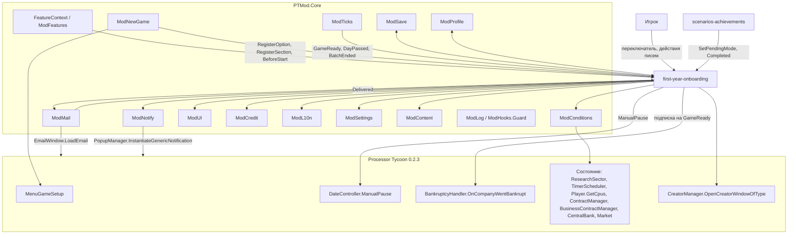
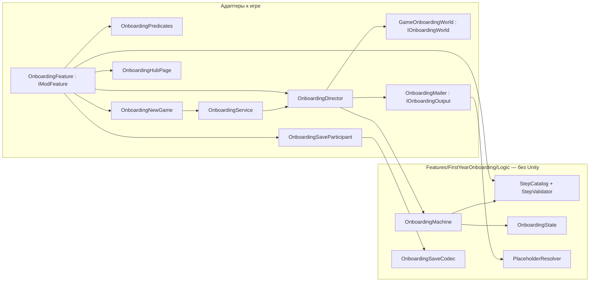
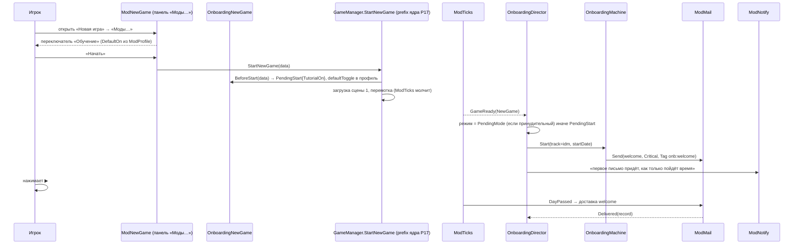
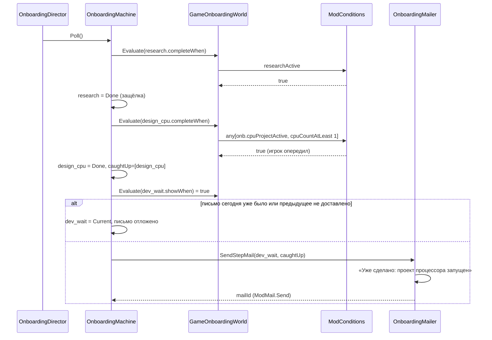
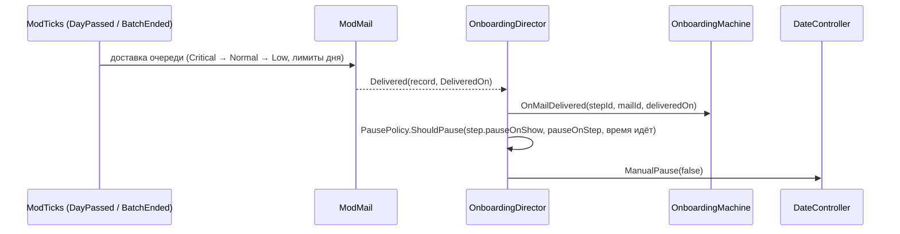
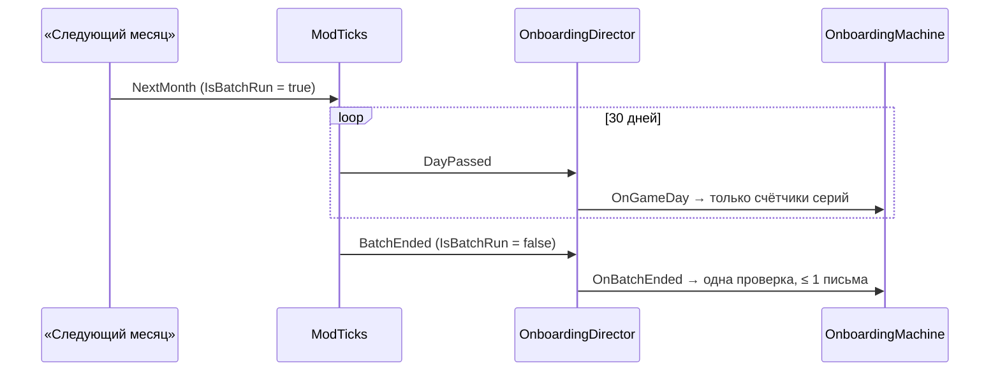
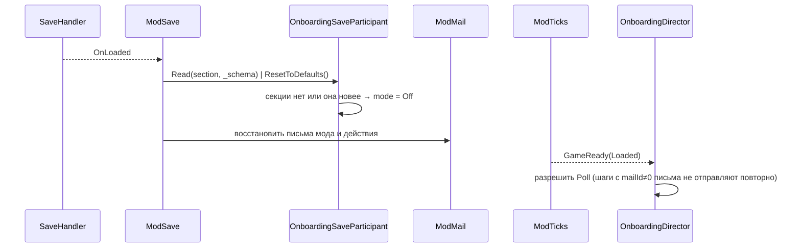
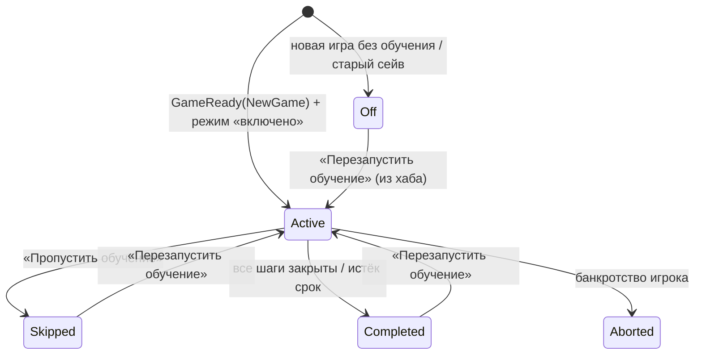

# Design: first-year-onboarding

## Document Information

- **Feature Name**: first-year-onboarding (I01)
- **Version**: 0.2
- **Date**: 2026-10-10
- **Author**: Dex719
- **Status**: Draft v0.2 — одобрено к реализации владельцем 2026-10-10
- **Reviewers**: владелец (Dex719); авторы `mod-framework` (контракт `[ModFeature] IModFeature`, `ModMail`/`ModConditions`/`ModNewGame`/`ModProfile`), `scenarios-achievements` (API FR-14)
- **Related Documents**: `requirements.md` (эта папка), `.kiro/steering/context.md`, `.kiro/steering/owner-decisions.md`, `.kiro/specs/mod-framework/design.md`, решения 0004–0006, `pt-modding/CODEMAP.md` (разделы «Save/load, menus, game setup…», «Desktop OS windows…», «Market simulation and contracts», «Time, bank…»)

## Overview

Фича — конечный автомат шагов, описанных данными (`steps.json`). Автомат опрашивает условия `ModConditions` по реальному времени (2 раза в секунду) и по игровым дням. Каждый шаг доставляется письмом `ModMail` с многоразовыми действиями; напоминания идут всплывающими подсказками `ModNotify`. Чистая логика (`OnboardingMachine`) отделена от игры двумя интерфейсами: «мир» (условия, дата, блокировки) и «вывод» (письма, подсказки, событие завершения). Поэтому автомат покрывается юнит-тестами мини-раннера без Unity.

В игру фича не вмешивается патчами: переключатель «Обучение» — опция `ModNewGame` на панели «Моды…» окна новой игры, старт — `ModTicks.GameReady(NewGame)`, тики — `FeatureContext.OnTick(TickPhase.DayPassed)`, письма — `ModMail`, состояние — `IModSaveParticipant`, глобальные данные — `ModProfile`. Патчи на `MenuGameSetup.*` и `GameManager.StartNewGame` ядро фичам запрещает (резерв «служба»). Баланс игры не меняется.

### Design Goals
- **Правда о прогрессе.** Шаг засчитывается только по реальному состоянию игры, с защёлкой.
- **Ноль дубликатов и спама.** Никаких писем при перемотке, загрузке и пакетном прогоне месяца, не больше одного письма в игровой день, «догоняющий» режим для уже сделанного.
- **Контент без пересборки.** Шаги, условия, напоминания и тексты — JSON и `ModL10n`.
- **Изоляция.** Ошибка в обучении не ломает игру и сейв: `ModHooks.Guard` на границах, состояние только в `ModSave`.

### Ключевые решения

- **D1. Шаги — данные, условия — `ModConditions`.** Нотация условий — ядра: `{ "type": "…", …параметры }`, `all`/`any`/`not`.
  - Отвергнуто: шаги в C# (каждая правка текста и порога требует сборки); собственный язык условий `{pred, op, value}` (дублирует `ModConditions`, который нужен ещё событиям и сценариям).
- **D2. Доставка — письма `ModMail` и подсказки `ModNotify`, без оверлеев.**
  - Отвергнуто: оверлей со стрелками поверх рабочего стола. Он зависит от структуры префабов и координат иконок, хрупок при смене разрешения (`AspectRatioFixer`), а своих ассетов у мода нет (решение 0005). Подсветка интерфейса — Could, вне MVP (решение владельца).
- **D3. Опрос условий по реальному времени (2 Гц) плюс игровые дни.** Опрос — корутина `PTModHost.Run` с `WaitForSecondsRealtime`; игровые дни — `ctx.OnTick(TickPhase.DayPassed, …)`.
  - Отвергнуто: только тики `ModTicks` — игра стартует на паузе (`DateController.Awake` выбирает кнопку скорости 0), и игрок, сделавший действие на паузе, не получил бы отклика.
  - Отвергнуто: патчи на каждое действие (`CreatorCpu.CreateCpu`, `ProjectReleaseWindow.ReleaseCpu`, `ResearchSector.SetCurrentResearch`…) — много хрупких точек. Опрос читает только публичное состояние.
  - Дни (напоминания, срок обучения, «минимум 1 день между письмами») считаются по разности дат с `ModTicks.Today`, а не по числу вызовов.
- **D4. Защёлка.** Засчитанный шаг не откатывается. Иначе шаг «первые продажи» мигал бы при дне без продаж.
- **D5. «Догоняющий» режим.** Если условие шага уже истинно, когда шаг становится текущим, он засчитывается без письма и попадает в строку «Уже сделано» следующего письма. Отвергнуто: слать письмо всё равно (спам для игрока, который опередил обучение).
- **D6. Баланс не меняется.** Стартовые деньги и цели — у `scenarios-achievements` (сценарий `garage-1975`). Обучение лишь принимает режим через `OnboardingService.SetPendingMode`.
- **D7. Переключатель — опция `ModNewGame` + выбор в `BeforeStart`.** `ModNewGame.RegisterOption` кладёт переключатель на общую панель «Моды…», `ModNewGame.BeforeStart` фиксирует выбор в `PendingStart`, итоговый режим вычисляется на `ModTicks.GameReady(NewGame)` с учётом `PendingMode` от сценария.
  - Отвергнуто: собственные патчи `MenuGameSetup.InitializeUI` и `GameManager.StartNewGame` (отклоняются ядром, дублируют P17/P18, две вставки в одно окно с `scenarios-achievements`).
  - Отвергнуто: спросить в первом письме «Нужно обучение?». Опытный игрок получил бы письмо, о котором не просил.
  - Порядок обработчиков `BeforeStart` у разных фич не определён, поэтому режим сценария применяется на `GameReady(NewGame)`, а не в `BeforeStart`.
- **D8. Письма различаются по `Tag`, блоков ID нет.** `ModMail.Send` сам выдаёт ID ≥ 100000; обучение хранит возвращённый ID в состоянии шага, тег — `onb:<stepId>` (повтор — `onb:<stepId>:repeat`).
- **D9. Пауза — по доставке письма.** Игру ставит на паузу обработчик `ModMail.Delivered` через `DateController.ManualPause(bool)`: письмо может стоять в очереди ядра, и пауза «в момент отправки» была бы раньше, чем игрок увидит письмо. Скорость до паузы игра запоминает сама (`speedButtonBeforeManualPause`), «▶» её возвращает.
- **D10. Пакетный прогон — через ядро.** Во время `ModTicks.IsBatchRun` письма не отправляются; на `ModTicks.BatchEnded` выполняется одна проверка. Собственный лимит «письмо за кадр» не нужен.
- **D11. Глобальные данные — `ModProfile`.** «Видел обучение» и последний выбор переключателя лежат в секции профиля `first-year-onboarding`, а не в `ModSettings`; в `ModSettings` остаются только параметры хаба (`pauseOnStep`, `remindersEnabled`).
- **D12. Приветствие при старте на паузе.** Ядро доставляет письма по `DayPassed`; пока игрок не нажал ▶, письма нет. Поэтому на `GameReady(NewGame)` показывается уведомление `ModNotify`, а письмо `welcome` (приоритет `Critical`) ставится в очередь и приходит в первый игровой день.

## Architecture

### System Context



### High-Level Architecture



### Используемые сервисы PTMod.Core

| Сервис | Для чего |
|---|---|
| `FeatureContext` / `ModFeatures` | точка входа `[ModFeature]`, `ctx.OnTick`, `ctx.SaveParticipant`, `ctx.Param`, `ctx.HubPage` |
| `ModHooks` | `Guard` на каждом входе, `Raise` для события `Completed`; **патчей фича не ставит** |
| `ModTicks` | `GameReady(NewGame\|Loaded)`, `TickPhase.DayPassed`, `IsLoading`, `IsFastForwarding`, `IsBatchRun`, `BatchEnded`, `Today`; защиты от перемотки и загрузки — по умолчанию |
| `ModSave` | секция `first-year-onboarding` (`IModSaveParticipant`) в `<save>.ptmod.json`; версию секции (`_schema`) ведёт ядро |
| `ModProfile` | секция профиля `first-year-onboarding`: `hasSeenTutorial`, `defaultToggle` |
| `ModConditions` | проверка `showWhen`, `completeWhen`, `variants[].when`; регистрация предикатов `onb.*` |
| `ModMail` | письма с действиями, `Tag`, приоритет, `Delivered`, `SetActionState`; ID выдаёт ядро |
| `ModNotify` | уведомление на старте и подсказки-напоминания |
| `ModNewGame` | опция «Обучение», секция «Задано сценарием», `BeforeStart` |
| `ModCredit` | `PlayerDebtLimit()` для `{debtLimit}` |
| `ModUI` | страница хаба, `Confirm` для «Перезапустить обучение» |
| `ModL10n` | все тексты `onb.*` |
| `ModSettings` | параметры `pauseOnStep`, `remindersEnabled` (`ParamSpec`) |
| `ModContent` | `first-year-onboarding/steps.json` и `config.json` с переопределением по `id` |
| `ModLog` | диагностика |

### Technology Stack

| Слой | Технология | Обоснование |
|---|---|---|
| Логика | C# latest; общее подмножество API .NET Framework 4.8 и `mscorlib` Unity (без `init`, `record`, `Index`/`Range`) | сборка `csc` из VS Build Tools, решение 0003 |
| Патчи | нет (всё через сервисы ядра) | резерв «служба» у `MenuGameSetup.*`, `GameManager.StartNewGame`, `Company.AddCpu` |
| Контент | JSON через `ModContent` | решение 0006 |
| Тесты | мини-раннер ядра на .NET Framework 4.8: `[Test]`, `[Covers]`, `Assert.*`; запуск `python mod/build.py --tests` | решение 0003 (обновлено): без xUnit и загрузок |

## Components and Interfaces

Пространство имён — `PTMod.Features.FirstYearOnboarding` (`ModFeatures.FeatureOfType` определяет фичу по нему). Чистая логика лежит в `mod/src/PTMod/Features/FirstYearOnboarding/Logic/` (пространство `…FirstYearOnboarding.Logic`), адаптеры — рядом. Сигнатуры ниже — контракт, реализацию задают tasks.md.

### OnboardingFeature
**Purpose**: точка входа фичи по контракту ядра (`[ModFeature] sealed class … : IModFeature`).
**Responsibilities**: ID `first-year-onboarding`; параметры; загрузка каталога; регистрация предикатов, участника сейва, страницы хаба, опции и секции новой игры; подписки на события ядра; запуск и остановка опроса.

```csharp
namespace PTMod.Features.FirstYearOnboarding
{
    [ModFeature]
    public sealed class OnboardingFeature : IModFeature
    {
        public const string FeatureId = "first-year-onboarding";
        public string Id => FeatureId;
        public string NameKey => "onb.feature.name";
        public string DescriptionKey => "onb.feature.desc";
        public string[] DependsOn => new string[0];     // жёстких зависимостей нет; bankruptcy-recovery и scenarios-achievements — мягкие связи
        public bool EnabledByDefault => true;
        public bool SupportsHotToggle => true;

        public void Register(FeatureContext ctx);        // см. ниже
        public void OnEnabled();                         // запустить корутину опроса, переподписаться на события сцены
        public void OnDisabled();                        // остановить опрос; секция сейва и профиль сохраняются
    }
}
```

`Register(FeatureContext ctx)` делает (без патчей):
- `ctx.Param(…)` для `pauseOnStep` (Bool, по умолчанию да) и `remindersEnabled` (Bool, по умолчанию да);
- `ModConditions.Register("onb.<имя>", FeatureId, …)` для собственных предикатов (таблица ниже);
- `ctx.SaveParticipant(new OnboardingSaveParticipant())`;
- `ctx.OnTick(TickPhase.DayPassed, director.OnDayPassed)`;
- `ModTicks.GameReady += director.OnGameReady`, `ModTicks.BatchEnded += director.OnBatchEnded`, `ModMail.Delivered += director.OnMailDelivered`, `ModMail.RegisterActionHandler(FeatureId, director.OnMailAction)`;
- `OnboardingNewGame.Register()`: `ModNewGame.RegisterOption`, `ModNewGame.RegisterSection(FeatureId, …, order: 20)`, `ModNewGame.BeforeStart += …`;
- `ctx.HubPage("onb.hub.title", hub.Build)`.

Обработчики событий ядра ядро вызывает через `ModHooks.Raise` (неактивные фичи пропускаются, исключение засчитывается фиче); обработчики дополнительно оборачиваются в `ModHooks.Guard`.

### OnboardingProfile (обёртка над ModProfile)

```csharp
internal static class OnboardingProfile
{
    // JsonObject = ModProfile.Section("first-year-onboarding"); версию секции (_schema) ведёт ядро
    internal static bool HasSeenTutorial { get; set; }   // по умолчанию false; set → ModProfile.MarkDirty
    internal static bool DefaultToggle { get; set; }     // последний выбор переключателя, по умолчанию true; set → MarkDirty
}
```

### StepCatalog и StepValidator (Logic)
**Purpose**: загрузка и проверка `steps.json` и `config.json`.
**Input**: записи `ModContent.LoadRecords` / `LoadConfig` (`JsonObject`); контекст проверки из Unity-слоя.
**Output**: `StepCatalog` с шагами по трекам и списком ошибок.

```csharp
public enum StepKind { Sequential, Situational }

public sealed class StepCatalog
{
    public OnboardingConfig Config { get; }
    public IList<StepDefinition> StepsFor(string track, StepKind kind); // ordered by Order
    public StepDefinition Find(string stepId);
    public IList<string> Errors { get; }
    public static StepCatalog Build(IList<StepDefinition> steps, OnboardingConfig config, IStepValidationContext context);
}

public interface IStepValidationContext
{
    // Unity-слой: ModConditions.Parse + проверка известных предикатов; в тестах — фейк
    bool ValidateCondition(JsonNode node, IList<string> errors, string path);   // using PTMod.Core.Logic.Json;
    bool HasString(string key);   // ru or en
}
```

Отображение `JsonObject → StepDefinition` (`StepMapper`) лежит в Logic; обёртка `StepRecord : IContentRecord` (поле `Id`) — в Unity-слое. Битая запись не попадает в каталог (`ModContent` пропускает её и пишет причину в отчёт).

### OnboardingMachine (Logic)
**Purpose**: автомат режимов и шагов.
**Responsibilities**: выбор текущего шага, защёлки, «догоняющий» режим, ограничение писем, напоминания, ситуативные советы, срок обучения, пропуск и перезапуск, итог.

```csharp
public enum OnboardingMode { Off, Active, Skipped, Completed, Aborted }
public enum StepStatus { Pending, Current, Done, Skipped, NotApplicable }

public interface IOnboardingWorld
{
    bool IsBlocked { get; }              // ModTicks.IsLoading || IsFastForwarding || !IsGameReady
    bool IsBatchRun { get; }             // ModTicks.IsBatchRun
    DateTime GameDate { get; }           // ModTicks.Today
    string DetectTrack();                // "idm" | "fabless" | "foundry"
    bool Evaluate(ConditionRef condition);   // делегирует ModConditions.Evaluate
    bool IsMailDelivered(int mailId);    // ModMail.Get(mailId)?.IsDelivered
}

public interface IOnboardingOutput
{
    int SendStepMail(StepDefinition step, string track, IList<string> caughtUp, bool isRepeat); // возвращает ID письма
    int SendSummaryMail(OnboardingState state, StepCatalog catalog);
    void ShowHint(StepDefinition step, int hintIndex);      // ModNotify
    void SetHintAvailable(int mailId, bool available);      // ModMail.SetActionState(…, "hint", …)
    void NotifyStarted();                                   // ModNotify при старте
    void RaiseCompleted(OnboardingResult result);
}

public sealed class OnboardingMachine
{
    public OnboardingMachine(StepCatalog catalog, OnboardingState state);
    public OnboardingState State { get; }
    public void Start(IOnboardingWorld world, IOnboardingOutput output);        // на GameReady(NewGame)
    public void Poll(IOnboardingWorld world, IOnboardingOutput output);         // 2 Гц, реальное время
    public void OnGameDay(IOnboardingWorld world, IOnboardingOutput output);    // TickPhase.DayPassed
    public void OnBatchEnded(IOnboardingWorld world, IOnboardingOutput output); // ModTicks.BatchEnded
    public void OnMailDelivered(string stepId, int mailId, DateTime deliveredOn);
    public void HandleAction(string actionId, string stepId, IOnboardingWorld world, IOnboardingOutput output);
    public void Abort(string reason, IOnboardingOutput output);                 // игрок обанкротился
}

public sealed class OnboardingResult
{
    public string Track;
    public int CompletedSteps;
    public int SkippedSteps;
    public bool WasSkipped;
    public bool Aborted;
}
```

**Правила автомата (псевдокод):**

```
OnGameDay:
  if mode != Active or world.IsBlocked: return
  update streak counters of situational tips                 // каждый день, в том числе внутри пакетного прогона
  if world.IsBatchRun: return                                // письма и подсказки ждут BatchEnded
  Evaluate()

Poll / OnBatchEnded:
  if mode != Active or world.IsBlocked or world.IsBatchRun: return
  Evaluate()

Evaluate:
  if daysSinceStart > config.tutorialWindowDays: finish(); return
  // 1. completion of current step (latch)
  if current != null and not current.CompleteOnShow and world.Evaluate(current.completeWhen):
      mark Done(current, today)
  // 2. advance (≤ 1 mail per call, ≤ 1 per game day, not while the previous mail is queued)
  caughtUp = []
  while current is Done/Skipped/NotApplicable:
      next = first Pending sequential step of track with Order > current.Order
      if next == null: finish(); return
      if next.showWhen != null and not world.Evaluate(next.showWhen): current = null; break   // wait
      if world.Evaluate(next.completeWhen): mark Done(next) silently; caughtUp.add(next.id); continue
      if lastMailDay == today or daysSince(lastMailDay) < config.minDaysBetweenMails
         or previous mailId != 0 and not world.IsMailDelivered(previous mailId):
           set next Current (mail pending); break
      mailId = send mail(next, caughtUp); lastMailDay = today
      if next.CompleteOnShow: mark Done(next)
      break
  // 3. situational tips: same day budget (no mail if lastMailDay == today)
  // 4. reminders: step = current with delivered mail
  //    r = step.reminders[step.RemindersShown]; if r exists and r.afterDays <= (today - step.DeliveredOn).Days
  //       and lastHintDate != today and remindersEnabled: output.ShowHint; RemindersShown++; lastHintDate = today
```

`OnMailDelivered(stepId, mailId, deliveredOn)` записывает `DeliveredOn` в состояние шага. Ограничение «одно письмо в игровой день» и то, что внутри пакетного прогона письма не отправляются, вместе дают защиту от пачек дней `DateController.NextMonth` (E2). Пауза времени машине не принадлежит: её ставит `OnboardingDirector.OnMailDelivered` по правилу `PausePolicy.ShouldPause(step, pauseOnStep, timeRunning)` (чистая функция, тестируется).

### OnboardingDirector
**Purpose**: мост между автоматом и игрой (обычный класс, не `MonoBehaviour`).
**Responsibilities**: подписки на события ядра, опрос 2 Гц (корутина), загрузка и сохранение состояния, обёртка `ModHooks.Guard` на каждом входе (счётчик ошибок и отключение ведёт ядро).

```csharp
internal sealed class OnboardingDirector
{
    internal const float PollIntervalSeconds = 0.5f;
    internal void Bind(OnboardingMachineFactory factory, StepCatalog catalog);
    internal void OnEnabled();                              // PTModHost.Instance.Run(PollLoop()); флаг активности
    internal void OnDisabled();                             // сбросить флаг: корутина выходит на ближайшей итерации
    private System.Collections.IEnumerator PollLoop();      // WaitForSecondsRealtime(PollIntervalSeconds) → machine.Poll
    internal void OnGameReady(GameReadyReason reason);      // NewGame: режим + Start; Loaded: возобновление; оба: подписка на BankruptcyHandler сцены
    internal void OnDayPassed();                            // ctx.OnTick(TickPhase.DayPassed)
    internal void OnBatchEnded();                           // ModTicks.BatchEnded
    internal void OnMailDelivered(ModMailRecord record);    // ModMail.Delivered: DeliveredOn в состояние, пауза
    internal void OnMailAction(ModMailRecord record, string actionId);   // ModMail.RegisterActionHandler
    private void OnCompanyWentBankrupt(ProcessorTycoon.CompanySystem.ICompany company);  // только игрок
}
```

Событие игры `BankruptcyHandler.OnCompanyWentBankrupt` принадлежит экземпляру сцены и обнуляется при смене сцены, поэтому подписка ставится в `OnGameReady` (ядро поднимает `GameReady` один раз на сцену) на `BankruptcyHandler.Instance`.

### GameOnboardingWorld и OnboardingPredicates
**Purpose**: реализация `IOnboardingWorld` над `ModConditions` и регистрация недостающих предикатов.

**Предикаты.** Условия записываются в нотации ядра. Большинство предикатов берётся у ядра как есть; недостающие регистрирует фича под префиксом `onb.` (правило `ModConditions.Register`: предикат фичи называется `<prefix>.<name>`). Все читают публичное состояние игры, без патчей.

| Предикат | Параметры | Вычисление (API игры) | Где |
|---|---|---|---|
| `companyType` | `kind` = `idm`\|`fabless`\|`foundry` | `Company.get_IsIdmCompany` / `get_IsFabless` / `get_IsFoundry` | ядро |
| `moneyBelow` | `amount` | `ICompany.get_MoneyAmount` | ядро |
| `inDefault` | — | `ICompany.get_IsInDefault` | ядро |
| `researchActive` | — | `ResearchSector.CurrentResearch() != null` (`ResearchSector.CurrentResearch`) | ядро |
| `cpuCountAtLeast` | `count`, `includeRetired` = false | `Player.GetCpus()` с `IsReleased && !IsRetired` | ядро |
| `oemOfferSent` | — | есть доступный контракт, где `Contract.HasReceivedOffer(cpu.SaveID)` для CPU игрока (`ContractManager.GetAvailableContracts`) | ядро |
| `oemContractsActiveAtLeast` | `count` | `ContractHelper.PlayerContracts().Count` | ядро |
| `businessContractsAtLeast` | `count` | `BusinessContractManager.Instance.SignedContractsCount(company)` | ядро |
| `factoryLinesAtLeast` | `lines` | `ICompany.get_Factory().ProductionCapacity` | ядро |
| `profitLastMonthAtLeast` | `amount` | отчёт прошлого месяца `CompanyFinance.Reports` | ядро |
| `daysSinceStartAtLeast` | `days` | `ModSave.GameStartDate` | ядро |
| `featureActive` | `id` | `ModFeatures.IsActive` | ядро |
| `onb.cpuProjectActive` | — | `TimerScheduler.Instance.GetTimedObjectsOfType<Project>()`: есть проект игрока с `Project.GetCpuProject() != null` | фича |
| `onb.factoryProjectActive` | — | то же с `Project.GetFactoryExpansionProject() != null` | фича |
| `onb.producedToday` | — | есть CPU игрока с `ProducedLastDay > 0` | фича |
| `onb.soldToday` | — | есть CPU игрока с `SoldLastDay > 0` | фича |
| `onb.missedOverSold` | — | сумма `MissedSalesLastDay` > сумма `SoldLastDay` по CPU игрока | фича |
| `onb.anyOldCpu` | — | есть выпущенный неретированный CPU с `Cpu.IsOld(-1, -1)` | фича |
| `onb.oemAvailable` | — | `ContractManager.Instance.GetAvailableContracts().Count > 0` | фича |
| `onb.automate` | — | `Player.Instance.AutomateContracts` | фича |
| `onb.foundryServices` | — | `Divisions.FoundryServices` компании игрока | фича |
| `onb.isJan1` | — | `ModTicks.Today` — 1 января | фича |
| `onb.dayOfMonth` | `day` | `ModTicks.Today.Day == day` | фича |
| `onb.stepDone` | `id` | статус шага в `OnboardingState` | фича |

`Project.GetCpuProject` пишет `Progress`/`IsPaused` в объект сохранения (побочный эффект, CODEMAP). Запись идемпотентна и не меняет игру, но опрос ограничен 2 Гц и только пока текущий шаг — `design_cpu`.

Предикаты фичи регистрируются в `Register`; фабрика разбирает параметры (`day`, `id`) и сообщает об ошибках в список ошибок парсера. Определение трека (`DetectTrack`) читает компанию игрока напрямую, а не через `ModConditions`.

### OnboardingMailer и PlaceholderResolver
**Purpose**: реализация `IOnboardingOutput`.
**Responsibilities**: заголовок `[Наставник] …` / `[Mentor] …` (префикс входит в строки `*.title`); выбор варианта текста по треку и по условию; значения аргументов; действия письма; повтор; итоговое письмо; подсказки `ModNotify`; уведомление на старте.

Письмо собирается в `ModMailMessage`: `FeatureId = first-year-onboarding`, `Tag = "onb:<stepId>"`, `TitleKey`/`BodyKey` (вариант трека `<ключ>.<трек>`, затем вариант по условию), `Args` — строки в порядке списка `args` шага, `Priority` — из шага (по умолчанию `Normal`), `Actions` — по списку `buttons`. Ядро хранит ключ и аргументы и перерисовывает письмо на текущем языке.

```csharp
public sealed class OnboardingMailer : IOnboardingOutput
{
    // action ids (ModMailAction.Id); обработчик — ModMail.RegisterActionHandler(FeatureId, …)
    public const string ActionSkipAll = "skipAll";            // Repeatable = false
    public const string ActionSkipStep = "skipStep";          // Repeatable = false
    public const string ActionHint = "hint";                  // Repeatable = true; SetActionState → неактивно, когда подсказки кончились
    public const string ActionOpenCpuDesigner = "openCpuDesigner";            // Repeatable = true
    public const string ActionOpenFactoryExpansion = "openFactoryExpansion";  // Repeatable = true
}

// Logic: имена плейсхолдеров → строки значений в порядке args шага; {0}, {1}, … в тексте L10n
public interface IPlaceholderSource { bool TryGet(string name, out string value); }
public static class PlaceholderResolver
{
    public static string[] ResolveArgs(IList<string> names, IPlaceholderSource source);   // неизвестное имя → "?" и предупреждение
}
```

| Имя в `args` | Источник |
|---|---|
| `highEndBudget`, `midRangeBudget`, `lowEndBudget`, `industriesBudget` | `Market.get_HighEndBudget` / `get_MidRangeBudget` / `get_LowEndBudget` / `get_IndustriesBudget` |
| `debtLimit` | `ModCredit.PlayerDebtLimit()` (учитывает множитель `bank.creditLimit` игрока; пороги берутся только из ядра, не из `CentralBank.DebtLimit`) |
| `defaultDays` | поле `BankruptcyHandler.defaultTimeLimit` экземпляра `BankruptcyHandler.Instance` через `AccessTools`; фолбэк — `config.defaultDaysFallback` = 120 (значение сцены) |
| `money` | `ICompany.get_MoneyAmount` |
| `company`, `founder` | `ICompany.get_Name`, `get_Founder` |

Деньги форматируются `StringFormatter.FloatToMoney(value, "", true, true, true)`, как в интерфейсе игры. Значения аргументов фиксируются в момент отправки письма.

Действия «Открыть конструктор CPU» и «Открыть расширение фабрики» вызывают `CreatorManager.Instance.OpenCreatorWindowOfType(CreatorWindow.Type.Cpu)` и `(CreatorWindow.Type.FactoryExpansion)`. Других окон игра программно не открывает (у `OSButton` нет метода открытия), поэтому остальные шаги называют иконку рабочего стола текстом.

### OnboardingNewGame
**Purpose**: переключатель «Обучение» и взаимодействие с окном новой игры (FR-1) без патчей.

```csharp
internal static class OnboardingNewGame
{
    internal const string OptionId = "tutorial";
    internal static void Register();    // ModNewGame.RegisterOption(new NewGameOption { FeatureId = FeatureId, Id = OptionId, LabelKey = "onb.toggle.label", TooltipKey = "onb.toggle.tooltip", Kind = Toggle, DefaultOn = !HasSeenTutorial || DefaultToggle })
                                        // + ModNewGame.RegisterSection(FeatureId, BuildForcedModeLine, order: 20) + ModNewGame.BeforeStart += OnBeforeStart
    private static void OnBeforeStart(ProcessorTycoon.InitialData.PlayerInitialData data);   // читает ModNewGame.GetToggle, пишет defaultToggle в профиль, PendingStart; data не меняет
    private static void BuildForcedModeLine(UnityEngine.RectTransform container);            // строка «Задано сценарием: …», обновляется по OnboardingService.PendingModeChanged
}

internal static class PendingStart
{
    internal static bool HasValue;
    internal static bool TutorialOn;
    internal static void Clear();
}
```

- Итоговый режим вычисляет `OnboardingDirector.OnGameReady(NewGame)`: `ForcedOn` → включено, `ForcedOff` → выключено, `Allowed` → значение `PendingStart.TutorialOn` (нет `PendingStart` — выключено). После этого `PendingStart.Clear()` и сброс режима сервиса в `Allowed`.
- Если режим принудительный, значение переключателя игнорируется, а секция панели показывает `onb.toggle.forced`.
- `DefaultOn` вычисляется один раз при `Register` из профиля (ядро читает профиль до `Register` любой фичи); пока панель открыта, выбор хранит `ModNewGame`.

### OnboardingService (API, FR-14)

```csharp
public enum PendingMode { Allowed, ForcedOn, ForcedOff }

public static class OnboardingService
{
    public static void SetPendingMode(PendingMode mode, string source);
    public static PendingMode GetPendingMode();
    public static event Action PendingModeChanged;            // секция новой игры обновляет строку «Задано сценарием»
    public static event Action<OnboardingResult> Completed;   // поднимается через ModHooks.Raise("onb.completed", …): исключение подписчика изолировано
    public static OnboardingStatus GetStatus();     // mode, track, current step index/total, current step id
    public static void SkipAll(string reason);
    public static void SkipCurrentStep();
    public static void ResendCurrent();
    public static void Restart();
}
```

### OnboardingHubPage
Страница «Обучение» в хабе «Моды» (`FeatureContext.HubPage`): статус, кнопки «Повторить письмо шага», «Пропустить шаг», «Пропустить обучение», «Перезапустить обучение» (подтверждение `ModUI.Confirm`). Переключатели «Пауза при новом шаге» и «Подсказки-напоминания» — `ParamSpec`: ядро строит их на странице настроек фичи само.

## Патчи Harmony

Фича не ставит патчей. Все точки интеграции — сервисы ядра:

| Нужно фиче | Как | Замена прежнего патча |
|---|---|---|
| Переключатель в окне новой игры | `ModNewGame.RegisterOption` / `RegisterSection` | постфикс `MenuGameSetup.InitializeUI` (отклоняется ядром) |
| Фиксация выбора | `ModNewGame.BeforeStart` | префикс `GameManager.StartNewGame` (отклоняется ядром) |
| Старт обучения | `ModTicks.GameReady(NewGame)` | событие `Player.OnNewGame` |
| Возобновление после загрузки | `ModTicks.GameReady(Loaded)` | `SaveHandler.OnLastLoadedTick` |
| День, пакетный прогон | `TickPhase.DayPassed`, `ModTicks.IsBatchRun`, `BatchEnded` | прежняя подписка `OnDayPassed` (такого имени в ядре нет) и собственный лимит «письмо за кадр» |

Патчей на формулы нет, каналы `ModModifiers` не используются.

## Подписки на события

| Событие | Обработчик | Защиты |
|---|---|---|
| `ModTicks.GameReady(NewGame)` | `OnboardingDirector.OnGameReady`: вычислить режим, `machine.Start`, уведомление `ModNotify`; подписаться на `BankruptcyHandler.OnCompanyWentBankrupt` сцены | Ядро поднимает событие после перемотки и один раз на сцену. Нет `PendingStart` и нет `ForcedOn` → `mode = Off`. |
| `ModTicks.GameReady(Loaded)` | `OnGameReady`: возобновить опрос по восстановленному состоянию; подписка на `BankruptcyHandler` | Старый сейв (нет секции) → `mode = Off` (участник получил `ResetToDefaults`). |
| `TickPhase.DayPassed` (`ctx.OnTick`) | `OnboardingDirector.OnDayPassed` → `machine.OnGameDay` | Подписчики фаз не вызываются при перемотке и загрузке; внутри пакетного прогона машина только считает серии. |
| `ModTicks.BatchEnded` | `OnboardingDirector.OnBatchEnded` → `machine.OnBatchEnded` | Одна проверка после `NextMonth`. |
| `ModMail.Delivered` | `OnMailDelivered`: тег `onb:<stepId>` → `DeliveredOn` в состояние шага, пауза по `PausePolicy` | Чужие письма игнорируются по `FeatureId`. |
| Опрос (корутина `PTModHost.Run`, 2 Гц, реальное время) | `machine.Poll` | Пропуск, если `IsBlocked`, `IsBatchRun` или фича выключена; корутина завершается при `OnDisabled`. |
| `ModSave` чтение/запись | `OnboardingSaveParticipant.Read` / `Write` | Нет секции или секция новее → `ResetToDefaults()`, `mode = Off`; новейшая секция ядром сохраняется как есть. |
| `BankruptcyHandler.OnCompanyWentBankrupt` | `OnCompanyWentBankrupt` | Только `company.IsPlayer`; при загрузке и перемотке событие не обрабатывается. |
| Действие письма (`ModMail.RegisterActionHandler`) | `machine.HandleAction` | Действие неизвестного шага (контент изменился) игнорируется с записью в лог. |
| `ModNewGame.BeforeStart` | `OnboardingNewGame.OnBeforeStart` | `PlayerInitialData` не меняется. |

## Data Models

### StepDefinition (контент)

```csharp
public sealed class StepDefinition
{
    public string Id;                 // unique, [a-z0-9_]{2,40}
    public int Order;                 // sequential ordering inside track
    public StepKind Kind;             // Sequential | Situational
    public string[] Tracks;           // subset of idm, fabless, foundry
    public ConditionRef ShowWhen;     // null = immediately
    public ConditionRef CompleteWhen; // null if CompleteOnShow
    public bool CompleteOnShow;
    public int StreakDays;            // situational: condition must hold N consecutive game days (0 = once)
    public string Priority;           // "critical" | "normal" | "low"; default "normal"
    public MailSpec Mail;
    public ReminderSpec[] Reminders;  // afterDays 1..3650
    public bool PauseOnShow;
}

public sealed class MailSpec
{
    public string TitleKey;           // onb.<id>.title (строка содержит префикс «[Наставник]»)
    public string BodyKey;            // onb.<id>.body ; track variant onb.<id>.body.<track>
    public string[] Args;             // имена плейсхолдеров по порядку: {0}, {1}, …
    public string[] Buttons;          // skipAll | skipStep | hint | openCpuDesigner | openFactoryExpansion
    public BodyVariant[] Variants;    // вариант текста по условию (например, bankruptcy-recovery)
}

public sealed class BodyVariant { public ConditionRef When; public string BodyKey; }
public sealed class ReminderSpec { public int AfterDays; public string HintKey; public string[] Args; }

public sealed class OnboardingConfig
{
    public int TutorialWindowDays;    // default 730
    public int MinDaysBetweenMails;   // default 1
    public int DefaultDaysFallback;   // default 120 (BankruptcyHandler.defaultTimeLimit scene value)
}

public sealed class ConditionRef
{
    public JsonNode Node;             // узел нотации ModConditions (using PTMod.Core.Logic.Json;)
    public object Compiled;           // ICondition ядра: кеш Unity-слоя после ModConditions.Parse (в тестах не используется)
}
```

**Validation Rules:**
- `Id` уникален; `Order` уникален внутри трека для последовательных шагов.
- `Tracks` не пуст и состоит из известных треков.
- Все условия (`ShowWhen`, `CompleteWhen`, `Variants[].When`) разбираются `ModConditions.Parse` и содержат только известные предикаты ядра или зарегистрированные `onb.*`.
- `TitleKey`/`BodyKey`/`HintKey` существуют хотя бы в `ru`; строка заголовка начинается с «[Наставник]».
- `Args` — только имена из белого списка плейсхолдеров; индексы `{n}` текста не выходят за длину `Args` (проверка по `ru`).
- `AfterDays` — 1..3650, по возрастанию; `StreakDays` — 0..365; `Priority` ∈ {`critical`, `normal`, `low`}.
- Ровно одно из `CompleteWhen` и `CompleteOnShow` задано.

### Контент: `mod/src/PTMod/Content/first-year-onboarding/steps.json` и `config.json`

Файлы следуют формату `ModContent`: `steps.json` — массив `records` (переопределение и отключение шага по `id`), `config.json` — настройки ритма. Поле `schema` здесь — схема файла контента, не секции сейва.

`config.json`:

```json
{ "schema": 1, "tutorialWindowDays": 730, "minDaysBetweenMails": 1, "defaultDaysFallback": 120 }
```

`steps.json` (часть файла с реальными значениями; полный файл — TSK-004):

```json
{
  "schema": 1,
  "records": [
    {
      "id": "welcome", "order": 10, "kind": "sequential", "tracks": ["idm", "fabless", "foundry"],
      "completeOnShow": true, "pauseOnShow": false, "priority": "critical",
      "mail": { "titleKey": "onb.welcome.title", "bodyKey": "onb.welcome.body", "args": ["company", "founder"], "buttons": ["skipAll"] }
    },
    {
      "id": "research", "order": 20, "kind": "sequential", "tracks": ["idm", "fabless", "foundry"],
      "completeWhen": { "type": "researchActive" },
      "pauseOnShow": true,
      "mail": { "titleKey": "onb.research.title", "bodyKey": "onb.research.body", "buttons": ["hint", "skipStep"] },
      "reminders": [ { "afterDays": 15, "hintKey": "onb.research.hint1" }, { "afterDays": 40, "hintKey": "onb.research.hint2" } ]
    },
    {
      "id": "design_cpu", "order": 30, "kind": "sequential", "tracks": ["idm", "fabless"],
      "completeWhen": { "any": [
        { "type": "onb.cpuProjectActive" },
        { "type": "cpuCountAtLeast", "count": 1 } ] },
      "pauseOnShow": true,
      "mail": { "titleKey": "onb.design_cpu.title", "bodyKey": "onb.design_cpu.body", "buttons": ["openCpuDesigner", "hint", "skipStep"] },
      "reminders": [ { "afterDays": 20, "hintKey": "onb.design_cpu.hint1" }, { "afterDays": 50, "hintKey": "onb.design_cpu.hint2" } ]
    },
    {
      "id": "release_price", "order": 50, "kind": "sequential", "tracks": ["idm", "fabless"],
      "completeWhen": { "type": "cpuCountAtLeast", "count": 1 },
      "pauseOnShow": true,
      "mail": { "titleKey": "onb.release_price.title", "bodyKey": "onb.release_price.body",
                "args": ["highEndBudget", "midRangeBudget", "lowEndBudget", "industriesBudget"], "buttons": ["skipStep"] }
    },
    {
      "id": "first_sales", "order": 70, "kind": "sequential", "tracks": ["idm", "fabless"],
      "completeWhen": { "type": "onb.soldToday" },
      "mail": { "titleKey": "onb.first_sales.title", "bodyKey": "onb.first_sales.body", "buttons": ["hint", "skipStep"] },
      "reminders": [ { "afterDays": 20, "hintKey": "onb.first_sales.hint1", "args": ["lowEndBudget"] }, { "afterDays": 45, "hintKey": "onb.first_sales.hint2" } ]
    },
    {
      "id": "tip_debt", "order": 0, "kind": "situational", "tracks": ["idm", "fabless", "foundry"],
      "showWhen": { "type": "moneyBelow", "amount": 0 },
      "completeOnShow": true, "pauseOnShow": true, "priority": "critical",
      "mail": { "titleKey": "onb.tip_debt.title", "bodyKey": "onb.tip_debt.body", "args": ["debtLimit", "defaultDays"], "buttons": [] }
    },
    {
      "id": "tip_default", "order": 0, "kind": "situational", "tracks": ["idm", "fabless", "foundry"],
      "showWhen": { "type": "inDefault" },
      "completeOnShow": true, "pauseOnShow": true, "priority": "critical",
      "mail": { "titleKey": "onb.tip_default.title", "bodyKey": "onb.tip_default.body", "args": ["defaultDays"], "buttons": [],
                "variants": [ { "when": { "type": "featureActive", "id": "bankruptcy-recovery" }, "bodyKey": "onb.tip_default.body.rec" } ] }
    },
    {
      "id": "tip_missed_sales", "order": 0, "kind": "situational", "tracks": ["idm", "fabless"],
      "showWhen": { "type": "onb.missedOverSold" },
      "streakDays": 7, "completeOnShow": true,
      "mail": { "titleKey": "onb.tip_missed_sales.title", "bodyKey": "onb.tip_missed_sales.body", "buttons": ["openFactoryExpansion"] }
    }
  ]
}
```

**Полный набор шагов (TSK-004):**

| Трек | Порядок | Шаг | `showWhen` | `completeWhen` | Напоминания (дни) |
|---|---|---|---|---|---|
| все | 10 | `welcome` (приоритет `critical`) | — | при показе | — |
| все | 20 | `research` | — | `researchActive` | 15, 40 |
| idm, fabless | 30 | `design_cpu` | — | `onb.cpuProjectActive` ∨ `cpuCountAtLeast 1` | 20, 50 |
| idm, fabless | 40 | `dev_wait` | `onb.cpuProjectActive` ∨ `cpuCountAtLeast 1` | при показе | — |
| idm, fabless | 50 | `release_price` | — | `cpuCountAtLeast 1` | — |
| idm, fabless | 60 | `production` (вариант текста для fabless) | — | `onb.producedToday` | 10, 30 |
| idm, fabless | 70 | `first_sales` | — | `onb.soldToday` | 20, 45 |
| idm, fabless | 80 | `oem_offer` | `onb.oemAvailable` | `oemOfferSent` ∨ `onb.automate` | 30, 90 |
| все | 90 | `finance` | `onb.stepDone research` ∧ `onb.dayOfMonth 1` | при показе | — |
| foundry | 30 | `foundry_services` | — | `onb.foundryServices` | 20 |
| foundry | 40 | `first_client` | — | `businessContractsAtLeast 1` | 30, 90 |
| foundry | 50 | `factory_expansion` | — | `onb.factoryProjectActive` | 60 |
| все | 100 | `graduation` | все предыдущие шаги трека закрыты или истёк срок | при показе | — |
| все | сит. | `tip_debt` (`critical`) | `moneyBelow 0` | при показе | — |
| все | сит. | `tip_default` (`critical`; вариант при `featureActive bankruptcy-recovery`) | `inDefault` | при показе | — |
| idm, fabless | сит. | `tip_contract_signed` | `oemContractsActiveAtLeast 1` | при показе | — |
| idm, fabless | сит. | `tip_missed_sales` | `onb.missedOverSold`, 7 дней подряд | при показе | — |
| все | сит. | `tip_year_summary` | `onb.isJan1` ∧ `daysSinceStartAtLeast 30` | при показе | — |
| idm, fabless | сит. | `tip_old_cpu` | `onb.anyOldCpu` | при показе | — |

Итого: трек `idm` — 10 последовательных шагов, `fabless` — 10 (тексты `production` и `design_cpu` с вариантом `.fabless`), `foundry` — 7; ситуативных советов — 6.

### OnboardingState (секция ModSave)

Версия секции (`_schema`) — не часть DTO: её пишет и читает ядро (`IModSaveParticipant.SchemaVersion = 1`).

```csharp
public sealed class OnboardingState
{
    public OnboardingMode Mode;
    public string Track;
    public string StartDate;           // "yyyy-MM-dd"
    public string CurrentStepId;
    public string LastMailDate;
    public string LastHintDate;
    public string PendingCaughtUp;     // comma-separated ids to mention in next mail
    public List<StepState> Steps;
    public string Source;              // "menu" | "scenario:garage-1975"
}

public sealed class StepState
{
    public string Id;
    public StepStatus Status;
    public string ShownOn;             // дата отправки письма
    public string DeliveredOn;         // дата доставки (ModMail.Delivered), null пока письмо в очереди
    public string DoneOn;
    public int MailId;                 // 0 if not sent; ID выдаёт ModMail.Send
    public int RemindersShown;
    public int StreakDays;
}
```

Пример секции `features.first-year-onboarding` в `<save>.ptmod.json` (поле `_schema` добавляет ядро):

```json
{
  "mode": "Active",
  "track": "idm",
  "startDate": "1975-01-01",
  "currentStepId": "release_price",
  "lastMailDate": "1975-07-14",
  "lastHintDate": "1975-03-02",
  "pendingCaughtUp": "",
  "source": "menu",
  "steps": [
    { "id": "welcome", "status": "Done", "shownOn": "1975-01-01", "deliveredOn": "1975-01-01", "doneOn": "1975-01-01", "mailId": 100000, "remindersShown": 0, "streakDays": 0 },
    { "id": "research", "status": "Done", "shownOn": "1975-01-02", "deliveredOn": "1975-01-02", "doneOn": "1975-01-02", "mailId": 100001, "remindersShown": 0, "streakDays": 0 },
    { "id": "design_cpu", "status": "Done", "shownOn": "1975-01-03", "deliveredOn": "1975-01-03", "doneOn": "1975-01-19", "mailId": 100002, "remindersShown": 0, "streakDays": 0 },
    { "id": "dev_wait", "status": "Done", "shownOn": "1975-01-20", "deliveredOn": "1975-01-20", "doneOn": "1975-01-20", "mailId": 100003, "remindersShown": 0, "streakDays": 0 },
    { "id": "release_price", "status": "Current", "shownOn": "1975-07-14", "deliveredOn": "1975-07-15", "doneOn": null, "mailId": 100005, "remindersShown": 0, "streakDays": 0 },
    { "id": "tip_debt", "status": "Done", "shownOn": "1975-05-02", "deliveredOn": "1975-05-02", "doneOn": "1975-05-02", "mailId": 100004, "remindersShown": 0, "streakDays": 0 }
  ]
}
```

Сами письма (заголовок, текст, действия, состояние кнопок) хранит и восстанавливает `ModMail` в секции ядра; обучение хранит только `mailId`.

Секция профиля `features.first-year-onboarding` в `ptmod_profile.json` (пишет `ModProfile`, версия — `_schema` ядра):

```json
{ "hasSeenTutorial": true, "defaultToggle": false }
```

## Формулы и баланс

Обучение **не меняет** ни одной формулы и константы игры: патчей нет, каналы `ModModifiers` не используются, вклада в общий предел `market.rating.cpu` и `popularity.gain` нет. Числа фичи — только ритм обучения:

| Параметр | Значение | Где задан | Обоснование |
|---|---|---|---|
| `tutorialWindowDays` | 730 игровых дней | `config.json` | Идея I01: «первые один-два года»; решение владельца |
| `minDaysBetweenMails` | 1 | `config.json` | NFR-5: не больше письма в день |
| Интервал опроса | 0,5 с реального времени | код (`PollIntervalSeconds`) | FR-4: отклик ≤ 1 с |
| Напоминания | 10–90 дней (таблица шагов) | `steps.json` | При скорости 1 день/с напоминание через 15–40 с реального времени не мешает, через 90 дней — уже явный застой |
| Ошибок до отключения | 5 за сессию (`hooks.faultThreshold`) | ядро | NFR-2 |

Числа, которые обучение **цитирует** в текстах (читаются из игры, где возможно, иначе берутся из контента со ссылкой на источник):

| Число в тексте | Значение | Источник в игре |
|---|---|---|
| Бюджеты сегментов | $599 / $249 / $149 / $79 (High End / Mid Range / Low End / Industries) | `PopulationData.BaseBudget` → `Market.get_HighEndBudget` и др. (бюджет не инфлируется) |
| Цена ≥ 3× бюджета → продаж в сегменте нет | 3× | `Market.CalculateRatings` |
| Цена ниже бюджета → бонус рейтинга | k = (бюджет / цена) × `UnderpricingBonus` − 1 | `Market.CalculateRatings` |
| Стартовая популярность CPU | 0,05 по каждому сегменту, потолок 1,0 | конструктор `CpuBase`; `Market.UpdatePopularities` |
| Хранение запасов | $0,5 за штуку в месяц | `StorageMath.Cost` (÷30 в день в `MarketDataHandler.RegisterDailyCpuSales`) |
| OEM: решение через год после появления предложения | 1 год | `Contract.Setup` / `Contract.OnTick` |
| OEM: штраф за недопоставку | 2 × оплата за штуку | `Contract.Setup` |
| OEM: автопредложения | 31 декабря, по марже `ContractProfitMargin` (по умолчанию 40%) | `ContractAutomation.SendOffers` |
| Кредитный лимит | `{debtLimit}` (живое значение; ≈ $111 млн в 1985) | `ModCredit.PlayerDebtLimit()`; база — `CentralBank.UpdateCreditLimit`: max(1 000 000, 10 000 000 × I² × (1,5 + clamp(год − 1971, 0, 60)/25) − 17 500 000) |
| Ставка по долгу | 25% годовых | `CentralBank.TaxInterest`, `interestRate` = 25 |
| Налог на прибыль | 25% от месячной прибыли | `TaxationHandler.HandleTaxes`, `taxRate` = 25 |
| Срок до банкротства в дефолте | `{defaultDays}` = 120 дней | `BankruptcyHandler.TickBankruptcies`, `defaultTimeLimit` = 120 |
| Скорость исследования | прогресс/день = √Funding × ResearchSpeed / Time | `ResearchSector.Research.AddProgress` |

## UI

### Окно новой игры (панель «Моды…»)
- Кнопка «Моды…» в `MenuGameSetup` и панель принадлежат ядру (`ModNewGame`, шаблон `Window.MenuPanel`); обучение даёт на ней переключатель «Обучение» (опция `tutorial`) и секцию с порядком 20: строка «Задано сценарием: …», пока `PendingMode` принудительный.
- Подсказка при наведении: `onb.toggle.tooltip` (`NewGameOption.TooltipKey`; мост подсказок даёт ядро, `ModUI.Tooltip`).

### Письма
- Заголовок: `[Наставник] <название шага>` (префикс входит в строку заголовка). Автора письма окно почты всегда показывает как основателя (`EmailWindow.UpdateEmailText`), поэтому отправитель — в заголовке и в подписи письма.
- Тело: 3–6 абзацев; последний — «**Что сделать сейчас:** …»; строка «Уже сделано: …», если есть «догнанные» шаги.
- Действия (`ModMailAction`): «Пропустить шаг», «Подсказка», «Открыть конструктор CPU», «Открыть расширение фабрики», «Пропустить обучение». Письмо они не закрывают; «Подсказка» становится неактивной с пояснением, когда подсказки кончились.

### Уведомления
- `ModNotify` → `PopupManager.InstantiateGenericNotification(message, secondary)`: заголовок «Подсказка наставника», текст из `hintKey`; на старте — «Наставник: первое письмо придёт в почту…». Метод игры не защищён от перемотки, защиту даёт ядро (очередь `ModNotify`) и автомат (`IsBlocked`).

### Страница хаба «Моды» → «Обучение»
- Строки: «Режим», «Трек», «Шаг N из M: <название>».
- Кнопки: «Повторить письмо шага», «Пропустить шаг», «Пропустить обучение», «Перезапустить обучение» (`ModUI.Confirm`, время на паузе).
- Параметры (страница настроек, строится ядром): «Пауза при новом шаге», «Подсказки-напоминания».

### Ключи строк ModL10n (примеры)

Плейсхолдеры в L10n индексные (`{0}`, `{1}`…) в порядке списка `args` шага; имена — в `steps.json`.

| Ключ | ru | en |
|---|---|---|
| `onb.feature.name` | Обучение первого года | First-year tutorial |
| `onb.feature.desc` | Наставник проводит по первому году письмами в почте. | A mentor guides you through the first year via in-game mail. |
| `onb.toggle.label` | Обучение | Tutorial |
| `onb.toggle.tooltip` | Наставник проведёт вас через первый год письмами в почте. | A mentor guides you through the first year via in-game mail. |
| `onb.toggle.forced` | Задано сценарием: обучение {0} | Set by scenario: tutorial {0} |
| `onb.start.notify` | Наставник: первое письмо придёт в почту, как только пойдёт время — нажмите ▶. | Mentor: the first mail arrives as soon as time runs — press ▶. |
| `onb.welcome.title` | [Наставник] Добро пожаловать в {0} | [Mentor] Welcome to {0} |
| `onb.welcome.body` | {1}, я помогу пройти первый год. Каждое письмо — одно действие; я замечу, когда вы его сделаете. Время можно ставить на паузу кнопкой внизу экрана — я подожду. | {1}, I'll guide you through the first year. Each mail is one action; I'll notice when it's done. You can pause time with the button at the bottom of the screen — I'll wait. |
| `onb.research.title` | [Наставник] Первое исследование | [Mentor] First research |
| `onb.release_price.body` | Процессор готов — задайте цену. Бюджеты покупателей: High End {0}, Mid Range {1}, Low End {2}, Industries {3}. Дороже бюджета — рейтинг падает; от трёх бюджетов и выше сегмент не купит вовсе. | Your CPU is ready: set a price. Buyer budgets: High End {0}, Mid Range {1}, Low End {2}, Industries {3}. Above budget the rating drops; at 3× the budget the segment won't buy at all. |
| `onb.first_sales.hint1` | Продаж нет? Сравните цену с бюджетом сегмента (Low End — {0}) и проверьте склад в окне «Производство». | No sales? Compare price with the segment budget (Low End: {0}) and check stock in Production. |
| `onb.tip_debt.body` | Вы ушли в минус. Банк даёт до {0} в долг под 25% годовых. Ниже этого лимита начинается дефолт: {1} дней на исправление, потом банкротство. | You're in debt. The bank lends up to {0} at 25% a year. Below that limit a default starts: {1} days to recover, then bankruptcy. |
| `onb.tip_default.body.rec` | Вы в дефолте: {0} дней до банкротства. Откройте меню спасения — оно предложит варианты. | You are in default: {0} days to bankruptcy. Open the rescue menu for options. |
| `onb.done.prefix` | Уже сделано: | Already done: |
| `onb.button.skipStep` | Пропустить шаг | Skip step |
| `onb.button.skipAll` | Пропустить обучение | Skip tutorial |
| `onb.button.hint` | Подсказка | Hint |
| `onb.button.openCpu` | Открыть конструктор CPU | Open CPU designer |
| `onb.button.openFactory` | Открыть расширение фабрики | Open factory expansion |
| `onb.hint.none` | Подсказки для этого шага закончились | No more hints for this step |
| `onb.graduation.title` | [Наставник] Обучение завершено | [Mentor] Tutorial complete |
| `onb.param.pause` | Пауза при новом шаге | Pause on new step |
| `onb.param.reminders` | Подсказки-напоминания | Reminder hints |
| `onb.hub.title` | Обучение | Tutorial |
| `onb.hub.status.oldSave` | Не запущено (старый сейв) | Not started (old save) |
| `onb.error.content` | Контент обучения повреждён — см. Player.log | Tutorial content is broken: see Player.log |

## Sequence-диаграммы

### Старт новой игры с обучением



### Продвижение шага с «догоняющим» режимом



### Доставка письма и пауза



### Пакетный прогон месяца



### Загрузка сейва



### Состояния режима



## Error Handling

| Ситуация | Поведение |
|---|---|
| Исключение в `OnBeforeStart` | `ModHooks.Guard` перехватывает; `PendingStart` не задан → обучение выключено (кроме `ForcedOn`); игра стартует нормально. |
| Исключение в `Poll`/`OnGameDay`/действии письма/`Delivered` | `ModHooks.Guard`: запись `[first-year-onboarding]` со стеком, счёт ведёт ядро; `hooks.faultThreshold` (5) → фича `Faulted` до перезапуска, хаб показывает «ошибка». |
| Предикат неизвестен `ModConditions` | Запись шага отбрасывается при загрузке контента (FR-3.2). |
| Условие бросило исключение при вычислении | Считается `false`; ошибка в лог не чаще раза в 60 с на шаг. |
| Старый сейв (нет секции) | `ResetToDefaults()` → `mode = Off`; хаб: «Не запущено (старый сейв)»; можно «Перезапустить обучение». |
| Схема секции новее кода | Ядро отдаёт `ResetToDefaults()` и сохраняет секцию без изменений (passthrough) и пишет предупреждение; `mode = Off` в памяти. |
| Шаг из сейва отсутствует в контенте | Запись сохраняется, при проверке пропускается; текущий шаг → следующий существующий. |
| Фича выключена посреди игры | `OnDisabled`: опрос останавливается; подписки остаются, но ядро не вызывает обработчики неактивной фичи; секция пишется без изменений (E8). |
| Битый `steps.json` целиком | Каталог пуст → обучение не запускается; хаб: `onb.error.content`. |
| `EmailWindow.Instance == null` (сцена 0) | Письма не отправляются: автомат активен только в сцене 1 после `GameReady`. |
| Письмо шага не доставляется долго | Следующий шаг не отправляется, пока предыдущий не доставлен (E14). |

## Security

- Сеть не используется. Файлов фича не пишет сама: только `ModSave`, `ModProfile`, `ModSettings`, чтение `ModContent`.
- Контент из папки переопределений не исполняется, только парсится: неизвестные поля игнорируются, числа ограничиваются диапазонами, длина строк ≤ 4000 символов.
- Имена плейсхолдеров берутся из белого списка (таблица выше), без форматирования произвольных выражений.
- Секция сейва проверяется: перечисления с неизвестными значениями → значение по умолчанию; даты разбираются `DateTime.TryParseExact`.

## Performance

| Операция | Частота | Бюджет | Как обеспечено |
|---|---|---|---|
| `Poll` | 2 Гц реального времени | ≤ 0,2 мс | Проверяется только текущий шаг (1–2 условия) и 6 советов; советы, показанные ранее, исключены из проверки. |
| `OnGameDay` | 1 раз в игровой день | ≤ 0,1 мс в среднем | Инкременты счётчиков серий, проверка напоминаний по разности дат. |
| Перемотка новой игры | ~10 000 тиков | 0 | Подписчики фаз при перемотке не вызываются (`ModTicks`), корутина опроса пропускает итерации. |
| После завершения | — | 0 | Корутина опроса завершается (`OnDisabled` или режим не `Active`). |

Самые «тяжёлые» предикаты — `oemOfferSent` (доступные контракты × CPU игрока, обычно ≤ 20 × 5) и `onb.cpuProjectActive` (проекты `TimerScheduler`, обычно ≤ 30). Оба вычисляются только пока соответствующий шаг текущий.

## Testing Strategy

### Юнит-тесты (мини-раннер, `mod/tests/PTMod.Tests/Features/FirstYearOnboarding/`, без Unity; запуск `python mod/build.py --tests`; каждый публичный тип `Logic` указан в `[Covers]`)
- `StepCatalogTests`: корректный файл; дубликат `id`; неизвестный трек; неизвестный предикат (фейковый `IStepValidationContext`); отсутствующий ключ строки; `afterDays` вне диапазона; пустой трек → ошибка каталога; `args` вне белого списка; индекс `{n}` вне длины `args`.
- `OnboardingMachineTests` на `FakeWorld`/`FakeOutput`:
  - полный проход трека `idm` по сценарию фейкового мира (10 писем, порядок);
  - защёлка: условие истинно, затем ложно → шаг остаётся `Done`;
  - «догоняющий» режим: 3 условия уже истинны → 1 письмо со строкой «Уже сделано» из 2–3 пунктов;
  - не больше 1 письма за игровой день при 30 вызовах `OnGameDay` с `IsBatchRun = true`, затем один `OnBatchEnded` → ровно 1 письмо;
  - письмо предыдущего шага не доставлено (`IsMailDelivered = false`) → следующее не отправляется;
  - `IsBlocked = true` → ни одного вызова вывода;
  - напоминания по `afterDays` от `DeliveredOn`, однократность, не больше одного в день;
  - ситуативный совет со `streakDays = 7`: 6 дней → нет, 7-й → есть, сброс при разрыве серии;
  - срок обучения 730 дней → итог;
  - пропуск шага, пропуск всего, перезапуск, повтор письма;
  - действие «Подсказка»: подсказки кончились → `SetHintAvailable(false)`;
  - `Abort` → нет итога, событие `Completed{Aborted=true}`.
- `PausePolicyTests`: пауза только если `pauseOnShow`, параметр включён и время идёт.
- `OnboardingSaveCodecTests`: круговая сериализация; пустая секция; неизвестный статус → `Pending`; неизвестный шаг сохраняется; в записанной секции нет поля версии.
- `PlaceholderResolverTests` (через интерфейс источника чисел): все плейсхолдеры, порядок по `args`, неизвестный → «?».

### Самопроверка на старте
- `ModSelfCheck` проверяет используемые фичей члены игры: `CreatorManager.OpenCreatorWindowOfType`, `DateController.ManualPause`, поле `BankruptcyHandler.defaultTimeLimit` (если нет — фолбэк 120 и предупреждение), `Market.get_HighEndBudget`, `get_MidRangeBudget`, `get_LowEndBudget`, `get_IndustriesBudget`.
- Предикаты `onb.*` приняты `ModConditions.Register` (иначе ядро сообщает об отклонённом предикате); каталог шагов валиден, все ключи `onb.*` из каталога есть в `ru`.

### Ручная проверка в игре (выполняет владелец)

| № | Шаги | Ожидаемый результат |
|---|---|---|
| M1 | Чистый профиль → «Новая игра» → «Моды…» | Переключатель «Обучение» есть и включён (AC-1.1). |
| M2 | Тип CPU, Normal, 1975, «Начать»; не нажимать ▶ | После загрузки — уведомление «первое письмо придёт…»; после ▶ и первого дня — письмо «Добро пожаловать», значок 1 (AC-2.1). |
| M3 | ▶, выбрать исследование в дереве | ≤ 1 с — шаг засчитан; на следующий игровой день письмо `design_cpu` с действием «Открыть конструктор CPU»; действие открывает конструктор и не закрывает письмо (AC-4.1, AC-5.2). |
| M4 | Создать проект CPU, сохранить игру, загрузить | В почте нет дубликатов; страница хаба показывает текущий шаг (AC-9.1, AC-10.1). |
| M5 | Выпустить CPU с ценой выше 3× бюджета Low End, ждать 20 дней | Подсказка о цене с реальными бюджетами (AC-6.1). |
| M6 | Уйти в минус | Письмо `tip_debt` с текущим кредитным лимитом (AC-7.1). |
| M7 | Скорость 12, прокручивать до конца года | Не больше 1 письма в игровой день; при доставке письма нового шага — пауза (AC-9.2, AC-12.1). |
| M8 | Новая игра Foundry | Нет шагов дизайна CPU; `foundry_services` засчитан молча; письмо `first_client` (AC-2.3). |
| M9 | «Пропустить обучение» в приветствии; прокрутить год | Новых писем обучения нет; при следующей «Новой игре» (новая сессия) переключатель выключен (AC-8.1, AC-1.2). |
| M10 | Загрузить сейв, созданный до установки мода | Писем нет; хаб: «Не запущено (старый сейв)» (AC-9.3). |
| M11 | Выключить фичу в хабе посреди обучения, сохранить, удалить `PTMod.dll` (через `install.py --restore`), загрузить | Игра грузит сейв без ошибок (AC-10.2). |
| M12 | Старт 2000 года с обучением | Во время перемотки писем и уведомлений нет (AC-2.2). |
| M13 | Нажать «Следующий месяц» при двух выполненных шагах | Писем во время прогона нет; после — одно письмо со строкой «Уже сделано» (AC-9.4). |
| M14 | Выбрать сценарий `garage-1975` (после реализации `scenarios-achievements`), открыть «Моды…» | Секция обучения: «Задано сценарием: обучение включено» (AC-14.1). |

### Совместимость сейвов
- Сейв с активным обучением → загрузка с выключенной фичей → сохранение → загрузка с включённой: шаги продолжаются (секция сохранена `ModSave`).
- Сейв без бокового файла: `mode = Off`.

## Migration and Compatibility

- **Схема секции**: версию (`_schema`) пишет и читает ядро; миграции — в `OnboardingSaveParticipant.Read(section, schema)` (`schema` < текущей → миграция внутри); при будущем увеличении версии добавляются поля со значениями по умолчанию.
- **Контент**: `steps.json` и `config.json`, `schema = 1`. Новые шаги в будущих версиях добавляются с новыми `id`; удалённые шаги в старых сейвах пропускаются (E3).
- **Совместимость с другими модами фреймворка**: `scenarios-achievements` вызывает `OnboardingService.SetPendingMode` и подписывается на `Completed`. `bankruptcy-recovery` не вызывается напрямую — только условие `featureActive` для варианта текста.
- **Без мода**: сейв ванильный; письма мода живут в боковом файле (`ModMail`), в `.txt` их нет.

## Трассировка FR → компоненты → точки интеграции → задачи

| FR | Компоненты | Точки интеграции (патчей нет) | Задачи |
|---|---|---|---|
| FR-1 | `OnboardingNewGame`, `OnboardingProfile` | `ModNewGame.RegisterOption` / `RegisterSection` / `BeforeStart` | TSK-013, TSK-018 |
| FR-2 | `OnboardingDirector`, `OnboardingMachine.Start`, `OnboardingMailer` | `ModTicks.GameReady(NewGame)`, `ModNotify` | TSK-006, TSK-011, TSK-018 |
| FR-3 | `StepCatalog`, `StepValidator`, `steps.json`, `config.json` | `ModContent`, `ModConditions.Parse` | TSK-002, TSK-004 |
| FR-4 | `OnboardingMachine`, `GameOnboardingWorld`, `OnboardingPredicates` | опрос 2 Гц, `TickPhase.DayPassed` | TSK-003, TSK-006, TSK-010 |
| FR-5 | `OnboardingMailer`, `PlaceholderResolver`, тексты | `ModMail.Send`, `ModCredit` | TSK-005, TSK-012 |
| FR-6 | `OnboardingMachine` (напоминания) | `ModMail.Delivered`, `TickPhase.DayPassed`, `ModNotify` | TSK-007, TSK-012 |
| FR-7 | `OnboardingMachine` (советы), `steps.json` | `TickPhase.DayPassed` | TSK-004, TSK-007 |
| FR-8 | `OnboardingMachine.HandleAction`, `OnboardingService` | действия писем `ModMail` | TSK-008, TSK-012 |
| FR-9 | `OnboardingDirector` (блокировки), `OnboardingMachine` (лимиты) | `ModTicks.IsBatchRun` / `BatchEnded` / `GameReady(Loaded)` | TSK-006, TSK-007, TSK-009, TSK-010, TSK-011 |
| FR-10 | `OnboardingState`, `OnboardingSaveCodec`, `OnboardingSaveParticipant` | `ModSave` | TSK-009 |
| FR-11 | `OnboardingMachine` (итог), `OnboardingMailer.SendSummaryMail` | `BankruptcyHandler.OnCompanyWentBankrupt` (подписка на `GameReady`) | TSK-006, TSK-007, TSK-011 |
| FR-12 | `PausePolicy`, `OnboardingDirector.OnMailDelivered` | `ModMail.Delivered`, `DateController.ManualPause` | TSK-012 |
| FR-13 | `OnboardingHubPage`, `OnboardingService` | `FeatureContext.HubPage`, `ParamSpec`, `ModUI.Confirm` | TSK-001, TSK-008, TSK-015 |
| FR-14 | `OnboardingService` | `ModHooks.Raise` | TSK-014 |
| NFR-1 | `OnboardingDirector` (троттлинг) | — | TSK-017 |
| NFR-2 | `OnboardingDirector` (`Guard`) | `ModHooks.Guard` | TSK-001, TSK-011, TSK-016 |
| NFR-3 | `OnboardingSaveCodec` | `ModSave` | TSK-009, TSK-018 |
| NFR-4 | тексты, самопроверка ключей | — | TSK-005, TSK-016 |
