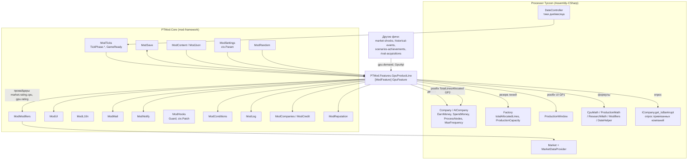
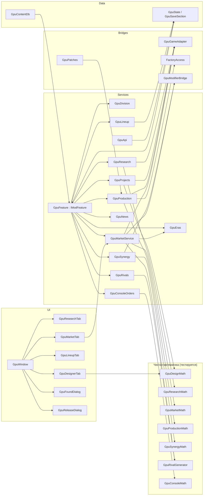
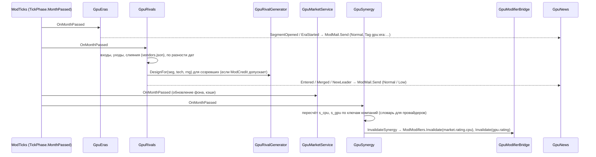

# Design: gpu-product-line

## Document Information

- **Feature Name**: gpu-product-line — линейка видеокарт (GPU) рядом с CPU (идея I16)
- **Version**: 0.2
- **Date**: 2026-10-10
- **Author**: Dex719
- **Status**: Draft v0.2 — одобрено к реализации владельцем 2026-10-10
- **Reviewers**: владелец проекта; авторы `mod-framework` (каналы, `ModTicks`, `ModSave`, `ModUI`)
- **Related Documents**: `requirements.md` (FR-1…FR-19, NFR-1…NFR-8), `tasks.md`; `.kiro/steering/context.md`, `.kiro/steering/owner-decisions.md`; `mod-framework/design.md` (контракт `PTMod.Core`); решения 0002, 0003, 0004, 0005, 0006; `pt-modding/CODEMAP.md` (разделы Hardware, Market, Production); `pt-modding/IDEAS.md` I16

## Overview

Фича — самостоятельная экономическая подсистема внутри `PTMod.dll`, пространство имён `PTMod.Features.GpuProductLine`. Точка входа — `[ModFeature] sealed class GpuFeature : IModFeature` (контракт ядра, раздел «GpuFeature»). Она состоит из пяти слоёв:

1. **Контент** (`GpuContentDb`): архитектуры, видеопамять, охлаждение, узлы исследований, сегменты, эпохи, вендоры, консольные заказы, таймлайн и баланс. Всё из `Content/gpu-product-line/*.json`.
2. **Чистая математика** (`GpuDesignMath`, `GpuResearchMath`, `GpuMarketMath`, `GpuProductionMath`, `GpuSynergyMath`, `GpuConsoleMath`). Работает без Unity на примитивах, покрыта тестами. Формулы — порты формул игры: `CpuMath.TransistorCount`, `ProductionMath.DiesPerWafer`, `CpuMath.RealUnitCost`, `Market.CalculateRatings` и др.
3. **Сервисы состояния** (`GpuResearch`, `GpuProjects`, `GpuProduction`, `GpuMarketService`, `GpuLineup`, `GpuEras`, `GpuRivals`, `GpuNews`, `GpuSynergy`, `GpuConsoleOrders`). Держат `GpuState`, подписаны на тики через `FeatureContext.OnTick`, двигают деньги игры через `ICompany.EarnMoney` / `ICompany.SpendMoney`.
4. **Мосты к игре и фреймворку**:
   - `GpuGameAdapter` — вызовы игры: `CpuMath`, `ProductionMath`, `Modifiers`, `ResearchMath`, `DateHelper`, `InflationHandler`, а также `ModCompanies` и `ModCredit`;
   - `FactoryAccess` — рефлексия приватных счётчиков `Factory`;
   - `GpuModifierBridge` — чтение каналов `ModModifiers` и провайдеры синергии;
   - `GpuPatches` — 2 необязательных Harmony-патча (`GP1`, `GP2`).
5. **UI** (`GpuWindow` и вкладки, диалоги) на `ModUI` из шаблонов игры.

GPU не являются объектами игры. В сейв игры фича ничего не пишет: всё лежит в секции `gpu-product-line` файла `<save>.ptmod.json` (версию секции `_schema` ведёт ядро). На игру она влияет пятью способами:
- деньги по существующим статьям `RevenueOrigin` / `ExpenseOrigin`;
- резерв линий фабрики (приватные счётчики `Factory`);
- множители провайдеров стандартного канала `market.rating.cpu` (вклад ≤ ×1,08) и канала `gpu.rating` (≤ ×1,10);
- прибавка к `Company.TotalLinesAllocated` (этап 3);
- письма `ModMail` и (Could) консольные заказы.

### Design Goals
- **Похоже на игру.** Те же сущности (техпроцесс, пластины, выход годных, брак, бюджет сегмента, популярность), формулы — порты формул игры с явной ссылкой на `Class.Method`.
- **Безопасно для сейвов.** Ни одного поля в классах игры, ни одного объекта игры, созданного для GPU. Удаление мода оставляет ванильную партию.
- **Изолированно.** Исключения ловит `ModHooks.Guard` (счётчик и circuit breaker у ядра), а не собственные счётчики фичи; сбой необязательного патча или поля рефлексии выключает только зависящую возможность (`GpuCapability`); патчей на горячие методы игры минимум (2, оба `Optional`).
- **Данные, а не код.** Все числа в контенте; этапы 1 и 2 переключаются полем `marketMode`.
- **Дёшево по тикам.** ≤ 0.5 мс в день, без поиска объектов в сцене внутри тика.

### Ключевые решения

- **D1. GPU — модель мода, а не `Cpu` игры.**
  - Отвергнуто: «теневые» объекты `Cpu` с флагом GPU. Они попали бы в `SaveObject.Cpus`, в рынок CPU (`Market.cpus`), в `ProductionWindow`, в контракты. Без мода сейв показал бы видеокарты как процессоры.
  - Отвергнуто: новый `HardwareType` / `CreatorWindow.Type`. Нужна правка enum и префабов в `data.unity3d`, что запрещено ограничениями.
- **D2. Свой рынок — порт формул `Market` в чистый C#.**
  - Отвергнуто: подмешивать GPU в `Market` (типы `List<Cpu>`, сегменты CPU, PGA-логика).
  - Отвергнуто: транспайлеры на `Market.Sell`. Хрупко, и единственный патч на формулы рынка CPU принадлежит `mod-framework`.
- **D3. Модель конструктора в духе `CpuMath`.** Прямо переиспользуются `CpuMath.TransistorCount`, `ProductionMath.DiesPerWafer`, `CpuMath.RealUnitCost` (через `GpuGameAdapter`). Чистые порты этих трёх функций нужны для тестов; при старте самопроверка сверяет порт с оригиналом.
  - Отвергнуто: `CpuMath.Consumption` / `CpuMath.FailureRate` для GPU. Они завязаны на `IPackage` и статический `CpuMath.CurrentModifiers`, который бывает `null`.
  - Отвергнуто: полностью новая «физика». Не похоже на игру, тяжело калибровать.
- **D4. Производство — резерв линий в `Factory` на `TickPhase.PreContractSellTick`.** `DateController.TriggerTicks` вызывает `OnPreContractSellTick` раньше `OnClientProductionTick`, `OnContractProductionTick` и `OnProductionTick`. Поэтому резерв гарантированно стоит до производства CPU без патча на `Factory.ProduceWafers`.
  - Отвергнуто: postfix `Factory.ResetProduction` (лишний патч и особый случай после загрузки).
  - Отвергнуто как режим по умолчанию: остаток мощности. Автоматизация CPU занимает все линии, и GPU голодали бы. По решению владельца этот режим доступен как переключатель «CPU в приоритете» (`cpuPriority`, выключен по умолчанию, D18): GPU берут только остаток, расчёт по тем же суммам, что на экране производства.
  - Отвергнуто: подставной `Cpu` в `Factory.ProduceWafers` (см. D1).
- **D5. Своя мини-лаборатория GPU** с формулами `ResearchSector` / `TechnologyTimeUpdater.UpdateTechnologyTimes`.
  - Отвергнуто: добавлять `Technology` в дерево игры. Связано с сейвом (`SaveObject.ResearchSector`) и `TechnologyIDInitializer`, а UI дерева — зона `research-tree-ux`.
- **D6. Свои проекты разработки.**
  - Отвергнуто: `Project` + `TimerScheduler`, потому что `SaveHandler.Save` сохраняет все таймеры типа `Project`.
- **D7. Подразделение открывается решением игрока, с догоняющей разблокировкой.** Одинаково работает в новой игре и на старом сейве; игрок, которому GPU не интересны, их не получает.
  - Отвергнуто: автоматическая выдача по `PlayerInitialData.StartingTechnology` при новой игре. Не работает для старых сейвов и навязывает фичу.
- **D8. Соперники — вендоры из контента с реальными названиями:** виртуальные (NVIDIA, ATI, 3dfx, Matrox, S3) и привязанные к `AICompany` по ключу `ai:<UniqueID>` (`ModCompanies.Resolve`): AMD — `ai:1`, Intel — `ai:0`. Отображаемое имя привязанного вендора берёт игра (`ICompany.get_Name`); самопроверка сверяет `UniqueID` с `CompanyHelper.IsEMD(int)` / `CompanyHelper.IsInlet(int)`. Выпуск вендоров абстрактный и линий фабрики не резервирует (решение владельца).
  - Отвергнуто: только виртуальные (нет связи с соперниками по CPU и синергии у ИИ).
  - Отвергнуто: новые `AICompany` через `CompanySpawner` (они попадут в сейв игры).
  - Отвергнуто: пародийные имена (Envidia, ATY, 3Dfox и т. п.) — политика владельца «реальные названия, как в русификаторе».
- **D9. «Прочие производители» уже в MVP.** Без фона первая же карта игрока брала бы 100 % рынка. Фон использует тот же генератор, что и соперники этапа 2.
- **D10. Синергия только через провайдеры каналов.** `market.rating.cpu` (стандартный, его читает патч ядра P4; вклад ≤ ×1,08) и `gpu.rating` (объявлен ядром, вклад ≤ ×1,10). Провайдеры регистрируются один раз в `Register` (`RegisterReasonedProvider`), месячный пересчёт кладёт значения в словарь по ключу компании и вызывает `ModModifiers.Invalidate`. Провайдеры выключенной фичи ядро пропускает, поэтому снимать записи при выключении не нужно.
  - Отвергнуто: свой патч на `Market.CalculateRatings` (конфликт с единственным патчем фреймворка).
  - Отвергнуто: записи `ModModifiers.Add` на каждую компанию (лишнее сохраняемое состояние и `RemoveAll` при выключении).
- **D11. Частота GPU = частота CPU компании (`ICompany.get_MaxFrequency`) × `arch.clockRatio`.** Исследования частот CPU работают на GPU.
  - Отвергнуто: отдельная ветка частот GPU (лишние узлы, нет связи с CPU).
- **D12. Эпохи — через требования к функциям и VRAM.** Сегменты открываются и закрываются по годам; режим `single` → `eras` переключается контентом. Старые карты теряют рейтинг постепенно, а не исчезают.
- **D13. Деньги — только через существующие статьи** (`Sales`, `Factories`, `Development`, `Research`, `Outsourcing`, `Royalties`), чтобы налоги (`TaxationHandler.HandleTaxes`) и отчёты работали.
  - Отвергнуто: `Company.AddMoney` (идёт мимо учёта и налогов).
- **D14. Снимок характеристик хранится в продукте.** Как `CreatorCpu.CreateCpu` сохраняет готовые `Ips`/`PowerConsumption`, так и GPU не пересчитываются при смене контента. Себестоимость единицы пересчитывается ежедневно (как `CpuUnitCostUpdater`): она зависит от выхода годных и размера пластины.
- **D15. Точка входа — `[ModFeature]` ядра.** `GpuFeature : IModFeature` с `Register(FeatureContext)`: тики через `ctx.OnTick(TickPhase.X)`, старт через `ModTicks.GameReady` и `TickPhase.FastForwardEnded`, состояние через `IModSaveParticipant`, настройки через `ctx.Param`, страница хаба через `ctx.HubPage`, патчи через `ctx.Patch`, ошибки через `ModHooks.Guard`. Фича не подписывается напрямую на `Player.OnNewGame`, `SaveHandler.OnLoaded`, `BankruptcyHandler.OnCompanyWentBankrupt`: игра обнуляет эти события при загрузке сцены, а ядро переподписывается само (D12 ядра).
  - Отвергнуто: собственные `Register()` / `OnSceneReady()` / `Trip(subsystem)` — выпадают из хаба, горячего выключения и порядка `DependsOn`.
- **D16. Каналы GPU — из реестра ядра.** `gpu.demand`, `gpu.demand.*`, `gpu.rating`, `gpu.vramCost` объявлены в `core.json` до `Register`; фича их не объявляет и читает через `ModModifiers.Get` и константы `ModChannels`. Отвергнуто: имена `market.demand.gpu*` и `market.rating.gpu` (пересекались с `market.demand.*` CPU и шаблоном `channelLimits` event-system).
- **D17. Чистый литейщик подразделение не открывает** (решение владельца): основание блокируется по `ICompany.get_IsCpuCompany`. Fabless производит на абстрактном аутсорсе (наценка 2,0, роялти 5 %).
- **D18. Переключатель «CPU в приоритете»** (решение владельца): `ParamSpec` `cpuPriority`, по умолчанию выключен. Режим меняет только расчёт доступных линий (F28') и подпись на экране производства (GP1), остальная модель общая.
- **D19. Идентификаторы компаний — ключи `ModCompanies`** (`player`, `ai:<UniqueID>`, пустая строка — виртуальный вендор). Отвергнуто: числовой SaveID компании в секции (общий ключ ядра надёжнее и переживает перенумерацию).
- **D20. Консольные заказы (Could) — собственная модель** (`GpuConsoleOrders`): предложение приходит письмом `Critical`, поставка идёт со склада GPU на `TickPhase.ContractSellTick`, выручка `RevenueOrigin.Contracts`, нарушение — штраф к репутации. Отвергнуто: `ContractType` и `Contract` игры (только CPU, попали бы в ванильный сейв).
- **D21. Реакция на банкротство — опрос.** Состояние привязанных компаний (`ICompany.get_IsBankrupt`, `ModCompanies.Resolve`) проверяется на `TickPhase.DayPassed`; прямой подписки на `BankruptcyHandler.OnCompanyWentBankrupt` нет.

## Architecture

### System Context



### Компоненты



### Используемые сервисы PTMod.Core

| Сервис | Для чего | Где |
|---|---|---|
| `IModFeature` / `[ModFeature]` | точка входа, `Register(FeatureContext)`, `OnEnabled` / `OnDisabled`, `DependsOn` (жёстких зависимостей нет) | `GpuFeature` |
| `ModHooks` | `ctx.Patch` для 2 необязательных патчей (`GP1`, `GP2`) + 6 полей рефлексии, `Guard` вместо собственных счётчиков ошибок, `Report` (статус патчей) | `GpuPatches`, `FactoryAccess`, все обработчики |
| `ModTicks` | `ctx.OnTick(TickPhase.PreContractSellTick / ContractSellTick / MarketSellTick / Tick / DayPassed / MonthPassed / FastForwardEnded)`, `GameReady`; защита от перемотки и загрузки встроена; `IsBatchRun` — только чтение | все сервисы |
| `ModSave` | `IModSaveParticipant` (`SectionId` = `gpu-product-line`); `ModSave.Flags` (`ModFlags.SetInt`) для последней открытой вкладки | `GpuSaveParticipant`, `GpuState`, `GpuWindow` |
| `ModModifiers` | чтение каналов `gpu.demand`, `gpu.demand.*`, `gpu.rating`, `gpu.vramCost` и стандартных `production.unitCost`, `production.output`, `popularity.gain` (`Get`, `Explain`); провайдеры синергии (`RegisterReasonedProvider`) в `market.rating.cpu` и `gpu.rating`; `Invalidate` после пересчёта. Каналы не объявляются фичей | `GpuModifierBridge` |
| `ModConditions` | предикат ядра `techResearched` (предпосылки узлов); регистрация `gpu.divisionFounded`, `gpu.hasProductOnMarket`, `gpu.marketShareAtLeast`, `gpu.researched` | `GpuResearch`, `GpuApi` |
| `ModMail` | письма эпох, вендоров и лидеров (`Normal` / `Low`), предложения консольных заказов (`Critical`); `Tag` `gpu:<…>`, `RegisterChoiceHandler`, `SetChoiceState`, `Delivered`; ID выдаёт ядро | `GpuNews`, `GpuConsoleOrders` |
| `ModNotify` | уведомления о завершении исследований и проектов | сервисы |
| `ModUI` | окно, вкладки, виджеты, модальные диалоги с паузой, `Confirm`, мост подсказок `Tooltip` | UI |
| `ModL10n` | строки `gpu.*` ru/en, плюрализация | UI, письма |
| `ModSettings` | `ctx.Param` (`ParamSpec`): `rivals`, `synergy`, `news`, `cpuPriority`, `consoleOrders`; значение — `ModSettings.GetBool("gpu-product-line", key)`; признак «фича включена» ведёт ядро | `GpuFeature` |
| `ModRandom` | разброс параметров и каденции соперников (поток `gpu-product-line/rivals`), фон (поток `gpu-product-line/background`) | `GpuRivals`, `GpuRivalGenerator`, `GpuMarketService` |
| `ModContent`, `ModJson` | `LoadRecords` / `LoadConfig`, переопределение JSON по `id`, `ModJson.Bind` и `ModJson.From` для DTO и секции | `GpuContentDb`, `GpuSaveParticipant` |
| `ModCompanies` | ключи `player`, `ai:<UniqueID>`; `Resolve` привязанных вендоров | `GpuRivals`, `GpuState`, `GpuApi` |
| `ModCredit` | `ThresholdOf` / `PlayerDebtLimit` в проверке основания и запуска вендоров | `GpuDivision`, `GpuRivals` |
| `ModReputation` | `Add` штрафа за срыв консольного заказа (Could) | `GpuConsoleOrders` |
| `ModIds` | проверка префикса `gpu` ключей L10n, предикатов и тегов (самопроверка ядра) | — |
| `ModLog` | лог `[gpu-product-line]`, замеры производительности | все |

Что фича **не** использует: `ModEvents.CpuReleased` / `CpuTransferred` (данные о CPU читаются по запросу: `GetCpus` компании для скидки FR-17 и «есть продаваемый CPU» для синергии), `ModSegments` (сегменты GPU — собственные ID, не `PTMod.Core.Segment`), `ModNewGame` (в окне новой игры у фичи нет опций), `ModProfile`, `ModFlags` кроме последней вкладки. Репутация бренда влияет на GPU только через канал `popularity.gain` (читает провайдер `press-reviews` на уровне компании).

### Technology Stack

| Слой | Технология | Обоснование |
|---|---|---|
| Логика и формулы | C# latest (Roslyn `csc` из VS Build Tools, решение 0003); чистые классы `Logic` без `UnityEngine`, общее подмножество API .NET Framework 4.8 и mscorlib Unity (без `init`, `record`, `Index`, `Range`) | тестируется вне игры |
| Тесты | мини-раннер ядра на .NET Framework 4.8: `[Test]`, `[Covers(typeof(X))]`, `Assert.*`; `python mod/build.py --tests`; покрытие — каждый публичный тип `Logic` в `[Covers]` | без xUnit и сторонних загрузок |
| Вызовы игры | прямые вызовы публичных статических методов `CpuMath`, `ProductionMath`, `ResearchMath`, `Modifiers`, `DateHelper` | переиспользование формул без копий в рантайме |
| Патчи | Harmony 2.3.6 через `ModHooks` (решение 0002): 2 необязательных postfix | минимум точек вмешательства |
| Рефлексия | `AccessTools.FieldRefAccess` (Harmony) | запись приватных счётчиков `Factory` без патча |
| Данные | JSON через `ModContent` и `ModJson.Bind` (решение 0006), плоские DTO с `List<T>` | правки без пересборки |
| Сохранение | `IModSaveParticipant` и секция `ModSave` (решение 0004), версия `_schema` — у ядра | ванильные сейвы |
| UI | `ModUI` из шаблонов игры (решение 0005): `ButtonTabGroup`, `ButtonUI`, `ToggleUI`, `SliderUI`, `DropdownUI`, `InputFieldUI`, `InfoText`, `ProgressBar`; подсказки — `ModUI.Tooltip` | родной вид и темы |

## Components and Interfaces

Ниже — сигнатуры (контракт реализации). Точные сигнатуры сервисов `PTMod.Core` задаёт `mod-framework/design.md`; фича обращается к ним только из `GpuFeature`, `GpuModifierBridge` и UI, поэтому переименование в фреймворке правится в одном месте.

### GpuFeature — точка входа и оркестратор

```csharp
namespace PTMod.Features.GpuProductLine
{
    // Возможности, которые самопроверка может отключить по отдельности (не по исключениям: их считает ModHooks.Guard).
    public enum GpuCapability { Production, ProductionUi, SharedLearning }

    [ModFeature]
    public sealed class GpuFeature : IModFeature
    {
        public const string FeatureId = "gpu-product-line";
        public static GpuFeature Instance { get; private set; }

        // --- IModFeature (контракт ядра) ---
        public string Id => FeatureId;
        public string NameKey => "gpu.feature.name";
        public string DescriptionKey => "gpu.feature.desc";
        public string[] DependsOn => new string[0];     // жёстких зависимостей нет; rival-acquisitions, historical-events используют GpuApi / каналы сами
        public bool EnabledByDefault => true;
        public bool SupportsHotToggle => true;
        public void Register(FeatureContext ctx);       // см. таблицу ниже
        public void OnEnabled();                        // пересчёт возможностей по ModHooks.Report; кеши техпроцессов; окно можно открывать
        public void OnDisabled();                       // закрыть окно; расторгнуть консольные заказы (FR-19 п. 7); провайдеры и записи каналов не удалять

        // --- состояние и настройки ---
        public GpuContentDb Content { get; }
        public GpuState State { get; }
        public bool RivalsEnabled { get; }              // ModSettings.GetBool(FeatureId, "rivals"); так же synergy, news, cpuPriority, consoleOrders
        public bool SynergyEnabled { get; }
        public bool NewsEnabled { get; }
        public bool CpuPriority { get; }                // «CPU в приоритете» (по умолчанию false)
        public bool ConsoleOrdersEnabled { get; }
        public bool IsAvailable(GpuCapability c);       // результат самопроверки и ModHooks.Report; false → зависимая возможность выключена
        internal void Guard(string siteId, Action body);// = ModHooks.Guard(FeatureId, "gpu/" + siteId, body); собственных счётчиков ошибок нет
    }
}
```

**Что делает `Register(FeatureContext ctx)`** (один раз; порядок `Register` фич не важен, потому что каналы GPU объявлены ядром заранее):

| Шаг | Вызов ядра | Содержимое |
|---|---|---|
| Настройки | `ctx.Param(ParamSpec)` ×5 | Bool-параметры `rivals`, `synergy`, `news`, `consoleOrders` (по умолчанию включены) и `cpuPriority` (по умолчанию выключен); подписи — `gpu.settings.*` |
| Страница хаба | `ctx.HubPage("gpu.hub.title", build)` | кнопка «Видеокарты» (`ModUI.Button` → `GpuWindow.Open`), состояние подразделения, результат самопроверки (возможности, патчи); параметры страница настроек ядра строит из `ParamSpec` сама |
| Сохранение | `ctx.SaveParticipant(new GpuSaveParticipant(State))` | секция `gpu-product-line`; `SchemaVersion` = 1 |
| Патчи | `ctx.Patch(typeof(ProductionWindowPatch))`, `ctx.Patch(typeof(TotalLinesAllocatedPatch))` | оба `Optional = true` (GP1, GP2) |
| Тики | `ctx.OnTick(TickPhase.PreContractSellTick, …)` и далее | `GpuProduction.OnPreContractSellTick`; `ContractSellTick` — `GpuConsoleOrders`; `MarketSellTick` — `GpuMarketService`; `Tick` — `GpuResearch`, `GpuProjects`; `DayPassed` — `GpuLineup`, `GpuMarketService`, `GpuSynergy`, `GpuRivals.CheckBoundCompanies`, `GpuConsoleOrders`; `MonthPassed` — `GpuEras` → `GpuRivals` → `GpuMarketService` → `GpuLineup` → `GpuSynergy` (порядок задаёт параметр `priority`); `FastForwardEnded` — `GpuMarketService.SeedForYear` (новая игра) |
| Старт сессии | подписка на `ModTicks.GameReady` | `Loaded`: засев, если секции не было, `GpuEras.ApplyModeSwitchIfNeeded`, кеши; `NewGame`: кеши и проверка засева |
| Каналы | `ModModifiers.RegisterReasonedProvider` ×2 | провайдеры синергии в `market.rating.cpu` и `gpu.rating` (один раз; повтор того же делегата ядро игнорирует) |
| Условия | `ModConditions.Register("gpu.…", FeatureId, factory)` ×4 | `gpu.divisionFounded`, `gpu.hasProductOnMarket`, `gpu.marketShareAtLeast`, `gpu.researched` |
| Почта | `ModMail.RegisterChoiceHandler`, `RegisterActionHandler` | ответы на предложения консольных заказов (Tag `gpu:console:<orderId>`); подписка на `ModMail.Delivered` для проверки условий принятия |
| Подтверждение | `ctx.ConfirmBeforeDisable(provider)` | не `null`, если есть действующие консольные заказы (`gpu.console.disableConfirm`: число заказов и штраф) |
| Контент | `GpuContentDb.Load` | при `IsUsable == false` на `GameReady` фича вызывает `ModFeatures.SetEnabled(FeatureId, false)` и один раз показывает `ModNotify` с причиной (FR-10 п. 3) |

Фича не подписывается на события игры напрямую (`Player.OnNewGame`, `SaveHandler.OnLoaded`, `BankruptcyHandler.OnCompanyWentBankrupt`, `DateController.OnDayPassed` и остальные события дня): тики, старт и сохранение приходят из ядра.

### GpuContentDb и DTO контента

```csharp
public sealed class GpuContentDb
{
    public GpuBalanceDto Balance { get; }
    public IReadOnlyList<GpuArchitectureDto> Architectures { get; }
    public IReadOnlyList<GpuMemoryDto> Memories { get; }
    public IReadOnlyList<GpuCoolerDto> Coolers { get; }
    public IReadOnlyList<GpuResearchNodeDto> ResearchNodes { get; }
    public IReadOnlyList<GpuSegmentDto> Segments { get; }   // filtered by Balance.marketMode
    public IReadOnlyList<GpuEraDto> Eras { get; }
    public IReadOnlyList<GpuVendorDto> Vendors { get; }
    public IReadOnlyList<GpuConsoleDto> Consoles { get; }   // consoles.json (FR-19)
    public GpuTimelineDto Timeline { get; }

    // IModContentSource — тонкая обёртка фичи над ModContent.LoadRecords / LoadConfig (в тестах — фикстуры JSON).
    public static GpuContentDb Load(IModContentSource src, IList<string> problems); // validates, skips broken records
    public bool IsUsable { get; }                           // >=1 arch, mem, cooler, segment
    public GpuArchitectureDto Arch(string id);  public GpuMemoryDto Mem(string id);
    public GpuCoolerDto Cooler(string id);      public GpuSegmentDto Segment(string id);
    public GpuArchitectureDto LatestArch(float techYear);   // max year <= techYear
    public GpuMemoryDto LatestMem(float techYear);
    public string NodeNameFor(float techYear);              // Timeline.nodeByYear
    public float MaxDie(int year);                          // Timeline.maxDieByYear, linear
}
```

### GpuGameAdapter — единственная точка вызова формул игры

```csharp
public interface IGpuGame
{
    DateTime Today { get; }                 // DateController.Instance.CurrentDate
    int MonthIndex { get; }                 // DateController.Instance.MonthsSinceStart
    float Inflation { get; }                // InflationHandler.Instance.Inflation
    ICompany PlayerCompany { get; }         // Player.Instance.get_Company()
    string KeyOf(ICompany c);               // ModCompanies.KeyOf: "player" | "ai:<UniqueID>" | null
    ICompany Resolve(string companyKey);    // ModCompanies.Resolve; null — компании нет в партии
    bool IsBankrupt(ICompany c);            // ICompany.get_IsBankrupt
    float DebtThreshold(ICompany c);        // ModCredit.ThresholdOf (отрицательное число); CentralBank.DebtLimit напрямую не читаем
    float Channel(string channel, ICompany owner);                        // ModModifiers.Get(channel, {Company = owner, CompanyKey}); owner == null — глобальный контекст
    float DecadeT(int year);                // DateHelper.DecadeTransitionValue(year, 2030)
    float Transistors(ICompany c, NodeSpec n, float die);                 // CpuMath.TransistorCount
    int DiesPerWafer(float die, float waferDiameter, float yield);        // ProductionMath.DiesPerWafer
    float DieUnitCost(ICompany m, float die, float material, float dpwYield,
                      float fr, bool outsourced, float markup);           // CpuMath.RealUnitCost(..., royalties: 0)
    float Modifier(ModifierType t, ICompany c);                           // Modifiers.GetModifier
    float ResearchSpeed(float funding, ICompany c);                       // ResearchMath.ResearchSpeed
    float MaxFrequencyKHz(ICompany c);                                    // ICompany.get_MaxFrequency
    float WaferDiameter(ICompany c);                                      // ICompany.get_CurrentWaferSize
    float NodeYield(ICompany c, NodeSpec n);                              // ICompany.CurrentNodeYield
    void Earn(ICompany c, float v, RevenueOrigin o);                      // ICompany.EarnMoney
    void Spend(ICompany c, float v, ExpenseOrigin o);                     // ICompany.SpendMoney
}

public struct NodeSpec { public string Name; public float Density; public float ProjectCost; public float MinYield; public float MaxYield; public object GameRef; }
// GameRef = ProcessNode (resolved once per load / month via DataFinder.FindLithography, cached by name)
```

### GpuDesignMath — модель конструктора (чистая)

```csharp
public struct GpuDesignInput
{
    public string ArchId, MemId, CoolerId, NodeName, Name;
    public float DieMm2, ClockMHz, VramMB;
    public int BusWidthBits;
}

public struct GpuDesignContext
{
    public GpuArchitectureDto Arch; public GpuMemoryDto Mem; public GpuCoolerDto Cooler; public NodeSpec Node;
    public double Transistors;          // from IGpuGame.Transistors (includes ResearchModifiers.DensityIncrease)
    public float CompanyMaxFreqKHz;     // IGpuGame.MaxFrequencyKHz
    public float WaferDiameter, Yield;  // for cost preview
    public float DieUnitCost;           // from IGpuGame.DieUnitCost (preview)
    public float DevModifier;           // Modifiers.GetModifier(DevelopmentCost)
    public float CoDevFactor;           // 1.0 or Balance.synergy.coDevFactor
    public float UnitCostMul, VramCostMul; // channels production.unitCost, gpu.vramCost
}

public struct GpuStats
{
    public double Transistors, ComputeMops, EffectivePerf;
    public int Units;
    public float MaxClockMHz, BandwidthMBs, BandwidthRatio, PowerW, TempC, FailureRate;
    public float DieCost, UnitCost, ProjectCost;
    public int ProjectDays;
    public string[] Features;
    public bool Valid; public string InvalidReasonKey;
}

public static class GpuDesignMath
{
    public static GpuStats Evaluate(GpuDesignInput d, GpuDesignContext c, GpuBalanceDto b);
    public static int Units(double transistors, float transistorsPerUnit);                       // F2
    public static float MaxClockMHz(float maxFreqKHz, float clockRatio);                        // F3
    public static double ComputeMops(int units, float clockMHz, float opsPerClock);             // F4
    public static float BandwidthMBs(int busWidthBits, float dataRateMTs);                      // F5
    public static double EffectivePerf(double compute, float bandwidth, float bytesPerOp,
                                       float exponent, float minRatio, out float ratio);        // F6
    public static float PowerW(float coef, float die, float clockMHz, float density,
                               float densityExp, float baseW);                                  // F7
    public static float TemperatureC(float powerW, float thermalResistance, float ambientC);    // F8
    public static float FailureRate(float tempC, float safeC, float complexity,
                                    float clockMHz, float maxClockMHz, float kT, float kF);     // F9
    public static float UnitCost(float dieCost, float vramMB, float costPerMB, float vramMul,
                                 int busWidth, float boardBase, float boardPerBit,
                                 float coolerCost, float unitCostMul);                          // F12
    public static float ProjectCost(float archCost, float nodeCost, float nodeShare,
                                    float memCost, float devMod, float coDev);                  // F13
    public static int ProjectDays(int archDays, int memDays);                                   // F13
    // ports used by tests and by the startup equivalence check (F1, F10, F11)
    public static double TransistorsPort(float density, float densityIncrease, float die);
    public static int DiesPerWaferPort(float die, float waferDiameter, float yield);
    public static float RealUnitCostPort(float maintenancePerLine, int dpwFull, float material,
                                         float dpwYield, float fr, float markup, float royalties);
}
```

### GpuResearch / GpuResearchMath

```csharp
public static class GpuResearchMath
{
    public static float EffectiveDays(int baseDays, int nodeYear, DateTime today,
                                      float penaltyPerYear, float bonusPerYear, float maxBonus); // F15
    public static float DailyProgress(float researchSpeed, float effectiveDays);                 // F16
    public static float DailyCost(float monthlyCost, float researchCostMod, float funding);      // F16
}

public sealed class GpuResearch
{
    public GpuResearchNodeDto Current { get; }
    public IReadOnlyList<string> Queue { get; }
    public float Funding { get; }                                   // 0.1..1.0
    public NodeAvailability Availability(string nodeId);           // Researched | Available | LockedByNodes | LockedByGameTech
    public bool Enqueue(string nodeId);  public void Dequeue(string nodeId);
    public void SetFunding(float f);
    public void UnlockUpToYear(int year);                           // founding catch-up (FR-1)
    internal void OnTick();                                         // TickPhase.Tick
    public event Action<GpuResearchNodeDto> Completed;
}
public enum NodeAvailability { Researched, Available, LockedByNodes, LockedByGameTech }
```

### GpuProjects и выпуск

```csharp
public sealed class GpuProjects
{
    public IReadOnlyList<GpuProjectSave> Active { get; }
    public bool CanStart(out string reasonKey);                         // maxParallelProjects
    public string Start(GpuDesignInput input, GpuStats stats);          // returns projectId; stores design snapshot
    public void SetPaused(string projectId, bool paused);
    public void Cancel(string projectId);
    internal void OnTick();                                             // TickPhase.Tick: progress + daily cost (F14)
    public event Action<string /*productId*/> ReadyToRelease;           // opens GpuReleaseDialog
}
```

### GpuDivision — основание подразделения

```csharp
public enum FoundingBlock { None, AlreadyFounded, MarketNotOpen, NotEnoughCredit, FoundryNotAllowed }

public sealed class GpuDivision
{
    public bool IsFounded { get; }
    // Порядок проверок: уже основано → год рынка (market.opensYear) → тип компании (ICompany.get_IsCpuCompany, чистый литейщик не может)
    // → кредит: MoneyAmount − cost >= ModCredit.ThresholdOf(player). Возвращает первую причину блокировки и её ключ L10n.
    public FoundingBlock Check(ICompany player, out string reasonKey, out float cost);   // cost = F30
    public bool Found(ICompany player);                  // SpendMoney(cost, Development), дата основания, GpuResearch.UnlockUpToYear(year − catchUpLagYears)
    public bool FoundFree(ICompany player);              // без оплаты (передача линейки, FR-18 п. 5): те же отметки и разблокировка
}
```

### GpuProduction и FactoryAccess

```csharp
public static class GpuProductionMath
{
    public struct DailyOutput { public int Gross, Good, Failed; public float Cost; }
    public static int AvailableLines(int capacity, int clientLines, int allocated,
                                     int cpuLines, bool cpuPriority);                   // F28 / F28': доступно GPU сегодня
    public static int[] ScaleLines(int[] requested, int available);                   // F28 proportional, largest remainder
    public static DailyOutput Produce(int lines, int wafersPerLine, int dpwFull, int dpwYield,
                                      float failureRate, float dieMaterial, float perGoodExtras,
                                      float maintenancePerLine, float waferMaterial50, float outputMul); // F17
    public static int AutoLines(float avgDailyDemand7d, int wafersPerLine, int dpwYield,
                                float failureRate, int capacity, float factor, float maxShare); // F29
    public static float StorageCostPerDay(int stock, float perUnitMonth);              // F32
}

public sealed class GpuProduction
{
    public int ReservedToday { get; }                                   // player, after scaling
    public int RequestedToday { get; }
    public int ReservedOn(string nodeName);                             // for TotalLinesAllocated postfix (F26)
    public int ContractedClientLines(ICompany c);                       // BusinessContractManager.GetFoundryServicesContract(...).ContractedProductionCapacity()
    public int CpuLinesInUse(ICompany c);                               // «CPU в приоритете»: Σ (CurrentProductionLines + CurrentContractedProductionLines) CPU без аутсорса, как в ProductionWindow.UpdateAvailableProductionLines
    internal void OnPreContractSellTick();                              // TickPhase.PreContractSellTick: reserve + produce (own fab) or outsource (fabless)
}

internal static class FactoryAccess
{
    // AccessTools.FieldRefAccess<Factory, int>("totalAllocatedLines") / ("totalDemandedLines")
    public static bool Verify(out string error);
    public static int GetAllocated(Factory f);
    public static void AddReservation(Factory f, int allocated, int demanded);
}
```

### GpuMarketService / GpuMarketMath

```csharp
public sealed class MarketItem               // runtime mirror of a product on the market
{
    public string ProductId, OwnerKey;        // OwnerKey: "player" | "vendor:<id>" | "background"
    public string CompanyKey;                 // ModCompanies key of the owner company ("player", "ai:<UniqueID>") or null for virtual
    public double Perf; public float PowerW, Price;
    public int Stock; public bool InfiniteStock, Selling, IsOld;
    public float[] Popularity;                // per segment index
    public float[] SegmentFactor;             // features x VRAM, per segment
    public float RatingMul;                   // channel gpu.rating of owner company (1 for virtual); read once a day per owner
    public float Overall; public int PotentialBuyers;
    public int SoldToday, MissedToday; public int[] SoldBySegment; public float IncomeToday;
}

public sealed class SegmentRuntime
{
    public string Id; public int Index;
    public float DailyBuyers, Remaining, Budget, ConsTarget;
    public float WPerf, WUnder, WOver, WObs, WCons;
}

public static class GpuMarketMath
{
    public static float YearlySize(float baseSize, float[] byDecade, int year, float t, float demandMul); // F19
    public static float DecadeLerp(float[] byDecade, int year, float t);                                 // F19 budget
    public static void SellDay(IList<SegmentRuntime> segs, IList<MarketItem> items);                     // F20, 3 passes
    public static void CalculateRatings(SegmentRuntime s, IList<MarketItem> items, double perfSum, bool ignoreOutOfStock);
    public static void Normalize(SegmentRuntime s, IList<MarketItem> items);
    public static void Dilute(IList<MarketItem> items);
    public static void PotentialBuyers(SegmentRuntime s, IList<MarketItem> items);
    public static void UpdatePopularity(IList<MarketItem> items, int segCount, int year,
                                        Func<string, float> gainMulByOwner, GpuPopularityDto p);         // F21
    public static float VramFactor(float vramMB, float reqMB);                                          // F33
    public static float FeatureFactor(string[] have, string[] required, float missingFactor);           // F34
}

public sealed class GpuMarketService
{
    public IReadOnlyList<GpuSegmentView> OpenSegments { get; }
    public float ShareOf(string ownerKey, int days = 30);
    public IReadOnlyList<GpuProductView> TopProducts(string segmentId, int n = 5);
    public void SeedForYear(int year);            // background + active vendors; once: TickPhase.FastForwardEnded (new game) or GameReady(Loaded) when the section was absent
    internal void OnMarketSellTick();             // TickPhase.MarketSellTick: build items, SellDay, money, popularity
    internal void OnDayPassed();                  // TickPhase.DayPassed: roll daily counters into ledgers / share windows
    internal void OnMonthPassed();                // TickPhase.MonthPassed: background refresh, caches (nodes, frontier frequency)
}
```

### GpuLineup

```csharp
public sealed class GpuLineup
{
    public IReadOnlyList<GpuProductView> PlayerProducts(bool includeArchived);
    public void Release(string productId, float price, bool sell, int lines);  // from GpuReleaseDialog (FR-4)
    public void SetPrice(string productId, float price);
    public void SetSelling(string productId, bool sell);
    public void SetLines(string productId, int lines);                          // own fab
    public void SetUnitsPerDay(string productId, int units);                    // fabless
    public void SetAuto(string productId, bool auto);
    public void Retire(string productId);                                       // liquidation F31; ModUI.Confirm, предупреждает о консольном заказе
    internal void OnDayPassed();                                                // TickPhase.DayPassed: storage cost F32, IsOld flags
    internal void OnMonthPassed();                                              // TickPhase.MonthPassed: close ledger month
}
```

### GpuEras, GpuRivals, GpuRivalGenerator, GpuNews

```csharp
public sealed class GpuEras
{
    public IReadOnlyList<GpuSegmentDto> OpenAt(DateTime d);
    public string[] RequiredFeatures(GpuSegmentDto s, int year);
    public float VramRequirement(GpuSegmentDto s, int year);                    // log-linear between control points
    public void ApplyModeSwitchIfNeeded(GpuState st);                           // single -> eras migration (FR-11.6)
    internal void OnMonthPassed();                                              // TickPhase.MonthPassed: open/close segments by date, raise events
    public event Action<GpuSegmentDto> SegmentOpened, SegmentClosed;
    public event Action<GpuEraDto> EraStarted;
}

public struct GpuRivalTech { public float TechYear; public NodeSpec Node; public float MaxFreqKHz; public double Transistors; }

public static class GpuRivalGenerator
{
    public static GpuDesignInput DesignFor(GpuSegmentDto seg, GpuRivalTech tech, GpuContentDb db,
                                           int year, IGpuRandom rng);            // F22-F24
}

// Обёртка над IModRng (Range(min, maxExclusive)) потоков ModRandom "gpu-product-line/rivals" (вендоры) и "gpu-product-line/background" (фон).
public interface IGpuRandom { float Next01(); int Range(int minInclusive, int maxInclusive); }

public sealed class GpuRivals
{
    public IReadOnlyList<GpuVendorRuntime> Active { get; }
    public ICompany ResolveBinding(GpuVendorDto v);            // ModCompanies.Resolve(v.bindTo): "ai:1" (AMD), "ai:0" (Intel); null — компании нет
    internal void OnMonthPassed();                             // TickPhase.MonthPassed: entries, exits, merges, launches (FR-12, FR-13); по разности дат
    internal void CheckBoundCompanies();                       // TickPhase.DayPassed: ICompany.get_IsBankrupt / Resolve == null → exit или fallbackVirtual (D21)
    public bool TransferProducts(ICompany from, ICompany to);  // for GpuApi (FR-18 п. 5): продукты → владелец to, вендор → merged
    public event Action<GpuVendorRuntime> Entered, Exited; public event Action<GpuVendorRuntime, GpuVendorRuntime> Merged;
    public event Action<GpuProductView, string /*segmentId*/> NewLeader;
}

public sealed class GpuNews
{
    // Подписка на события GpuEras / GpuRivals; ModMail.Send только вне перемотки и загрузки и только для событий не старше предыдущего месяца.
    // Приоритеты: эпоха и вендор — Normal, лидер — Low. Теги: gpu:era:<eraId>, gpu:segment:<id>, gpu:vendor:<id>:<enter|exit|merge>, gpu:leader:<segmentId>.
    internal void Bind(GpuEras eras, GpuRivals rivals);
}
```

### GpuSynergy и GpuModifierBridge

Собственных констант каналов у фичи нет: имена берутся из `ModChannels` ядра (`GpuDemand`, `GpuRating`, `GpuVramCost`, `GpuDemandSegment(segmentId)`, `MarketRatingCpu`, `ProductionUnitCost`, `ProductionOutput`, `PopularityGain`). Каналы объявлены в `core.json`, `DeclareChannel` фича не вызывает.

```csharp
public interface IGpuModifierBridge
{
    // ModModifiers.Get(channel, {Company = company, CompanyKey = ModCompanies.KeyOf(company)}); 1.0 без вкладов.
    // company == null — глобальный контекст (виртуальные вендоры, фон). Cpu и Segment в контексте не заполняются (Segment.Any).
    float Get(string channel, ICompany company);
    float Demand(string segmentId);                                   // Get(gpu.demand) × Get(gpu.demand.<segmentId>), глобальный контекст
    ModifierBreakdown Explain(string channel, ICompany company);      // для подсказок окна «Рынок»
    // Один раз в Register: ModModifiers.RegisterReasonedProvider(FeatureId, MarketRatingCpu | GpuRating, …).
    // Провайдер O(1): словарь companyKey → (sCpu, sGpu); не активен (1,0), если synergy выключена или у компании нет записи.
    void RegisterSynergyProviders(Func<string, SynergyBonus> lookup);
    void InvalidateSynergy();                                         // ModModifiers.Invalidate(MarketRatingCpu), Invalidate(GpuRating) после месячного пересчёта и при смене параметра synergy
}
public struct SynergyBonus { public float SCpu, SGpu; }

public static class GpuSynergyMath
{
    public static float CpuBonus(float gpuShare, float k, float max);   // F25
    public static float GpuBonus(float cpuShare, float k, float max);   // F25
}

public sealed class GpuSynergy
{
    public GpuSynergyView ViewFor(ICompany c);
    internal void OnDayPassed();       // TickPhase.DayPassed: sample MarketDataProvider.Instance.MarketShare(c) and GPU share (30-day rings)
    internal void OnMonthPassed();     // TickPhase.MonthPassed: recompute sCpu/sGpu per companyKey, InvalidateSynergy
    // ClearAll не нужен: провайдеры выключенной фичи ядро не применяет, при synergy = false они возвращают 1,0.
}
```

Максимальный вклад фичи в общие каналы (проверяется `GpuSynergyTests`):

| Канал | Что пишет фича | Диапазон вклада | Общий предел |
|---|---|---|---|
| `market.rating.cpu` | провайдер синергии, причина `gpu.synergy.cpu` | ×[1,00; 1,08] (`synergy.cpuMax`) | ядро: произведение всех поставщиков на CPU в [0,5; 2,0], `Explain` пишет «(ограничено)» |
| `gpu.rating` | провайдер синергии, причина `gpu.synergy.gpu` | ×[1,00; 1,10] (`synergy.gpuMax`) | предохранитель [0,25; 4,0], балансового диапазона нет |
| `popularity.gain` | не пишет (только читает) | — | ядро: [0,5; 2,0] |
| `gpu.demand`, `gpu.demand.*`, `gpu.vramCost`, `production.*`, `development.cost` | не пишет (только читает) | — | предохранители из `core.json` |

### GpuApi — для других фич

```csharp
public static class GpuApi
{
    public static bool IsAvailable { get; }                                   // feature on and content usable
    public static bool IsDivisionFounded(ICompany c);                         // player only; AI: has bound vendor
    public static IReadOnlyList<GpuProductView> ProductsOf(ICompany c);
    public static float MarketShare(ICompany c, int days = 30);
    public static GpuSynergyView Synergy(ICompany c);
    public static IReadOnlyList<string> OpenSegmentIds();
    public static bool IsResearched(string nodeId);
    // Для rival-acquisitions (решение владельца: линейка поглощённой компании передаётся игроку, если фича включена).
    // from — компания ИИ с привязанным вендором, to — игрок. Основывает подразделение игрока бесплатно, если оно не основано (FR-18 п. 5).
    // false — фича выключена, у from нет вендора или to не игрок.
    public static bool TransferVendorProducts(ICompany from, ICompany to);
    public static event Action<GpuProductView> ProductReleased;              // player and vendors
}

public struct GpuProductView { public string Id, Name, OwnerKey, Status; public float Price, EffectivePerf, PowerW; public int Stock, SoldLastMonth; public string[] SegmentIds; public float[] Popularity; }
public struct GpuSynergyView { public float CpuBonus, GpuBonus, CpuShare30, GpuShare30; public bool Active; }
public struct GpuSegmentView { public string Id; public float MonthlyBuyers, Budget, VramReqMB; public string[] RequiredFeatures; }
```

Предикаты `ModConditions` (FR-18 п. 4) регистрируются в `Register` через `ModConditions.Register(type, "gpu-product-line", factory)` и называются `gpu.<имя>` (правило ядра: предикат фичи без своего префикса отклоняется). Синтаксис узла условия — `{ "type": "gpu.…", …параметры }`:

| Тип | Параметры | Источник |
|---|---|---|
| `gpu.divisionFounded` | `company` (по умолчанию игрок) | `GpuApi.IsDivisionFounded` |
| `gpu.hasProductOnMarket` | `company` | `GpuApi.ProductsOf`: есть продукт со статусом «в продаже» |
| `gpu.marketShareAtLeast` | `share` (0..1), `company` | `GpuApi.MarketShare` (30 дней) |
| `gpu.researched` | `node` (ID узла дерева GPU) | `GpuApi.IsResearched` |

Предикаты — тонкие обёртки над `GpuApi`; при выключенной фиче они возвращают false. Пространство предикатов не пересекается с каналом `gpu.rating` (правило 7 соглашения об идентификаторах).

### GpuConsoleOrders и GpuConsoleMath (Could, FR-19)

```csharp
public static class GpuConsoleMath                    // чистая логика
{
    public static bool Qualifies(double productPerf, double bestPerfInSegment, float minPerfShare);        // F35
    public static float OrderPrice(float unitCost, float segmentBudget, float priceFactor);                // F35: max(1.15·U, priceFactor·Budget)
    public static int DailyUnits(float segmentDailyBuyers, float unitsShare);                              // F35: floor
    public static float MissedShare(IReadOnlyList<int> delivered, IReadOnlyList<int> missed);              // доля недопоставки в окне graceDays
    public static bool ShouldCancel(float missedShare, float failCancelShare, int daysActive, int graceDays);
}

public sealed class GpuConsoleOrders
{
    public IReadOnlyList<GpuConsoleOrderSave> Orders { get; }
    internal void OnDayPassed();                      // TickPhase.DayPassed: предложения по offerYear, пересчёт условий (раз в revalidateDays), окончание срока
    internal void OnContractSellTick();               // TickPhase.ContractSellTick: поставка со склада до розницы, EarnMoney(Contracts), окно недопоставки
    internal void OnChoice(ModMailRecord mail, string choiceId);   // «accept» / «decline» (RegisterChoiceHandler)
    internal void CancelAll(string reasonKey);        // OnDisabled, снятие закреплённого GPU: штраф через ModReputation.Add
    public DisableConfirmation BuildDisableConfirmation();   // не null при действующих заказах (провайдер ConfirmBeforeDisable)
}
```

Письмо-предложение: `ModMailMessage { FeatureId = "gpu-product-line", Tag = "gpu:console:<orderId>", Priority = Critical, TimeoutDays = 60, DefaultChoiceId = "decline", Choices = [accept, decline], Actions = [openLineup (Repeatable)] }`. ID письма, возвращённый `ModMail.Send`, хранится в `GpuConsoleOrderSave.mailId`. Состояние кнопки «Принять» обновляют `ModMail.SetChoiceState` и `ModMail.Refresh` (на `ModMail.Delivered` и раз в `revalidateDays`). После загрузки сейва состояния кнопок пересчитываются в обработчике `GameReady(Loaded)`.

### UI-классы

```csharp
public enum GpuTab { Auto, Research, Designer, Lineup, Market }
public sealed class GpuWindow     { public static void Open(GpuTab tab = GpuTab.Auto); public static void Close(); }  // последняя вкладка: ModFlags.SetInt(FeatureId, "lastTab", n)
internal sealed class GpuFoundDialog   { }   // modal (ModUI.CreateWindow Modal), PauseTrigger
internal sealed class GpuResearchTab   { }
internal sealed class GpuDesignerTab   { }   // recompute on change events only (NFR-1)
internal sealed class GpuLineupTab     { }   // + блок «Консольные заказы» (Could) и строка режима линий
internal sealed class GpuMarketTab     { }
internal sealed class GpuReleaseDialog { }   // modal, PauseTrigger
```

### Патчи Harmony

Номера `GP1` и `GP2` — патчи фичи (номера P1–P23 принадлежат ядру). Оба объявлены как `[ModPatch(…, PatchKind.Postfix, Optional = true)]` в классах `ProductionWindowPatch` и `TotalLinesAllocatedPatch`, регистрируются `ctx.Patch`; ни одна из целей не входит в таблицу резерва ядра (`ModHooks.IsReserved` = false). Тела обёрнуты в `ModHooks.Guard`; при неприменённом `Optional`-патче фича остаётся `Enabled`, а соответствующая возможность (`GpuCapability`) выключается.

| # | Цель (`Class.Method` игры) | Тип | Что меняет | Этап | Порядок / конфликты |
|---|---|---|---|---|---|
| GP1 | `ProductionWindow.UpdateAvailableProductionLines` (private, вызывается из `LateUpdate` и `OnDayPassed`) | postfix | Только UI. Если у игрока есть резерв GPU: дописывает к `linesUsedText.Text` « (+N GPU)». В режиме по умолчанию пересчитывает свободные линии `free = ProductionCapacity − (CPU-линии + контрактные + клиентские) − N` (те же суммы, что в оригинале, по полям `cpus` и `clientCpus`) и вызывает `ProductionUI.UpdateAvailableProductionLines(max(0, free))` у каждой строки из `productionUIs`. При включённом «CPU в приоритете» строки CPU не ограничиваются: подпись « (+N GPU)» остаётся, `free` не уменьшается | 1 | Другие спеки этот метод не патчат. При сбое отключается только GP1 (`GpuCapability.ProductionUi`), производство GPU продолжается |
| GP2 | `Company.TotalLinesAllocated(ProcessNode)` | postfix | `__result += round(GpuProduction.ReservedOn(node.Name) × gpuLearningShare)` только для `Player.Instance.get_Company()`, только при включённой синергии. Влияет на `ProductionMath.NodeOptimizationRate` → `WaferCostUpdater.ApplyYieldLearning` | 3 | `AICompany.TotalLinesAllocated` не трогаем (у ИИ GPU не на линиях). Если другая фича пропатчит тот же метод, порядок задаёт `ModHooks` (приоритет `Priority.Normal`, прибавки складываются). При сбое отключается `GpuCapability.SharedLearning` |

Патчей на рынок CPU нет: синергия отдаёт провайдер в канал `market.rating.cpu`, который читает единственный патч ядра P4 на `Market.CalculateRatings`. Патчей на `Company.AddCpu`, `AICompany.AddCpu`, `DateController.NextMonth`, `GameManager.StartNewGame`, `MenuGameSetup.InitializeUI`, `MenuGameSetup.UpdateInitialData`, `EmailWindow.GetEmails`, `EmailWindow.UpdateEmailText` фича не ставит: `ModHooks` отклонил бы их (цель зарезервирована службой ядра).

### Поля для рефлексии (проверяются самопроверкой)

| Поле | Доступ | Для чего |
|---|---|---|
| `Factory.totalAllocatedLines` (private int) | чтение и запись | резерв линий GPU (F28) |
| `Factory.totalDemandedLines` (private int) | запись | спрос на линии в отчётах мощности (`Factory.ResetProduction` → `DailyLinesDemand`) |
| `ProductionWindow.linesUsedText` (private `InfoText`) | чтение и запись | GP1 |
| `ProductionWindow.productionUIs` (private `List<ProductionUI>`) | чтение | GP1 |
| `ProductionWindow.cpus` (private `List<Cpu>`) | чтение | GP1 |
| `ProductionWindow.clientCpus` (private `List<Cpu>`) | чтение | GP1 |

### Подписки на события

Все подписки идут через ядро (`ctx.OnTick`, `ModTicks.GameReady`, события `ModMail` / `ModSettings`). `ModTicks` не вызывает подписчиков без `RunDuringFastForward` / `RunDuringLoading` во время перемотки новой игры и загрузки и не вызывает подписчиков неактивной фичи; обработчики обёрнуты в `ModHooks.Guard`.

| Источник | Обработчик | Защиты |
|---|---|---|
| `TickPhase.PreContractSellTick` | `GpuProduction.OnPreContractSellTick` | только если подразделение основано; `Guard("production")` |
| `TickPhase.ContractSellTick` | `GpuConsoleOrders.OnContractSellTick` | только при действующих заказах; идёт раньше `MarketSellTick` (порядок дня `DateController.TriggerTicks`), поэтому поставка консолям имеет приоритет над розницей |
| `TickPhase.Tick` | `GpuResearch.OnTick`, `GpuProjects.OnTick` | `Guard("research")`, `Guard("projects")` |
| `TickPhase.MarketSellTick` | `GpuMarketService.OnMarketSellTick` | рынок идёт и без подразделения игрока (FR-6 п. 8); `Guard("market")` |
| `TickPhase.DayPassed` | `GpuLineup.OnDayPassed`, `GpuMarketService.OnDayPassed`, `GpuSynergy.OnDayPassed`, `GpuRivals.CheckBoundCompanies`, `GpuConsoleOrders.OnDayPassed` | `Guard` у каждого; опрос банкротства вместо подписки на `BankruptcyHandler.OnCompanyWentBankrupt` (D21) |
| `TickPhase.MonthPassed` | `GpuEras` → `GpuRivals` → `GpuMarketService` → `GpuLineup` → `GpuSynergy` (`OnMonthPassed`, порядок — параметр `priority` подписки) | правила по разности дат, письма только для свежих событий |
| `TickPhase.FastForwardEnded` | `GpuMarketService.SeedForYear(текущий год)` | единственная точка засева при новой игре (политика владельца: состояние ИИ к старту); повторный вызов в сессии игнорируется (`market.seeded`) |
| `ModTicks.GameReady(Loaded)` | `GpuFeature.OnGameReadyLoaded` | нет секции (`market.seeded` = false) → `SeedForYear`; `GpuEras.ApplyModeSwitchIfNeeded`; кэш техпроцессов (`DataFinder.FindLithography` по именам) строится здесь и раз в месяц; пересчёт состояния кнопок писем консольных заказов |
| `ModTicks.GameReady(NewGame)` | `GpuFeature.OnGameReadyNewGame` | кэш техпроцессов, проверка засева |
| `ModSave` чтение / запись | `GpuSaveParticipant.Read` / `Write` / `ResetToDefaults` | ядро вызывает их сама (P12–P14, `SaveHandler.OnLoaded`); `Write` — сериализация снимка без побочных эффектов, без поля версии |
| `ModMail.Delivered`, ответы на письма | `GpuConsoleOrders.OnChoice`, обновление `SetChoiceState` | только письма с Tag `gpu:console:` |
| `ModSettings.Changed` | `GpuModifierBridge.InvalidateSynergy` (для `synergy`), перерисовка страницы хаба | мгновенно |
| `ThemeManager.OnThemeChanged` | через `ModUI` | — |

Пакетный прогон `DateController.NextMonth` (`ModTicks.IsBatchRun`): подписчики фаз вызываются по дням как обычно, фича отдельных признаков пакета не ведёт; письма и уведомления ядро отложит до `ModTicks.BatchEnded`.

Порядок внутри дня: резерв и выпуск GPU (`PreContractSellTick`) → производство CPU игрой для клиентов и контрактов (`ClientProductionTick`, `ContractProductionTick`) → поставки консольных заказов (`ContractSellTick`) → `ContractTick`, `ProductionTick` (остальное производство CPU) → рынок CPU и рынок GPU (`MarketSellTick`) → исследования и проекты (`Tick`) → `Factory.SpendOperationCost` (`LateTick`, видит линии GPU) → `Factory.ResetProduction` и учёт (`DayPassed`). Запас GPU пополняется на `PreContractSellTick`, то есть до поставки консольному заказу и до розницы того же дня.

## Data Models

### Состояние и секция ModSave (C# DTO)

Все DTO плоские (поля, `List<T>` вместо массивов и словарей, значения по умолчанию в инициализаторах) — под `ModJson.Bind` / `ModJson.From` ядра; `[Serializable]` и `JsonUtility` не используются (решение 0006). **Поля версии секции в DTO нет:** `_schema` пишет и читает ядро (`IModSaveParticipant.SchemaVersion` = 1, `Read(section, schema)`, `Write()` без `_schema`).

```csharp
// Участник сохранения (регистрируется ctx.SaveParticipant)
internal sealed class GpuSaveParticipant : IModSaveParticipant
{
    public string SectionId => "gpu-product-line";
    public int SchemaVersion => 1;
    public void ResetToDefaults();                                  // новая игра, нет секции, секция новее: пустое состояние, market.seeded = false
    public void Read(JsonObject section, int schema);               // ModJson.Bind<GpuSaveSection> + проверки ниже; schema < SchemaVersion → Migrate_n_to_n+1
    public JsonObject Write();                                      // (JsonObject)ModJson.From(section), без _schema
}

public sealed class GpuDate { public int y, m, d; }

public sealed class GpuSaveSection
{
    public bool divisionFounded; public GpuDate foundedOn;
    public string marketModeApplied = "single";
    public long nextId = 1;
    public GpuResearchSave research = new GpuResearchSave();
    public List<GpuDesignSave> designs = new List<GpuDesignSave>();
    public List<GpuProjectSave> projects = new List<GpuProjectSave>();
    public List<GpuProductSave> products = new List<GpuProductSave>();
    public List<GpuVendorSave> vendors = new List<GpuVendorSave>();
    public GpuMarketSave market = new GpuMarketSave();
    public GpuSynergySave synergy = new GpuSynergySave();
    public GpuNewsSave news = new GpuNewsSave();
    public List<GpuConsoleOrderSave> consoleOrders = new List<GpuConsoleOrderSave>();   // Could, FR-19
}

public sealed class GpuResearchSave
{ public List<string> completed = new List<string>(); public string currentId = ""; public float currentProgress; public List<string> queue = new List<string>(); public float funding = 1f; }

public sealed class GpuStatsSave
{ public double transistors, computeMops, effectivePerf; public int units; public float maxClockMHz, bandwidthMBs, bandwidthRatio, powerW, tempC, failureRate, dieMaterial, perGoodExtras, projectCost; public int projectDays; public List<string> features = new List<string>(); }

public sealed class GpuDesignSave
{ public string id, name, archId, memId, coolerId, node; public float die, clockMHz, vramMB; public int busWidth; public GpuStatsSave stats; }

public sealed class GpuProjectSave
{ public string id, designId; public float progress, totalCost, inflationAtStart; public int days; public bool paused; }

public sealed class GpuLedgerSave
{ public int startMonthIndex; public List<int> sold = new List<int>(), produced = new List<int>(), failed = new List<int>(); public List<float> income = new List<float>(), cost = new List<float>(); }

public sealed class GpuProductSave
{
    public string id, designId, owner /* player|vendor|background */, vendorId, name, status /* ready|selling|retired */;
    public string companyKey = "";             // ключ ModCompanies: "player" | "ai:<UniqueID>" | "" для виртуального вендора и фона
    public float price; public bool sell = true, auto;
    public int lines, unitsPerDay, stock;
    public GpuDate released; public GpuStatsSave stats; public string node;
    public float die; public int busWidth; public float vramMB;   // needed for daily production and VRAM factor
    public List<string> segIds = new List<string>(); public List<float> pop = new List<float>();
    public GpuLedgerSave ledger = new GpuLedgerSave();
}

public sealed class GpuSegLaunch { public string seg; public GpuDate date; }

public sealed class GpuVendorSave
{ public string id, state /* pending|active|exited|merged */, mergedInto = "" /* vendor id или "player" */; public string companyKey = ""; public int launchCount; public List<GpuSegLaunch> lastLaunch = new List<GpuSegLaunch>(); }

public sealed class GpuMarketSave
{ public bool seeded; public List<string> openSegIds = new List<string>(); public List<float> potentialSales = new List<float>(); public GpuDate lastBackgroundRefresh; public List<float> playerShareDaily = new List<float>(); /* ring, 30 */ public List<int> playerSoldMonthly = new List<int>(); /* 24 */ }

public sealed class GpuSynergyEntry { public string companyKey; public float sCpu, sGpu; public List<float> cpuShareDaily = new List<float>(), gpuShareDaily = new List<float>(); }
public sealed class GpuSynergySave { public List<GpuSynergyEntry> entries = new List<GpuSynergyEntry>(); }

public sealed class GpuNewsSave { public List<GpuSegLaunch> lastLeaderMail = new List<GpuSegLaunch>(); }

// Консольный заказ (Could, FR-19): состояние ведёт GpuConsoleOrders; mailId — ID письма-предложения, возвращённый ModMail.Send
public sealed class GpuConsoleOrderSave
{
    public string id /* запись consoles.json */, status /* offered|active|ended|cancelled|declined */, productId = "";
    public int mailId; public GpuDate offeredOn, startedOn, endsOn;
    public int unitsPerDay; public float price;
    public List<int> deliveredWindow = new List<int>(), missedWindow = new List<int>();   // кольцо graceDays
}
```

**Правила проверки при загрузке (FR-9.5, NFR-8):**
- числа — конечные: NaN/∞ → значение по умолчанию; запас, линии, цена ≥ 0;
- `pop` клампится в [0, 1], длина `pop` = длина `segIds`;
- списки обрезаются по лимитам `balance.limits` (продукты 500, вендоры 32, месяцы бухгалтерии 600, консольные заказы 32);
- неизвестный `archId` / `memId` / `coolerId` у продукта не ошибка: продукт работает по снимку `stats`. У проекта — проект отменяется с записью в лог;
- неизвестный узел в `completed` пропускается; `funding` клампится в [0.1, 1.0];
- `companyKey` должен соответствовать `^(player|ai:\d+)?$`; ключ, который не разрешается через `ModCompanies.Resolve` (компании нет в партии), → вендор становится `exited` (или виртуальным при `fallbackVirtual`), продукты снимаются;
- консольный заказ с неизвестным `id` записи или `productId`, которого нет в продуктах игрока, → `cancelled` без штрафа и с записью в лог; `deliveredWindow` / `missedWindow` обрезаются до `graceDays`.

### Пример секции в `<save>.ptmod.json`

```json
{
  "schema": 1,
  "modVersion": "0.4.0",
  "features": {
    "gpu-product-line": {
      "_schema": 1,
      "divisionFounded": true,
      "foundedOn": { "y": 1995, "m": 3, "d": 1 },
      "marketModeApplied": "eras",
      "nextId": 43,
      "research": {
        "completed": ["arch.2d", "arch.gui", "arch.3d", "vram.dram", "vram.vram", "vram.sgram", "cool.passive", "cool.fan"],
        "currentId": "arch.tnl", "currentProgress": 0.37, "queue": ["vram.ddr"], "funding": 0.8
      },
      "designs": [
        { "id": "d-17", "name": "Vortex 2", "archId": "arch.3d", "memId": "vram.sgram", "coolerId": "cool.fan",
          "node": "250nm", "die": 110, "clockMHz": 150, "busWidth": 128, "vramMB": 16,
          "stats": { "transistors": 3520000, "units": 8, "computeMops": 1200, "bandwidthMBs": 1600, "bandwidthRatio": 0.167,
                     "effectivePerf": 342.4, "maxClockMHz": 160, "powerW": 10.37, "tempC": 40.2, "failureRate": 0.077,
                     "dieMaterial": 8, "perGoodExtras": 53.6, "projectCost": 47500000, "projectDays": 330,
                     "features": ["2d", "gui", "3d"] } }
      ],
      "projects": [
        { "id": "p-17", "designId": "d-17", "progress": 0.62, "totalCost": 47500000, "days": 330, "inflationAtStart": 3.4, "paused": false }
      ],
      "products": [
        { "id": "g-9", "designId": "d-9", "owner": "player", "vendorId": "", "companyKey": "player", "name": "Vortex 1",
          "status": "selling", "price": 249, "sell": true, "auto": false, "lines": 4, "unitsPerDay": 0, "stock": 18450,
          "released": { "y": 1997, "m": 6, "d": 12 }, "node": "350nm", "die": 80, "busWidth": 128, "vramMB": 4,
          "stats": { "effectivePerf": 225.9, "powerW": 6.19, "failureRate": 0.085, "dieMaterial": 8, "perGoodExtras": 37.7 },
          "segIds": ["office2d", "gaming.high", "gaming.mid"], "pop": [0.21, 0.64, 0.48],
          "ledger": { "startMonthIndex": 317, "sold": [9120, 15310], "produced": [12000, 15000], "failed": [1020, 1275],
                      "income": [2270880, 3812190], "cost": [1410000, 1730000] } },
        { "id": "g-30", "designId": "", "owner": "vendor", "vendorId": "3dfx", "companyKey": "", "name": "Voodoo 3",
          "status": "selling", "price": 299, "stock": 41000, "released": { "y": 1998, "m": 2, "d": 1 },
          "segIds": ["gaming.high", "gaming.mid"], "pop": [0.83, 0.55] }
      ],
      "vendors": [
        { "id": "3dfx", "state": "active", "companyKey": "", "launchCount": 3, "lastLaunch": [ { "seg": "gaming.high", "date": { "y": 1998, "m": 2, "d": 1 } } ] },
        { "id": "ati", "state": "active", "companyKey": "", "launchCount": 5 },
        { "id": "amd.gpu", "state": "pending", "companyKey": "ai:1" }
      ],
      "market": { "seeded": true, "openSegIds": ["office2d", "gaming.high", "gaming.mid", "gaming.low"], "potentialSales": [310, 820, 1450, 2100],
                  "lastBackgroundRefresh": { "y": 1998, "m": 1, "d": 1 } },
      "synergy": { "entries": [ { "companyKey": "player", "sCpu": 0.04, "sGpu": 0.02 } ] },
      "news": { "lastLeaderMail": [ { "seg": "gaming.high", "date": { "y": 1998, "m": 3, "d": 1 } } ] },
      "consoleOrders": [
        { "id": "sony.2", "status": "active", "productId": "g-9", "mailId": 100012, "offeredOn": { "y": 1998, "m": 1, "d": 1 },
          "startedOn": { "y": 1998, "m": 1, "d": 20 }, "endsOn": { "y": 2004, "m": 1, "d": 20 }, "unitsPerDay": 1800, "price": 118.5,
          "deliveredWindow": [1800, 1800, 1500], "missedWindow": [0, 0, 300] }
      ]
    }
  }
}
```

### Контент-JSON (`mod/src/PTMod/Content/gpu-product-line/`)

Общие правила:
- файлы записей (`research`, `architectures`, `memory`, `coolers`, `segments`, `eras`, `vendors`, `consoles`) имеют вид `{ "schema": 1, "records": [ … ] }` (`ModContent.LoadRecords`); ниже показан только массив `records`. Переопределение из `<папка игры>/PTMod/content/gpu-product-line/`: запись с тем же `id` заменяет встроенную, `"disabled": true` удаляет. `balance.json` и `timeline.json` — объекты (`ModContent.LoadConfig`), `schema` в них — версия формата контента, а не секции сейва;
- массивы `…ByDecade` — 7 значений: 1970-е, 1980-е, …, 2030-е (как множители в `PopulationData`);
- тексты — ключ `ModL10n` (`nameKey`, префикс `gpu.`) или `{ "ru": "…", "en": "…" }`;
- имена техпроцессов — точные `ProcessNode.Name` игры (`"350nm"`, `"1.5µm"` и т. д.);
- компании — ключом `ai:<UniqueID>` (AMD — `ai:1`, Intel — `ai:0`); отображаемое имя привязанного вендора берётся из игры;
- ID записей (`arch.*`, `vram.*`, `cool.*`, ID вендоров) — локальные идентификаторы файлов этой фичи, к ключам L10n, предикатам и событиям они не относятся, поэтому таблица префиксов ядра их не проверяет.

**DTO контента (C#, плоские; `ModJson.Bind`, `List<T>` вместо массивов, `IContentRecord` у записей):**

```csharp
public sealed class GpuYearValue  { public int year; public float v; }
public sealed class GpuYearNode   { public int year; public string node; }
public sealed class GpuYearFeats  { public int year; public List<string> f = new List<string>(); }
public sealed class GpuText       { public string ru, en; }

public sealed class GpuArchitectureDto : IContentRecord
{ public string id, nameKey; public string Id => id; public int year; public float transistorsPerUnit, opsPerClock, clockRatio, bytesPerOp, powerCoef, complexity, dieMaterialCost, projectCost; public int projectDays; public List<string> features = new List<string>(); }

public sealed class GpuMemoryDto : IContentRecord
{ public string id, nameKey; public string Id => id; public int year; public float dataRateMTs, costPerMB, costDecayPerYear = 1f, costFloor = 1f, maxVramMB, projectCost; public List<int> busWidths = new List<int>(); public int projectDays; }

public sealed class GpuCoolerDto : IContentRecord
{ public string id, nameKey; public string Id => id; public int year; public float thermalResistance, cost; }

public sealed class GpuResearchNodeDto : IContentRecord
{ public string id, branch /* architecture|memory|cooling */, unlocks; public string Id => id; public int year, baseDays; public float monthlyCost; public List<string> requiresNodes = new List<string>(), requiresGameTechs = new List<string>(); }

public sealed class GpuSegmentDto : IContentRecord
{
    public string id, mode /* single|eras */, nameKey; public string Id => id; public int opensYear, closesYear /* 0 = never */;
    public float baseSize; public List<float> sizeByDecade = new List<float>(), budgetByDecade = new List<float>();  // 7 values: 1970s..2030s
    public float consumptionTarget, wPerf, wUnder, wOver, wObs, wCons, missingFeatureFactor;
    public List<GpuYearFeats> featureReqs = new List<GpuYearFeats>(); public List<GpuYearValue> vramReq = new List<GpuYearValue>();
    public float rivalDieShare, rivalVramFactor; public int rivalBusTier;
}

public sealed class GpuEraDto : IContentRecord { public string id, nameKey, mailKey; public string Id => id; public int startYear; public List<string> hintNodes = new List<string>(); }

public sealed class GpuVendorDto : IContentRecord
{
    public string id; public string Id => id;
    public GpuText name;                 // запасное имя: для привязанного вендора имя берёт игра (ICompany.get_Name)
    public string series;                // серия для названий продуктов: "<series> <launchCount>" (Voodoo 3, GeForce 2)
    public string bindTo;                // "" (виртуальный) или ключ ModCompanies "ai:<UniqueID>"
    public bool fallbackVirtual;
    public int entryYear, exitYear, mergeYear; public string mergeInto;
    public float techLag, priceFactor, capacityShare, strength; public int designIntervalMonths;
    public List<string> segments = new List<string>(); public string color;
}

public sealed class GpuConsoleDto : IContentRecord           // consoles.json (Could, FR-19)
{ public string id, clientKey /* ключ L10n gpu.console.client.<…>: Sony, Nintendo, Microsoft */; public string Id => id; public int offerYear, termYears; }

public sealed class GpuTimelineDto { public List<GpuYearNode> nodeByYear = new List<GpuYearNode>(); public List<GpuYearValue> maxDieByYear = new List<GpuYearValue>(); }
// GpuBalanceDto mirrors balance.json below (nested plain classes: market, founding, research, design, production,
// popularity, background, rivals, synergy, news, console, limits).
```

**`balance.json`**

```json
{
  "schema": 1,
  "marketMode": "single",
  "market": { "opensYear": 1981 },
  "founding": { "cost": 25000000, "catchUpLagYears": 3 },
  "research": { "penaltyPerYear": 3.5, "bonusPerYear": 0.15, "maxBonus": 0.75, "fundingMin": 0.1, "fundingMax": 1.0, "queueMax": 5 },
  "design": {
    "minDie": 20, "clockMinShare": 0.25, "bandwidthExponent": 0.7, "bandwidthRatioMin": 0.05,
    "densityExponent": -0.25, "basePowerW": 0.5, "ambientC": 35, "safeTempC": 95, "frTempK": 5, "frClockK": 15,
    "boardBase": 20, "boardCostPerBit": 0.08, "nodeProjectShare": 0.5, "maxParallelProjects": 3, "nameMaxLength": 32
  },
  "production": { "autoDemandFactor": 1.1, "autoMaxShare": 0.5, "storageCostPerUnitMonth": 0.5, "liquidationShare": 0.1, "fablessYieldProgress": 0.75 },
  "popularity": {
    "start": 0.05, "floor": 0.05, "cap": 1.0, "gainBase": 0.025, "baselineGain": 0.00005,
    "eraYears": [1990, 2010], "eraGain": [1.0, 2.5, 5.0], "eraBaseline": [1.0, 1.5, 3.0],
    "oldDecay": 0.0005, "oldYears": 5, "oldYearsBefore1990": 7, "brandCarry": 0.5
  },
  "background": { "enabled": true, "techLagYears": 2.0, "popularity": 0.35, "refreshMonths": 12, "priceFactor": 1.0 },
  "rivals": { "maxProductsPerSegment": 2, "intervalJitterMonths": 3, "priceFloorMarkup": 1.3, "targetTempC": 85, "clockShare": 0.95, "dieJitter": 0.05 },
  "synergy": { "cpuMax": 0.08, "cpuK": 0.2, "gpuMax": 0.10, "gpuK": 0.25, "shareWindowDays": 30, "gpuLearningShare": 1.0, "coDevYears": 2, "coDevFactor": 0.85 },
  "news": { "leaderCooldownMonths": 3 },
  "console": { "unitsShare": 0.25, "minPerfShare": 0.6, "priceFactor": 0.55, "priceFloorMarkup": 1.15, "segment": "gaming.mid", "fallbackSegment": "consumer",
               "offerTimeoutDays": 60, "revalidateDays": 7, "graceDays": 90, "failCancelShare": 0.25, "reputationPenalty": 3 },
  "limits": { "products": 500, "vendors": 32, "ledgerMonths": 600, "consoleOrders": 32 }
}
```

Блок `console` (FR-19, Could) — черновые значения для баланс-прогона TSK-045. Режим «CPU в приоритете» — настройка `ModSettings`, а не поле контента.

Константы, которые фича берёт из игры, а не из контента:
- `ProductionMath.WafersPerProductionLine` (50);
- `ProductionMath.BaseMarkupPrice` (2.0) и `ProductionMath.BaseRoyalties` (0.05) — для fabless;
- `ProductionMath.WaferMaterialCost(1.0)` (2000 до шоков): вызывается каждый день, а не копируется константой, чтобы канал `production.waferCost` (`market-shocks`) действовал на GPU.

**`architectures.json`** (9 записей; `projectCost` — в деньгах игры, `projectDays` — в днях)

```json
[
  { "id": "arch.2d",      "nameKey": "gpu.arch.2d",      "year": 1981, "transistorsPerUnit": 15000,   "opsPerClock": 1, "clockRatio": 0.50, "bytesPerOp": 2.0,  "powerCoef": 0.020, "complexity": 0.30, "dieMaterialCost": 8,  "projectCost": 4000000,   "projectDays": 120, "features": ["2d"] },
  { "id": "arch.gui",     "nameKey": "gpu.arch.gui",     "year": 1987, "transistorsPerUnit": 25000,   "opsPerClock": 2, "clockRatio": 0.50, "bytesPerOp": 2.0,  "powerCoef": 0.020, "complexity": 0.35, "dieMaterialCost": 8,  "projectCost": 8000000,   "projectDays": 150, "features": ["2d","gui"] },
  { "id": "arch.3d",      "nameKey": "gpu.arch.3d",      "year": 1995, "transistorsPerUnit": 400000,  "opsPerClock": 1, "clockRatio": 0.40, "bytesPerOp": 8.0,  "powerCoef": 0.008, "complexity": 0.40, "dieMaterialCost": 8,  "projectCost": 20000000,  "projectDays": 180, "features": ["2d","gui","3d"] },
  { "id": "arch.tnl",     "nameKey": "gpu.arch.tnl",     "year": 1999, "transistorsPerUnit": 1200000, "opsPerClock": 4, "clockRatio": 0.20, "bytesPerOp": 2.0,  "powerCoef": 0.010, "complexity": 0.45, "dieMaterialCost": 10, "projectCost": 40000000,  "projectDays": 200, "features": ["2d","gui","3d","tnl"] },
  { "id": "arch.shader",  "nameKey": "gpu.arch.shader",  "year": 2002, "transistorsPerUnit": 3000000, "opsPerClock": 8, "clockRatio": 0.15, "bytesPerOp": 0.25, "powerCoef": 0.012, "complexity": 0.50, "dieMaterialCost": 10, "projectCost": 80000000,  "projectDays": 220, "features": ["2d","gui","3d","tnl","shader"] },
  { "id": "arch.unified", "nameKey": "gpu.arch.unified", "year": 2006, "transistorsPerUnit": 2400000, "opsPerClock": 2, "clockRatio": 0.35, "bytesPerOp": 0.25, "powerCoef": 0.008, "complexity": 0.50, "dieMaterialCost": 12, "projectCost": 150000000, "projectDays": 240, "features": ["2d","gui","3d","tnl","shader","unified"] },
  { "id": "arch.gpgpu",   "nameKey": "gpu.arch.gpgpu",   "year": 2009, "transistorsPerUnit": 1400000, "opsPerClock": 2, "clockRatio": 0.40, "bytesPerOp": 0.12, "powerCoef": 0.013, "complexity": 0.55, "dieMaterialCost": 15, "projectCost": 250000000, "projectDays": 240, "features": ["2d","gui","3d","tnl","shader","unified","compute"] },
  { "id": "arch.rt",      "nameKey": "gpu.arch.rt",      "year": 2018, "transistorsPerUnit": 1600000, "opsPerClock": 2, "clockRatio": 0.40, "bytesPerOp": 0.02, "powerCoef": 0.013, "complexity": 0.60, "dieMaterialCost": 20, "projectCost": 500000000, "projectDays": 260, "features": ["2d","gui","3d","tnl","shader","unified","compute","rt"] },
  { "id": "arch.tensor",  "nameKey": "gpu.arch.tensor",  "year": 2020, "transistorsPerUnit": 1500000, "opsPerClock": 4, "clockRatio": 0.45, "bytesPerOp": 0.004,"powerCoef": 0.016, "complexity": 0.60, "dieMaterialCost": 25, "projectCost": 800000000, "projectDays": 300, "features": ["2d","gui","3d","tnl","shader","unified","compute","rt","tensor"] }
]
```

**`memory.json`**

Поля:
- `dataRateMTs` — мегатрансферы в секунду на линию шины;
- `costPerMB` — себестоимость мегабайта в год появления;
- `costDecayPerYear` и `costFloor` — ежегодное удешевление и его нижний предел (доля от начальной цены), формула F12.

```json
[
  { "id": "vram.dram",  "year": 1981, "dataRateMTs": 4,     "costPerMB": 400,   "costDecayPerYear": 0.75, "costFloor": 0.2, "maxVramMB": 0.25,  "busWidths": [8, 16],               "projectCost": 1000000,   "projectDays": 60 },
  { "id": "vram.vram",  "year": 1986, "dataRateMTs": 16,    "costPerMB": 250,   "costDecayPerYear": 0.75, "costFloor": 0.2, "maxVramMB": 1,     "busWidths": [16, 32],              "projectCost": 3000000,   "projectDays": 90 },
  { "id": "vram.sgram", "year": 1994, "dataRateMTs": 100,   "costPerMB": 4,     "costDecayPerYear": 0.70, "costFloor": 0.2, "maxVramMB": 16,    "busWidths": [32, 64, 128],         "projectCost": 10000000,  "projectDays": 150 },
  { "id": "vram.ddr",   "year": 1999, "dataRateMTs": 300,   "costPerMB": 1.0,   "costDecayPerYear": 0.80, "costFloor": 0.2, "maxVramMB": 128,   "busWidths": [64, 128],             "projectCost": 20000000,  "projectDays": 180 },
  { "id": "vram.gddr3", "year": 2004, "dataRateMTs": 1600,  "costPerMB": 0.1,   "costDecayPerYear": 0.80, "costFloor": 0.2, "maxVramMB": 1024,  "busWidths": [128, 256, 384],       "projectCost": 40000000,  "projectDays": 200 },
  { "id": "vram.gddr5", "year": 2008, "dataRateMTs": 4000,  "costPerMB": 0.02,  "costDecayPerYear": 0.85, "costFloor": 0.2, "maxVramMB": 8192,  "busWidths": [128, 256, 384, 512],  "projectCost": 80000000,  "projectDays": 220 },
  { "id": "vram.hbm",   "year": 2015, "dataRateMTs": 1000,  "costPerMB": 0.015, "costDecayPerYear": 0.85, "costFloor": 0.2, "maxVramMB": 32768, "busWidths": [1024, 2048, 4096],    "projectCost": 200000000, "projectDays": 260 },
  { "id": "vram.gddr6", "year": 2018, "dataRateMTs": 14000, "costPerMB": 0.008, "costDecayPerYear": 0.90, "costFloor": 0.2, "maxVramMB": 24576, "busWidths": [128, 192, 256, 384], "projectCost": 150000000, "projectDays": 240 },
  { "id": "vram.gddr7", "year": 2024, "dataRateMTs": 28000, "costPerMB": 0.006, "costDecayPerYear": 0.90, "costFloor": 0.2, "maxVramMB": 32768, "busWidths": [128, 192, 256, 384, 512], "projectCost": 250000000, "projectDays": 260 }
]
```

**`coolers.json`**

```json
[
  { "id": "cool.passive", "year": 1981, "thermalResistance": 2.0,  "cost": 2 },
  { "id": "cool.fan",     "year": 1995, "thermalResistance": 0.5,  "cost": 8 },
  { "id": "cool.dual",    "year": 2004, "thermalResistance": 0.2,  "cost": 25 },
  { "id": "cool.vapor",   "year": 2016, "thermalResistance": 0.11, "cost": 45 }
]
```

**`research.json`** (по узлу на каждую архитектуру, память и охлаждение; `monthlyCost` — при финансировании 100 %, как `Technology.Cost`; фрагмент)

```json
[
  { "id": "arch.2d",     "branch": "architecture", "unlocks": "arch.2d",     "year": 1981, "baseDays": 120, "monthlyCost": 2000000,   "requiresNodes": [], "requiresGameTechs": [] },
  { "id": "arch.3d",     "branch": "architecture", "unlocks": "arch.3d",     "year": 1995, "baseDays": 200, "monthlyCost": 20000000,  "requiresNodes": ["arch.gui", "vram.sgram"], "requiresGameTechs": [] },
  { "id": "arch.shader", "branch": "architecture", "unlocks": "arch.shader", "year": 2002, "baseDays": 240, "monthlyCost": 60000000,  "requiresNodes": ["arch.tnl"], "requiresGameTechs": ["130nm"] },
  { "id": "vram.gddr3",  "branch": "memory",       "unlocks": "vram.gddr3",  "year": 2004, "baseDays": 200, "monthlyCost": 40000000,  "requiresNodes": ["vram.ddr"], "requiresGameTechs": ["DDR2"] },
  { "id": "vram.hbm",    "branch": "memory",       "unlocks": "vram.hbm",    "year": 2015, "baseDays": 260, "monthlyCost": 200000000, "requiresNodes": ["vram.gddr5"], "requiresGameTechs": ["14nm"] },
  { "id": "cool.dual",   "branch": "cooling",      "unlocks": "cool.dual",   "year": 2004, "baseDays": 120, "monthlyCost": 10000000,  "requiresNodes": ["cool.fan"], "requiresGameTechs": [] }
]
```

Имена в `requiresGameTechs` сверяются с `Technology.get_Name` из `DataFinder.FindAllTechnologies` (при загрузке контента). Факт исследования компанией проверяет предикат `ModConditions` «исследована технология».

**`segments.json`** (режим `single` — 1 запись, режим `eras` — 6 записей; фрагмент)

```json
[
  { "id": "consumer", "mode": "single", "nameKey": "gpu.seg.consumer", "opensYear": 1981, "closesYear": 0,
    "baseSize": 3000000, "sizeByDecade": [0, 0.5, 4, 8, 10, 9, 9], "budgetByDecade": [449, 449, 249, 249, 299, 449, 449],
    "consumptionTarget": 99, "wPerf": 100, "wUnder": 3.0, "wOver": 1.0, "wObs": 3.0, "wCons": 0,
    "featureReqs": [], "missingFeatureFactor": 0.35,
    "vramReq": [ { "year": 1981, "v": 0.0625 }, { "year": 1990, "v": 0.5 }, { "year": 1996, "v": 2 }, { "year": 2000, "v": 32 },
                 { "year": 2005, "v": 256 }, { "year": 2010, "v": 1024 }, { "year": 2015, "v": 4096 }, { "year": 2020, "v": 8192 }, { "year": 2025, "v": 12288 } ],
    "rivalDieShare": 0.5, "rivalBusTier": 1, "rivalVramFactor": 1.0 },
  { "id": "gaming.high", "mode": "eras", "nameKey": "gpu.seg.gaming.high", "opensYear": 1996, "closesYear": 0,
    "baseSize": 1000000, "sizeByDecade": [0, 0, 1, 4, 6, 6, 6], "budgetByDecade": [399, 399, 399, 499, 699, 999, 1199],
    "consumptionTarget": 99, "wPerf": 100, "wUnder": 2.5, "wOver": 1.0, "wObs": 4.0, "wCons": 0,
    "featureReqs": [ { "year": 1996, "f": ["3d"] }, { "year": 2000, "f": ["3d","tnl"] }, { "year": 2003, "f": ["3d","tnl","shader"] },
                     { "year": 2008, "f": ["3d","tnl","shader","unified"] }, { "year": 2020, "f": ["3d","tnl","shader","unified","rt"] } ],
    "missingFeatureFactor": 0.35,
    "vramReq": [ { "year": 1996, "v": 4 }, { "year": 2000, "v": 64 }, { "year": 2005, "v": 512 }, { "year": 2010, "v": 2048 }, { "year": 2015, "v": 8192 }, { "year": 2020, "v": 16384 }, { "year": 2025, "v": 24576 } ],
    "rivalDieShare": 0.8, "rivalBusTier": 2, "rivalVramFactor": 1.5 },
  { "id": "compute", "mode": "eras", "nameKey": "gpu.seg.compute", "opensYear": 2007, "closesYear": 0,
    "baseSize": 200000, "sizeByDecade": [0, 0, 0, 0.5, 2, 3, 3], "budgetByDecade": [2999, 2999, 2999, 2999, 4999, 7999, 7999],
    "consumptionTarget": 250, "wPerf": 200, "wUnder": 3.5, "wOver": 2.0, "wObs": 2.0, "wCons": 30,
    "featureReqs": [ { "year": 2007, "f": ["compute"] } ], "missingFeatureFactor": 0.0,
    "vramReq": [ { "year": 2007, "v": 1024 }, { "year": 2015, "v": 16384 }, { "year": 2025, "v": 49152 } ],
    "rivalDieShare": 0.9, "rivalBusTier": 2, "rivalVramFactor": 2.0 }
]
```

Остальные сегменты режима `eras` (полностью — в TSK-030):

| id | Годы | baseSize | sizeByDecade | budgetByDecade | Веса perf/under/over/obs/cons | Требования |
|---|---|---|---|---|---|---|
| `office2d` | 1981–2009 | 3 000 000 | 0, 0.6, 3, 1, 0, 0, 0 | 399, 399, 149, 59, 59, 59, 59 | 60 / 3.5 / 2.0 / 1.0 / 0 | `2d` |
| `gaming.mid` | 1996– | 2 000 000 | 0, 0, 1, 5, 7, 7, 7 | 199, 199, 199, 249, 299, 449, 499 | 100 / 3.0 / 1.0 / 3.0 / 0 | как `gaming.high` |
| `gaming.low` | 1998– | 3 000 000 | 0, 0, 1, 4, 3, 2, 2 | 99, 99, 99, 119, 149, 199, 199 | 30 / 3.5 / 2.0 / 1.5 / 0 | `3d` (с 2003 — `shader`) |
| `ai` | 2016– | 100 000 | 0, 0, 0, 0, 0.5, 8, 12 | 9999, 9999, 9999, 9999, 9999, 24999, 24999 | 300 / 3.0 / 1.5 / 3.0 / 20 (target 400 Вт) | `tensor`, фактор 0 |

**`eras.json`**

```json
[
  { "id": "era.2d",      "startYear": 1981, "nameKey": "gpu.era.2d",      "mailKey": "gpu.mail.era.2d",      "hintNodes": ["arch.2d", "vram.dram"] },
  { "id": "era.3d",      "startYear": 1996, "nameKey": "gpu.era.3d",      "mailKey": "gpu.mail.era.3d",      "hintNodes": ["arch.3d", "vram.sgram", "cool.fan"] },
  { "id": "era.shader",  "startYear": 2003, "nameKey": "gpu.era.shader",  "mailKey": "gpu.mail.era.shader",  "hintNodes": ["arch.shader", "vram.gddr3"] },
  { "id": "era.compute", "startYear": 2007, "nameKey": "gpu.era.compute", "mailKey": "gpu.mail.era.compute", "hintNodes": ["arch.gpgpu", "vram.gddr5"] },
  { "id": "era.ai",      "startYear": 2016, "nameKey": "gpu.era.ai",      "mailKey": "gpu.mail.era.ai",      "hintNodes": ["arch.tensor", "vram.hbm"] },
  { "id": "era.rt",      "startYear": 2020, "nameKey": "gpu.era.rt",      "mailKey": "gpu.mail.era.rt",      "hintNodes": ["arch.rt", "vram.gddr6"] }
]
```

**`vendors.json`** (названия реальные, как в русификаторе — решение владельца; даты входа, ухода и слияний приближены к истории и правятся контентом)

```json
[
  { "id": "matrox", "name": { "ru": "Matrox", "en": "Matrox" }, "series": "Millennium", "bindTo": "", "entryYear": 1983, "exitYear": 2005, "mergeInto": "", "mergeYear": 0,
    "techLag": 1.5, "priceFactor": 0.95, "capacityShare": 0.35, "designIntervalMonths": 24, "strength": 0.6, "segments": ["consumer", "office2d", "gaming.low"], "color": "#2E7D6B" },
  { "id": "ati", "name": { "ru": "ATI", "en": "ATI" }, "series": "Radeon", "bindTo": "", "entryYear": 1985, "exitYear": 0, "mergeInto": "amd.gpu", "mergeYear": 2006,
    "techLag": 0.75, "priceFactor": 0.9, "capacityShare": 0.5, "designIntervalMonths": 15, "strength": 0.8, "segments": ["consumer", "office2d", "gaming.high", "gaming.mid", "gaming.low"], "color": "#C62828" },
  { "id": "s3", "name": { "ru": "S3", "en": "S3" }, "series": "Savage", "bindTo": "", "entryYear": 1989, "exitYear": 2003, "mergeInto": "", "mergeYear": 0,
    "techLag": 1.5, "priceFactor": 0.8, "capacityShare": 0.4, "designIntervalMonths": 18, "strength": 0.5, "segments": ["consumer", "office2d", "gaming.low"], "color": "#6A1B9A" },
  { "id": "nvidia", "name": { "ru": "NVIDIA", "en": "NVIDIA" }, "series": "GeForce", "bindTo": "", "entryYear": 1995, "exitYear": 0, "mergeInto": "", "mergeYear": 0,
    "techLag": 0.5, "priceFactor": 1.05, "capacityShare": 0.6, "designIntervalMonths": 12, "strength": 1.0, "segments": ["consumer", "gaming.high", "gaming.mid", "gaming.low", "compute", "ai"], "color": "#76B900" },
  { "id": "3dfx", "name": { "ru": "3dfx", "en": "3dfx" }, "series": "Voodoo", "bindTo": "", "entryYear": 1996, "exitYear": 0, "mergeInto": "nvidia", "mergeYear": 2001,
    "techLag": 0.25, "priceFactor": 1.1, "capacityShare": 0.5, "designIntervalMonths": 12, "strength": 0.9, "segments": ["consumer", "gaming.high", "gaming.mid"], "color": "#F9A825" },
  { "id": "amd.gpu", "name": { "ru": "AMD", "en": "AMD" }, "series": "Radeon", "bindTo": "ai:1", "fallbackVirtual": true, "entryYear": 2006, "exitYear": 0, "mergeInto": "", "mergeYear": 0,
    "techLag": 0.75, "priceFactor": 0.9, "capacityShare": 0.5, "designIntervalMonths": 15, "strength": 0.8, "segments": ["consumer", "gaming.high", "gaming.mid", "gaming.low", "compute", "ai"], "color": "#D32F2F" },
  { "id": "intel.gpu", "name": { "ru": "Intel", "en": "Intel" }, "series": "Arc", "bindTo": "ai:0", "fallbackVirtual": false, "entryYear": 2022, "exitYear": 0, "mergeInto": "", "mergeYear": 0,
    "techLag": 1.5, "priceFactor": 0.85, "capacityShare": 0.3, "designIntervalMonths": 18, "strength": 0.5, "segments": ["consumer", "gaming.mid", "gaming.low", "compute"], "color": "#1565C0" }
]
```

`bindTo`: `"ai:<UniqueID>"` → `ModCompanies.Resolve` (AMD — `ai:1`, Intel — `ai:0`); пустая строка — виртуальный вендор. Самопроверка сверяет привязки с игрой: `CompanyHelper.IsEMD(1)` и `CompanyHelper.IsInlet(0)` должны быть true. Отображаемое имя привязанного вендора — `ICompany.get_Name` (в русификаторе «AMD», «Intel»), `name` нужно для виртуального режима (`fallbackVirtual`). Название продукта вендора — `<series> <n>`, где `n` — `launchCount` вендора после выпуска (например, «Voodoo 3»). Вендор с `mergeInto` уходит в `mergeYear`, его продукты переходят к поглотителю (если тот уже активен). Иначе поглотитель выходит на рынок досрочно.

**`consoles.json`** (Could, FR-19; клиенты — производители консолей из списка OEM-клиентов игры, названия реальные)

```json
[
  { "id": "sony.2",       "clientKey": "gpu.console.client.sony",      "offerYear": 1998, "termYears": 6 },
  { "id": "microsoft.1",  "clientKey": "gpu.console.client.microsoft", "offerYear": 1999, "termYears": 5 },
  { "id": "nintendo.4",   "clientKey": "gpu.console.client.nintendo",  "offerYear": 2000, "termYears": 5 },
  { "id": "sony.3",       "clientKey": "gpu.console.client.sony",      "offerYear": 2004, "termYears": 7 },
  { "id": "nintendo.6",   "clientKey": "gpu.console.client.nintendo",  "offerYear": 2015, "termYears": 7 },
  { "id": "sony.5",       "clientKey": "gpu.console.client.sony",      "offerYear": 2018, "termYears": 7 }
]
```

Общие числа заказа — `balance.console`. Записи — черновые, калибруются в TSK-045.

**`timeline.json`**

```json
{
  "nodeByYear": [
    { "year": 1971, "node": "10µm" }, { "year": 1975, "node": "6µm" }, { "year": 1979, "node": "3µm" }, { "year": 1983, "node": "1.5µm" },
    { "year": 1986, "node": "1µm" }, { "year": 1989, "node": "800nm" }, { "year": 1991, "node": "600nm" }, { "year": 1995, "node": "350nm" },
    { "year": 1997, "node": "250nm" }, { "year": 1999, "node": "180nm" }, { "year": 2001, "node": "130nm" }, { "year": 2004, "node": "90nm" },
    { "year": 2006, "node": "65nm" }, { "year": 2008, "node": "45nm" }, { "year": 2010, "node": "32nm" }, { "year": 2012, "node": "28nm" },
    { "year": 2016, "node": "14nm" }, { "year": 2018, "node": "12nm" }, { "year": 2020, "node": "7nm" }, { "year": 2022, "node": "5nm" },
    { "year": 2024, "node": "3nm" }, { "year": 2027, "node": "2nm" }, { "year": 2029, "node": "1.4nm" }, { "year": 2031, "node": "1nm" }
  ],
  "maxDieByYear": [ { "year": 1981, "v": 60 }, { "year": 1990, "v": 100 }, { "year": 1995, "v": 120 }, { "year": 2000, "v": 200 },
                    { "year": 2005, "v": 350 }, { "year": 2010, "v": 550 }, { "year": 2015, "v": 650 }, { "year": 2020, "v": 800 }, { "year": 2030, "v": 850 } ]
}
```

**Правила валидации контента (FR-10.2):**
- id уникальны в файле;
- `unlocks` ссылается на существующую запись нужной ветки;
- `requiresNodes` указывает на существующие узлы, циклов нет;
- `busWidths` не пуст и все значения > 0; `costDecayPerYear` в (0, 1], `costFloor` в [0, 1];
- `sizeByDecade` и `budgetByDecade` — ровно по 7 значений;
- годы в [1971, 2040], множители ≥ 0;
- `transistorsPerUnit`, `dataRateMTs`, `thermalResistance` > 0; `opsPerClock` ≥ 1;
- `nodeByYear.node` разрешается в `ProcessNode` через `DataFinder.FindLithography` (проверка на загрузке сцены, нерешённая запись пропускается);
- `vendors.segments` ссылаются на сегменты текущего режима или пропускаются;
- `mergeInto` указывает на существующего вендора;
- `bindTo` — пустая строка или `ai:<число>`; `fallbackVirtual` имеет смысл только при непустом `bindTo`;
- `consoles`: `offerYear` в [1981, 2040], `termYears` в [1, 15]; `clientKey` — ключ L10n с префиксом `gpu.`;
- имена полей контента не содержат поля версии секции сейва: `schema` верхнего уровня файла — версия формата контента (`ModContent`).

## Формулы и баланс

Обозначения: `ch(x)` — значение канала `ModModifiers` (`ModModifiers.Get`, 1.0, если вкладов нет) в контексте `{Company = c}` без CPU и сегмента (для виртуальных вендоров и фона — глобальный контекст), `c` — компания-владелец, `b` — `balance.json`. Читаются одни и те же каналы для игрока, вендоров ИИ и фона. Каналы `cpu.failureRate`, `development.cost.design`, `production.memoryCost` на GPU не действуют (они привязаны к формулам CPU).

| # | Формула | Что из игры повторяет / меняет |
|---|---|---|
| F1 | Транзисторы `T = node.TransistorDensity × clamp(c.ResearchModifiers.DensityIncrease, 1, 999999) × die` | прямой вызов `CpuMath.TransistorCount(c, node, die)`; исследовательские проекты плотности (`ResearchMath.DensityIncrease`) работают и на GPU |
| F2 | Блоки `S = max(1, floor(T / arch.transistorsPerUnit))` | новое |
| F3 | `maxClock (МГц) = c.get_MaxFrequency() / 1000 × arch.clockRatio`; ползунок `[b.clockMinShare × maxClock, maxClock]` | частота CPU из `Company.get_MaxFrequency` (кГц) |
| F4 | `C = S × clock × arch.opsPerClock` (МОПС-экв.) | аналог `CpuMath.Ips = frequency × ipc` |
| F5 | `B = busWidth / 8 × mem.dataRateMTs` (МБ/с) | новое |
| F6 | `r = B / (C × arch.bytesPerOp)`; `P = C × clamp(r, b.bandwidthRatioMin, 1)^b.bandwidthExponent` | аналог «бутылочного горлышка памяти» в `CpuMath.Ipc` (`IpsThreshold`), упрощён |
| F7 | `W = arch.powerCoef × die × clock × node.TransistorDensity^b.densityExponent + b.basePowerW` | новое. `CpuMath.Consumption` не используется (D3); показатель −0.25 откалиброван так, что 1985 → ≈ 2 Вт, 2005 → ≈ 80 Вт, 2022 → ≈ 250–400 Вт |
| F8 | `Temp = b.ambientC + W × cooler.thermalResistance` | по образцу `CpuMath.Temperature` (35 °C окружения) |
| F9 | `FR = (b.frTempK × Temp / Ts + b.frClockK × arch.complexity × clock / maxClock + π × max(0, Temp − Ts)) / 100`, `Ts = b.safeTempC` (95) | по структуре `CpuMath.FailureRate`: `5·T/Ts`, `15·c·f/fmax`, `π·max(0, T−Ts)` |
| F10 | Кристаллов на пластину `DPW(die, D, y)`; `D = c.get_CurrentWaferSize()`, `y = c.CurrentNodeYield(node)` (fabless: `Lerp(node.MinimumYieldRate, node.MaximumYieldRate, b.production.fablessYieldProgress)`) | прямой вызов `ProductionMath.DiesPerWafer` |
| F11 | Себестоимость кристалла `dieCost = CpuMath.RealUnitCost(c, die, arch.dieMaterialCost, DPW(die, D, y), FR, isOutsourced, markup, 0)`; markup = 1 (своя фабрика) или `ProductionMath.BaseMarkupPrice` (fabless) | прямой вызов `CpuMath.RealUnitCost` (обслуживание линии `Factory.MaintainanceCostPerLine`, пластина `ProductionMath.WaferMaterialCost(1)`); канал `production.waferCost` (`market-shocks`) действует на `dieCost` автоматически, потому что патч шока стоит на `ProductionMath.WaferMaterialCost` |
| F12 | `memCost(year) = mem.costPerMB × max(mem.costFloor, mem.costDecayPerYear^max(0, year − mem.year))`; `U = (dieCost + vramMB × memCost(year) × ch(gpu.vramCost) + b.boardBase + busWidth × b.boardCostPerBit + cooler.cost) × ch(production.unitCost)`; `perGoodExtras` = слагаемые без `dieCost`. Пересчитывается каждый день (на `TickPhase.PreContractSellTick`), как `CpuUnitCostUpdater.UpdateCpusUnitCost` пересчитывает `CpuBase.UnitCost` | новое; каналы `production.unitCost` (стандартный) и `gpu.vramCost` (канал GPU, объявлен ядром). `production.memoryCost` на VRAM не действует: он патчит только `CpuMath.MaterialCost` |
| F13 | Проект: `cost = (arch.projectCost + node.ProjectCost × b.nodeProjectShare + mem.projectCost) × Modifiers.GetModifier(ModifierType.DevelopmentCost, c) × coDev`; `days = arch.projectDays + mem.projectDays` | по образцу `CpuMath.ProjectCost` / `CpuMath.ProjectTime`; fabless-скидка 0.67 и канал `development.cost` (патч ядра P1 на `Modifiers.GetModifier`) действуют автоматически. `CpuMath.ProjectCost` не вызывается, поэтому канал `development.cost.design` (патч P19) к GPU не применяется |
| F14 | Дневное списание проекта `cost / days × Inflation_now / inflationAtStart` → `ExpenseOrigin.Development` | по образцу `Project.UpdateCostBasedOnInflation` / `Project.CalculateDailyCost` |
| F15 | `T_eff`: если `year_node > year_now`: `base × (1 + 3.5 × DaysUntilYear(year_node) / 365)`; если меньше: `base × (1 − clamp((DaysSince(1 янв. year_node) − 365) / 365 × 0.15, 0, 0.75))`; иначе `base` | повторяет `TechnologyTimeUpdater.UpdateTechnologyTimes` (penaltyPerYear 350, bonusPerYear 15) |
| F16 | Прогресс/день = `ResearchMath.ResearchSpeed(funding, c) / T_eff`; расход/день = `monthlyCost × Modifiers.GetModifier(ModifierType.ResearchCost, c) / 30 × funding` → `ExpenseOrigin.Research` | повторяет `ResearchSector.Research.AddProgress` и `ResearchSector.Team.GetTotalCost`; каналы `research.speed` / `research.cost` действуют через `Modifiers.GetModifier` |
| F17 | Выпуск за день при `L` линиях: `gross = floor(L × 50 × DPW(die, D, 1) / 30)`; `good = floor(L × 50 × DPW(die, D, y) / 30)`; `failed = round(good × FR)`; `stock += round((good − failed) × ch(production.output))`; `cost = dieMaterial × gross + perGoodExtras × (good − failed) + MaintainanceCostPerLine × L / 30 + ProductionMath.WaferMaterialCost(1.0) × 50 × L / 30` → `ExpenseOrigin.Factories` | повторяет `Factory.ProduceWafers` (там же `UnitCost × gross + обслуживание + материал пластин`); VRAM, плата и охлаждение ставятся только на годные. Материал пластин берётся вызовом `ProductionMath.WaferMaterialCost(1.0)` каждый день (2000 без шоков), поэтому шок `production.waferCost` действует и на GPU |
| F18 | Fabless: `units/день` задаёт игрок; `stock += round(units × (1 − FR) × ch(production.output))`; `cost = U × units` с markup 2.0 в `dieCost` → `ExpenseOrigin.Outsourcing`; с продаж `0.05 × revenue` → `ExpenseOrigin.Royalties` | по образцу аутсорса в `Factory.ProduceWafers` и роялти в `Market.SellCpuToPopulation` |
| F19 | Покупателей в день `N_s = floor(baseSize × Lerp(m_dec, m_next, t) × ch(gpu.demand) × ch(gpu.demand.<s>) / 365)` (глобальные каналы; семейство `gpu.demand.*`), `t = DateHelper.DecadeTransitionValue(year, 2030)`; бюджет `Budget_s = Lerp(budget_dec, budget_next, t)` | размер — как `PopulationData.GetCurrentSize` + `Market.Population.UpdateCurrentData`. **Отличие:** бюджет GPU меняется по десятилетиям, бюджет CPU в игре постоянный |
| F20 | Рейтинг продукта `i` в сегменте `s`: `Perf = P_i / ΣP × wPerf` (ΣP по всем продаваемым GPU); `Cons = consTarget / clamp(W_i, 0.5, 9999) × wCons`; если `price < Budget`: `k = Budget / price × wUnder − 1`, `Perf×=k`, `Cons×=k`; если `price > Budget`: `div = (price/Budget)^(10 × (price/Budget − 1) × wOver)`, иначе `div = 1`; если `price ≥ 3 × Budget`: `Perf = Cons = 0`; `Overall = (Perf + Cons) / div × FeatureFactor × VramFactor × ch(gpu.rating, c)`; `Overall = 0`, если `price ≤ 0`, нет запаса во 2–3 проходе, `pop ≤ 0` или продажа выключена. Нормализация: `F = max P` среди самых быстрых продуктов владельцев с `Overall > 0`; `ratio = F / P_i`; `f = Lerp(1, 2, InverseLerp(1, 3, ratio))`; `Overall /= ratio^(wObs × f / 2)`. Разбавление по владельцу: `Overall = Overall² / Σ_owner Overall`. Покупатели: `PB_i = round(Remaining_s × pop_i,s × Overall_i / ΣOverall)`; `sold = min(stock, PB_i)` (бесконечный запас у фона); `Remaining −= sold`; выручка `price × sold` → `EarnMoney(…, RevenueOrigin.Sales)`. Три прохода `(false, true, true)` | порт `Market.CalculateRatings`, `Market.NormalizeRatings`, `Market.DiluteRatings`, `Market.UpdateRatingSum`, `Market.CalculatePotentialBuyers`, `Market.SellCpuToPopulation`, `Market.Sell`; PGA-логика не переносится |
| F21 | Популярность за день: `g = 0.025 × eraGain(year) × ch(popularity.gain, c)` (читается в контексте компании без CPU; записи уровня CPU не применяются; итог ограничен диапазоном ядра [0,5; 2,0]; применяется к положительному приросту), `base = 5e-5 × eraBaseline(year)`; если `missed > 0`: `g = 0` при `missed ≥ sold`, иначе `g × sold / (sold − missed)`, `base = 0`; если устарел — `base = 0`; `pop_s += base + g × sold_s / (1 + Σ sold_s)`; устаревшие −0.0005, пол 0; прочие — пол 0.05; потолок 1.0. Новый продукт: `pop_s = max(0.05, brandCarry × max pop_s активных продуктов владельца)`. Фон — фиксирован | повторяет `Market.UpdatePopularities` (эпохи ×1 / ×2.5 / ×5 и ×1 / ×1.5 / ×3, `IsOld` 7 лет до 1990 / 5 лет — как `Cpu.IsOld`); `brandCarry` — новое |
| F22 | Генератор (соперники и фон): `techYear = year + (month − 1) / 12 − techLag`; arch/mem/cooler — последние с `year ≤ techYear`; техпроцесс — последний из `ICompany.get_ProcessNodes` привязанной компании, иначе `timeline.nodeByYear(techYear)`; `maxClock` по `MaxFrequencyKHz` привязанной компании или по максимуму `get_MaxFrequency` среди `ModCompanies.All` и компании игрока (список — кеш ядра, максимум кэшируется на месяц); `clock = maxClock × 0.95 × (1 ± 0.05 rng)`; `die = rivalDieShare × MaxDie(year) × (1 ± dieJitter)`; `busWidth = mem.busWidths[min(tier, len − 1)]`; `vram` = ближайшая степень двойки ≥ `vramReq(year) × rivalVramFactor`, не больше `mem.maxVramMB`; охлаждение — минимальное с `Temp ≤ 85` | новое |
| F23 | Цена соперника `max(b.rivals.priceFloorMarkup × U, Budget_s × vendor.priceFactor)`; фон: `Budget_s × b.background.priceFactor` | новое |
| F24 | Мощность соперника: каждый день `stock = max(stock, round(capacityShare × N_s))` по его главному сегменту; себестоимость проданных единиц `U × sold` (привязанный вендор → `ExpenseOrigin.Factories`), разработка `projectCost` при запуске → `ExpenseOrigin.Development`; запуск привязанного вендора откладывается, если `MoneyAmount − projectCost < ModCredit.ThresholdOf(c)` или компания в дефолте | новое (абстрактный выпуск, линий не резервирует — решение владельца) |
| F25 | Синергия: `gpuShare30` — доля компании в штуках продаж GPU за 30 дней; `cpuShare30` — среднее `MarketDataProvider.MarketShare(c)` за 30 дней; `s_cpu = min(cpuMax, cpuK × gpuShare30)`, `s_gpu = min(gpuMax, gpuK × cpuShare30)`; при отсутствии продаваемого CPU или GPU — 0. Провайдеры возвращают `1 + s_cpu` (`market.rating.cpu`, ≤ ×1,08) и `1 + s_gpu` (`gpu.rating`, ≤ ×1,10) | влияет на рейтинг CPU только через провайдер `market.rating.cpu` (патч ядра P4 на `Market.CalculateRatings`); итог на CPU ограничен балансовым диапазоном ядра [0,5; 2,0] |
| F26 | `Company.TotalLinesAllocated(node) += round(reservedGpuLinesOn(node) × gpuLearningShare)` (игрок) | меняет вход `ProductionMath.NodeOptimizationRate`: `0.1 × sqrt(lines / LearningRequirement) + 0.035` |
| F27 | Совместная разработка: `coDev = coDevFactor` (0.85), если среди `c.get_Owner().GetCpus()` есть CPU с `CpuBase.Year ≥ year − coDevYears` и именем техпроцесса (`Cpu.ProcessNode`, `ProcessNode.Name`), равным `node.Name`; иначе 1 | новое |
| F28 | Резерв: `R = Σ lines_i` (продаваемые и непроданные GPU на своей фабрике, кроме снятых); `avail = ProductionCapacity − Σ_клиенты ContractedProductionCapacity − FactoryAccess.GetAllocated(f)`; при `R > avail` — `ScaleLines` пропорционально (метод наибольших остатков); `totalAllocatedLines += R_eff`; `totalDemandedLines += R` | меняет загрузку в `Factory.SpendOperationCost` (`u = totalAllocatedLines / ProductionCapacity`) и `Factory.ResetProduction` → `DailyLinesDemand` |
| F28' | Режим «CPU в приоритете» (`cpuPriority`): `avail' = max(0, ProductionCapacity − Σ_клиенты ContractedProductionCapacity − Σ_{CPU игрока без аутсорса}(CurrentProductionLines + CurrentContractedProductionLines))`; далее как в F28 (`ScaleLines`, учёт в `totalAllocatedLines`, «Не хватает линий: R_eff из R»). Линии CPU не урезаются: к моменту их производства `totalAllocatedLines` не больше `ProductionCapacity − Σ CPU` | те же суммы, что в `ProductionWindow.UpdateAvailableProductionLines`; решение владельца (D18) |
| F29 | Авто: `L = ceil(autoDemandFactor × avg7(sold + missed) × 30 / (50 × max(1, DPW(die, D, y)) × max(0.01, 1 − FR)))`, `L ≤ floor(autoMaxShare × ProductionCapacity)` | по образцу `ProductionAutomation.CalculateProductionDistribution` (`30 × (missed + sold)`); защита от бесконечного цикла `ProductionMath.RequiredProductionLines` |
| F30 | Основание: `cost = b.founding.cost × InflationHandler.Instance.Inflation`; разблокировка узлов с `year ≤ currentYear − catchUpLagYears` | новое |
| F31 | Снятие с производства: `EarnMoney(stock × price × liquidationShare, Sales)` | по образцу `StorageMath.SellStock` (там 29 за единицу) |
| F32 | Хранение: `stock × storageCostPerUnitMonth / 30` в день → `ExpenseOrigin.Factories` | по образцу `StorageMath.Cost` (0.5 за единицу) в `MarketDataHandler.RegisterDailyCpuSales` |
| F33 | `VramFactor = clamp(vram / vramReq(year), 0.25, 1)`; `vramReq` — лог-линейная интерполяция между контрольными годами | новое |
| F34 | `FeatureFactor = missingFeatureFactor^(число требуемых функций, которых нет)` (0^0 = 1) | новое |
| F35 | Консольный заказ (Could): подходит, если `P_product ≥ b.console.minPerfShare × max P` среди продаваемых в целевом сегменте (`b.console.segment`, иначе `fallbackSegment`); цена `price = max(b.console.priceFloorMarkup × U, b.console.priceFactor × Budget_s)` фиксируется при принятии; объём `units = floor(b.console.unitsShare × N_s)`; поставка за день `delivered = min(stock, units)`, выручка `price × delivered` → `EarnMoney(…, RevenueOrigin.Contracts)`, `missed = units − delivered`; расторжение, если `Σ missed / Σ units` за последние `graceDays` дней > `failCancelShare` (не раньше `graceDays` дней после старта) → `ModReputation.Add(player, −reputationPenalty, "gpu.console.failed")` | новое; своя модель вместо `ContractType` игры; `contract.reward` не действует (область `ContractSeller.SellContracts`) |

### Калибровочные примеры (контрольные значения для тестов TSK-006/007)

| Год | Дизайн | T | S | C | B | r → P | W | Temp | FR |
|---|---|---|---|---|---|---|---|---|---|
| 1985 | `arch.2d`, 1.5µm (ρ 1000), 60 мм², 8 МГц, DRAM 16 бит, пассив | 60 000 | 4 | 32 | 8 | 0.125 → 7.47 | 2.21 | 39.4 | 6.57 % |
| 1997 | `arch.3d`, 350nm (ρ 16 000), 80 мм², 100 МГц, SGRAM 128 бит, пассив | 1.28e6 | 3 | 300 | 1 600 | 0.667 → 225.9 | 6.19 | 47.4 | 8.49 % |
| 2005 | `arch.shader`, 90nm (ρ 3e5), 300 мм², 510 МГц, GDDR3 256 бит, вентилятор | 9.0e7 | 30 | 122 400 | 51 200 | 1.67 → 122 400 | 78.95 | 74.5 | 11.42 % |
| 2022 | `arch.tensor`, 5nm (ρ 5.25e7), 600 мм², 2 250 МГц, GDDR6 384 бит, испарительная камера | 3.15e10 | 21 000 | 1.89e8 | 672 000 | 0.889 → 1.74e8 | 254.3 | 63.0 | 12.3 % |

(Частоты: 1985 — CPU 16 МГц × 0.5; 1997 — CPU 250 МГц × 0.4; 2005 — CPU 3.4 ГГц × 0.15; 2022 — CPU 5 ГГц × 0.45. `DensityIncrease` = 1.)

Ориентир себестоимости (2022, пластина 300 мм, выход 0.9, обслуживание ≈ 4.3e5 на линию):
- `dieCost ≈ 180`;
- VRAM 24 ГБ: `24576 × 0.008 × 0.9^4 ≈ 129`;
- плата: `20 + 384 × 0.08 ≈ 51`;
- охлаждение 45;
- итого `U ≈ 405` при бюджете `gaming.high` 2020-х 999.

## UI

Все окна строит `ModUI` по шаблонам игры (решение 0005): тема — `ThemeManager.Instance` (перекраска делает `ModUI`), модальные окна — с `PauseTrigger`, подсказки — через мост `ModUI.Tooltip` (собственного моста к `TooltipHandler` нет), подтверждения — `ModUI.Confirm`. Шаблон окна (большое окно с заголовком, `ButtonClose`, `WindowDrag`) выбирает `ModUI.CreateWindow` по значению `WindowTemplate` (`Modal` для диалогов, `Panel` для окна «Видеокарты»).

### Окно «Видеокарты» (`GpuWindow`)
- **Точка входа:** кнопка «Видеокарты» на странице фичи в хабе «Моды» (`FeatureContext.HubPage`); ярлыка на рабочем столе нет (`ModUI` их не предоставляет). Там же ядро строит переключатели `rivals`, `synergy`, `news`, `cpuPriority`, `consoleOrders` из `ParamSpec`.
- **До основания:** `GpuFoundDialog` (модальный) — стоимость (`StringFormatter.FloatToMoney`), список узлов, которые откроются, кнопки «Открыть подразделение» / «Позже», причина блокировки (год рынка, кредитный лимит по `ModCredit.ThresholdOf`, чистый литейщик).
- **После основания:** вкладки `ButtonTabGroup`: «Исследования», «Конструктор», «Линейка», «Рынок». Последняя открытая вкладка запоминается через `ModFlags.SetInt` (в сейве).

### Вкладка «Исследования» (`GpuResearchTab`)
- Три колонки по веткам; узел — `ButtonUI` с состоянием (исследован / доступен / заблокирован) и подсказкой: год, срок `T_eff`, стоимость в месяц, предпосылки, «опережает время ×k».
- Текущее исследование — `ProgressBar` + `InfoText` «Осталось ≈ N дней», «Расход в месяц».
- Финансирование — `SliderUI` 10–100 %. Очередь — до 5 строк с кнопкой «Убрать».

### Вкладка «Конструктор» (`GpuDesignerTab`)
- Слева входы:
  - `DropdownUI` — архитектура, техпроцесс, память, шина, охлаждение;
  - `SliderUI` — площадь (мм²), частота (МГц, `StringFormatter.FloatToFrequency`), VRAM (шаги степени двойки);
  - `InputFieldUI` — имя; «На основе…» (`DropdownUI` по существующим GPU, Could).
- Справа `InfoText`: транзисторы, блоки, вычислительная мощность, ПСП, эффективная производительность, мощность, температура, брак, себестоимость, стоимость и срок разработки, «Совместная разработка: −15 %».
- Ниже таблица «Оценка по сегментам»: для каждого открытого сегмента — рейтинг относительно лучшего продукта рынка (%), множители функций и VRAM, бюджет.
- Предупреждения цветом темы (негативный цвет `Colors.Instance.DynamicNegativeColor`): «Упор в память: −N %», «Перегрев», «Кристалл не помещается на пластину». Кнопка «Разработать» (`ButtonUI`), неактивна с подсказкой причины.
- Пересчёт — по событиям изменения (`OnValueChanged` у `SliderUI` / `DropdownUI`), не в `Update`.

### Вкладка «Линейка» (`GpuLineupTab`)
- Список продуктов: имя, статус, цена (`InputFieldUI`), «Продавать» (`ToggleUI`), линии (`SliderUI` 0…мощность) или шт./день (fabless), «Авто» (`ToggleUI`), запас, продано / выручка / затраты / прибыль за прошлый месяц, популярность по сегментам, метки «устарел» и «Не хватает линий: X из Y».
- Кнопки «Снять с производства» (подтверждение `ModUI.Confirm`; при действующем консольном заказе текст предупреждает о расторжении) и «Выпустить» (для «Готов к выпуску»).
- Проекты в разработке — `ProgressBar`, «Пауза», «Отменить».
- Итог по линейке: линий под GPU / мощность фабрики; строка режима «Линии: GPU в приоритете» / «Линии: CPU в приоритете» (переключатель `cpuPriority` — на странице фичи в хабе).
- Блок «Консольные заказы» (Could): действующие заказы (клиент, карта, объём в день, цена, остаток срока, недопоставка за 90 дней), завершённые — строкой истории; кнопка «Открыть линейку» из письма-предложения ведёт сюда.

### Вкладка «Рынок» (`GpuMarketTab`)
- По каждому открытому сегменту — блок: покупателей в месяц, бюджет, требования (функции, VRAM), топ-5 (имя, производитель, цена, производительность, продано за 30 дней), доли производителей за 30 дней (строки с цветом вендора).
- Эпоха: название текущей и год следующей.
- Доля игрока за 30 дней; продажи игрока по месяцам за 24 месяца (таблица).
- Синергия (этап 3): «+X % к рейтингу CPU, +Y % к рейтингу GPU» с подсказкой формулы и разбивкой `ModModifiers.Explain` (причины `gpu.synergy.cpu`, `gpu.synergy.gpu`, пометка «(ограничено)» от ядра).

### Диалог «Выпуск GPU» (`GpuReleaseDialog`, модальный)
- Имя, характеристики, предложенная цена (бюджет целевого сегмента × 0.9, редактируемо), «Продавать на рынке», линии / шт. в день.
- Кнопки «Выпустить» / «Позже».

### Экран производства игры (GP1)
- Строка «Использовано: X (+N GPU)»; в режиме по умолчанию слайдеры CPU-строк ограничены свободными линиями за вычетом GPU, при «CPU в приоритете» — не ограничены (подпись остаётся).

### Ключи строк ModL10n (примеры)

| Ключ | ru | en |
|---|---|---|
| `gpu.feature.name` / `gpu.feature.desc` | Видеокарты (GPU) / Вторая продуктовая линия: исследования, конструктор, производство и рынок видеокарт | Graphics cards (GPU) / A second product line: research, designer, production and the GPU market |
| `gpu.hub.title` / `gpu.hub.entry` | Видеокарты | Graphics cards |
| `gpu.settings.rivals` / `.synergy` / `.news` / `.cpuPriority` / `.consoleOrders` | Соперники на рынке GPU / Синергия CPU+GPU / Новости рынка GPU / CPU в приоритете / Консольные заказы | GPU market rivals / CPU+GPU synergy / GPU market news / CPU first / Console orders |
| `gpu.found.title` | GPU-подразделение | GPU division |
| `gpu.found.cost` | Стоимость основания: {0} | Founding cost: {0} |
| `gpu.found.button` | Открыть GPU-подразделение | Found the GPU division |
| `gpu.found.locked.year` | Рынок видеоадаптеров откроется в {0} году | The graphics adapter market opens in {0} |
| `gpu.found.locked.money` | Не хватает кредитного лимита | Not enough credit |
| `gpu.found.locked.foundry` | Подразделение недоступно литейщику без CPU-подразделения | Not available to a pure foundry without a CPU division |
| `gpu.tab.research` / `.designer` / `.lineup` / `.market` | Исследования / Конструктор / Линейка / Рынок | Research / Designer / Lineup / Market |
| `gpu.research.funding` | Финансирование | Funding |
| `gpu.research.eta` | Осталось ≈ {0} | ≈ {0} left |
| `gpu.research.ahead` | Опережает время: срок ×{0} | Ahead of its time: ×{0} duration |
| `gpu.research.needs` | Нужно: {0} | Requires: {0} |
| `gpu.design.stat.perf` | Производительность | Performance |
| `gpu.design.stat.bandwidth` | Пропускная способность памяти | Memory bandwidth |
| `gpu.design.warn.bandwidth` | Упор в память: −{0} | Memory-bound: −{0} |
| `gpu.design.warn.temp` | Перегрев: нужно охлаждение мощнее | Overheating: use a stronger cooler |
| `gpu.design.block.die` | Кристалл не помещается на пластину | The die does not fit on the wafer |
| `gpu.design.codev` | Совместная разработка: −{0} | Co-development: −{0} |
| `gpu.design.create` | Разработать | Develop |
| `gpu.release.title` | Выпуск {0} | Launching {0} |
| `gpu.lineup.status.dev` / `.ready` / `.selling` / `.retired` | В разработке / Готов к выпуску / В продаже / Снят | In development / Ready to launch / On sale / Retired |
| `gpu.lineup.warn.lines` | Не хватает линий: {0} из {1} | Not enough lines: {0} of {1} |
| `gpu.lineup.old` | устарел | outdated |
| `gpu.seg.consumer` | Видеокарты | Graphics cards |
| `gpu.seg.office2d` | Офисные 2D | Office 2D |
| `gpu.seg.gaming.high` / `.mid` / `.low` | Игровые: энтузиасты / массовые / бюджетные | Gaming: enthusiast / mainstream / budget |
| `gpu.seg.compute` | Вычисления и рабочие станции | Compute and workstations |
| `gpu.seg.ai` | ИИ-ускорители | AI accelerators |
| `gpu.vendor.background` | Прочие производители | Other manufacturers |
| `gpu.mail.era.3d.subject` | Эпоха 3D-ускорителей | The 3D accelerator era |
| `gpu.mail.era.3d.body` | Игры требуют аппаратного 3D. Открыты сегменты «Игровые». Исследуйте: {0}. | Games now need hardware 3D. Gaming segments are open. Research: {0}. |
| `gpu.mail.vendor.enter.subject` | {0} выходит на рынок видеокарт | {0} enters the graphics card market |
| `gpu.mail.vendor.merge.subject` | {0} поглощает {1} | {0} acquires {1} |
| `gpu.mail.leader.subject` | Новый лидер в сегменте «{0}» | New leader in {0} |
| `gpu.synergy.cpu` | Платформа: +{0} к рейтингу CPU | Platform: +{0} to CPU rating |
| `gpu.synergy.gpu` | Платформа: +{0} к рейтингу GPU | Platform: +{0} to GPU rating |
| `gpu.notify.research.done` | Исследование GPU завершено: {0} | GPU research complete: {0} |
| `gpu.notify.project.done` | Разработка {0} завершена | {0} development complete |
| `gpu.notify.content.unusable` | Контент GPU повреждён, фича выключена. Подробности — в Player.log | GPU content is broken, the feature was turned off. See Player.log |
| `gpu.lineup.mode.gpuFirst` / `.cpuFirst` | Линии: GPU в приоритете / Линии: CPU в приоритете | Lines: GPU first / Lines: CPU first |
| `gpu.console.client.sony` / `.nintendo` / `.microsoft` | Sony / Nintendo / Microsoft | Sony / Nintendo / Microsoft |
| `gpu.console.offer.subject` / `.body` | {0}: заказ на графический чип консоли / {0} просит поставлять {1} шт. в день по {2} в течение {3}. Ответьте до {4}. | {0}: console graphics chip order / {0} asks for {1} units a day at {2} for {3}. Reply by {4}. |
| `gpu.console.noproduct` | Нет подходящей карты | No suitable card |
| `gpu.console.failed` | Срыв консольного заказа | Console order failed |
| `gpu.console.disableConfirm` | Действующих консольных заказов: {0}. Выключение расторгнет их, репутация снизится на {1} | Active console orders: {0}. Turning the feature off cancels them and lowers reputation by {1} |

## Sequence Diagrams

### Основание → исследование → разработка → выпуск

```mermaid
sequenceDiagram
    actor P as Игрок
    participant W as GpuWindow
    participant F as GpuFeature
    participant R as GpuResearch
    participant D as GpuDesignerTab / GpuDesignMath
    participant J as GpuProjects
    participant G as IGpuGame (Company)
    P->>W: Хаб «Моды» → страница фичи → «Видеокарты»
    W->>F: divisionFounded? тип компании? ModCredit.ThresholdOf?
    F-->>W: нет → GpuFoundDialog (PauseTrigger); литейщику основание заблокировано
    P->>W: «Открыть подразделение»
    W->>G: SpendMoney(cost × Inflation, Development)
    W->>R: UnlockUpToYear(year − 3)
    P->>R: Enqueue("arch.3d"), funding 80 %
    loop каждый день (TickPhase.Tick)
        R->>G: ResearchSpeed(0.8, c); SpendMoney(daily, Research)
    end
    R-->>P: ModNotify «Исследование завершено»
    P->>D: параметры дизайна
    D->>G: Transistors / DiesPerWafer / DieUnitCost / Modifier(DevelopmentCost)
    D-->>P: характеристики, оценка сегментов
    P->>J: «Разработать»
    loop каждый день (TickPhase.Tick)
        J->>G: SpendMoney(cost/days × infl, Development)
    end
    J-->>W: ReadyToRelease → GpuReleaseDialog (PauseTrigger)
    P->>W: цена, линии → «Выпустить»
```

### Игровой день

```mermaid
sequenceDiagram
    participant DC as DateController.TriggerTicks (через ModTicks)
    participant PR as GpuProduction
    participant FA as Factory (игра)
    participant CO as Company (игра)
    participant CN as GpuConsoleOrders
    participant MS as GpuMarketService
    participant RS as GpuResearch / GpuProjects
    participant LN as GpuLineup / GpuSynergy
    DC->>PR: TickPhase.PreContractSellTick
    PR->>FA: AddReservation(R_eff, R) (рефлексия; F28 или F28' при cpuPriority)
    PR->>CO: SpendMoney(cost GPU, Factories); запас GPU +good
    DC->>FA: ClientProductionTick / ContractProductionTick (CPU получают остаток)
    DC->>CN: TickPhase.ContractSellTick (поставка консольным заказам из запаса)
    CN->>CO: EarnMoney(revenue, Contracts)
    DC->>FA: ProductionTick (остальное производство CPU)
    DC->>MS: TickPhase.MarketSellTick
    MS->>MS: SellDay (3 прохода), UpdatePopularity
    MS->>CO: EarnMoney(revenue, Sales) по владельцам
    DC->>RS: TickPhase.Tick (прогресс, расходы)
    DC->>FA: LateTick → SpendOperationCost (видит линии GPU)
    DC->>LN: TickPhase.DayPassed (хранение, кольца долей, учёт, опрос банкротства вендоров)
    DC->>FA: DayPassed → ResetProduction (обнуляет счётчики)
```

### Сохранение и загрузка

```mermaid
sequenceDiagram
    participant SH as SaveSystem / SaveHandler (игра)
    participant MS as ModSave (ядро)
    participant F as GpuSaveParticipant / GpuFeature
    SH->>SH: SaveSystem.Save(name)
    SH-->>MS: postfix P12
    MS->>F: Write()
    F-->>MS: JsonObject секции (без _schema)
    MS->>MS: _schema = SchemaVersion; атомарная запись <save>.ptmod.json
    Note over SH: SaveHandler.Load(name): перезагрузка сцены
    SH-->>MS: SaveHandler.OnLoaded → чтение бокового файла
    alt секции нет или она новее
        MS->>F: ResetToDefaults()
    else есть
        MS->>F: Read(section, _schema)
        F->>F: валидация, Migrate_n_to_n+1 при schema < SchemaVersion
    end
    SH-->>MS: SaveHandler.OnLastLoadedTick → ModTicks.GameReady(Loaded)
    MS->>F: GameReady(Loaded)
    F->>F: SeedForYear, если market.seeded = false; кэш ProcessNode по именам
    F->>F: GpuEras.ApplyModeSwitchIfNeeded
```

### Месяц: эпохи, соперники, синергия



## Error Handling

| Ситуация | Реакция |
|---|---|
| Исключение в обработчике тика, в патче GP1/GP2 или в UI | тело обёрнуто в `ModHooks.Guard(FeatureId, siteId, …)`: исключение ловится на границе, пишется в `ModLog` и засчитывается фиче. После `hooks.faultThreshold` (5) исключений ядро переводит фичу в `Faulted` и уведомляет игрока. Игра продолжается; GP1 и GP2 при сбое возвращают оригинальный результат. Собственных счётчиков и отключения подсистем по исключениям нет |
| Самопроверка: нет `Factory.totalAllocatedLines` / `totalDemandedLines` | `GpuCapability.Production` выключается; конструктор и рынок работают, в линейке пометка «Производство недоступно в этой версии игры» |
| Самопроверка: нет цели GP1 или полей `ProductionWindow` (`ModHooks.Report` — патч не применён) | выключается `GpuCapability.ProductionUi`, производство GPU продолжается |
| Самопроверка: нет `Company.TotalLinesAllocated` (GP2 не применён) | выключается `GpuCapability.SharedLearning`, синергия работает без общего опыта |
| Порты F1/F10/F11 расходятся с оригиналом больше чем на 1e-3 | предупреждение в лог; в игре используется оригинал через адаптер (порты — только для тестов) |
| `UniqueID` привязки не совпадает с игрой (`CompanyHelper.IsEMD(1)` / `IsInlet(0)` ложны) | предупреждение в лог; вендор работает по ключу, имя берётся из игры |
| Старый сейв без секции | `ResetToDefaults`, на `GameReady(Loaded)` — `SeedForYear` |
| Секция новее кода (`_schema` больше `SchemaVersion`) | ядро выдаёт значения по умолчанию и сохраняет исходную секцию без изменений (passthrough); игра идёт с пустым состоянием GPU, прогресс этой сессии в секцию не пишется |
| Битый контент | битая запись пропускается; при пустых обязательных наборах фича выключается через `ModFeatures.SetEnabled` и один раз показывает `ModNotify` (FR-10 п. 3) |
| Фича выключена посреди игры | `ModTicks` не вызывает подписчиков → резерва нет со следующего дня; провайдеры синергии ядро пропускает; секция сохраняется как есть; консольные заказы расторгаются в `OnDisabled` |
| Фича включена снова | помесячные правила считаются по разности дат и догоняют год на ближайшем месячном тике, письма о пропущенном не шлются (FR-14 п. 6) |
| `DiesPerWafer ≤ 0` / NaN | производство продукта в этот день пропускается, предупреждение в линейке; конструктор блокирует такие дизайны |
| Привязанная компания не найдена (`ModCompanies.Resolve` = null) или банкрот | вендор `exited` (или виртуальный при `fallbackVirtual`), продукты сняты; при загрузке письмо не отправляется (тихая миграция) |
| `FactoryAccess.GetAllocated(f) > ProductionCapacity` до резерва (чужие изменения) | резерв = 0 на день, предупреждение в лог (NFR-2) |
| Ошибка в провайдере синергии | ядро считает ×1 и засчитывает исключение фиче (провайдер O(1), без обращений к игре) |

## Security

- Без сети, без запуска процессов; файлы — только через `ModContent` (чтение) и `ModSave` (секция).
- Контент и сейв проходят валидацию диапазонов и ссылок, списки ограничены лимитами (NFR-8). Строки имён обрезаются до `nameMaxLength` и экранируются для TMP (теги `<...>` удаляются).
- Рефлексия ограничена шестью полями из таблицы; другие приватные члены фича не трогает.
- Античит: фича меняет деньги через `EarnMoney` / `SpendMoney` в одиночной игре. Запуск — по ограничениям проекта, не во время онлайн-игр.

## Performance

| Операция | Частота | Бюджет | Как достигается |
|---|---|---|---|
| Резерв и выпуск GPU игрока | день | ≤ 0.05 мс | ≤ 50 продуктов игрока, без аллокаций (переиспользуемые массивы) |
| Рынок GPU (3 прохода × ≤ 6 сегментов × ≤ 150 продуктов) + популярность | день | ≤ 0.4 мс | плоские массивы `MarketItem`, ΣP и суммы по владельцам считаются один раз на проход, каналы (`ModModifiers.Get`) читаются раз в день на владельца и сегмент (кеш ядра на день) |
| Провайдеры синергии | на запрос ядра | ≤ 5 мкс | словарь по ключу компании, без обращений к игре |
| Консольные заказы | день | ≤ 0.02 мс | ≤ 32 заказа, кольца ≤ 90 значений |
| Исследования, проекты, хранение, кольца долей | день | ≤ 0.05 мс | O(n) по продуктам игрока |
| Эпохи, соперники, генератор, фон, синергия, бухгалтерия, кэши | месяц | ≤ 5 мс | `DataFinder.FindLithography` только здесь и при загрузке; компании — из кеша `ModCompanies.All` |
| Конструктор | по изменению | ≤ 1 мс на пересчёт | без пересчёта в `Update` |
| UI рынка | день при открытом окне | ≤ 2 мс | обновление текстов, без пересоздания объектов |

Замер: в отладочной сборке `Stopwatch` вокруг дневных и месячных обработчиков, раз в месяц строка в `ModLog` (среднее и максимум).

## Testing Strategy

### Юнит-тесты чистой логики (`mod/tests/PTMod.Tests/GpuProductLine/`)
Тесты идут в мини-раннере ядра на .NET Framework 4.8 (`[Test]`, `[Covers(typeof(X))]`, `Assert.True/False/Equal/NotEqual/Near/InRange/Throws<T>/Fail`; запуск `python mod/build.py --tests`); каждый публичный тип `GpuProductLine/Logic` указан в `[Covers]`. Тесты не требуют Unity: чистые классы работают на примитивах, а `IGpuGame` подменяется фейком.
- `GpuDesignMathTests` — F2–F9, F12–F13 на 4 калибровочных примерах (допуск 0.5 %); граничные случаи: S ≥ 1, r ≥ 0.05, температура выше 95, нулевая частота.
- `PortEquivalenceTests` — порты F1, F10, F11 против ручных расчётов по формулам `CpuMath.TransistorCount`, `ProductionMath.DiesPerWafer`, `CpuMath.RealUnitCost` (значения из CODEMAP).
- `GpuResearchMathTests` — F15 (будущий год, прошлый, тот же), F16.
- `GpuMarketMathTests` — F19–F21: недо- и переоценка, `price ≥ 3 × budget`, нормализация, разбавление, 3 прохода, бесконечный запас фона, пол и потолок популярности, затухание устаревших; отдельный тест «как `Market`» на ручном примере из 3 продуктов.
- `GpuProductionMathTests` — F17, F18, F28 (урезание, наибольшие остатки, клиенты), F28' («CPU в приоритете»: остаток после линий CPU, нулевой остаток), F29 (защита от DPW = 0), F32.
- `GpuRivalGeneratorTests` — детерминизм при одинаковом сиде, выбор технологий по `techYear`, охлаждение с `Temp ≤ 85`, VRAM ≤ `maxVramMB`.
- `GpuSynergyMathTests` — F25, клампы, нули.
- `GpuSynergyTests` — провайдеры синергии: вклад в `market.rating.cpu` не выше ×1,08 и в `gpu.rating` не выше ×1,10; при `synergy = false` и без продаваемого CPU или GPU — ×1,0; произведение с чужим вкладом (×1,9) ограничивается балансовым диапазоном ядра 2,0 (на фейковом `ModModifiers`).
- `GpuConsoleMathTests` — F35: порог производительности, цена, суточный объём, доля недопоставки, расторжение не раньше `graceDays`.
- `GpuContentValidationTests` — дубликаты, битые ссылки, циклы, массивы десятилетий, пустые наборы, `bindTo` формата `ai:<число>`, записи `consoles`.
- `GpuSaveRoundTripTests` — сериализация и десериализация секции через `ModJson.From` / `ModJson.Bind` без поля версии; NaN, отрицательные числа, неизвестные id, лимиты, ключи компаний, миграция `single → eras`, `Read` с `schema` меньше текущей, секция без поля версии.
- `GpuSimulationTests` (интеграционный, без Unity): 1981–2010 с фейковой компанией и ботом-игроком; проверка NFR-7 и отсутствия исключений; замер времени дня и месяца.

### Самопроверка на старте (`ModHooks`)
- Цели патчей: `ProductionWindow.UpdateAvailableProductionLines`, `Company.TotalLinesAllocated`; статус применения — `ModHooks.Report` (оба патча `Optional`).
- Поля рефлексии из таблицы (6 шт.).
- Методы и члены игры, которые фича вызывает: `CpuMath.TransistorCount`, `CpuMath.RealUnitCost`, `ProductionMath.DiesPerWafer`, `ProductionMath.WaferMaterialCost`, `ResearchMath.ResearchSpeed`, `Modifiers.GetModifier`, `DateHelper.DecadeTransitionValue`, `MarketDataProvider.MarketShare`, `BusinessContractManager.GetFoundryServicesContract`, `BusinessContract.ContractedProductionCapacity`, `CompanyHelper.IsEMD`, `CompanyHelper.IsInlet` (с `UniqueID` привязок: `IsEMD(1)`, `IsInlet(0)`).
- Эквивалентность портов F1/F10/F11 на 3 наборах аргументов.
- Результат — строка в `Player.log` и на странице фичи в хабе: `[gpu-product-line] self-check OK (patches 2/2, fields 6/6, calls 12/12, ports 3/3)`; при неприменённом патче или отсутствующем поле выключается соответствующая `GpuCapability`.
- Проверки ядра, которые касаются фичи: все `gpu.*` ключи L10n, предикаты и теги писем имеют префикс `gpu` (`ModIds`); каналы GPU объявлены в `core.json` (`ModModifiers.IsDeclared`).

### Ручные сценарии в игре (выполняет владелец)
Каждый шаг — действие и ожидаемый результат. Сейвы сценариев — в `mod/tests/manual/gpu/`.

**Этап 1**
1. **Установка.** `install.py --with-mods`, запуск, главное меню → `Player.log` содержит строку самопроверки OK; в хабе «Моды» у фичи «Видеокарты» есть переключатель, страница настроек и кнопка «Видеокарты».
2. **Основание.** Новая игра 1990, IDM, Normal. Открыть «Видеокарты» → экран основания: стоимость ≈ 2.5e7 × инфляция, список узлов (2D, GUI, DRAM, VRAM, пассивное охлаждение). Подтвердить → деньги уменьшились, финансы → «Разработка» выросла, появились 4 вкладки.
3. **Исследование.** Поставить `vram.sgram` (1994) в 1990 → срок ≈ в 15 раз больше базового, пометка «опережает время». Поставить `arch.gui`… (уже есть) → недоступно. Поставить доступный узел, финансирование 50 % → срок × ≈1.41. Скорость 3 → по завершении уведомление, узел зелёный.
4. **Конструктор.** Выбрать параметры → значения обновляются сразу. Сузить шину → «Упор в память». Увеличить площадь до максимума на 100-мм пластине → кнопка неактивна, если не помещается.
5. **Разработка и выпуск.** «Разработать» → проект в «Линейке». Пауза на месяц → прогресс не растёт, расходов нет. Снять паузу → по завершении время на паузе, диалог выпуска. «Выпустить» с 3 линиями.
6. **Производство.** Экран производства игры → «Использовано: X (+3 GPU)». Через день запас GPU вырос, «Затраты на фабрики» в финансах выросли. Назначить GPU больше линий, чем мощность → «Не хватает линий».
7. **Продажи.** Через 30 дней во вкладке «Рынок» доля игрока > 0, в финансах растут «Продажи», популярность карты > 0.05.
8. **Снятие.** «Снять с производства» → начислена ликвидация, линии свободны, карта в архиве.
9. **Сохранение и загрузка.** Сохранить, выйти в меню, загрузить → совпадают исследования, проекты, запас, цены, линии, популярность.
10. **Выключение фичи.** Выключить в хабе, загрузить сейв → игра работает, линии CPU не ограничены GPU; включить снова → состояние GPU на месте.
11. **Удаление мода.** `install.py --restore` (по `mod-framework`), загрузить сейв в ванильной игре → без ошибок.
20. **«CPU в приоритете».** Фабрика на 20 линий, CPU занимают 18, GPU назначены 5. В режиме по умолчанию GPU получают 5, CPU — 15. Включить «CPU в приоритете» на странице фичи → CPU снова 18, GPU 2, в линейке «Не хватает линий: 2 из 5».
21. **Литейщик.** Новая игра за литейщика → в окне «Видеокарты» кнопка основания неактивна с подсказкой про литейщика.

**Этап 2**
12. **Эпохи.** Сейв 1995 → дождаться 1996: письмо «Эпоха 3D-ускорителей», во вкладке «Рынок» появились игровые сегменты; 2D-карта в них с пометкой «Нет: 3d».
13. **Соперники.** В 1996 письмо о выходе 3dfx, её карты в топе `gaming.high`. В 2001 письмо о поглощении 3dfx компанией NVIDIA.
14. **Привязанный вендор.** Сейв 2005 → в 2006 вендор «AMD» получил карты ATI; в финансах AMD (окно компании) видна выручка.
15. **Детерминизм.** Загрузить сейв, промотать 12 месяцев, записать запуски; повторить → совпадают.

**Этап 3**
16. **Синергия.** Сейв с CPU и GPU на рынке → 1-е число: во вкладке «Рынок» бонусы ≠ 0; выключить «Синергию» в хабе → 0.
17. **Общий опыт.** Две партии из одного сейва: с линиями GPU на текущем техпроцессе и без. Через 6 месяцев выход годных на экране производства выше в первой.
18. **Совместная разработка.** CPU на техпроцессе выпущен в прошлом году → в конструкторе строка «Совместная разработка: −15 %».
19. **Совместимость сейвов между этапами.** Сейв этапа 1 загружается в сборке этапа 2 → `consumer` переходит в сегменты эпох, продукты продолжают продаваться.
22. **Консольный заказ (Could).** Сейв 1998 года с GPU в продаже → 1 января письмо Sony с кнопкой «Принять»; принять → ежедневная поставка, выручка в «Контрактах»; выключить фичу в хабе → подтверждение с числом заказов; «Да» → заказы расторгнуты, репутация снижена.
23. **Передача линейки при поглощении.** Через `rival-acquisitions` купить AMD с картами в продаже → карты в линейке игрока (линии 0), вендор AMD ушёл с рынка; без основанного подразделения оно основано бесплатно.

### Совместимость сейвов (автоматически, `GpuSaveRoundTripTests` + ручные 9–11, 19)
- ванильный → с модом; с модом → без мода; этап 1 → 2 → 3; секция с `_schema` из будущего (passthrough).

## Migration and Compatibility

- **Версия секции.** `GpuSaveParticipant.SchemaVersion` = 1; поле `_schema` пишет и читает ядро. Миграции добавляются функциями `Migrate_n_to_n+1` и вызываются из `Read(section, schema)`, когда `schema` меньше текущей. Неизвестные поля игнорируются, отсутствующие получают значения по умолчанию. Секция без `_schema` читается как версия 1 (ядро пишет предупреждение).
- **`marketMode single → eras`** (контент этапа 2 при старом сейве): `GpuEras.ApplyModeSwitchIfNeeded`.
  - популярность `consumer` копируется в каждый открытый сегмент эпох (`gaming.mid`, `office2d` и др.) с коэффициентом 1.0;
  - продукты фона и вендоров пересоздаются `SeedForYear`;
  - `marketModeApplied` = `eras`.
- **Удаление мода:** сейв игры ванильный, боковой файл игнорируется игрой. Повторная установка восстанавливает GPU из бокового файла.
- **Будущее официальное GPU в игре** (риск из I16): фича изолирована в своей модели. При конфликте её выключают одним переключателем без потери сейва игры.
- **Фича выключена и включена снова:** записи и провайдеры каналов, сохраняемые ядром, остаются; правила по разности дат догоняют год на ближайшем месячном тике, письма о пропущенных событиях не шлются.
- **Смежные спеки:**
  - множители в `market.rating.cpu` перемножаются с `platform-generations`, `cpu-architectures`, `historical-events` и `design-flaw-recalls`; итог на CPU ограничивает ядро [0,5; 2,0], вклад синергии не выше ×1,08;
  - события `market-shocks` и `historical-events` (криптобумы 2017 и 2021) используют каналы `gpu.demand` / `gpu.demand.<segmentId>` через тип эффекта `ModifierTimed` движка `event-system` — новых типов эффектов фича не регистрирует;
  - шоки пластин (`production.waferCost`, `market-shocks`) действуют на GPU через `ProductionMath.WaferMaterialCost`; шоки памяти (`production.memoryCost`) на VRAM не действуют, для VRAM — канал `gpu.vramCost`;
  - `rival-acquisitions` вызывает `GpuApi.TransferVendorProducts` после покупки компании ИИ;
  - `scenarios-achievements` использует предикаты `gpu.*`.

## Трассировка FR → компоненты / патчи / задачи

| FR | Компоненты | Патчи / рефлексия / события | Задачи |
|---|---|---|---|
| FR-1 Подразделение и вход | `GpuFeature` (`HubPage`), `GpuDivision`, `GpuFoundDialog`, `GpuWindow`, `GpuResearch.UnlockUpToYear` | `FeatureContext.HubPage`, `ModCredit.ThresholdOf`, `ICompany.get_IsCpuCompany` | TSK-001, TSK-013, TSK-022 |
| FR-2 Исследования | `GpuResearch`, `GpuResearchMath`, `GpuResearchTab` | `TickPhase.Tick`, `ModConditions` (`techResearched`) | TSK-003, TSK-008, TSK-014, TSK-023 |
| FR-3 Конструктор | `GpuDesignMath`, `GpuGameAdapter`, `GpuDesignerTab` | вызовы `CpuMath`, `ProductionMath`; `ModUI.Tooltip` | TSK-006, TSK-007, TSK-011, TSK-024 |
| FR-4 Разработка и выпуск | `GpuProjects`, `GpuReleaseDialog`, `GpuLineup.Release` | `TickPhase.Tick` | TSK-007, TSK-015, TSK-025 |
| FR-5 Производство | `GpuProduction`, `GpuProductionMath` (F28, F28'), `FactoryAccess` | `TickPhase.PreContractSellTick`; поля `Factory.*`; GP1; `ParamSpec` `cpuPriority` | TSK-001, TSK-010, TSK-011, TSK-016, TSK-017, TSK-021 |
| FR-6 Рынок | `GpuMarketService`, `GpuMarketMath`, `GpuRivalGenerator` (фон) | `TickPhase.MarketSellTick`, `TickPhase.FastForwardEnded`, `ModModifiers.Get` | TSK-009, TSK-012, TSK-018, TSK-019 |
| FR-7 Линейка | `GpuLineup`, `GpuLineupTab` | `TickPhase.DayPassed`, `TickPhase.MonthPassed`, `ModUI.Confirm` | TSK-010, TSK-020, TSK-025 |
| FR-8 Окно рынка | `GpuMarketTab` | `ModModifiers.Explain` | TSK-026, TSK-037 |
| FR-9 Сохранение | `GpuSaveParticipant`, `GpuState`, DTO | `ModSave` (`IModSaveParticipant`), `ModCompanies` | TSK-004, TSK-005, TSK-019, TSK-047 |
| FR-10 Контент | `GpuContentDb`, DTO контента | `ModContent`, `ModJson` | TSK-002, TSK-003, TSK-005, TSK-046 |
| FR-11 Эпохи | `GpuEras`, F33, F34 | `TickPhase.MonthPassed` | TSK-030, TSK-031 |
| FR-12 Соперники | `GpuRivals` | `ModCompanies.Resolve`, `ICompany.get_IsBankrupt` (опрос), `CompanyHelper.IsEMD/IsInlet` (самопроверка) | TSK-032, TSK-033 |
| FR-13 ИИ соперников | `GpuRivals`, `GpuRivalGenerator` | `ModRandom`, `ModCredit` | TSK-018, TSK-034, TSK-035 |
| FR-14 Новости | `GpuNews` | `ModMail` (`Tag`, приоритеты) | TSK-036 |
| FR-15 Синергия | `GpuSynergy`, `GpuSynergyMath`, `GpuModifierBridge` | провайдеры `market.rating.cpu` / `gpu.rating`, `ModModifiers.Invalidate` | TSK-012, TSK-040, TSK-044 |
| FR-16 Общий опыт | `GpuPatches` GP2 | `Company.TotalLinesAllocated` | TSK-041 |
| FR-17 Совместная разработка | `GpuDesignMath` F27, `GpuDesignerTab` | — | TSK-042 |
| FR-18 Каналы и API | `GpuModifierBridge`, `GpuApi` | `ModModifiers`, `ModConditions.Register`, `GpuRivals.TransferProducts` | TSK-012, TSK-043, TSK-044 |
| FR-19 Консольные заказы (Could) | `GpuConsoleOrders`, `GpuConsoleMath`, `GpuLineupTab` | `TickPhase.ContractSellTick`, `ModMail`, `ModReputation`, `ConfirmBeforeDisable` | TSK-048, TSK-049 |
| NFR-1 Производительность | все сервисы | замеры | TSK-028, TSK-045 |
| NFR-2 Надёжность | `ModHooks.Guard` в обработчиках, самопроверка | `ModHooks` | TSK-001, TSK-011, TSK-028 |
| NFR-3 Совместимость | `GpuSaveParticipant`, `GpuState` | `ModSave` | TSK-005, TSK-047 |
| NFR-4 Локализация | UI, `GpuNews` | `ModL10n` | TSK-027, TSK-038 |
| NFR-5 Удобство | UI | `PauseTrigger`, `ModUI.Tooltip`, `ModUI.Confirm` | TSK-022…TSK-026 |
| NFR-6 Детерминизм | `GpuRivals`, генератор | `ModRandom` | TSK-035 |
| NFR-7 Баланс | контент | `GpuSimulationTests` | TSK-028, TSK-045 |
| NFR-8 Безопасность | валидация | — | TSK-002, TSK-004 |
