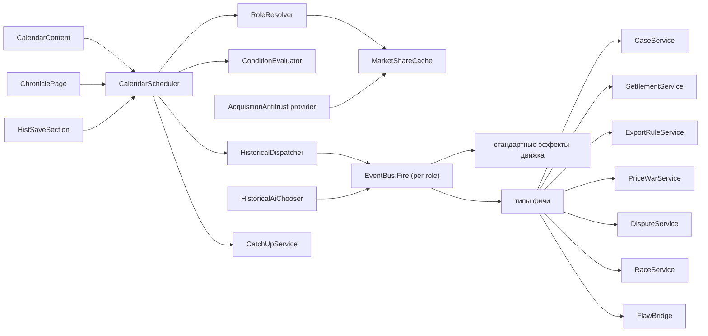
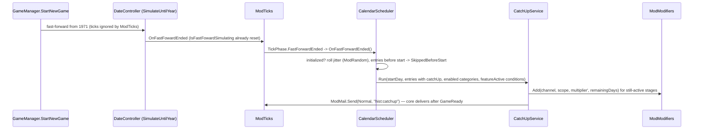

# Design: historical-events

## Document Information

- **Feature Name**: historical-events — календарь реальных событий индустрии 1971–2025
- **Version**: 0.2
- **Date**: 2026-10-10
- **Author**: Dex719
- **Status**: Draft v0.2 — одобрено к реализации владельцем 2026-10-10
- **Reviewers**: владелец форка
- **Related Documents**:
  - `requirements.md` (эта папка);
  - `.kiro/steering/context.md` — архитектурный контракт `PTMod.Core`;
  - `.kiro/steering/owner-decisions.md` — решения владельца (внесены, см. `requirements.md`, «Решения по умолчанию»);
  - `.kiro/specs/event-system/design.md`:
    - `EventRegistry.RegisterPack`, `EventBus.Fire` / `EventFireContext`;
    - `IEventEffectHandler`, `EventConditions.Register`, `EventAi.AddChooser`, `EventLog`, предикат `es.activeInCategory`;
  - `.kiro/specs/mod-framework/design.md` — `IModFeature`, `ModTicks`, `ModSave`, `ModModifiers` (`RegisterReasonedProvider`, `Add`, `Invalidate`), `ModCompanies`, `ModSegments`, `ModCredit`, `ModMail`, `ModUI`;
  - `.kiro/specs/design-flaw-recalls/design.md` — API `FlawRegistry`;
  - `.kiro/specs/rival-personalities/design.md` — `IRivalPersonalitiesApi.ApplyPriceCut` / `RestorePriceCut` (ценовые войны ИИ);
  - `.kiro/specs/rival-acquisitions/design.md` — канал `acquisition.price` (антимонопольная надбавка);
  - `.kiro/specs/gpu-product-line/design.md` — канал `gpu.demand` (криптобумы);
  - `.kiro/specs/market-shocks/design.md` — пересечение категорий (`es.activeInCategory`), граница по антидемпингу;
  - решения 0004, 0005, 0006.

## Overview

Фича — `[ModFeature] sealed class HistoricalEventsFeature : IModFeature` в `PTMod.Features.HistoricalEvents`. Она отвечает за «когда и с кем» происходит историческое событие. За «что именно происходит» отвечает движок `event-system`.

1. **Календарь** (`calendar.json`) — 42 записи. У записи есть:
   - якорь, окно, сдвиг, флаги `major` и `catchUp`;
   - роли, условия, запасной вариант;
   - справка с источниками;
   - стадии. Стадия — список срабатываний `{ eventId, role }` со смещением в днях.
2. **Пак событий** (`events.json`, `EventRegistry.RegisterPack("historical-events", …)`).
   - Определения `event-system` с триггером `Manual`: тексты, `cause` со справкой «как было», эффекты и варианты выбора.
   - Стандартные эффекты (`MarketDemand`, `ModifierTimed`, `FactoryOutput`, `Reputation`) исполняет, сохраняет и показывает движок.
   - Нестандартные — семь типов этой фичи (`AntitrustCase`, `AntitrustSettlement`, `ExportControl`, `PriceWar`, `PatentDispute`, `AttributeRace`, `ForceDesignFlaw`).
3. **Планировщик** (`CalendarScheduler`):
   - ежедневно смотрит только на ближайшую запись;
   - распознаёт роли (`RoleResolver`) и условия (`ConditionEvaluator`);
   - для каждой роли стадии вызывает `EventBus.Fire(eventId, new EventFireContext { CompanyKey = key, Args = … })`;
   - соблюдает интервал между `major`-событиями.
4. **Решения ИИ** — штатный механизм движка (`aiWeight`). Плюс `HistoricalAiChooser : IEventAiChooser` (регистрация `EventAi.AddChooser(chooser, priority: 10)`) с учётом денежного запаса для событий `hist.decide.*`; `rival-personalities` перекрывает его своим выбором с более высоким приоритетом.
5. **Долгоживущие процессы** — сервисы с состоянием в секции фичи:
   - `CaseService` — дела;
   - `SettlementService` — иски;
   - `ExportRuleService` — правила экспорта;
   - `PriceWarService` — ценовые войны;
   - `DisputeService` — патентные споры;
   - `RaceService` — гонки характеристик;
   - `AcquisitionAntitrust` — антимонопольная надбавка к цене поглощений (провайдер `acquisition.price`).
6. **Поздний старт** — `CatchUpService` после перемотки (`TickPhase.FastForwardEnded`) переводит ещё действующие стандартные эффекты в записи `ModModifiers.Add` с остатком срока.
7. **Хроника** — страница хаба «Хроника отрасли».

### Design Goals

- История — «канва», а не рельсы: роли подбираются в мире партии, игрок может оказаться Intel 2009 года.
- Каждое событие объяснимо: письмо движка с эффектами в числах, справка в `cause`, домен источника.
- Не дублировать движок: эффекты, окна, таймеры, журнал и сохранение экземпляров — в `event-system`.
- Никаких патчей формул и общих хуков: стандартные каналы `ModModifiers`, рейтинг CPU — провайдером `market.rating.cpu`, пакетный прогон — `ModTicks.IsBatchRun`, сегмент — `ModSegments`, порог кредита — `ModCredit`.
- Цены ИИ — через `IRivalPersonalitiesApi` (`ApplyPriceCut` / `RestorePriceCut`), если `rival-personalities` активна.
- Одинаковые правила для ИИ и игрока, нейтральность при перемотке новой игры.
- Детерминизм, устойчивость к загрузке, перемотке и выключению. Контент правится без сборки.

### Key Design Decisions

- **D1. Своё расписание + события `Manual` в паке `event-system`.**
  - Нужны: окна, повторные проверки, роли, запасные варианты, стадии, догоняющие эффекты, интервалы.
  - Отвергнуто: триггер `Date` движка. Он не знает ролей и запасных вариантов.
  - Отвергнуто: эффекты прямо в календаре. Пришлось бы повторить исполнение, сохранение и тексты движка.
- **D2. Доли рынка — из помесячных журналов `CpuBase.MarketData`, а не из `MarketDataProvider.MarketShare`.**
  - `MarketShare` считает только по `SoldLastDay`: шумно, без сегментов и периода.
  - Журналы выровнены по месяцам (`MarketDataHandler.HandleMissingIndexes`) и сохраняются игрой.
- **D3. Условия — предикаты, зарегистрированные в движке (`EventConditions.Register`) под префиксом `hist.`.** Например, `hist.ShareAtLeast`, `hist.CaseActive`, `hist.IsFabless`, `hist.PlayerHasCpuAbove` (`ModConditions.Register` отклоняет имя без префикса фичи).
  - Планировщик вычисляет те же функции напрямую. Тот же предикат можно использовать в `requires` и `filter` определений.
  - Нотация условий — `ModConditions`: объект с `type` и параметрами на верхнем уровне, либо `all` / `any` / `not`. Роли записи передаются предикатам через область вызова `HistRoleScope` (подлежащее предиката остаётся компанией).
  - Стандартные условия берутся у ядра и движка: `dateAtLeast`, `moneyAtLeast`, `cpuOnMarket`, `featureActive`, `es.hasFab`, `es.activeInCategory`.
- **D4. Стадии — внутри записи календаря со смещением.**
  - Отвергнуто: цепочки `FireEvent`. Догоняющий эффект при позднем старте требует знать смещения и длительности заранее.
- **D5. Решения ИИ — штатный механизм движка.**
  - Экземпляр события для ИИ (`CompanyKey = "ai:<id>"`) решается политикой движка (`aiWeight`).
  - `HistoricalAiChooser` (приоритет 10 в `EventAi.AddChooser`: выборщики опрашиваются по убыванию приоритета, побеждает первый ненулевой ответ) учитывает стоимость нестандартных эффектов: `AppliedEffect.value` из `Resolve`. Для чужих событий возвращает `null`.
  - Новость игроку — флаг `notifyPlayer`.
  - Правила одинаковы для ИИ и игрока; на низкой сложности эффекты ИИ не ослабляются.
  - Отвергнуто: своя политика мимо движка (журнал и `rival-personalities` не увидели бы решения).
- **D6. Экспортный контроль — провайдер `market.rating.cpu` (`ModModifiers.RegisterReasonedProvider`) для CPU выше порога.**
  - Канал объявлен в `mod-framework` с областью CPU и сегмента; провайдер получает `ModifierContext` (`Company`, `CompanyKey`, `Cpu`, `Segment`) и отдаёт `ProviderResult` с причиной `hist.mod.export` для `Explain`.
  - Дневной кеш канала сбрасывается `ModModifiers.Invalidate("market.rating.cpu")` при каждом изменении состояния правила или гонки внутри дня.
  - Отвергнуто: `market.demand.<segment>` (режет спрос на все CPU сегмента, урезанный SKU потерял бы смысл).
  - Отвергнуто: регионы рынка (отдельная большая фича; решение владельца: без регионов).
- **D7. Ценовая война.**
  - Если `rival-personalities` активна — `RivalPersonalities.Api.ApplyPriceCut(reactionId, rival, segment, depth, floorMargin)` / `RestorePriceCut(reactionId)` (публичный `IRivalPersonalitiesApi`; ценовыми войнами владеет она и держит цены под ударом). Фича напрямую цен ИИ не меняет.
  - Если она неактивна (`Api.IsEnabled == false`; фолбэк допустим по решению владельца) — `PriceWarFallback`: разовое снижение `Cpu.Price` и `CpuBase.AIStrategy.TargetPrice` с запоминанием исходной цели и возвратом по окончании. Без патчей; возврат цен — штатная логика `AIBehaviourMarket.ChangePrices`.
- **D8. Денежные статьи.**
  - Штрафы, иски, мировые и судебные расходы — `ExpenseOrigin.Fines`.
  - Лицензионные платежи — `ExpenseOrigin.Royalties` и `RevenueOrigin.Royalties`; компенсация пострадавшему — `RevenueOrigin.Royalties`.
  - Банковская гарантия — `ExpenseOrigin.Interest`; возврат штрафа — `RevenueOrigin.Interest` (решение: статья `Interest`, как у доходов `event-system`).
- **D9. Порог экспорта индексируется к среднему `Ips` рынка со степенью 0.5.** Фиксированный порог через 3–4 года накрыл бы весь рынок; полная индексация не отражала бы ужесточение.
- **D10. Аналоги — по `AICompany.UniqueID` с цепочкой `fallback` на роли.**
  - Intel 0, AMD 1, Zilog 2, Texas Instruments 3, IBM 4, Fairchild 5, Toshiba 6, Motorola 7, GlobalFoundries 8 (игровое имя SolarFoundries), TSMC 9, Cyrix 10, VIA Technologies 11, Digital Devices 12 (`data/ProcessorTycoon.CompanySystem.CompanySpawner.json`; реальные названия — по `translation/brands.json` русификатора).
  - Компании в состоянии — по ключу `ModCompanies.KeyOf` (`player` / `ai:<UniqueID>`); названия в логике и контенте не вшиваются, имя берётся из игры (`ICompany.get_Name`).
- **D11. Справка — в `cause` определения и в календаре (`history.factKey`, `history.sources`).** JSON без комментариев, поэтому факт и дата для сопровождающих лежат в поле `_note` (парсер игнорирует поля с префиксом `_`).
- **D12. Интенсивность — `PackOptions.Severity` пака.**
  - Стандартные эффекты помечены `"scalable": true`; движок считает `multiplier' = 1 + (multiplier − 1) × Severity`.
  - Нестандартные типы (суммы штрафов, доли экспорта) интенсивностью не масштабируются.
- **D13. Антимонопольное ограничение поглощений — надбавка к цене, а не запрет.**
  - Провайдер `acquisition.price` (`ModModifiers.RegisterReasonedProvider`) считает множитель по доле рынка игрока после сделки и по активному делу против игрока.
  - Отвергнуто: запрет сделки. Он потребовал бы нового хука в `rival-acquisitions`; канал и его предел [0,5; 3,0] уже в реестре ядра.
- **D14. Категория `disaster` выключена по умолчанию** (решение владельца). Выключенная категория не срабатывает и не догоняется при позднем старте.
- **D15. Основной сегмент CPU — единые правила ядра:** для ИИ `CpuBase.AIStrategy.TargetMarket`, для игрока `ModSegments.FromSales` по продажам последнего полного месяца, затем `ModSegments.Classify`. Собственного классификатора нет.
- **D16. Денежный запас ИИ — `MoneyAmount − ModCredit.ThresholdOf(company)`.** Порог дефолта берётся только из `ModCredit` (с учётом того, что реально применяет игра), а не из `CentralBank.DebtLimit`.

## Architecture

### System Context

```mermaid
graph TB
    subgraph Game["Processor Tycoon"]
        DC["DateController (OnDayPassed, OnMonthPassed, OnFastFowardEnded)"]
        Ledgers["CpuBase.MarketData / CompanyFinance.Reports"]
        AIPrice["Cpu.Price, AIStrategy.TargetPrice"]
        Money["ICompany.SpendMoney / EarnMoney"]
        CEH["CompanyEventHandler.TriggerSolarFoundriesSpinOff"]
        LH["LicenseHelper.OnX86LicenseRevoked"]
        BH["BankruptcyHandler.OnCompanyWentBankrupt"]
    end
    subgraph Core["PTMod.Core"]
        Feat["IModFeature / FeatureContext"]
        Ticks["ModTicks (IsBatchRun)"]
        Save[ModSave]
        Mods["ModModifiers (RegisterReasonedProvider, Add, Invalidate)"]
        Comp[ModCompanies]
        Seg[ModSegments]
        Cred[ModCredit]
        Mail["ModMail (hist:catchup)"]
        Rand[ModRandom]
        Content[ModContent]
        UI["ModUI / HubPage"]
    end
    subgraph ES["event-system"]
        Reg[EventRegistry]
        Bus[EventBus]
        Eff[EventEffects]
        Cnd[EventConditions]
        Ai[EventAi]
        Log[EventLog]
    end
    HE["historical-events"]
    DFR["design-flaw-recalls"]
    RP["rival-personalities (IRivalPersonalitiesApi)"]
    RA["rival-acquisitions (acquisition.price)"]
    GPU["gpu-product-line (gpu.demand)"]
    MS["market-shocks"]

    DC --> Ticks --> HE
    HE --> Ledgers
    HE --> Mods
    HE --> Money
    HE --> Seg
    HE --> Cred
    HE --> Mail
    HE --> Reg
    HE --> Bus
    HE --> Eff
    HE --> Cnd
    HE --> Ai
    Bus --> Log
    HE --> UI
    HE -- FlawRegistry.ForceFlaw --> DFR
    HE -- "ApplyPriceCut / RestorePriceCut" --> RP
    HE -. "fallback (Api.IsEnabled == false)" .-> AIPrice
    HE -- "provider acquisition.price" --> RA
    HE -- "ModifierTimed gpu.demand" --> GPU
    MS -. "not es.activeInCategory(history, scope any)" .-> HE
    CEH -- postfix --> HE
    LH --> HE
    BH --> HE
```



### High-Level Architecture



Чистая логика (тесты без Unity):
- `CalendarValidator`, `SchedulerCore`;
- `ShareMath`, `RoleResolverCore`;
- `AntitrustCaseMachine`, `ExportRuleMath`, `PriceWarFallback` (расчёт среза), `DisputeMath`, `AcquisitionAntitrustMath`;
- `HistoricalAiChooserCore`.

Каждый публичный тип `Logic/` указан в `[Covers]` тестов.

Адаптер к игре — `IWorldView` (`GameWorldView`).

### Technology Stack

| Слой | Технология | Обоснование |
|---|---|---|
| Регистрация | `[ModFeature] IModFeature.Register(FeatureContext)` | контракт `mod-framework` |
| Время | `ctx.OnTick(TickPhase.DayPassed / MonthPassed / FastForwardEnded)`, `ModTicks.GameReady`, `ModTicks.IsBatchRun` | защиты фреймворка |
| Эффекты, окна, журнал | пак `event-system` | D1, D5 |
| Рейтинг CPU | `ModModifiers.RegisterReasonedProvider("historical-events", "market.rating.cpu", …)` + `Invalidate` | D6 |
| Цена поглощений | `ModModifiers.RegisterReasonedProvider("historical-events", "acquisition.price", …)` | D13 |
| Сегмент CPU, порог кредита | `ModSegments`, `ModCredit` | D15, D16 |
| Письма | `ModMail.Send` (`Normal`, тег `hist:catchup`) | FR-4 п. 4 |
| Догоняющие эффекты | `ModModifiers.Add` со сроком | FR-4 |
| Состояние | `IModSaveParticipant`, секция `historical-events`; `_schema` пишет ядро | решение 0004 |
| Контент | `ModContent`: `calendar.json`, `params.json`; пак: `events.json` | решение 0006 |
| UI | `ctx.HubPage`, `ModUI` | решение 0005 |
| Случайность | `ModRandom.Stream("historical-events")` | NFR-6 |

## Components and Interfaces

Все типы — в `namespace PTMod.Features.HistoricalEvents`.

### Component 1: HistoricalEventsFeature

```csharp
[ModFeature]
public sealed class HistoricalEventsFeature : IModFeature
{
    public string Id => "historical-events";
    public string NameKey => "hist.feature.name";
    public string DescriptionKey => "hist.feature.desc";
    public string[] DependsOn => new[] { "event-system" };      // hard only; rival-personalities, design-flaw-recalls, rival-acquisitions, gpu-product-line are soft
    public bool EnabledByDefault => true;
    public bool SupportsHotToggle => true;
    public void Register(FeatureContext ctx);
    // ctx.OnTick(TickPhase.DayPassed / MonthPassed / FastForwardEnded); ctx.SaveParticipant(save); ctx.Param(...);
    // ctx.HubPage("hist.chronicle.title", chronicle.Build); ctx.Patch(typeof(BuiltInEventNewsPatches)) (Optional);
    // EventRegistry.RegisterPack("historical-events", "content/historical-events", new PackOptions { SettingsFeatureId = Id, Severity = intensity });
    // EventEffects.Register(...) x8; EventConditions.Register("hist.*", ...); EventAi.AddChooser(chooser, priority: 10);
    // ModModifiers.RegisterReasonedProvider(Id, ModChannels.MarketRatingCpu, RatingProvider)       // once, in Register
    // ModModifiers.RegisterReasonedProvider(Id, ModChannels.AcquisitionPrice, AcquisitionProvider) // once, in Register (lazy binding, order of Register is irrelevant)
    // ModTicks.GameReady += OnGameReady (jitter fallback for runs without fast-forward, rebinding of BankruptcyHandler.OnCompanyWentBankrupt)
    public void OnEnabled();    // providers stay registered; wars/cases resume; entries of ModModifiers are NOT recreated
    public void OnDisabled();   // FR-17 п. 3: providers answer 1.0, cases/disputes paused, price wars restored; ModModifiers.RemoveAll NOT called
    public static bool IsCategoryActive(string category);   // is the category toggle on (used by tests, chronicle and AcquisitionAntitrust)
}
```

Параметры (`ctx.Param`; ключи — полный slug фичи `historical-events`):
- `mode` (Int: 0 `adaptive`, 1 `strict`);
- `intensity` (Float 1.0, 0.5–1.5);
- 12 переключателей категорий (Bool); все включены по умолчанию, кроме `disaster` (по умолчанию `false`, решение владельца);
- `historyNotes`, `spoilers`, `debug` (Bool).

### Component 2: CalendarContent и CalendarValidator

```csharp
public sealed class CalendarEntry : IContentRecord
{
    public string Id { get; set; }               // "hist.<…>" (ModIds.IsEventIdAllowed)
    public string Category; public bool Major; public bool CatchUp;
    public SimpleDate Anchor, WindowFrom, WindowTo; public int JitterDays;
    public List<RoleSpec> Roles; public List<ICondition> Conditions;   // ModConditions notation: { "type": "hist.ShareAtLeast", ...params }
    public List<StageSpec> Stages;              // stage 0 = at firing
    public string Fallback;                     // "news" | "skip"
    public List<FireSpec> FallbackFires;        // e.g. ForceDesignFlaw fallback event
    public HistoryInfo History;                 // titleKey, factKey, sources[]
}
public sealed class StageSpec { public int OffsetDays; public List<FireSpec> Fires; public string SkipIfFlag; }
public sealed class FireSpec  { public string EventId; public string Role; public string[] ExtraArgs; public ICondition OnlyIf; }
public sealed class RoleSpec  { public string Name; public string Kind; public Segment[] Segments; public int Months; public float MinShare;
                                public int UniqueId = -1; public bool RequireFoundry; public bool RequireCapacity; public List<RoleSpec> Fallback; }
                                // Segments: JSON "all" | "highend" | "midrange" | "lowend" | "industries" -> Segment (all = Segment.Any = every segment)
public sealed class HistoryInfo { public string TitleKey; public string FactKey; public List<string> Sources; }

public static class CalendarValidator
{
    public static bool Validate(CalendarEntry e, IEventCatalog events, IL10nKeys keys, List<string> errors);
}
```

Загрузка — `ModContent.LoadRecords<CalendarEntry>("historical-events", "calendar.json", map, validate, 1)`; условия разбираются `ModConditions.Parse`. Битые записи пропускаются, отчёт — `ModContent.ReportOf`. Валидатор проверяет префикс `hist.` у `id`, существование `eventId` в паке и ключей L10n.

### Component 3: CalendarScheduler

```csharp
internal sealed class CalendarScheduler
{
    internal void OnFastForwardEnded();     // TickPhase.FastForwardEnded (IsFastFowardSimulating already reset): jitter roll, SkippedBeforeStart, CatchUpService; once (state.initialized)
    internal void OnGameReady(GameReadyReason reason);   // NewGame without fast-forward: same initialization once; Loaded: rebuild the due list
    internal void OnDay();                  // pointer to nearest due entry/stage
    internal void OnMonth();                // re-check Waiting entries, expire with fallback
    internal EntryStatus GetStatus(string entryId);
    internal IReadOnlyList<FiredEntryView> GetFired();
    internal void DebugFireNow(string entryId);
}
public enum EntryStatus { Pending, Waiting, Fired, Expired, SkippedBeforeStart, Disabled, Error }
```

Алгоритм `OnDay` (O(1) в обычный день):
1. `due` — список «запись или стадия → день срабатывания», отсортированный по дню (дни от 1971-01-01, как в `event-system`). Указатель смотрит на голову.
2. Если `голова.день > сегодня`, выход.
3. Запись:
   - категория выключена → `Disabled`;
   - роли не распознаны или условия ложны → `Waiting`, повтор 1-го числа;
   - нарушен интервал `major` (45 дней) → перенос, но не дальше `WindowTo`;
   - иначе `HistoricalDispatcher.FireStage(entry, 0, roles)`, статус `Fired`, стадии с `OffsetDays > 0` — в `due`.
4. Стадия: `FireStage(entry, k, сохранённые роли)`. Флаг `SkipIfFlag` пропускает стадию (например, `recovered` после сверхурочного восстановления).

### Component 4: RoleResolver, MarketShareCache, IWorldView

```csharp
public interface IWorldView   // adapter over game singletons; fake in tests
{
    IReadOnlyList<CompanyInfo> Companies { get; }          // ModCompanies.All + flags
    IReadOnlyList<CpuInfo> Cpus { get; }                   // CpuDataProvider.Instance.GetAllCpus()
    int MonthsSinceStart { get; }                          // DateController.Instance.MonthsSinceStart
    float AverageIps { get; }                              // Market.Instance.AverageIps
    float Revenue12m(string companyKey);                   // CompanyFinance.Reports
    float CashHeadroom(string companyKey);                 // MoneyAmount - ModCredit.ThresholdOf(company): money plus the debt limit the game really applies
    bool IsFeatureActive(string featureId);                // ModFeatures.IsActive (rival-personalities, design-flaw-recalls, gpu-product-line)
}
public sealed class CompanyInfo { public string Key; public int UniqueId; public bool IsPlayer, IsBankrupt, IsFabless, IsFoundry, HasManufacturing, IsCpuCompany; public int Capacity; public int FoundedYear, FoundedMonth; public string Name; }
public sealed class CpuInfo { public int SaveId; public string CompanyKey; public int Year; public bool Released, Retired, OnMarket; public float Ips, Power, Frequency, Price, RealUnitCost; public int Cores;
                              public Segment Segment; }   // primary segment (D15): AI = AIStrategy.TargetMarket; player = ModSegments.FromSales(last full month), then ModSegments.Classify(cpu)

public sealed class MarketShareCache
{
    public void Rebuild(IWorldView world, int maxMonths);    // monthly
    public float Share(string companyKey, SegmentMask segments, int months);   // SegmentMask over Segment (HighEnd..Industries); all = every bit
    public IReadOnlyList<string> Ranking(SegmentMask segments, int months);   // desc share; tie -> player first, then lower UniqueId
}

public sealed class RoleResolver
{
    public RoleResult Resolve(CalendarEntry entry, IWorldView world, MarketShareCache shares, HistSettings settings, IModRng rng);
}
public sealed class RoleResult { public bool Ok; public Dictionary<string, List<string>> Targets; public string FailedRole; }
```

Виды ролей (`RoleSpec.Kind`):

| Kind | Правило |
|---|---|
| `leader` | 1-я в `Ranking(segments, months)`, доля ≥ `MinShare` |
| `challenger` | 2-я в том же рейтинге, не совпадает с уже назначенными ролями записи |
| `named` | компания с `AICompany.UniqueID` = `UniqueId`, не банкрот (`RequireFoundry`, `RequireCapacity` — доп. фильтры); в режиме `strict` `Fallback` не используется |
| `foundryLeader` | макс. `FactoryBase.ProductionCapacity` среди `CompanyDataProvider.Instance.GetFoundryCompanies(list, null)` |
| `bestPerfPerWatt` | владелец CPU на рынке с макс. `Ips / max(PowerConsumption, 0.5)`, выпущенного за 36 месяцев |
| `newestEntrant` | макс. `FoundationDate` среди компаний с ≥ 1 выпущенным CPU, кроме уже назначенных ролей |
| `randomManufacturer` | случайная (`IModRng`) не fabless ИИ-компания с мощностью > 0 |
| `player` | `ModCompanies.PlayerKey` |
| `global` | без компании: срабатывание с целью «игрок», эффекты глобальные |
| `allCpuCompanies` / `allManufacturers` / `allFabless` | группы по `Divisions` и `IsFabless`, не банкроты (одно срабатывание на компанию) |

Отладка: параметр `debug` и флаг `debugForceLeader` (страница хроники) делают игрока `leader` и `challenger`-кандидатом №1.

### Component 5: ConditionEvaluator и предикаты движка

```csharp
public sealed class ConditionEvaluator
{
    // c: ICondition parsed by ModConditions.Parse; roles are supplied through the scheduler-scoped HistRoleScope
    public bool Evaluate(ICondition c, RoleResult roles, IWorldView world, MarketShareCache shares, HistState state);
}
internal static class HistRoleScope { internal static RoleResult Current { get; } /* Push/Pop around Evaluate */ }
```

Нотация условий — `ModConditions`: `{ "type": "hist.ShareAtLeast", "role": "target", "value": 0.55, "months": 36 }`, составные `all` / `any` / `not`. Имена предикатов фичи — `hist.<имя>`.

| Предикат (`EventConditions.Register`) | Аргументы | Истина, если |
|---|---|---|
| `hist.ShareAtLeast` | `role` или компания контекста, `value`, `months`, `segments` | доля ≥ `value` |
| `hist.HasCpuSince` | `months`, `segment` | у компании есть CPU, выпущенный за последние `months` месяцев в сегменте (`Segment`, по правилу D15) |
| `hist.CaseActive` | `caseId`, `targetNotPlayer` | дело активно (и его цель — не игрок) |
| `hist.PlayerHasCpuAbove` | `ruleId`, `anyCompany` | у игрока (или у любой компании) есть CPU на рынке с `Ips ≥` порога правила |
| `hist.IsFabless` | — | компания fabless (для `filter` групповых событий) |
| стандартные ядра и движка | `dateAtLeast`, `moneyAtLeast`, `cpuOnMarket`, `featureActive{id}`, `es.hasFab`, `es.activeInCategory{category, scope}` | `ModConditions` и `event-system` (предикаты ядра без точки, предикаты движка с префиксом `es.`) |

### Component 6: HistoricalDispatcher

```csharp
internal sealed class HistoricalDispatcher
{
    internal void FireStage(CalendarEntry entry, int stageIndex, RoleResult roles);
    // for each FireSpec: for each company key of the role (or null for global/AllCompanies definitions):
    //   EventBus.Fire(spec.EventId, new EventFireContext { CompanyKey = key, Args = BuildArgs(entry, roles, spec), IgnoreConditions = true })
    internal void FireFallbackNews(CalendarEntry entry);   // EventBus.Fire("hist.fizzle", {CompanyKey: player, Args: [title]})
}
```

`Args` всех событий пака:
- `[0]` — id записи календаря;
- `[1]` — игровое имя цели (`ICompany.get_Name`);
- `[2]` — игровое имя второй роли (истец, бенефициар), если есть;
- `[3]` — ключ второй роли;
- `[4..]` — `ExtraArgs` спецификации (например, `caseId`, `ruleId`).

Определения задают `important: true` для событий с выбором игрока и `notifyPlayer: true` для экземпляров ИИ.

### Component 7: HistoricalAiChooser

```csharp
internal sealed class HistoricalAiChooser : IEventAiChooser   // EventAi.AddChooser(this, priority: 10)
{
    public string Choose(EventInstance instance, ChoiceOption[] options, ICompany company, IModRng rng);
    // only for eventId starting with "hist.decide."; otherwise null (the next chooser / default policy decides)
}
public static class HistoricalAiChooserCore   // pure
{
    public static string Choose(OptionCost[] options, AiWeights weights, float cashHeadroom, string defaultChoice, float roll01);
}
public struct OptionCost { public string ChoiceId; public float UpfrontCost; }   // sum of negative AppliedEffect.value of our types + Money spend
```

- Варианты с `UpfrontCost > cashHeadroom` получают вес 0; при нулевой сумме весов — `defaultChoice`. `cashHeadroom = company.MoneyAmount − ModCredit.ThresholdOf(company)` (`IWorldView.CashHeadroom`).
- Веса — `aiWeight` вариантов (из `events.json`), при необходимости переопределённые `params.json`.
- Семантика `EventAi.AddChooser(chooser, priority)`: выборщики образуют список по убыванию приоритета, побеждает первый ненулевой ответ; если все вернули `null`, действует политика движка по умолчанию.
- `rival-personalities` регистрирует свой выборщик с более высоким приоритетом (100) и может вернуть `null`, чтобы отдать решение этому классу.

### Component 8: Сервисы нестандартных эффектов

Каждый обработчик реализует `IEventEffectHandler` движка (`Type`, `Validate`, `Resolve`, `Apply`, `Describe`). `Resolve` считает суммы один раз: они видны под кнопками и в письме. Состояние процессов хранится в секции фичи; месячные начисления делает сервис.

```csharp
// AntitrustCase: params {caseId, action: open|pay|provision|appeal|settle|fight|reimposePay|reimposeAppeal, mode: fine|consent|warning, ...}
internal sealed class CaseService : IEventEffectHandler
{
    internal void OnMonth();                      // guarantee fees, legal costs, rulings, reimposition -> EventBus.Fire(hist.decide.antitrust.reimpose)
    internal IReadOnlyList<CaseView> Cases { get; }
}
public static class AntitrustCaseMachine          // pure
{
    public static CaseStep Open(CaseParams p, float revenue12m);
    public static CaseStep Choose(CaseState s, string action, CaseParams p);
    public static CaseStep Rule(CaseState s, CaseParams p, float shareNow, float roll);
    public static CaseStep Reimpose(CaseState s, CaseParams p, float roll);
}

// AntitrustSettlement: params {settlementId, caseRef, action: sue|decline, legalCostPct, months, pWin, settlementPct}
internal sealed class SettlementService : IEventEffectHandler { internal void OnMonth(); }

// ExportControl: params {ruleId, action: open|update|comply|license|lobby, segments, percentile, blockedShare, indexing, durationDays, license*, lobby*}
internal sealed class ExportRuleService : IEventEffectHandler
{
    internal void OnMonth();                                     // threshold recompute, expirations; then ModModifiers.Invalidate("market.rating.cpu")
    internal ProviderResult RatingMultiplier(ModifierContext ctx);   // part of the market.rating.cpu provider, O(1); reason "hist.mod.export"
}

// PriceWar: params {warId, action: start|decline|join|hold|marketing, segments, cut, followCut, durationDays, marketingCostPct}
internal sealed class PriceWarService : IEventEffectHandler
{
    internal void OnDay();                                       // end -> RestorePriceCut / restore saved TargetPrice
    // rival-personalities active (ModFeatures.IsActive): RivalPersonalities.Api.ApplyPriceCut("hist:<warId>", rival, segment, depth, floorMargin)
    //                                                    / RivalPersonalities.Api.RestorePriceCut("hist:<warId>"); no direct price writes
    // otherwise (Api.IsEnabled == false): PriceWarFallback (data-only cut with saved originals)
}

// PatentDispute: params {disputeId, mode: licenseWithdrawal|infringement, action: open|arbitrate|license|independent|fight|settle|redesign|sue|decline}
internal sealed class DisputeService : IEventEffectHandler { internal void OnMonth(); }

// AttributeRace: params {raceId, attribute: frequency|coreCount, topN, bonus, segments, durationDays}
internal sealed class RaceService : IEventEffectHandler
{
    internal void OnMonth();                                     // recompute top-N SaveIds; then ModModifiers.Invalidate("market.rating.cpu")
    internal ProviderResult RatingMultiplier(ModifierContext ctx);   // reason "hist.mod.race.frequency" | "hist.mod.race.cores"
}

// ForceDesignFlaw: params {pick, typeId, severityLeader, severityOthers, discovery, maxPerCompany}
internal sealed class FlawBridge : IEventEffectHandler { }       // DesignFlawRecallsFeature.Registry.ForceFlaw or fallback event

// Provider of acquisition.price (FR-19, no event type: it works from state of CaseService and MarketShareCache)
internal sealed class AcquisitionAntitrust
{
    internal ProviderResult Multiplier(ModifierContext ctx);     // ctx.Company = target; O(1) from cached shares
}
public static class AcquisitionAntitrustMath                     // pure
{
    public static float Multiplier(float playerShare, float targetShare, bool caseActive, AcqAntitrustParams p);   // see formula 11
}
```

Провайдеры каналов (по одному на канал, регистрируются один раз в `Register`):

```csharp
internal ProviderResult RatingProvider(ModifierContext ctx)       // market.rating.cpu
{
    // returns 1.0 while the feature is disabled or the category is off; otherwise export * race with the reason of the larger deviation
}
internal ProviderResult AcquisitionProvider(ModifierContext ctx) => acquisitionAntitrust.Multiplier(ctx);   // acquisition.price
```

Состояние провайдера изменилось внутри дня (правило введено, лицензия выдана, топ гонки пересчитан, дело открыто или закрыто, месячный пересчёт долей) → `ModModifiers.Invalidate(channel)`.

### Component 9: CatchUpService

**Purpose**: FR-4.

```csharp
internal sealed class CatchUpService
{
    internal void Run(int startDay, IReadOnlyList<CalendarEntry> entries, IEventCatalog events);
}
```

Для каждой записи с `CatchUp` и якорем раньше старта берутся её стадии. Если `якорь + OffsetDays + DurationDays > старт` (длительность — из `durationDays` эффектов определения), стандартные эффекты стадии переводятся в записи `ModModifiers.Add("historical-events", channel, scope, multiplier', remainingDays, "hist.catchup")`:

| Эффект определения | Канал и область |
|---|---|
| `MarketDemand {segment}` | `ModChannels.MarketDemand(segment)`, `ModifierScope.Global(...)` |
| `ModifierTimed {channel, scope: Target}` | `channel`, `ModifierScope.Company(key)` для текущих компаний роли |
| `ModifierTimed {scope: Global}` | `channel`, `ModifierScope.Global()` (в том числе `gpu.demand` для криптобумов) |
| `FactoryOutput` | `production.output`, `ModifierScope.Company(key)` |

Нестандартные эффекты и выборы не догоняются. Записи выключенных категорий (`disaster` по умолчанию) и записи, чьё условие `featureActive` ложно (`gpu-product-line` для криптобумов), не догоняются. Затем отправляется одно письмо «Обстановка в отрасли» (`ModMail.Send`, `MailPriority.Normal`, `Tag = "hist:catchup"`) со списком; ядро доставляет его после `GameReady`.

### Component 10: ChroniclePage и BuiltInEventNews

- `ChroniclePage` — страница хаба (`ctx.HubPage("hist.chronicle.title", build)`), вкладки на `ModUI.Button`, строки `ModUI.Info` в `ModUI.ScrollView`:
  - «Прошедшие» — дата, событие, роль → компания, итог (из `EventLog.Entries` по `eventId` пака и из статусов календаря);
  - «Действует сейчас» — эффекты с остатком дней (по дням срабатывания и `durationDays` определений), экспортные правила (порог, доля, исключения), ценовые войны;
  - «Дела и споры» — стадия, суммы, ближайшая дата;
  - отладка (`debug`): `ModUI.Dropdown` записей, кнопка «Запустить сейчас», флаг `debugForceLeader`.
- `BuiltInEventNews` (Could, FR-16):
  - постфикс `CompanyEventHandler.TriggerSolarFoundriesSpinOff`;
  - подписка на `LicenseHelper.OnX86LicenseRevoked`;
  - `EventBus.Fire("hist.news.solarfoundries" | "hist.news.x86license", { CompanyKey: player })`: письмо со справкой, без эффектов.

### Component 11: HistSaveSection

`HistSaveSection : IModSaveParticipant` (`SectionId = "historical-events"`, `SchemaVersion = 1` — свойство участника). Восстанавливает указатель планировщика и состояние сервисов. Поле `_schema` пишет и читает ядро, в данных фичи его нет; `Write()` его не возвращает. Провайдеры `market.rating.cpu` и `acquisition.price` регистрируются в `Register` и не сохраняются (контракт `ModModifiers`).

## Патчи Harmony

| Цель (`Class.Method`) | Тип | Что меняет | Порядок и конфликты |
|---|---|---|---|
| `CompanyEventHandler.TriggerSolarFoundriesSpinOff` | postfix, `Optional` | Письмо-справка о выделении фабрик (FR-16, Could); игровая логика не меняется | Не во время загрузки и перемотки. Других патчей на метод в проекте нет |

Других патчей у фичи нет:
- рейтинг, спрос, себестоимость, кредит, налоги, награды контрактов, цена поглощений — каналы `ModModifiers`;
- выпуск и перенос CPU, пакетный прогон месяца, старт новой игры — службы ядра (`ModEvents`, `ModTicks`, `ModNewGame`), патчей на `Company.AddCpu`, `AICompany.AddCpu`, `DateController.NextMonth` нет;
- цены ИИ — `IRivalPersonalitiesApi` или данные (D7).

## Подписки на события

| Событие | Обработчик | Защиты |
|---|---|---|
| `TickPhase.DayPassed` | `CalendarScheduler.OnDay`, `PriceWarService.OnDay` | `ModTicks`: не при перемотке и загрузке; фича активна |
| `TickPhase.MonthPassed` | по порядку: `MarketShareCache.Rebuild`, `CalendarScheduler.OnMonth`, `CaseService.OnMonth`, `SettlementService.OnMonth`, `ExportRuleService.OnMonth`, `DisputeService.OnMonth`, `RaceService.OnMonth` | То же; порядок через `priority` подписки; `IsBatchRun` не проверяется (тики по дням, показ откладывает ядро) |
| `TickPhase.FastForwardEnded` | `CalendarScheduler.OnFastForwardEnded` | `initialized = false`; приходит после сброса `IsFastFowardSimulating`; единственная точка однократной инициализации состояния к старту новой игры |
| `ModTicks.GameReady` | `CalendarScheduler.OnGameReady`, переподписка на `BankruptcyHandler.OnCompanyWentBankrupt` | `NewGame` — резервная инициализация, если `FastForwardEnded` не пришёл; `Loaded` — восстановить указатель `due` |
| `ModSave` (участник) | `HistSaveSection.Read/Write/ResetToDefaults` | Ядро (`Read` после `SaveHandler.OnLoaded`, `Write` в postfix `SaveSystem.Save`, `_schema` — ядро) |
| `BankruptcyHandler.OnCompanyWentBankrupt` | закрыть дела, споры, иски и войны банкрота | Переподписка при `ModTicks.GameReady` |
| `LicenseHelper.OnX86LicenseRevoked` | `BuiltInEventNews` (FR-16) | `ModTicks.IsLoading` → пропуск (событие поднимается и на `SaveHandler.OnLastLoadedTick`) |
| `ModFeatures.StateChanged` | `OnEnabled` / `OnDisabled` | — |

## Data Models

### Календарь: `Content/historical-events/calendar.json`

Пример 1 — бум с догоняющим эффектом:

```json
{
  "id": "hist.1995.win95",
  "_note": "Windows 95 вышла 24.08.1995; рост продаж ПК для дома",
  "category": "boom", "major": false, "catchUp": true,
  "anchor": "1995-08-24", "window": { "from": "1995-08-01", "to": "1996-03-31" }, "jitterDays": 10,
  "roles": [], "conditions": [],
  "stages": [ { "offsetDays": 0, "fires": [ { "eventId": "hist.1995.win95", "role": "global" } ] } ],
  "fallback": "skip",
  "history": { "titleKey": "hist.1995.win95.title", "factKey": "hist.1995.win95.fact",
               "sources": ["https://en.wikipedia.org/wiki/Windows_95"] }
}
```

Пример 2 — антимонопольное дело ЕС:

```json
{
  "id": "hist.2009.eufine",
  "_note": "ЕК 13.05.2009: штраф Intel 1.06 млрд евро (~4% выручки); 2014 ГС оставил; 2017 ЕСС вернул; 26.01.2022 ГС отменил; 22.09.2023 повторно 376 млн; 12.2024 ГС снизил до 237 млн",
  "category": "antitrust", "major": true, "catchUp": false,
  "anchor": "2009-05-13", "window": { "from": "2009-05-01", "to": "2010-12-31" }, "jitterDays": 15,
  "roles": [ { "name": "target", "kind": "leader", "segments": ["all"], "months": 36, "minShare": 0.55 } ],
  "conditions": [ { "type": "hist.ShareAtLeast", "role": "target", "value": 0.55, "months": 36 } ],
  "stages": [ { "offsetDays": 0, "fires": [ { "eventId": "hist.decide.antitrust.fine", "role": "target", "extraArgs": ["eu2009"] } ] } ],
  "fallback": "news",
  "history": { "titleKey": "hist.2009.eufine.title", "factKey": "hist.2009.eufine.fact",
    "sources": [
      "https://gulfnews.com/technology/intel-loses-court-challenge-against-144b-eu-fine-1.1346382",
      "https://www.news4jax.com/business/2022/01/26/eu-court-annuls-intels-2009-billion-euro-antitrust-fine/",
      "https://www.lawsociety.ie/gazette/top-stories/2023/september/eu-re-imposes-fine-on-intel-for-competition-breach/",
      "https://globalcompetitionreview.com/article/general-court-slashes-re-imposed-penalty-against-intel" ] }
}
```

Пример 3 — аналог с цепочкой `fallback` и двумя стадиями:

```json
{
  "id": "hist.1999.jiji",
  "_note": "Землетрясение Цзицзи 21.09.1999; остановка фабрик в научном парке Синьчжу",
  "category": "disaster", "major": true, "catchUp": false,
  "anchor": "1999-09-21", "window": { "from": "1999-09-01", "to": "2000-03-31" }, "jitterDays": 0,
  "roles": [ { "name": "target", "kind": "named", "uniqueId": 9, "requireFoundry": true,
               "fallback": [ { "kind": "foundryLeader" } ] } ],
  "conditions": [],
  "stages": [
    { "offsetDays": 0,  "fires": [ { "eventId": "hist.1999.jiji.hit", "role": "target" },
                                    { "eventId": "hist.1999.jiji.market", "role": "global" } ] },
    { "offsetDays": 30, "fires": [ { "eventId": "hist.1999.jiji.recovery", "role": "target" } ], "skipIfFlag": "recovered" }
  ],
  "fallback": "news",
  "history": { "titleKey": "hist.1999.jiji.title", "factKey": "hist.1999.jiji.fact",
               "sources": ["https://en.wikipedia.org/wiki/1999_Jiji_earthquake"] }
}
```

Пример 4 — экспортный контроль с ужесточением:

```json
{
  "id": "hist.2022.exportcontrol",
  "_note": "BIS 07.10.2022: ограничения на передовые чипы; 17.10.2023 — ужесточение порогов; ответ — урезанные A800/H800",
  "category": "export", "major": true, "catchUp": true,
  "anchor": "2022-10-07", "window": { "from": "2022-10-01", "to": "2023-06-30" }, "jitterDays": 0,
  "roles": [],
  "conditions": [],
  "stages": [
    { "offsetDays": 0,   "fires": [ { "eventId": "hist.2022.export.rule", "role": "global", "extraArgs": ["us2022"] },
                                     { "eventId": "hist.decide.export", "role": "allCpuCompanies", "extraArgs": ["us2022"],
                                       "onlyIf": { "type": "hist.PlayerHasCpuAbove", "ruleId": "us2022", "anyCompany": true } } ] },
    { "offsetDays": 375, "fires": [ { "eventId": "hist.2023.export.update", "role": "global", "extraArgs": ["us2022"] },
                                     { "eventId": "hist.decide.export.update", "role": "allCpuCompanies", "extraArgs": ["us2022"],
                                       "onlyIf": { "type": "hist.PlayerHasCpuAbove", "ruleId": "us2022", "anyCompany": true } } ] }
  ],
  "fallback": "skip",
  "history": { "titleKey": "hist.2022.exportcontrol.title", "factKey": "hist.2022.exportcontrol.fact",
    "sources": [ "https://www.csis.org/analysis/where-chips-fall-us-export-controls-under-biden-administration-2022-2024",
                 "https://www.aiwiki.ai/wiki/nvidia_a800" ] }
}
```

`onlyIf` проверяется для каждой компании роли: выбор получают только компании с CPU выше порога. Игроку без таких CPU приходит только новость `hist.2022.export.rule`.

Пример 5 — криптобум с эффектом на спрос GPU (записи 41 и 42; условие `featureActive` из ядра):

```json
{
  "id": "hist.2017.cryptoboom",
  "_note": "Осень 2017: рост курса криптовалют, массовая закупка видеокарт для майнинга, дефицит GPU до начала 2018",
  "category": "boom", "major": false, "catchUp": true,
  "anchor": "2017-10-01", "window": { "from": "2017-09-01", "to": "2018-03-31" }, "jitterDays": 15,
  "roles": [],
  "conditions": [ { "type": "featureActive", "id": "gpu-product-line" } ],
  "stages": [ { "offsetDays": 0, "fires": [ { "eventId": "hist.2017.cryptoboom", "role": "global" } ] } ],
  "fallback": "skip",
  "history": { "titleKey": "hist.2017.cryptoboom.title", "factKey": "hist.2017.cryptoboom.fact",
               "sources": ["https://en.wikipedia.org/wiki/Cryptocurrency_bubble"] }
}
```

Событие пака — глобальный `ModifierTimed` на `gpu.demand`:

```json
{
  "id": "hist.2017.cryptoboom",
  "category": "history",
  "title": { "key": "hist.2017.cryptoboom.title" }, "text": { "key": "hist.2017.cryptoboom.text" }, "cause": { "key": "hist.2017.cryptoboom.fact" },
  "trigger": { "type": "Manual" }, "targets": { "type": "Player" }, "oncePerGame": true,
  "effects": [ { "type": "ModifierTimed", "params": { "channel": "gpu.demand", "scope": "Global", "multiplier": 1.35, "scalable": true }, "durationDays": 365 } ]
}
```

Запись 42 `hist.2021.cryptoboom`: якорь 2021-04-01, окно 2021-02-01…2021-12-31, `gpu.demand` × 1.45 на 365 дней, тот же шаблон. Источники обеих записей помечены [проверить] (TSK-020).

### Пак: `Content/historical-events/events.json` (схема `event-system`)

Бум (глобальный эффект, письмо игроку):

```json
{
  "id": "hist.1995.win95",
  "category": "history",
  "title": { "key": "hist.1995.win95.title" }, "text": { "key": "hist.1995.win95.text" }, "cause": { "key": "hist.1995.win95.fact" },
  "trigger": { "type": "Manual" }, "targets": { "type": "Player" }, "oncePerGame": true,
  "effects": [
    { "type": "MarketDemand", "params": { "segment": "midrange", "multiplier": 1.25, "scalable": true }, "durationDays": 730 },
    { "type": "MarketDemand", "params": { "segment": "lowend",   "multiplier": 1.15, "scalable": true }, "durationDays": 730 }
  ]
}
```

Антимонопольное дело (выбор, для ИИ — новость):

```json
{
  "id": "hist.decide.antitrust.fine",
  "category": "history",
  "title": { "key": "hist.2009.eufine.title" }, "text": { "key": "hist.decide.antitrust.fine.text" }, "cause": { "key": "hist.2009.eufine.fact" },
  "trigger": { "type": "Manual" }, "targets": { "type": "Specific" },
  "important": true, "notifyPlayer": true,
  "timerDays": 30, "defaultChoice": "appeal",
  "effects": [ { "type": "AntitrustCase", "params": { "action": "open", "mode": "fine", "finePct": 0.04,
      "remedyChannel": "contract.reward", "remedyMultiplier": 0.95, "remedyDays": 730,
      "appealMonths": 60, "pAnnul": 0.35, "pReduce": 0.35, "reduceTo": 0.35,
      "interestPerYear": 0.04, "guaranteeFeePerYear": 0.01, "dominanceLostShare": 0.40,
      "reimpose": true, "reimposeDelayMonths": 18, "reimposeP": 0.5, "reimposeShare": 0.355,
      "secondAppealMonths": 15, "secondPReduce": 0.6, "secondReduceTo": 0.63 } } ],
  "choices": [
    { "id": "pay",       "textKey": "hist.choice.pay",       "aiWeight": 0.3, "effects": [ { "type": "AntitrustCase", "params": { "action": "pay" } } ] },
    { "id": "provision", "textKey": "hist.choice.provision", "aiWeight": 0.3, "effects": [ { "type": "AntitrustCase", "params": { "action": "provision" } } ] },
    { "id": "appeal",    "textKey": "hist.choice.appeal",    "aiWeight": 0.4, "effects": [ { "type": "AntitrustCase", "params": { "action": "appeal" } } ] }
  ]
}
```

Удар по литейщику (стадия 0 `hist.1999.jiji`):

```json
{
  "id": "hist.1999.jiji.hit",
  "category": "history",
  "title": { "key": "hist.1999.jiji.title" }, "text": { "key": "hist.1999.jiji.text" }, "cause": { "key": "hist.1999.jiji.fact" },
  "trigger": { "type": "Manual" }, "targets": { "type": "Specific" }, "important": true, "notifyPlayer": true,
  "timerDays": 7, "defaultChoice": "wait",
  "effects": [ { "type": "FactoryOutput", "params": { "multiplier": 0.5, "scalable": true }, "durationDays": 30 } ],
  "choices": [
    { "id": "overtime", "textKey": "hist.choice.overtime", "aiWeight": 0.6,
      "effects": [ { "type": "Money", "params": { "direction": "Spend", "origin": "Factories", "revenueFraction": [0.01, 0.01], "min": 0, "max": 1000000000 } },
                   { "type": "HistFlag", "params": { "entry": "hist.1999.jiji", "flag": "recovered" } } ] },
    { "id": "wait", "textKey": "hist.choice.wait", "aiWeight": 0.4, "effects": [] }
  ]
}
```

`HistFlag` — служебный тип фичи (восьмой обработчик). Он ставит флаг записи календаря для `skipIfFlag`. `revenueFraction` у `Money` считается движком от квартальной выручки (`CompanyFinance.QuarterlyRevenue`).

Полный список событий пака:
- **Выбор — 18:**
  - `hist.decide.secondsource`;
  - `hist.decide.pricewar.aggressor`, `hist.decide.pricewar.follower`;
  - `hist.decide.patent.plaintiff`, `hist.decide.patent.withdrawal`, `hist.decide.patent.infringement`;
  - `hist.decide.brand.leader`, `hist.decide.brand.coop`;
  - `hist.decide.antitrust.consent`, `hist.decide.antitrust.fine`, `hist.decide.antitrust.reimpose`;
  - `hist.decide.settlement`;
  - `hist.decide.export`, `hist.decide.export.update`;
  - `hist.decide.shortage.priority`, `hist.decide.insourcing`;
  - `hist.1999.jiji.hit`, `hist.2011.tohoku.hit` (выбор восстановления).
- **Без выбора:**
  - по одному на запись с глобальными эффектами (в том числе `hist.2017.cryptoboom`, `hist.2021.cryptoboom`);
  - `hist.fizzle` (новость «не состоялось»);
  - `hist.news.solarfoundries`, `hist.news.x86license`, `hist.catchup.summary`.

Все ID событий несут префикс `hist.` (`ModIds.IsEventIdAllowed`). Для событий с выбором игрока задан `important: true` (письмо `Critical`, таймер от доставки — правила `event-system`), для остальных письмо идёт с приоритетом `Normal`.

### Параметры: `Content/historical-events/params.json`

```json
{
  "schema": 1,
  "majorSpacingDays": 45,
  "shareCacheMonths": 36,
  "aiChooserPriority": 10,
  "settlementDefaults": { "legalCostPct": 0.004, "months": 12, "pWin": 0.7, "settlementPct": 0.03 },
  "disputeDefaults": { "legalCostPct": 0.002, "arbitrationMonths": 48, "pWinArbitration": 0.6,
                       "licenseFeePct": 0.0125, "licenseMonths": 36, "researchCostMultiplier": 1.3,
                       "pWinInfringement": 0.55, "settlePct": 0.03, "redesignMultiplier": 1.2, "redesignMonths": 24,
                       "plaintiffSettlementPct": 0.03 },
  "priceWarDefaults": { "floorMargin": 0.05, "marketingCostPct": 0.01, "marketingPopularityGain": 1.10, "marketingDays": 180 },
  "acquisitionAntitrust": { "softShare": 0.40, "slope": 2.5, "caseSurcharge": 1.25, "maxMultiplier": 3.0, "shareMonths": 36 },
  "aiWeightOverrides": {}
}
```

Содержимое `params.json` — настройки фичи (`schema` здесь — версия файла контента для `ModContent`, а не версия секции сейва).

### Секция `ModSave` (`features["historical-events"]`)

Дни — целые дни от 1971-01-01. Версию секции (`_schema`) пишет и читает ядро; в DTO фичи поля версии нет.

```csharp
public sealed class HistSaveData
{
    public bool initialized;                       // jitter rolled, start processed
    public List<EntryStateDto> entries = new List<EntryStateDto>();
    public List<CaseDto> cases = new List<CaseDto>();
    public List<SettlementDto> settlements = new List<SettlementDto>();
    public List<ExportRuleDto> exportRules = new List<ExportRuleDto>();
    public List<PriceWarDto> priceWars = new List<PriceWarDto>();
    public List<DisputeDto> disputes = new List<DisputeDto>();
    public List<RaceDto> races = new List<RaceDto>();
    public int lastMajorDay;
    public List<string> catchUpEntryIds = new List<string>();   // ModModifiers entries created by CatchUpService
}
public sealed class EntryStateDto { public string id; public int status; public int jitter; public int firedDay; public int stagesFired; public List<RoleTargetsDto> targets; public List<string> flags; }
public sealed class RoleTargetsDto { public string role; public List<string> companyKeys; }
public sealed class CaseDto { public string caseId; public string targetKey; public string mode; public int stage; public float fine; public float paid; public float provisioned;
                              public int rulingDay; public int reimposeDay; public float guaranteeFeePerMonth; public int openedDay; public JsonObject @params; }
public sealed class SettlementDto { public string id; public string plaintiffKey, defendantKey; public int resolveDay; public float legalPerMonth; }
public sealed class ExportRuleDto { public string ruleId; public float threshold0, avgIps0, threshold; public float percentile, blockedShare, indexing; public List<int> segments; public int endDay; public List<ExemptionDto> exemptions; }
public sealed class ExemptionDto { public string companyKey; public string kind; public float factor; public int endDay; }
public sealed class PriceWarDto { public string warId; public int endDay; public bool viaRivalApi; public List<PriceRestoreDto> restore; }
public sealed class PriceRestoreDto { public int cpuSaveId; public float originalTargetPrice; }
public sealed class DisputeDto { public string disputeId; public string mode; public string plaintiffKey, defendantKey; public string choice; public int endDay; public int resolveDay; public float monthlyPaymentPct; }
public sealed class RaceDto { public string raceId; public string attribute; public int topN; public float bonus; public List<int> segments; public int endDay; public List<int> topCpuIds; }
```

Пример секции (без поля версии; `_schema` добавит ядро при записи):

```json
{
  "initialized": true,
  "entries": [
    { "id": "hist.1995.win95", "status": 2, "jitter": 5, "firedDay": 9002, "stagesFired": 1, "targets": [], "flags": [] },
    { "id": "hist.2009.eufine", "status": 2, "jitter": -3, "firedDay": 13998, "stagesFired": 1,
      "targets": [ { "role": "target", "companyKeys": ["player"] } ], "flags": [] }
  ],
  "cases": [
    { "caseId": "eu2009", "targetKey": "player", "mode": "fine", "stage": 2, "fine": 1000000000, "paid": 0, "provisioned": 0,
      "rulingDay": 15824, "reimposeDay": 0, "guaranteeFeePerMonth": 833333.3, "openedDay": 13998, "params": { "appealMonths": 60 } }
  ],
  "settlements": [], "exportRules": [], "priceWars": [], "disputes": [], "races": [],
  "lastMajorDay": 13998,
  "catchUpEntryIds": []
}
```

## Календарь (42 записи)

Обозначения:
- Сегменты: HE — HighEnd, MR — MidRange, LE — LowEnd, IN — Industries.
- `×` — множитель канала или спроса; в скобках — длительность в днях.
- Роли: `leader(сегм, мес, minShare)`; «→» — цепочка `fallback`; `named:N` — `AICompany.UniqueID` = N (имена в скобках — реальные названия из русификатора, в контенте их нет).
- Категория `disaster` (записи 20, 30, 35) по умолчанию выключена.
- [проверить] — URL сверяется в TSK-020.

| # | id | Якорь (окно до) | Категория | Роли и условия (адаптация) | Эффекты | Выбор игрока | catchUp | Источник |
|---|---|---|---|---|---|---|---|---|
| 1 | `hist.1971.microprocessor` | 1971-11-15 (1972-06) | boom | — | IN спрос ×1.10 (730) | — | да | <https://en.wikipedia.org/wiki/Intel_4004> |
| 2 | `hist.1973.oilembargo` | 1973-10-17 (1974-03) | macro | — | спрос всех ×0.85 (365); `bank.interest` ×1.25 (365) | — | да | <https://en.wikipedia.org/wiki/1973_oil_crisis> |
| 3 | `hist.1975.altair` | 1975-01-01 (1975-06) | boom | — | LE ×1.15 (540) | — | да | <https://en.wikipedia.org/wiki/Altair_8800> |
| 4 | `hist.1977.trinity` | 1977-06-10 (1977-12) | boom | — | LE ×1.20, MR ×1.10 (730) | — | да | <https://en.wikipedia.org/wiki/Apple_II> |
| 5 | `hist.1980.volcker` | 1980-03-14 (1980-12) | macro | — | `bank.interest` ×1.50 (730); спрос всех ×0.90 (540) | — | да | <https://en.wikipedia.org/wiki/Early_1980s_recession> |
| 6 | `hist.1981.ibmpc` | 1981-08-12 (1982-06) | boom | target = leader(все, 24, 0.15); second = challenger | MR ×1.25, HE ×1.15 (1095); `contract.reward` ×1.10 (730); выбор цели о втором поставщике | лидер-игрок: «Согласиться» (`contract.signChance` ×1.25 себе, ×1.15 second, 1095) / «Отказаться» (×0.85 себе, 730) | да (спрос) | <https://en.wikipedia.org/wiki/IBM_Personal_Computer>, <https://en.wikipedia.org/wiki/Second_source> |
| 7 | `hist.1985.dramexit` | 1985-10-01 (1986-06) | priceWar | агрессор named:6 (Toshiba) → leader(LE, 12, 0) среди ИИ | PriceWar LE cut 0.15, follow 0.08 (180); `production.unitCost` ×0.95 (365) | продаёт в LE: снизить / держать / маркетинг | нет | <https://en.wikipedia.org/wiki/Intel> [проверить раздел о выходе из DRAM] |
| 8 | `hist.1986.usjapan` | 1986-09-02 (1987-03) | macro | — | `production.unitCost` ×1.08 (730) | — | да | соглашение США–Япония о полупроводниках 1986 [проверить URL] |
| 9 | `hist.1987.koshiba` | 1987-07-01 (1988-06) | export | named:6 строго, без fallback | Toshiba: `contract.signChance` ×0.70 (1095), `market.rating.cpu` ×0.90 (365), репутация −10 | — (новость) | нет | <https://en.wikipedia.org/wiki/Toshiba%E2%80%93Kongsberg_scandal> |
| 10 | `hist.1987.blackmonday` | 1987-10-19 (1988-01) | macro | — | `bank.creditLimit` ×0.80 (180); спрос всех ×0.95 (180) | — | да | <https://en.wikipedia.org/wiki/Black_Monday_(1987)> |
| 11 | `hist.1987.arbitration` | 1987-03-01 (1989-12) | patent | истец named:0 → leader(все, 24, 0.2); ответчик named:1 → challenger; у обоих есть CPU | PatentDispute `licenseWithdrawal` | ответчик-игрок: арбитраж / лицензия / своя разработка; истец-игрок: подать / нет | нет | <https://en.wikipedia.org/wiki/Advanced_Micro_Devices> |
| 12 | `hist.1988.dramshortage` | 1988-03-01 (1988-12) | shock | — | `production.unitCost` ×1.12 (365); `contract.reward` ×1.05 (365) | — | да | <https://en.wikipedia.org/wiki/Dynamic_random-access_memory> [проверить раздел истории] |
| 13 | `hist.1991.brandprogram` | 1991-07-01 (1992-06) | brand | target = leader(все, 24, 0.25) | `popularity.gain` цели ×1.20 (730) | лидер-игрок: запустить (2 % выручки) / нет (бонус уходит challenger); иначе: кооп. маркетинг (1.5 % → ×1.10 себе) / нет | нет | <https://en.wikipedia.org/wiki/Intel_Inside> [проверить] |
| 14 | `hist.1992.clonesuit` | 1992-05-01 (1993-12) | patent | истец named:0 → leader(все, 24, 0.2); ответчик named:10 (Cyrix) → newestEntrant | PatentDispute `infringement` | ответчик-игрок: судиться / мировое / переделать; истец-игрок: подать / нет | нет | <https://en.wikipedia.org/wiki/Cyrix> |
| 15 | `hist.1994.fdiv` | 1994-11-07 (1995-06) | flaw | target = leader(HE, 24, 0.2) + `hist.HasCpuSince(24, HE)` | ForceDesignFlaw `arith`, `Major`, External, `topSellingHighEnd24m`; fallback: репутация −5, `market.rating.cpu` ×0.95 (180) | через окно брака `design-flaw-recalls` | нет | <https://en.wikipedia.org/wiki/Pentium_FDIV_bug> |
| 16 | `hist.1995.win95` | 1995-08-24 (1996-03) | boom | — | MR ×1.25, LE ×1.15 (730) | — | да | <https://en.wikipedia.org/wiki/Windows_95> |
| 17 | `hist.1997.asiancrisis` | 1997-07-02 (1998-03) | macro | — | спрос всех ×0.90 (540); `production.unitCost` ×0.95 (365) | — | да | <https://en.wikipedia.org/wiki/1997_Asian_financial_crisis> |
| 18 | `hist.1998.sub1000` | 1998-04-15 (1998-12) | priceWar | агрессор leader(LE+MR, 12, 0.15) | PriceWar LE+MR cut 0.15, follow 0.08 (270); LE ×1.15 (540) | агрессор: начать / нет; иначе: снизить / держать / маркетинг | нет | <https://en.wikipedia.org/wiki/Celeron> |
| 19 | `hist.1998.ftc` | 1998-06-08 (1999-12) | antitrust | target = leader(все, 24, 0.60) | AntitrustCase `consent`: соглашение → `contract.reward` ×0.95 (730); суд → 0.3 % выручки/мес × 9, затем 50 % закрыто / 50 % соглашение + штраф 1 % | соглашение / судиться | нет | <https://en.wikipedia.org/wiki/Intel> [проверить раздел о FTC 1998] |
| 20 | `hist.1999.jiji` | 1999-09-21 (2000-03) | disaster | target = named:9 (если литейщик) → foundryLeader | выпуск цели ×0.50 (30), затем ×0.85 (60); всем `production.unitCost` ×1.05 (90) | цель-игрок: сверхурочно (1 % квартальной выручки, отменяет 2-ю стадию) / ждать | нет | <https://en.wikipedia.org/wiki/1999_Jiji_earthquake> |
| 21 | `hist.2000.dotcom` | 2000-10-02 (2001-06) | macro | — | HE ×0.80, MR ×0.90 (540); `bank.creditLimit` ×0.85 (365) | — | да | <https://en.wikipedia.org/wiki/Dot-com_bubble> |
| 22 | `hist.2000.ghzrace` | 2000-03-06 (2000-12) | race | — | AttributeRace `frequency`, топ-3, ×1.10, HE+MR+LE (1460) | — | да | <https://en.wikipedia.org/wiki/Megahertz_myth> |
| 23 | `hist.2005.jftc` | 2005-03-08 (2006-03) | antitrust | target = leader(все, 24, 0.55); beneficiary = challenger | AntitrustCase `warning`: `contract.reward` цели ×0.97 (730); `contract.signChance` beneficiary ×1.10 (730) | — | нет | решение JFTC по Intel, 2005 [проверить URL] |
| 24 | `hist.2005.archswitch` | 2005-06-06 (2006-06) | oem | target = bestPerfPerWatt | `contract.signChance` ×1.25, `contract.reward` ×1.05 (1095) | — | нет | <https://en.wikipedia.org/wiki/Mac_transition_to_Intel_processors> |
| 25 | `hist.2006.core2war` | 2006-07-27 (2007-06) | priceWar | агрессор leader(HE+MR, 12, 0.15) | PriceWar HE+MR cut 0.20, follow 0.10 (180) | агрессор: начать / нет; иначе: снизить / держать / маркетинг | нет | <https://en.wikipedia.org/wiki/Intel_Core_2> |
| 26 | `hist.2008.netbook` | 2008-03-02 (2008-12) | boom | — | LE ×1.30, IN ×1.05 (730) | — | да | <https://en.wikipedia.org/wiki/Netbook> |
| 27 | `hist.2008.lehman` | 2008-09-15 (2009-03) | macro | — | спрос всех ×0.80 (365); `bank.creditLimit` ×0.70 (540); `bank.interest` ×1.20 (365) | — | да | <https://en.wikipedia.org/wiki/2007%E2%80%932008_financial_crisis> |
| 28 | `hist.2009.eufine` | 2009-05-13 (2010-12) | antitrust | target = leader(все, 36, 0.55) | AntitrustCase `fine` (пример выше) | оплатить / резерв / апелляция; затем повторный штраф: оплатить / апелляция | нет | 4 ссылки из IDEAS (пример 2) |
| 29 | `hist.2009.settlement` | 2009-11-12 (2010-12) | antitrust | `hist.CaseActive(eu2009, targetNotPlayer)`; plaintiff = player при доле ≥ 0.10 за 36 мес. → challenger; defendant = цель дела | AntitrustSettlement: 12 мес, 0.4 % выручки/мес, `pWin` 0.7, 3 % выручки ответчика | подать иск / нет | нет | <https://en.wikipedia.org/wiki/Advanced_Micro_Devices> |
| 30 | `hist.2011.tohoku` | 2011-03-11 (2011-09) | disaster | target = named:6 (мощность > 0) → randomManufacturer | всем `production.unitCost` ×1.10 (180); выпуск цели ×0.60 (90) | цель-игрок: перенести производство (1 % квартальной выручки → ×0.80 вместо ×0.60) / ждать | нет | <https://en.wikipedia.org/wiki/2011_T%C5%8Dhoku_earthquake_and_tsunami> |
| 31 | `hist.2012.postpc` | 2012-04-01 (2012-12) | macro | — | MR ×0.85, LE ×0.85 (1460); IN ×1.15 (1460) | — | да | <https://en.wikipedia.org/wiki/Post-PC_era> |
| 32 | `hist.2017.corewar` | 2017-03-02 (2017-12) | race | агрессор войны leader(HE, 12, 0.15) | AttributeRace `coreCount`, топ-3, ×1.10, HE+MR (1095); PriceWar HE cut 0.10, follow 0.05 (180) | агрессор: начать / нет; иначе: снизить / держать / маркетинг | частично (гонка) | <https://en.wikipedia.org/wiki/Ryzen> |
| 33 | `hist.2018.meltdown` | 2018-01-03 (2018-06) | flaw | allCpuCompanies, CPU `perCompanyAboveAvgIps60m`; лидер HE — `Major`, прочие — `Minor` | ForceDesignFlaw `security`, External, по 1 CPU на компанию; fallback: `market.rating.cpu` ×0.95 топ-3 (365) | через окно брака | нет | <https://meltdownattack.com/>, <https://en.wikipedia.org/wiki/Spectre_(security_vulnerability)> |
| 34 | `hist.2018.tradewar` | 2018-07-06 (2019-03) | macro | — | `production.unitCost` ×1.05 (730) | — | да | <https://en.wikipedia.org/wiki/China%E2%80%93United_States_trade_war> |
| 35 | `hist.2020.covid` | 2020-03-11 (2020-06) | disaster | — | стадия 0: спрос всех ×0.85 (90); стадия +90: MR ×1.30, LE ×1.30 (540) | — | да (по стадиям) | <https://en.wikipedia.org/wiki/COVID-19_pandemic> |
| 36 | `hist.2020.shortage` | 2020-12-01 (2021-06) | shock | allFabless — для выпуска | `production.unitCost` ×1.15 (730); `contract.reward` ×1.15 (730); выпуск allFabless ×0.90 (540) | игрок не fabless: приоритет OEM (`contract.reward` ×1.10, 365) / приоритет рознице (`popularity.gain` ×1.10, 365) | да | <https://en.wikipedia.org/wiki/2020%E2%80%932023_global_chip_shortage> |
| 37 | `hist.2020.insourcing` | 2020-06-22 (2021-06) | oem | allCpuCompanies | `contract.signChance` ×0.85 (1095) | ≥ 1 OEM-контракт: скидка OEM (`contract.reward` ×0.92 и шанс ×0.925 вместо ×0.85, 730) / принять | нет | <https://en.wikipedia.org/wiki/Mac_transition_to_Apple_silicon> |
| 38 | `hist.2022.chipsact` | 2022-08-09 (2023-06) | macro | allManufacturers (`HasFab`) | `taxes` ×0.75 (1825) | — | да | <https://en.wikipedia.org/wiki/CHIPS_and_Science_Act> |
| 39 | `hist.2022.exportcontrol` | 2022-10-07 (2023-06); стадия +375 = 2023-10-17 | export | allCpuCompanies; выбор — у компаний с CPU выше порога | ExportControl (пример 4 выше) | соблюдать / лицензия / лоббировать (дважды) | да | csis, aiwiki (пример 4) |
| 40 | `hist.2023.aiboom` | 2023-01-15 (2023-12) | boom | — | HE ×1.20, IN ×1.20 (1095) | — | да | <https://en.wikipedia.org/wiki/AI_boom> |
| 41 | `hist.2017.cryptoboom` | 2017-10-01 (2018-03) | boom | условие `featureActive{gpu-product-line}` | `gpu.demand` ×1.35 (365), глобально | — | да | <https://en.wikipedia.org/wiki/Cryptocurrency_bubble> [проверить] |
| 42 | `hist.2021.cryptoboom` | 2021-04-01 (2021-12) | boom | условие `featureActive{gpu-product-line}` | `gpu.demand` ×1.45 (365), глобально | — | да | <https://en.wikipedia.org/wiki/2020%E2%80%932023_global_chip_shortage> [проверить] |

Записи 41–42 добавлены в v0.2 по решению владельца (криптобумы 2017 и 2021 годов с эффектом на спрос GPU; порядок таблицы — по номеру, не по дате). Названия компаний в колонке «Роли» — игровые (реальные в русификаторе), в контенте они задаются `UniqueID`.

Итог:
- По категориям: boom 9, macro 10, shock 2, disaster 3, priceWar 3, patent 2, antitrust 4, export 2, flaw 2, race 2, brand 1, oem 2 (всего 42).
- Записей с возможным выбором игрока — 18: №№ 6, 7, 11, 13, 14, 15, 18, 19, 20, 25, 28, 29, 30, 32, 33, 36, 37, 39 (у 28 и 39 — по два решения). В типичной партии игрок проходит 7–13 решений при настройках по умолчанию (категория `disaster` выключена: записи 20 и 30 не срабатывают) и 8–14 с включённой `disaster`.
- Категория `disaster` (записи 20, 30, 35) выключена по умолчанию; при выключенной категории они получают статус `Disabled` и не догоняются при позднем старте.

## Новые типы эффектов `event-system`

| Тип | Сервис | Параметры | Действие |
|---|---|---|---|
| `AntitrustCase` | `CaseService` | `caseId` (`Args[4]`), `action`, `mode`, `finePct`, `appeal*`, `reimpose*`, `remedy*` | открыть дело, обработать выбор, месячные начисления, решения суда |
| `AntitrustSettlement` | `SettlementService` | `settlementId`, `caseRef`, `action`, `legalCostPct`, `months`, `pWin`, `settlementPct` | иск пострадавшего |
| `ExportControl` | `ExportRuleService` | `ruleId`, `action`, `segments`, `percentile`, `blockedShare`, `indexing`, `durationDays`, `license*`, `lobby*` | правило и выбор компании |
| `PriceWar` | `PriceWarService` | `warId`, `action`, `segments`, `cut`, `followCut`, `durationDays`, `marketing*` | снижение и возврат цен ИИ (`IRivalPersonalitiesApi.ApplyPriceCut` / `RestorePriceCut` или fallback), выбор игрока |
| `PatentDispute` | `DisputeService` | `disputeId`, `mode`, `action`, параметры из `params.json` | спор, платежи, `research.cost` |
| `AttributeRace` | `RaceService` | `raceId`, `attribute`, `topN`, `bonus`, `segments`, `durationDays` | вклад в провайдер рейтинга |
| `ForceDesignFlaw` | `FlawBridge` | `pick`, `typeId`, `severityLeader`, `severityOthers`, `discovery`, `maxPerCompany`, `fallbackEventId` | `FlawRegistry.ForceFlaw` или запасное событие |
| `HistFlag` | `CalendarScheduler` | `entry`, `flag` | флаг записи для `skipIfFlag` |

## Каналы ModModifiers

Новых каналов фича не объявляет: все используемые каналы объявлены в реестре ядра.

| Канал | Как используется | Кто читает |
|---|---|---|
| `market.rating.cpu` | `ModModifiers.RegisterReasonedProvider("historical-events", "market.rating.cpu", RatingProvider)`: экспортные правила и гонки по `ModifierContext.Cpu` и `Segment`; причины `hist.mod.export`, `hist.mod.race.*`; `Invalidate` при изменении состояния | постфикс P4 `mod-framework` на `Market.CalculateRatings` (до `NormalizeRatings`) |
| `acquisition.price` | `ModModifiers.RegisterReasonedProvider("historical-events", "acquisition.price", AcquisitionProvider)`: антимонопольная надбавка (FR-19), причина `hist.mod.acqAntitrust` | `rival-acquisitions` при расчёте цены (канал объявлен ядром, владелец `rival-acquisitions`; связывание ленивое) |
| `gpu.demand` | `ModifierTimed` (глобально) из событий криптобумов; догоняющие эффекты — `ModModifiers.Add` | `gpu-product-line` (канал объявлен ядром) |
| `market.demand.<seg>`, `production.unitCost`, `production.output`, `bank.interest`, `bank.creditLimit`, `contract.reward`, `contract.signChance`, `popularity.gain`, `taxes`, `research.cost` | стандартные эффекты движка (`MarketDemand`, `ModifierTimed`, `FactoryOutput`); догоняющие эффекты — `ModModifiers.Add` | патчи `mod-framework` (таблица в п. 10 «Формул») |

Записи 7, 8, 12 (DRAM) используют канал `production.unitCost` (только фактические траты производства), а не `production.memoryCost`: тот канал принадлежит `market-shocks`, его патч меняет `Cpu.get_RealUnitCost`, и историческая фича не зависит от её пака (решение по умолчанию).

**Максимальный вклад фичи в общие каналы** (общий предел задаёт ядро: [0,5; 2,0] у `market.rating.cpu` и `popularity.gain`; тесты эффектов учитывают это ограничение, `Explain` дописывает «(ограничено)»):

| Канал | Вклад |
|---|---|
| `market.rating.cpu` | провайдер: экспорт [0,80; 1,00] (`blockedShare` 0,15 → 0,20), гонки [1,00; 1,10]; записи: `hist.1987.koshiba` ×0,90 (365 дн.), запасные эффекты `hist.1994.fdiv` ×0,95 (180 дн.) и `hist.2018.meltdown` ×0,95 (365 дн.). Худшее совпадение 0,80 × 0,90 = 0,72 |
| `popularity.gain` | только повышающие: бренд-программа ×1,20 (730 дн.), кооперативный маркетинг и маркетинг войны ×1,10, приоритет рознице ×1,10; худшее совпадение ≈ 1,45 |
| `acquisition.price` | провайдер [1,00; 3,00] |
| `gpu.demand` | ×1,35 (2017) и ×1,45 (2021), не пересекаются во времени |

## Формулы и баланс

### 1. Доля рынка для ролей (читает журналы игры, ничего не меняет)

```
n = MonthsSinceStart; window = full months n-M .. n-1 (current month excluded) = list indices Count-1-M .. Count-2
sold_seg(cpu, m) = MarketData.SoldByHighEnd[m] | SoldByMidRange[m] | SoldByLowEnd[m] | SoldByIndustries[m]
                   ("all" = Sold[m] + SoldByContracts[m])
Share(c, segs, M) = sum_{cpu of c} sum_{m in window} sum_{s in segs} sold_s(cpu, m) / same sum over all CPUs   (0 if denominator 0)
```

Журналы пишет `MarketDataHandler.RegisterDailyCpuSales` и выравнивает `MarketDataHandler.HandleMissingIndexes`. Кэш перестраивается раз в месяц: O(CPU × M).

### 2. Интенсивность (FR-10 п. 3; `PackOptions.Severity` движка)

```
multiplier' = 1 + (multiplier - 1) * intensity      // only for params.scalable = true; intensity in [0.5, 1.5]
amounts of the feature's own types (fines, settlements, export share) are NOT scaled
```

### 3. Антимонопольное дело (`fine`)

```
Revenue12m = sum TotalRevenues of the last 12 closed CompanyFinance.Report (Reports[Count-13 .. Count-2])
F = finePct * Revenue12m                                   // EU 2009: EUR 1.06 bn ~ 4% of Intel 2008 revenue (USD 37.6 bn) -> finePct 0.04
pay:       target.SpendMoney(F, ExpenseOrigin.Fines); ModReputation.Add -5 ("hist.rep.antitrust.fine") + 2 ("hist.rep.antitrust.paid")
provision: target.SpendMoney(F, ExpenseOrigin.Fines); provisioned = F; reputation -5
appeal:    monthly target.SpendMoney(F * guaranteeFeePerYear / 12, ExpenseOrigin.Interest); reputation -5
remedy:    ModModifiers entry contract.reward x remedyMultiplier for remedyDays (Company scope)

ruling at rulingDay (appeal or provision):
  pA = pAnnul + (shareNow < dominanceLostShare ? 0.10 : 0); pU = 1 - pA - pReduce
  annul:  provisioned ? target.EarnMoney(provisioned, RevenueOrigin.Interest) : nothing
  reduce: due = F * reduceTo; provisioned ? refund (F - due) : pay due
  uphold: due = F * (1 + interestPerYear * years); provisioned ? pay (due - F) : pay due
reimposition (if annulled and reimpose): at reimposeDay, with p = reimposeP:
  F2 = F * reimposeShare (EU 2023: 376 / 1060 = 0.355); EventBus.Fire(hist.decide.antitrust.reimpose): pay | appeal
  (secondAppealMonths; pReduce -> F2 * secondReduceTo, EU 2024: 237 / 376 = 0.63; else uphold F2)
```

Ожидаемые потери цели при апелляции:
- суд: 0.35·0 + 0.35·0.35F + 0.30·1.2F ≈ 0.48F;
- гарантия: 0.05F;
- повторный штраф: 0.35·0.5·(0.6·0.63 + 0.4)·0.355F ≈ 0.05F.

Итого ≈ 0.58F против F при немедленной оплате. Апелляция выгоднее по ожиданию, но рискованнее; это соответствует истории дела.

### 4. Режимы `consent` и `warning`

```
consent/settle: remedy only (contract.reward x0.95, 730 d), reputation -3
consent/fight:  9 months of target.SpendMoney(0.003 * Revenue12m, Fines);
                then 50%: closed (reputation +1); 50%: remedy + target.SpendMoney(0.01 * Revenue12m, Fines), reputation -5
warning:        remedy on target (contract.reward x0.97, 730 d) + beneficiary contract.signChance x1.10 (730 d), reputation target -2
```

### 5. Иск пострадавшего

```
legal: 12 months plaintiff.SpendMoney(0.004 * Revenue12m(plaintiff), Fines)
win (p 0.7): S = 0.03 * Revenue12m(defendant); defendant.SpendMoney(S, Fines); plaintiff.EarnMoney(S, RevenueOrigin.Royalties)
calibration: AMD-Intel 2009 USD 1.25 bn / Intel 2009 revenue ~USD 35 bn ~ 3.6%
```

### 6. Экспортный контроль

```
T0 = percentile_p(Ips of market CPUs: IsReleased && !IsRetired && SellOnMarket)
AvgIps0 = Market.Instance.AverageIps at rule start (Market.get_AverageIps)
T(t) = T0 * (Market.Instance.AverageIps / AvgIps0) ^ indexing           // monthly
multiplier(ctx) = ctx.Segment in segments && ctx.Cpu.Ips >= T && !licensed(ctx.CompanyKey)
                  ? 1 - blockedShare * lobbyFactor(ctx.CompanyKey) : 1
license: company.SpendMoney(licenseCostPct * Revenue12m, Fines); success (p licenseSuccess) -> exempt licenseMonths
lobby:   company.SpendMoney(lobbyCostPct * Revenue12m, Fines); success (p lobbySuccess) -> lobbyFactor = 0.5 for lobbyMonths
update (stage 2): T0 := percentile_0.75 at update; AvgIps0 := current; blockedShare := 0.20
```

Влияние: CPU выше порога теряет примерно `blockedShare` своих покупателей в сегменте (`Market.CalculatePotentialBuyers`). Покупатели переходят к CPU ниже порога, в том числе к урезанному SKU игрока.

### 7. Ценовая война

```
segment of AI CPU = CpuBase.AIStrategy.TargetMarket
segment of player CPU = ModSegments.FromSales(last full month SoldByHighEnd/MidRange/LowEnd/Industries); if Segment.Any -> ModSegments.Classify(cpu)
rival-personalities active (ModFeatures.IsActive; RivalPersonalities.Api.IsEnabled):
   RivalPersonalities.Api.ApplyPriceCut("hist:" + warId, rival, segment, cut | followCut, floorMargin)    // max(price*(1-depth), RUC*(1+floorMargin)); rival-personalities owns the prices
   end: RivalPersonalities.Api.RestorePriceCut("hist:" + warId)
fallback (rival-personalities inactive, Api.IsEnabled == false), for AI CPU c (!IsRetired && SellOnMarket && TargetMarket in segments):
   restore.add(c.SaveID, c.Strategy.TargetPrice)
   floor = c.RealUnitCost * (1 + floorMargin)                                  // Cpu.get_RealUnitCost
   c.Strategy.TargetPrice = max(floor, c.Strategy.TargetPrice * (1 - cut))
   c.Price               = max(floor, c.Price * (1 - cut))
   end: c.Strategy.TargetPrice = original; Price then moves via AIBehaviourMarket.ChangePrices
        (+5/day while missed sales >= 25% of sold; -5/day toward TargetPrice when no missed sales)
player join: Price = max(RealUnitCost * (1 + floorMargin), Price * (1 - followCut)) for player market CPUs of war segments (one-time)
player marketing: Money(Spend, Development, revenueFraction marketingCostPct) + ModifierTimed(popularity.gain, 1.10, 180)
```

Если `rival-personalities` выключили посреди войны, новые срезы идут в режиме fallback (`viaRivalApi = false`), а срезы через API восстанавливает сама `rival-personalities` при выключении.

Стартовые диапазоны цен ИИ (`AIBehaviourMarket.Initialize`): HE 419–599, MR 219–279, LE 109–159, IN 59–79. Срез 0.20 на HE ≈ −85…−120.

### 8. Патентные споры

```
licenseWithdrawal / arbitrate: monthly defendant.SpendMoney(0.002 * Revenue12m, Fines) for 48 months;
   win (0.6): plaintiff.SpendMoney(0.03 * Revenue12m(plaintiff), Fines), defendant.EarnMoney(same, Royalties)
   lose: research.cost x1.3 for 730 d (ModModifiers entry, Company scope)
licenseWithdrawal / license: monthly 0.0125 * monthlyRevenue(defendant): defendant.SpendMoney(.., ExpenseOrigin.Royalties),
   plaintiff.EarnMoney(.., RevenueOrigin.Royalties), 36 months
licenseWithdrawal / independent: research.cost x1.3 for 1095 d
infringement / fight: win (0.55) nothing; lose: settle amount x1.5
infringement / settle: one-time 0.03 * Revenue12m(defendant) defendant -> plaintiff (Fines / Royalties)
infringement / redesign: research.cost x1.2 for 730 d
skip research.cost multiplier if CompanyHelper.IsUnluckyCompany(defendant)   // game already applies ResearchCost 6.0 (Modifiers.GetModifier type 4)
```

`research.cost` — стандартный канал поверх `ModifierType.ResearchCost` (4): `Modifiers.GetModifier` → `ResearchSector.Team.GetTotalCost` и `ResearchSector.Research.AddProgress` (CODEMAP, AI Formulas).

### 9. Гонки характеристик

```
monthly: top = topN market CPUs by Frequency (or CoreCount, tie -> Ips) among IsReleased && !IsRetired && SellOnMarket
multiplier(ctx) = ctx.Segment in segments && ctx.Cpu.SaveID in top ? bonus : 1
```

### 10. Какие формулы игры затрагивают стандартные эффекты (через патчи `mod-framework`)

| Канал или эффект | Формула игры (CODEMAP) |
|---|---|
| `MarketDemand` / `market.demand.<seg>` | `PopulationData.GetCurrentSize` → `Market.Population.UpdateCurrentData` (покупатели в день) |
| `production.unitCost` | себестоимость `CpuMath.RealUnitCost` / затраты в `Factory.ProduceWafers` |
| `FactoryOutput` / `production.output` | выход годных в `Factory.ProduceWafers` |
| `bank.creditLimit` | `CentralBank.UpdateCreditLimit` (`DebtLimit`) |
| `bank.interest` | `CentralBank.TaxInterest` (проценты по долгу) |
| `taxes` | `TaxationHandler.HandleTaxes` (`ModifierType.Taxes` 5) |
| `contract.reward` | доход по контрактам в `ContractSeller.SellContracts` (патч P6) |
| `contract.signChance` | шанс выбора CPU, `Contract.CpuOffer.DefineChance` (патч P8) |
| `popularity.gain` | прирост в `Market.UpdatePopularities` |
| `market.rating.cpu` | `Overall` в `Market.CalculateRatings` (патч P4) |
| `research.cost` | `ModifierType.ResearchCost` (4) |
| `gpu.demand` | спрос на GPU в `gpu-product-line` (канал объявлен ядром, формулу читает фича-владелец) |
| `acquisition.price` | цена поглощения в `rival-acquisitions` (канал объявлен ядром, формулу читает фича-владелец) |

### 11. Антимонопольная надбавка к цене поглощений (FR-19)

```
playerShare = MarketShareCache.Share(player, all segments, p.shareMonths)       // refreshed monthly
targetShare = MarketShareCache.Share(ctx.Company key, all segments, p.shareMonths)
S' = playerShare + targetShare                                                  // share after the deal
caseActive = CaseService has an active case (fine | consent) whose target is the player
if !IsCategoryActive("antitrust") or !FeatureActive:                  m = 1
else if S' < p.softShare and !caseActive:                             m = 1
else: m = 1 + p.slope * max(0, S' - p.softShare)
      if caseActive: m *= p.caseSurcharge
      m = min(m, p.maxMultiplier)                                               // channel fuse [0.5, 3.0]
reason: ProviderResult.ReasonKey = "hist.mod.acqAntitrust", args = { round(S' * 100) }
```

Параметры (`params.json`, `acquisitionAntitrust`): `softShare` 0,40; `slope` 2,5; `caseSurcharge` 1,25; `maxMultiplier` 3,0; `shareMonths` 36. Таблица значений:

| S' | Дело против игрока | Множитель |
|---|---|---|
| 0,30 | нет | 1,00 (причины нет) |
| 0,40 | нет | 1,00 |
| 0,50 | нет | 1,25 |
| 0,60 | нет | 1,50 |
| 0,65 | да | (1 + 2,5·0,25) · 1,25 ≈ 2,03 |
| 0,90 | да | (1 + 2,5·0,5) · 1,25 ≈ 2,81 |
| 0,97 | да | (1 + 2,5·0,57) · 1,25 ≈ 3,03 → предел 3,00 |

Это надбавка к цене, а не запрет сделки (D13): регулятор удорожает концентрацию рынка, а `rival-acquisitions` решает, платить ли. Доля цели берётся из того же кэша `MarketShareCache`, что и роли. Кэш пересобирается раз в месяц; после пересборки и при открытии или закрытии дела вызывается `ModModifiers.Invalidate("acquisition.price")`.

## UI

### Письма и окна (движок)

- Для экземпляра игрока движок шлёт письмо и, при `important`, показывает окно с паузой.
- Для экземпляров ИИ с `notifyPlayer` движок шлёт новость.
- Текст события (`text`) — что произошло в партии, с игровыми именами из `Args`.
- `cause` — справка «Как это было» (2–4 предложения).
- Последняя строка `text` — «Источник: {домен}» (ключ `hist.mail.source`).
- Эффекты с числами движок дописывает сам (`Describe`).

### Страница «Хроника отрасли» (`ChroniclePage`)

- Вкладки: «Прошедшие», «Действует сейчас», «Дела и споры»; при `spoilers` — год трёх ближайших событий.
- Отладка (`debug`): выбор записи и «Запустить сейчас», `debugForceLeader`.

### Ключи `ModL10n` (примеры; аргументы позиционные)

| Ключ | ru | en |
|---|---|---|
| `hist.feature.name` | Исторические события | Historical events |
| `hist.feature.desc` | Календарь реальных событий индустрии 1971–2025: кризисы, бумы, регуляторы, ценовые войны | Calendar of real industry events 1971–2025: crises, booms, regulators, price wars |
| `hist.chronicle.title` | Хроника отрасли | Industry chronicle |
| `hist.chronicle.tab.past` / `.active` / `.cases` | Прошедшие / Действует сейчас / Дела и споры | Past / In effect / Cases and disputes |
| `hist.mail.source` | Источник: {0} | Source: {0} |
| `hist.1995.win95.title` | Выход Windows 95 | Windows 95 launch |
| `hist.1995.win95.text` | Новая операционная система подстёгивает спрос на домашние ПК. | A new operating system boosts demand for home PCs. |
| `hist.1995.win95.fact` | 24 августа 1995 года Microsoft выпустила Windows 95; продажи домашних ПК резко выросли. | On 24 August 1995 Microsoft released Windows 95, and home PC sales surged. |
| `hist.2009.eufine.title` | Еврокомиссия штрафует {1} | The European Commission fines {1} |
| `hist.2009.eufine.fact` | В 2009 году ЕК оштрафовала Intel на 1,06 млрд евро за скидки за эксклюзивность. Суд отменил штраф в 2022 году, в 2023 году часть штрафа наложили снова, в 2024 году её снизили. | In 2009 the EC fined Intel EUR 1.06 bn over exclusivity rebates. A court annulled it in 2022; part was re-imposed in 2023 and reduced in 2024. |
| `hist.decide.antitrust.fine.text` | Регулятор признал {1} злоупотребляющей доминированием. Апелляция: решение суда примерно через 5 лет, плата за банковскую гарантию ежемесячно. | The regulator found {1} abusing dominance. Appeal: court ruling in about 5 years, monthly bank guarantee fee. |
| `hist.choice.pay` / `.provision` / `.appeal` | Оплатить / Резерв (оплатить, вернуть при отмене) / Апелляция | Pay / Provision (pay, refund if annulled) / Appeal |
| `hist.fx.fine` | Штраф {0} ({1}% годовой выручки) | Fine {0} ({1}% of annual revenue) |
| `hist.decide.export.text` | Введён экспортный контроль: CPU с производительностью выше {5} теряют часть покупателей. Урезанные модели ниже порога не затронуты. | Export controls: CPUs above {5} lose part of their buyers. Cut-down models below the threshold are unaffected. |
| `hist.choice.comply` / `.license` / `.lobby` | Соблюдать / Запросить лицензию / Лоббировать | Comply / Apply for a licence / Lobby |
| `hist.fizzle.text` | {0}: в этой истории событие не состоялось | {0}: in this timeline it did not happen |
| `hist.catchup.title` | Обстановка в отрасли | Industry situation |
| `hist.2017.cryptoboom.title` / `.text` / `.fact` | Криптобум: спрос на видеокарты / Майнинг взвинчивает спрос на GPU. / Осенью 2017 года рост курса криптовалют привёл к массовой закупке видеокарт для майнинга и дефициту GPU. | Crypto boom: GPU demand / Mining drives up demand for GPUs. / In autumn 2017 a rally in cryptocurrencies led to mass purchases of graphics cards for mining and a GPU shortage. |
| `hist.rep.antitrust.fine` / `.paid` | Антимонопольный штраф / Штраф оплачен без спора | Antitrust fine / Fine paid without dispute |
| `hist.mod.export` | Экспортный контроль: порог {0} | Export control: threshold {0} |
| `hist.mod.race.frequency` / `hist.mod.race.cores` | Гонка частот / Гонка ядер | Frequency race / Core race |
| `hist.mod.acqAntitrust` | Антимонопольная надбавка: доля после сделки {0}% | Antitrust premium: post-deal share {0}% |
| `hist.catchup` | Действует с начала партии | In effect since the game started |

## Sequence-диаграммы

### Срабатывание записи с выбором игрока

```mermaid
sequenceDiagram
    participant T as ModTicks (DayPassed)
    participant S as CalendarScheduler
    participant R as RoleResolver
    participant C as ConditionEvaluator
    participant D as HistoricalDispatcher
    participant B as EventBus
    participant CS as CaseService (AntitrustCase)
    T->>S: OnDay()
    S->>S: head of due = hist.2009.eufine, day reached
    S->>R: Resolve(entry)
    R-->>S: target = "player" (share 0.62)
    S->>C: hist.ShareAtLeast(0.55, 36)
    C-->>S: true
    S->>S: major spacing ok
    S->>D: FireStage(entry, 0, roles)
    D->>B: Fire("hist.decide.antitrust.fine", {CompanyKey: player, Args: [entryId, name, "", "", "eu2009"]})
    B->>CS: Resolve(open) -> F = 1e9; Resolve(options) -> costs
    B-->>B: Critical letter + window (important), timer 30 d from delivery (ModMail.Delivered), cause = history note
    B->>CS: Apply(open) then Apply(chosen "appeal")
    CS->>CS: state Appeal, rulingDay = +60 months, fee 10M/yr
```

### Решение суда и повторный штраф

```mermaid
sequenceDiagram
    participant T as ModTicks (MonthPassed)
    participant CS as CaseService
    participant AM as AntitrustCaseMachine
    participant Rng as ModRandom.Stream
    participant B as EventBus
    T->>CS: OnMonth()
    CS->>CS: SpendMoney(fee/12, Interest)
    alt today >= rulingDay
        CS->>Rng: Value()
        CS->>AM: Rule(state, params, shareNow, roll)
        AM-->>CS: Annul -> refund if provisioned; reimposeDay = +18 months
    end
    alt today >= reimposeDay
        CS->>AM: Reimpose(state, roll)
        AM-->>CS: F2 = 0.355 F
        CS->>B: Fire("hist.decide.antitrust.reimpose", {CompanyKey: target, Args: [..., caseId]})
    end
```

### Поздний старт



### Ценовая война

```mermaid
sequenceDiagram
    participant D as HistoricalDispatcher
    participant B as EventBus
    participant W as PriceWarService
    participant PB as rival-personalities (IRivalPersonalitiesApi)
    D->>B: Fire("hist.decide.pricewar.aggressor", {CompanyKey: ai:1})
    B->>W: Apply(start) (AI chose via the choosers: rival-personalities 100, HistoricalAiChooser 10)
    alt rival-personalities active
        W->>PB: ApplyPriceCut("hist:core2", AMD, seg, 0.20, 0.05); followers 0.10
    else fallback (Api.IsEnabled == false)
        W->>W: save TargetPrice originals, cut Price and TargetPrice
    end
    D->>B: Fire("hist.decide.pricewar.follower", {CompanyKey: player})
    loop daily
        W->>W: today >= endDay ?
    end
    W->>PB: RestorePriceCut("hist:core2") or restore TargetPrice originals
```

## Error Handling

| Ситуация | Поведение |
|---|---|
| Исключение при проверке или срабатывании записи | Запись `Error`, `ModLog.Error` с `id`; планировщик продолжает работу |
| Исключение в месячном тике сервиса | Пропуск объекта (дело, правило, война) на этот месяц; 3 подряд → объект закрывается с записью в лог |
| `EventBus.Fire` вернул `UnknownEvent` / `Disabled` | Запись `Error` (неизвестное событие) или `Disabled` (пак выключен); для дел — переход к `defaultChoice` и новость |
| Роль ссылается на отсутствующую компанию | Цепочка `fallback`, затем запасной вариант записи |
| CPU из восстановления ценовой войны не найден | Пропуск при возврате |
| Банкротство цели дела, спора, иска или войны | Объект закрывается без платежей; `RestorePriceCut` или возврат целей |
| `design-flaw-recalls` неактивна | `ForceDesignFlaw` → `fallbackEventId` |
| `rival-personalities` выключили во время войны | Война продолжается в режиме fallback до конца срока (`viaRivalApi = false` для новых срезов; старые восстанавливает сама `rival-personalities` при выключении) |
| `gpu-product-line` выключена | Записи криптобумов не срабатывают (`featureActive`), по окончании окна уходят в `skip` |
| `rival-acquisitions` выключена или не читает канал | Провайдер `acquisition.price` не вызывается; ошибок нет |
| Исключение в провайдере канала | Ядро засчитывает множитель ×1 и ошибку фиче (`ModHooks`), игра работает |
| Старый сейв без секции | FR-18 п. 3 |
| Схема секции новее мода | Ядро (`_schema` новее `SchemaVersion`) сохраняет секцию как есть, фича выключается для сейва, `ModNotify` |
| Секция без `_schema` | Ядро читает её как версию 1 с предупреждением |
| Фича выключена посреди партии | FR-17 п. 3: провайдеры возвращают 1.0, дела на паузе, `RestorePriceCut` / возврат целей; записи `ModModifiers` фичи хранятся и не применяются (`RemoveAll` не вызывается) |
| Месячный тик в пакетном прогоне (`IsBatchRun`) | Выполняется как обычно; письма и окна показывает ядро/движок после `BatchEnded` |

## Security

- Без сети и внешних процессов. URL источников только отображаются (домен в письме).
- Валидация `calendar.json` и `params.json` (`CalendarValidator`):
  - даты в [1971-01-01, 2030-12-31], `from ≤ anchor ≤ to`;
  - `jitterDays` ∈ [0, 60], `offsetDays` ∈ [0, 1825];
  - доли и вероятности ∈ [0, 1];
  - `uniqueId` ∈ [0, 12];
  - `id` уникальны и начинаются с `hist.` (`ModIds.IsEventIdAllowed`);
  - `eventId` каждого `FireSpec` существует в паке;
  - у каждой записи ≥ 1 источник `https://`;
  - ключи `ModL10n` существуют (иначе предупреждение) и начинаются с `hist.` (`ModIds.IsL10nKeyAllowed`);
  - предикаты условий известны и имеют вид `hist.<имя>` либо входят в каталог ядра и движка;
  - `acquisitionAntitrust`: `softShare` ∈ [0, 1], `slope` ∈ [0, 10], `caseSurcharge` ∈ [1, 3], `maxMultiplier` ∈ [1, 3], `shareMonths` ∈ [1, 120].
- `events.json` валидирует сам движок (`IEventEffectHandler.Validate` типов фичи проверяет диапазоны своих параметров).
- Валидация сейва:
  - суммы конечны;
  - дни ≥ 0;
  - статусы в диапазоне enum;
  - ключи компаний разрешаются `ModCompanies.Resolve` при использовании.

## Performance

| Операция | Частота | Сложность | Бюджет |
|---|---|---|---|
| `CalendarScheduler.OnDay` | день | O(1) (голова очереди) | ≤ 0.02 мс |
| `PriceWarService.OnDay` | день | O(активных войн) | ≤ 0.01 мс |
| `MarketShareCache.Rebuild` | месяц | O(CPU × 36) ≈ 400 × 36 | ≤ 2 мс |
| Месячные тики сервисов | месяц | O(объектов) + перцентиль O(CPU log CPU) | ≤ 1 мс |
| Провайдер `market.rating.cpu` | ≈ 720 вызовов в день (кеш `ModModifiers` на день) | O(1): сравнение с порогом, `HashSet<int>` | ≤ 0.03 мс в день |
| Провайдер `acquisition.price` | при расчёте цены поглощения (редко) | O(1): кэшированные доли | пренебрежимо |

## Testing Strategy

### Юнит-тесты (`mod/tests/PTMod.Tests/HistoricalEvents/`, мини-раннер ядра, без Unity, `IWorldView` — фейк)

Тесты помечены `[Test]`, каждый публичный тип `Logic/` указан в `[Covers(typeof(X))]`; запуск — `python mod/build.py --tests`.

- `CalendarValidatorTests`:
  - встроенный календарь валиден (42 записи, у каждой источник, префикс `hist.`);
  - каждое правило Security — отдельный тест.
- `ShareMathTests`: окно месяцев без текущего; сегменты (`Segment`); нулевой знаменатель; ничья.
- `RoleResolverTests`: каждый вид роли; `minShare`; `fallback`; `strict`; истец ≠ ответчик; `debugForceLeader`; основной сегмент CPU игрока (`ModSegments`: продажи месяца, затем цена; AC-3.4).
- `CalendarSchedulerTests`: сдвиг; повторная проверка; истечение с `news`/`skip`; интервал `major` 45 дней; порядок в один день; выключенная категория (`disaster` по умолчанию); `skipIfFlag`; инициализация один раз (`FastForwardEnded`, затем `GameReady(NewGame)` ничего не меняет).
- `CatchUpServiceTests`: AC-4.1 (старт 2021-01-01, `disaster` включена), AC-4.2 (по умолчанию), AC-4.3 (криптобум, остаток 90 дней), стадии, запись без `catchUp`.
- `AntitrustCaseMachineTests`:
  - AC-5.1–5.3;
  - ожидаемая потеря ≈ 0.58F на 100 000 бросков (± 0.01F);
  - поправка `dominanceLostShare`.
- `ExportRuleMathTests`: перцентиль, индексация, лоббирование, лицензия, AC-7.1/7.2.
- `PriceWarTests`: ветка `IRivalPersonalitiesApi` (фейк: `ApplyPriceCut("hist:<warId>", …)`, `RestorePriceCut`, прямых записей цен нет), fallback — срез, пол, возврат; основной сегмент CPU игрока.
- `DisputeMathTests`: все ветки п. 8, пропуск для `IsUnluckyCompany`.
- `AcquisitionAntitrustMathTests`: таблица формулы 11 (0,30 → 1,00; 0,50 → 1,25; 0,65 с делом → 2,03; 0,97 с делом → предел 3,00); категория `antitrust` выключена → 1,00; причина только при множителе ≠ 1.
- `HistoricalAiChooserTests`: отсечение по запасу (`cashHeadroom` из `ModCredit`, порог — фейк), `defaultChoice`, распределение по `aiWeight`, `null` для чужих событий, порядок двух выборщиков (100 и 10; `null` первого → решает второй).
- `HistSaveSectionTests`: круговая сериализация примера (без поля версии, `Write()` не возвращает `_schema`), пустая секция (FR-18 п. 3), схема новее.
- `CalendarSimulationTests` (метрики requirements):
  - 100 синтетических миров 1975–2030: 27–35 срабатываний по умолчанию (30–38 с `disaster`);
  - 7–13 решений игрока в «среднем» мире (8–14 с `disaster`);
  - интервалы `major` ≥ 45 дней;
  - мир «доминирование» → ≥ 2 антимонопольных записи против игрока; мир «слабый игрок» → 0.

### Самопроверка на старте

- Цель патча `CompanyEventHandler.TriggerSolarFoundriesSpinOff` существует (Optional, только FR-16).
- События `LicenseHelper.OnX86LicenseRevoked`, `BankruptcyHandler.OnCompanyWentBankrupt` доступны.
- Пак зарегистрирован; все `eventId` календаря есть в паке; 8 типов эффектов и предикаты `hist.*` зарегистрированы (ID и ключи с префиксом `hist.` — `ModIds`).
- Каналы `market.rating.cpu` (с `PerCpu` и `PerSegment`), `acquisition.price` и `gpu.demand` объявлены в реестре ядра. Если `market.rating.cpu` не объявлен — записи `export` и `race` получают `Disabled` с ошибкой в логе.
- Календарь валиден (≥ 25 записей), иначе фича `Unavailable`.
- Нет собственных патчей на `Company.AddCpu`, `AICompany.AddCpu`, `DateController.NextMonth` (ядро иначе отклонило бы фичу).

### Ручные сценарии в игре (выполняет владелец)

Подготовка: в хабе «Моды» → настройки фичи → `debug` включён.

1. **Бум без выбора.**
   - Шаги: новая игра, старт 1995, сложность 2; ждать конца августа 1995.
   - Ожидаемо: письмо «Выход Windows 95» с эффектами и справкой; в хронике «Действует сейчас» 2 строки спроса с остатком ~730 дней; в `Player.log` `fired hist.1995.win95`.
2. **Поздний старт.**
   - Шаги: новая игра, старт 2021 (настройки по умолчанию: `disaster` выключена); затем повторить с включённой `disaster`.
   - Ожидаемо: по умолчанию — одно письмо «Обстановка в отрасли», в хронике действует только дефицит чипов (~699 дней); с включённой `disaster` добавляется рост спроса после пандемии (~334 дня); писем о прошлых событиях нет; письмо приходит после загрузки сцены, а не во время перемотки.
3. **Антимонопольное дело против игрока.**
   - Шаги: в хронике включить `debugForceLeader`; «Запустить сейчас» → `hist.2009.eufine`.
   - Ожидаемо: пауза; окно с 3 кнопками; сумма = 4 % выручки за 12 месяцев (сверить с финансовым отчётом).
   - Шаги (продолжение): выбрать «Апелляция»; промотать 2 месяца.
   - Ожидаемо: в отчёте «Проценты» растёт на гарантию; в «Делах и спорах» дело с датой решения.
4. **Экспортный контроль.**
   - Шаги: старт 2022 с быстрым CPU на рынке; «Запустить сейчас» → `hist.2022.exportcontrol`.
   - Ожидаемо: если CPU выше порога — окно 3 кнопок; продажи CPU выше порога в HighEnd падают (~15 %); урезанный CPU ниже порога продаётся без штрафа; в «Диагностике» хаба `ModModifiers.Explain` показывает вклад провайдера.
5. **Ценовая война.**
   - Шаги: старт 2006; «Запустить сейчас» → `hist.2006.core2war`.
   - Ожидаемо: цены CPU ИИ в HighEnd/MidRange снизились на 20 % или 10 %; через 180 дней цели цен вернулись, цены растут постепенно. Повторить с выключенной `rival-personalities` (fallback).
6. **FDIV и брак.**
   - Шаги: `debugForceLeader`; «Запустить сейчас» → `hist.1994.fdiv`.
   - Ожидаемо: при включённой `design-flaw-recalls` — окно решения брака с типом «ошибка вычислений»; при выключенной — письмо и временный штраф рейтинга.
7. **Выключенная категория.**
   - Шаги: оставить `disaster` выключенной (по умолчанию); «Запустить сейчас» → `hist.2011.tohoku`.
   - Ожидаемо: статус `Disabled`, писем и эффектов нет; после включения `disaster` та же запись срабатывает.
8. **Сейвы.**
   - Шаги: сохранить при активной апелляции и ценовой войне; загрузить; снять мод (`install.py --restore`), загрузить; вернуть мод, загрузить.
   - Ожидаемо: с модом всё продолжается; без мода сейв грузится, цены ИИ постепенно возвращаются игровой логикой.
9. **Аналог отсутствует.**
   - Шаги: режим `strict`, Toshiba обанкротилась; дата 1987-07.
   - Ожидаемо: новость «в этой истории событие не состоялось».
10. **Криптобум.**
    - Шаги: включить `gpu-product-line`; «Запустить сейчас» → `hist.2017.cryptoboom`; повторить с выключенной `gpu-product-line`.
    - Ожидаемо: при включённой линейке — письмо со справкой и запись `gpu.demand` × 1.35 в «Диагностике»; при выключенной — письма и записи нет.
11. **Антимонопольная надбавка поглощений** (после готовности `rival-acquisitions`).
    - Шаги: довести долю игрока до 0.5; открыть окно поглощения соперника с долей 0.15; повторить с активным делом `hist.2009.eufine`.
    - Ожидаемо: цена цели выше базовой в 1.25 раза (без дела) и ~1.63–2.03 раза (с делом; зависит от долей); в «Диагностике» (`Explain`) виден вклад `hist.mod.acqAntitrust`.
12. **Пакетный прогон.**
    - Шаги: нажать «Следующий месяц» перед датой записи с выбором.
    - Ожидаемо: запись срабатывает в нужный день внутри прогона, письмо и окно показываются один раз после прогона.

### Совместимость сейвов

- Сейв без бокового файла → FR-18 п. 3 (статусы по текущей дате, без догоняющих эффектов).
- Боковой файл с секцией и выключенная фича → секция не меняется (решение 0004).
- Экземпляры событий пака хранит `event-system` в своей секции; удаление пака из контента → движок помечает их как неизвестные (его `PersistenceTests`).

## Migration and Compatibility

- **Схема 1.** Миграции — в `HistSaveSection.Read(section, schema)`; версию `schema` читает и передаёт ядро (`_schema`).
- **Изменение контента.**
  - Новые записи в будущих версиях появятся в старых сейвах как `Pending` (якорь в будущем) или `SkippedBeforeStart`.
  - Удалённые записи игнорируются; их активные процессы закрываются с возвратом цен.
- **Удаление мода.**
  - Множители каналов и провайдер исчезают сразу.
  - Цены ИИ, сниженные в режиме fallback, возвращает `AIBehaviourMarket.ChangePrices` (+5 в день при дефиците). Сниженные `TargetPrice` остаются до следующего `AIBehaviourMarket.ResetPrices` — допустимо.
- **Совместимость.**
  - Встроенное событие SolarFoundries и штраф Cyrix не меняются; добавляется только письмо (FR-16).
  - `market-shocks`: её события той же природы получают условие `{ "not": { "type": "es.activeInCategory", "category": "history", "scope": "any" } }` (параметр `scope` предиката `event-system`); общий антидемпинг — у `market-shocks`, реальные соглашения (США–Япония 1986) — здесь.
  - `rival-personalities`: цены — через `IRivalPersonalitiesApi.ApplyPriceCut` / `RestorePriceCut`; выбор ИИ — её `IEventAiChooser` с более высоким приоритетом (100) в `EventAi.AddChooser`.
  - `rival-acquisitions`: читает канал `acquisition.price`, провайдер фичи добавляет антимонопольную надбавку (FR-19); запрета сделки нет.
  - `gpu-product-line`: читает канал `gpu.demand`, криптобумы 2017 и 2021 годов добавляют глобальные записи.

## Трассировка FR → компоненты, патчи, задачи

| FR | Компоненты | Патчи и подписки | Задачи |
|---|---|---|---|
| FR-1 | `CalendarContent`, `CalendarValidator`, `calendar.json`, пак `events.json` | `ModContent`, `EventRegistry.RegisterPack`, `ModIds` | TSK-002, TSK-017, TSK-018, TSK-019, TSK-020 |
| FR-2 | `CalendarScheduler`, `HistoricalDispatcher` | `TickPhase.DayPassed` / `MonthPassed`, `EventBus.Fire`, `ModTicks.IsBatchRun` (без патча `NextMonth`) | TSK-006, TSK-008 |
| FR-3 | `RoleResolver`, `MarketShareCache`, `ConditionEvaluator` | `EventConditions.Register`, `ModSegments` | TSK-004, TSK-005 |
| FR-4 | `CatchUpService` | `TickPhase.FastForwardEnded`, `ModTicks.GameReady`, `ModModifiers.Add`, `ModMail.Send` | TSK-007 |
| FR-5 | `CaseService`, `AntitrustCaseMachine` | `EventEffects.Register(AntitrustCase)`, `ModReputation.Add` | TSK-009 |
| FR-6 | `SettlementService` | `EventEffects.Register(AntitrustSettlement)` | TSK-010 |
| FR-7 | `ExportRuleService` | `ModModifiers.RegisterReasonedProvider(market.rating.cpu)`, `ModModifiers.Invalidate` | TSK-011 |
| FR-8 | `PriceWarService` | `IRivalPersonalitiesApi.ApplyPriceCut` / `RestorePriceCut` или данные ИИ (fallback), `ModSegments` | TSK-012 |
| FR-9 | `DisputeService` | канал `research.cost` | TSK-013 |
| FR-10 | пак `events.json`, `PackOptions.Severity` | стандартные эффекты `event-system`, `gpu.demand` | TSK-008, TSK-017, TSK-018, TSK-019 |
| FR-11 | `RaceService` | `ModModifiers.RegisterReasonedProvider(market.rating.cpu)` | TSK-014 |
| FR-12 | `FlawBridge` | API `FlawRegistry.ForceFlaw` | TSK-015 |
| FR-13 | `HistoricalAiChooser` | `EventAi.AddChooser`, `ModCredit.ThresholdOf` | TSK-016 |
| FR-14 | тексты пака (`text`, `cause`), `hist.fizzle`, `hist.catchup.summary` | письма движка, `ModMail`, `EventLog` | TSK-021 |
| FR-15 | `ChroniclePage` | `FeatureContext.HubPage` | TSK-022 |
| FR-16 | `BuiltInEventNews` | `CompanyEventHandler.TriggerSolarFoundriesSpinOff` (postfix), `LicenseHelper.OnX86LicenseRevoked` | TSK-023 |
| FR-17 | `HistoricalEventsFeature` | `ModSettings` (`ctx.Param`) | TSK-001, TSK-024 |
| FR-18 | `HistSaveSection` | `IModSaveParticipant` (`_schema` — ядро) | TSK-003 |
| FR-19 | `AcquisitionAntitrust`, `AcquisitionAntitrustMath` | `ModModifiers.RegisterReasonedProvider(acquisition.price)`, `ModModifiers.Invalidate` | TSK-028 |
| NFR-1–7 | все | самопроверка | TSK-020, TSK-024, TSK-025, TSK-026, TSK-027 |
| NFR-8 | `CalendarValidator`, `HistSaveSection` | — | TSK-002, TSK-003 |
| NFR-9 | провайдеры каналов, контент | каналы `market.rating.cpu`, `acquisition.price`, `gpu.demand` | TSK-011, TSK-014, TSK-019, TSK-028 |
