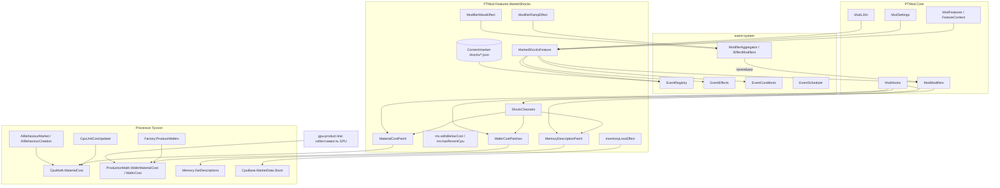
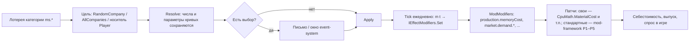
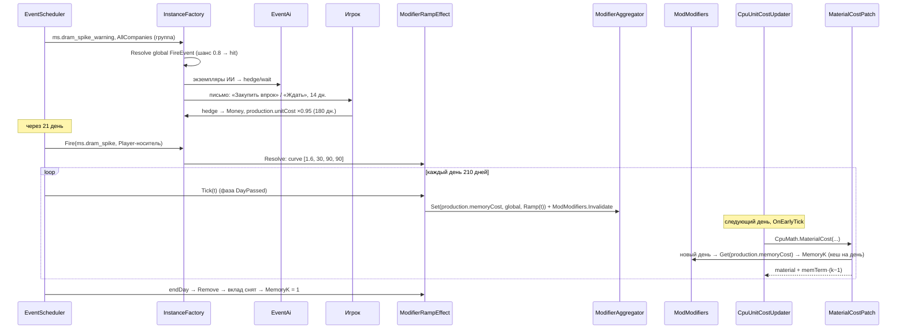
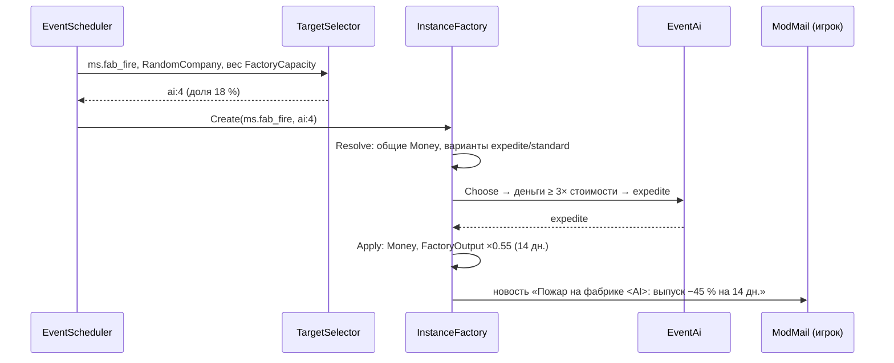
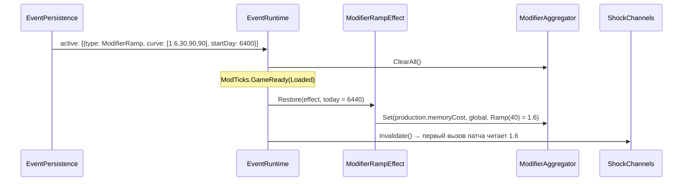

# Design: market-shocks

## Document Information

- **Feature Name**: market-shocks — рыночные шоки: аварии фабрик, скачки цен на память и сырьё, циклы спроса
- **Version**: 0.2
- **Date**: 2026-10-10
- **Author**: Dex719
- **Status**: Draft v0.2 — одобрено к реализации владельцем 2026-10-10
- **Reviewers**: владелец проекта; авторы `event-system`, `mod-framework`, `historical-events`, `gpu-product-line`
- **Related Documents**:
  - [requirements.md](requirements.md), [tasks.md](tasks.md);
  - `.kiro/specs/event-system/design.md` (API движка);
  - `.kiro/specs/mod-framework/design.md` (API `PTMod.Core` v0.2, стандартные каналы P1–P5, таблица патчей F1/F2);
  - `.kiro/steering/context.md`, `.kiro/steering/owner-decisions.md`;
  - `pt-modding/CODEMAP.md` (разделы Hardware, Market, Time/Production).

## Overview

`market-shocks` — фича-пак (`[ModFeature] sealed class MarketShocksFeature : IModFeature`, `DependsOn = { "event-system" }`), пространство имён `PTMod.Features.MarketShocks`. Состоит из:

1. **Контент.** 21 запись JSON (19 шоков, два из них — с письмом-предупреждением) в 6 категориях, `config.json` пака с частотами и пределами каналов.
2. **Типы эффектов.** `ModifierRamp` (трапеция), `ModifierWave` (синус), `InventoryLoss` (списание запасов) — реализации `ITimedEffectHandler` / `IEventEffectHandler`, регистрируются через `EventEffects.Register`.
3. **Каналы.** `production.memoryCost` и `production.waferCost` — глобальные каналы `ModModifiers`, которые объявляет реестр ядра (`core.json`, владелец — `market-shocks`) до `Register` любой фичи; фича их не объявляет. Их читают патчи этой спеки на `CpuMath.MaterialCost`, `ProductionMath.WaferMaterialCost` и (для отображения) `ProductionMath.WaferCost`, `Memory.GetDescriptions`. Ядро закрепило эти цели за `market-shocks` как «формулы фичи» (`ReservedKind.FeatureFormula`, строки F1 и F2 таблицы патчей): патч фичи-владельца принимается, чужой — отклоняется. `WaferMaterialCost` вызывается ещё и производством GPU (`gpu-product-line`), поэтому шоки пластин действуют на GPU.
4. **Предикаты.** `ms.sellsBelowCost`, `ms.hasRecentCpu` в каталоге `ModConditions` (через `EventConditions.Register`, имена с префиксом `ms.`).

Всё остальное делает движок и стандартные каналы `mod-framework`:
- движок: выбор целей, выборы с таймером, письма, журнал, сохранение, агрегатор-провайдер с пределами, заморозка при выключении;
- `mod-framework`: спрос (P3 `PopulationData.GetCurrentSize`), выпуск, себестоимость компании и брак (P2 `Factory.ProduceWafers`), расходы фабрик и скорость исследований (P1 `Modifiers.GetModifier`), рост популярности (P5 `Market.UpdatePopularities`).

Шоки симметричны. Цели фабричных шоков выбираются среди всех компаний с фабрикой пропорционально числу линий. Отраслевые и ценовые шоки действуют на всех. ИИ реагирует существующей логикой игры: поднимает цены, когда себестоимость выше цены (`AIBehaviourMarket.HandleUnprofitableCpus`), или при дефиците (`AIBehaviourMarket.ChangePrices`), и проектирует CPU по новой себестоимости (`AIBehaviourCreation`).

### Design Goals

- **Реалистичная форма.** Шоки нарастают, держатся и спадают; циклы — волнами без скачков.
- **Честность.** Одинаковые правила для игрока и ИИ; память дорожает пропорционально кэшу CPU.
- **Объяснимость.** Предупреждение заранее, причина, точные числа и сроки (через движок).
- **Безопасность.** Пределы каналов, никаких удалений линий, патчи нейтральны при k = 1.
- **Данные, а не код.** Все числа — в JSON пака.
- **Шоки не складываются в бюджет рейтинга.** Пак не пишет в `market.rating.cpu` и пишет в `popularity.gain` только `ms.launch_hype` ×1,2.

### Key Design Decisions

| # | Решение | Почему | Отвергнутые альтернативы |
|---|---|---|---|
| D1 | Падение мощностей — через стандартный `FactoryOutput` (`production.output`, P2 `mod-framework`), а не через снятие линий | Обратимо, переживает загрузку, не трогает `Factory.OperatingCost` и контракты на линии. P2 берёт множитель по `Factory.Company`: авария литейщика бьёт и по CPU его клиентов, а стоимость считается от валового выпуска | `Company.RemoveProductionLines` + `Company.ExpandFactory` (подход из I12): пересчёт `OperatingCost`, возврат линий надо хранить отдельно; при нехватке законтрактованных линий литейщика — штрафы `BusinessHelper.HandleFoundryServicesFines` |
| D2 | Свои глобальные каналы `production.memoryCost` и `production.waferCost` (объявляет реестр ядра, владелец — `market-shocks`); патчи — «формулы фичи», меняют только нужный член формулы | Скачок памяти должен бить по CPU с большим кэшем, а не на ровный процент. `CpuMath.MaterialCost` — единственная точка для ежедневной себестоимости, предпросмотра игрока и проектирования ИИ, и `Cpu.get_RealUnitCost` видит результат (ИИ реагирует ценами). Объявление в ядре снимает зависимость от порядка `Register` фич и закрепляет цели патчей за владельцем | Менять `Memory.UnitCostPerCache` (свойство с `private set` на общих ассетах) — нужно хранить и восстанавливать оригинал, риск «залипания» после сбоя. Канал `production.unitCost` — не различает долю памяти и не виден ИИ в `RealUnitCost`. `DeclareChannel` из `Register` фичи — порядок и конкурирующие патчи третьих фич не определены |
| D3 | Форма шока — трапеция `ModifierRamp`, цикл — синус `ModifierWave` целым числом периодов | Плавный вход и выход; волна начинается и заканчивается на 1,0, поэтому перезапуск цикла бесшовен | Ступенька `ModifierTimed` — резкий скачок цен на 1-й и последний день |
| D4 | Цели фабричных шоков — `RandomCompany` с весом `FactoryCapacity` | Вероятность пропорциональна риску (числу линий), игрок — наравне с ИИ | Только игрок — нечестно и однообразно. Равные шансы — маленькая фабрика страдает так же часто, как гигант |
| D5 | Предупреждение — отдельное событие с выбором подготовки и `FireEvent` (шанс 0,8 / 0,85) | Время подготовиться; неопределённость прогноза; без изменений контракта движка | Поле «warningDays» в определении — меняет контракт `EventDefinition`. Без предупреждения — игрок не может подготовиться |
| D6 | Глобальные события без выбора «несёт» экземпляр игрока (цель `Player`, эффекты `scope: Global`) | Одна запись в журнале и одно письмо-новость, без 14 пустых экземпляров `AllCompanies` | `AllCompanies` для чисто глобального шока — шум в журнале, нагрузка |
| D7 | Интенсивность — `PackOptions.Severity` движка: масштабирует отклонения от 1,0 и суммы | Одна ручка на весь пак, без правки JSON | Отдельные множители в каждом эффекте — сложно настраивать |
| D8 | Пределы каналов пака (`channelLimits`) сужают пределы движка | Защищают от редкого совпадения трёх шоков | Без пределов — землетрясение, скачок и волна дали бы память ×2,4 |
| D9 | Значение канала в патче кешируется на игровой день (`ModTicks.Today`) и сбрасывается по `ModModifiers.ChannelChanged` | `CpuMath.MaterialCost` вызывается тысячи раз в день (себестоимость всех CPU, поиск конструкции ИИ). Кеш по дню совпадает с дневным кешем `ModModifiers` и меняется до `CpuUnitCostUpdater` нового дня; сброс по событию канала покрывает изменения посреди дня (выбор игрока, `ModModifiers.Invalidate`) | Подписка на тик — порядок подписчиков `OnEarlyTick` не определён (CODEMAP: Time Uncertain). Чтение `ModModifiers.Get` на каждый вызов — лишняя работа |
| D10 | Интенсивность — `PackOptions.Severity` 0,5 / 1 / 1,5 / 2 («Хаос»); после масштабирования множитель зажимается пределами пака (`channelLimits`) при `Resolve` | На «Хаосе» пик памяти 1,6 → 2,2 вышел бы за предохранитель канала [0,5; 2,0]; зажим при `Resolve` сохраняет правило «показанное = применённое» и гарантии NFR-5 (выпуск ≥ 40 %) | Зажим только в агрегаторе — письмо обещает ×0,1, канал отдаёт ×0,4 |
| D11 | Новости об ИИ — только по топ-5 по доле рынка (`PackOptions.RivalNewsTopN = 5`), письмо `Low` | Решение владельца; не засоряет почту и дневной лимит писем при частых авариях на 13 ИИ | Новости обо всех — до 13 писем на пожары и «хайпы» в год |
| D12 | Координация с `historical-events`: глобальные случайные шоки имеют условие `not es.activeInCategory(history, scope any)` | Случайный шок не накладывается на исторический (например, DRAM 1988); односторонне, чтобы исторические события оставались авторитетными | Блокировать исторические — ломает календарь; ничего не делать — два шока памяти подряд |

## Architecture

### System Context



### High-Level Architecture



### Используемые сервисы

| Сервис | Для чего |
|---|---|
| `event-system`: `EventRegistry.RegisterPack`, `EventEffects.Register`, `EventConditions.Register`, `IEffectModifiers`, `PackOptions` (`Severity`, `Frequency`, `EventsFile`, `RivalNewsTopN`), предикаты `es.*` | Регистрация пака и расширений, агрегатор |
| `ModFeatures` / `FeatureContext` | `[ModFeature] IModFeature` с `DependsOn = { "event-system" }`; `Patch`, `Param`; `ModFeatures.StateChanged` |
| `ModModifiers` | Каналы объявлены ядром; `HasAny` и `Get` в патчах; `ModModifiers.ChannelChanged` — сброс кеша |
| `ModHooks` | `[ModPatch]` на 4 цели (формулы фичи), `Guard`, самопроверка целей |
| `ModIds` | `IsEventIdAllowed`, `IsPredicateNameAllowed` — проверка префикса `ms` |
| `ModTicks` | `Today` — ключ дневного кеша значения канала |
| `ModContent` | `Content/market-shocks/*.json` (через `event-system`) |
| `ModSettings` | `ParamSpec` интенсивности и частоты, `Changed` |
| `ModL10n` | Ключи `ms.*` |
| `ModLog`, `ModSelfCheck` | `[PTMod] [market-shocks] …`, вклад в самопроверку |

`ModSave` пак не использует: всё состояние — экземпляры и `AppliedEffect` с параметрами кривых в секции `event-system`.

## Components and Interfaces

Пространство имён — `PTMod.Features.MarketShocks`. Без возможностей C# 6+.

### Фича

```csharp
[ModFeature]
public sealed class MarketShocksFeature : IModFeature
{
    public string Id { get { return "market-shocks"; } }
    public string[] DependsOn { get { return new[] { "event-system" }; } }
    public bool EnabledByDefault { get { return true; } }
    public bool SupportsHotToggle { get { return true; } }
    public string NameKey { get { return "ms.feature.name"; } }
    public string DescriptionKey { get { return "ms.feature.desc"; } }
    public void Register(FeatureContext ctx);   // см. ниже
    public void OnEnabled();                    // PackOptions → EventRegistry; ShockChannels.Invalidate()
    public void OnDisabled();                   // ShockChannels.Invalidate(); заморозку пака делает event-system; патчи снимает ядро
}
```

`Register(ctx)` (каналы `production.memoryCost` и `production.waferCost` не объявляются: их объявило ядро до `Register`; `ModModifiers.DeclareChannel` не вызывается):
1. `EventEffects.Register("ModifierRamp", ...)`, `EventEffects.Register("ModifierWave", ...)`, `EventEffects.Register("InventoryLoss", ...)`;
2. `EventConditions.Register("ms.sellsBelowCost", "market-shocks", ...)`, `EventConditions.Register("ms.hasRecentCpu", "market-shocks", ...)`;
3. `EventRegistry.RegisterPack("market-shocks", "market-shocks", options)` с `options.SettingsFeatureId = "market-shocks"`, `options.EventsFile = "shocks"`, `options.RivalNewsTopN = 5`, `options.Severity` и `options.Frequency` из параметров;
4. `ctx.Patch(typeof(MaterialCostPatch))`, `ctx.Patch(typeof(WaferCostPatches))`, `ctx.Patch(typeof(MemoryDescriptionPatch))` — все цели закреплены за этой фичей как `FeatureFormula`;
5. `ctx.Param`: `intensity` (Float 0.5…2.0, шаг 0.5, по умолчанию 1; подписи «Мягко» / «Обычно» / «Жёстко» / «Хаос»), `frequency` (Float 0.5…1.5, шаг 0.5, по умолчанию 1);
6. подписка на `ModModifiers.ChannelChanged` (сброс кеша `ShockChannels` для двух своих каналов) и `ModTicks.GameReady` (`ShockChannels.Invalidate()` после загрузки).

### Чистые кривые и формулы (тестируются без Unity)

```csharp
public static class ShockCurves
{
    // r(t) ∈ [0,1]; t — дни от начала
    public static float Trapezoid(int t, int rampIn, int hold, int rampOut);
    public static float Ramp(int t, float peak, int rampIn, int hold, int rampOut, float severity);   // 1 + (peak-1)·r·s
    public static float Wave(int t, float amplitude, int period, float phaseRad, float severity);       // 1 + A·s·sin(2πt/P + φ)
    public static int TotalDays(int rampIn, int hold, int rampOut);
    public static float MemoryTerm(int l1, int l2, int l3, float unitCostPerCache, float cacheCostReduction);
}
```

### Типы эффектов

```csharp
public sealed class ModifierRampEffect : ITimedEffectHandler, ICurveEffectHandler
{
    public string Type { get { return "ModifierRamp"; } }
    // params: channel, peak, rampIn, hold, rampOut, scope ("Target"|"Global"), scalable (true)
    // Resolve: peak' = clamp(1 + (peak − 1)·Severity, LimitMin(channel), LimitMax(channel)); curve = [peak', rampIn, hold, rampOut]; value = peak'; durationDays = total
    // Tick/Restore: ctx.Contributions.Set(e, e.channel, e.companyKey, ShockCurves.Ramp(today - e.startDay, ...))
    // Remove: ctx.Contributions.Clear(e)
}

public sealed class ModifierWaveEffect : ITimedEffectHandler, ICurveEffectHandler
{
    public string Type { get { return "ModifierWave"; } }
    // params: channel, amplitude, period, cycles (1), phase (0 | 180 | "random"), phaseGroup, scope, scalable
    // Resolve: фаза бросается один раз на (instanceId, phaseGroup) из ctx.Rng; A' = A·Severity (пик 1 + A' зажимается пределами канала);
    //          curve = [A', period, phaseRad]
}

public sealed class InventoryLossEffect : IEventEffectHandler
{
    public string Type { get { return "InventoryLoss"; } }
    // params: fraction (число или [lo,hi]), scalable
    // Resolve: f бросается; для каждого CPU с Manufacturer == цель, Base == null, !IsRetired:
    //          lost_i = floor(Stock_i · f); curve = [saveId_1, lost_1, saveId_2, lost_2, ...]; value = Σ lost_i
    // Apply:   Stock_i -= min(lost_i, Stock_i) по CpuDataProvider.GetCpu(saveId)
}
```

Отображение в журнале (`Describe`):

| Тип | Ключ | Аргументы |
|---|---|---|
| `ModifierRamp` | `ms.fx.ramp` | канал; пик в % (`+60 %`); `rampIn`; `hold`; `rampOut`; дата окончания |
| `ModifierWave` | `ms.fx.wave` | канал; амплитуда `±15 %`; период в годах; «сначала рост» / «сначала спад» |
| `InventoryLoss` | `ms.fx.inventory` | единиц; стоимость по `Cpu.UnitCost` |

Текущее значение кривой для вкладки «Активные эффекты» отдаёт `ICurveEffectHandler.ValueAt(effect, today)` — по тем же `ShockCurves` от сохранённых параметров.

### Предикаты

```csharp
public static class ShockPredicates
{
    // ms.sellsBelowCost: priceRatio = 0.95, minShare = 0.05 (параметры на верхнем уровне узла ModConditions)
    public static bool SellsBelowCost(JsonObject args, ConditionContext ctx);
    // ms.hasRecentCpu: maxAgeYears = 1
    public static bool HasRecentCpu(JsonObject args, ConditionContext ctx);
}
```

`ms.sellsBelowCost` перебирает CPU подлежащего (`CpuDataProvider.Instance.GetAllCpus()`, `Company == ctx.Subject`). Истина, если у какого-то CPU `SellOnMarket && IsReleased && !IsRetired && SoldLastDay > 0 && Price < Cpu.get_RealUnitCost() · priceRatio`, и `MarketDataProvider.Instance.MarketShare(subject) ≥ minShare`. `ms.hasRecentCpu`: `ctx.Today.Year − CpuBase.Year ≤ maxAgeYears` у CPU на рынке. Предикаты регистрируются под префиксом фичи (`ModIds.IsPredicateNameAllowed("market-shocks", "ms.sellsBelowCost")`); в `shocks.json` их тип пишется с префиксом.

### Каналы и патчи

```csharp
internal static class ShockChannels
{
    public const string MemoryCost = "production.memoryCost";
    public const string WaferCost  = "production.waferCost";
    // дневной кеш: при смене ModTicks.Today — HasAny ? Get(channel, default(ModifierContext)) : 1
    public static float MemoryK { get; }
    public static float WaferK { get; }
    public static void Invalidate();   // вкл/выкл фичи, загрузка (GameReady), событие ModModifiers.ChannelChanged для двух своих каналов
}

internal static class MaterialCostPatch
{
    // CpuMath.MaterialCost(IPackage package, Memory memory, ProcessNode processNode, int l1Cache, int l2Cache, int l3Cache, float failureRate)
    [ModPatch(typeof(CpuMath), "MaterialCost", PatchKind.Postfix)]
    static void Postfix(Memory memory, ProcessNode processNode, int l1Cache, int l2Cache, int l3Cache, ref float __result);
}

internal static class WaferCostPatches
{
    [ModPatch(typeof(ProductionMath), "WaferMaterialCost", PatchKind.Postfix)]
    static void PostfixMaterial(ref float __result);
    // ProductionMath.WaferCost(ICompany company, float yieldRate, float waferSizeMultiplier) — только отображение (ProcessNode.GetDescriptions)
    [ModPatch(typeof(ProductionMath), "WaferCost", PatchKind.Postfix, Optional = true)]
    static void PostfixDisplay(float yieldRate, float waferSizeMultiplier, ref float __result);
}

internal static class MemoryDescriptionPatch
{
    [ModPatch(typeof(Memory), "GetDescriptions", PatchKind.Postfix, Optional = true)]
    static void Postfix(Memory __instance, List<string> __result);
}
```

## Каналы ModModifiers, которые читает пак

Оба канала объявлены в реестре ядра (`Content/mod-framework/core.json`, поле `owner = "market-shocks"`, 27 записей реестра) до `Register` любой фичи. Эта фича их не объявляет; `ModSelfCheck` проверяет `ModModifiers.IsDeclared` для обоих.

| Канал | Область (`ChannelSpec` ядра) | Объявляет | Пишут | Читает (патч) | Пределы |
|---|---|---|---|---|---|
| `production.memoryCost` | `Global = true`, `Min` 0.5, `Max` 2.0 | ядро (`core.json`) | эффекты `ModifierRamp` / `ModifierWave` (через провайдер `event-system`), `historical-events` | `MaterialCostPatch`, `MemoryDescriptionPatch` | предохранитель канала [0,5; 2,0]; вклад событий пака — те же (`channelLimits`) |
| `production.waferCost` | `Global = true`, `Min` 0.6, `Max` 2.0 | ядро (`core.json`) | `ModifierRamp`, `historical-events` | `WaferCostPatches` | [0,6; 2,0] |

Остальные каналы, в которые пишет пак, — стандартные (`production.output`, `production.unitCost`, `factory.operatingCost`, `cpu.failureRate`, `research.speed`, `market.demand.<segment>`, `popularity.gain`); их читают патчи ядра.

## Патчи Harmony

| Цель (`Class.Method` игры) | Тип | Что меняет | Порядок / конфликты |
|---|---|---|---|
| `CpuMath.MaterialCost` | postfix | `__result += memTerm · (MemoryK − 1)`. Выход сразу при `MemoryK == 1`; при `memory == null`, `processNode == null`, `CacheCostReduction ≤ 0` или нечисловом результате — без изменений | Формула фичи (`ReservedKind.FeatureFormula`, владелец `market-shocks`, строка F1 таблицы патчей ядра): принимается только от этой фичи. Вызывающие: `CpuUnitCostUpdater.UpdateUnitCost`, `CreatorCpu`, `AIBehaviourCreation`. Канал `production.unitCost` `mod-framework` применяет позже, в `Factory.ProduceWafers` (P2), к уже изменённому `Cpu.UnitCost` — вклады перемножаются |
| `ProductionMath.WaferMaterialCost` | postfix | `__result *= WaferK` | Формула фичи (F1). Вызывающие: `Factory.ProduceWafers` (расход дня), `CpuMath.RealUnitCost` (цена для ИИ и автоматики контрактов) и производство GPU (`gpu-product-line` вызывает формулу напрямую) |
| `ProductionMath.WaferCost` | postfix, `Optional` | `__result += 2000 · waferSizeMultiplier · (WaferK − 1) / yieldRate` (при `yieldRate > 0`) | Формула фичи (F2). Только отображение: вызывающий — `ProcessNode.GetDescriptions` |
| `Memory.GetDescriptions` | postfix, `Optional` | При `MemoryK ≠ 1` и `__result.Count ≥ 3` заменяет `__result[2]` на `L("ms.ui.cache_cost", UnitCostPerCache · MemoryK, MemoryK)` | Формула фичи (F2). Только отображение. Замена по индексу: русификатор переводит литерал «Cache Cost:» в DLL |

Тела патчей обёрнуты в `ModHooks.Guard`: при исключении `__result` не меняется. Порог сбоев фичи — у фреймворка (`hooks.faultThreshold`). Необязательные (`Optional`) патчи при сбое не делают фичу `Unavailable`. При выключении фичи ядро снимает все её патчи — формулы возвращаются к ванильным (эквивалентно k = 1).

## Подписки на события

| Событие | Обработчик | Защиты |
|---|---|---|
| Регистрация фич `mod-framework` (`IModFeature.Register`, после `event-system` по `DependsOn`) | `MarketShocksFeature.Register` | `event-system` недоступна → фича `Unavailable` (правило реестра фич), патчи не ставятся |
| `IModFeature.OnEnabled` / `OnDisabled`, `ModSettings.Changed("market-shocks", …)` | Пересчёт `PackOptions`; `ShockChannels.Invalidate()` | Выключение пака: `event-system` замораживает эффекты пака по `PackOptions.SettingsFeatureId` и `ModFeatures.StateChanged`; патчи фичи снимает ядро → `MemoryK = WaferK = 1` |
| `ModModifiers.ChannelChanged("production.memoryCost" \| "production.waferCost")` | `ShockChannels.Invalidate()` | Изменение вклада посреди дня (выбор игрока, `ModModifiers.Invalidate`) |
| `ModTicks.GameReady(Loaded)` | `ShockChannels.Invalidate()` | После `Restore` эффектов движком первый вызов патча читает актуальное значение |
| Загрузка сейва (`event-system` → `Restore` эффектов) | `ModifierRampEffect.Restore` / `ModifierWaveEffect.Restore` | Значение кривой на текущий день из `AppliedEffect.curve` |

Своих подписок на `DateController` у пака нет: ежедневные `Tick` вызывает движок, а патчи сами обновляют дневной кеш по `ModTicks.Today`.

## Data Models

### Параметры кривых в `AppliedEffect.curve`

| Тип | `curve` | `value` | `startDay` / `endDay` |
|---|---|---|---|
| `ModifierRamp` | `[peak', rampIn, hold, rampOut]` (peak' — после интенсивности) | peak' | старт / старт + `rampIn + hold + rampOut` |
| `ModifierWave` | `[A', period, phaseRad]` | A' | старт / старт + `period · cycles` |
| `InventoryLoss` | `[saveId_1, lost_1, saveId_2, lost_2, ...]` | Σ lost | разовый |

Сохранение — в секции `event-system` `ModSave`. Своей секции у пака нет.

### config.json пака

`mod/src/PTMod/Content/market-shocks/config.json`:

```json
{
  "schema": 1,
  "categories": [
    { "id": "ms.supply",   "dailyChance": 0.0045, "minGapDays": 60,  "maxActive": 2 },
    { "id": "ms.industry", "dailyChance": 0.0018, "minGapDays": 365, "maxActive": 1 },
    { "id": "ms.price",    "dailyChance": 0.006,  "minGapDays": 240, "maxActive": 1 },
    { "id": "ms.demand",   "dailyChance": 0.003,  "minGapDays": 540, "maxActive": 1 },
    { "id": "ms.trade",    "dailyChance": 0.004,  "minGapDays": 90,  "maxActive": 2 },
    { "id": "ms.cycle",    "dailyChance": 0.0,    "minGapDays": 0,   "maxActive": 2 }
  ],
  "channelLimits": [
    { "channel": "production.memoryCost",  "min": 0.5, "max": 2.0 },
    { "channel": "production.waferCost",   "min": 0.6, "max": 2.0 },
    { "channel": "market.demand.*",        "min": 0.6, "max": 1.6 },
    { "channel": "production.output",      "min": 0.4, "max": 1.5 },
    { "channel": "production.unitCost",    "min": 0.7, "max": 1.6 },
    { "channel": "factory.operatingCost",  "min": 0.7, "max": 1.8 }
  ]
}
```

### Примеры записей `shocks.json`

Условия — синтаксис `ModConditions` (параметры на верхнем уровне узла, `all` / `any` / `not`).

Фабричный шок с выбором (`ms.fab_fire`):

```json
{
  "id": "ms.fab_fire",
  "category": "ms.supply",
  "title": { "key": "ms.fab_fire.title" }, "text": { "key": "ms.fab_fire.text" }, "cause": { "key": "ms.fab_fire.cause" },
  "trigger": { "type": "DailyChance" },
  "conditions": { "type": "es.hasRevenueHistory" },
  "weight": 10, "cooldownDays": 1095, "important": true, "notifyPlayer": true,
  "targets": { "type": "RandomCompany", "weighting": "FactoryCapacity",
               "filter": { "all": [ { "type": "es.hasFab" },
                                    { "not": { "type": "es.activeInCategory", "category": "ms.supply" } } ] } },
  "timerDays": 3, "defaultChoice": "standard",
  "effects": [
    { "type": "Money", "params": { "direction": "Spend", "origin": "Construction", "revenueFraction": [0.02, 0.04], "min": 100000, "max": 40000000, "scalable": true } }
  ],
  "choices": [
    { "id": "expedite", "textKey": "ms.fab_fire.expedite", "aiMinCashMultiple": 3,
      "effects": [
        { "type": "Money", "params": { "direction": "Spend", "origin": "Construction", "revenueFraction": [0.02, 0.03], "min": 50000, "max": 20000000, "scalable": true } },
        { "type": "FactoryOutput", "params": { "multiplier": 0.55, "scalable": true }, "durationDays": 14 } ] },
    { "id": "standard", "textKey": "ms.fab_fire.standard",
      "effects": [ { "type": "FactoryOutput", "params": { "multiplier": 0.55, "scalable": true }, "durationDays": 35 } ] }
  ]
}
```

Предупреждение и скачок цены памяти:

```json
{
  "id": "ms.dram_spike_warning",
  "category": "ms.price",
  "title": { "key": "ms.dram_spike_warning.title" }, "text": { "key": "ms.dram_spike_warning.text" }, "cause": { "key": "ms.dram_spike_warning.cause" },
  "trigger": { "type": "DailyChance" },
  "conditions": { "all": [ { "type": "dateAtLeast", "year": 1975 },
                           { "not": { "type": "es.activeInCategory", "category": "history", "scope": "any" } } ] },
  "weight": 10, "cooldownDays": 1095,
  "targets": { "type": "AllCompanies", "filter": { "type": "cpuOnMarket" } },
  "timerDays": 14, "defaultChoice": "wait",
  "effects": [
    { "type": "FireEvent", "params": { "eventId": "ms.dram_spike", "delayDays": 21, "chance": 0.8, "scope": "Global", "target": "Player" } }
  ],
  "choices": [
    { "id": "hedge", "textKey": "ms.dram_spike_warning.hedge", "aiMinCashMultiple": 4,
      "effects": [
        { "type": "Money", "params": { "direction": "Spend", "origin": "Factories", "revenueFraction": [0.02, 0.03], "min": 30000, "max": 15000000, "scalable": true } },
        { "type": "ModifierTimed", "params": { "channel": "production.unitCost", "multiplier": 0.95 }, "durationDays": 180 } ] },
    { "id": "wait", "textKey": "ms.dram_spike_warning.wait", "effects": [] }
  ]
},
{
  "id": "ms.dram_spike",
  "category": "ms.price",
  "title": { "key": "ms.dram_spike.title" }, "text": { "key": "ms.dram_spike.text" }, "cause": { "key": "ms.dram_spike.cause" },
  "trigger": { "type": "Manual" },
  "targets": { "type": "Player" },
  "effects": [
    { "type": "ModifierRamp", "params": { "channel": "production.memoryCost", "peak": 1.6, "rampIn": 30, "hold": 90, "rampOut": 90, "scope": "Global", "scalable": true } }
  ]
}
```

Цикл спроса (общая фаза для сегментов):

```json
{
  "id": "ms.silicon_cycle",
  "category": "ms.cycle",
  "title": { "key": "ms.silicon_cycle.title" }, "text": { "key": "ms.silicon_cycle.text" }, "cause": { "key": "ms.silicon_cycle.cause" },
  "trigger": { "type": "Condition", "checkEvery": "Month" },
  "conditions": { "type": "dateAtLeast", "year": 1980 },
  "cooldownDays": 1825,
  "targets": { "type": "Player" },
  "effects": [
    { "type": "ModifierWave", "params": { "channel": "market.demand.highend",    "amplitude": 0.08, "period": 1825, "phase": "random", "phaseGroup": "silicon", "scope": "Global", "scalable": true } },
    { "type": "ModifierWave", "params": { "channel": "market.demand.midrange",   "amplitude": 0.08, "period": 1825, "phase": "random", "phaseGroup": "silicon", "scope": "Global", "scalable": true } },
    { "type": "ModifierWave", "params": { "channel": "market.demand.lowend",     "amplitude": 0.08, "period": 1825, "phase": "random", "phaseGroup": "silicon", "scope": "Global", "scalable": true } },
    { "type": "ModifierWave", "params": { "channel": "market.demand.industries", "amplitude": 0.05, "period": 1825, "phase": "random", "phaseGroup": "silicon", "scope": "Global", "scalable": true } }
  ]
}
```

Проверки типов пака при загрузке (поверх проверок движка):

| Тип | Ключи | Диапазоны |
|---|---|---|
| `ModifierRamp` | `channel`, `peak`, `rampIn`, `hold`, `rampOut` | `0.3 ≤ peak ≤ 3`; `rampIn, rampOut ≥ 1`; `hold ≥ 0`; `1 ≤ total ≤ 1500`; канал известен `ModModifiers` |
| `ModifierWave` | `channel`, `amplitude`, `period`, `cycles` (1), `phase`, `phaseGroup` | `0 ≤ A ≤ 0.5`; `30 ≤ P ≤ 3650`; `1 ≤ cycles ≤ 3`; `phase ∈ {0, 180, "random"}` |
| `InventoryLoss` | `fraction` | `0 ≤ f ≤ 0.5` |

### Каталог шоков (баланс)

QR — квартальная выручка цели; суммы `min`/`max` × инфляция I. Все эффекты пака `scalable` (интенсивность). Для `ModifierRamp` указано «пик (нарастание / плато / спад, дни)». Предикаты условий: `dateAtLeast` / `dateBefore` / `cpuOnMarket` — каталог `mod-framework` (имена без точки); `es.hasRevenueHistory` / `es.hasFab` / `es.activeInCategory` — `event-system`; `ms.sellsBelowCost` / `ms.hasRecentCpu` — этот пак.

**Координация К1 (с `historical-events`).** К условиям `conditions` шоков №5–8, №10–12, №14, №16–18 (глобальные случайные: отраслевые, ценовые, рецессия и бумы) добавляется `{ "not": { "type": "es.activeInCategory", "category": "history", "scope": "any" } }`: пока идёт историческое событие категории `history` у любой компании или с глобальным эффектом, такой шок не выбирается (пример — условие `ms.dram_spike_warning` ниже). Шоки №9 и №15 (Manual) идут от предупреждений, №13 и №19 (циклы) и №1–4, №20–21 (инциденты у компаний, торговые) условия К1 не получают.

| # | id | Категория / триггер | Цель | Условия | weight / откат | Выбор: таймер / по умолч. | Эффекты |
|---|---|---|---|---|---|---|---|
| 1 | `ms.fab_fire` | `ms.supply` / DailyChance | RandomCompany, вес `FactoryCapacity`, фильтр `es.hasFab` и `not es.activeInCategory(ms.supply)` | `es.hasRevenueHistory` | 10 / 1095 | 3 / `standard`, important | Общие: Money −[2–4 %] QR (100k–40M, `Construction`). `expedite`: −[2–3 %] QR (50k–20M) + `FactoryOutput ×0.55` 14 дн. `standard`: `FactoryOutput ×0.55` 35 дн. ИИ: `expedite` при деньгах ≥ 3× стоимости |
| 2 | `ms.cleanroom_contamination` | `ms.supply` / DailyChance | как №1 | `es.hasRevenueHistory` | 8 / 1095 | — | `InventoryLoss` f ∈ [0,08; 0,15]; `ModifierTimed cpu.failureRate ×1.4` 45 дн. |
| 3 | `ms.grid_failure` | `ms.supply` / DailyChance | как №1 | — | 8 / 730 | — | `FactoryOutput ×0.7` 10 дн.; `ModifierTimed factory.operatingCost ×1.15` 30 дн. |
| 4 | `ms.litho_breakdown` | `ms.supply` / DailyChance | как №1 | `es.hasRevenueHistory` | 8 / 1095 | 5 / `wait`, important | `rent`: −[1,5–2,5 %] QR (60k–15M, `Construction`) + `FactoryOutput ×0.85` 20 дн.; `wait`: `FactoryOutput ×0.7` 45 дн. ИИ: `rent` при ≥ 3× |
| 5 | `ms.earthquake` | `ms.industry` / DailyChance | AllCompanies, фильтр `es.hasFab` | К1 | 3 / 3650 | — | На компанию: `FactoryOutput ×0.85` 21 дн.; Money −[0,5–1 %] QR (50k–20M, `Construction`). Глобально: `ModifierRamp production.memoryCost` 1,3 (15/30/60) |
| 6 | `ms.photoresist_shortage` | `ms.industry` / DailyChance | AllCompanies, `es.hasFab` | `dateAtLeast` 1975, К1 | 5 / 2190 | — | На компанию: `production.unitCost ×1.10` 90 дн.; `FactoryOutput ×0.93` 90 дн. |
| 7 | `ms.logistics_crunch` | `ms.industry` / DailyChance | AllCompanies, `cpuOnMarket` | `dateAtLeast` 1985, К1 | 4 / 2190 | — | На компанию: `production.unitCost ×1.06` 120 дн. |
| 8 | `ms.dram_spike_warning` | `ms.price` / DailyChance | AllCompanies, `cpuOnMarket` | `dateAtLeast` 1975, К1 | 10 / 1095 | 14 / `wait` | Глобально: `FireEvent ms.dram_spike` через 21 дн., шанс 0,8. `hedge`: −[2–3 %] QR (30k–15M, `Factories`) + `production.unitCost ×0.95` 180 дн.; `wait`: —. ИИ: `hedge` при ≥ 4× |
| 9 | `ms.dram_spike` | `ms.price` / Manual | носитель Player | — | — | — | Глобально: `ModifierRamp production.memoryCost` 1,6 (30/90/90) |
| 10 | `ms.dram_glut` | `ms.price` / DailyChance | носитель Player | `dateAtLeast` 1975, К1 | 8 / 1095 | — | Глобально: `ModifierRamp production.memoryCost` 0,7 (30/120/90) |
| 11 | `ms.wafer_shortage` | `ms.price` / DailyChance | носитель Player | К1 | 8 / 1095 | — | Глобально: `ModifierRamp production.waferCost` 1,6 (20/60/60) |
| 12 | `ms.energy_crisis` | `ms.price` / DailyChance | носитель Player | `dateAtLeast` 1973, К1 | 5 / 2190 | — | Глобально: `ModifierRamp factory.operatingCost` 1,25 (30/90/60) |
| 13 | `ms.memory_cycle` | `ms.cycle` / Condition (раз в месяц) | носитель Player | `dateAtLeast` 1976 | — / 1460 | — | Глобально: `ModifierWave production.memoryCost` A 0,15, P 1460, фаза 0 или 180° |
| 14 | `ms.recession_warning` | `ms.demand` / DailyChance | AllCompanies, `cpuOnMarket` | `dateAtLeast` 1974, К1 | 6 / 2555 | 21 / `hold` | Глобально: `FireEvent ms.recession` через 45–75 дн., шанс 0,85. `cut_costs`: `factory.operatingCost ×0.92` и `research.speed ×0.9` на 365 дн.; `hold`: —. ИИ: веса 1 / 1 |
| 15 | `ms.recession` | `ms.demand` / Manual | носитель Player | — | — | — | Глобально: `ModifierRamp` `market.demand.highend` 0,8; `midrange` 0,8; `lowend` 0,85; `industries` 0,9 (60/180/120) |
| 16 | `ms.pc_boom` | `ms.demand` / DailyChance | носитель Player | `dateAtLeast` 1981, `dateBefore` 2006, К1 | 5 / 2920 | — | Глобально: `ModifierRamp` `midrange` 1,25; `lowend` 1,2 (60/240/120) |
| 17 | `ms.server_boom` | `ms.demand` / DailyChance | носитель Player | `dateAtLeast` 1990, К1 | 4 / 2920 | — | Глобально: `ModifierRamp` `highend` 1,3 (45/180/90) |
| 18 | `ms.embedded_boom` | `ms.demand` / DailyChance | носитель Player | `dateAtLeast` 1978, К1 | 4 / 2920 | — | Глобально: `ModifierRamp` `industries` 1,3 (60/240/120) |
| 19 | `ms.silicon_cycle` | `ms.cycle` / Condition (раз в месяц) | носитель Player | `dateAtLeast` 1980 | — / 1825 | — | Глобально: `ModifierWave` спрос High/Mid/Low A 0,08, Industries A 0,05, P 1825, общая фаза |
| 20 | `ms.dumping_complaint` | `ms.trade` / DailyChance | RandomCompany, вес `MarketShare`, фильтр `ms.sellsBelowCost` | — | 6 / 1095 | 14 / `accept_duty`, important | `accept_duty`: `production.unitCost ×1.12` 365 дн.; `lobby`: −[2–3 %] QR (50k–20M, `Fines`) + с шансом 0,4 `production.unitCost ×1.12` 365 дн. ИИ: `lobby` при ≥ 3× |
| 21 | `ms.launch_hype` | `ms.trade` / DailyChance | RandomCompany, вес `MarketShare`, фильтр `ms.hasRecentCpu` | — | 8 / 730 | — | `Popularity +0.10` (новейший CPU); `popularity.gain ×1.2` 60 дн. (единственный вклад пака в `popularity.gain`); новость игроку (для ИИ — только топ-5 по доле рынка) |

Итого 19 шоков: №8 и №9, №14 и №15 — пары «предупреждение → удар»; 21 запись.

## Формулы и баланс

### Частоты категорий

Ожидаемое число срабатываний категории в год с учётом паузы `minGapDays` (формула лотереи движка):

```
rate_year ≈ 365 / (1 / (dailyChance · F) + minGapDays)
```

| Категория | dailyChance | minGapDays | ≈ в год | Ограничения сверху |
|---|---|---|---|---|
| `ms.supply` | 0,0045 | 60 | 1,29 | откаты на компанию 730–1095 не ограничивают (много компаний) |
| `ms.industry` | 0,0018 | 365 | 0,40 | откаты 2190–3650 (Σ ≈ 0,6/год) |
| `ms.price` | 0,006 | 240 | 0,90 → ≈ 0,7 после откатов | откаты 1095/1095/1095/2190 (Σ ≈ 1,2/год) |
| `ms.demand` | 0,003 | 540 | 0,42 → ≈ 0,4 | откаты 2555/2920×3 (Σ ≈ 0,5/год), годы бумов |
| `ms.trade` | 0,004 | 90 | 1,07 | только при наличии подходящей цели |

Игрок становится целью фабричного шока с вероятностью, равной его доле мощностей. При доле 20 % это ≈ 0,26 инцидента в год, остальное — новости о соперниках. Точные значения подтверждает симулятор баланса (TSK-015).

### Себестоимость: член памяти

Формула игры `CpuMath.MaterialCost`:

```
Yc       = 1 − clamp(failureRate, 0, 1)      (0 → 0.01; MathHelper.ReversePercentageScale)
material = package.BaseUnitCost · Yc + memTerm
memTerm  = (2.35·l1 + l2/1.25 + l3) · memory.UnitCostPerCache / processNode.CacheCostReduction
```

Патч: `material' = material + memTerm · (k_mem − 1)`. Ежедневно `CpuUnitCostUpdater.UpdateUnitCost` записывает результат в `Cpu.UnitCost`. Оттуда он идёт:
- в расход производства `Factory.ProduceWafers`: `cost += UnitCost · gross`, где P2 `mod-framework` дополнительно умножает `UnitCost` на `production.unitCost` компании;
- в `Cpu.get_RealUnitCost` → `CpuMath.RealUnitCost`, которыми пользуются ИИ и автоматика контрактов.

Примеры (данные `Memory`: DRAM `UnitCostPerCache` 20, DDR5 1; `ProcessNode` 45 нм `CacheCostReduction` 3,6; `Package` PGA 1990 `BaseUnitCost` 40, LGA 2015 — 15):

| Случай | memTerm | material база | k = 1,6 | Рост |
|---|---|---|---|---|
| 1988: L1 = 2, DRAM, CCR = 1, PGA, брак 10 % | 94 | 36 + 94 = 130 | 186,4 | +43 % |
| 2010: L1 = 16, L2 = 64, L3 = 256, DDR5, 45 нм, LGA 2015, брак 10 % | 344,8 / 3,6 = 95,8 | 13,5 + 95,8 = 109,3 | 166,8 | +53 % |
| Без кэша (l1 = l2 = l3 = 0) | 0 | 36 | 36 | 0 % |

### Себестоимость: материал пластины

Игра: `ProductionMath.WaferMaterialCost(m) = 2000 · m`. В `Factory.ProduceWafers` расход дня `+= WaferMaterialCost(1.0) · 50 · lines / 30`, в `CpuMath.RealUnitCost` слагаемое `WaferMaterialCost(1.0) · 50`. Патч: `× k_wafer`. Одна линия в день: 3 333 → 5 333 при k = 1,6. Доля пластины в себестоимости выше в раннюю эпоху (малые кэши и кристаллы), поэтому дефицит пластин сильнее бьёт по 1970–80-м.

### Кривые

```
Trapezoid(t):  t < rampIn                    → t / rampIn
               t < rampIn + hold             → 1
               t < rampIn + hold + rampOut   → 1 − (t − rampIn − hold) / rampOut
               иначе                         → 0 (эффект закрыт движком по endDay)
Ramp(t)  = 1 + (peak − 1) · Trapezoid(t) · s
Wave(t)  = 1 + A · s · sin(2π · t / P + φ),  φ ∈ {0, π}
s — интенсивность (0.5 / 1 / 1.5 / 2 «Хаос»); t = today − startDay
peak' = clamp(1 + (peak − 1)·s, LimitMin(channel), LimitMax(channel))     // при Resolve, ниже по тексту
```

Значение кривой передаётся в агрегатор `event-system` (`IEffectModifiers.Set`). Агрегатор перемножает его с другими вкладами, ограничивает пределами из `config.json` и отдаёт через провайдер `ModModifiers`.

**Интенсивность и пределы.** Пик (или амплитуда) масштабируется при `Resolve` и сразу зажимается пределом канала из `channelLimits` пака, чтобы письмо, журнал и канал показывали одно число. Таблица для скачка памяти (пик 1,6, предел [0,5; 2,0]):

| Интенсивность | s | Пик до зажима | Пик после зажима |
|---|---|---|---|
| Мягко | 0,5 | 1,30 | 1,30 |
| Обычно | 1 | 1,60 | 1,60 |
| Жёстко | 1,5 | 1,90 | 1,90 |
| Хаос | 2 | 2,20 | 2,00 («ограничено») |

Пожар (`FactoryOutput ×0,55`, предел `production.output` [0,4; 1,5]): «Хаос» даёт 1 + (0,55 − 1)·2 = 0,10 → 0,40. Деньги масштабируются только `× s` (без зажима, но с границами `min`/`max` эффекта).

### Спрос

Канал `market.demand.<segment>` (P3 `mod-framework` на `PopulationData.GetCurrentSize`). Игра считает размер сегмента так: `size = RoundToInt(BaseSize · Lerp(mA, mB, t))`, дневные покупатели = `size / 365` (`Market.Population.UpdateCurrentData`). Множитель умножает размер. Пример: High End 1991, BaseSize 4 000 000, множители 1990-х 7 → 9 → ≈ 28,8 млн в год; рецессия на плато ×0,8 → ≈ 23 млн.

### Расходы фабрик

Канал `factory.operatingCost` (P1 `mod-framework`: `Modifiers.GetModifier`, тип 1). Игра (`Factory.SpendOperationCost`): `LastCost = (OperatingCost · u + 0.1 · OperatingCost) · m`, `OperatingCost = 358 884 · L · Modifiers.GetModifier(1, c) · m`, списание `LastCost / 30` в день. На 51-мм пластинах `m = 0,25` (применяется дважды), поэтому в 1970-х ×1,25 энергокризиса — это десятки тысяч долларов в месяц, а не миллионы.

### Деньги

По формуле движка: `round_to_1000(clamp(f · QR, min · I, max · I) · s)`. Пример пожара (1995, I ≈ 4,0, QR $60M): общие −$1,8M (f = 0,03) + `expedite` −$1,5M (f = 0,025) → итого −$3,3M и 14 дней ×0,55 против 35 дней ×0,55 у `standard`.

### Оценка ущерба (обычная интенсивность)

| Шок | Типичный ущерб для цели |
|---|---|
| Пожар, `standard` | 45 % выпуска × 35 дн. ≈ 4,3 % годового выпуска при полной стоимости производства + 2–4 % QR + возможные штрафы OEM (`FinePerUnit` = 2 × оплата за недопоставку, `ContractSeller.SellContracts`) |
| Скачок памяти | себестоимость +30–55 % на ~5 месяцев у всех; маржа сжимается, ИИ поднимает цены шагами +$5 (`AIBehaviourMarket.HandleUnprofitableCpus`) |
| Рецессия | −10…−20 % покупателей на ~6 месяцев плато; склады растут, автоматика производства (`ProductionAutomation`) снижает план |
| Демпинговая пошлина | расход производства +12 % на год у нарушителя |

Ограничение NFR-5 (одиночный шок на «Обычно»: выпуск ≥ 55 %, себестоимость ≤ +60 %) соблюдено; на «Хаосе» гарантии дают пределы пака (выпуск ≥ 40 %, память и пластины ≤ ×2,0).

### Вклад в общие каналы

| Канал | Вклад пака | Диапазон при «Обычно» | Комментарий |
|---|---|---|---|
| `popularity.gain` | `ms.launch_hype` ×1,2 на 60 дней, одна компания | [1,0; 1,2] (при «Хаосе» до 1,4) | Единственная запись пака; вместе с событиями `event-system` ограничена пределом событий [0,7; 1,6]; общий предел на CPU по всем фичам — [0,5; 2,0] ядра |
| `market.rating.cpu` | нет | — | Пак рейтинг не трогает |
| `market.demand.<segment>` | рецессия 0,8–0,9, бумы 1,2–1,3, волны ±5–8 % | [0,6; 1,6] (предел пака) | Не входит в бюджет рейтинга и популярности |
| `production.output`, `production.unitCost`, `factory.operatingCost` | см. каталог | [0,4; 1,5], [0,7; 1,6], [0,7; 1,8] | Пределы пака сужают предел событий |

### Симметрия ИИ

- Глобальные каналы действуют в формулах, общих для всех компаний: `CpuMath.MaterialCost`, `ProductionMath.WaferMaterialCost`, `PopulationData.GetCurrentSize`. Каналы памяти и пластин видны ИИ через `Cpu.get_RealUnitCost`.
- Каналы компании (`production.output`, `production.unitCost` и т. д.) получают ИИ-цели так же, как игрок. `production.unitCost` меняет расход производства, но не `RealUnitCost`, по которому ИИ ставит цены (решение владельца: канал — только фактические траты), поэтому на хедж, пошлину и сбои поставок ИИ ценами не реагирует.
- Выборы ИИ: `aiMinCashMultiple` (дорогие варианты — только при запасе денег), иначе `aiWeight`. `rival-personalities` и `historical-events` подключают свои политики через `EventAi.AddChooser`.
- Эффекты для ИИ на низкой сложности не ослабляются (решение владельца).
- Новости о событиях ИИ — только по топ-5 по доле рынка (`PackOptions.RivalNewsTopN = 5`); в журнал попадают все.

## UI

Своих окон у пака нет: письма, модальные окна, журнал и активные эффекты рисует `event-system`. Пак добавляет:
- параметры в хабе «Моды» (`ParamSpec` → слайдеры): «Интенсивность шоков» 0,5 «Мягко» / 1 «Обычно» / 1,5 «Жёстко» / 2 «Хаос», «Частота шоков» 0,5 / 1 / 1,5; включение пака — общий переключатель фичи в хабе;
- строку цены кэша в описании памяти (`Memory.GetDescriptions`) и цену пластины в описании техпроцесса (через `ProductionMath.WaferCost`).

### Ключи L10n (примеры)

| Ключ | ru | en |
|---|---|---|
| `ms.feature.name` | `Рыночные шоки` | `Market shocks` |
| `ms.feature.desc` | `Аварии фабрик, скачки цен на память и пластины, бумы и рецессии` | `Fab incidents, memory and wafer price spikes, booms and recessions` || `ms.fab_fire.title` | `Пожар на фабрике {0}` | `Fire at {0}'s fab` |
| `ms.fab_fire.cause` | `Чем больше линий, тем выше риск аварий. У {0} {1} мировых мощностей.` | `More lines mean more risk. {0} holds {1} of world capacity.` |
| `ms.fab_fire.expedite` | `Ускоренный ремонт (сверхурочные)` | `Expedited repair (overtime)` |
| `ms.fab_fire.standard` | `Обычный ремонт` | `Standard repair` |
| `ms.warn.contract_fines` | `Внимание: при недопоставке по контрактам начисляются штрафы.` | `Warning: contract shortfalls are fined.` |
| `ms.dram_spike_warning.title` | `Аналитики: память скоро подорожает` | `Analysts: memory prices are about to rise` |
| `ms.dram_spike_warning.hedge` | `Закупить память впрок` | `Stock up on memory now` |
| `ms.dram_spike_warning.wait` | `Ждать` | `Wait` |
| `ms.dram_spike.title` | `Скачок цен на память` | `Memory price spike` |
| `ms.recession.title` | `Рецессия` | `Recession` |
| `ms.silicon_cycle.title` | `Новый кремниевый цикл` | `A new silicon cycle` |
| `ms.fx.ramp` | `{0}: до {1} (рост {2} дн., пик {3} дн., спад {4} дн.), до {5}` | `{0}: up to {1} (rise {2} d, peak {3} d, fall {4} d), until {5}` |
| `ms.fx.wave` | `{0}: волна {1}, период {2} г., {3}` | `{0}: wave {1}, period {2} y, {3}` |
| `ms.fx.wave.up_first` | `сначала рост` | `rising first` |
| `ms.fx.wave.down_first` | `сначала спад` | `falling first` |
| `ms.fx.inventory` | `Списано {0} шт. на {1}` | `{0} units written off ({1})` |
| `ms.fx.forecast_missed` | `Прогноз не оправдался` | `The forecast did not come true` |
| `ms.channel.production.memoryCost` | `Цена памяти` | `Memory price` |
| `ms.channel.production.waferCost` | `Цена пластин` | `Wafer price` |
| `ms.ui.cache_cost` | `Цена кэша: {0} (шок ×{1})` | `Cache cost: {0} (shock ×{1})` |
| `ms.settings.intensity` | `Интенсивность шоков (×0,5 мягко … ×2 хаос)` | `Shock intensity (×0.5 mild … ×2 chaos)` |
| `ms.settings.frequency` | `Частота шоков` | `Shock frequency` |

## Sequence Diagrams

### Предупреждение → скачок цены памяти



### Пожар на фабрике у ИИ



### Загрузка посреди кривой



## Error Handling

| Ситуация | Поведение |
|---|---|
| Исключение в патче | `ModHooks.Guard`: исходный `__result`; при превышении порога сбоев фича `Faulted` (фреймворк), лог `[PTMod] [market-shocks] ERROR …` |
| `memory` / `processNode` = null, `CacheCostReduction ≤ 0`, NaN/∞ | Патч не меняет результат |
| `Memory.GetDescriptions` вернул < 3 строк | Список не трогается |
| `event-system` недоступна | Фича `Unavailable` (зависимость), патчи не ставятся, себестоимость ванильная |
| Битая запись JSON пака | Пропуск записью (валидатор движка + проверки типов пака) |
| CPU из `InventoryLoss.curve` не найден при `Apply` (`CpuDataProvider.GetCpu` → null) | Пропуск этого CPU; остальное списывается |
| Пак выключен посреди шока | Движок замораживает эффекты пака; ядро снимает патчи фичи (формулы ванильные); включение возвращает кривые с прежними датами |
| Старый сейв без эффектов пака | Ничего не активно |
| Сейв с эффектами пака, пак удалён | Движок отменяет экземпляры как «событие удалено из контента»; каналы остаются объявленными в ядре, но патчей нет и вкладов нет |
| Другая фича патчит `CpuMath.MaterialCost` и т. п. | `ModHooks` отклоняет патч (`FeatureFormula`, владелец `market-shocks`) с подсказкой, чужая фича `Unavailable` |
| Событие истории идёт, лотерея выбрала глобальный шок | Условие К1 исключает шок из выбора до окончания исторического события |

## Security

- Контент валидируется по диапазонам; параметры кривых из сейва проходят те же проверки при `Restore` (защита от ручной правки бокового файла: пик, длительность, амплитуда).
- Патчи не пишут поля игры. Единственная запись — `CpuBase.MarketData.Stock` в `InventoryLoss`, не ниже 0.
- Без сети и файлового ввода-вывода, кроме `ModContent`.

## Performance

| Операция | Бюджет | Как |
|---|---|---|
| Postfix `CpuMath.MaterialCost` при k = 1 | сравнение дня + сравнение k | Дневной кеш `ShockChannels` (D9) |
| Postfix при k ≠ 1 | O(1), ~10 арифметических операций | Без аллокаций; `ModModifiers.Get` — раз в день |
| `Tick` кривой | ≤ 0,05 мс на эффект | `ShockCurves` — чистая арифметика |
| `ms.sellsBelowCost` | O(CPU компании); вычисляется только при выборе цели в `ms.trade` | Ленивая проверка движком, дневной кеш `ModConditions` |
| `InventoryLoss.Resolve` | O(CPU в игре), разово | Один проход `CpuDataProvider.GetAllCpus()` |

## Testing Strategy

### Unit Testing (`mod/tests/PTMod.Tests/MarketShocks/`, свой мини-раннер .NET Framework 4.8, без Unity)

Тесты — методы с `[Test]`, покрытие типов — `[Covers(typeof(X))]` (каждый публичный тип `Logic` пака указан в `[Covers]`), запуск `python mod/build.py --tests`. Эффекты в тестах учитывают общий балансовый диапазон ядра [0,5; 2,0] на CPU для `popularity.gain`.

| Набор | Что проверяет | Требования |
|---|---|---|
| `ShockCurvesTests` | Трапеция (AC-7.1), волна (AC-7.2), интенсивность (в том числе «Хаос» ×2 и зажим пределами канала, AC-7.4), границы t | FR-7 |
| `MemoryTermTests` | `MemoryTerm` и пример AC-4.1 (130 → 186,4); строки таблицы примеров; защиты (CCR = 0, null) | FR-8 |
| `WaferCostTests` | ×k для материала (AC-8.2), формула отображения | FR-8, FR-13 |
| `ChannelCacheTests` | Дневной кеш: одно чтение `Get` на день, сброс по `Invalidate` / `ChannelChanged`, быстрый путь `HasAny = false` | FR-8, NFR-1 |
| `InventoryLossTests` | Списание по CPU (AC-7.3), варианты исключены, Stock ≥ 0, CPU не найден | FR-7 |
| `PredicateTests` | `ms.sellsBelowCost` (AC-6.1, $90 / $96), `ms.hasRecentCpu` (AC-12.1), `MarketDataProvider` = null — на `FakeGameState`; имена проходят `ModIds.IsPredicateNameAllowed` | FR-12 |
| `PackContentTests` | `shocks.json` и `config.json` проходят валидаторы движка и пака; 21 запись; ID с префиксом `ms.`; условие К1 у шоков №5–8, №10–12, №14, №16–18; ключи L10n в `ru` и `en`; все `FireEvent` указывают на существующие события | FR-1, FR-10, NFR-4 |
| `BalanceSimulationTests` | Симулятор на чистой логике движка (`EventScheduler` с фейковым фасадом): 50 лет × 20 прогонов. Частоты категорий ±25 % от FR-10.1 (AC-10.1). Доля игрока = доля мощностей ± 2 п. п. (AC-2.1, AC-9.1). Пределы каналов не превышены (AC-10.2), в том числе на «Хаосе» (AC-10.3). Одиночный шок в пределах NFR-5. Координация К1 (AC-10.4) | FR-9, FR-10, NFR-5 |
| `ParityTests` | Одинаковые числа эффектов для игрока и ИИ при равной QR и любой сложности; новости об ИИ только по топ-5 (AC-2.3, AC-2.4) | FR-2, FR-9, FR-11 |

### Самопроверка на старте

Вклад фичи в `ModSelfCheck`:
- цели 4 патчей найдены (`ModHooks`) и закреплены за `market-shocks` как `FeatureFormula`;
- каналы `production.memoryCost` и `production.waferCost` объявлены в реестре ядра (`ModModifiers.IsDeclared`);
- типы и предикаты зарегистрированы, имена предикатов и ID событий соответствуют префиксу `ms`;
- пак загружен без ошибок, ключи `ms.*` есть в `ru` и `en`.

Итог: `[PTMod] [market-shocks] INFO selfcheck OK: 21 events, 4 patches` или список проблем.

### Ручные сценарии в игре (выполняет владелец)

Подготовка: `install.py --with-mods` (отладочная сборка); флаг отладки `debug.events` в `ptmod_settings.json` (список «Запустить сейчас» из `event-system`, только в отладочной сборке).

| # | Шаги | Ожидаемый результат |
|---|---|---|
| M1 | Новая игра 1985, «Обычно», произвести CPU. Запустить `ms.fab_fire` (цель — игрок) | Модальное окно с паузой: «Ускоренный ремонт» (сумма) / «Обычный ремонт», «осталось 3 дн.»; предупреждение о штрафах |
| M2 | Выбрать «Обычный ремонт», 35 дней на скорости 1 | В окне производства выпуск CPU ≈ 55 % от прежнего; на 36-й день — норма; в журнале точная сумма ремонта = списание в финансах |
| M3 | Запустить `ms.dram_spike_warning`, выбрать «Закупить впрок» | Списана сумма из письма; через 21 день (если прогноз сбылся) письмо «Скачок цен на память» |
| M4 | Во время скачка открыть конструктор CPU, выбрать память | В описании памяти «Цена кэша: … (шок ×1,…)»; себестоимость в предпросмотре выше, чем до шока |
| M5 | 30 дней скачка, открыть таблицу CPU соперников / рынок | Цены CPU ИИ, проданных ниже новой себестоимости, выросли; после окончания шока себестоимость своих CPU вернулась к базовой на следующий день |
| M6 | Запустить `ms.recession_warning`, выбрать «Сократить издержки»; дождаться `ms.recession` | Расходы фабрики ниже, исследования медленнее; спрос (потенциальные продажи на рынке) плавно падает 60 дней и держится |
| M7 | Сохранить посреди рецессии, загрузить | «Активные эффекты» показывают те же даты окончания и текущее значение кривой |
| M8 | Выключить пак в хабе посреди скачка памяти, через 10 дней включить | После выключения себестоимость на следующий день базовая; после включения шок продолжается, дата окончания прежняя |
| M9 | Интенсивность 1,5, частота 1,5, 3 года на скорости 3 | Шоки разнообразны; новости о пожарах у соперников; ни один канал не выходит за пределы (журнал без «ошибок»), компания выживает при разумной игре |
| M10 | Снять мод (`install.py` restore), загрузить сейв из M7 | Сейв загружается в ванильной игре; себестоимость CPU нормальная со следующего дня |
| M11 | Интенсивность «Хаос», запустить `ms.fab_fire` и `ms.dram_spike` | В письме выпуск −60 % (×0,4, «ограничено»), цена памяти до +100 % (×2,0); суммы вдвое больше, чем на «Обычно»; в канале те же числа |
| M12 | Играть 3 года на «Обычно», следить за почтой | Новости о пожарах и «хайпе» приходят только по пятёрке лидеров рынка; об остальных записи только в журнале |
| M13 | Запустить историческое событие категории `history` (если `historical-events` включена), затем лотерею `ms.price` (повторно запускать «Запустить сейчас») | Во время исторического события случайный глобальный шок не срабатывает; после его окончания срабатывает |

### Совместимость сейвов

Покрыто тестами `event-system` (`PersistenceTests`) и M7, M10: пак не имеет своей секции, параметры кривых в `AppliedEffect.curve`. `Cpu.UnitCost` в сейве игры может содержать шок на день сохранения. Без мода `CpuUnitCostUpdater.UpdateCpusUnitCost` пересчитает его в первый же игровой день.

## Migration and Compatibility

- **Версия контента.** `schema: 1` в `config.json` и `shocks.json`. Изменение параметров шока затрагивает только новые срабатывания: уже идущие кривые хранят свои параметры в сейве.
- **Каналы.** Каналы `production.memoryCost` и `production.waferCost` объявлены ядром (реестр `core.json`, владелец `market-shocks`) и открыты для записи другим фичам; читающие патчи остаются в этой фиче как «формулы фичи» (строки F1 и F2 таблицы патчей ядра). Имена каналов и контента не меняются.
- **Изменения контракта v0.2 относительно черновика v0.1.**
  - `ModModifiers.DeclareChannel` из `Register` убран (каналы объявлены ядром).
  - Предикаты переименованы: `ms.sellsBelowCost`, `ms.hasRecentCpu`; предикаты движка — `es.hasFab`, `es.hasRevenueHistory`, `es.activeInCategory`.
  - `ctx.Modifiers` движка переименован в `ctx.Contributions`.
  - Интенсивность расширена уровнем «Хаос» ×2 (зажим пределами канала при `Resolve`).
  - В `PackOptions` добавлены `EventsFile = "shocks"` и `RivalNewsTopN = 5`.
  - Добавлено условие К1 к глобальным случайным шокам.
- **Совместимость с русификатором.** Патчи меняют числа, а не строки игры. Замена строки в `Memory.GetDescriptions` — по индексу и через `ModL10n`.
- **Влияние на другие спеки.**
  - `historical-events` может использовать `ModifierRamp`, `ModifierWave` и каналы памяти и пластин для реальных дефицитов (например, DRAM 1988); исторические события категории `history` блокируют глобальные случайные шоки этого пака (К1).
  - `gpu-product-line`: шоки пластин (`production.waferCost`) действуют и на GPU, потому что производство GPU вызывает `ProductionMath.WaferMaterialCost`.
  - `rival-personalities` может слушать `EventBus.OnEventFired` для реакций ИИ на шоки и подключает политику ИИ через `EventAi.AddChooser`.

## Трассировка FR → компоненты / патчи / задачи

| FR | Компоненты | Патчи / подписки | Задачи |
|---|---|---|---|
| FR-1 | `MarketShocksFeature`, `config.json`, `shocks.json` | регистрация фич `mod-framework` (`[ModFeature]`, `DependsOn = { "event-system" }`), `ModIds` | TSK-009, TSK-010, TSK-017 |
| FR-2 | записи №1–4 | `PackOptions.RivalNewsTopN` | TSK-009, TSK-010, TSK-015 |
| FR-3 | записи №5–7 | — | TSK-010 |
| FR-4 | записи №8–13, `ModifierRampEffect`, `ModifierWaveEffect` | `CpuMath.MaterialCost`, `ProductionMath.WaferMaterialCost` | TSK-011 |
| FR-5 | записи №14–19 | каналы `market.demand.*` (P3 `mod-framework`) | TSK-012 |
| FR-6 | записи №20–21 | — | TSK-013 |
| FR-7 | `ModifierRampEffect`, `ModifierWaveEffect`, `InventoryLossEffect`, `ShockCurves` | `IEffectModifiers` (`LimitMin` / `LimitMax`) | TSK-004, TSK-005, TSK-006, TSK-008 |
| FR-8 | `ShockChannels`, `MaterialCostPatch`, `WaferCostPatches` | `CpuMath.MaterialCost`, `ProductionMath.WaferMaterialCost` (формулы фичи), `ModModifiers.ChannelChanged` | TSK-001, TSK-002, TSK-003 |
| FR-9 | политика ИИ в контенте, цели `RandomCompany` / `AllCompanies` | `EventAi.AddChooser` (у других фич) | TSK-013, TSK-015 |
| FR-10 | `config.json`, `PackOptions`, условие К1 | `es.activeInCategory` (`scope = any`) | TSK-009, TSK-010, TSK-011, TSK-012, TSK-015, TSK-016 |
| FR-11 | тексты `cause`, предупреждения, `Describe` типов, `RivalNewsTopN` | — | TSK-004, TSK-005, TSK-009, TSK-014, TSK-015 |
| FR-12 | `ShockPredicates` | `ModConditions` (`ms.*`) | TSK-007, TSK-008 |
| FR-13 | `MemoryDescriptionPatch`, `WaferCostPatches` (отображение) | `Memory.GetDescriptions`, `ProductionMath.WaferCost` | TSK-002, TSK-003 |
| FR-14 | параметры пака | `FeatureContext.Param`, `ModFeatures.StateChanged`, `IModFeature.OnDisabled` | TSK-016 |
| NFR-1 | `ShockChannels` дневной кеш, ранний выход | — | TSK-001, TSK-003 |
| NFR-2 | `ModHooks.Guard`, пределы каналов | `ModHooks` | TSK-001, TSK-009 |
| NFR-3 | `AppliedEffect.curve`, `Restore` | — | TSK-004, TSK-005, TSK-008 |
| NFR-4 | L10n | `ModL10n`, `ModIds` | TSK-014, TSK-017 |
| NFR-5 | баланс контента | — | TSK-015 |
| NFR-6 | `Validate` / `Restore` типов (диапазоны), патчи только на чтение | — | TSK-004, TSK-005, TSK-006, TSK-008 |
| NFR-7 | контент `ms.launch_hype` (единственный вклад пака в `popularity.gain`) | `ModModifiers` (балансовый диапазон ядра) | TSK-013, TSK-015 |
