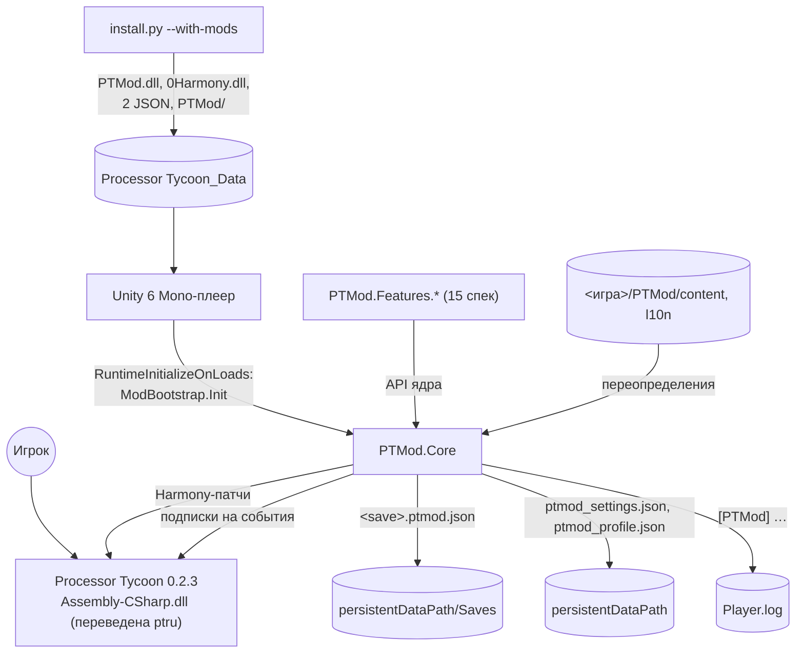
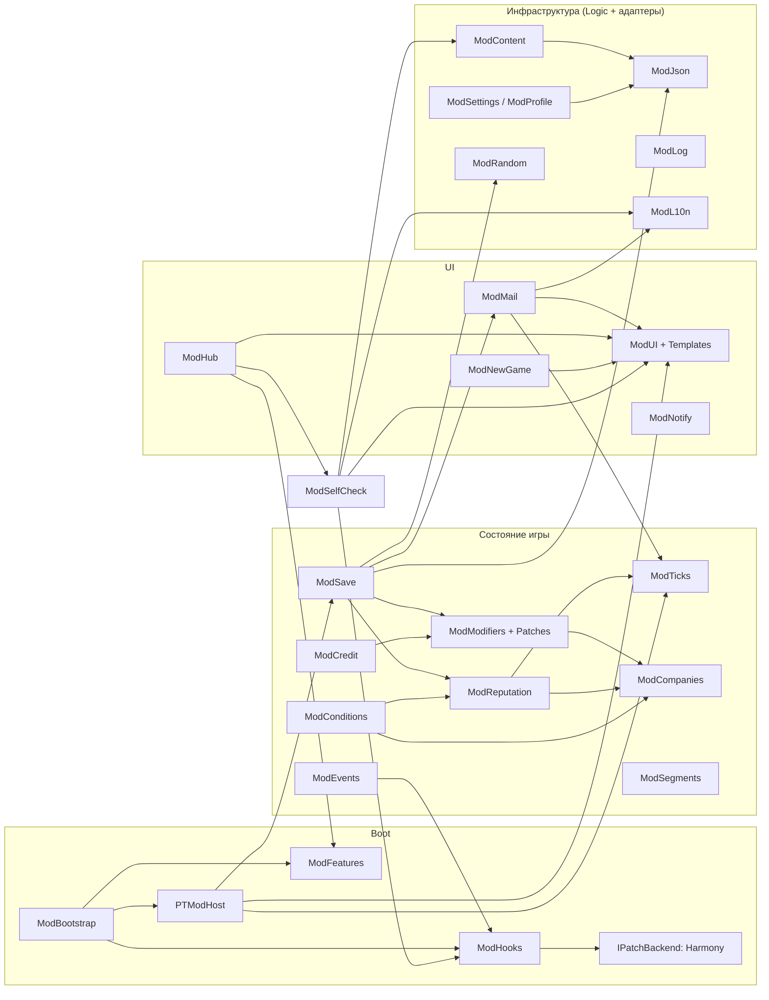
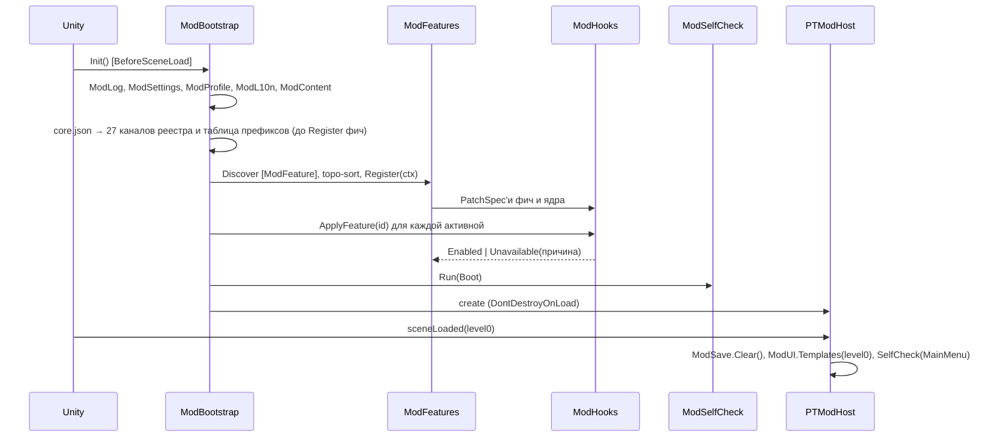
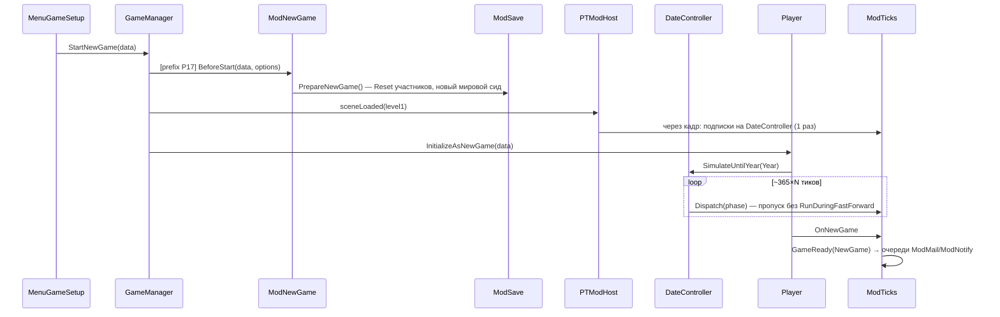
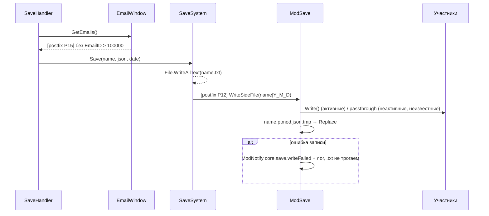
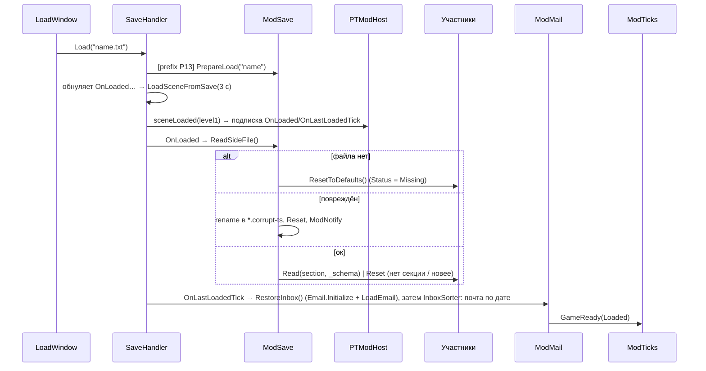
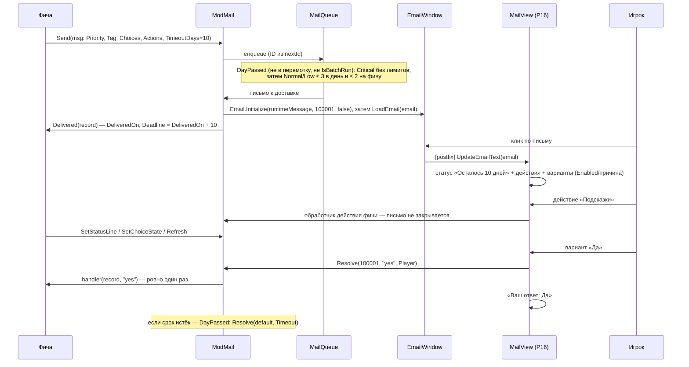
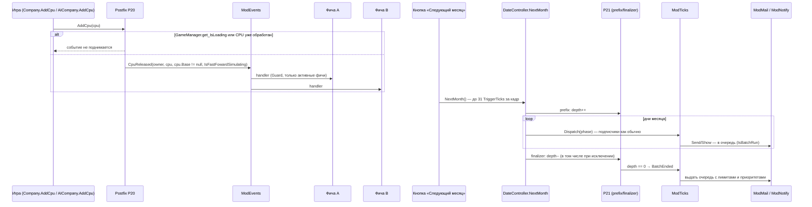
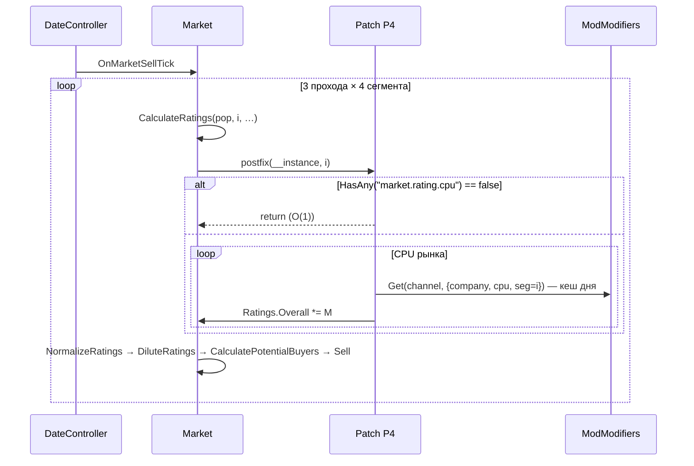

# Design: mod-framework

## Document Information

- **Feature Name**: mod-framework (`PTMod.Core`)
- **Version**: 0.2
- **Date**: 2026-10-10
- **Author**: Dex719
- **Status**: Draft v0.2 — одобрено к реализации владельцем 2026-10-10
- **Reviewers**: владелец форка
- **Related Documents**: [requirements.md](requirements.md), [tasks.md](tasks.md), `.kiro/steering/context.md`, `.kiro/steering/owner-decisions.md`, `.kiro/decisions/0001`–`0006`, `pt-modding/CODEMAP.md`

## Overview

`PTMod.dll` — одна сборка .NET, которую Roslyn `csc` (VS 2022 Build Tools, C# latest, `-nostdlib`) компилирует против `Managed/*.dll` игры (решение 0003). Unity загружает её по записи в `ScriptingAssemblies.json`, а метод `PTMod.Core.ModBootstrap.Init` вызывается по записи в `RuntimeInitializeOnLoads.json` до загрузки первой сцены (решение 0001). `Init` создаёт постоянный объект `PTModHost`, находит фичи, применяет патчи Harmony 2.3.6 (решение 0002) и подписывается на `SceneManager.sceneLoaded`. При каждой загрузке сцены ядро заново подписывается на события игры (`DateController`, `SaveHandler`, `Player`, `ThemeManager`), потому что игра пересоздаёт объекты сцены и обнуляет свои события при загрузке сейва.

Состояние модов живёт в боковом файле `<сейв>.ptmod.json` (решение 0004), окна строятся из клонов окон игры (решение 0005), контент и строки — в JSON внутри сборки с переопределением из `<папка игры>/PTMod/` (решение 0006). Формулы игры меняются только через каналы `ModModifiers`: у каждой формулы ровно один патч-владелец — ядро. Общие для многих фич механизмы (выпуск CPU, сегмент по цене, пакетный прогон месяца, порог кредита, дрейф репутации, приоритеты писем, секции окна новой игры) живут в ядре, и фичи не ставят на эти места своих патчей.

### Design Goals
- **Не навредить.** Любой сбой мода → ванильное поведение; сейв `.txt` остаётся ванильным; мод снимается откатом двух JSON.
- **Один владелец у каждой формулы и каждого общего хука.** Фичи влияют на формулы игры только через каналы, а на выпуск CPU, пакетный прогон месяца и старт новой игры — через события и сервисы ядра; конфликт патчей обнаруживается при старте.
- **Предсказуемая жизнь в сценах.** Подписки переустанавливаются при каждой загрузке сцены ровно один раз; тики не идут во время перемотки и загрузки.
- **Чистая логика тестируется без Unity.** Всё, что не трогает игру (JSON, ГСЧ, модификаторы, условия, сейв-модель), лежит в `*/Logic/` и покрыто тестами.
- **Нет своих ассетов.** UI — клоны окон игры с её темой и шрифтами.

### Key Design Decisions

- **D1. Загрузка через `ScriptingAssemblies.json` + `RuntimeInitializeOnLoads.json`, `loadTypes: 1` (BeforeSceneLoad).** Фолбэк — IL-хук в `GameManager.Awake` через `ptru/patch_dll.py`. *Отвергнуто:* BepInEx/Doorstop (лишний загрузчик, прокси-DLL), правка IL на каждую фичу (конфликт с патчером строк).
- **D2. `ModHooks` абстрагирует бэкенд патчей (`IPatchBackend`).** Основной бэкенд — Harmony 2. Если спайк 0002 провалится, бэкенд меняется без правки фич. *Отвергнуто:* прямые вызовы `Harmony.Patch` из фич (нет изоляции, нет all-or-nothing).
- **D3. Harmony ID на фичу (`ptmod.<feature-id>`).** Это даёт `UnpatchAll(id)` при выключении фичи и откат при частичном сбое. *Отвергнуто:* один Harmony на всё (нельзя снять патчи одной фичи).
- **D4. Ядро — единственный патчер формул каналов.** Фичи регистрируют записи или провайдеры, а патчи формул живут в папке `Core/Modifiers/Patches/` (пространство имён `PTMod.Core.Patches`). *Отвергнуто:* каждая фича патчит формулы сама (порядок и конфликты постфиксов на `Market.CalculateRatings` непредсказуемы).
- **D5. Временная подстановка значения CPU вместо изменения сохраняемых полей** (`UnitCost`, `FailureRate` в `Factory.ProduceWafers`: prefix подставляет, postfix и finalizer возвращают). *Отвергнуто:* менять `CpuBase.UnitCost`/`FailureRate` насовсем — значения попали бы в ванильный сейв и остались бы после удаления мода.
- **D6. Сегмент рынка определяется по индексу популяции в `Market`, а не по `PopulationData.Name`.** Русификатор переводит имена (`High End` → «Высокий», `translation/ui.json`).
- **D7. Ключ компании — `player` / `ai:<UniqueID>`.** *Отвергнуто:* `SaveID` компании из `ISaveID` (то, что он переживает `JsonUtility`, не проверено, CODEMAP Uncertain) и имя компании (переводится русификатором: Inlet → Intel).
- **D8. Запись бокового файла — postfix `SaveSystem.Save`, а не `SaveHandler.Save`.** Здесь известно итоговое имя (включая фолбэк `Y_M_D`), и postfix не выполнится, если игра не записала `.txt`. Это уточнение решения 0004 (оформлено разделом «Уточнения» в самом решении). Чтение — в `SaveHandler.OnLoaded`, имя файла ловится prefix'ом `SaveHandler.Load`.
- **D9. Письма мода исключаются из ванильного сейва postfix'ом `EmailWindow.GetEmails`.** Метод вызывается только из `SaveHandler.Save` (grep), а UI почты им не пользуется. *Отвергнуто:* оставить письма в `.txt` — без мода они восстановились бы без текста (`Email.message` не сериализуется).
- **D10. Свой JSON-парсер `ModJson` (дерево узлов + биндер DTO)** — решение по 0006. *Отвергнуто:* `JsonUtility` (нет словарей, полиморфизма и сохранения неизвестных секций), Newtonsoft.Json (лишняя зависимость, возможный конфликт версий с Unity).
- **D11. Окна-клоны создаются под неактивным родителем; все компоненты не из белого списка удаляются до активации.** Иначе `Awake` клона перезапишет синглтоны игры (`BreakContractWindow.Instance` и др.). Окна не уничтожаются в пределах сцены: `PauseHandler` не удаляет триггеры.
- **D12. ModTicks подписывается на события `DateController` через кадр после загрузки сцены**, когда отработали `Start` игры. Поэтому обработчики мода в каждой фазе идут после обработчиков игры, подписанных в `Start`. Подписчики через `Invoke` (`Company.InitializeResearchSector` через 0,1 с) могут оказаться после мода — фичи не должны на это опираться.
- **D13. ГСЧ — xoshiro128** (32-битное состояние из 4 слов).** Состояние точно сериализуется числами JSON (все ≤ 2³²). Поток = SplitMix32(мировой сид ⊕ FNV-1a(ID потока)). *Отвергнуто:* `System.Random` (нет доступа к состоянию), 64-битные генераторы (в JSON-числах теряют точность, понадобились бы строки).
- **D14. Сборка — `mod/build.py` над Roslyn `csc.exe` из VS Build Tools; без `.csproj`, MSBuild и .NET SDK** (решение 0003, обновлено). Скрипт находит `csc` (`vswhere` или известные пути) и папку игры (`--game-dir` / `PT_GAME_DIR`), собирает `mod/src/PTMod/**/*.cs`, встраивает ресурсы (`-resource:файл,LogicalName`) и берёт версию из `mod/VERSION`. Тесты собираются тем же `csc` в exe под .NET Framework 4.8 из `Core/Logic/**` и `mod/tests/PTMod.Tests/**`. *Отвергнуто:* .NET SDK (загрузка не нужна), xUnit/NuGet (без загрузок), MSBuild-проект (лишняя зависимость от Visual Studio).
- **D15. Строки: `L10n/ru.json`/`en.json` для ядра и `L10n/<lang>/<feature>.json` для фич** (рекомендуется: меньше конфликтов слияния). Обе раскладки грузятся. Строки и контент `framework-sample` лежат в `L10n/<lang>/framework-sample.json` и `Content/framework-sample/` и не входят в релизную сборку (D27).
- **D16. Слот меню новой игры — во фреймворке (`ModNewGame`).** Обучение и сценарии добавляют опции в одно окно, а не вставляют свои элементы в `MenuGameSetup` каждая по-своему.
- **D17. Кредитный лимит компании меняется transpiler'ом `BankruptcyHandler.TickBankruptcies`**, а не перезаписью `CentralBank.DebtLimit`. `DebtLimit` один на все компании и читается в 12 местах. Глобальный множитель — postfix `CentralBank.UpdateCreditLimit`. Единая точка чтения порога для фич — `ModCredit` (D23); пороги ИИ в `AIBehaviour*` остаются глобальными (решение владельца).
- **D18. Выпуск CPU — одно событие ядра.** Один postfix P20 на `Company.AddCpu` и `AICompany.AddCpu` поднимает `ModEvents.CpuReleased` по единому правилу («не при `IsLoading`, один раз на объект»). Пять спек ставили свои postfix'ы с разными защитами (двойные броски брака и обзоров, пропуски при загрузке). Перенос CPU между компаниями — отдельное событие `CpuTransferred`, которое поднимает фича-исполнитель. *Отвергнуто:* патч на `Player.AddCpu` (срабатывает и из `Company.AddCpu`, и при переносе).
- **D19. Письма: очередь с приоритетами, а не один лимит.** `ModMail.Send` кладёт письмо в очередь; доставка идёт по приоритетам `Critical > Normal > Low` с дневным лимитом и квотой на фичу, `Critical` — в обход лимитов. Срок ответа считается от доставки. Кнопки двух видов: `ModMailChoice` (одноразовый выбор, закрывает письмо) и `ModMailAction` (вызывает фичу, письмо не закрывает). Письма различаются по `Tag`, блоков ID нет. *Отвергнуто:* блоки ID на фичу (после 10 000 писем авто-ID дошли бы до блоков), единый глобальный лимит 3 (съедал срок решения и опаздывал с письмами обучения).
- **D20. Версию секции пишет и читает ядро.** `ModSave` сам пишет `_schema = SchemaVersion` и сам читает его; фичи своё поле версии не хранят. Секция без `_schema` читается как версия 1. *Отвергнуто:* версия внутри данных фичи (в 13 спеках она оказалась названа `schema`, и ModSave не мог распознать «секцию новее»).
- **D21. Реестр каналов ядра объявляет все каналы заранее.** Все 27 записей (стандартные, `development.cost.design`, `production.memoryCost`, `production.waferCost`, каналы GPU, `acquisition.price`) лежат в `core.json` и объявляются до `Register` любой фичи; фичи читают/пишут их, но не объявляют. Провайдер или запись на необъявленный канал связываются лениво. *Отвергнуто:* объявление каналов самими фичами (порядок `Register` по топосорту не гарантирован: провайдер мог прийти раньше объявления).
- **D22. Единственный писатель профиля — `ModProfile`.** Атомарная запись с `.bak`, троттлинг 2 с, принудительная запись при выходе. *Отвергнуто:* собственный `ProfileStore` в `scenarios-achievements` (два писателя перезаписывают файл целиком и теряют изменения друг друга).
- **D23. Единый порог дефолта — `ModCredit`.** `ThresholdOf` возвращает порог, который реально применяет игра (с учётом того, применился ли transpiler P10), поэтому предупреждения, автозаём и лимиты фич согласованы с дефолтом игры. *Отвергнуто:* чтение `CentralBank.DebtLimit` фичами (расходится с P10).
- **D24. Контекст канала содержит Contract и Design.** `ModifierContext.Contract` заполняется в P8 захватом контракта в prefix на приватный `Contract.GetBestOffers` (P23). `ModifierContext.Design` заполняется в P19 (`CpuMath.ProjectCost`). Контексты с `Contract` входят в ключ кеша по ID контракта, контексты с `Design` не кешируются. *Отвергнуто:* рефлексия поля контекста в фичах (две спеки уже строили такой обход).
- **D25. Балансовый диапазон отдельно от предохранителя.** Для `market.rating.cpu` и `popularity.gain` произведение множителей ограничивается [0,5; 2,0] на CPU (балансовый диапазон, решение владельца), затем широким предохранителем [min, max]. Explain сообщает `IsBalanceCapped` для «(ограничено)». *Отвергнуто:* только предохранитель [0; 5] (пять фич стекались до ×2–3).
- **D26. Слот новой игры = одна панель с секциями.** Опции (`RegisterOption`) и секции (`RegisterSection`) всех фич — на панели за кнопкой «Моды…»; `PreviewChanged` поднимается после ванильного `MenuGameSetup.UpdateInitialData`; старт применяется только в `BeforeStart`. Патчи фич на `GameManager.StartNewGame`, `MenuGameSetup.InitializeUI`, `MenuGameSetup.UpdateInitialData` запрещены. *Отвергнуто:* вставки каждой фичи в `MenuGameSetup` (дублируют P17, нарушают FR-18.4).
- **D27. Служебная фича только в отладочной сборке.** `framework-sample` и флаги `debug.*` компилируются под символом `PTMOD_DEBUG`; релизная сборка (`mod/build.py --release`) их не содержит. Ручные сценарии M1–M24 выполняются на отладочной сборке; релизную проверяет сценарий M24.
- **D28. Соглашение об идентификаторах — таблица ядра** (`prefixes` в `core.json`, раздел «Соглашение об идентификаторах»): L10n-ключи, предикаты, ID событий и теги писем несут префикс фичи; предикаты ядра точек не содержат. Проверки — чистая логика `ModIds`. *Отвергнуто:* соглашение «по обычаю» (event-system и market-shocks уже зарегистрировали предикаты без префикса, `Register` отклонил бы дубли в будущем).

## Architecture

### System Context



### High-Level Architecture



**Используемые сервисы `PTMod.Core`:** эта спека их и определяет. Внешние зависимости ядра — только Unity, `Assembly-CSharp` (английский оригинал из `_original_en/` при сборке) и Harmony. Служебная фича `framework-sample` пользуется всеми сервисами и служит их интеграционной проверкой.

### Technology Stack

| Слой | Технология | Обоснование |
|---|---|---|
| Рантайм | Unity 6000.0.65f1 Mono | игра; IL2CPP нет — патчи в рантайме возможны |
| Сборка мода | Roslyn `csc.exe` из VS 2022 Build Tools, `-langversion:latest -nostdlib -target:library`, ссылки на `Managed/*.dll`; скрипт `mod/build.py` | решение 0003 (обновлено); .NET SDK не нужен |
| Патчи | Harmony 2.3.6 (`0Harmony.dll`, net48, MIT; лежит в `mod/lib/`, в `.gitignore`) | решение 0002 |
| JSON | `ModJson` (своя реализация, ~600 строк) | D10 |
| UI | uGUI + TextMeshPro, компоненты игры (`ButtonUI`, `ToggleUI`, `SliderUI`, `DropdownUI`, `InfoText`, `Themeable*`) | решение 0005 |
| Тесты | свой мини-раннер на .NET Framework 4.8 (чистая логика, собирается тем же `csc`), Python `unittest` (установщик) | без Unity, файлов игры, xUnit и NuGet |
| Установщик | Python 3.9+, `install.py` + `ptru/mods.py` | расширение существующего |

### Жизненный цикл

| Момент | Что делает ядро |
|---|---|
| BeforeSceneLoad | `ModBootstrap.Init`: лог, `ModSettings`, `ModProfile` (чтение, `.bak`), `ModL10n`, `ModContent`, `core.json` → **объявление всех 27 каналов реестра и таблицы префиксов** (стадия `Declare`), поиск фич, `Register` фич, применение патчей (ядро и фичи), создание `PTModHost`, `OnEnabled` фич, `ModSelfCheck(Boot)` (в том числе каналы без объявления); стадии и порядок — в «Старт ядра: стадии `CoreInit`» ниже |
| `sceneLoaded(level0)` | `ModSave.Clear()`, `ModUI` ищет шаблоны меню, `ModSelfCheck(MainMenu)` |
| `GameManager.StartNewGame` (prefix, P17) | `ModNewGame.BeforeStart` (опции → `PlayerInitialData`), `ModSave.PrepareNewGame()` (сброс участников, новый мировой сид) |
| `SaveHandler.Load` (prefix) | `ModSave.PrepareLoad(имя)`, если файл существует |
| `sceneLoaded(level1)` | через кадр: подписки на `DateController`, `SaveHandler.OnLoaded`/`OnLastLoadedTick`, `Player.OnNewGame`, `ThemeManager.OnThemeChanged`, `CompanySpawner.OnCompanySpawned`, `BankruptcyHandler.OnCompanyWentBankrupt`; `ModUI` ищет шаблоны, создаёт кнопку «Моды»; `ModSelfCheck(GameScene)` |
| `SaveHandler.OnLoaded` | `ModSave.ReadSideFile()` → секции участникам (`ModRandom`, `ModModifiers`, `ModReputation`, `ModMail`, фичи) |
| `SaveHandler.OnLastLoadedTick` | `ModMail.RestoreInbox()`, `GameReady(Loaded)`, сброс очередей `ModNotify` |
| `Player.OnNewGame` | `GameReady(NewGame)`, доставка очередей |
| `SaveSystem.Save` (postfix) | `ModSave.WriteSideFile(имя)` |
| `SaveSystem.Delete` (postfix) | удаление `<имя>.ptmod.json` |
| `SceneTransitionHandler.OnTransitionsStarted` | `SceneLeaving`: закрыть окна мода, сбросить ссылки на объекты сцены, принудительно записать `ModProfile` |
| `Company.AddCpu` / `AICompany.AddCpu` (postfix P20) | `ModEvents.CpuReleased(owner, cpu, isVariant, duringFastForward)`; не при `IsLoading`, один раз на объект CPU |
| `DateController.NextMonth` (prefix + finalizer P21) | `ModTicks.IsBatchRun` = true до выхода, затем `BatchEnded`; `ModMail` и `ModNotify` выдают очередь после `BatchEnded` |
| `MenuGameSetup.UpdateInitialData` (postfix P22) | `ModNewGame.PreviewChanged` |
| `OnApplicationPause(true)` (`PTModHost`) | `ModProfile.Flush()` (запись, только если есть несохранённое) |
| `OnApplicationQuit` (`PTModHost`) | `ModProfile.Save()` (безусловная запись), `ModSettings.Flush()`, `ModLog.FlushAll()` (сводки повторов) |

### Раскладка репозитория

```
mod/
  VERSION                          # версия мода (одно место), build.py генерирует BuildInfo.g.cs
  build.py                         # сборка PTMod.dll, --tests, --release; Roslyn csc из VS Build Tools
  lib/0Harmony.dll                 # Harmony 2.3.6 net48 (в .gitignore), lib/README.md
  src/PTMod/
    Core/
      Compat/      полифилы типов, отсутствующих в рантайме Unity (IsExternalInit и т. п.)
      Bootstrap/   ModBootstrap.cs, PTModHost.cs, ModFeatures.cs, FeatureContext.cs
      Hooks/       ModHooks.cs, PatchSpec.cs, HarmonyBackend.cs, Guard.cs, ReservedTargets.cs
      Ticks/       ModTicks.cs, TickDispatcher.cs, BatchRun.cs
      Save/        ModSave.cs, SideFileIo.cs, SavePatches.cs
      Settings/    ModSettings.cs, ModProfile.cs
      Log/         ModLog.cs
      L10n/        ModL10n.cs
      Content/     ModContent.cs
      Random/      ModRandom.cs
      Companies/   ModCompanies.cs
      Events/      ModEvents.cs, CpuEventPatches.cs
      Segments/    ModSegments.cs
      Credit/      ModCredit.cs
      Ids/         ModIdsAdapter.cs
      Modifiers/   ModModifiers.cs, ModChannels.cs, Patches/*.cs
      Reputation/  ModReputation.cs
      Conditions/  ModConditions.cs, GameStateAdapter.cs, Predicates/*.cs
      Mail/        ModMail.cs, MailFactory.cs, MailView.cs, MailPatches.cs, InboxSorter.cs
      Notify/      ModNotify.cs
      UI/          ModUI.cs, ModUITemplates.cs, ModWindow.cs, Widgets.cs, CloneSanitizer.cs, ConfirmDialog.cs, TooltipBridge.cs
      Hub/         ModHub.cs
      NewGame/     ModNewGame.cs, NewGamePatches.cs, NewGameSections.cs
      SelfCheck/   ModSelfCheck.cs
      Logic/       Json/, Random/, Modifiers/, Conditions/, Save/, L10n/, Settings/, Content/, Log/,
                   Segments/ (SegmentRule), Mail/ (MailQueue, MailQuota, InboxOrder), Credit/ (CreditMath),
                   Ticks/ (BatchCounter), Events/ (ReleaseDeduper), Ids/ (ModIds), Reputation/, Features/   # без UnityEngine
    Features/FrameworkSample/FrameworkSampleFeature.cs        # только отладочная сборка (PTMOD_DEBUG)
    Content/mod-framework/core.json
    Content/framework-sample/samples.json                       # только отладочная сборка
    L10n/ru.json, L10n/en.json
    L10n/ru/framework-sample.json, L10n/en/framework-sample.json   # только отладочная сборка
  tests/PTMod.Tests/               # свой мини-раннер (.NET Framework 4.8), компилирует Core/Logic/** вместе с тестами
    Runner/                        # TestAttribute, CoversAttribute, Assert, TestRunner, Program
  tests/installer/                 # Python unittest: test_mods_json.py, test_install_mods.py, test_check_spec_refs.py
  build/                           # результат сборки (.gitignore): PTMod.dll, PTMod.Tests.exe, release/
ptru/mods.py                       # логика установки модов для install.py
tools/check_spec_refs.py, tools/dump_ui_templates.py
```

## Components and Interfaces

Пространство имён ядра — `PTMod.Core` (контракт steering), служебной фичи — `PTMod.Features.FrameworkSample`. Сигнатуры ниже — контракт для остальных спек.

### ModBootstrap, PTModHost, реестр фич

```csharp
namespace PTMod.Core
{
    public static class ModBootstrap
    {
        public const string ModVersion = BuildInfo.Version;  // BuildInfo.g.cs генерирует build.py из mod/VERSION
        [UnityEngine.RuntimeInitializeOnLoadMethod(UnityEngine.RuntimeInitializeLoadType.BeforeSceneLoad)]
        public static void Init();                           // идемпотентен, try/catch внутри
        public static bool IsInitialized { get; }
        internal static bool HasFailed { get; }              // Init упал: мод выключен на сессию
    }

    public sealed partial class PTModHost : UnityEngine.MonoBehaviour   // DontDestroyOnLoad, один экземпляр
    {
        public const int MainMenuScene = 0, GameScene = 1;
        public static PTModHost Instance { get; }
        public static int CurrentScene { get; }                   // buildIndex от загрузки до SceneLeaving; -1 между сценами
        public static bool IsSceneReady { get; }                  // SceneReady поднят для CurrentScene
        public static event System.Action<int> SceneReady;        // buildIndex, через кадр после sceneLoaded; сначала ядро, потом фичи
        public static event System.Action SceneLeaving;           // SceneTransitionHandler.OnTransitionsStarted; сначала фичи, потом ядро
        public UnityEngine.Coroutine Run(System.Collections.IEnumerator routine);   // исключение -> ReportFault владельцу (по пространству имён)
        public void Stop(UnityEngine.Coroutine routine);
        // только для ядра:
        internal static event System.Action FrameUpdate;          // каждый кадр; упавший обработчик логируется и снимается
        internal static event System.Action ApplicationQuitting;
        internal static event System.Action<bool> ApplicationPaused;
        internal static bool IsQuitting { get; }
    }

    public enum FeatureState { Disabled, Enabled, Faulted, Unavailable }

    public interface IModFeature
    {
        string Id { get; }                 // = slug спеки
        string NameKey { get; }            // ключ ModL10n
        string DescriptionKey { get; }
        string[] DependsOn { get; }        // ID фич
        bool EnabledByDefault { get; }
        bool SupportsHotToggle { get; }
        void Register(FeatureContext ctx); // патчи, тики, участник сейва, контент, страница хаба, ParamSpec
        void OnEnabled();
        void OnDisabled();
    }

    [System.AttributeUsage(System.AttributeTargets.Class)]
    public sealed class ModFeatureAttribute : System.Attribute { }

    public sealed class DisableConfirmation
    {
        public string MessageKey;            // ключ ModL10n тела окна подтверждения
        public string[] Args;                // аргументы сообщения (уже отформатированы)
        public string ConfirmLabelKey;       // подпись «Да»; null — core.common.yes
    }

    public sealed class FeatureContext
    {
        public string FeatureId { get; }
        public void Patch(System.Type patchClass);                         // [ModPatch]-методы класса
        public System.IDisposable OnTick(TickPhase phase, System.Action handler, int priority = 0, TickOptions options = TickOptions.None);
        public void SaveParticipant(IModSaveParticipant participant);
        public void Param(ParamSpec spec);
        public void HubPage(string titleKey, System.Action<UnityEngine.RectTransform> build);
        // Подтверждение выключения в хабе: provider вернул null — выключать без вопросов.
        // OnDisabled вызывается только после «Да»; «Отмена» оставляет фичу включённой.
        public void ConfirmBeforeDisable(System.Func<DisableConfirmation> provider);
    }

    public sealed class FeatureInfo           // все свойства только для чтения
    {
        public string Id, NameKey, DescriptionKey;                         // NameKey == null у фичи, которую не удалось прочитать
        public System.Collections.Generic.IReadOnlyList<string> DependsOn;
        public bool EnabledByDefault, SupportsHotToggle;
        public System.Type FeatureType;
        public FeatureState State; public bool IsActive;
        public FeatureStatus Status; public string Reason;                 // Reason: локализованный текст (core.feature.reason.*)
        public bool WantsEnabled, HasPendingChange, IsRegistered;
    }

    public static partial class ModFeatures
    {
        public static System.Collections.Generic.IReadOnlyList<FeatureInfo> All { get; }   // в порядке зависимостей; непригодные классы тоже (Unavailable с причиной)
        public static FeatureInfo Find(string featureId);
        public static FeatureState StateOf(string featureId);              // без выделений памяти
        public static bool IsActive(string featureId);                     // Enabled и не Faulted
        public static FeatureStatus StatusOf(string featureId);            // состояние со структурированной причиной (для хаба)
        public static string ReasonOf(string featureId);                   // для Unavailable/Faulted; локализовано, иначе английская причина
        public static bool WantsEnabled(string featureId);                 // положение переключателя (с учётом отложенного)
        public static bool HasPendingChange(string featureId);             // негорячая фича, переключённая в сцене 1: вступит в силу на SceneLeaving
        public static void SetEnabled(string featureId, bool enabled);     // хаб; без подтверждения
        public static DisableConfirmation GetDisableConfirmation(string featureId); // хаб вызывает перед SetEnabled(false); null — без подтверждения
        public static string FeatureOfType(System.Type type);              // по пространству имён PTMod.Features.<Name>; для типов ядра — "mod-framework"
        public static event System.Action<string, FeatureState> StateChanged;   // после OnEnabled/OnDisabled, сначала деактивации; обработчики неактивных фич пропускаются
        // только для ядра (ModHooks и др.):
        internal static event System.Action<FeatureInfo> FeatureRegistered;    // после Register (проверка PatchSpec)
        internal static event System.Action<FeatureInfo> FeatureActivating;    // применить патчи; отказ = MarkUnavailable или исключение, затем сразу FeatureDeactivated, OnEnabled не вызывается
        internal static event System.Action<FeatureInfo> FeatureDeactivated;   // после OnDisabled: снять патчи
        internal static System.Action<string, string, System.Exception> FaultSink { get; set; }   // счётчик сбоев (ModHooks), до его установки — запись в лог
        internal static void MarkUnavailable(string featureId, string detail);
        internal static void Fault(string featureId, string detail);           // предохранитель сработал
        internal static void ReportFault(string featureId, string site, System.Exception ex);
        internal static string OwnerOf(System.Delegate handler);               // фича по пространству имён типа метода
    }
}
```

**Старт ядра: стадии `CoreInit`.** Сервисы ядра включаются в `ModBootstrap.Init` без правки бутстрапа: `[CoreInit(CoreInitStage.<стадия>, order)] internal static void Method()` (`internal`, статический `void` без параметров, только `PTMod.Core.*`; метод фичи игнорируется с предупреждением; `Optional = true` — сбой только в лог). Порядок: стадия, `Order`, полное имя. Рефлексия по `PTMod.dll` — один проход (`ReflectionTypeLoadException` переживается).

| Стадия | Когда | Что делают сервисы |
|---|---|---|
| `Declare` | после `ModSettings`/`ModLog`/`ModProfile`/`ModL10n` и чтения `core.json`, до реестра фич | объявить 27 каналов и таблицу префиксов (D21, D28), предикаты ядра; подписаться на `FeatureRegistered`/`FeatureActivating`/`FeatureDeactivated`, задать `ModFeatures.FaultSink` |
| `Patch` | реестр фич построен (состояния известны, `Register` не вызывался) | патчи самого ядра (Harmony ID `ptmod.mod-framework`) |
| `AfterRegister` | `Register` всех активных фич выполнен | проверить объявленное фичами; патчи фич — all-or-nothing на `FeatureActivating` |
| `SelfCheckBoot` | `PTModHost` создан, `OnEnabled` фич вызван | этап Boot самопроверки |
| `HostReady` | последний шаг успешного старта | — |
| `Rollback` | только при сбое `Init`, в обратном порядке, после выключения всех фич; вызывается и для служб, чьи ранние стадии не выполнялись (должен быть no-op) | снять патчи ядра |

Сбой `Init` — ровно одна запись `[PTMod] [core] ERROR Init failed (<шаг>)` с исключением (AC-1.3; под id `core`, остальные строки ядра идут под `mod-framework`), затем `ModFeatures.Halt`: `OnDisabled` запущенным фичам, все идентификаторы, включая `mod-framework`, становятся `Unavailable`, `Rollback`, `PTModHost.Shutdown`. Игра продолжает как ванильная.

**Решения реестра фич (не вытекают из требований).** (1) `Register` вызывается один раз за сессию: на старте только у активных фич, позже лениво при первой активации; поэтому `ParamSpec` выключенной фичи объявляются только после её первого включения (хаб до этого не показывает её настроек), а участник `ModSave`, зарегистрированный в середине игры, не видит `ReadSideFile` — `ModSave` обязан отдать ему сохранённую секцию при регистрации (`SideFileModel.RestoreParticipant`). (2) Негорячая фича, переключённая в игровой сцене, применяется на `SceneLeaving` (после рассылки `SceneLeaving`); вне сцены 1 и для горячих — сразу; каскад зависимостей действует немедленно. (3) Обработчики `SceneReady`/`SceneLeaving`/`StateChanged` и корутины `Run` неактивных фич не вызываются, поэтому `OnDisabled` сбрасывает ссылки на объекты сцены. (4) Класс с `[ModFeature]`, чей `Id` не совпадает со слагом пространства имён `PTMod.Features.<Name>`, пустой, равен `mod-framework` или не имеет конструктора, виден в `All` как `Unavailable` с причиной; дубликат `Id` отбрасывается с ошибкой. (5) Запасной `SceneLeaving` — на `sceneLoaded`, если игра сменила сцену без `SceneTransitionHandler`.

**Контракт точки входа фичи.** Фича — `[ModFeature] sealed class … : IModFeature` в пространстве имён `PTMod.Features.<Name>`: `Id` = slug спеки, `NameKey`/`DescriptionKey`, `DependsOn` (только жёсткие зависимости; мягкие связи в него не входят), `EnabledByDefault`, `SupportsHotToggle`, `Register(FeatureContext)`, `OnEnabled`/`OnDisabled`. Всё остальное идёт через контекст и сервисы ядра:

| Нужно фиче | Как |
|---|---|
| Тик дня/месяца/года | `ctx.OnTick(TickPhase.X, handler)`; не `ModTicks.OnDayPassed` и не прямые подписки на `DateController` |
| Новая игра / загрузка | `ModTicks.GameReady(NewGame\|Loaded)`; не `Player.OnNewGame`, `SaveHandler.OnLastLoadedTick` (игра обнуляет их при загрузке сцены, ядро переподписывается через кадр, D12) |
| Выпуск и перенос CPU | `ModEvents.CpuReleased`, `ModEvents.CpuTransferred`; не патч `Company.AddCpu` |
| Пакетный прогон месяца | `ModTicks.IsBatchRun`, `ModTicks.BatchEnded`; не патч `DateController.NextMonth` |
| Сегмент CPU по цене | `ModSegments.Classify`; не собственный классификатор |
| Порог дефолта | `ModCredit.ThresholdOf`, `ModCredit.PlayerDebtLimit`; не `CentralBank.DebtLimit` |
| Состояние в сейве | `IModSaveParticipant` (JsonObject); версию секции ведёт ядро (`_schema`) |
| Глобальные данные (достижения, «видел обучение») | `ModProfile.Section(featureId, schema)`; не свой файл |
| Опции окна новой игры | `ModNewGame.RegisterOption`/`RegisterSection`/`BeforeStart`; не патчи `MenuGameSetup`/`GameManager.StartNewGame` |
| Настройки и страница хаба | `ctx.Param(ParamSpec)`, `ctx.HubPage` |
| Счётчик ошибок | `ModHooks.Guard`/`ReportFault`; не собственные счётчики |
| Регистрация провайдеров канала | в `Register`/`OnEnabled`/`GameReady`; для каналов других фич порядок `Register` не важен (D21) |

### ModHooks

```csharp
namespace PTMod.Core
{
    public enum PatchKind { Prefix, Postfix, Transpiler, Finalizer }

    [System.AttributeUsage(System.AttributeTargets.Method, AllowMultiple = true)]
    public sealed class ModPatchAttribute : System.Attribute
    {
        public ModPatchAttribute(System.Type target, string method, PatchKind kind);
        public System.Type[] ArgTypes { get; set; }      // null — метод единственный по имени
        public string InnerType { get; set; }            // вложенный тип: "CpuOffer" у Contract
        public int Priority { get; set; } = 400;         // Harmony Priority.Normal
        public bool Optional { get; set; }               // сбой не делает фичу Unavailable
    }

    public sealed class PatchSpec                       // неизменяемый; строится из ModPatchAttribute после разрешения цели
    {
        public string FeatureId { get; }                 // "mod-framework" для патчей ядра
        public string Id { get; }                        // "<feature>/<Class.Method>/<kind>", вложенные типы через точку
        public System.Reflection.MethodBase Target { get; }
        public string TargetName { get; }                // "Contract.CpuOffer.DefineChance"
        public System.Reflection.MethodInfo Handler { get; }
        public PatchKind Kind { get; }
        public int Priority { get; }
        public bool Optional { get; }
    }

    public interface IPatchBackend
    {
        string Name { get; }                             // "Harmony 2.3.6.0" или "none"
        bool Supports(PatchKind kind);
        bool TryApply(PatchSpec spec, out string error); // при сбое от патча в игре ничего не остаётся
        void Remove(PatchSpec spec);                     // один патч: откат класса патчей ядра
        void RemoveFeature(string featureId);            // только патчи этой фичи (Harmony ID ptmod.<feature-id>)
    }

    public enum PatchStatus { Declared, Applied, Failed, Rejected, Removed }

    public sealed class PatchReport                      // строка вкладки «Патчи» и самопроверки (ModHooks.Report)
    {
        public string FeatureId, Id, Target, Signature, Handler;
        public PatchKind Kind; public int Priority; public bool Optional;
        public PatchStatus Status;
        public string Detail;                            // английский текст причины, для лога
        public ReservedTarget Reserved;                  // резерв, из-за которого патч отклонён (AC-2.3, AC-2.4)
        public string ConflictWith;                      // фича, чей transpiler уже держит метод (FR-2 п. 5)
        public string StatusKey;                         // ключ core.diag.patches.status.applied/failed/rejected; null для Declared/Removed
        public bool IsProblem;                           // для самопроверки
    }

    public static class ModHooks
    {
        public const string CoreId = "mod-framework";
        public const string HarmonyIdPrefix = "ptmod.";  // Harmony ID = ptmod.<feature-id>; ядро — ptmod.mod-framework

        public static IPatchBackend Backend { get; }     // Harmony, либо "none" без 0Harmony.dll
        public static string BackendProblem { get; }     // почему нет настоящего бэкенда, или null
        public static FeatureState ApplyFeature(string featureId);   // all-or-nothing для не-Optional; для ядра — по классам патчей
        public static void RemoveFeature(string featureId);
        public static System.Collections.Generic.IReadOnlyList<PatchReport> Report { get; }
        public static bool IsApplied(System.Type patchClass);        // все патчи класса в игре (ModCredit спрашивает про P10)

        // Обёртки для тел патчей и обработчиков: try/catch + счётчик + circuit breaker. Тело пропускается у Faulted/Unavailable
        // (и у неизвестного id); у выключенной фичи выполняется (OnDisabled убирает за собой), её патчи и обработчики уже сняты.
        public static bool Guard(string featureId, string siteId, System.Action body);
        public static T Guard<T>(string featureId, string siteId, System.Func<T> body, T fallback);
        public static bool CanRun(string featureId, string siteId);  // для горячих путей без делегата; сбой — ReportFault из своего catch
        public static void ReportFault(string featureId, string siteId, System.Exception e);
        public static int FaultsOf(string featureId);
        public static int FaultThreshold { get; }                    // hooks.faultThreshold из core.json (5)

        // Поднятие события ядра: каждый обработчик в try/catch; фича-владелец обработчика определяется
        // по пространству имён типа (ModFeatures.FeatureOfType); обработчики фич не в состоянии Enabled пропускаются.
        public static void Raise(string eventName, System.Delegate handlers, params object[] args);   // DynamicInvoke
        public static void Raise(string eventName, System.Action handlers);                           // типизированные перегрузки
        public static void Raise<T1>(string eventName, System.Action<T1> handlers, T1 a1);            // на 0–4 аргумента без рефлексии
        public static void Raise<T1, T2>(string eventName, System.Action<T1, T2> handlers, T1 a1, T2 a2);
        public static void Raise<T1, T2, T3>(string eventName, System.Action<T1, T2, T3> handlers, T1 a1, T2 a2, T3 a3);
        public static void Raise<T1, T2, T3, T4>(string eventName, System.Action<T1, T2, T3, T4> handlers, T1 a1, T2 a2, T3 a3, T4 a4);

        // Зарезервированные цели: патчить их фичам нельзя (FR-2 п. 6).
        public static bool IsReserved(System.Reflection.MethodBase target, out ReservedTarget info);
        public static bool IsReservedByChannel(System.Reflection.MethodBase target, out string channel);   // частный случай IsReserved
        public static System.Collections.Generic.IReadOnlyList<ReservedTarget> ReservedTargetList { get; } // 28 строк колонки «Резерв»
    }

    // FeatureContext.Patch(System.Type patchClass) — фича объявляет класс патчей в Register.

    public enum ReservedKind { Channel, Service, FeatureFormula }

    public sealed class ReservedTarget                   // неизменяемый
    {
        public string Patch { get; }          // строка таблицы патчей: "P4", "P20", "F1"
        public string TypeName, Method;       // полное имя типа игры (Contract+CpuOffer) и метод; перекрывает все перегрузки
        public string Target { get; }         // "Market.CalculateRatings" для сообщений
        public ReservedKind Kind { get; }
        public string Name { get; }           // канал ("market.rating.cpu"), служба ("ModEvents") или канал фичи-владельца
        public string OwnerFeature { get; }   // "mod-framework" или ID фичи-владельца формулы (market-shocks)
        public string Api { get; }            // что использовать вместо: "ModEvents.CpuReleased"; null у FeatureFormula
        public System.Collections.Generic.IReadOnlyList<PatchKind> Kinds { get; }   // какие виды патча закрыты (P7 — prefix/transpiler, P10/P11 — transpiler)
        public string UseInstead { get; }     // ключ ModL10n подсказки по виду резерва: core.hooks.reserved.channel / .service / .featureFormula
        public bool Covers(PatchKind kind);
        public bool Rejects(string featureId, PatchKind kind);   // ядро и фича-владелец FeatureFormula проходят
        public string Hint();                 // подсказка игроку на текущем языке ({0} = Name, {1} = Api или владелец)
        public string EnglishHint { get; }    // для лога
        public string Holder { get; }         // "ModModifiers" / "ModEvents" / "market-shocks" для core.hooks.targetReserved
    }
}
```

Правила:
- Цели разрешаются через `AccessTools.Method` (с учётом `InnerType` через `AccessTools.Inner`) до применения. Неразрешённая обязательная цель → фича `Unavailable`.
- Тела патчей ядра и фич оборачиваются в `ModHooks.Guard`. Prefix при сбое возвращает `true` (выполнить оригинал), postfix не меняет `__result`, подстановки откатываются в finalizer.
- Circuit breaker: `hooks.faultThreshold` (5) исключений фичи за сессию → `Faulted`. Ядро (`mod-framework`) при сбое отключает только виновный канал или сервис.
- Резерв бывает трёх видов (колонка «Резерв» таблицы патчей): `Channel` — формулу читает канал ядра (P1–P11, P19, P23); `Service` — место занимает служба ядра (P15–P18, P20–P22); `FeatureFormula` — формулу патчит фича-владелец канала, ядро лишь закрепляет цель за ней (`CpuMath.MaterialCost`, `ProductionMath.WaferMaterialCost`, `ProductionMath.WaferCost`, `Memory.GetDescriptions` — владелец `market-shocks`). Патч фичи-владельца на цель вида `FeatureFormula` принимается, патч любой другой фичи отклоняется с указанием владельца.
- Для событий ядра `ModHooks.Raise` берёт список вызова делегата и вызывает обработчики по одному: исключение одного не мешает остальным и засчитывается его фиче. Фичи не поднимают события ядра сами (кроме `ModEvents.RaiseCpuTransferred`).

Решения реализации (TSK-023, волна 6; код — `Core/Hooks/`):
- Цели разрешает собственный резолвер `ModHooks.ResolveTarget` с семантикой `AccessTools.Method`/`Inner` (все видимости, базовые типы, вложенные типы через `InnerType`, `ArgTypes` — точное совпадение), не зависит от Harmony и годится для запасного бэкенда (TSK-008). Отличие: без `ArgTypes` неоднозначное имя — ошибка (`AccessTools` молча берёт перегрузку без параметров); `abstract` и обобщённые методы — ошибка.
- Патчи ядра находятся сканированием `PTMod.dll` по `[ModPatch]` в `PTMod.Core*` (кроме `Core.Logic`) на стадии `CoreInit.Patch`, центрального списка нет. Единица отката ядра — класс патчей: сломанный класс снимается один, остальное ядро работает (`IsApplied(Type)` для служб вроде `ModCredit`/P10).
- Circuit breaker ядра отключает «единицу» `siteId` — часть до первого `/` (`P2/prefix` и `P2/postfix` — единица `P2`; сайт обработчика события — `Type.Method@event`, единица — сам обработчик); ядро остаётся `Enabled`. Для фичи — `ModFeatures.Fault`. Сводки неучтённых повторов пишутся при срабатывании предохранителя и на `ApplicationQuitting`; формулировка общая с `ModLog` (`LogFormatter.RepeatedPhrase`: «повторено 4 раза», «повторено 597 раз»).
- Снятие патчей фичи, сработавшей внутри тела патча или обработчика, откладывается на следующий кадр (`PTModHost.FrameUpdate`): Harmony не пересобирает метод, который может выполняться; сами тела пропускаются сразу.
- Optional-патч на зарезервированную цель отклоняется (в `Report` — `Rejected` с `Reserved`), но фичу не выключает. Второй transpiler на метод определяется порядком активации (порядок зависимостей, при равенстве — по id); конфликт виден в `Report.ConflictWith` и предупреждением уже при объявлении.
- Без `0Harmony.dll` создание бэкенда изолировано (`NoInlining`), `Backend` = `UnavailableBackend` с причиной, фичи с патчами `Unavailable`, остальной мод работает (FR-2 п. 7).
- Подсказка резерва: `ReservedTarget.Hint()` берёт `core.hooks.reserved.*` из `ModL10n`, пока ключа нет — английский `EnglishHint`. Причина `Unavailable` для игрока: `core.hooks.targetReserved` + «: » + подсказка («цель Company.AddCpu закреплена за ModEvents: используйте ModEvents.CpuReleased (служба ModEvents)»). Причина локализуется в момент отметки, поэтому строка лога о смене состояния содержит текст на языке мода на тот момент.

### ModTicks

```csharp
namespace PTMod.Core
{
    public enum TickPhase
    {
        EarlyTick, AIBehaviourTick, PreContractSellTick, ClientProductionTick, ContractProductionTick,
        ContractSellTick, ContractTick, ProductionTick, MarketSellTick, Tick, LateTick, DayPassed,
        CompanySpawnTick, MonthCacheUpdate, EarlyMonthPassed, MonthPassed, YearPassed,
        LateMonthPassed, LateYearPassed, FirstEverTick, FastForwardEnded
    }
    [System.Flags] public enum TickOptions { None = 0, RunDuringFastForward = 1, RunDuringLoading = 2 }
    public enum GameReadyReason { NewGame, Loaded }

    public static class ModTicks
    {
        public static System.IDisposable Subscribe(string featureId, TickPhase phase, System.Action handler,
                                                   int priority = 0, TickOptions options = TickOptions.None);
        public static event System.Action<GameReadyReason> GameReady;
        public static bool IsFastForwarding { get; }      // DateController.Instance.IsFastFowardSimulating
        public static bool IsLoading { get; }             // GameManager.Instance.get_IsLoading()
        public static bool IsGameReady { get; }
        public static bool IsBatchRun { get; }            // true, пока выполняется DateController.NextMonth (до 31 тика за кадр); P21
        public static event System.Action BatchEnded;     // один раз после выхода из внешнего NextMonth (в том числе при исключении)
        public static System.DateTime Today { get; }      // DateController.get_CurrentDate
        public static GameReadyReason ReadyReason { get; } // почему готово состояние (имеет смысл, пока IsGameReady)
        public static TickStats StatsOf(TickPhase phase); // avg/max мс за 30 игровых дней
        public static TickStats StatsOfDay();             // то же по целым игровым дням (суточные и месячные фазы вместе, без одноразовых)
    }

    // Phase = null у итога по дням; AverageMs = TotalMs / Samples (один отсчёт — раздача фазы, где отработал хотя бы один обработчик),
    // AveragePerDayMs = TotalMs / Days (пустые дни входят: это цифра бюджета NFR-1)
    public struct TickStats
    {
        public TickPhase? Phase { get; }
        public int Subscribers { get; }
        public int Samples { get; }
        public int Days { get; }
        public double TotalMs { get; }
        public double MaxMs { get; }
        public double AverageMs { get; }
        public double AveragePerDayMs { get; }
    }
}
```

Соответствие фаз событиям `DateController` (порядок дня — `DateController.TriggerTicks`): `EarlyTick` → `OnEarlyTick`, `AIBehaviourTick` → `OnAIBehaviourTick`, …, `DayPassed` → `OnDayPassed`, `CompanySpawnTick` → `OnCompanySpawnTick`, `MonthCacheUpdate` → `OnMonthCacheUpdate`, `EarlyMonthPassed` → `OnEarlyMonthPassed`, `MonthPassed` → `OnMonthPassed`, `YearPassed` → `OnYearPassed`, `LateMonthPassed` → `OnLateMonthPassed`, `LateYearPassed` → `OnLateYearPassed`, `FirstEverTick` → `FirstEverTick`, `FastForwardEnded` → `OnFastFowardEnded`. Подписка — одна лямбда-диспетчер на событие и экземпляр `DateController`. Экземпляр запоминается, и повторная подписка на него не делается. Политика владельца для перемотки: фичи нейтральны, пока `IsFastForwarding` (подписчики без `RunDuringFastForward` не вызываются), а состояние, которое нужно ИИ к старту (архитектуры, платформы, характеры), инициализируется один раз в `TickPhase.FastForwardEnded` (событие `DateController.OnFastFowardEnded` приходит уже после сброса `IsFastFowardSimulating`).

Рекомендация фичам: таймеры считать по разности дат (`ModTicks.Today`), а не по числу вызовов, — так пропуск тиков во время `IsLoading` не сбивает сроки.

**Пакетный прогон.** `DateController.NextMonth` в цикле вызывает `TriggerTicks` `daysToSimulate` раз за один кадр. P21 (prefix увеличивает счётчик глубины, finalizer уменьшает; при глубине 0 поднимается `BatchEnded`) даёт один общий признак вместо трёх локальных (event-system — BatchDepth, scenarios — assisted, обучение — лимит «1 письмо в день»). Подписчики фаз вызываются по каждому дню как обычно; `ModMail` и `ModNotify` откладывают показ до `BatchEnded`, а логика счёта (`BatchCounter`) чистая и тестируется без Unity.

**Реализация (TSK-024, TSK-057; код — `Core/Ticks/{ModTicks,TickDispatcher,TickStats,BatchRun}.cs`, `Core/Logic/Ticks/BatchCounter.cs`).**
- Файлы: `TickPhase`, `TickOptions` объявлены в `TickDispatcher.cs` (диспетчер собирается в харнессе без Unity), `GameReadyReason` — в `ModTicks.cs`. Обработчики хранятся массивами по фазам (без цепочек делегатов), массивы копируются при изменении: подписка и `Dispose` безопасны во время раздачи; обработчик, подписанный изнутри обработчика, вызывается со следующей раздачи. Порядок: больший `priority` раньше (как у Harmony), при равном — по порядку подписки. Каждый вызов идёт через `ModHooks.Guard`, сайт сбоя — `Type.Method@Phase`; обработчик неактивной фичи пропускается, подписка остаётся.
- **Защиты (уточнение FR-4 п. 2–3).** Перемотка новой игры всегда идёт под экраном загрузки, поэтому во время неё достаточно одного флага `RunDuringFastForward`; вне перемотки при `GameManager.IsLoading` вызываются только подписчики с `RunDuringLoading`. Исключение — `TickPhase.FastForwardEnded`: к его моменту `IsFastFowardSimulating` уже сброшен, а экран загрузки ещё поднят (`LoadingScreen.Hide` вызывается после `InitializeAsNewGame` и гаснет ещё секунду), и фаза доходит до всех подписчиков без флагов — это точка однократной инициализации состояния ИИ к старту (политика владельца). `FirstEverTick` поднимается внутри `SimulateUntilYear`, когда перемотка уже идёт, и доходит только до подписчиков с `RunDuringFastForward`.
- **Подписка на игру.** Подписка делается на `PTModHost.SceneReady(1)`, то есть через кадр после `sceneLoaded` (D12); если объектов сцены ещё нет, попытки повторяются до 600 кадров. Экземпляр `DateController` запоминается: тот же после загрузки — повторной подписки нет (строка INFO), новый — подписка снимается со старого и ставится на новый. Между `SceneLeaving` и следующим `SceneReady` события не раздаются. `SaveHandler.OnLastLoadedTick` и `Player.OnNewGame` подписываются парой `-=`/`+=`, поэтому обработчик всегда ровно один.
- **`GameReady`** поднимается один раз на сцену. Сначала внутреннее событие `ModTicks.BeforeGameReady` (`IsGameReady` уже `true`), затем публичное `GameReady`; обе раздачи — через `ModHooks.Raise`. Службам ядра, которым нужен порядок относительно `GameReady` (`ModCompanies.Refresh`, `ModMail.RestoreInbox`, сброс очередей `ModNotify`), подписываться на `BeforeGameReady`, а не напрямую на события игры. Службы ядра подписываются на тики так: `ModTicks.Subscribe(ModHooks.CoreId, TickPhase.X, h, priority, options)`.
- **Подписки, которые отклоняются.** Повтор того же обработчика той же фичи на ту же фазу возвращает первый токен и пишет WARN; пустой id, неизвестная фича или `null`-обработчик дают токен-заглушку и WARN; обработчик — код другой фичи: WARN, владельцем остаётся переданный id, а если передан id ядра — владельцем становится фича обработчика.
- **Статистика.** `TickStats` — окно за 30 игровых дней по дате; дата назад или скачок на 30 и более дней сбрасывает окно, после перемотки новой игры оно начинается заново (`FastForwardEnded`). В итоги дня не входят одноразовые фазы. Если среднее время обработчиков за день выше `performance.warnMsPerDay` (`core.json`, 2 мс), раз на игровую сцену пишется одно WARN; во время перемотки проверки нет.
- **Сбои.** Классы игры не совпали (`MissingMemberException`, `TypeLoadException`) — одна ERROR, тики и `GameReady` выключены до конца сессии; иное при чтении состояния — лог и `false`; падение самого диспетчера идёт на сайт `ticks/dispatch` (юнит `ticks`), и после порога предохранителя раздача останавливается. `ModTicks.Start` — `[CoreInit(HostReady, 1000, Optional = true)]`: подписка ядра на события игры идёт после подписок других служб.
- **P21 (`BatchRun.cs`).** `BatchRunPatches`: `[ModPatch]` prefix (`Priority 800`) и void-finalizer (`Priority 0`) на `DateController.NextMonth` с общим `__state` типа `bool`. Finalizer вызывает `Leave` только если prefix сделал `Enter`, и предохранитель его не пропускает, поэтому `IsBatchRun` не может залипнуть. `BatchEnded` поднимается один раз через `ModHooks.Raise`, `IsBatchRun` к этому моменту уже `false`. На `SceneLeaving` незавершённый прогон сбрасывается с WARN и без `BatchEnded`. Без Harmony (или если патчи не применились) `IsBatchRun` всегда `false` (признак — внутреннее `ModTicks.IsBatchRunTracked`). Внутренние члены для «Диагностики»: `BatchDepth`, `LastBatchDays`, `LastBatchMs`, `SubscribersOf(phase)`, `IsAttached`.

### ModSave

```csharp
namespace PTMod.Core
{
    public interface IModSaveParticipant
    {
        string SectionId { get; }          // ID фичи; ядро: "mod-framework"
        int SchemaVersion { get; }         // текущая версия секции; поле _schema пишет и читает ядро, не фича
        void ResetToDefaults();            // новая игра, нет секции, секция новее
        void Read(Logic.Json.JsonObject section, int schema);  // schema = прочитанный _schema (нет поля → 1); schema < SchemaVersion → миграция внутри
        Logic.Json.JsonObject Write();     // данные фичи БЕЗ _schema (ядро добавит; если фича вернула _schema, оно перезаписывается с предупреждением)
    }

    public enum SideFileStatus { None, Loaded, Missing, Corrupt, Newer, NewGame }

    public static class ModSave
    {
        public const int FileSchema = 1;
        public static void Register(IModSaveParticipant participant);
        public static string CurrentSaveName { get; }      // без .txt
        public static SideFileStatus Status { get; }
        public static System.DateTime? GameStartDate { get; } // дата старта новой игры (для условий)
        public static ModFlags Flags { get; }               // флаги фич в секции ядра
        public static event System.Action AfterRead;        // все участники прочитаны
        public static event System.Action BeforeWrite;
    }

    public sealed class ModFlags
    {
        public bool Get(string featureId, string key);
        public void Set(string featureId, string key, bool value = true);
        public int GetInt(string featureId, string key, int fallback = 0);
        public void SetInt(string featureId, string key, int value);
    }
}
```

Путь файла: `Application.persistentDataPath + "/Saves/" + имя + ".ptmod.json"` — та же конкатенация, что у `SaveSystem.Save`. Атомарная запись: `имя.ptmod.json.tmp` → `File.Replace` (или `File.Move`, если цели нет).

### ModSettings, ModProfile

```csharp
namespace PTMod.Core
{
    public enum ParamType { Bool, Int, Float }
    public sealed class ParamSpec
    {
        public string FeatureId, Key, LabelKey, TooltipKey;
        public ParamType Type; public double Default, Min, Max, Step;
        public bool RequiresReload;
    }
    public static class ModSettings
    {
        public static string Language { get; set; }                 // "ru" | "en"; по умолчанию "ru", не зависит от языка игры
        public static bool VerboseLog { get; set; }
        public static bool IsFeatureEnabled(string featureId);      // default: IModFeature.EnabledByDefault
        public static void SetFeatureEnabled(string featureId, bool enabled);
        public static void Declare(ParamSpec spec);
        public static bool GetBool(string featureId, string key);
        public static int GetInt(string featureId, string key);
        public static float GetFloat(string featureId, string key);
        public static void Set(string featureId, string key, double value); // с clamp по ParamSpec
        public static bool Debug(string flag);                      // "debug.failInit", "debug.brokenPatch", …; только в отладочной сборке (PTMOD_DEBUG), в релизе всегда false
        public static event System.Action<string, string> Changed;  // (featureId, key)
    }
    public enum ProfileStatus { New, Loaded, RestoredFromBackup, Corrupt }

    // Единственный писатель ptmod_profile.json (D22): достижения, «видел обучение», лучшие результаты.
    public static class ModProfile
    {
        // Живой объект секции фичи (создаётся при первом обращении). Поле _schema пишет и читает ядро:
        // schemaVersion запоминается, секция «новее» отдаётся пустым объектом, исходная сохраняется как есть.
        public static Logic.Json.JsonObject Section(string featureId, int schemaVersion = 1);
        public static void MarkDirty(string featureId);   // запись не раньше чем через profile.saveThrottleSeconds (2 с), не чаще 1 раза за окно
        public static void Save();                        // немедленная атомарная запись (File.Replace + .bak)
        public static ProfileStatus Status { get; }
        public static event System.Action Loaded;         // профиль прочитан (старт мода); «липкое»: подписчик, пришедший позже, вызывается сразу
        // Игроку нужно сообщить о профиле: (ключ L10n, аргументы формата) — `core.profile.corrupt` (восстановлено из .bak, аргумент — имя .bak)
        // или `core.profile.reset` (не помог и .bak, начат пустой профиль, аргумент — имя файла с повреждённым профилем). Уведомление,
        // возникшее до подписки (профиль читается раньше, чем `ModNotify` готов), хранится и отдаётся первому подписчику. `ModNotify` подписывается
        // и вызывает `ModNotify.ShowKey(ModLog.CoreFeatureId, key, args)`.
        public static event System.Action<string, object[]> Notice;
    }
}
```

### ModLog

```csharp
namespace PTMod.Core
{
    public static class ModLog
    {
        public static void Debug(string featureId, string message);   // только при ModSettings.VerboseLog
        public static void Info(string featureId, string message);
        public static void Warn(string featureId, string message);
        public static void Error(string featureId, string message, System.Exception e = null);
        public static System.Collections.Generic.IReadOnlyList<LogEntry> RecentProblems { get; } // 50 последних
    }
}
```

Формат строки: `[PTMod] [<feature-id>] <LEVEL> <message>`. Ключ подавления повторов — фича + текст, в котором цифры заменены на `#`.

### ModL10n

```csharp
namespace PTMod.Core
{
    public sealed class LocText { public string Key; public string Ru; public string En; }

    public static class ModL10n
    {
        public static string Language { get; }
        public static string L(string key, params object[] args);
        public static string Plural(string key, long n, params object[] args); // ru: .one/.few/.many; en: .one/.other
        public static string Resolve(LocText text, params object[] args);
        public static bool Has(string key);
        public static event System.Action LanguageChanged;
    }
}
```

Аргументы форматируются через `string.Format(CultureInfo.InvariantCulture, …)`. Деньги и даты фичи передают уже отформатированными через `StringFormatter.FloatToMoney` и `StringFormatter.DateToString` игры, чтобы формат совпадал с остальным интерфейсом.

### ModRandom

```csharp
namespace PTMod.Core
{
    public interface IModRng
    {
        int Range(int minInclusive, int maxExclusive);
        float Value();                         // [0, 1)
        bool Chance(float probability);
        int WeightedIndex(System.Collections.Generic.IList<float> weights); // -1, если сумма ≤ 0
        T Pick<T>(System.Collections.Generic.IList<T> items);
    }
    public static class ModRandom
    {
        public static uint WorldSeed { get; }
        public static IModRng Stream(string streamId);   // поток живёт и сохраняется в ModSave
        public static void SetSeedForNewGame(uint seed); // из ModNewGame.BeforeStart (сценарии)
    }
}
```

### ModJson, ModContent

```csharp
namespace PTMod.Core.Logic.Json
{
    public enum JsonKind { Null, Bool, Number, String, Object, Array }
    public abstract class JsonNode { /* Kind, IsNull/IsObject/IsArray/IsScalar, DeepClone(), структурное Equals/GetHashCode, ToString() = компактный JSON */ }
    public sealed class JsonObject : JsonNode { /* упорядоченный словарь string → JsonNode; индексатор (null, если ключа нет), Set/Add/Remove, типизированные TryGet*/Get* (String, Bool, Double, Int32, Int64), GetObject/GetArray */ }
    public sealed class JsonArray  : JsonNode { /* список JsonNode */ }
    public sealed class JsonValue  : JsonNode { /* string | число | bool | null; целые от 16 цифр хранят точный текст (TryGetInt64/TryGetUInt64) */ }
    public sealed class JsonError  { public string Message; public int Line, Column, Offset; /* 1-based */ }

    public static class ModJson
    {
        public static bool TryParse(string text, out JsonNode node, out JsonError error); // строка/столбец; не бросает
        public static string Write(JsonNode node, bool pretty);                            // бросает InvalidOperationException при глубине > 64; размер вывода не проверяет
        public static void Write(JsonNode node, System.IO.TextWriter writer, bool pretty); // потоковая запись
        public static T Bind<T>(JsonNode node, System.Collections.Generic.List<string> errors) where T : new();
        public static object Bind(System.Type type, JsonNode node, System.Collections.Generic.List<string> errors);
        public static JsonNode From(object dto);
        public static JsonNode From(object dto, System.Collections.Generic.List<string> errors);
        public const int MaxBytes = 8 * 1024 * 1024, MaxDepth = 64;                        // MaxBytes — в байтах UTF-8
    }
}

namespace PTMod.Core
{
    public interface IContentRecord { string Id { get; } }

    public sealed class ContentReport { public int Builtin, Replaced, Added, Removed; public System.Collections.Generic.List<string> Errors; }

    public static class ModContent
    {
        public static System.Collections.Generic.IReadOnlyList<T> LoadRecords<T>(
            string featureId, string file,
            System.Func<Logic.Json.JsonObject, System.Collections.Generic.List<string>, T> map,   // null — запись битая
            System.Func<T, System.Collections.Generic.List<string>, bool> validate,
            int supportedSchema) where T : class, IContentRecord;
        public static Logic.Json.JsonObject LoadConfig(string featureId, string file, int supportedSchema);
        public static string OverrideRoot { get; }   // <папка игры>/PTMod/content
        public static ContentReport ReportOf(string featureId, string file);
    }
}
```

Правила `ModJson` (реализация TSK-009, TSK-010): дубликат ключа в объекте — ошибка разбора; числа конечные (`NaN`, `Infinity`, `1e999` отклоняются); биндер работает с публичными полями и публичными свойствами с `get` и `set` (ключ JSON — имя члена с учётом регистра), неизвестные ключи игнорирует, отсутствующие оставляет по конструктору, JSON `null` обнуляет только ссылочные и `Nullable`-члены; не более 100 ошибок за вызов, путь в тексте ошибки вида `$.a[2].b`; `From` пишет C#-`null` как явный JSON `null`.

Ресурсы встраиваются `csc` (`-resource:<файл>,<LogicalName>`) с именами `content/<feature>/<file>.json` и `l10n/<lang>.json` / `l10n/<lang>/<feature>.json`. Папка игры = родитель `Application.dataPath`.

### ModCompanies

```csharp
namespace PTMod.Core
{
    public static class ModCompanies
    {
        public const string PlayerKey = "player";
        public static string KeyOf(ProcessorTycoon.CompanySystem.ICompany company); // "player" | "ai:<UniqueID>" | null
        public static ProcessorTycoon.CompanySystem.ICompany Resolve(string key);    // null, если нет в мире
        public static System.Collections.Generic.IReadOnlyList<ProcessorTycoon.CompanySystem.ICompany> All { get; } // кеш
        public static bool IsPlayer(ProcessorTycoon.CompanySystem.ICompany company);
    }
}
```

Кеш списка ИИ строится через `CompanyDataProvider.GetAICompanies` (без сканирования всех MonoBehaviour, как у `DataFinder.FindAllAICompanies`). Обновляется на `MonthCacheUpdate`, `CompanySpawner.OnCompanySpawned`, `BankruptcyHandler.OnCompanyWentBankrupt` и `GameReady`.

### ModEvents

```csharp
namespace PTMod.Core
{
    public static class ModEvents
    {
        // Выпуск CPU: поднимает единственный postfix ядра P20 на Company.AddCpu и AICompany.AddCpu.
        // owner — ICompany владельца; isVariant = cpu.Base != null; duringFastForward = DateController.IsFastFowardSimulating.
        // Не поднимается при GameManager.get_IsLoading (загрузка сейва вызывает AddCpu для каждого CPU) и не чаще 1 раза на объект CPU.
        public static event System.Action<ProcessorTycoon.CompanySystem.ICompany, ProcessorTycoon.Hardware.Cpu, bool, bool> CpuReleased;

        // Перенос CPU между компаниями (rival-acquisitions): from, to, cpu. CpuReleased при этом не поднимается.
        public static event System.Action<ProcessorTycoon.CompanySystem.ICompany, ProcessorTycoon.CompanySystem.ICompany, ProcessorTycoon.Hardware.Cpu> CpuTransferred;

        // Единственное событие, которое поднимает фича: сама фича переносит CPU, ядро лишь раздаёт подписчикам с изоляцией ошибок.
        public static void RaiseCpuTransferred(string featureId,
            ProcessorTycoon.CompanySystem.ICompany from, ProcessorTycoon.CompanySystem.ICompany to, ProcessorTycoon.Hardware.Cpu cpu);
    }
}
```

Обработчики вызываются через `ModHooks.Raise`: в порядке подписки, изолированно, только для активных фич. Правило «один раз на CPU» держит чистый `ReleaseDeduper` (набор идентификаторов объектов, очищается при смене сцены). Фичи реагируют на `CpuReleased` так: игнорируют событие при `duringFastForward` (политика владельца: нейтральность при перемотке), отсеивают варианты по `isVariant`, если им нужны только базовые CPU, и не лезут в `Company.AddCpu`/`AICompany.AddCpu`.

### ModSegments

```csharp
namespace PTMod.Core
{
    public static class ModSegments
    {
        // Сегмент по цене и текущим бюджетам Market (get_MidRangeBudget, get_LowEndBudget, get_IndustriesBudget):
        // HighEnd, если цена > Mid×band; MidRange, если > Low×band; LowEnd, если > Industries×band; иначе Industries.
        // band = segments.priceBand (1,25). Market.Instance == null, cpu == null или цена не число → Segment.Any.
        public static Segment Classify(ProcessorTycoon.Hardware.Cpu cpu);
        public static Segment Classify(float price);
        // Сегмент с наибольшими продажами (при равенстве — меньший индекс); все нули → Segment.Any.
        public static Segment FromSales(int soldHighEnd, int soldMidRange, int soldLowEnd, int soldIndustries);
        public static Segment DominantBySales(ProcessorTycoon.Hardware.Cpu cpu);   // FromSales по SoldLastDayBy* CPU
    }
}

namespace PTMod.Core.Logic.Segments   // не «Market»: имя пересекалось бы с классом игры Market
{
    public static class SegmentRule   // чистая логика (тесты без Unity)
    {
        public static Segment ByPrice(float price, float midBudget, float lowBudget, float industriesBudget, float band = 1.25f);
        public static Segment FromSales(int highEnd, int midRange, int lowEnd, int industries);
    }
}
```

Проверка правила: бюджеты 599 / 249 / 149 / 79, `band` 1,25 → границы 311,25 / 186,25 / 98,75: 312 → HighEnd, 311 → MidRange, 187 → MidRange, 186 → LowEnd, 99 → LowEnd, 98 → Industries (оба классификатора, ранее жившие в `rival-personalities` и `press-reviews`, заменяются этим).

### ModModifiers

```csharp
namespace PTMod.Core
{
    public enum Segment { Any = -1, HighEnd = 0, MidRange = 1, LowEnd = 2, Industries = 3 }
    public enum ScopeKind { Global, AllCompanies, Player, AIOnly, Company, Cpu }

    public struct ModifierScope
    {
        public ScopeKind Kind; public string CompanyKey; public int CpuSaveId; public Segment Segment;
        public static ModifierScope Global(Segment s = Segment.Any);
        public static ModifierScope AllCompanies(Segment s = Segment.Any);
        public static ModifierScope Player(Segment s = Segment.Any);
        public static ModifierScope AIOnly(Segment s = Segment.Any);
        public static ModifierScope Company(string companyKey, Segment s = Segment.Any);
        public static ModifierScope Cpu(int cpuSaveId, Segment s = Segment.Any);
    }

    // Проектируемый CPU (канал development.cost.design, патч P19 на CpuMath.ProjectCost).
    public sealed class DesignContext
    {
        public ProcessorTycoon.Hardware.IPackage Package; public ProcessorTycoon.Hardware.ProcessNode Node;
        public ProcessorTycoon.Hardware.Memory Memory; public float Frequency;
    }

    public struct ModifierContext
    {
        public ProcessorTycoon.CompanySystem.ICompany Company; public string CompanyKey;
        public ProcessorTycoon.Hardware.Cpu Cpu; public Segment Segment;
        public ProcessorTycoon.ContractSystem.Contract Contract;   // только в P8 (contract.signChance); иначе null; ID контракта входит в ключ кеша
        public DesignContext Design;                               // только в P19 (development.cost.design); иначе null; такие значения не кешируются
    }

    public sealed class ChannelSpec
    {
        public string Name;                    // точное имя или семейство с суффиксом ".*" ("gpu.demand.*")
        public float Min, Max;                 // предохранитель: защита от ошибки контента
        public float BalanceMin, BalanceMax;   // балансовый диапазон произведения; 0 и 0 — не задан ([0,5; 2,0] у market.rating.cpu и popularity.gain)
        public bool Global, PerCompany, PerCpu, PerSegment;
        public bool Cacheable = true;          // false — значения не кешируются (development.cost.design)
        public string OwnerFeature;            // "mod-framework" для стандартных; ID фичи — для каналов фич (market-shocks, gpu-product-line, rival-acquisitions)
        public string DescriptionKey;
    }

    // Результат провайдера с причиной для Explain. Неявное преобразование из float — «множитель без причины».
    public struct ProviderResult
    {
        public float Multiplier; public string ReasonKey; public string[] ReasonArgs;
        public static implicit operator ProviderResult(float multiplier);
    }

    public struct AppliedModifier
    {
        public string FeatureId, EntryId, ReasonKey; public string[] ReasonArgs;
        public float Multiplier; public System.DateTime? ExpiresOn;
    }

    // Разбивка для подсказок. Перечисляет применённые множители; IReadOnlyList — для совместимости с простыми потребителями.
    public sealed class ModifierBreakdown : System.Collections.Generic.IReadOnlyList<AppliedModifier>
    {
        public float Raw;                       // произведение всех множителей до ограничений
        public float Total;                     // итог после балансового диапазона и предохранителя (то, что вернёт Get)
        public float BalanceMin, BalanceMax;    // границы диапазона (0, 0 — не задан)
        public bool IsBalanceCapped;            // сработал балансовый диапазон → интерфейс дописывает «(ограничено)» (core.explain.capped)
        public bool IsFuseCapped;               // сработал предохранитель
    }

    public static class ModChannels
    {
        public const string ResearchSpeed = "research.speed", ResearchCost = "research.cost",
            ProductionUnitCost = "production.unitCost", ProductionOutput = "production.output",
            FactoryOperatingCost = "factory.operatingCost", MarketRatingCpu = "market.rating.cpu",
            PopularityGain = "popularity.gain", CpuFailureRate = "cpu.failureRate",
            ContractReward = "contract.reward", ContractSignChance = "contract.signChance",
            BankInterest = "bank.interest", BankCreditLimit = "bank.creditLimit", Taxes = "taxes",
            ConstructionCost = "construction.cost", DevelopmentCost = "development.cost",
            DevelopmentCostDesign = "development.cost.design",                       // P19: CpuMath.ProjectCost, контекст Design
            // каналы фич: объявлены в реестре ядра заранее (D21), читает код фичи-владельца
            ProductionMemoryCost = "production.memoryCost", ProductionWaferCost = "production.waferCost",   // владелец market-shocks
            GpuDemand = "gpu.demand", GpuRating = "gpu.rating", GpuVramCost = "gpu.vramCost",               // владелец gpu-product-line
            AcquisitionPrice = "acquisition.price";                                                          // владелец rival-acquisitions
        public static string MarketDemand(Segment s);          // "market.demand.highend" и т. д.
        public static string GpuDemandSegment(string segmentId); // "gpu.demand.<segmentId>" (семейство "gpu.demand.*")
    }

    public static class ModModifiers
    {
        // Сохраняемая запись. durationDays = 0 — бессрочно. Запись выключенной фичи хранится, но не применяется (FR-12 п. 8).
        public static string Add(string featureId, string channel, ModifierScope scope, float multiplier,
                                 int durationDays = 0, string reasonKey = null, string[] reasonArgs = null);
        public static bool Remove(string entryId);
        public static int RemoveAll(string featureId, string channel = null);
        // Провайдер не сохраняется; фича регистрирует его в Register/OnEnabled/GameReady.
        // Канал может быть объявлен позже: связывание по имени ленивое (D21).
        public static void RegisterProvider(string featureId, string channel, System.Func<ModifierContext, float> provider, string reasonKey = null);
        // Провайдер с причиной на каждый вызов (ReasonKey/ReasonArgs попадают в Explain).
        public static void RegisterReasonedProvider(string featureId, string channel, System.Func<ModifierContext, ProviderResult> provider);
        public static float Get(string channel, ModifierContext ctx);        // произведение → балансовый диапазон → предохранитель [Min, Max]
        public static ModifierBreakdown Explain(string channel, ModifierContext ctx);   // разбивка: множители, причины, Raw/Total, IsBalanceCapped
        public static bool HasAny(string channel);                           // быстрый путь патчей
        public static void DeclareChannel(ChannelSpec spec);                 // только для имён, которых нет в реестре ядра; дубликат с другими границами отклоняется
        public static bool IsDeclared(string channel);
        public static ChannelSpec SpecOf(string channel);                    // null, если не объявлен (в том числе семейство "gpu.demand.*")
        public static void Invalidate(string channel = null);                // сбросить дневной кеш канала (null — всех каналов)
        public static void Invalidate(string channel, string companyKey);    // сбросить кеш одной компании
        public static event System.Action<string> ChannelChanged;
    }
}
```

Правила применимости записи: `Global` — всегда; `AllCompanies` — `ctx.Company != null`; `Player` — `ctx.CompanyKey == "player"`; `AIOnly` — ключ начинается с `ai:`; `Company` — ключ совпадает; `Cpu` — `ctx.Cpu.SaveID == CpuSaveId`. `Segment.Any` подходит к любому сегменту. Запись или провайдер выключенной фичи не применяется (записи при этом не удаляются, исходные сроки `ExpiresOn` сохраняются; провайдеры остаются в реестре и просто пропускаются, пока фича не `Enabled`). Поэтому провайдер регистрируется один раз (в `Register` или на `GameReady`), а `OnEnabled`/`OnDisabled` записи и провайдеры не пересоздают и не удаляют — повторная регистрация задвоила бы провайдера (повтор того же делегата ядро игнорирует), а `RemoveAll` в `OnDisabled` потерял бы сроки. Результат кешируется до конца игрового дня по ключу (канал, компания, CPU, сегмент, ID контракта); контексты с `Design` и каналы с `Cacheable = false` не кешируются. Кеш сбрасывается при любом `Add`/`Remove`/`RegisterProvider`/`Invalidate`, при смене состояния фичи и при смене дня.

**Вычисление `Get`.** `raw = Π m_i` по применимым записям и провайдерам; если задан балансовый диапазон — `balanced = clamp(raw, BalanceMin, BalanceMax)`, иначе `balanced = raw`; `Total = clamp(balanced, Min, Max)`. Нулевой множитель провайдера на канале с балансовым диапазоном поднимается до `BalanceMin` — «обнулить» CPU через `market.rating.cpu` нельзя. Диапазон применяется к произведению всех фич на один CPU, поэтому каждая спека-поставщик обязана указывать свой максимальный вклад (по минимуму и максимуму), а суммарный предел обеспечивает ядро. Каналы без записей и провайдеров возвращают 1 без выделений.

**Реестр каналов.** 27 записей `core.json` объявляются в `Init` до `Register` фич (см. «Контент ядра»). Для необъявленного канала `RegisterProvider`/`Add` принимаются и связываются лениво; `Get` до объявления использует предохранитель [0,1; 10]; `ModSelfCheck` после `Register` всех фич предупреждает о каналах с записями или провайдерами, но без объявления. Семейство `gpu.demand.*` разрешает любые имена с этим префиксом с границами семейства.

**Провайдер на проект CPU.** Для `development.cost.design` провайдер получает `ctx.Design` (пакет, техпроцесс, память, частота) и `ctx.Company`; для игрока выбор семейства архитектуры знает сама фича (состояние конструктора), для ИИ — активная архитектура по `ctx.CompanyKey`. Вызов не кешируется, поэтому провайдер обязан быть O(1): ≤ 5 мкс.

### ModCredit

```csharp
namespace PTMod.Core
{
    public static class ModCredit
    {
        // true — transpiler P10 применился и порог дефолта зависит от компании (bank.creditLimit по компании).
        public static bool IsPerCompanyActive { get; }
        // Порог дефолта (отрицательное число, как MoneyAmount): дефолт при MoneyAmount < ThresholdOf(company).
        // IsPerCompanyActive: −CentralBank.DebtLimit × M(bank.creditLimit, company); иначе −CentralBank.DebtLimit.
        // Возвращает ровно то, что применяет игра в этот момент (учтён и глобальный множитель P9).
        public static float ThresholdOf(ProcessorTycoon.CompanySystem.ICompany company);
        public static float DebtLimitOf(ProcessorTycoon.CompanySystem.ICompany company);   // −ThresholdOf(company), положительное
        public static float PlayerDebtLimit();                                              // то, что показывают P11 и интерфейс игры
    }
}

namespace PTMod.Core.Logic.Credit
{
    public static class CreditMath   // чистая логика
    {
        public static float Threshold(float debtLimit, float companyMultiplier, bool perCompanyActive);
    }
}
```

`ModCreditHooks` (внутренний класс для вызовов из transpiler'ов P10/P11) и `ModCredit` считают порог одной и той же функцией `CreditMath.Threshold`. Фичи (`bankruptcy-recovery`, `first-year-onboarding`, `rival-acquisitions`, `scenarios-achievements`) берут пороги только отсюда. Пороги ИИ в `AIBehaviourFinance`, `AIBehaviourProduction` и др. остаются глобальными, лимиты кредитов `bankruptcy-recovery` на `bank.creditLimit` не умножаются (решение владельца: без двойного применения).

### ModReputation

```csharp
namespace PTMod.Core
{
    public struct ReputationChange { public System.DateTime Date; public float Delta, Value; public string Reason; }

    public static class ModReputation
    {
        public const float Min = 0f, Max = 100f, Default = 50f;
        public static float Get(ProcessorTycoon.CompanySystem.ICompany company);
        public static float Get(string companyKey);
        public static void Add(ProcessorTycoon.CompanySystem.ICompany company, float delta, string reason);
        public static void Set(ProcessorTycoon.CompanySystem.ICompany company, float value, string reason);
        // v += (target − v) × rate; без записи в историю и без Changed (D22: дрейф не вытесняет значимые записи).
        public static void Drift(ProcessorTycoon.CompanySystem.ICompany company, float rate, float target = 50f);
        public static System.Collections.Generic.IReadOnlyList<ReputationChange> History(string companyKey);
        public static event System.Action<string, float, float, string> Changed; // key, old, new, reason — только Add/Set
        public static event System.Action Drifted;                               // после ежемесячного дрейфа всех компаний (кеш каналов уже сброшен)
    }
}
```

Ежемесячный дрейф выполняет ядро: подписка на `TickPhase.LateMonthPassed` (не во время перемотки), для всех компаний из `ModCompanies.All` кроме банкротов — `Drift(company, reputation.driftMonthlyRate, reputation.driftTarget)` (3 % к 50, период полураспада отклонения ≈ 23 месяца), затем `ModModifiers.Invalidate()` и `Drifted`. Фичи (`press-reviews`) дрейф не реализуют; они пишут только значимые изменения через `Add` с причиной. История хранит только `Add` и `Set` (последние `reputation.historyPerCompany` = 50).

### ModConditions

```csharp
namespace PTMod.Core
{
    public interface ICondition { bool Evaluate(ConditionContext ctx); string Describe(); }

    public sealed class ConditionContext
    {
        public ProcessorTycoon.CompanySystem.ICompany Subject;   // по умолчанию игрок
        public System.DateTime Today;
        public IGameState State;                                 // адаптер к игре или фейк в тестах
    }

    public interface IGameState { /* узкие методы чтения, см. таблицу предикатов; реализация GameStateAdapter */ }

    public static class ModConditions
    {
        public static ICondition Parse(Logic.Json.JsonNode node, System.Collections.Generic.List<string> errors, string path = "$");
        public static bool Evaluate(ICondition condition, ProcessorTycoon.CompanySystem.ICompany subject = null);
        // type фичи — только "<prefix>.<name>" (D28, ModIds.IsPredicateNameAllowed); имена предикатов ядра точек не содержат;
        // занятое имя или имя без префикса фичи отклоняется (false + запись в отчёт самопроверки).
        public static bool Register(string type, string ownerFeature,
            System.Func<Logic.Json.JsonObject, System.Collections.Generic.List<string>, string, ICondition> factory);
        public static System.Collections.Generic.IReadOnlyCollection<string> KnownTypes { get; }
    }
}
```

Синтаксис: узел — объект с `type` (предикат) или с одним из ключей `all` / `any` (массив) / `not` (узел). Параметр `company` у предикатов: `player` (по умолчанию), `ai:<UniqueID>`, `anyAI`.

### ModMail

```csharp
namespace PTMod.Core
{
    public enum MailPriority { Low = 0, Normal = 1, Critical = 2 }

    // Одноразовый выбор: первый клик вызывает обработчик, фиксирует ответ и закрывает письмо («Ваш ответ: …»).
    public sealed class ModMailChoice
    {
        public string Id; public string LabelKey; public LocText Label; public string TooltipKey;
        public bool Enabled = true;                       // false — кнопка неактивна (нехватка денег, не выполнено условие)
        public string DisabledReasonKey; public string[] DisabledReasonArgs;   // показываются подсказкой и строкой под кнопкой
    }

    // Многоразовая кнопка-действие: вызывает обработчик фичи и письмо не закрывает («Подсказки», «Открыть журнал»).
    public sealed class ModMailAction
    {
        public string Id; public string LabelKey; public LocText Label; public string TooltipKey;
        public bool Repeatable = true;                    // false — после первого нажатия неактивна (письмо остаётся)
        public bool Enabled = true;
        public string DisabledReasonKey; public string[] DisabledReasonArgs;
    }

    public sealed class ModMailMessage
    {
        public string FeatureId;
        public string Tag;                             // "<prefix>:<…>" (FR-25): onb:<stepId>, scn:briefing:<runId>; по нему письма различаются и ищутся
        public string TitleKey, BodyKey; public LocText Title, Body;
        public string[] Args;                          // уже отформатированные строки
        public MailPriority Priority = MailPriority.Normal;
        public System.Collections.Generic.List<ModMailChoice> Choices;   // null/пусто — без выбора
        public System.Collections.Generic.List<ModMailAction> Actions;   // null/пусто — без действий
        public int TimeoutDays;                        // срок ответа от даты ДОСТАВКИ; 0 — без срока
        public string DefaultChoiceId;                 // обязателен при TimeoutDays > 0
    }

    public enum MailResolution { Pending, Player, Timeout, Programmatic }

    public sealed class ModMailRecord
    {
        public int MailId; public string FeatureId, Tag, ChoiceId, StatusLine; public MailPriority Priority;
        public MailResolution Resolution;
        public System.DateTime SentOn;                 // дата вызова Send
        public System.DateTime? DeliveredOn;           // null — письмо ещё в очереди
        public System.DateTime? Deadline;              // DeliveredOn + TimeoutDays
        public bool Read;
        public bool IsDelivered { get; }
    }

    public static class ModMail
    {
        public const int FirstModMailId = 100000;   // контракт: ID 0 — Year Summary. ID выдаёт ядро из счётчика nextId; фича свой ID не выбирает
        public static int Send(ModMailMessage message);                 // ID; доставка по приоритетам и лимитам, может быть отложена
        public static void RegisterChoiceHandler(string featureId, System.Action<ModMailRecord, string> handler);   // choiceId; ровно 1 раз на письмо
        public static void RegisterActionHandler(string featureId, System.Action<ModMailRecord, string> handler);   // actionId; письмо не закрывается
        public static bool Resolve(int mailId, string choiceId);        // программно (событие отменено и т. п.)
        public static void SetChoiceState(int mailId, string choiceId, bool enabled, string disabledReasonKey = null, params string[] args);
        public static void SetActionState(int mailId, string actionId, bool enabled, string disabledReasonKey = null, params string[] args);
        public static void Refresh(int mailId);                         // перерисовать открытое письмо (кнопки, статус)
        public static void SetStatusLine(int mailId, string text);      // строка под текстом (таймер фичи); null — убрать; сохраняется
        public static ModMailRecord Get(int mailId);
        public static ModMailRecord Find(string featureId, string tag); // последнее письмо с точным тегом или null
        public static System.Collections.Generic.IReadOnlyList<ModMailRecord> FindAll(string featureId, string tagPrefix = null);
        public static System.Collections.Generic.IReadOnlyList<ModMailRecord> All { get; }
        public static event System.Action<ModMailRecord> Delivered;     // в момент доставки; DeliveredOn уже заполнен
    }
}
```

**Доставка.** `Send` кладёт письмо в очередь `MailQueue` (чистая логика). Раз в игровой день (`DayPassed`, после `GameReady`, не в перемотку) и по `BatchEnded` ядро выбирает письма: сначала все `Critical` (без лимитов), затем `Normal`, затем `Low` — каждое в порядке отправки, пока не исчерпаны `mail.maxDeliveredPerDay` (3) на весь день и `mail.maxPerFeaturePerDay` (2) на фичу (оба лимита — только для `Normal`/`Low`). Письмо, отложенное лимитом, остаётся в очереди и сохраняется в `ModSave`. Очередь ограничена `mail.queueLimit` (200): при переполнении отбрасываются самые старые `Low`, затем `Normal`, `Critical` — никогда. Доставка: `Email.Initialize` + `EmailWindow.LoadEmail`, `DeliveredOn` = текущая дата, срок `Deadline` = `DeliveredOn + TimeoutDays`, затем `Delivered`. Подписчики `Delivered` (event-system, design-flaw-recalls) считают свои таймеры от `DeliveredOn`.

**Реализация письма.** `ScriptableObject.CreateInstance<EmailMessage>()`, поля `<Title>k__BackingField`/`<Text>k__BackingField` задаются рефлексией. Затем `new Email().Initialize(msg, id, false)`; для восстановленного письма дата пишется в `<Date>k__BackingField` (`Email.EventDate`), `HasBeenRead` — из записи. Всё это до `EmailWindow.LoadEmail`, чтобы строка в списке показала правильную дату. `EmailTextFormatter` форматирует только `EmailID == 0`, поэтому текст мода показывается как есть, а `Email.FormatTextAgain` при смене темы берёт его из нашего `EmailMessage`.

**Сортировка почты по дате.** `EmailWindow.InstantiateButton` ставит новую кнопку первой (`SetAsFirstSibling`), поэтому после `RestoreInbox` письма мода оказались бы выше всех. `InboxSorter` читает дочерние кнопки `emailButtonsParent` (приватное поле, самопроверка проверяет его наличие), берёт `EmailButton.Email` и `Email.Date`, упорядочивает по убыванию даты (при равенстве — по убыванию `EmailID`) и расставляет `SetSiblingIndex`. Порядок вычисляет чистая функция `InboxOrder` (тест без Unity). Живые письма (доставленные в процессе игры) уже стоят первыми и не требуют сортировки.

### ModNotify

```csharp
namespace PTMod.Core
{
    public static class ModNotify
    {
        public static void Show(string featureId, string message, string secondary = null);   // уже локализовано
        public static void ShowKey(string featureId, string key, params object[] args);
    }
}
```

Показ откладывается (очередь ≤ `notify.queueLimit`) во время перемотки, загрузки, пакетного прогона (`ModTicks.IsBatchRun` → до `BatchEnded`) и при `PopupManager.Instance == null`; лимит `notify.maxPerFeaturePerDay` считается по дате показа.

### ModUI, ModWindow, ModHub, ModNewGame

```csharp
namespace PTMod.Core
{
    public enum WindowTemplate { Modal, Panel, MenuPanel }
    public enum ButtonStyle { Standard, CallToAction }

    public sealed class ModWindow
    {
        public string Id { get; }
        public WindowTemplate Template { get; }
        public UnityEngine.GameObject Root { get; }
        public UnityEngine.RectTransform Content { get; }  // очищенная область содержимого
        public bool IsOpen { get; }
        public bool IsAlive { get; }                       // false, когда сцена окна покинута
        public string Title { get; }
        public void Open(); public void Close(); public void Toggle();
        public void SetTitle(string text);
        public event System.Action Opened, Closed;
    }

    public static partial class ModUI
    {
        public static bool IsReady { get; }                 // шаблоны текущей сцены найдены
        public static event System.Action Ready;
        public static event System.Action ThemeChanged;     // тема сменилась, ядро перекрасило свои части: перекрасьте свои
        public static void ReapplyTheme();                  // вызывает ThemeRebinder на каждый ThemeManager.OnThemeChanged
        public static ModWindow CreateWindow(string id, WindowTemplate template, string titleKey, UnityEngine.Vector2 size); // null, если шаблона нет
        // Необязательный последний аргумент tooltip — подсказка при наведении (см. ниже), остальное как раньше.
        public static ProcessorTycoon.UI.ButtonUI Button(UnityEngine.Transform parent, string text, System.Action onClick, ButtonStyle style = ButtonStyle.Standard, string tooltip = null);
        public static ProcessorTycoon.UI.ToggleUI Toggle(UnityEngine.Transform parent, string label, bool value, System.Action<bool> onChanged, string tooltip = null);
        public static ProcessorTycoon.UI.SliderUI Slider(UnityEngine.Transform parent, string label, float min, float max, float step, float value, System.Action<float> onChanged, string tooltip = null);
        public static ProcessorTycoon.UI.DropdownUI Dropdown(UnityEngine.Transform parent, string label, System.Collections.Generic.IList<string> options, int index, System.Action<int> onChanged, string tooltip = null);
        public static ProcessorTycoon.UI.InfoText Info(UnityEngine.Transform parent, string title, string text, string tooltip = null);
        // Смена значения без вызова колбэка (хаб обновляет строки).
        public static void SetWithoutNotify(ProcessorTycoon.UI.ToggleUI toggle, bool on);
        public static void SetWithoutNotify(ProcessorTycoon.UI.SliderUI slider, float value);
        public static void SetWithoutNotify(ProcessorTycoon.UI.DropdownUI dropdown, int index);
        public static TMPro.TMP_Text Text(UnityEngine.Transform parent, string text, bool bold = false);
        public static UnityEngine.RectTransform VerticalList(UnityEngine.Transform parent, float spacing = 6f);
        public static UnityEngine.RectTransform ScrollView(UnityEngine.Transform parent, float height);

        // Модальное подтверждение на Window.Modal: «Да»/«Нет», время на паузе, вызывается ровно один из колбэков.
        public static void Confirm(string title, string message, System.Action onYes, System.Action onNo = null,
                                   string yesKey = "core.common.yes", string noKey = "core.common.no");

        // Мост к подсказкам игры (общий для всех фич; фичи не пишут свой мост к TooltipHandler).
        public struct TooltipText { public string Header, Content; }
        public static void Tooltip(UnityEngine.GameObject target, string header, string content);              // статическая
        public static void Tooltip(UnityEngine.GameObject target, System.Func<TooltipText> provider);            // текст строится при наведении
        public static void ShowTooltip(string header, string content,
            ProcessorTycoon.TooltipSystem.Tooltip.PositionPreference position = default, float? delayOverride = null);   // TooltipHandler.StartTrigger
        public static void HideTooltip();                                                                          // TooltipHandler.CancelTrigger
    }                                                                  // Confirm и Tooltip — вторая половина partial-класса (TSK-064)

    public static class ModHub { public static void Open(); public static void Close(); }

    public enum NewGameOptionKind { Toggle, Dropdown }
    public sealed class NewGameOption
    {
        public string FeatureId, Id, LabelKey, TooltipKey; public NewGameOptionKind Kind;
        public bool DefaultOn; public System.Collections.Generic.List<string> ChoiceKeys; public int DefaultIndex;
    }
    public static class ModNewGame
    {
        public static void RegisterOption(NewGameOption option);        // простая опция (Toggle/Dropdown) на общей панели
        // Свободная секция на общей панели «Моды…»: build получает контейнер секции и наполняет его виджетами ModUI
        // (кнопки «Испытания…», блок предпросмотра). Порядок секций: order, затем ID фичи. Исключение в build изолируется.
        public static void RegisterSection(string featureId, System.Action<UnityEngine.RectTransform> build, int order = 100);
        public static bool GetToggle(string featureId, string optionId);
        public static int GetChoice(string featureId, string optionId);
        // Текущий снимок настроек окна (MenuGameSetup.playerInitialData), только чтение; менять PlayerInitialData можно лишь в BeforeStart.
        public static ProcessorTycoon.InitialData.PlayerInitialData Preview { get; }
        public static event System.Action PreviewChanged;               // после MenuGameSetup.UpdateInitialData (дата, тип, сложность, читы): обновить свои тексты
        public static event System.Action<ProcessorTycoon.InitialData.PlayerInitialData> BeforeStart; // до перемотки; единственное место правки PlayerInitialData
    }
}
```

`ModUI.Tooltip` создаёт `TooltipData` через `ScriptableObject.CreateInstance` один раз на элемент (приватные сеттеры `Header`/`Content`/`Delay`/`PreferedWidth` выставляются через `AccessTools`) и вызывает `TooltipHandler.StartTrigger`/`TooltipHandler.CancelTrigger` (через `TooltipHandler.Instance`) из обработчиков наведения; задержка и вид — родные. При `TooltipHandler.Instance == null` подсказка не показывается и исключений нет. `ShowTooltip`/`HideTooltip` дают тот же путь без привязки к элементу (дерево исследований и др.).

**Реализация окон и виджетов (TSK-035, TSK-036; код — `Core/UI/{ModUI,ModWindow,ThemeRebinder,Widgets}.cs`, чистая арифметика слайдера — `Core/Logic/Ui/SliderMath.cs`).**
- **Окно.** Окна не уничтожаются, а скрываются (`SetActive`); `Opened`/`Closed` поднимаются один раз на реальную смену состояния (повторный `Open` только выносит окно вперёд). Пауза — штатный `PauseTrigger` клона `Window.Modal`, он остаётся в белом списке; крестик — `CloneSanitizer.BindClose` → `Close`. Окно принадлежит сцене: на `SceneLeaving` оно закрывается (`Closed` поднимается) и списывается (`IsAlive = false`, `Open` ничего не делает), окна нужно создавать заново на `ModUI.Ready`. Окна фичи закрываются, когда фича перестаёт быть `Enabled`; владелец определяется по стеку вызова `CreateWindow`. Повторный `id` в сцене даёт то же окно; нет шаблона или сцена не готова — `null` и WARN с именем строки таблицы; `titleKey`, которого нет ни в одной таблице, показывается как есть; заголовок перерисовывается при смене языка.
- **Размер и положение.** Окна игры привязаны к левому нижнему углу холста и висят на центре (`WindowDrag` иначе предупреждает «is not bottom-left anchored» и при перетаскивании сбрасывает окно в угол), поэтому клон сохраняет якоря шаблона, берёт `pivot (0.5, 0.5)`, а `anchoredPosition` = центр холста минус якорная точка; повторно окно центрируется только при первом `Open`. Допущение, что `Background` и `TopBar` растягиваются вместе с корнем, запуском не проверено: на первом `Open` (с подробным журналом) пишется `ui: window ID opened for the first time: root WxH, content WxH`. Область содержимого без своего layout получает `VerticalLayoutGroup` (отступ 12, интервал 6, сверху плюс высота перекрывающей её `TopBar`).
- **Тема.** Клоны несут `Themeable*`, которые перекрашивает сама игра (`ThemeManager.UpdateThemes` трогает и скрытые объекты). То, что ядро собирает с нуля (текст, полосы прокрутки), регистрируется в `ModUI` и перекрашивается `ReapplyTheme`. `ThemeRebinder` (`[CoreInit(HostReady, 10, Optional)]`) подписывает `ThemeManager.OnThemeChanged` заново на каждый `SceneReady` (сначала `-=`, потом `+=`: ровно один обработчик; игра очищает событие при каждом переходе сцены), снимает подписку на `SceneLeaving`, обработчик идёт под `ModHooks.Guard` и вызывает `ReapplyTheme`, затем поднимается `ModUI.ThemeChanged`.
- **Виджеты.** Button/CTA, Toggle, Slider, Dropdown, Info — клоны шаблонов с `Themeable*`; Text, VerticalList, ScrollView собраны с нуля (шаблонов нет): шрифт, материал и размер берутся с текста шаблона `Widget.InfoText` (запасные — `Widget.Button`, `Widget.Toggle`), цвета — `Theme.Text`/`ScrollBarBackground`/`ScrollBarHandle`. Колбэки подписаны на `ButtonUI.OnClick`, `ToggleUI.OnValueChanged`, `SliderUI.OnValueChanged`, `DropdownUI.OnValueChanged` один раз, начальное значение ставится без уведомления, колбэк идёт под `ModHooks.Guard` фичи-владельца колбэка. Слайдер зовёт колбэк только при смене шага (`SliderMath.Snap`). Клон перед установкой кратко активируется в контейнере `PTModUIWake` (корень сцены, без `Canvas`), чтобы отработал `Awake` игровых скриптов (`ButtonUI.Text`, `ToggleUI.IsOn`, `DropdownUI.Value` падают до него); `ToggleUI` вешает слушателя в `Start`, поэтому начальное значение ставится `Toggle.SetIsOnWithoutNotify`, а колбэк читает `toggle.isOn`. `Widget.Dropdown` всегда ставится в строку с подписью (у выпадающего списка игры своей подписи нет), `Widget.Toggle` — только если в клоне нет своего TMP. `TMP.DropdownItem` в белый список не нужен: `TMP_Dropdown.SetupTemplate` добавляет его сам при первом `Show`.
- **Подсказка виджета.** Аргумент `tooltip` вешает на виджет внутренний `ModHoverTooltip`: `TooltipHandler.StartTrigger` с родной задержкой при наведении и `CancelTrigger` при уходе или скрытии, `TooltipData` создаётся один раз на виджет (приватные сеттеры — через рефлексию), при `TooltipHandler.Instance == null` ничего не показывается; три сбоя за сессию отключают подсказки мода. `ModUI.Confirm`, `Tooltip`, `ShowTooltip`, `HideTooltip` и `TooltipText` остаются за TSK-064 (`ConfirmDialog.cs`, `TooltipBridge.cs`), которые добавляют их во вторую половину `partial`-класса.
- **Проверка в игре (владелец).** Все допущения выше (размер и якоря окна, `Awake` клона в `PTModUIWake`, высоты строк, шрифт текста с нуля) проверяются запуском; удобнее всего одним окном `framework-sample` (TSK-049) с каждым виджетом, подсказкой и сменой темы.

Панель новой игры: одно окно `Window.MenuPanel` за кнопкой «Моды…»; сверху блок простых опций (`RegisterOption`) по фичам, ниже секции (`RegisterSection`) по порядку. Панель строится при первом открытии и перестраивается при `ModFeatures.StateChanged`. Хаб при выключении фичи вызывает `ModUI.Confirm`, если у фичи есть `ConfirmBeforeDisable`.

### ModSelfCheck

```csharp
namespace PTMod.Core
{
    public enum SelfCheckStage { Boot, MainMenu, GameScene }
    public enum CheckSeverity { Ok, Warning, Error }
    public sealed class SelfCheckItem { public SelfCheckStage Stage; public CheckSeverity Severity; public string Area, Message, Hint; }
    public static class ModSelfCheck
    {
        public static System.Collections.Generic.IReadOnlyList<SelfCheckItem> Run(SelfCheckStage stage);
        public static System.Collections.Generic.IReadOnlyList<SelfCheckItem> Last { get; }
    }
}
```

## Патчи Harmony

Все цели проверены в `pt-modding/code`. Harmony ID: `ptmod.mod-framework` (ядро), `ptmod.<feature-id>` (фичи). Колонка «Резерв» — кто закрепил метод; фичам патчить его нельзя (FR-2 п. 6):
- **канал** — формулу читает канал `ModModifiers`, фичи используют записи и провайдеры;
- **служба** — место занимает служба ядра (`ModEvents`, `ModTicks`, `ModMail`, `ModNewGame`), фичи используют её события и API;
- **формула фичи** — патч пишет фича-владелец канала, остальным цель закрыта (`ModHooks.IsReserved` → `FeatureFormula`);
- **нет** — метод свободен, но фичам рекомендуются события ядра (`ModSave.AfterRead`/`BeforeWrite`).

P1–P18 сохраняют номера (на них ссылаются спеки фич); новые патчи — P19–P23.

| # | Цель `Class.Method` | Вид | Что меняет | Порядок, конфликты | Резерв |
|---|---|---|---|---|---|
| P1 | `Modifiers.GetModifier` | postfix | `__result *= M(канал типа, company)` для типов 0–6 → `research.speed`, `factory.operatingCost`, `construction.cost`, `development.cost`, `research.cost`, `taxes`, `bank.interest`; `company == null` → без изменений | единственный патч; `Priority.Normal` | канал |
| P2 | `Factory.ProduceWafers` | prefix + postfix + finalizer | prefix: снимок `cpu.UnitCost`, `cpu.FailureRate`, `cpu.ProducedLastDay`; подставляет `UnitCost×M(unitCost)` и `clamp(FailureRate×M(failureRate), 0, 0.95)`. postfix: возвращает исходные значения, добавляет `round(Δproduced×(M(output)−1))` к `Stock` (`CpuBase.MarketData`, поле `Market` CPU) и `cpu.ProducedLastDay`. finalizer: возврат при исключении | prefix `Priority.Last` (после чужих prefix'ов) | канал |
| P3 | `PopulationData.GetCurrentSize` | postfix | `__result = RoundToInt(__result × M(market.demand.<seg>))`; сегмент — по индексу экземпляра в списке популяций `Market` | — | канал |
| P4 | `Market.CalculateRatings` | postfix | для каждого CPU рынка: `Ratings.Overall *= M(market.rating.cpu, company, cpu, populationIndex)` до `NormalizeRatings`/`DiluteRatings` | параметр `Market.Population` приватный — в сигнатуре патча только `__instance`, `int populationIndex` | канал |
| P5 | `Market.UpdatePopularities` | prefix + postfix | prefix: снимок `Popularities[0..3]` CPU рынка в переиспользуемый буфер; postfix: положительный прирост × `M(popularity.gain, company, cpu, k)`, затем `clamp` [пол, 1] | — | канал |
| P6 | `ContractSeller.SellContracts` | prefix + postfix + finalizer | prefix: флаг области `contract.reward = on`; postfix: `IncomeLastDayFromContracts *= M(company)` у CPU с поставками; finalizer: флаг off | — | канал |
| P7 | `Company.EarnMoney`, `AICompany.EarnMoney` | prefix | при флаге P6 и `RevenueOrigin.Contracts`: `value *= M(contract.reward, this)` | другие фичи могут ставить postfix для учёта, но не менять `value` | канал (только в области P6) |
| P8 | `Contract.CpuOffer.DefineChance` | postfix | `Chance = clamp(round(ipsShare×100×M(contract.signChance, ctx)), 1, 100)` (поле `<Chance>k__BackingField`), где `ctx = {Company = cpu.Company, Cpu = cpu, Contract = ModContractScope.Current}`; ID контракта входит в ключ кеша | вложенный приватный тип: `AccessTools.Inner(typeof(Contract), "CpuOffer")`; контракт берётся из P23 | канал |
| P9 | `CentralBank.UpdateCreditLimit` | postfix | `DebtLimit = max(1e6, DebtLimit × M(bank.creditLimit, Global))` | — | канал |
| P10 | `BankruptcyHandler.TickBankruptcies` | transpiler (Optional) | каждую загрузку локальной `V_0` (−`DebtLimit`) внутри цикла заменяет на `ModCreditHooks.Threshold(V_0, V_2)` = `CreditMath.Threshold` = `V_0 × M(bank.creditLimit, company)` | ожидается ровно 3 загрузки в теле цикла; иначе патч не ставится (только глобальный лимит, `ModCredit.IsPerCompanyActive` = false). `bankruptcy-recovery` — только prefix/postfix | канал (transpiler) |
| P11 | `MoneyBalance.UpdateUI`, `Money.UpdateMoneyText`, `BankruptcyHandler.UpdateUI` | transpiler (Optional) | чтение свойства `CentralBank.DebtLimit` (вызов его геттера) → `ModCreditHooks.PlayerDebtLimit(bank)` = `ModCredit.PlayerDebtLimit()` = `DebtLimit × M(player)` | при несовпадении паттерна — отображение по глобальному лимиту, предупреждение | канал (transpiler) |
| P12 | `SaveSystem.Save` | postfix | `ModSave.WriteSideFile(имя)`; имя — `saveName` или `Y_M_D` от `currentTime` | выполняется только при успешной записи `.txt` | нет |
| P13 | `SaveHandler.Load` | prefix | `if SaveSystem.FileExists(fileName)` → `ModSave.PrepareLoad(SaveSystem.RemoveTxt(fileName))` | — | нет |
| P14 | `SaveSystem.Delete` | postfix | удаляет `<RemoveTxt(fileName)>.ptmod.json` | — | нет |
| P15 | `EmailWindow.GetEmails` | postfix | `__result.RemoveAll(e => e.EmailID >= 100000)` (список — копия) | единственный вызов — `SaveHandler.Save` | служба (ModMail) |
| P16 | `EmailWindow.UpdateEmailText` | postfix | показывает или прячет панель кнопок (выбор, действия), статусную строку и срок для письма мода | — | служба (ModMail) |
| P17 | `GameManager.StartNewGame` | prefix | `ModNewGame.BeforeStart(data)`, `ModSave.PrepareNewGame()` | правка `PlayerInitialData` — только здесь | служба (ModNewGame) |
| P18 | `MenuGameSetup.InitializeUI` | postfix | вставляет кнопку «Моды…» рядом с `openColorPickerButton` | — | служба (ModNewGame) |
| P19 | `CpuMath.ProjectCost` | postfix | `__result *= M(development.cost.design, {Company = company, Design = {package, processNode, memory, frequency}})`; без кеша; O(1) без провайдеров | множитель типа 3 (`development.cost`, P1) уже внутри результата игры; вызывается из `CreatorCpu` (игрок) и `AIBehaviourCreation` (ИИ) | канал |
| P20 | `Company.AddCpu`, `AICompany.AddCpu` | postfix (по одному на метод) | `ModEvents.CpuReleased(owner, cpu, cpu.Base != null, DateController.IsFastFowardSimulating)`; не при `GameManager.get_IsLoading`, не чаще 1 раза на объект CPU | загрузка сейва вызывает оба метода (`SaveHandler`, `SaveObjectInstantiator`) — для неё события нет | служба (ModEvents) |
| P21 | `DateController.NextMonth` | prefix + finalizer | prefix: `BatchCounter.Enter()`; finalizer: `Leave()`, при глубине 0 — `ModTicks.BatchEnded` | метод проводит до 31 `TriggerTicks` за кадр | служба (ModTicks) |
| P22 | `MenuGameSetup.UpdateInitialData` | postfix | поднимает `ModNewGame.PreviewChanged`; `ModNewGame.Preview` = приватное поле `playerInitialData` (injection `___playerInitialData`) | метод приватный; вызывается из `InitializeUI` и обработчиков выпадающих списков | служба (ModNewGame) |
| P23 | `Contract.GetBestOffers` | prefix + finalizer | prefix: `ModContractScope.Push(__instance)`; finalizer: `Pop()` — контракт, для которого строится список предложений, доступен в P8 | метод приватный; вызывается из `Contract.ChooseCpu` (розыгрыш) и `Contract.ChanceToSign` (интерфейс) — контекст одинаков | канал (Contract в контексте) |
| F1 | `CpuMath.MaterialCost`, `ProductionMath.WaferMaterialCost` | postfix фичи `market-shocks` | читают глобальные каналы `production.memoryCost` и `production.waferCost`; патчи пишет фича-владелец | `WaferMaterialCost` вызывается из `Factory.ProduceWafers` и `CpuMath.RealUnitCost`; шоки пластин действуют и на GPU | формула фичи (`market-shocks`) |
| F2 | `ProductionMath.WaferCost`, `Memory.GetDescriptions` | postfix фичи `market-shocks` | только отображение цен с шоком | `Optional` | формула фичи (`market-shocks`) |
| S1 (спайк) | `Modifiers.GetModifier`, `Market.UpdatePopularities`, `Market.CalculateRatings`, `Factory.ProduceWafers`, `BankruptcyHandler.TickBankruptcies`, `Contract.CpuOffer.DefineChance`, а также `Contract.GetBestOffers` (приватный), `DateController.NextMonth`, `Company.AddCpu` / `AICompany.AddCpu` (виртуальные) | все виды | только лог «patched/called» | только в сборке спайка | — |

## Подписки на события

| Событие | Обработчик | Защиты |
|---|---|---|
| `SceneManager.sceneLoaded` | `PTModHost.OnSceneLoaded` → через кадр `SceneReady(buildIndex)` | только `buildIndex` 0 и 1 |
| `SceneTransitionHandler.OnTransitionsStarted` | `PTModHost.SceneLeaving`: закрыть окна мода, сбросить ссылки на объекты сцены | подписка один раз (объект `DontDestroyOnLoad`) |
| `DateController.OnEarlyTick` … `OnLateYearPassed`, `FirstEverTick`, `OnFastFowardEnded` (21 событие) | `TickDispatcher.Dispatch(phase)` | `IsFastFowardSimulating`, `get_IsLoading`; одна подписка на экземпляр; try/catch на обработчик |
| `DateController.OnDayPassed` (ядро) | истечение записей `ModModifiers`, сроки `ModMail` (от даты доставки), доставка очереди писем (`MailQueue`: приоритеты, лимиты), сброс суточных лимитов `ModMail`/`ModNotify` | не в перемотку; доставка не при `IsBatchRun` |
| `DateController.OnLateMonthPassed` (ядро) | `ModReputation`: ежемесячный дрейф к 50, затем `ModModifiers.Invalidate()` и `Drifted` | не в перемотку; банкроты не дрейфуют |
| `ModTicks.BatchEnded` | `ModMail` и `ModNotify`: выдача очередей, накопленных за пакетный прогон | — |
| `DateController.OnFastFowardEnded` | ничего, кроме диспетчера (очереди сбрасываются на `GameReady`) | — |
| `PTModHost.OnApplicationQuit` / `OnApplicationPause` | `Quit`: `ModProfile.Save()`, `ModSettings.Flush()`, `ModLog.FlushAll()`; `Pause(true)`: `ModProfile.Flush()` | принудительная запись; обработчики ядра `ApplicationQuitting` / `ApplicationPaused` идут первыми |
| `DateController.OnMonthCacheUpdate` | `ModCompanies.Refresh()` | — |
| `SaveHandler.OnLoaded` | `ModSave.ReadSideFile()` | только при ожидающем имени из P13; подписка после загрузки сцены, так как `SaveHandler.Load` обнуляет событие |
| `SaveHandler.OnLastLoadedTick` | `ModMail.RestoreInbox()` (затем `InboxSorter`: сортировка почты по дате), `ModCompanies.Refresh()`, `GameReady(Loaded)` | один раз на сцену |
| `Player.OnNewGame` | `ModCompanies.Refresh()`, `GameReady(NewGame)` | один раз на сцену |
| `CompanySpawner.OnCompanySpawned` | `ModCompanies.Refresh()` | — |
| `BankruptcyHandler.OnCompanyWentBankrupt` | `ModCompanies.MarkChanged()`, сброс кеша `ModConditions` | — |
| `ThemeManager.OnThemeChanged` | `ModUI.ReapplyTheme()` для элементов без `Themeable*` | переподписка на каждой сцене (игра обнуляет событие при смене сцены) |
| `ModFeatures.StateChanged` | хаб, кеш `ModModifiers`, кнопки писем | — |

## Data Models

### DTO бокового файла (Logic)

```csharp
namespace PTMod.Core.Logic.Save
{
    public sealed class SideFileHeader { public int schema; public string modVersion; public string gameVersion; public string saveName; public string gameDate; public string writtenUtc; }

    public sealed class CoreSectionDto       // секция "mod-framework"
    {
        public int _schema = 1;
        public string startDate;                                   // "1975-01-01"
        public RandomDto random;
        public Dictionary<string, Dictionary<string, int>> flags;  // featureId → key → int (bool = 0/1)
        public Dictionary<string, JsonNode> newGameOptions;
        public List<ModifierEntryDto> modifiers;
        public Dictionary<string, ReputationDto> reputation;       // companyKey → …
        public MailStoreDto mail;
    }
    public sealed class RandomDto { public uint worldSeed; public Dictionary<string, uint[]> streams; }   // 4 слова xoshiro128**
    public sealed class ModifierEntryDto { public string id, feature, channel, scope, company, reason, expires; public string[] reasonArgs; public int cpu = -1; public int segment = -1; public float mult; }
    public sealed class ReputationDto { public float value; public List<ReputationChangeDto> history; }   // дрейф в историю не пишется
    public sealed class ReputationChangeDto { public string date; public float delta, value; public string reason; }
    public sealed class MailStoreDto { public int nextId; public List<MailRecordDto> mails; public List<MailRecordDto> queue; }   // queue — ещё не доставленные
    public sealed class MailRecordDto
    {
        public int id; public string feature, tag, titleKey, bodyKey, sent, delivered, deadline, choice, resolution, defaultChoice, priority, status;
        public LocTextDto title, body; public string[] args; public bool read;
        public List<MailChoiceDto> choices; public List<MailActionDto> actions;
    }
    public sealed class MailChoiceDto { public string id, labelKey, tooltipKey, disabledReasonKey; public LocTextDto label; public string[] disabledReasonArgs; public bool enabled = true; }
    public sealed class MailActionDto { public string id, labelKey, tooltipKey, disabledReasonKey; public LocTextDto label; public string[] disabledReasonArgs; public bool enabled = true; public bool repeatable = true; public bool used; }
}
```

**Правила валидации:** `schema` файла = 1, иначе файл `Newer` (если больше) или `Corrupt` (если меньше 1 или не число). Версия секции — поле `_schema`, которое ядро пишет и читает само (целое ≥ 1; нет поля → 1 с предупреждением; больше `SchemaVersion` участника → `Newer` для секции, passthrough). Даты — `yyyy-MM-dd`. `mult` — конечное число ≥ 0 (ноль допустим на каналах с `min` 0: `taxes`, `bank.interest`, `production.output`, `cpu.failureRate`, `contract.signChance`, `market.rating.cpu`, `popularity.gain`; итог всё равно ограничивают балансовый диапазон и предохранитель). `id` письма ≥ 100000 и уникален; `priority` ∈ {`Low`, `Normal`, `Critical`} (иначе `Normal`); `delivered` отсутствует у писем очереди; у письма очереди `deadline` — предварительный (`sent` + `TimeoutDays`, у `MailRecordDto` нет поля срока): из него при чтении восстанавливается `TimeoutDays`, а настоящий `Deadline` считается при доставке (AC-14.8). Ключ компании соответствует `^(player|ai:\d+)$`. Нарушения в записи → запись отбрасывается с предупреждением, секция читается дальше.

### Пример бокового файла `1985_3_1.ptmod.json`

```json
{
  "schema": 1,
  "modVersion": "0.1.0",
  "gameVersion": "0.2.3",
  "saveName": "1985_3_1",
  "gameDate": "1985-03-01",
  "writtenUtc": "2026-10-10T18:42:07Z",
  "features": {
    "mod-framework": {
      "_schema": 1,
      "startDate": "1975-01-01",
      "random": { "worldSeed": 2730914561, "streams": { "framework-sample": [123456789, 362436069, 521288629, 88675123] } },
      "flags": { "framework-sample": { "welcomeSent": 1 } },
      "newGameOptions": { "first-year-onboarding.tutorial": true },
      "modifiers": [
        { "id": "m-000017", "feature": "framework-sample", "channel": "research.speed", "scope": "Player", "mult": 1.25, "expires": "1985-06-01", "reason": "smp.mod.boost" },
        { "id": "m-000018", "feature": "market-shocks", "channel": "market.demand.lowend", "scope": "Global", "mult": 0.7, "expires": "1985-04-01", "reason": "ms.event.recession", "reasonArgs": ["рецессия"] }
      ],
      "reputation": {
        "player": { "value": 57.5, "history": [ { "date": "1985-02-14", "delta": 7.5, "value": 57.5, "reason": "smp.test" } ] },
        "ai:0":   { "value": 49.1, "history": [] }
      },
      "mail": {
        "nextId": 100004,
        "mails": [
          { "id": 100001, "feature": "framework-sample", "tag": "smp:welcome", "priority": "Critical", "titleKey": "smp.mail.title", "bodyKey": "smp.mail.body", "args": ["JAT"], "sent": "1985-01-02", "delivered": "1985-01-02", "read": true, "choices": [ { "id": "yes", "labelKey": "core.common.yes" }, { "id": "no", "labelKey": "core.common.no" } ], "defaultChoice": "no", "deadline": "1985-01-12", "choice": "yes", "resolution": "Player" },
          { "id": 100002, "feature": "framework-sample", "tag": "smp:help", "priority": "Normal", "titleKey": "smp.mail.helpTitle", "bodyKey": "smp.mail.helpBody", "sent": "1985-02-10", "delivered": "1985-02-11", "read": false, "status": "Осталось 3 дня", "resolution": "Pending",
            "actions": [ { "id": "hint", "labelKey": "smp.mail.hint", "repeatable": true }, { "id": "skip", "labelKey": "smp.mail.skip", "repeatable": false, "used": true, "enabled": false } ] }
        ],
        "queue": [
          { "id": 100003, "feature": "framework-sample", "tag": "smp:digest", "priority": "Low", "titleKey": "smp.mail.digestTitle", "bodyKey": "smp.mail.digestBody", "sent": "1985-02-28", "resolution": "Pending" }
        ]
      }
    },
    "framework-sample": { "_schema": 1, "clicks": 3 },
    "gpu-product-line": { "_schema": 2, "lines": [ "…секция неизвестной фичи сохраняется как есть…" ] }
  }
}
```

### Настройки `ptmod_settings.json` и профиль `ptmod_profile.json`

```json
{
  "schema": 1,
  "language": "ru",
  "verboseLog": false,
  "features": {
    "framework-sample": { "enabled": false, "params": { "boost": 1.25 } },
    "event-system": { "enabled": true, "params": {} }
  },
  "debug": { "failInit": false, "brokenPatch": false, "throwOnTick": false, "stress": false, "badIds": false }
}
```

Секция `debug` действует только в отладочной сборке (`PTMOD_DEBUG`); релиз её игнорирует.

```json
{ "schema": 1, "features": { "scenarios-achievements": { "_schema": 1, "unlocked": ["first-profit"] } } }
```

Профиль пишет только `ModProfile`: основной файл `ptmod_profile.json`, предыдущая версия `ptmod_profile.json.bak` (создаётся `File.Replace` при каждой записи), повреждённый основной файл уезжает в `ptmod_profile.json.corrupt-<yyyyMMddHHmmss>`.

### Контент ядра `Content/mod-framework/core.json`

`min`/`max` каналов — предохранители, а не баланс: они ограничивают итоговый множитель, чтобы ошибка контента не сломала экономику. `balanceMin`/`balanceMax` — балансовый диапазон (решение владельца): задан только у `market.rating.cpu` и `popularity.gain` ([0,5; 2,0] на CPU); у остальных каналов не задан. В реестре 27 записей: 19 стандартных (в том числе 4 `market.demand.*`), `development.cost.design` и 7 каналов фич, объявленных ядром заранее (D21), с владельцем (`owner`) для документации и самопроверки. Читают их патчи или код фичи-владельца.

```json
{
  "schema": 1,
  "hooks": { "faultThreshold": 5 },
  "log": { "repeatLimit": 3, "repeatWindowSeconds": 60, "recentProblems": 50 },
  "mail": { "maxDeliveredPerDay": 3, "maxPerFeaturePerDay": 2, "queueLimit": 200, "maxStoredResolved": 300 },
  "notify": { "maxPerFeaturePerDay": 5, "queueLimit": 20 },
  "reputation": { "historyPerCompany": 50, "driftMonthlyRate": 0.03, "driftTarget": 50 },
  "profile": { "saveThrottleSeconds": 2.0 },
  "segments": { "priceBand": 1.25 },
  "performance": { "warnMsPerDay": 2.0 },
  "prefixes": {
    "mod-framework": ["core"], "framework-sample": ["smp"],
    "first-year-onboarding": ["onb"], "contract-transparency": ["ct"], "research-tree-ux": ["rtux"], "bankruptcy-recovery": ["rec"],
    "event-system": ["es"], "market-shocks": ["ms"], "design-flaw-recalls": ["dfr"], "historical-events": ["hist"], "press-reviews": ["press"],
    "rival-personalities": ["rival"], "rival-acquisitions": ["acq"], "scenarios-achievements": ["scn", "chl", "ach"],
    "platform-generations": ["pg"], "cpu-architectures": ["arch"], "gpu-product-line": ["gpu"]
  },
  "channels": [
    { "name": "research.speed",        "min": 0.25, "max": 4.0,  "perCompany": true },
    { "name": "research.cost",         "min": 0.25, "max": 4.0,  "perCompany": true },
    { "name": "factory.operatingCost", "min": 0.25, "max": 4.0,  "perCompany": true },
    { "name": "construction.cost",     "min": 0.25, "max": 4.0,  "perCompany": true },
    { "name": "development.cost",      "min": 0.25, "max": 4.0,  "perCompany": true },
    { "name": "development.cost.design","min": 0.25, "max": 4.0, "perCompany": true, "cacheable": false },
    { "name": "taxes",                 "min": 0.0,  "max": 4.0,  "perCompany": true },
    { "name": "bank.interest",         "min": 0.0,  "max": 4.0,  "perCompany": true },
    { "name": "bank.creditLimit",      "min": 0.1,  "max": 10.0, "global": true, "perCompany": true },
    { "name": "production.unitCost",   "min": 0.25, "max": 4.0,  "perCompany": true, "perCpu": true },
    { "name": "production.output",     "min": 0.0,  "max": 3.0,  "perCompany": true, "perCpu": true },
    { "name": "production.memoryCost", "min": 0.5,  "max": 2.0,  "global": true, "owner": "market-shocks" },
    { "name": "production.waferCost",  "min": 0.6,  "max": 2.0,  "global": true, "owner": "market-shocks" },
    { "name": "cpu.failureRate",       "min": 0.0,  "max": 10.0, "perCompany": true, "perCpu": true },
    { "name": "market.demand.highend", "min": 0.1,  "max": 3.0,  "global": true },
    { "name": "market.demand.midrange","min": 0.1,  "max": 3.0,  "global": true },
    { "name": "market.demand.lowend",  "min": 0.1,  "max": 3.0,  "global": true },
    { "name": "market.demand.industries","min": 0.1,"max": 3.0,  "global": true },
    { "name": "market.rating.cpu",     "min": 0.0,  "max": 5.0,  "balanceMin": 0.5, "balanceMax": 2.0, "perCompany": true, "perCpu": true, "perSegment": true },
    { "name": "popularity.gain",       "min": 0.0,  "max": 5.0,  "balanceMin": 0.5, "balanceMax": 2.0, "perCompany": true, "perCpu": true, "perSegment": true },
    { "name": "contract.reward",       "min": 0.25, "max": 4.0,  "perCompany": true },
    { "name": "contract.signChance",   "min": 0.0,  "max": 5.0,  "perCompany": true, "perCpu": true },
    { "name": "gpu.demand",            "min": 0.1,  "max": 3.0,  "global": true, "owner": "gpu-product-line" },
    { "name": "gpu.demand.*",          "min": 0.1,  "max": 3.0,  "global": true, "owner": "gpu-product-line" },
    { "name": "gpu.rating",            "min": 0.25, "max": 4.0,  "perCompany": true, "owner": "gpu-product-line" },
    { "name": "gpu.vramCost",          "min": 0.5,  "max": 2.0,  "global": true, "perCompany": true, "owner": "gpu-product-line" },
    { "name": "acquisition.price",     "min": 0.5,  "max": 3.0,  "perCompany": true, "owner": "rival-acquisitions" }
  ]
}
```

Границы каналов фич (`production.memoryCost` [0,5; 2,0], `production.waferCost` [0,6; 2,0]) взяты из спеки `market-shocks`; `gpu.*` и `acquisition.price` — стартовые значения предохранителя, фича-владелец может уточнить их правкой этой строки (изменение спеки ядра, без правки кода).

### Контент служебной фичи `Content/framework-sample/samples.json`

```json
{
  "schema": 1,
  "records": [
    { "id": "boost-research", "channel": "research.speed", "scope": "Player", "mult": 1.25, "days": 90 },
    { "id": "rep-bump", "reputationDelta": 7.5 },
    { "id": "welcome-mail", "timeoutDays": 10, "defaultChoice": "no",
      "title": { "ru": "Проверка модов", "en": "Mod check" },
      "body":  { "ru": "Если вы видите это письмо, ModMail работает. Ответьте «Да».", "en": "If you see this, ModMail works. Answer \"Yes\"." } }
  ]
}
```

### Строки `L10n/ru.json` (фрагмент; `en.json` — те же ключи)

```json
{
  "core.hub.title": "Моды",
  "core.hub.tab.features": "Фичи",
  "core.hub.tab.diagnostics": "Диагностика",
  "core.hub.tab.about": "О моде",
  "core.feature.state.enabled": "Включена",
  "core.feature.state.disabled": "Выключена",
  "core.feature.state.faulted": "Ошибка — отключена до перезапуска",
  "core.feature.state.unavailable": "Недоступна: {0}",
  "core.feature.reloadRequired": "Изменение вступит в силу после загрузки сейва",
  "core.save.status.loaded": "Загружен",
  "core.save.status.missing": "Нет файла модов (старый сейв)",
  "core.save.corrupt": "Файл состояния модов «{0}» повреждён. Использованы значения по умолчанию, копия: {1}",
  "core.save.newer": "Сейв создан более новой версией мода ({0}). Часть данных модов недоступна, но сохранится без изменений.",
  "core.save.writeFailed": "Состояние модов не сохранено: {0}",
  "core.mail.answer": "Ваш ответ: {0}",
  "core.mail.answerTimeout": "Ответ по истечении срока: {0}",
  "core.mail.featureOff": "Фича «{0}» выключена — ответить нельзя",
  "core.mail.daysLeft.one": "Остался {0} день",
  "core.mail.daysLeft.few": "Осталось {0} дня",
  "core.mail.daysLeft.many": "Осталось {0} дней",
  "core.selfcheck.failed": "Моды: самопроверка нашла ошибок — {0}. Подробности: «Моды → Диагностика»",
  "core.mail.statusQueued": "Письмо ожидает доставки",
  "core.newgame.button": "Моды…",
  "core.newgame.title": "Параметры модов",
  "core.newgame.sectionError": "Раздел «{0}» не загружен — ошибка в логе",
  "core.explain.capped": "(ограничено)",
  "core.hub.confirm.title": "Выключить фичу?",
  "core.hub.confirm.default": "Выключить «{0}»?",
  "core.selfcheck.channelUndeclared": "Канал «{0}» используется, но не объявлен в реестре",
  "core.selfcheck.predicateRejected": "Предикат «{0}» отклонён: нет префикса «{1}.»",
  "core.profile.corrupt": "Файл профиля модов повреждён. Данные восстановлены из копии: {0}",
  "core.profile.reset": "Файл профиля модов повреждён и не восстановлен: начат пустой профиль. Повреждённый файл сохранён как {0}",
  "core.common.yes": "Да",
  "core.common.no": "Нет",
  "core.common.cancel": "Отмена"
}
```

`en.json`: `"core.hub.title": "Mods"`, `"core.feature.state.faulted": "Error — disabled until restart"`, `"core.mail.answer": "Your answer: {0}"`, `"core.mail.daysLeft.one": "{0} day left"`, `"core.mail.daysLeft.other": "{0} days left"`, `"core.explain.capped": "(capped)"`, `"core.newgame.button": "Mods…"`, `"core.profile.reset": "The mod profile was damaged and could not be restored: a new empty profile was started. The damaged file was saved as {0}"`, …

Строки `framework-sample` лежат отдельно (`L10n/ru/framework-sample.json`, ключи `smp.*`) и входят только в отладочную сборку.

## ModConditions: предикаты и источники данных

Подлежащее — игрок, если не указан `company`. Все `Class.Method` существуют в `pt-modding/code`. Имена предикатов ядра — без точки (`dateAtLeast`); предикаты фич называются `<prefix>.<name>` (`es.hasFab`, `ms.sellsBelowCost`, `onb.isJan1`, `hist.…`) — раздел «Соглашение об идентификаторах».

| Тип | Параметры | Источник данных | Примечание |
|---|---|---|---|
| `dateAtLeast` / `dateBefore` | `year`, `month`=1, `day`=1 | `DateController.get_CurrentDate` | — |
| `daysSinceStartAtLeast` | `days` | `ModSave.GameStartDate`; для старого сейва — `ICompany.get_FoundationDate` игрока | — |
| `moneyAtLeast` / `moneyBelow` | `amount` | `ICompany.get_MoneyAmount` | — |
| `inDefault` | — | `ICompany.get_IsInDefault` | — |
| `daysInDefaultAtLeast` | `days` | `ICompany.get_DaysInDefault` | — |
| `cpuCountAtLeast` | `count`, `includeRetired`=false | `Player.GetCpus`, `CpuBase.IsReleased`, `CpuBase.IsRetired` | для ИИ — `ICompanyOwner` компании |
| `cpuOnMarket` | — | CPU с `SellOnMarket`, не `IsRetired`, `Price` > 0 | — |
| `productionLinesAllocatedAtLeast` | `lines` | сумма `CpuBase.CurrentProductionLines` + `CurrentContractedProductionLines` по CPU игрока | — |
| `factoryLinesAtLeast` | `lines` | `ICompany.get_Factory` → `ProductionCapacity` | — |
| `oemContractsActiveAtLeast` | `count` | `ContractManager.GetActiveContracts`; `Contract.ChosenCpuID` ∈ SaveID CPU игрока | кеш на день |
| `oemOfferSent` | — | `ContractManager.GetAvailableContracts`, `Contract.HasReceivedOffer` для CPU игрока | кеш на день |
| `businessContractsAtLeast` | `count` | `BusinessContractManager.SignedContractsCount` | — |
| `marketShareAtLeast` | `share` (0..1), `window` = `day`\|`month` | `day`: `MarketDataProvider.MarketShare`; `month`: Σ`CpuBase.Market.Sold[Count−2]` компании / Σ по всем CPU (`CpuDataProvider.GetAllCpus`) | `month` — последний полный месяц |
| `segmentShareAtLeast` | `segment`, `share`, `window` | `day`: `CpuBase.SoldLastDayByHighEnd` (`…MidRange`, `…LowEnd`, `…Industries`); `month`: списки `SoldByHighEnd` и др. в `CpuBase.Market`, элемент `[Count−2]` | — |
| `techResearched` | `name` (ключ, например `45nm`) | `ResearchSector.IsUnlocked` (перегрузка `string`) | имена технологий не переводятся (README русификатора) |
| `researchActive` | — | `ResearchSector.CurrentResearch` ≠ null | — |
| `technologiesAtLeast` | `count` | `ResearchSector.UnlockedTechnologies` | — |
| `rivalBankrupt` | `company` = `ai:<id>`\|`anyAI` | `AICompany.IsBankrupt` по кешу `ModCompanies` | — |
| `rivalExists` | `company` = `ai:<id>` | `ModCompanies.Resolve` ≠ null и не банкрот | — |
| `companyType` | `kind` = `idm`\|`fabless`\|`foundry` (не `type`: это ключ самого узла) | `ICompany.get_IsIdmCompany` / `get_IsFabless` / `get_IsFoundry` | — |
| `difficultyAtLeast` | `level` (0..5) | `Player.DifficultyLevel` | — |
| `cheatsEnabled` | — | `Player.EnableCheats` | — |
| `profitLastMonthAtLeast` / `revenueLastMonthAtLeast` | `amount` | `CompanyFinance.Reports[Count−2]`: `TotalRevenues − TotalExpenses` / `TotalRevenues` | false при `Count` < 2 (CODEMAP: индексы ломаются на новой игре) |
| `teamsAtLeast` | `count` | `ICompany.get_Teams` | — |
| `reputationAtLeast` / `reputationBelow` | `value`, `company` | `ModReputation.Get` | — |
| `pgaEra` | — | `Market.AnyCpuIsPGA` | — |
| `flag` | `feature`, `key` | `ModSave.Flags` | для цепочек обучения и событий |
| `featureActive` | `id` | `ModFeatures.IsActive` | — |
| `all` / `any` / `not` | массив / массив / узел | — | пустой `all` = true, пустой `any` = false |

Уточнения реализации (`Core/Logic/Conditions`, волна 3): параметр `company` (`player` \| `ai:<id>` \| `anyAI`) принимают все предикаты, зависящие от компании (деньги, дефолт, CPU, линии, контракты, доли рынка, исследования, тип, прибыль и выручка, команды, репутация); без него подлежащее — компания контекста (по умолчанию игрок). `anyAI` — хотя бы одна небанкротная компания ИИ; `rivalBankrupt` по умолчанию `anyAI` и учитывает банкротов; `rivalExists` требует `ai:<id>`. Глобальные предикаты (даты, `difficultyAtLeast`, `cheatsEnabled`, `pgaEra`, `flag`, `featureActive`, `daysSinceStartAtLeast`) `company` не принимают. Неизвестный параметр узла — ошибка разбора с путём. `flag` имеет необязательный `value` (без него — любое ненулевое значение). `segmentShareAtLeast.segment` — строка `highend`\|`midrange`\|`lowend`\|`industries`. `reputationAtLeast/Below` сравнивают с допуском 1e-4 (репутация хранится как `float`). Источник данных недоступен (синглтон игры `null`, компания неизвестна, мало отчётов) — предикат `false`, а `not` от него `true`.

Свои предикаты фичи регистрируют через `ModConditions.Register` под своим префиксом (например, `event-system` — `es.eventFired`, `es.hasFab`; `market-shocks` — `ms.sellsBelowCost`, `ms.hasRecentCpu`).

## Соглашение об идентификаторах

Единая таблица «фича → префикс» (хранится в `core.json`, раздел `prefixes`; проверки — `ModIds`, FR-25). Новая фича добавляет строку изменением этой спеки.

| Фича (slug = ID фичи) | Префикс | Примеры |
|---|---|---|
| `mod-framework` | `core` | L10n `core.hub.title`; предикаты ядра без точки: `dateAtLeast`, `flag`, `featureActive` |
| `framework-sample` | `smp` | L10n `smp.mail.title`; предикат `smp.hasLetter`; тег `smp:welcome`; причина `smp.mod.boost` |
| `first-year-onboarding` | `onb` | предикаты `onb.isJan1`, `onb.cpuProjectActive`; тег `onb:<stepId>` |
| `contract-transparency` | `ct` | L10n `ct.reason.<код>`; тег `ct:<…>` |
| `research-tree-ux` | `rtux` | L10n `rtux.tab.<имя>` |
| `bankruptcy-recovery` | `rec` | L10n `rec.menu.title`; тег `rec:<offerId>` (вместо полного slug) |
| `event-system` | `es` | предикаты `es.eventFired`, `es.hasFab`, `es.hasRevenueHistory`; ID события `es.<имя>`; тег `es:<eventInstance>` |
| `market-shocks` | `ms` | ID события `ms.earthquake`; предикаты `ms.sellsBelowCost`, `ms.hasRecentCpu`; L10n `ms.channel.production.memoryCost` |
| `design-flaw-recalls` | `dfr` | ID события `dfr.<имя>`; тег `dfr:<flawId>` |
| `historical-events` | `hist` | ID события `hist.<id>`; предикаты `hist.<имя>` |
| `press-reviews` | `press` | L10n `press.outlet.<id>`; причина репутации `press.review`; тег `press:<reviewId>` |
| `rival-personalities` | `rival` | предикаты `rival.<имя>`; тег `rival:<…>` |
| `rival-acquisitions` | `acq` | L10n `acq.deal.<…>`; тег `acq:<dealId>` (вместо полного slug) |
| `scenarios-achievements` | `scn`, `chl`, `ach` | сценарии `scn.*` (тег `scn:briefing:<runId>`), испытания `chl.*`, достижения `ach.*` |
| `platform-generations` | `pg` | предикаты `pg.<имя>`; L10n `pg.gen.<…>` |
| `cpu-architectures` | `arch` | L10n `arch.family.<id>.name`; предикаты `arch.<имя>` |
| `gpu-product-line` | `gpu` | L10n `gpu.window.<…>`; предикаты `gpu.<имя>` |

Правила:
1. **Ключи ModL10n** фичи начинаются с `<prefix>.` (для плюрализации — суффиксы `.one/.few/.many/.other`). Ядро — `core.`. Самопроверка предупреждает о чужом префиксе.
2. **Предикаты ModConditions** фичи — `<prefix>.<name>`; предикаты ядра не содержат точки. `ModConditions.Register` отклоняет предикат фичи без её префикса (коллизий с будущими предикатами ядра быть не может).
3. **ID событий `event-system`** (контент паков) — `<prefix>.<name>`; валидатор контента использует `ModIds.IsEventIdAllowed`.
4. **Теги писем** (`ModMailMessage.Tag`) — `<prefix>:<…>` (двоеточие отличает тег от ключа L10n); ID письма, возвращённый `Send`, фича хранит в своей секции.
5. **Причины** (`reasonKey` каналов, `reason` репутации) — ключи L10n той же фичи, чтобы `Explain` и история репутации показывали переведённый текст.
6. **Полный slug** используется там, где нужна точная привязка к фиче: ID фичи, ключ секции `ModSave`/`ModProfile`, Harmony ID `ptmod.<feature-id>`, префикс записи `ModLog` `[<feature-id>]`, ID потока `ModRandom` (`<feature-id>` или `<feature-id>/<имя>`), ключи `ModFlags`/`ModSettings`/`ParamSpec`.
7. **Имена каналов** `ModModifiers` — `<домен>.<имя>`, где домен — `research`, `production`, `factory`, `market`, `popularity`, `cpu`, `contract`, `bank`, `taxes`, `construction`, `development`, `gpu`, `acquisition`; префикс фичи в имени канала не используется. Список каналов — только реестр ядра (FR-12 п. 15). Пространства имён предикатов, ключей и каналов независимы: предикат `gpu.hasLine` и канал `gpu.rating` не конфликтуют.
8. **ID записей контента** внутри файла (`records[].id`) уникальны в файле; межфайловые ID (события, сценарии, достижения) несут префикс по правилу 3.

```csharp
namespace PTMod.Core.Logic.Ids
{
    public static class ModIds   // чистая логика; таблица префиксов приходит из core.json
    {
        public static bool IsL10nKeyAllowed(string featureId, string key);
        public static bool IsPredicateNameAllowed(string featureId, string name);   // ядро: без точки; фича: "<prefix>.<name>"
        public static bool IsEventIdAllowed(string featureId, string eventId);
        public static bool IsTagAllowed(string featureId, string tag);              // "<prefix>:<…>"
        public static System.Collections.Generic.IReadOnlyList<string> PrefixesOf(string featureId);
        public static string FeatureOfPrefix(string prefix);
    }
}
```

## Формулы и баланс

Ниже `M(канал, …)` — итоговый множитель: произведение применимых записей и провайдеров, ограниченное балансовым диапазоном (только у `market.rating.cpu` и `popularity.gain`: [0,5; 2,0]) и предохранителем `[min, max]` из `core.json`. Без записей M = 1, и формула игры не меняется.

### research.speed (ModifierType 0, P1)
- Игра: `ResearchMath.ResearchSpeed(funding, company) = sqrt(funding) × Modifiers.GetModifier(ResearchSpeed, company)`; база 1,05 для IDM, иначе 1,0. Скорость используется в прогрессе `ResearchSector.Update`: прогресс = `sqrt(Funding) × ResearchSpeed / Technology.Time`.
- Мод: `GetModifier(0, c) × M(research.speed, c)`.
- Пример: IDM, финансирование 400/день: 20 × 1,05 = 21; при M = 1,25 → 26,25 (на 25 % быстрее).

### research.cost (ModifierType 4, P1)
- Игра: `ResearchSector` (вложенный класс `Research`, вклад в день) `TotalInvestment += Technology.Cost × GetModifier(ResearchCost, c) / 30 × funding`; полная цена — `Technology.Cost × GetModifier(4, c)`; ИИ — `AIBehaviourResearch` (строка 49). База 6,0 для «неудачливой» компании (Cyrux до отзыва лицензии x86), иначе 1,0.
- Мод: `× M(research.cost, c)`.

### factory.operatingCost (ModifierType 1, P1)
- Игра: `ProductionMath.OperatingCost(L, c) = 358884 × L × GetModifier(MaintainanceCost, c)`; база 0,5 для литейщика. `Factory.SpendOperationCost` пересчитывает `OperatingCost` каждый день: `LastCost = (OperatingCost×u + 0,1×OperatingCost) × mult`, списание `LastCost/30` (`ExpenseOrigin.Factories`). `Factory.MaintainanceCostPerLine` тоже идёт от `OperatingCost`, поэтому в `Factory.ProduceWafers` множитель входит и в обслуживание линий.
- Мод: `GetModifier(1, c) × M(factory.operatingCost, c)` — действует с ближайшего `OnLateTick`.
- Пример: IDM, 50 линий: 358884 × 50 = 17,94 млн в месяц до загрузки; при M = 0,8 → 14,36 млн.

### construction.cost (ModifierType 2, P1) — новый канал фреймворка
- Игра: `ProductionMath.ExpansionCost = 20024316 × L × (1 − 0,015 × clamp(L−1, 0, 20)) × Inflation × GetModifier(2, c) × wafer.ConstructionCostMultiplier` (модификатор — только при `c ≠ null`); `FactoryUpgradeHandler.TickFactoriesUpgrade`: `UpgradeCost × GetModifier(2, c) / 30` в день.
- Мод: `× M(construction.cost, c)`.

### development.cost (ModifierType 3, P1) — новый канал фреймворка
- Игра: `CpuMath.ProjectCost = (package + node + memory ProjectCost) × GetModifier(3, c)`; `SocketMath.ThermalInvestment`, `SocketMath.CacheInvestment`; стоимость проектов техпроцесса, корпуса и памяти для игрока (`ProcessNode`, `Package`, `Memory`). База 0,67 для fabless.
- Мод: `× M(development.cost, c)`.

### development.cost.design (P19) — канал на проект CPU
- Игра: `CpuMath.ProjectCost(package, processNode, memory, frequency, company) = (package.ProjectCost + processNode.ProjectCost + memory.ProjectCost) × Modifiers.GetModifier(3, company)`. Вызывается из `CreatorCpu` (игрок, на каждое движение ползунка) и из `AIBehaviourCreation` (ИИ, много раз в месяц).
- Мод: postfix P19: `result × M(development.cost.design, {Company = company, Design = {package, processNode, memory, frequency}})`. Тип 3 (`development.cost`, P1) остаётся внутри результата игры и применяется один раз; `development.cost.design` — отдельный множитель, который знает параметры проекта. Через него `cpu-architectures` задаёт `design.devCost` и коэффициент незрелости, а `platform-generations` — скидки по поколению. Значения не кешируются.
- Пример: проект 1,2 млрд при fabless-множителе типа 3 (0,67) → 0,8 млрд; провайдер архитектуры ×1,15 → 0,92 млрд.

### taxes (ModifierType 5, P1)
- Игра: `TaxationHandler.HandleTaxes` (1-е число): `tax = 0,25 × (rev − exp) × GetModifier(Taxes, c)` при `rev > exp`; база 0,67 для TCMS.
- Мод: `× M(taxes, c)`. Пример: прибыль 10 млн → налог 2,5 млн; при M = 0,8 → 2,0 млн.

### bank.interest (ModifierType 6, P1)
- Игра: `CentralBank.TaxInterest` (каждый день, только при отрицательном балансе): `|money| × 0,25 / 365 × GetModifier(Interest, c)`; база 0,25 для TCMS. Процент на положительный остаток (`CentralBank.PayInterest`) канал не меняет.
- Мод: `× M(bank.interest, c)`. Пример: долг 20 млн → 13 699 в день; при M = 1,5 → 20 548.

### bank.creditLimit (P9, P10, P11)
- Игра: `CentralBank.UpdateCreditLimit` (каждый день): `DebtLimit = max(1e6, base × I² × (1,5 + clamp(Год − 1971, 0, 60)/25) − 1,75e7)`, `I` = `InflationHandler.Inflation`. `BankruptcyHandler.TickBankruptcies`: дефолт при `MoneyAmount < −DebtLimit`, банкротство через 120 дней в дефолте.
- Мод, глобально: `DebtLimit = max(1e6, DebtLimit × M(bank.creditLimit, Global))`.
- Мод, по компании: порог компании c = `−DebtLimit × M(bank.creditLimit, c)` (transpiler P10). Отображение для игрока (P11) — `DebtLimit × M(player)`. Фичи читают порог только через `ModCredit.ThresholdOf` / `PlayerDebtLimit` (учитывают, применился ли P10). Пороги в `AIBehaviour*` остаются глобальными, лимиты кредитов `bankruptcy-recovery` на `bank.creditLimit` не умножаются (решение владельца).
- Пример (если `base` = 1e7; CODEMAP не уверен, что поле восстанавливается, иначе действует пол 1e6): 1990 год, I = 3,0 → 1e7 × 9 × 2,26 − 1,75e7 = 185,9 млн; игроку M = 1,5 → дефолт при −278,9 млн.

### production.unitCost (P2)
- Игра: `Factory.ProduceWafers`: `cost = cpu.UnitCost × gross + MaintainanceCostPerLine × lines / 30 + 2000 × 50 × lines / 30` → `Manufacturer.SpendMoney(cost, Factories)`; для заказа у литейщика клиент платит `cost × markup`.
- Мод: на время вызова `cpu.UnitCost' = cpu.UnitCost × M(production.unitCost, Factory.Company, cpu)`. Сохраняемое `UnitCost` не меняется (D5), показанная себестоимость (`Cpu.get_RealUnitCost`) остаётся ванильной (решение владельца: канал влияет только на фактические траты). Поэтому ИИ не реагирует ценами на этот канал; реакцию на сырьё даёт `production.memoryCost` / `production.waferCost` (они меняют `Cpu.get_RealUnitCost`).
- Пример: `UnitCost` 12, gross 10 000/день → 120 000; при M = 1,3 (скачок цен сырья) → 156 000.

### production.output (P2)
- Игра: `good = lines × 50 × DiesPerWafer(die, D, yield) / 30`; `failed = round(good × FailureRate)`; `Stock` (`CpuBase.MarketData`, поле `Market` CPU) `+= good − failed`, `cpu.ProducedLastDay += good − failed`.
- Мод: `extra = round((ProducedLastDay_после − ProducedLastDay_до) × (M(production.output, Factory.Company, cpu) − 1))`; `Stock` и `ProducedLastDay` увеличиваются на `extra` с ограничением [0, 2e9]. Стоимость не меняется (считается от gross). `ProductionMath.DiesPerWafer` не трогаем: на его результате держится `ProductionMath.RequiredProductionLines`, который зациклится при значении ≤ 0.
- Пример: годных 3 000 в день, M = 0,5 (авария фабрики) → −1 500.

### cpu.failureRate (P2)
- Игра: `failed = round(good × cpu.FailureRate)` в `Factory.ProduceWafers`.
- Мод: на время вызова `FailureRate' = clamp(FailureRate × M(cpu.failureRate, cpu.Company, cpu), 0, 0,95)`. Потолок 0,95 защищает от нулевого выпуска.
- Пример: `FailureRate` 0,2, скрытый брак M = 1,5 → 0,3: из 3 000 годных кристаллов бракуется 900 вместо 600.

### market.demand.<segment> (P3)
- Игра: `PopulationData.GetCurrentSize = RoundToInt(BaseSize × Lerp(mA, mB, t))` → `CurrentSize = size / 365` покупателей в день (`Market.UpdatePopulations`), интерфейс `Market.get_HighEndSize` = `CurrentSize × 30`.
- Мод: `size' = RoundToInt(size × M(market.demand.<seg>, Global))`; сегмент — индекс популяции (0 High End, 1 Mid Range, 2 Low End, 3 Industries).
- Пример: Low End, `BaseSize` 8 000 000, начало 1990-х (множитель 0,3) → ≈ 2,4 млн в год (6 575 в день); рецессия M = 0,7 → 4 602 в день.

### market.rating.cpu (P4)
- Игра: `Market.CalculateRatings`: `Perf = Ips/S × W.Performance`, `Cons = …`, ценовые поправки, `Overall = (Perf + Cons)/div`, обнуления (цена ≥ 3 × бюджета, нет товара, популярность ≤ 0), множитель PGA. Затем `Market.NormalizeRatings` (устаревание), `Market.DiluteRatings` (`Overall²/T` по компании), `Market.CalculatePotentialBuyers`: `PB = round(buyers × Popularity[seg] × Overall / ratingSum)`.
- Мод: после `CalculateRatings` → `Overall × M(market.rating.cpu, company, cpu, seg)`; нулевой рейтинг остаётся нулевым. `M` ограничено балансовым диапазоном [0,5; 2,0] на CPU (решение владельца): на канал пишут не меньше пяти фич (архитектуры, платформы, исторические события, заплатка после брака, синергия GPU), и без общего предела их произведение дало бы ×2–3. Explain показывает «(ограничено)», когда диапазон сработал.
- Пример: у компании один CPU с долей рейтинга 30 %; M = 1,2 → доля 1,2 × 0,3 / (1,2 × 0,3 + 0,7) ≈ 34 %. Если M одинаков для всех CPU компании, разбавление сохраняет линейность: `(m·O)² / (m·T) = m·O²/T`.

### popularity.gain (P5)
- Игра: `Market.UpdatePopularities`: `Pop[k] += b + g × SoldByK / Σ_k`; g = 0,025 × эпоха (1 / 2,5 / 5 до 1990 / 1990–2009 / с 2010), b = 5e−5 × (1 / 1,5 / 3); пропуски продаж обнуляют b; старые CPU теряют 0,0005 в день; затем `clamp` [0,05 (старые — 0), 1].
- Мод: `Δ = Pop_после − Pop_до`; при `Δ > 0`: `Pop = Pop_до + Δ × M(popularity.gain, company, cpu, k)`, затем тот же `clamp`. Отрицательный Δ (распад) не меняется. `M` ограничено тем же балансовым диапазоном [0,5; 2,0] (пишут `press-reviews` — ажиотаж 0,6–1,5 × репутация 0,7–1,3, `event-system`, `market-shocks`, `scenarios-achievements`): ажиотаж складывается мультипликативно, но не выше ×2,0 на CPU.
- Пример: 1995 год, CPU с 30 % продаж сегмента: Δ = 7,5e−5 + 0,0625 × 0,3 = 0,01883 в день; M = 1,2 → 0,02259.

### contract.reward (P6, P7)
- Игра: `ContractSeller.SellContracts`: `Company.EarnMoney(PaymentPerUnit × sold, RevenueOrigin.Contracts)`; роялти 5 % от этой суммы для заказа у литейщика; штраф `FinePerUnit × missed`.
- Мод: внутри `SellContracts` выплата `× M(contract.reward, cpu.Company)`; `IncomeLastDayFromContracts` масштабируется тем же M (постфикс P6), чтобы месячный учёт CPU совпадал с финансами. Роялти и штрафы не меняются. `EarnMoney(…, Contracts)` из `BusinessContractManager` и `BusinessHelper` вне области P6 и тоже не меняются.
- Пример: 2 000 шт. × $199 = $398 000 в день; M = 1,1 → $437 800.

### contract.signChance (P8)
- Игра: `Contract.GetBestOffers` → `Contract.CpuOffer.DefineChance(ipsShare)`: `Chance = clamp(round(ipsShare × 100), 1, 100)`; `Contract.ChooseCpu` перебирает лучшие предложения и берёт CPU, если `Chance ≥ rand[1..100]`; `Contract.ChanceToSign` показывает тот же шанс в интерфейсе.
- Мод: `Chance = clamp(round(ipsShare × 100 × M(contract.signChance, ctx)), 1, 100)`, где `ctx` содержит `Contract` — контракт, для которого сейчас строится список предложений (P23 захватывает его в `GetBestOffers`; `CpuOffer` ссылки на контракт не хранит). Выбор (`ChooseCpu`) и интерфейс (`ChanceToSign`) идут через один и тот же `GetBestOffers`, поэтому согласованы. 1 января один CPU разыгрывается сразу в нескольких контрактах, и провайдер видит каждый отдельно (`ctx.Contract.ContractID`, `ctx.Contract.Company`); ID контракта входит в ключ дневного кеша.
- Пример: доля IPS 0,4 → 40; M = 1,25 → 50.

### Новые каналы ModModifiers

| Канал | Формула игры | Обоснование |
|---|---|---|
| `construction.cost` | `ModifierType` 2: `ProductionMath.ExpansionCost`, `FactoryUpgradeHandler.TickFactoriesUpgrade` | тот же патч P1, нужен `market-shocks` (стоимость строительства) и `rival-acquisitions` (покупка фабрик); утверждён владельцем |
| `development.cost` | `ModifierType` 3: `CpuMath.ProjectCost`, `SocketMath.ThermalInvestment`, `SocketMath.CacheInvestment` | тот же патч P1, нужен `cpu-architectures` и `platform-generations`; утверждён владельцем |
| `development.cost.design` | `CpuMath.ProjectCost` с контекстом проекта | патч P19; per-design множители вместо отдельного postfix `cpu-architectures` (D24) |

### Каналы, которые читает код фич (объявлены ядром, D21)

| Канал | Границы (предохранитель) | Владелец | Кто читает формулу | Кто пишет |
|---|---|---|---|---|
| `production.memoryCost` | [0,5; 2,0], глобальный | `market-shocks` | postfix `market-shocks` на `CpuMath.MaterialCost` (член памяти `memTerm × (k − 1)`) | события `market-shocks`, `historical-events` |
| `production.waferCost` | [0,6; 2,0], глобальный | `market-shocks` | postfix `market-shocks` на `ProductionMath.WaferMaterialCost`; действует и на GPU, где формула вызывается напрямую | события `market-shocks`, `historical-events` |
| `gpu.demand` | [0,1; 3,0], глобальный | `gpu-product-line` | рынок GPU фичи | `market-shocks`, `historical-events` (криптобумы 2017 и 2021) через `ModifierTimed` |
| `gpu.demand.<segmentId>` (семейство `gpu.demand.*`) | [0,1; 3,0], глобальный | `gpu-product-line` | рынок GPU фичи | то же |
| `gpu.rating` | [0,25; 4,0], по компании | `gpu-product-line` | рейтинг GPU фичи | синергия CPU+GPU и события |
| `gpu.vramCost` | [0,5; 2,0], глобальный и по компании | `gpu-product-line` | формула себестоимости GPU фичи | события |
| `acquisition.price` | [0,5; 3,0], по компании-цели | `rival-acquisitions` | `DealRules`, `StakeMath` (не формулы игры) | `rival-personalities` (сопротивление), `historical-events`, контент `event-system` |

Имена GPU-каналов: `gpu.demand`, `gpu.demand.<segmentId>`, `gpu.rating`, `gpu.vramCost` (вместо прежних `market.demand.gpu*`, которые пересекались с шаблоном `market.demand.*` и со стандартными CPU-каналами).

## UI

### Шаблоны (`ModUI.Templates`)

Имена взяты из `pt-modding/data` (поле `gameobject`). Полные пути в иерархии печатает `tools/dump_ui_templates.py` (TSK-048; `--check` сверяет их с таблицей в `ModUITemplates.cs`, код возврата 1 при расхождении) и они записаны в строках таблицы кода. Поиск — сначала точный путь от корней сцены (`Transform.Find`, видит неактивные объекты), при промахе окно по имени, затем дочерний объект по имени с предупреждением «путь устарел» (имена вроде `DifficultyDropdown` встречаются в сцене несколько раз, поэтому всегда пара окно + элемент). Корень level0 — `Main Canvas`, level1 — `MainCanvas`.

| Ключ | Сцена | GameObject (окно / элемент) | Компоненты игры (проверены по data/code) | Назначение |
|---|---|---|---|---|
| `Window.Modal` | level1 | `BreakContractWindow` | `BreakContractWindow` (удаляется), `PauseTrigger`, `ButtonUI` `CancelButton`/`BreakContractButton`, `ThemeableTopBar`, `ButtonClose`, `WindowDrag`, `WindowOpenAnimation` | модальные диалоги, хаб |
| `Window.Panel` | level1 | `FileCPUWindow` | `WikiWindow` (удаляется), `SelectableButton` вкладок (`AchitectureButton`, `WaferButton`, `MIPSButton`), страницы текста | немодальные панели со списком и вкладками |
| `Window.MenuPanel` | level0 | `SettingsWindow` | `GameSettingsWindow` (удаляется), переключатели, слайдеры | панель опций новой игры |
| `Button.Taskbar` | level1 | `DoorButton` | `OSButton`, `ButtonUI` (`triggerCursor: false`) | кнопка «Моды» (иконка заменяется надписью TMP) |
| `Button.MenuFallback` | level1 | `GameplaySettingsButton` | `ButtonUI` | запасная точка входа в меню паузы (`PauseMenu`) |
| `Button.NewGame` | level0 | `OpenColorPickerButton` в окне `GameSetupWindow` (`MenuGameSetup` — компонент на отдельном объекте `Menu Game Setup`, окно названо `GameSetupWindow`; в level1 одноимённая кнопка живёт в `CompanyEditWindow`) | `ButtonUI` | кнопка «Моды…» в окне новой игры |
| `Widget.Button` | level1 | `CancelButton` в `BreakContractWindow` | `ButtonUI`, `ThemeableButton` (Standard) | обычная кнопка |
| `Widget.ButtonCTA` | level1 | `BreakContractButton` в `BreakContractWindow` | `ButtonUI`, `ThemeableButton` (CTA) | главная кнопка |
| `Widget.Toggle` | 0/1 | `ContractSignedToggle` в `SettingsWindow` | `ToggleUI`, `ThemeableToggle` | переключатель |
| `Widget.Slider` | 0/1 | `MasterSlider` в `SettingsWindow` | `SliderUI`, `ThemeableSlider` | слайдер |
| `Widget.Dropdown` | 1 / 0 | `DifficultyDropdown` в `GameplaySettingsWindow` / в окне `GameSetupWindow` | `DropdownUI`, `ThemeableDropdown` | выпадающий список |
| `Widget.InfoText` | level1 | `AI` в `GameplaySettingsWindow` | `InfoText` | пара «заголовок: значение» |
| `Mail.Host` | level1 | объект `Texts` в `EmailWindow/Background/BackgroundRight` (родитель области письма) | `ThemeableText` (не клонируется: `Get(MailHost)` отдаёт сам объект) | место панели кнопок письма (выбор, действия, статус) |

**Белый список компонентов клона:** `RectTransform`, `CanvasRenderer`, `Image`, `SVGImage`, `CanvasGroup`, `LayoutElement`, `*LayoutGroup`, `ContentSizeFitter`, `Mask`, `RectMask2D`, `ScrollRect`, `Scrollbar`, `Button`, `Toggle`, `Slider`, `TMP_Dropdown`, `TextMeshProUGUI`, `ButtonUI`, `ButtonUIState`, `ToggleUI`, `SliderUI`, `DropdownUI`, `InfoText`, `SelectableButton`, `ButtonClose`, `WindowDrag`, `WindowOpenAnimation`, `WindowHierarchyBehaviour`, `RoundedOutlineAnimation`, `UIAnimationButton`, `SoundTriggerMouse`, `Outlines`, `OutlinesColorTrigger`, `PauseTrigger`, все `Themeable*`, а также `Outline` и `Shadow` (`UnityEngine.UI`: стоят на всех кнопках и в `ThemeableTopBar`, без них клоны теряют рамки). Тип проходит белый список только из пространств `UnityEngine*`, `TMPro`, `Unity.VectorGraphics`, `ProcessorTycoon*`: одноимённый чужой тип не пройдёт. Всё остальное (`BreakContractWindow`, `WikiWindow`, `GameSettingsWindow`, `WindowStartBehaviour`, `TooltipTrigger` и т. п.) удаляется `DestroyImmediate` до активации.

**Порядок клонирования:** (1) неактивный контейнер `PTModUIStaging` под тем же `Canvas`; (2) `Instantiate(template, staging)`; (3) удаление компонентов не из белого списка; (4) у всех `Button.onClick` — `SetPersistentListenerState(i, Off)` и `RemoveAllListeners`, у `ButtonUI` — `ResetOnClick`; (5) очистка содержимого (дети области контента); (6) крестик (`ButtonClose` → его `Button`) → `ModWindow.Close`; (7) перенос под `Canvas` шаблона, `SetActive(true)`. Без `WindowStartBehaviour` `PauseTrigger.Awake` пишет предупреждение «does not contain 'WindowStartBehaviour'» — это `Debug.LogWarning` игры, `ModLog` его не перехватывает, оно ожидаемо.

**Реализация (TSK-034, TSK-048; код — `Core/UI/{ModUITemplates,TemplateLocator,CloneSanitizer}.cs`).**
- Таблица `ModUITemplates` — 19 строк на 13 ключей (ключ может иметь строку в каждой сцене). Три необязательные строки level0 сверх таблицы выше (`required = false`, помечены в коде `// extra`): `Widget.Button` → `SettingsWindow/GeneralSettingsButton`, `Widget.ButtonCTA` → `GameSetupWindow/StartButton`, `Widget.InfoText` → `GameSetupWindow/AI`, чтобы панель новой игры (`Window.MenuPanel`, TSK-041) могла строить кнопки и инфо-текст; если не нужны — удалить строки с пометкой `// extra`.
- Поиск шаблонов идёт на `PTModHost.SceneReady` каждой из двух сцен (стадия `CoreInit.HostReady`, `Optional`, обработчики ядра выполняются раньше обработчиков фич), результаты сбрасываются на `SceneLeaving`. API: `Table`, `IsReady`, `IsComplete`, `SceneIndex`, `Ready`, `Missing`, `Results` (`UiTemplateResult`: `How` = `Path`/`Names`, `ActualPath`, `Candidates`, `MissingComponents`), `ResultOf`, `Get`, `Has`, `ParentOf`; внутренние `CloneWidget(key, name)` → `GameObject` и `CloneWindow(key, name)` → `UiWindowParts` (`Root`, `Content`, `TopBar`, `Title`, `CloseButton`) либо `null`. Исключения в игру не выходят: ошибка в логе и `null`. Ожидаемая строка в `Player.log`: `ui: scene 0: 8 of 8 templates found (8 by path, 0 by name)` и `scene 1: 11 of 11 …`; предупреждение `template X not found` / `is not at its path` называет строку таблицы для правки (проверка в игре — владелец).
- Клон создаётся НЕАКТИВНЫМ под `PTModUIStaging`; потребитель сначала добавляет детей (`ButtonUI.Awake` берёт первый `TMP_Text` среди детей, у `DoorButton` текста нет — добавить TMP до активации), затем `CloneSanitizer.Attach(clone, ModUITemplates.ParentOf(key), activate)`; `CloneSanitizer.BindClose(parts, onClose)` вешает закрытие на крестик.
- Песочница: компоненты не из белого списка удаляются `DestroyImmediate` до активации; `WindowStartBehaviour` эмулируется до удаления (`CanvasGroup` alpha 1 и `blocksRaycasts`, `scale = 1` у корня окна, иначе клон остаётся невидимым); persistent-слушатели `Button`/`Toggle`/`Slider`/`TMP_Dropdown`/`Scrollbar`/`ScrollRect` — `Off` + `RemoveAllListeners`, у `ButtonUI` `ResetOnClick`; `Background` окна очищается; `BreakContractWindow.Instance` охраняется с откатом (D11). Дубли компонентов в шаблонах игры (`DropdownUI` ×2 на `DifficultyDropdown`, `ButtonUI` ×2 на `StartButton` level0) песочница схлопывает, потребителям всё равно брать `GetComponent<>()` (первый).

### Хаб «Моды»

- Кнопка: клон `DoorButton` справа от оригинала, надпись «Моды» (своих иконок нет). Нажатие — `ModHub.Open()`.
- Окно: `Window.Modal`, размер 760×520, вкладки — три `Widget.Button` сверху, текущая подсвечена (`ButtonUI.SetColor`).
  - «Фичи»: прокручиваемый список строк `[Toggle] Название — Состояние` + описание мелким текстом + «Настройки» (если есть страница или `ParamSpec`). У `Unavailable`/`Faulted` переключатель неактивен, причина — в подсказке. Выключение фичи с `ConfirmBeforeDisable` открывает `ModUI.Confirm` (текст фичи, «Да»/«Отмена»): переключатель переходит в «Выключена» только после «Да».
  - «Диагностика»: блоки «Самопроверка» (по этапам), «Патчи» (цель, вид, фича, статус, резерв), «Ошибки» (50 последних), «Время» (фаза: среднее/макс, мс), «Каналы» (имя, число записей и провайдеров, признак балансового диапазона, каналы без объявления), «Почта» (в очереди / из них `Critical`, доставлено сегодня).
  - «О моде»: версии, статус бокового файла, пути (`ptmod_settings.json`, `<игра>/PTMod/content`), подсказка «копируя сейв, копируйте и `.ptmod.json`».
- Страница настроек фичи: `ParamSpec` Bool → `Widget.Toggle`, Int/Float → `Widget.Slider` (min/max/шаг); изменение → `ModSettings.Set`; `RequiresReload` → пометка.

### Панель кнопок в письме

Под `contentText` в `EmailWindow` создаётся контейнер `PTModMailPanel` (вертикальный). Сверху вниз:
1. **Статусные строки**: срок ядра («Осталось 3 дня», `Plural`, если `TimeoutDays > 0`) и строка фичи `SetStatusLine`.
2. **Действия** (`ModMailAction`): кнопки `Widget.Button`, по одной на действие. Нажатие → обработчик `RegisterActionHandler`; письмо не закрывается; неповторяемое действие после нажатия неактивно.
3. **Выбор** (`ModMailChoice`): кнопки `Widget.Button`, по одной на вариант, пока `Resolution == Pending`. Неактивный вариант (`Enabled = false`) серый, под ним строка `DisabledReasonKey`, она же подсказка (`ModUI.Tooltip`). Нажатие → `Resolve(…, Player)`.

P16 показывает контейнер только для `EmailID ≥ 100000`. Для решённого письма вместо кнопок выбора — `core.mail.answer`/`answerTimeout`; действия остаются. Если фича неактивна, все кнопки неактивны с текстом `core.mail.featureOff`. `ModMail.Refresh(mailId)` перерисовывает контейнер открытого письма (вызывают фичи после смены `Enabled` или строки статуса).

### Слот меню новой игры

P18 добавляет клон `OpenColorPickerButton` с надписью «Моды…» в окно `MenuGameSetup`, если есть зарегистрированные опции или секции (решение владельца: все опции фич — на одной панели за кнопкой, не под переключателем читов). Нажатие открывает `Window.MenuPanel`: сверху простые опции (`Widget.Toggle`/`Widget.Dropdown`) по фичам, ниже секции `RegisterSection` по порядку `order`. Секция — контейнер `PTModNewGameSection_<featureId>`, который наполняет `build` виджетами `ModUI` (кнопки «Испытания…», блок предпросмотра с текстами). P22 после `MenuGameSetup.UpdateInitialData` поднимает `PreviewChanged`: секции обновляют свои тексты по `ModNewGame.Preview` (год старта, тип, сложность, читы). Значения опций живут в `ModNewGame` до `BeforeStart` (P17), затем копируются в `CoreSectionDto.newGameOptions`; старт сценария применяется только в `BeforeStart`, потому что `GameManager.StartNewGame` замыкает тот же объект `PlayerInitialData` и передаёт его в `Player.InitializeAsNewGame`.

## Sequence Diagrams

### Загрузка мода и старт игры



### Новая игра



### Сохранение



### Загрузка



### Письмо с выбором и действиями



### Выпуск CPU и пакетный прогон



### Применение канала в рыночном тике



## Спайки и фолбэки

### Спайк 0001 — загрузка (TSK-005)
- **Что:** сборка `PTModSpike.dll` с `ModBootstrap.Init`, который пишет `[PTMod] spike Init: unity=<Application.unityVersion>, mono=<Environment.Version>` и создаёт `PTModHost`; регистрация через `ptru/mods.py` (TSK-004).
- **Критерий успеха:** строка в `Player.log` до `level0`, повторный старт игры — одна строка, удаление DLL с оставленными JSON — игра стартует.
- **Также проверить:** нужна ли регистрация `0Harmony.dll` в `ScriptingAssemblies.json` или Mono находит её в `Managed/` сам; формат обоих JSON (`names`/`types`, `root`).
- **Фолбэк A (TSK-007):** `ptru/patch_dll.py` вставляет в начало `GameManager.Awake` блок `try { Type.GetType("PTMod.Core.ModBootstrap, PTMod")?.GetMethod("Init")?.Invoke(null, null); } catch {}` — вызов через рефлексию, без `AssemblyRef` на `PTMod`. Если `PTMod.dll` удалён, игра стартует как ванильная, а не падает с `TypeLoadException`. Вставка делается при сборке перевода с `--with-mods`, откатывается `--remove-mods`/`--restore`. API ядра не меняется, `Init` идемпотентен (его вызывают два экземпляра `GameManager` — level0 и level1).
- **Фолбэк B (только по отдельному решению владельца):** Unity Doorstop (прокси `winhttp.dll`) — отвергнут в 0001, рассматривается последним.

### Спайк 0002 — Harmony на Unity 6 Mono (TSK-006)
- **Что:** патчи S1 из таблицы, Harmony 2.3.6 (`mod/lib/0Harmony.dll`, net48): postfix `Modifiers.GetModifier`, prefix приватного `Market.UpdatePopularities`, postfix `Market.CalculateRatings` (приватный вложенный тип в сигнатуре), prefix/finalizer `Factory.ProduceWafers` с `__state`-структурой, transpiler-пустышка на `BankruptcyHandler.TickBankruptcies` (с подсчётом `ldloc.0`), postfix вложенного `Contract.CpuOffer.DefineChance`; а также prefix/finalizer приватного `Contract.GetBestOffers`, prefix/finalizer `DateController.NextMonth` и postfix виртуальных `Company.AddCpu` / `AICompany.AddCpu` (для P20, P21, P23).
- **Критерий успеха:** все патчи S1 применены и вызваны (счётчики в логе за 30 игровых дней, включая нажатие «Следующий месяц» и выпуск CPU игроком и ИИ), производительность перемотки не хуже +5 %.
- **Фолбэк A:** другая версия Harmony (2.2.2 вместо 2.3.6; пакет `Lib.Harmony` 2.2.2 понадобится скачать — отдельное одобрение владельца).
- **Фолбэк B (TSK-008):** бэкенд `StaticStubBackend`: на этапе установки `ptru` вставляет в начало и в выходы целевых методов вызовы `PTMod.Core.Hooks.Stubs.Pre_<n>/Post_<n>` (только prefix/postfix, список целей — из манифеста сборки `mod/build/ptmod_hooks.json`). Transpiler'ы P10/P11 недоступны (Optional), `bank.creditLimit` работает только глобально.
- **Фолбэк C:** режим «только события»: фичи без патчей работают, остальные `Unavailable`; каналы `ModModifiers` недоступны.

### Спайк 0003 — тулчейн (TSK-003; решение уже accepted, спайк подтверждает его)
- **Что:** `python mod/build.py --game-dir <папка игры>` на тестовом файле с современными конструкциями C# (`?.`, интерполяция, локальные функции, `readonly struct`) против `Managed/mscorlib.dll`, `netstandard.dll`, `UnityEngine*.dll`, `_original_en/Assembly-CSharp.dll` и `mod/lib/0Harmony.dll`; затем `python mod/build.py --tests` на пустом тесте (мини-раннер, .NET Framework 4.8).
- **Критерий успеха:** DLL собирается без ошибок и открывается `Assembly.ReflectionOnlyLoadFrom` в консольной проверке; загружается в спайке 0001. Раннер собирается и возвращает код 0. Проверено, что `-nostdlib` с `mscorlib` игры не требует отсутствующих типов (`IsExternalInit` и т. п.): недостающие полифилы кладутся в `Core/Compat/`.
- **Фолбэк:** если конструкция C# требует отсутствующего в рантайме Unity типа, она не используется в коде (правило FR-21 п. 4); при отсутствии `csc` в системе владелец ставит VS 2022 Build Tools (Roslyn уже установлен по решению 0003).

## Установщик и сборка

### `install.py` (через `ptru/mods.py`)

| Команда | Действия |
|---|---|
| `install.py <dir> --with-mods [--force] [--mods-only] [--mod-dir <папка>]` | `install()` перевода (кроме `--mods-only`: `data.unity3d` и `Assembly-CSharp.dll` не трогаются) → проверка версии (`meta.json`: sha256 оригинального `Assembly-CSharp.dll` из `_original_en`, а при `--mods-only` без `_original_en` — текущего файла как оригинала; неизвестная версия → отказ без `--force`) → поиск DLL (`--mod-dir`, `mod/build/`, папка рядом с `install.py`; нет DLL, но есть `csc.exe` → `mod/build.py`; нет ничего → инструкция «скачайте GitHub Release») → бэкап `ScriptingAssemblies.json`, `RuntimeInitializeOnLoads.json` в `_original_en/` (если нет) → копирование `PTMod.dll`, `0Harmony.dll` в `Managed/` → правка JSON → `<dir>/PTMod/{content,l10n}/` + `README.txt` → манифест `_original_en/ptmod_install.json` (`files`, `sha256`, `modVersion`, дата, режим `mods-only`) |
| `install.py <dir> --remove-mods [--force]` | удалить файлы из манифеста, вернуть 2 JSON из бэкапа, удалить манифест; `PTMod/content`, `PTMod/l10n` не трогать |
| `install.py <dir> --restore` | как сейчас (2 файла) + 2 JSON + удаление файлов по манифесту |
| `install.py --check` | как сейчас + `ModContent`/`ModL10n`-проверка: JSON разбирается, `schema` известна, `id` уникальны, ключи `ru` и `en` совпадают |

Правки JSON (функции `ptru/mods.py`, чистые, тестируются `unittest`):
- `ScriptingAssemblies.json`: если в `names` нет `PTMod.dll` → добавить в конец `names`, а в `types` — 16. То же для `0Harmony.dll`, если спайк 0001 покажет, что это нужно.
- `RuntimeInitializeOnLoads.json`: если в `root` нет записи с `assemblyName == "PTMod"` и `className == "ModBootstrap"` → добавить `{"assemblyName":"PTMod","nameSpace":"PTMod.Core","className":"ModBootstrap","methodName":"Init","loadTypes":1,"isUnityClass":false}`.
- Запись: `json.dumps(…, separators=(',', ':'))` в исходном стиле файла, временный файл → `os.replace`.

Решения реализации (TSK-044, TSK-068, волна 6; `ptru/mods.py`, `install.py`, тесты `mod/tests/installer/test_install_mods.py` и `test_install_sources.py`):
- Всё, что может остановить установку, проверяет `prepare_install` без записи в игру, в таком порядке: JSON разбираются → нет ручной установки без манифеста (иначе сообщение со ссылкой на `--remove-mods --force`; `--force` этот отказ не снимает: бэкапы JSON уже содержали бы записи PTMod; случай спайка — на `tools/spike_install.py`) → версия игры → поиск или сборка DLL → `SHA256SUMS.txt` → чужие `PTMod.dll`/`0Harmony.dll` в `Managed/`, которых нет в манифесте (без `--force` не заменяются) → перевод → `install_mods`. Сбой внутри `install_mods` откатывает всё сделанное целиком.
- Версию игры судит `_original_en/Assembly-CSharp.dll` (при `--mods-only` без него — текущий файл); `data.unity3d` проверяет только шаг перевода. Явный `--mod-dir` без DLL — ошибка, а не переход к следующей папке. Автосборка идёт с `--release` (`python mod/build.py --game-dir <игра> --csc <csc> --release`, таймаут 900 с), поэтому собранный установщиком мод не содержит `framework-sample`; отладочную сборку делают заранее вручную, установщик берёт её из `mod/build`.
- `0Harmony.dll` в `ScriptingAssemblies.json` по умолчанию не вносится (`mods.REGISTER_HARMONY = False`); если прогон TSK-005 покажет, что запись нужна, достаточно поменять константу (`install_mods(register_harmony=…)` и поле манифеста `registeredAssemblies` уже есть, устаревшая запись при обратном переключении снимается).
- Манифест `_original_en/ptmod_install.json` (JSON, `indent=2`): `schema` (1), `modVersion` (читается из ресурса версии DLL, иначе `null`), `build` (`debug`/`release`), `date`, `modsOnly`, `gameVersion`, `gameVersionKnown`, `force`, `files` (`path` с `/` от папки игры и `sha256` для `PTMod.dll` и `0Harmony.dll`), `json` (`path` и `backup` двух JSON), `registeredAssemblies`, `runtimeInit`, `readmes` (два `README.txt` отдельно от `files`, чтобы `--remove-mods` не трогал папку `PTMod`). Для `--remove-mods` (TSK-045): оригиналы JSON в `_original_en` не обновляются после обновления игры, поэтому снятие сначала применяет `unregister_assembly`/`unregister_runtime_init` (они возвращают исходный текст) и только потом, как запасной путь, бэкап.
- `backup_originals` сохраняет только недостающие оригиналы (после `--mods-only` в `_original_en` нет перевода), `restore` пропускает отсутствующие и пишет «восстанавливать нечего».

Решения реализации (TSK-045, волна 7; `ptru/mods.py`: `remove_mods`, `RemoveResult`, `ModsRemoveRefused`, `check_mod_sources`, `CheckReport`; `install.py`: `restore_mods`; тесты `mod/tests/installer/test_install_mods.py`):
- **`--remove-mods [--force]`.** Снимает файлы из манифеста, возвращает оба JSON Unity, удаляет манифест. Перевод, сейвы, `PTMod/content` и `PTMod/l10n` не трогаются (AC-20.2, AC-20.3). Без манифеста и без `--force` — отказ с подсказкой `--remove-mods --force`; `--force` без манифеста убирает только `PTMod.dll` и записи PTMod, а `0Harmony.dll` оставляет. Пути манифеста проверяются (не `..`, не абсолютные, не `PTMod/` и не `_original_en/`, не за пределами игры, в том числе через ссылку или junction); файл, изменённый после установки, без `--force` не удаляется; повреждённый или чужой манифест с `--force` игнорируется; спайк (`ptmod_spike_install.json`) отправляется на `tools/spike_install.py --remove` даже с `--force`. Занятая запущенной игрой DLL — сообщение «Закройте игру» и откат целиком.
- **Порядок снятия JSON.** Сначала записи PTMod убираются из текущих JSON (`unregister_*`), поэтому после обновления игры остаётся новая версия файла; резервная копия в `_original_en` при расхождении обновляется (после снятия JSON равен копии), повреждённый или отсутствующий JSON берётся из копии. Резервные копии JSON после снятия остаются (как у `tools/spike_install.py`), удаляется только манифест.
- **`--restore [--force]`.** Сначала то же снятие модов, затем `data.unity3d` и `Assembly-CSharp.dll` из `_original_en`. Отказ, который снимается только `--force` (ручная установка, изменённая DLL, плохой манифест), здесь предупреждение: перевод восстанавливается всё равно; настоящий сбой (DLL занята) останавливает всё до касания файлов игры. После `--mods-only` `--restore` снимает моды и пишет, что перевод не устанавливался. У игры без модов вывод прежний.
- **Флаги.** `--remove-mods` не сочетается с `--with-mods` и `--restore` (код 2); `--force` допустим с `--with-mods`, `--remove-mods` и `--restore`.
- **`--check`.** К проверке перевода добавлена проверка `mod/src/PTMod` без игры. Строгий JSON как у `ModJson` (без комментариев и запятых в конце, без `NaN`/`Infinity`, повторяющихся ключей, глубже 64 уровней, больше 8 МиБ, не UTF-8); `schema` целая и известна (`CONTENT_SCHEMAS = (1,)`); `id` уникальны (`records[].id` и соседи в любом массиве); `disabled` логический; каналы `core.json` объявлены один раз; ID событий в `events.json` (и `shocks.json` у `market-shocks`) несут префикс своей фичи по таблице `prefixes`; L10n: имена таблиц, непустые значения, набор ключей `ru` и `en` совпадает по тем же правилам групп форм (`.one/.few/.many` против `.one/.other`), дубль ключа в двух файлах одного языка — предупреждение. Ключ в общем `L10n/<язык>.json` должен нести любой префикс из таблицы `prefixes` (почти все спеки фич кладут свои строки туда, D15); в `L10n/<язык>/<фича>.json` префикс должен принадлежать этой фиче, чужой — ошибка с подсказкой, куда положить ключ. Неизвестная папка контента и файл вне `Content/<фича>/` — предупреждения. Без `mod/src/PTMod` проверка мода пропускается. Ошибки дают код 1, предупреждения — нет. Тот же допуск общего файла у архитектурного теста `L10n_Keys_CarryThePrefixOfTheirFeature`.

### Сборка

Сборка — `mod/build.py` (Python, только stdlib) над Roslyn `csc.exe` из Visual Studio 2022 Build Tools (решение 0003, обновлено). .NET SDK, MSBuild, `.csproj` и NuGet не используются.

| Команда | Что делает |
|---|---|
| `python mod/build.py --game-dir <игра>` (или `PT_GAME_DIR`) | находит `csc.exe` (`vswhere` или `C:\Program Files (x86)\Microsoft Visual Studio\2022\BuildTools\MSBuild\Current\Bin\Roslyn\csc.exe`); генерирует `mod/build/gen/BuildInfo.g.cs` (версия из `mod/VERSION`, `AssemblyVersion`); собирает `mod/src/PTMod/**/*.cs` с `-langversion:latest -nostdlib -target:library -define:PTMOD_DEBUG`, ссылки на `<игра>/Processor Tycoon_Data/Managed/{mscorlib,netstandard,System*,UnityEngine*,UnityEngine.UI,Unity.TextMeshPro}.dll`, `<игра>/_original_en/Assembly-CSharp.dll` и `mod/lib/0Harmony.dll`; ресурсы `-resource:Content/**/*.json,content/…` и `L10n/**/*.json,l10n/…`; результат `mod/build/PTMod.dll`; DLL игры в выход не копируются |
| `python mod/build.py --release` | то же без `PTMOD_DEBUG`: из сборки исключены `Features/FrameworkSample/**`, `Content/framework-sample/**`, `L10n/*/framework-sample.json`; пакет `mod/build/release/PTMod-<версия>.zip` (`PTMod.dll`, `0Harmony.dll`, лицензия MIT Harmony, `SHA256SUMS.txt`) — его владелец публикует в GitHub Release |
| `python mod/build.py --tests` | собирает тем же `csc` консольный exe `mod/build/PTMod.Tests.exe` под .NET Framework 4.8 (ссылки на `C:\Windows\Microsoft.NET\Framework64\v4.0.30319\`) из `mod/src/PTMod/Core/Logic/**/*.cs`, `mod/src/PTMod/Core/Compat/**/*.cs` и `mod/tests/PTMod.Tests/**/*.cs`; запускает его; ненулевой код при падении теста. Игра и Unity не нужны |
| `python -m unittest discover -s mod/tests/installer` | тесты установщика и инструментов (Python `unittest`) |

Правила языка: C# latest, но без конструкций, которым нужны типы, отсутствующие в `mscorlib` Unity (`init`, `record`, `Index`/`Range`) — исключение: типы-полифилы в `Core/Compat/` (компилируются и в тесты). `Core/Logic/**` использует только общее подмножество API .NET Framework 4.8 и `mscorlib` Unity.

**Мини-раннер** (`mod/tests/PTMod.Tests/Runner/`): `[Test]` на публичных методах без параметров, `[Covers(typeof(X))]` на классе, `Assert` (`True`, `False`, `Equal`, `NotEqual`, `Near`, `InRange`, `Throws<T>`, `Fail`), перебор по рефлексии, фильтр `--filter <подстрока>`, итог «N прошло / M упало», ненулевой код при падении. Режим `--coverage-types` сверяет множество `[Covers]` с публичными типами `PTMod.Core.Logic.*` и падает на непокрытом типе (замена процента строк, NFR-8). Время и файловая система в логике инъецируются (фейки), поэтому тесты не ждут и не пишут на диск.

## Error Handling

| Категория | Где | Реакция | Что видит игрок |
|---|---|---|---|
| Исключение в теле патча | `ModHooks.Guard` | ванильное поведение для вызова, счётчик, после 5 — `Faulted` | фича «Ошибка — отключена до перезапуска» в хабе |
| Исключение в обработчике тика | `TickDispatcher` | остальные обработчики выполняются; счётчик фичи | то же |
| Цель патча не найдена | `ApplyFeature` | откат патчей фичи, `Unavailable` | «Недоступна: нет метода X (другая версия игры?)» |
| Шаблон UI не найден | `ModUI` | окна на шаблоне недоступны, `CreateWindow` → null | уведомление самопроверки; запасная кнопка хаба |
| Битый боковой файл | `ModSave.ReadSideFile` | `*.corrupt-<ts>`, значения по умолчанию | уведомление `core.save.corrupt` |
| Секция новее мода | `ModSave` | значения по умолчанию, passthrough при записи | уведомление `core.save.newer` |
| Старый сейв без файла | `ModSave` | значения по умолчанию | «Нет файла модов (старый сейв)» в «О моде» |
| Ошибка записи файла | `SideFileIo` | `.tmp` удаляется, `.txt` цел | уведомление `core.save.writeFailed` |
| Битый контент | `ModContent` | запись или файл пропущен | ошибка в «Диагностике» |
| Нет ключа L10n | `ModL10n` | `[key]` | ключ в тексте, предупреждение в логе |
| Фича выключена посреди игры | `ModFeatures.SetEnabled` | снятие патчей (hot) или флаг до перезагрузки; записи модификаторов не применяются; письма неактивны | пометка в хабе |
| Синглтон игры = null | адаптеры | операция пропускается (очередь для писем и уведомлений), предупреждение один раз | — |
| Сбой `Init` | `ModBootstrap` | ядро не активируется | игра ванильная, строка ERROR в логе |
| Исключение в обработчике события ядра (`CpuReleased`, `Delivered`, `BatchEnded`, …) | `ModHooks.Raise` | остальные обработчики выполняются; счётчик фичи-владельца обработчика | то же (после 5 — `Faulted`) |
| Патч фичи на зарезервированную цель | `ModHooks.ApplyFeature` | патч отклонён, фича `Unavailable`, подсказка с API-заменой | «Недоступна: цель закреплена за …» |
| Провайдер/запись на необъявленный канал | `ModModifiers` | принято, связывается лениво; предохранитель по умолчанию | предупреждение в «Диагностике» |
| Исключение в провайдере канала | `ModModifiers.Get` | провайдер считается как ×1, счётчик фичи | то же |
| Переполнение очереди писем | `MailQueue` | отбрасываются самые старые `Low`, затем `Normal`; `Critical` — никогда | запись в логе |
| Исключение в `build` секции окна новой игры | `ModNewGame` | секция показывает строку об ошибке, остальные секции и старт не затронуты | `core.newgame.sectionError` |
| Повреждённый профиль | `ModProfile` | `*.corrupt-<ts>`, восстановление из `.bak`, иначе пустой профиль | уведомление `core.profile.corrupt` (восстановлено из `.bak`) или `core.profile.reset` (начат пустой профиль) |
| Секция без `_schema` | `ModSave` | читается как версия 1, предупреждение один раз | — |
| Паттерн transpiler'а P10/P11 не найден | `ModHooks` | патч не ставится; `ModCredit.IsPerCompanyActive` = false | предупреждение в «Диагностике» |
| Нет `csc` и готовых DLL | `install.py` | остановка с инструкцией «скачайте GitHub Release» | сообщение на русском |

Логирование: ошибки — с ID фичи и `siteId` (`Class.Method/kind`), первый стек полностью. Предупреждения о данных — с путём (`features.mod-framework.modifiers[3].mult`).

## Security

- Нет сети: сборка не ссылается на `System.Net*` и `UnityEngine.Networking` (архитектурный тест TSK-046).
- Пути: боковой файл — только `persistentDataPath/Saves/<имя>.ptmod.json`; имя берётся то же, что у игры. Если `Path.GetFullPath` выходит за `Saves/` (имя с `..`), боковой файл не пишется, причина — в логе. Переопределения — только из `<игра>/PTMod/`, без символьных ссылок наружу (`GetFullPath` + проверка префикса).
- Валидация: все входные JSON — через `ModJson` с лимитами (8 МБ, глубина 64), биндинг с проверкой типов, числа — конечные, ID писем ≥ 100000, ключи компаний по шаблону.
- Нет исполнения кода из контента: условия и эффекты — только зарегистрированные типы.
- Установщик пишет только в папку игры и бэкап, сейвы не трогает.

## Performance

| Путь | Частота | Бюджет | Как достигается |
|---|---|---|---|
| P1 `Modifiers.GetModifier` | десятки вызовов на компанию в день | ≤ 1 мкс без записей, ≤ 5 мкс с записями | `HasAny` (массив флагов по типу), кеш дня по (канал, ключ) |
| P4 `Market.CalculateRatings` | 12 вызовов в день × N CPU | ≤ 0,2 мс в день при 200 CPU и 10 записях | быстрый выход; кеш по (CPU, сегмент) на день; без LINQ и выделений |
| P5 `Market.UpdatePopularities` | 1 в день | ≤ 0,1 мс при 200 CPU | переиспользуемый буфер `float[4N]` |
| P2 `Factory.ProduceWafers` | на CPU × 2 (рынок, контракты) в день | ≤ 2 мкс на вызов | `__state`-структура, без выделений |
| P19 `CpuMath.ProjectCost` | на движение ползунка (игрок) и тысячи раз в месяц (ИИ) | ≤ 0,2 мкс без провайдеров; ≤ 5 мкс с провайдерами | `HasAny` до сборки контекста; контекст — структура; кеша нет, провайдеры дешёвые |
| P20 `Company.AddCpu`/`AICompany.AddCpu` | единицы в месяц | ≤ 20 мкс без подписчиков | `ReleaseDeduper` — хэш-набор; без подписчиков выход сразу |
| P21 `DateController.NextMonth` | 1 раз на нажатие | ≤ 1 мкс | счётчик глубины |
| P23 `Contract.GetBestOffers` | на контракт × (розыгрыш + интерфейс) | ≤ 1 мкс | стек контрактов (поле `[ThreadStatic]` или статическое) |
| `ModMail` очередь | раз в день | ≤ 0,05 мс при 200 письмах | массивы по приоритетам, без LINQ |
| Дрейф репутации | раз в месяц | ≤ 0,05 мс на 14 компаний | один проход, без выделений |
| Диспетчер тиков | 12–19 событий в день | ≤ 0,05 мс в день при отсутствии подписчиков | массивы обработчиков по фазе, без делегатных цепочек |
| `ModConditions` | по запросу фич | ≤ 0,05 мс на условие | кеш источников на день |
| Запись бокового файла | при сохранении | ≤ 50 мс при 1 МБ | потоковая запись `ModJson`, без промежуточных копий |
| Старт | 1 раз | ≤ 1,0 с | ленивые кеши, один проход по типам сборки |

Итог ядра — ≤ 0,5 мс на игровой день в среднем (NFR-1). `ModTicks.StatsOf` и `Stopwatch` в патчах (включаются флагом `debug.stress`) дают цифры во вкладку «Диагностика». При среднем выше `performance.warnMsPerDay` (2,0) — предупреждение.

## Testing Strategy

### Юнит-тесты чистой логики (мини-раннер на .NET Framework 4.8, `mod/tests/PTMod.Tests`; покрытие — каждый публичный тип `Core/Logic/**` в `[Covers]`)

Запуск: `python mod/build.py --tests` (собирает exe тем же `csc`, запускает, возвращает ненулевой код при падении). Тесты установщика — `python -m unittest discover -s mod/tests/installer`.

| Область | Ключевые случаи |
|---|---|
| `ModJson` | все типы, экранирование, юникод, числа (1e−7, 2³²−1, −0), ошибки со строкой/столбцом, лимиты 8 МБ/64, порядок полей, round-trip неизвестных полей |
| Биндер | `List<T>`, `Dictionary<string,T>`, вложенные DTO, `JsonNode`-поля, неверные типы → ошибки с путём |
| `ModRandom` | детерминизм по сиду, независимость потоков, совпадение 1 000 значений после save/restore, `WeightedIndex` с нулями, равномерность (χ²) |
| `ModL10n` | фолбэк ru→en→ru→`[key]`, плюрализация ru (1, 2, 5, 11, 21, 22, 111), en, `LocText` |
| `ModSettings` | clamp, неверные типы, отсутствующие ключи, повреждённый файл |
| `ModContent` | замена/добавление/удаление по `id`, неизвестная схема, битая запись не роняет остальные |
| Модель `ModSave` | passthrough неизвестных секций, `_schema` новее, **секция без `_schema` → версия 1 + предупреждение**, `Write()` с ключом `_schema` перезаписывается, отсутствие файла, повреждение, атомарная запись (фейковая ФС: сбой на `Replace`) |
| `ModProfile` (модель) | `.bak` при каждой записи, восстановление из `.bak` при повреждённом основном файле, троттлинг (10 `MarkDirty` за 1 с → 1 запись; `Save()` немедленно), passthrough неизвестных секций (фейковые часы и ФС) |
| `ModModifiers` | произведение, предохранитель, **балансовый диапазон [0,5; 2,0] и `IsBalanceCapped`**, все области, сегменты, истечение по дате, выключенная фича, провайдеры (в том числе с причиной), `Explain` (причины, `Raw`/`Total`), кеш и его сброс (`Invalidate`), **контекст `Contract` в ключе кеша, `Design` без кеша**, ленивое связывание провайдера с ещё не объявленным каналом, семейство `gpu.demand.*` |
| `ModReputation` | clamp, по умолчанию 50, история 50, NaN/Infinity, неизвестный ключ, **`Drift`: 80 → 79,1, история не меняется, 48 дрейфов не вытесняют значимые записи, привязка к 0,05** |
| `ModConditions` | разбор дерева и ошибки пути, каждый предикат на `FakeGameState`, `company`, кеш дня, **отклонение предиката фичи без префикса** |
| Реестр фич | топосорт, циклы, недоступные зависимости |
| `ModLog` | подавление повторов (окно 60 с, лимит 3), кольцевой буфер |
| `SegmentRule` | бюджеты 599/249/149/79, `band` 1,25: 312/311/187/186/99/98 → HighEnd/MidRange/MidRange/LowEnd/LowEnd/Industries; NaN, ≤ 0; `FromSales` — argmax, ничья, нули → `Any` |
| `ReleaseDeduper` / события выпуска | один раз на объект; повторный `AddCpu` игнорируется; сброс при смене сцены |
| `BatchCounter` | вложенный вход (глубина 2), исключение во внутреннем, `BatchEnded` ровно один раз |
| `MailQueue` / `MailQuota` | порядок `Critical` → `Normal` → `Low`; лимит 3 в день и 2 на фичу для `Normal`/`Low`; `Critical` без лимитов; срок от доставки; переполнение (сначала `Low`, потом `Normal`, `Critical` не отбрасывается); удержание при `IsBatchRun` и до `GameReady` |
| `InboxOrder` | порядок по дате (новые сверху), при равных датах больший `EmailID` выше; письма мода среди ванильных |
| `CreditMath` | порог с `perCompanyActive` и без; `M` = 0,5 / 1,5; глобальный множитель P9; нулевой лимит |
| `ModIds` | префиксы всех 17 строк таблицы: L10n-ключи, предикаты (`es.hasFab` да, `hasFab` нет, предикаты ядра без точки), ID событий, теги `<prefix>:`; `scn`/`chl`/`ach` у `scenarios-achievements`; чужой префикс отклоняется |
| Архитектура | файлы `Core/Logic/**` без `using UnityEngine`; сборка без `System.Net`; **каждый публичный тип `Core/Logic/**` в `[Covers]`**; `Core/Compat` содержит все полифилы, нужные логике |
| Установщик (`unittest`) | идемпотентность правки JSON, бэкап, манифест, `--remove-mods`, `--restore`, ручная установка без манифеста, **`--mods-only` (игровые файлы не изменились), неизвестная версия → отказ и `--force`, порядок поиска DLL, нет DLL и `csc` → инструкция** |
| `tools/check_spec_refs.py` (`unittest`) | несуществующий `Class.Method`; `--core-api`: `ModTicks.OnDayPassed` и `ModTicks.IsBatchRunning` отвергаются, `ModTicks.IsBatchRun` принят; каталог `mod-framework` исключён |

### Самопроверка на старте (автоматически при каждом запуске)
Boot: Harmony и версия (2.3.x), `GameVersion.Current`, разрешение всех целей P1–P23 (в том числе приватных `Contract.GetBestOffers`, `MenuGameSetup.UpdateInitialData`) и патчей фич, конфликты transpiler'ов, попытки патчить зарезервированные методы (канал/служба/формула фичи), контент, L10n (в том числе префиксы ключей по таблице `prefixes`), настройки, профиль; после `Register` всех фич — каналы с записями или провайдерами без объявления, предикаты, отклонённые из-за отсутствия префикса. MainMenu: `Window.MenuPanel`, `Button.NewGame`, `MenuGameSetup`, поле `playerInitialData`. GameScene: шаблоны level1, синглтоны (`DateController.Instance`, `SaveHandler.Instance`, `EmailWindow.Instance`, `PopupManager.Instance`, `ThemeManager.Instance`, `Market.Instance`, `Player.Instance`), приватное поле `EmailWindow.emailButtonsParent`, запись в `Saves/` (пробный `.ptmod.probe`, сразу удаляется), паттерны transpiler'ов P10/P11 (итог — `ModCredit.IsPerCompanyActive`).

### Ручные сценарии в игре (выполняет владелец; включить `framework-sample` в хабе или в `ptmod_settings.json`)

| № | Шаги | Ожидаемый результат |
|---|---|---|
| M1 | `python install.py "<игра>" --with-mods` | вывод «Моды установлены (0.1.0)»; в `Managed/` есть `PTMod.dll`, `0Harmony.dll`; в JSON по одной записи; в `_original_en/` два JSON и `ptmod_install.json` |
| M2 | Запустить игру, открыть `%USERPROFILE%\AppData\LocalLow\CoffeeHeaven\Processor Tycoon\Player.log` | `[PTMod] Init 0.1.0`, `self-check Boot: OK`, `self-check MainMenu: OK`; главное меню на русском |
| M3 | Новая игра, Normal, 1975 | перемотка без ошибок PTMod; `self-check GameScene: OK`; кнопка «Моды» рядом с «дверью» |
| M4 | Нажать «Моды» | окно в теме игры, время на паузе; 3 вкладки; `framework-sample` выключена; закрыть крестиком — время идёт |
| M5 | Включить `framework-sample`, подождать 2 дня | письмо «Проверка модов» с кнопками «Да»/«Нет», многоразовым действием «Подсказка» и строкой «Осталось 10 дней»; уведомление-всплывашка |
| M6 | Нажать «Да» | кнопки исчезли, «Ваш ответ: Да»; в «Диагностике» репутация игрока 57,5 |
| M7 | Проверить исследование: время до завершения технологии до и после включения | при `boost-research` ×1,25 время уменьшается примерно в 1,25 раза; выключение фичи возвращает ванильное время в течение дня |
| M8 | Сохранить как `test1`, открыть `Saves/` | `test1.txt` и `test1.ptmod.json`; в `.txt` нет `"EmailID":100001` |
| M9 | Выйти в меню, загрузить `test1` | письмо с ответом на месте и с той же датой; почта отсортирована по дате (письма мода не слиплись вверху списка); множитель исследования действует; статус «Загружен» |
| M10 | Загрузить ванильный сейв (сделанный до установки) | загрузка без ошибок; «Нет файла модов (старый сейв)» |
| M11 | Испортить `test1.ptmod.json` (удалить половину), загрузить | игра загружена; уведомление о повреждении; рядом `test1.ptmod.json.corrupt-*` |
| M12 | В `ptmod_settings.json` → `"debug": {"throwOnTick": true}`, запустить, пройти 5 дней | игра идёт; `framework-sample` — «Ошибка — отключена до перезапуска»; в логе 1 стек и сводка повторов |
| M13 | Сменить тему в настройках при открытом хабе | хаб перекрашен; после выхода в меню и загрузки — тоже |
| M14 | Удалить `test1` в окне загрузки | `test1.ptmod.json` тоже удалён |
| M15 | `"debug": {"stress": true}`; скорость 3, прожить 1 год; «Диагностика → Время» | среднее ядра ≤ 0,5 мс в день, пик ≤ 2 мс |
| M16 | `python install.py "<игра>" --remove-mods`, загрузить `test1` | игра (с переводом) грузит `test1.txt`; писем мода нет; ошибок нет |
| M17 | `python install.py "<игра>" --restore` | английская ванильная игра; JSON совпадают с оригиналами |
| M18 | Включить все фичи сборки и `debug.stress` (по 20 записей ×1,3 на `market.rating.cpu` и `popularity.gain`); «Диагностика → Каналы»; подсказка рейтинга CPU | итог по каждому из двух каналов ≤ 2,0 и ≥ 0,5, подсказка/разбивка показывает «(ограничено)», множители перечислены с причинами; ни один CPU не получает рейтинг или прирост популярности выше ×2,0 от ванильного |
| M19 | Загрузить сейв с ≥ 30 CPU; выпустить свой CPU (вариант и базовый) и дождаться выпуска CPU у ИИ | при загрузке счётчик `CpuReleased` у `framework-sample` = 0; после каждого выпуска +1 ровно по разу; `isVariant` верен |
| M20 | Нажать «Следующий месяц», когда `framework-sample` шлёт в каждом дне 2 письма `Normal` и раз в неделю `Critical` | во время прогона писем нет, `IsBatchRun` виден в «Диагностике → Тики»; после прогона доставлены все `Critical` и не больше 3 `Normal`, остальные — в следующие дни |
| M21 | Отправить за один день 6 писем `Normal` от `framework-sample` и 1 `Critical` | в первый день доставлены `Critical` и 2 `Normal` (квота на фичу), остальные — в следующие дни; срок письма отсчитан от доставки |
| M22 | В хабе выключить `framework-sample` (у неё `ConfirmBeforeDisable`) | окно подтверждения, время на паузе; «Отмена» — фича осталась включённой; «Да» — выключена, `OnDisabled` вызван один раз |
| M23 | Окно новой игры → «Моды…» → секция `framework-sample`; сменить год старта и сложность | секция показывает актуальный текст после каждого изменения (`PreviewChanged`), `PlayerInitialData` не меняется до «Старт»; исключение в `build` другой секции не мешает |
| M24 | `python mod/build.py --release`, затем `python install.py "<игра>" --with-mods --mods-only` на английской игре | в хабе нет `framework-sample`; `data.unity3d` и `Assembly-CSharp.dll` не изменены; `self-check` OK; игра стартует |

### Совместимость сейвов

| Откуда → куда | Ожидание | Проверка |
|---|---|---|
| ваниль → мод | грузится, значения по умолчанию | M10 |
| мод → мод (та же версия) | все секции восстановлены | M9, юнит-тест round-trip |
| мод → без мода | `.txt` грузится, писем мода нет | M16 |
| мод новее → мод старее | секции новее — passthrough | юнит-тест |
| битый боковой файл | грузится, `.corrupt` | M11 |
| удаление сейва | удаляется и боковой | M14 |
| секция без `_schema` (ручная правка) | читается как версия 1, предупреждение, поле появляется при записи | юнит-тест `SideFileTests` |
| повреждённый `ptmod_profile.json` | восстановление из `.bak`, иначе пустой профиль | юнит-тест `ProfileTests` |

## Migration and Compatibility

- **Схемы:** файл — `schema` 1; секции — поле `_schema`, которое пишет и читает ядро (D20): фичи свою версию в секции не хранят; `IModSaveParticipant.Read(section, schema)` получает прочитанное значение и мигрирует сам. Секция без `_schema` = версия 1. Ядро хранит миграции секции `mod-framework` в `CoreSectionMigrations` (пока пусто).
- **Версия игры:** поддерживается 0.2.3. На другой версии установщик отказывает без `--force`, самопроверка помечает фичи с ненайденными целями.
- **Русификатор:** порядок установки не важен. Перевод пересобирает только `data.unity3d` и `Assembly-CSharp.dll`, мод не трогает строки.
- **Будущие спеки:** добавляют фичи в ту же сборку. Новые каналы на существующие формулы — только через изменение этой спеки (FR-12 п. 10); новый префикс — строкой таблицы `prefixes`; общие хуки (выпуск CPU, пакетный прогон, старт новой игры, письма) — через сервисы ядра, а не собственными патчами.
- **Решения 0001–0006:** все accepted. Уточнения 0004 (`SaveSystem.Save`, а не `SaveHandler.Save`) и 0005 (`DoorButton` с компонентом `OSButton`, а не «клон `OSButton`») оформлены разделами «Уточнения» в самих решениях; 0003 обновлено владельцем (Roslyn `csc`, мини-раннер).
- **Удаление мода:** `--remove-mods` возвращает JSON. Боковые файлы остаются (безвредны), README объясняет, что их можно удалить.

## Заметки реализации волн 8+ (быстрый режим, 2026-10-10)

Волны 8+ шли без промежуточной интеграции: пакеты работали параллельно, а стыки свёл один общий проход. Здесь собраны решения пакетов, которые дополняют или уточняют текст выше. Если решение расходится с разделом выше, код написан по этому списку; при следующей правке спеки разделы выше приводятся в соответствие.

**Сохранение, случай и флаги (`ModSave`, `CoreSection`, `ModRandom`, `ModFlags`; TSK-025)**
- P12, P13, P14 — три отдельных патч-класса `SaveWritePatches`, `SaveLoadPatches`, `SaveDeletePatches`: единица отката ядра — класс, поломка одной цели отключает только свой патч. Самопроверка видит их как `SaveSystem.Save/postfix`, `SaveHandler.Load/prefix`, `SaveSystem.Delete/postfix`.
- `ModSave.PrepareNewGame()` (internal) вызывает P17 сразу после `ModNewGame.BeforeStart`; `ModRandom.SetSeedForNewGame(seed)` — из `BeforeStart` сценария. Без P17 работает запасной путь: на `GameReady(NewGame)` одно предупреждение, статус фиксируется, но участники сбрасываются уже после перемотки.
- Блоки секции `mod-framework` подключает `CoreSection.RegisterPart(ICoreSectionPart)` или `RegisterPart(key, reset, read, write)` (internal) из метода `[CoreInit(Declare)]`: в `Read` блок никогда не null (нет блока — `ResetToDefaults`), узел менять нельзя, `Write` отдаёт свежее дерево или null. Блок без владельца пишется обратно как есть и отдаётся блоку, зарегистрированному позже; сбой `Read` сбрасывает блок и сохраняет его исходный текст до следующей записи. Порядок записи фиксирован: `startDate`, `random`, `flags`, `newGameOptions`, `modifiers`, `reputation`, `mail`, затем прочие. Блоки `startDate` и `flags` — ядра `ModSave`, `random` — `ModRandom`, остальные — `ModNewGame`, `ModModifiers`, `ModReputation`, `ModMail`.
- Секции читаются на `SaveHandler.OnLoaded` (раньше `GameReady`); запасной путь — `BeforeGameReady(Loaded)`. `ModSave` подписан на `BeforeGameReady` первым (стадия `Declare`, порядок −1000), остальные службы видят уже прочитанные данные.
- `ModSave.Notice` — `event Action<string, object[]>`, та же форма, что у `ModProfile.Notice`: `core.save.corrupt` (имя файла, имя копии или «-»), `core.save.newer` (версия мода из файла или «?»), `core.save.writeFailed` (причина). Уведомление без подписчика хранится (до 8) и отдаётся первому подписчику. Для статуса «Новая игра» добавлен ключ `core.save.status.newGame`.
- Фича, выключенная и включённая посреди игры, получает последнее записанное состояние из модели (не то, что было в памяти). Сбои блоков ядра считаются под юнитами `save.<ключ>`.

**События выпуска CPU и сегменты (TSK-055, TSK-056)**
- Ворота выпуска: `GameManager.IsLoading` и не `DateController.IsFastFowardSimulating`. Загрузочный экран новой игры закрывается после стартовой перемотки, так что при голом `IsLoading` AC-23.4 был бы невозможен. «Не при `IsLoading`» в FR-23 и AC-23.2 читать так.
- CPU, встреченные `AddCpu` во время загрузки сейва, запоминаются, поэтому повторный `AddCpu` старого объекта не принимается за выпуск. Если `GameManager.Instance` или `LoadingScreen.Instance` нет, состояние считается «идёт загрузка».
- `ModEvents.RaiseCpuTransferred` с пустым или неизвестным id фичи, с null или с `from == to` ничего не делает (предупреждение). Молча игнорируется для фичи в `Faulted`/`Unavailable` и во время загрузки; перевод не дедуплицируется и память выпусков не трогает. Оба патча P20 — один класс (единица P20).
- `SegmentRule.ByPrice` возвращает `Any` и при нефинитном бюджете или полосе; цена ровно на границе относится к нижнему сегменту (строгое `>`), арифметика в double.

**Компании и репутация (TSK-026)**
- Кеш `ModCompanies` обновляется через `CompanyDataProvider.GetAICompanies` на `MonthCacheUpdate`, но этот список не отдаёт банкротов и не видит новую компанию до следующего месяца (обновляется после `CompanySpawnTick`). Поэтому банкроты помнятся из прежних снимков, а на структурных событиях (спавн, банкротство, момент готовности игры) добавляется один типизированный скан `DataFinder.FindAllAICompanies`.
- `ModCompanies.All` — игрок первым, затем ИИ по `UniqueID`, банкроты включены; потребителям, которым нужны только живые ИИ, фильтровать `IsBankrupt`. Добавлены `Version` и событие `Changed` (кеш `ModConditions` по ним сбрасывается). Подписка на события игры — на `SceneReady(1)`, обновление — на `BeforeGameReady`.
- Дрейф репутации: `ReputationStore.DriftAll` и событие `Drifted` (не `Changed`), не во время перемотки, банкроты пропускаются; кеш каналов по `Drifted` сбрасывает `ModModifiers` (подписка там), `ModReputation` его не вызывает. Подписки дрейфа и кеша — с приоритетом 1000, `ModCompanies.Start` — `HostReady` 800. Перегрузок `Add`/`Set` по строковому ключу нет (двусмысленность с null).

**Модификаторы (TSK-027)**
- `ModifierContext.Segment` — свойство над полем «значение + 1»: по умолчанию `Any`, а не `HighEnd`. `DeclareChannel` возвращает `bool` (true — объявлен, в том числе повторное объявление с теми же границами).
- Записи получают id вида «m1», «m2»; «m-000017» в примере бокового файла условно, читатель принимает любой непустой id.
- День реестра — последний завершённый игровой день. Запись на 90 дней, добавленная во время тиков 1990-01-01, действует по тики 1990-03-31 включительно и удаляется в `DayPassed` того дня. Подписка `DayPassed` идёт с `RunDuringFastForward | RunDuringLoading`, иначе дневной кеш за 9100 дней перемотки стоял бы на месте.
- Любой `ModFeatures.StateChanged` сбрасывает кеш всех каналов (провайдер одной фичи может смотреть на состояние другой). Провайдеры получают игровой контекст через статический слот с восстановлением (без упаковки структуры). Внутренний API для диагностики и патчей: `ModModifiers.Registry`, `Entries`, `Describe`, `UndeclaredChannels`, `SyncToday`, `Evaluate`, `HasAnyForType`, `ModChannels.OfModifierType`.

**Патчи каналов (TSK-028…031, TSK-060)**
- Классы патчей лежат в `PTMod.Core` (не в `PTMod.Core.Patches`): ядро находит их сканом по пространству имён.
- Горячие патчи (P1, P2, P6…P8, P19, P20) защищены схемой `CanRun` + `try/catch` + `ReportFault`, а не делегатным `Guard`: замыкание на ref/out-состояние выделяет память. Единица предохранителя — по первой части id сайта (`P2/prefix` → `P2`).
- P2: prefix `Priority.Last`, postfix и finalizer `Priority.First`; возврат `UnitCost` и `FailureRate` не зависит от `CanRun`; finalizer возвращает void, исключение игры идёт дальше. Компания: `production.unitCost` и `production.output` — по `Factory.Company`, `cpu.failureRate` — по `cpu.Company`.
- P3 берёт сегмент по индексу популяции в живом `Market`; P4 и P5 получают список CPU через injection `___cpus`. P4 берёт множитель из `Get` как есть (он уже в диапазоне [0,5; 2,0]), нулевой рейтинг остаётся нулевым. P5 масштабирует только положительный чистый прирост, буфер переиспользуется.
- P6/P7: `IncomeLastDayFromContracts` масштабируется множителем, который P7 реально применил к выплатам компании за прогон, чтобы отчёт совпадал с деньгами. P8: шанс = `clamp(round(ipsShare × 100 × M), 1, 100)`; риск — оптимизирующий JIT может заинлайнить короткий `Contract.CpuOffer.DefineChance` в `GetBestOffers`, тогда postfix не сработает (проверить счётчиком спайка S1, запасной вариант: считать долю в postfix на `GetBestOffers`). P23: стек `ModContractScope` глубиной до 32, вне `GetBestOffers` контракт равен null. P19 без компании остаётся ванильным.
- P9…P11 (`ModCredit`): множитель компании в порогах — её доля `Get(c) / Get(global)`, потому что глобальная часть уже в `DebtLimit` после P9 (иначе AC-24.3 даёт −64 млн вместо −80). `IsPerCompanyActive` = P10 применён и `CanRun(core, "P10/hook")`. Без `CentralBank` (меню, загрузка) `ThresholdOf`, `DebtLimitOf`, `PlayerDebtLimit` возвращают 0, `ThresholdOf(null)` — глобальный порог. P11 — три отдельных Optional-патча; `IsApplied(CreditDisplayTranspiler)` истинно, только когда поставлены все три (по отдельным целям — `ModCredit.MissingPatterns()`). Паттерны P10/P11 сверены статически скриптом `mod/spikes/ilprobe/dump_method_il.ps1 -CheckCredit`.

**Условия (TSK-032) и идентификаторы (TSK-066)**
- `techResearched` сверяет точное имя технологии: `IsUnlocked(string)` игры делает `Name.Contains`, и «5nm» был бы истинным при исследованном 45nm. Неизвестное имя даёт false и одно предупреждение. `oemOfferSent` читает `Contract.OffersIDs` напрямую. `ConditionContext` держит `SubjectKey` (строка), а не `ICompany`; ключ кеша списков — день и `ModCompanies.Version`.
- `ModIds` шире наброска: `Load`, `Clear`, `IsLoaded`, `Features`, `IsAllowed(kind)`, `Explain`, `FeatureOfId`, `SeparatorOf`, `IdKind`. Таблица глобальна: тесты, которые её грузят, обязаны делать `ModIds.Clear()`. Политика имён предикатов всегда подключена к реестру (`ModIdsAdapter.IsPredicateNameAllowed`), так что фича без строки в `prefixes` не зарегистрирует ни одного предиката; `ModConditions.Rejected` отдаёт копию списка с причинами, называющими нужный префикс.

**Почта (TSK-037, TSK-038, TSK-062)**
- Доставка идёт из `DayPassed` (приоритет −1000, после обработчиков фич и сроков −900), `BatchEnded` и `GameReady`; письма, отправленные из обработчиков `GameReady`, добираются одним проходом на следующем кадре. `BeforeGameReady` только восстанавливает письма. Причина удержания (`MailHold`) пишется в подробный лог один раз при смене.
- Без действующего P15 (нет Harmony, патч не применён, сработал предохранитель) письма не доставляются и не восстанавливаются, чтобы не попасть в ванильный `.txt`; одна ERROR за сессию. P16 обязателен для ядра, но его сбой не мешает доставке и срокам, пропадают только кнопки.
- `ModMail.Resolve` (программный) не вызывает обработчик выбора: обработчик вызывается на ответ игрока и на срок (`record.Resolution` различает). Срок применяется только пока фича `Enabled`, иначе письмо остаётся `Pending` до первого дня после включения. Один обработчик на фичу, повторная регистрация заменяет, null снимает.
- Панель кнопок — следующий sibling текста (если у родителя есть layout group) или закреплена под текстом. `InboxSorter` сортирует только после восстановления (`InboxRestored`), живые письма не сортирует; ванильное «итоги года» того же дня может остаться выше до следующей загрузки.
- Ключ `mail.maxStoredResolved` из `core.json` нигде не читается (обрезка разрешённых писем не реализована).

**Хаб, диагностика, окна (TSK-039, TSK-040, TSK-064, TSK-065)**
- Состояние фичи — малый текст под переключателем (а не часть подписи переключателя); страница настроек заменяет тело того же окна, кнопка «Назад» внутри него. Окно хаба создаётся лениво на первом `Open`, кнопка «Моды» ставится на `ModUI.Ready`; запасная кнопка меню паузы — только если шаблона панели нет.
- Вкладки регистрируются `ModHub.RegisterTab(nameKey, order, build)`: «Фичи» 0, «Диагностика» 10, «О моде» 20. Блок «Тики» вынесен в «Диагностике» отдельно; признак «ограничено» показан как «балансовый диапазон a — b». Репутацию игрока ядро в «Диагностике» не показывает (место — страница фичи).
- Подтверждение выключения: вторая кнопка — `core.common.cancel` («Отмена», FR-3 п. 8), а не «Нет» из текста AC-17.3. Каскад (выключение фичи, от которой зависят другие) подтверждения не спрашивает.
- `ModUI.Confirm`: вопрос при открытом диалоге встаёт в очередь (идентичный отбрасывается); крестик, конец сцены и невозможность показать окно дают `onNo`; в главном меню окно клонирует `Window.MenuPanel`; окно принадлежит ядру и не закрывается при выключении фичи-заказчика. Мост подсказок не запускает триггер, пока у `TooltipHandler` не зарегистрирован `Tooltip`; три сбоя за сессию его отключают. Подсказка виджетов идёт через `ModUI.Tooltip`, своего моста у `Widgets.cs` больше нет.

**Новая игра и уведомления (TSK-041, TSK-063, TSK-033)**
- `ModNewGame.Preview` — снимок `PlayerInitialData` (копия после последнего пересчёта), а не живой объект; `PreviewChanged` поднимается на следующем кадре и только если настройки реально изменились (игра зовёт `UpdateInitialData` 2–3 раза на один клик), первый пересчёт сцены поднимает его всегда. FR-18.6 перечисляет «имя» среди причин, но `UpdateInitialData` при вводе названия не вызывается: событие на смену имени невозможно без патча поля ввода (предлагается убрать «имя» из FR-18.6). Выбранные значения опций возвращаются после сброса `PrepareNewGame`.
- `ModNotify`: «сброс очередей на `GameReady`» реализован как выдача (уведомления не пропадают); `BeforeGameReady` лишь закрывает суточные счётчики; на `SceneLeaving` уведомления фич отбрасываются, ядра остаются; при переполнении очереди (20) вытесняется старейшее не ядровое; лимит 5 в день действует и для ядра; день определяется по `ModTicks.Today`, а не по `DayPassed`. Показ порциями не растягивается.

**Самопроверка (TSK-042)**
- `ModSelfCheck.Last` — находки последнего запуска каждого этапа (ошибки первыми), пустой этап элементов не даёт; «этап выполнен без находок» показывает `Stages[i].Ran`. `Run` для главного меню и игровой сцены возвращает пустой список, если сцена не готова. Одно уведомление за сессию, по первому этапу с ошибками; находка позднего этапа не повторяет раннюю. Находки хранят ключ и аргументы и перерисовываются при смене языка; часть редких находок (настройки, профиль, шаблоны UI, сбой самой проверки) пока показывается по-английски — для них нет ключей (предлагаемые: `core.selfcheck.settings.invalid`, `core.selfcheck.profile.restored`, `core.selfcheck.profile.reset`, `core.selfcheck.ui.templateMoved`, `core.selfcheck.ui.templateComponents`, `core.selfcheck.ui.notLooked`, `core.selfcheck.check.failed`, `core.selfcheck.l10n.noPrefix`, `core.selfcheck.l10n.more`, `core.selfcheck.patch.notDeclared`, `core.selfcheck.predicate.refused`).

**Открытые вопросы к владельцу (не блокируют)**
- В `README.md` разделы фич пока расходятся: `bankruptcy-recovery`, `rival-acquisitions`, `gpu-product-line` ссылаются на `README.md` проекта, а `contract-transparency` и `platform-generations` — на `mod/README.md`. Нужно выбрать одно место; новые разделы ставить после раздела «Моды».
- Статус бокового файла в FR-17 п. 5 назван «Новее мода», в таблицах строк — «Создан более новой версией мода» (игрок видит второе).
- `install.py --remove-mods` не предупреждает о непогашенных кредитах в боковых файлах (предложение `bankruptcy-recovery`).
- Мелочи, которые стоило бы довести: перенос тестов адаптеров и патчей из офлайн-харнессов в репозиторий (нужен режим харнессов `build.py`), ключи L10n для редких находок самопроверки.

## Traceability

| FR | Компоненты | Патчи / подписки | Задачи |
|---|---|---|---|
| FR-1 | `ModBootstrap`, `PTModHost` | `sceneLoaded`, `OnTransitionsStarted` | TSK-001, TSK-004, TSK-005, TSK-007, TSK-022, TSK-044 |
| FR-2 | `ModHooks`, `IPatchBackend`, `HarmonyBackend`, `ReservedTarget` | все P (P1–P23), F1–F2 | TSK-006, TSK-008, TSK-023, TSK-056 |
| FR-3 | `ModFeatures`, `FeatureContext`, `DisableConfirmation` | — | TSK-020, TSK-022, TSK-049, TSK-065 |
| FR-4 | `ModTicks`, `TickDispatcher`, `BatchCounter` | 21 событие `DateController`, `OnLastLoadedTick`, `Player.OnNewGame`, P21 | TSK-024, TSK-057 |
| FR-5 | `ModSave`, `SideFileIo`, `ModFlags` | P12, P13, P14, `SaveHandler.OnLoaded` | TSK-016, TSK-025, TSK-054 |
| FR-6 | `ModSettings`, `ModProfile` | `OnApplicationQuit` | TSK-014, TSK-021 |
| FR-7 | `ModLog` | — | TSK-011, TSK-021 |
| FR-8 | `ModL10n` | — | TSK-013, TSK-021, TSK-043, TSK-066 |
| FR-9 | `ModRandom` | — | TSK-012, TSK-025 |
| FR-10 | `ModJson`, `ModContent` | — | TSK-009, TSK-010, TSK-015, TSK-021 |
| FR-11 | `ModConditions`, `GameStateAdapter` | `OnCompanyWentBankrupt` | TSK-019, TSK-032, TSK-066 |
| FR-12 | `ModModifiers`, `ModChannels`, `ModCompanies`, `Modifiers/Patches`, `BalanceRange` | P1–P11, P19, P23, `DayPassed` | TSK-017, TSK-027, TSK-028, TSK-029, TSK-030, TSK-031, TSK-043, TSK-059, TSK-060 |
| FR-13 | `ModReputation`, `ModCompanies` | `OnCompanySpawned`, `LateMonthPassed` | TSK-018, TSK-026 |
| FR-14 | `ModMail`, `MailView`, `MailQueue`, `InboxSorter` | P15, P16, `OnLastLoadedTick`, `BatchEnded` | TSK-037, TSK-038, TSK-061, TSK-062 |
| FR-15 | `ModNotify` | `GameReady`, `BatchEnded` | TSK-033, TSK-062 |
| FR-16 | `ModUI`, `ModUITemplates`, `ModWindow`, `CloneSanitizer`, виджеты, `ConfirmDialog`, `TooltipBridge` | `OnThemeChanged` | TSK-034, TSK-035, TSK-036, TSK-048, TSK-064 |
| FR-17 | `ModHub` | — | TSK-039, TSK-040, TSK-065 |
| FR-18 | `ModNewGame`, `NewGameSections` | P17, P18, P22 | TSK-041, TSK-063 |
| FR-19 | `ModSelfCheck` | — | TSK-040, TSK-042 |
| FR-20 | `install.py`, `ptru/mods.py` | — | TSK-004, TSK-044, TSK-045, TSK-050, TSK-068, TSK-069 |
| FR-21 | `mod/build.py`, `mod/VERSION`, мини-раннер | — | TSK-002, TSK-003, TSK-046, TSK-067, TSK-069 |
| FR-22 | `tools/check_spec_refs.py`, `tools/dump_ui_templates.py` | — | TSK-047, TSK-048 |
| FR-23 | `ModEvents`, `ModSegments`, `SegmentRule`, `ReleaseDeduper` | P20 | TSK-055, TSK-056 |
| FR-24 | `ModCredit`, `CreditMath`, `ModCreditHooks` | P9, P10, P11 | TSK-031, TSK-058 |
| FR-25 | `ModIds`, таблица `prefixes` | — | TSK-043, TSK-066 |
| NFR-1…10 | все | — | TSK-046, TSK-051, TSK-052, TSK-053, TSK-054 |
