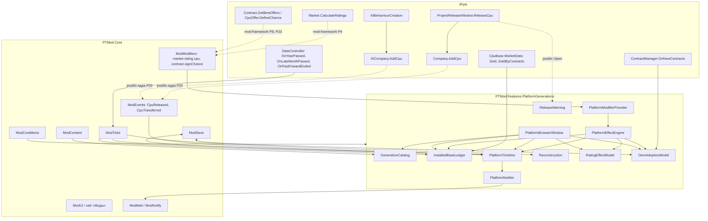
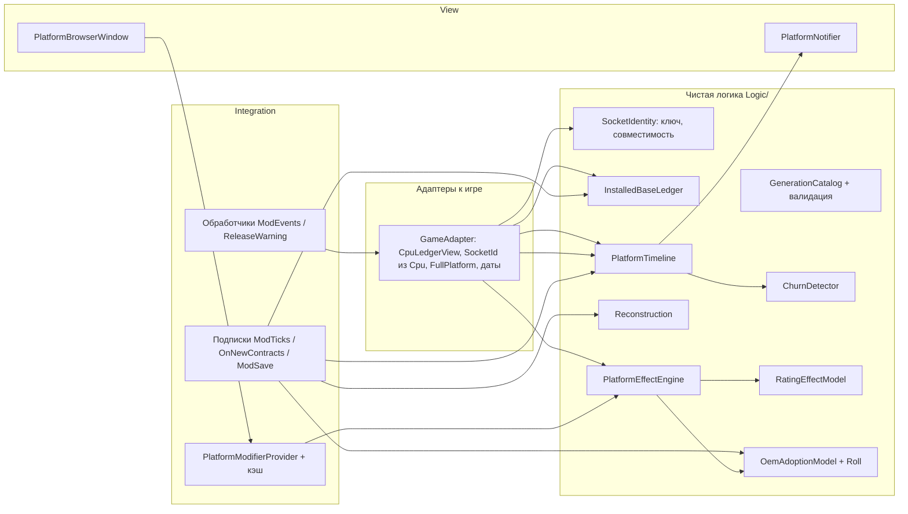
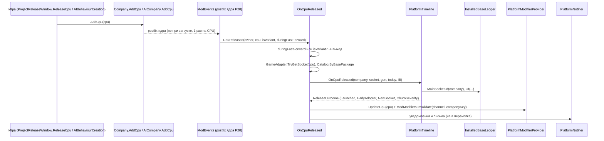
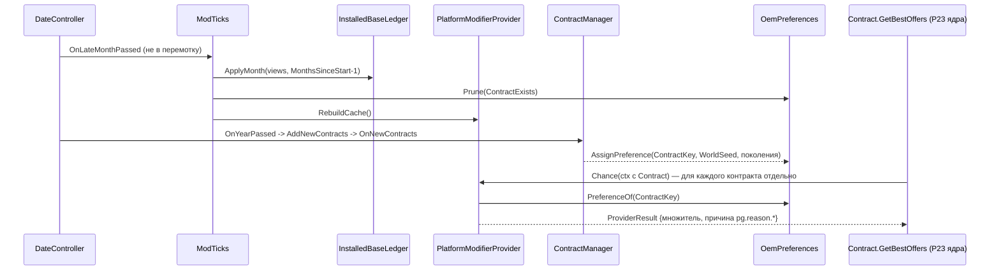
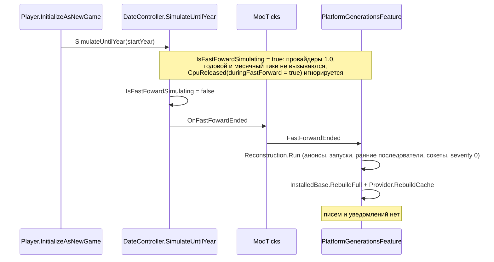

# Design: platform-generations

## Document Information

- **Feature Name**: platform-generations
- **Version**: 0.2
- **Date**: 2026-10-10
- **Author**: Dex719
- **Status**: Draft v0.2 — одобрено к реализации владельцем 2026-10-10
- **Reviewers**: владелец проекта
- **Related Documents**: `requirements.md` (FR-1…FR-13, NFR-1…NFR-8), `tasks.md`, `.kiro/steering/context.md`, `.kiro/steering/owner-decisions.md`, решения `0002` (Harmony), `0003` (тулчейн: Roslyn `csc`, мини-раннер), `0004` (ModSave), `0005` (ModUI), `0006` (контент JSON), спеки `mod-framework` v0.2 (каналы `ModModifiers`, `ModEvents`, `ModTicks`), `contract-transparency` (показ множителей)

## Overview

Фича состоит из трёх слоёв.

1. **Данные**: поколения платформ и баланс в контент-JSON (`ModContent`).
2. **Модели (чистая логика, `Logic/`)**:
   - каталог поколений и идентичность сокета;
   - установленная база, выводимая из помесячных продаж CPU (`CpuBase.MarketData`);
   - хронология (анонсы, запуски, ранние последователи, появления сокетов) и реконструкция;
   - модель эффекта на рейтинг;
   - модель принятия OEM и движок эффектов `PlatformEffectEngine`.
3. **Интеграция**:
   - два провайдера каналов `ModModifiers`: `market.rating.cpu` (множитель к `Cpu.Ratings.Overall`, фиксированная причина) и `contract.signChance` (множитель к шансу предложения, причина на каждый вызов);
   - подписки на события ядра `ModEvents.CpuReleased` / `CpuTransferred` вместо собственных патчей на `AddCpu`;
   - один собственный postfix-патч: `ProjectReleaseWindow.Open`;
   - подписки `ModTicks` (без работы в перемотке), `ModSave`, `ContractManager.OnNewContracts`;
   - окно «Платформы».

Формулы рынка и контрактов фича не патчит. Единственный патч на `Market.CalculateRatings` и на шанс контракта (P4, P8, P23) принадлежит `mod-framework`, который читает каналы. Ванильный PGA-переход (`Market.PgaDebuffMultiplier`) остаётся нетронутым.

### Design Goals
- Платформа — стратегическое решение с понятной ценой: база, ранний переход, смена сокета, отставание у OEM, полная платформа (сокет и память одного поколения).
- Умеренный баланс по умолчанию (рейтинг ×0,90…×1,16, шанс ×0,50…×1,375). Все числа — в контенте. Максимальный вклад фичи в общие каналы указан явно.
- Детерминизм и восстанавливаемость. База выводится из сейва игры, хронология и предпочтения — в `ModSave`, ролл — хэш с `ModRandom.WorldSeed`.
- Нейтральность в перемотке новой игры (политика владельца): ничего не делаем, затем один раз восстанавливаем состояние на `TickPhase.FastForwardEnded`.
- Ноль аллокаций в горячем пути (рыночный тик): множители из кэша, пересчёт раз в месяц.
- Одинаковые правила для игрока и ИИ.

### Key Design Decisions

- **D1. Эффекты — только через каналы `ModModifiers` (`market.rating.cpu`, `contract.signChance`).**
  - *Отвергнуто:* свой postfix на `Market.CalculateRatings` — конфликт с единственным патчем `mod-framework` и с другими фичами (порядок умножений, двойной учёт). Свой patch на `Contract.GetBestOffers` — цель закреплена ядром (P23), `ModHooks` её отклонит.
- **D2. Установленная база выводится из ledger-списков CPU, а не хранится.**
  - `CpuBase.MarketData.Sold` / `SoldByContracts` уже сохраняются игрой помесячно. Полная пересборка при загрузке точно воспроизводит базу.
  - *Отвергнуто:* хранить базу в `ModSave` — расходится с сейвом при ручной правке и раздувает файл. Копить её ежедневно на `OnMarketSellTick` — лишняя работа на тик и нет истории для старых сейвов.
- **D3. База хранится по CPU, суммы пересчитываются по текущему владельцу.**
  - При спин-оффе (`CompanyEventHandler.TriggerSolarFoundriesSpinOff`) или покупке компании (`rival-acquisitions`, событие `ModEvents.CpuTransferred`) база уходит вместе с CPU без отдельных хуков; на событие переноса фича только обновляет кэш множителей этого CPU.
  - *Отвергнуто:* кэш только по компаниям — устаревает при смене владельца.
- **D4. Стандартный `Package` — общий стандарт, `CustomSocket` — закрытая платформа компании.**
  - Чужая база на стандартном сокете засчитывается с весом `sharedWeight` (0,25, апгрейд «в тот же сокет» от другого производителя). Это даёт «войну платформ»: открытый стандарт против своего сокета.
  - *Отвергнуто:* все сокеты закрытые — теряется динамика стандартов. Ключ по ссылке на объект `IPackage` — не переживает загрузку.
- **D5. Анонс — по расписанию, запуск — по первому CPU.**
  - Анонс (1 января `announceYear`) даёт игроку время спланировать переход. Запуск по факту выпуска (как ванильный `MarketEventHandler.TriggerPgaEvent`) не позволяет поколению «стартовать» без продуктов.
  - *Отвергнуто:* только расписание — бонус ранним последователям мог бы достаться ни за что. Только запуск — нет предупреждения.
- **D6. Предпочтение OEM назначается контракту один раз и хранится по `ContractKey`; ролл — детерминированный хэш с `ModRandom.WorldSeed`.**
  - *Отвергнуто:* пересчитывать при каждом вызове — предпочтение «прыгало» бы с изменением базы. `System.Random` — невоспроизводимо после загрузки.
- **D7. Ванильный PGA-переход не меняется.**
  - Он сильнее любых эффектов фичи (×0.9 → 0 за 5 лет). Эффекты фичи умножаются поверх.
  - *Отвергнуто:* обобщить его через патч `Market.PgaDebuffMultiplier` — большой риск баланса.
- **D8. Нейтральность в перемотке и реконструкция на `FastForwardEnded`.**
  - В перемотку подписки года и месяца не вызываются (`TickOptions.None`), `ModEvents.CpuReleased` с `duringFastForward = true` игнорируется, провайдеры возвращают 1.0. На `TickPhase.FastForwardEnded` (после сброса `IsFastFowardSimulating`) один раз выполняется реконструкция по CPU рынка (тот же алгоритм, что для старых сейвов), затем полная пересборка базы и кэша. Реконструкция идемпотентна: повтор на `GameReady(NewGame)` ничего не меняет.
  - *Отвергнуто:* вести хронологию в перемотку (`RunDuringFastForward`) — противоречит политике владельца и удорожает перемотку; игнорировать перемотку совсем — после старта не было бы ранних последователей и запусков за прошлые годы.
- **D9. Совместимость по базовому корпусу.**
  - Стандартный `Package` и свой сокет на его основе считаются совместимыми, смена между ними не штрафуется. Это защищает ИИ, который строит свой сокет на каждом новом настраиваемом корпусе (`AIBehaviourSocket.SelectBasePackage`).
- **D10. OEM: основной режим «по контрактам» (контракт в `ModifierContext`), запасной «рыночный».**
  - Ядро v0.2 заполняет `ModifierContext.Contract` в P8 (захват контракта в prefix на приватный `Contract.GetBestOffers`, P23) и включает контракт в ключ дневного кеша. Поэтому 1 января один CPU получает свой множитель в каждом контракте. Режим выбирается по контексту вызова: `Contract` ≠ null → «по контрактам»; `Contract` = null (объяснение без контракта, патч P23 не применился) → «рыночный» (ожидание множителя по распределению предпочтений рынка).
  - *Отвергнуто:* проверка поля `ModifierContext.Contract` рефлексией (обход, нужный до доработки ядра); принудительный режим `perContract` в настройках; свой prefix на `GetBestOffers`.
- **D11. Стандарт памяти поколения влияет на OEM-множитель («полная платформа»).**
  - CPU, у которого `Cpu.Memory.Name` входит в `memories` поколения его сокета, получает `+fullPlatformBonus` (0,05) к платформенному множителю. Решение владельца: «стандарт памяти влияет». Надбавка прибавляется к `c_plat`, а не множит его, чтобы диапазон [0,40; 1,40] сохранялся.
  - *Отвергнуто:* штраф за «неполную» платформу (сложнее объяснить игроку); влияние памяти на рейтинг (канал рынка и без того нагружен).
- **D12. Причины множителей отдаёт провайдер.**
  - `market.rating.cpu`: фиксированный `reasonKey` без аллокаций. `contract.signChance`: `RegisterReasonedProvider` с `ProviderResult`; массивы аргументов подготовлены заранее. Разбивку показывает `ModModifiers.Explain`; своего публичного `Explain` у фичи нет.
- **D13. Имена поколений — реальные сокеты (решение владельца).**
  - В контенте `name` = реальный сокет или пара сокетов эпохи; технические `id` не меняются. *Отвергнуто:* обезличенные «PGA-1990».

## Architecture

### System Context



### High-Level Architecture



### Используемые сервисы PTMod.Core

| Сервис | Для чего |
|---|---|
| `ModModifiers` | Провайдеры каналов `market.rating.cpu` (`RegisterProvider` с причиной) и `contract.signChance` (`RegisterReasonedProvider`); `Invalidate` после изменения состояния внутри дня; причины для `Explain` (FR-10) |
| `ModEvents` | `CpuReleased` (запуск, ранние последователи, появление сокета) и `CpuTransferred` (смена владельца CPU); свои патчи на `AddCpu` запрещены |
| `ModHooks` | Патч `ProjectReleaseWindow.Open`; самопроверка; `Guard` для патча, `Raise` для событий фичи |
| `ModTicks` | `ctx.OnTick(TickPhase.YearPassed / LateMonthPassed / FastForwardEnded)` без `RunDuringFastForward`; `GameReady`; `IsFastForwarding`, `IsLoading`, `IsBatchRun` |
| `ModSave` | `IModSaveParticipant`, секция `platform-generations`: хронология, появления сокетов, предпочтения контрактов; `ModSave.Status` для выбора «новая игра / реконструкция»; версию секции (`_schema`) ведёт ядро |
| `ModContent` | `Content/platform-generations/generations.json`, `balance.json` |
| `ModSettings` | `ratingEffects`, `oemEffects`, `notifications` (`ctx.Param`); переключатель фичи ведёт хаб |
| `ModUI` | Окно «Платформы», пункт хаба, `ModUI.Tooltip` |
| `ModMail`, `ModNotify` | Анонсы (тег `pg:announce:<genId>`), ранние последователи (`pg:early:<genId>`), запуски, штрафы, предупреждения; приоритет `Normal`; блоков ID писем нет |
| `ModL10n` | Строки `pg.*` |
| `ModConditions` | Предикаты `pg.*` (FR-11) |
| `ModRandom` | `WorldSeed` — сид детерминированного ролла предпочтений OEM |
| `ModCompanies` | Ключи компаний `KeyOf` / `Resolve` (`player`, `ai:<UniqueID>`) |
| `ModLog` | Валидация контента, сбои, замеры |

### Technology Stack

| Слой | Технология | Обоснование |
|---|---|---|
| Модели | C# latest, общее подмножество API .NET Framework 4.8 и `mscorlib` Unity (без `init`, `record`, `Index`, `Range`), без `UnityEngine` | Решение 0003; тестируются мини-раннером в `mod/tests/PTMod.Tests/PlatformGenerations/` |
| Патчи | Harmony 2.3.x через `ModHooks` | Решение 0002 |
| Эффекты | Каналы `ModModifiers` | Контракт фреймворка: единственная точка патча формул |
| Данные | `ModContent` (JSON), `ModSave` (JSON) | Решения 0004, 0006 |
| UI | `ModUI` (клон окна игры) | Решение 0005 |

## Components and Interfaces

Пространство имён: `PTMod.Features.PlatformGenerations` (файлы в `mod/src/PTMod/Features/PlatformGenerations/`, чистая логика — в `.../Logic/`).

> API `PTMod.Core` — по `mod-framework/design.md` v0.2: `IModFeature`, `FeatureContext`, `[ModPatch]`, `ModHooks.Guard`/`Raise`, `IModSaveParticipant`, `TickPhase`/`TickOptions`, `ModTicks.GameReady`, `ModEvents`, `ModModifiers.RegisterProvider(featureId, channel, Func<ModifierContext, float>, reasonKey)` / `RegisterReasonedProvider(featureId, channel, Func<ModifierContext, ProviderResult>)` / `Invalidate`, `ModifierContext {Company, CompanyKey, Cpu, Segment, Contract, Design}`, `Segment`, `ModCompanies.KeyOf`, `ModContent.LoadRecords`/`LoadConfig`, `ModRandom.WorldSeed`, `ModConditions.Register`, `ModMail.Send`, `ModNotify.Show`, `ModUI.CreateWindow`. Обращения к фреймворку собраны в `PlatformModifierProvider` и `PlatformGenerationsFeature`.

### Component 1: PlatformGenerationsFeature

```csharp
[PTMod.Core.ModFeature]
public sealed class PlatformGenerationsFeature : PTMod.Core.IModFeature, PTMod.Core.IModSaveParticipant
{
    public const string FeatureId = "platform-generations";
    public string Id => FeatureId;  public string NameKey => "pg.hub.title";  public string DescriptionKey => "pg.hub.description";
    public string[] DependsOn => new string[0];  public bool EnabledByDefault => true;  public bool SupportsHotToggle => true;
    public string SectionId => FeatureId;  public int SchemaVersion => 1;     // поле _schema пишет и читает ядро
    public static PlatformGenerationsFeature Instance { get; private set; }
    public GenerationCatalog Catalog { get; private set; }     // ModContent.LoadRecords("platform-generations", "generations.json", …)
    public PlatformBalance Balance { get; private set; }       // ModContent.LoadConfig("platform-generations", "balance.json", 1)
    public InstalledBaseLedger InstalledBase { get; }
    public PlatformTimeline Timeline { get; }
    public OemPreferences Preferences { get; }
    /// Register (один раз):
    ///   ctx.Patch(typeof(ReleaseWarning));
    ///   ModEvents.CpuReleased += OnCpuReleased; ModEvents.CpuTransferred += OnCpuTransferred;   // вызывает ModHooks.Raise, только пока фича активна
    ///   ctx.OnTick(TickPhase.YearPassed, OnYearPassed); ctx.OnTick(TickPhase.LateMonthPassed, OnMonthPassed);   // без RunDuringFastForward
    ///   ctx.OnTick(TickPhase.FastForwardEnded, OnFastForwardEnded); ModTicks.GameReady += OnGameReady;
    ///   ctx.SaveParticipant(this); ctx.Param(...) ×3; ctx.HubPage("pg.hub.title", BuildHubPage);
    ///   ModSettings.Changed += OnSettingsChanged;            // ModModifiers.Invalidate обоих каналов
    ///   PlatformModifierProvider.Register();                 // провайдеры регистрируются один раз
    ///   PlatformConditions.Register();                       // pg.generationLaunched, pg.earlyAdopter, pg.installedBaseShare
    public void Register(PTMod.Core.FeatureContext ctx);
    public void OnEnabled();   // догоняющая Reconstruction.Run, InstalledBase.RebuildFull, Provider.RebuildCache; провайдеры не пересоздаются
    public void OnDisabled();  // закрыть окно «Платформы»; провайдеры и записи не удаляются — ядро пропускает неактивную фичу
    // IModSaveParticipant
    public void ResetToDefaults();                 // новая игра (ModSave.Status == NewGame) / нет секции / секция новее
    public void Read(PTMod.Core.Logic.Json.JsonObject section, int schema);   // schema — версия секции, прочитанная ядром
    public PTMod.Core.Logic.Json.JsonObject Write();                          // данные БЕЗ _schema
    /// GameReady(Loaded): если секции не было — Reconstruction.Run; затем InstalledBase.RebuildFull и Provider.RebuildCache.
    /// GameReady(NewGame): идемпотентный повтор Reconstruction.Run (основную работу сделал FastForwardEnded).
    private void OnGameReady(PTMod.Core.GameReadyReason reason);
    /// FastForwardEnded: Reconstruction.Run по CPU рынка (без писем и уведомлений), RebuildFull, RebuildCache.
    private void OnFastForwardEnded();
}
```

### Component 2: GenerationCatalog и SocketIdentity

```csharp
// LocText — PTMod.Core.LocText {Key, Ru, En}; в JSON: { "ru": "...", "en": "..." } (решение 0006)
[System.Serializable] public sealed class OemCurveDef { public int delayMonths; public int rampMonths; public float maxAdoption; public float ibAccel; }
[System.Serializable] public sealed class SocketPair { public string a; public string b; }

[System.Serializable] public sealed class GenerationDef : PTMod.Core.IContentRecord
{
    public string Id => id;
    public string id; public int order; public PTMod.Core.LocText name; public PTMod.Core.LocText description;   // name — реальный сокет (решение владельца)
    public int announceYear; public int obsoleteYear;        // 0 = не устаревает
    public List<string> sockets; public List<string> memories;
    public int earlyWindowMonths;
    public OemCurveDef oem;
    public List<SocketPair> compatibleSockets;               // по именам базовых корпусов
}
[System.Serializable] public sealed class GenerationsFile { public int schema; public List<GenerationDef> generations; }   // schema — версия файла контента

public sealed class GenerationCatalog
{
    public IReadOnlyList<GenerationDef> Generations { get; }   // по order
    public GenerationDef ById(string id);
    public GenerationDef ByBasePackage(string basePackageName); // null = вне поколений
    public bool IsFullPlatform(GenerationDef g, string memoryName);   // memoryName ∈ g.memories (D11)
    public GenerationStatus StatusAt(GenerationDef g, GameDate now, PlatformTimeline tl); // Expected/Announced/EarlyWindow/Mature/Obsolete
    /// Валидация FR-1.2…1.4 (функция validate для ModContent.LoadRecords + кросс-проверки дубликатов);
    /// packageExists/memoryExists — обёртки над DataFinder.FindPackage/FindMemory.
    public static GenerationCatalog Build(IReadOnlyList<GenerationDef> records, System.Func<string, bool> packageExists,
                                          System.Func<string, bool> memoryExists, List<string> errors);
}

public struct SocketId
{
    public string Key;               // "pkg:PGA 1995" | "custom:5120"
    public string BasePackageName;   // "PGA 1995"
    public bool IsStandard;          // !IPackage.IsCustomized
}

public static class SocketIdentity   // чистая логика
{
    public static SocketId Standard(string packageName);
    public static SocketId Custom(int customHardwareId, string basePackageName);
    /// FR-6.3: одинаковая база (если customOnSameBaseIsCompatible) или пара из compatibleSockets.
    public static bool Compatible(SocketId a, SocketId b, GenerationCatalog catalog, PlatformBalance balance);
}
// Адаптер (GameAdapter): TryGetSocket(Cpu cpu, out SocketId id) — Cpu.Package; IPackage.get_IsCustomized; CustomSocket.CustomHardwareID;
// CustomSocket.BasePackage.Name (исключение → «вне поколений»); Package.Name. IsFullPlatform читает Cpu.Memory.Name.
```

### Component 3: InstalledBaseLedger

```csharp
public struct CpuLedgerView   // строит GameAdapter из Cpu
{
    public int CpuId;                     // Cpu.SaveID
    public string CompanyKey;             // ModCompanies.KeyOf(Cpu.Company): "player" | "ai:<UniqueID>"
    public string SocketKey, GenId;       // GenId = null вне поколений
    public IReadOnlyList<int> Sold;              // CpuBase.MarketData.Sold
    public IReadOnlyList<int> SoldByContracts;   // CpuBase.MarketData.SoldByContracts
}

public sealed class InstalledBaseLedger
{
    public double Total { get; }
    /// FR-4.3: ib_cpu = Σ_i (Sold[i] + w*SoldByContracts[i]) * δ^(L - i), L = lastFullMonth.
    public void RebuildFull(IEnumerable<CpuLedgerView> cpus, int lastFullMonth, PlatformBalance b);
    /// FR-4.2: ib_cpu = ib_cpu*δ + units[lastFullMonth]; затем агрегаты по текущему CompanyKey.
    public void ApplyMonth(IEnumerable<CpuLedgerView> cpus, int lastFullMonth, PlatformBalance b);
    public double Of(string companyKey, string socketKey);
    public double OfSocket(string socketKey);
    public double OfGeneration(string genId);
    public string MainSocketOf(string companyKey, string excludeSocketKey); // max IB среди прочих
    public IEnumerable<IbRow> Rows();                                       // для окна
}
public struct IbRow { public string CompanyKey; public string SocketKey; public double Units; public double Share; }
```

### Component 4: PlatformTimeline, ChurnDetector, Reconstruction

`GameDate` — простая дата (год, месяц, день) без `UnityEngine`; адаптер строит её из `DateController.get_CurrentDate`.

```csharp
public sealed class PlatformTimeline
{
    public bool IsAnnounced(string genId); public bool IsLaunched(string genId, out GameDate date, out string byCompanyKey);
    public void Announce(string genId, GameDate date);                                 // FR-2
    /// FR-3, FR-6: регистрирует выпуск (вызывается из обработчика ModEvents.CpuReleased); возвращает, что изменилось.
    public ReleaseOutcome OnCpuReleased(string companyKey, SocketId socket, GenerationDef gen, GameDate date,
                                        InstalledBaseLedger ib, GenerationCatalog cat, PlatformBalance b);
    /// FR-7: то же без записи (для предупреждения в окне выпуска).
    public ReleaseOutcome Preview(string companyKey, SocketId socket, GenerationDef gen, GameDate date,
                                  InstalledBaseLedger ib, GenerationCatalog cat, PlatformBalance b);
    public bool IsEarlyAdopter(string companyKey, string genId, out GameDate since);
    public SocketIntro IntroOf(string companyKey, string socketKey);   // дата появления, severity
    public int SocketAgeMonths(string companyKey, string socketKey, GameDate now);
}
public struct ReleaseOutcome { public bool Announced, Launched, EarlyAdopter, NewSocket; public float ChurnSeverity; public string MainSocketKey; public int MainAgeMonths; }

public static class ChurnDetector
{
    /// FR-6.2: severity = (1 - age/minLife), если main есть, share >= churnMinBaseShare, age < minLife и несовместимы; иначе 0.
    public static float Severity(bool hasMain, int mainAgeMonths, double mainShare, bool compatible, PlatformBalance b);
}

public struct ReconCpu { public int CpuId, Year; public string CompanyKey, SocketKey, GenId; }   // строит GameAdapter из всех CPU рынка

public static class Reconstruction   // FR-12.3: FastForwardEnded, сейв без секции, повторное включение фичи
{
    /// Идемпотентно дополняет Timeline недостающими записями: анонсы (announceYear ≤ currentYear, 1 января),
    /// запуск (минимальный Year, 1 января), ранние последователи по (Year, CpuId) в окне, появления сокетов с severity 0.
    /// Писем и событий не создаёт.
    public static ReconstructionReport Run(PlatformTimeline tl, GenerationCatalog cat, PlatformBalance b,
                                           IReadOnlyList<ReconCpu> cpus, int currentYear);
}
```

### Component 5: RatingEffectModel, OemAdoptionModel, PlatformEffectEngine

```csharp
public struct RatingInput
{
    public double OwnIb, SocketIb, TotalIb; public bool IsStandard;
    public bool IsEarlyAdopter; public int MonthsSinceEarly;
    public float ChurnSeverity; public int MonthsSinceIntro;
}
public struct RatingBreakdown { public float Bib, Bearly, Pchurn, ConsumerMult, IndustriesMult; public double EffShare; }

public static class RatingEffectModel
{
    public static RatingBreakdown Compute(RatingInput i, PlatformBalance b);   // формулы F2–F6
}

public struct GenAdoptionInput { public GenerationDef Gen; public bool Launched; public int MonthsSinceLaunch; public double IbShareG; public bool ObsoleteAtT; }

public enum OemMode { Auto, MarketAverage }   // Auto: контракт в контексте → «по контрактам», иначе «рыночный»

public static class OemAdoptionModel
{
    public static double Adoption(OemCurveDef c, bool launched, int monthsSinceLaunch, double ibShareG); // F7
    /// F8 (по контрактам): перебор от новых к старым; "" = без предпочтения.
    public static string AssignPreference(string contractKey, uint worldSeed, IReadOnlyList<GenAdoptionInput> newestFirst);
    public static double Roll(string contractKey, string genId, uint worldSeed);   // FNV-1a 64 -> [0,1)
    /// F9a: множитель платформы для известного предпочтения; fullPlatform — память CPU входит в стандарты его поколения (D11).
    public static float PlatformMultiplier(int? cpuGenOrder, int? prefGenOrder, bool fullPlatform, PlatformBalance b, out string reasonKey);
    /// F9b (запасной «рыночный» режим): Σ p_G·c_plat(Gc,G) + p_none; p_G = A_G·Π_{H новее}(1−A_H). 1.0 при order(Gc) < marketAverageMinGenOrder.
    public static float MarketAverageMultiplier(int? cpuGenOrder, bool fullPlatform, IReadOnlyList<GenAdoptionInput> newestFirst, PlatformBalance b);
    /// F9c: × лояльность OEM, clamp [minChanceMult, maxChanceMult].
    public static float WithLoyalty(float platformMult, double effShare, PlatformBalance b);
}

public sealed class OemPreferences   // режим «по контрактам»
{
    public string PreferenceOf(string contractKey);           // null = не назначено
    public void Assign(string contractKey, string genId);
    public void Prune(System.Func<string, bool> stillExists);  // FR-8.8
}

public static class ContractKeyBuilder   // та же формула, что в contract-transparency; своя копия, чтобы не создавать зависимость
{
    public static string Build(string company, int acceptanceYear, int acceptanceMonth, int units, float paymentPerUnit, int contractType);
}

/// Чистый движок множителей: вход — плоские структуры, выход — множитель и причина. Режим выбирается по наличию контракта.
public struct EffectCpu { public int? GenOrder; public string GenId; public bool FullPlatform; public double EffShare; public bool IsFastForwarding; }
public struct EffectContract { public bool Present; public string Key; public int ContractType; }
public struct ChanceResult { public float Multiplier; public string ReasonKey; public string GenId; public int LagGenerations; public double AdoptionPercent; }

public sealed class PlatformEffectEngine
{
    public OemMode EffectiveMode(OemMode configured, bool contractPresent);
    /// Присутствует контракт и режим Auto → F9a по сохранённому предпочтению (или без предпочтения → 1.0), иначе F9b; затем F9c.
    public ChanceResult Chance(EffectCpu cpu, EffectContract contract, OemMode configured,
                               OemPreferences prefs, IReadOnlyList<GenAdoptionInput> newestFirst, PlatformBalance b);
}
```

### Component 6: PlatformModifierProvider

```csharp
public sealed class PlatformModifierProvider
{
    /// Вызывается один раз из PlatformGenerationsFeature.Register (OnEnabled/OnDisabled провайдеры не пересоздают):
    /// ModModifiers.RegisterProvider(FeatureId, ModChannels.MarketRatingCpu, Rating, reasonKey: "pg.reason.rating");
    /// ModModifiers.RegisterReasonedProvider(FeatureId, ModChannels.ContractSignChance, Chance);
    public void Register();
    /// Горячий путь: кэш Dictionary<Cpu, float[2]> (индекс 0 — потребительские сегменты, 1 — Segment.Industries). Без аллокаций.
    /// 1.0 при ModTicks.IsFastForwarding, выключенном эффекте, CPU вне поколений. Ядро дополнительно кеширует результат на день.
    public float Rating(PTMod.Core.ModifierContext ctx);       // ctx.Cpu, ctx.Segment
    /// ctx.Contract != null → «по контрактам» (PlatformEffectEngine, предпочтение по ContractKey; при отсутствии — ленивое назначение);
    /// иначе «рыночный» режим (кэш Dictionary<Cpu, float>, пересчёт раз в месяц). Причина — pg.reason.oemPrefers / oemLag / oemAdoption / oemLoyalty;
    /// массивы ReasonArgs подготовлены заранее по поколениям.
    public PTMod.Core.ProviderResult Chance(PTMod.Core.ModifierContext ctx);
    public void RebuildCache();                                // LateMonthPassed, GameReady, FastForwardEnded, ModSettings.Changed
    public void UpdateCpu(ProcessorTycoon.Hardware.Cpu cpu);   // новый CPU или смена владельца; затем ModModifiers.Invalidate(channel, companyKey)
}

public static class PlatformInsights   // только для окна «Платформы» и соседних фич; Explain делает ядро
{
    public static RatingBreakdown RatingOf(ProcessorTycoon.Hardware.Cpu cpu);          // составляющие B_ib, B_early, P_churn
    public static OemView OemOf(ProcessorTycoon.Hardware.Cpu cpu);                      // число контрактов с отставанием, средний множитель, c̄
    public static GenerationDef GenerationOf(ProcessorTycoon.Hardware.Cpu cpu);         // для press-reviews и окон
}
```

### Component 7: Обработчики событий ядра, патч окна выпуска и уведомления

```csharp
// Обработчики ModEvents (внутри PlatformGenerationsFeature); исключения изолирует ModHooks.Raise и засчитывает фиче.
//   OnCpuReleased(ICompany owner, Cpu cpu, bool isVariant, bool duringFastForward):
//       if (duringFastForward || isVariant) return;                  // нейтральность в перемотке; вариант не меняет сокет и поколение
//       GameAdapter.TryGetSocket → Timeline.OnCpuReleased → Provider.UpdateCpu → ModModifiers.Invalidate → Notifier
//   OnCpuTransferred(ICompany from, ICompany to, Cpu cpu): Provider.UpdateCpu(cpu) + Invalidate; база уйдёт на ближайшем ApplyMonth.

internal static class ReleaseWarning
{
    [PTMod.Core.ModPatch(typeof(ProcessorTycoon.ProjectSystem.ProjectReleaseWindow), "Open", PTMod.Core.PatchKind.Postfix, Optional = true)]
    internal static void OpenPostfix(ProcessorTycoon.ProjectSystem.ProjectReleaseWindow __instance, ProcessorTycoon.Hardware.Cpu cpu); // FR-7
}
public sealed class PlatformNotifier   // ModNotify.Show / ModMail.Send (приоритет Normal, теги pg:announce:<genId>, pg:early:<genId>)
{
    public void Announced(GenerationDef g); public void Launched(GenerationDef g, string byCompanyKey, bool player);
    public void EarlyAdopter(GenerationDef g, int slot); public void Churn(SocketId s, float penalty, int months);
    // все методы: no-op при ModTicks.IsFastForwarding, ModTicks.IsLoading или notifications = false;
    // в пакетном прогоне (ModTicks.IsBatchRun) показ откладывает ядро до BatchEnded
}
public static class PlatformEvents   // поднимаются через ModHooks.Raise, не в перемотке
{
    public static event System.Action<string> GenerationAnnounced, GenerationLaunched;
    public static event System.Action<string, string> EarlyAdopterGranted;      // companyKey, genId
    public static event System.Action<string, string, float> SocketChurnApplied; // companyKey, socketKey, severity
}
```

### Component 8: UI

| Окно / элемент | Шаблон и компоненты `ModUI` | Содержимое |
|---|---|---|
| `PlatformBrowserWindow` | `ModUI.CreateWindow("pg.browser", WindowTemplate.Panel, "pg.hub.title", 760×560)`; вкладки — `ModUI.Button`; списки — `ModUI.ScrollView` + `ModUI.VerticalList` + `ModUI.Info`; полоса принятия — текстовая полоса `▮▮▮▯▯` + процент (в `ModUI` нет обёртки `ProgressBar`) | Вкладки «Поколения», «Установленная база» (`ModUI.Dropdown` «мои / все»), «Мои CPU» (с признаком «полная платформа») |
| Подсказка риска смены сокета | `ModUI.Tooltip` (динамический текст) на строке сокета вкладки «Мои CPU» | Возраст, остаток до `minSocketLifeMonths`, штраф сейчас |
| Уведомления | `ModNotify.Show` / `ShowKey` | Анонс, запуск, ранний последователь, штраф, предупреждение выпуска |
| Письма | `ModMail.Send` | Анонс поколения; «Вы — ранний последователь»; итог штрафа |
| Настройки | `ctx.HubPage`: `ModUI.Toggle` ×3 + переключатель фичи хаба | FR-13 |

## Патчи Harmony

| Цель (Class.Method игры) | Тип | Что меняет | Порядок / конфликты |
|---|---|---|---|
| `ProjectReleaseWindow.Open(Cpu)` | postfix (`Optional`) | Предупреждение о смене сокета или раннем переходе (FR-7) через `PlatformTimeline.Preview` | Только чтение; сбой цели не делает фичу `Unavailable`; цель не закреплена ядром |

Выпуск CPU фича получает событием ядра `ModEvents.CpuReleased` (один postfix ядра P20 на `Company.AddCpu` и `AICompany.AddCpu`), перенос — `ModEvents.CpuTransferred`. Собственных патчей на `Company.AddCpu` / `AICompany.AddCpu` у фичи нет: цели закреплены ядром, `ModHooks` отклонил бы такой патч.

Не патчится (эффект — через каналы `mod-framework`): `Market.CalculateRatings`, `Market.NormalizeRatings`, `Contract.GetBestOffers` (P23), `Contract.CpuOffer.DefineChance` (P8). Не трогается ваниль: `Market.PgaDebuffMultiplier`, `MarketEventHandler.TriggerPgaEvent`, `Cpu.get_AveragePopularity`, `CreatorSocket.CreateSocket`, `AIBehaviourSocket.CreateSocket` (появление сокета фиксируется по первому выпущенному CPU, а не по созданию сокета).

## Подписки на события

| Событие | Обработчик | Защиты (перемотка/загрузка) |
|---|---|---|
| `ModEvents.CpuReleased` | `OnCpuReleased`: запуск, ранний последователь, появление сокета, штраф; обновление кэша CPU; `ModModifiers.Invalidate` | Ядро не поднимает событие при загрузке сейва и не чаще раза на объект CPU; `duringFastForward = true` и `isVariant = true` игнорируются |
| `ModEvents.CpuTransferred` | `OnCpuTransferred`: обновление кэша множителей CPU | Событие переноса не сопровождается `CpuReleased` |
| `ctx.OnTick(TickPhase.YearPassed)` (`TickOptions.None`) | `Timeline.Announce` для поколений с `announceYear == год`; `Notifier.Announced` | В перемотку и при загрузке не вызывается; в пакетном прогоне вызывается по дням, показ писем откладывает ядро |
| `ctx.OnTick(TickPhase.LateMonthPassed)` (`TickOptions.None`) | `InstalledBase.ApplyMonth`; `Preferences.Prune`; `Provider.RebuildCache` | В перемотку и при загрузке не вызывается (пересборка — на `FastForwardEnded` и `GameReady`) |
| `ctx.OnTick(TickPhase.FastForwardEnded)` | `Reconstruction.Run` + `InstalledBase.RebuildFull` + `Provider.RebuildCache` + проверка инвариантов | Приходит после сброса `IsFastFowardSimulating` — единственная точка однократной инициализации |
| `ContractManager.OnNewContracts` (подписка на сцене, переподписка на `PTModHost.SceneReady`) | Назначение предпочтений новым контрактам (FR-8.3) | В перемотку выходит сразу (`ModTicks.IsFastForwarding`); контракты из перемотки получают предпочтение лениво или при реконструкции |
| `IModSaveParticipant.Read` (ядро, на `SaveHandler.OnLoaded`) | Восстановление хронологии и предпочтений | Нет секции / секция новее (`_schema` больше `SchemaVersion`) → `ResetToDefaults` + флаг «нужна реконструкция» |
| `IModSaveParticipant.Write` (ядро, после `SaveSystem.Save`, P12) | Запись секции | — |
| `IModSaveParticipant.ResetToDefaults` при `ModSave.Status` = `NewGame` (ядро в prefix `GameManager.StartNewGame`, P17) | Сброс состояния новой игры (FR-12.1) | До начала перемотки |
| `ModTicks.GameReady(Loaded / NewGame)` | Loaded: реконструкция (если нужна, FR-12.4), `RebuildFull`, `RebuildCache`; NewGame: идемпотентный повтор реконструкции | Один раз на сцену |
| `ModSettings.Changed` / `ModFeatures.StateChanged` | `Provider.RebuildCache`, `ModModifiers.Invalidate` обоих каналов | — |

## Data Models

### Секция ModSave

Поля версии в секции нет: `_schema` пишет и читает ядро.

```csharp
[System.Serializable] public sealed class PlatformGenerationsSave   // ModJson.Bind / ModJson.From
{
    public List<GenerationStateDto> generations = new List<GenerationStateDto>();
    public List<SocketIntroDto> socketIntros = new List<SocketIntroDto>();
    public List<ContractPrefDto> contractPrefs = new List<ContractPrefDto>();   // режим «по контрактам»
}
[System.Serializable] public sealed class GenerationStateDto { public string id, announced, launched, launchedBy; public List<AdopterDto> earlyAdopters = new List<AdopterDto>(); }
[System.Serializable] public sealed class AdopterDto { public string company; public string date; }   // company = ModCompanies.KeyOf
[System.Serializable] public sealed class SocketIntroDto { public string company, socket, date, main; public int mainAgeMonths; public float severity; }
[System.Serializable] public sealed class ContractPrefDto { public string key, gen; }   // gen "" = без предпочтения
```

Сид ролла — `ModRandom.WorldSeed` (его хранит ядро), отдельного сида у фичи нет.

Пример:

```json
{
  "schema": 1,
  "features": {
    "platform-generations": {
      "_schema": 1,
      "generations": [
        { "id": "gen-1990-pga", "announced": "1990-01-01", "launched": "1990-02-14", "launchedBy": "ai:3",
          "earlyAdopters": [ { "company": "ai:3", "date": "1990-02-14" }, { "company": "player", "date": "1990-11-02" } ] },
        { "id": "gen-1995-pga", "announced": "1995-01-01", "launched": "", "launchedBy": "", "earlyAdopters": [] }
      ],
      "socketIntros": [
        { "company": "player", "socket": "pkg:PGA 1990", "date": "1990-11-02", "main": "pkg:PGA 1985", "mainAgeMonths": 50, "severity": 0.0 },
        { "company": "ai:5", "socket": "pkg:PGA 1990", "date": "1993-06-01", "main": "pkg:PGA 1985", "mainAgeMonths": 61, "severity": 0.0 },
        { "company": "ai:5", "socket": "pkg:PGA 1995", "date": "1995-02-01", "main": "pkg:PGA 1990", "mainAgeMonths": 20, "severity": 0.444 }
      ],
      "contractPrefs": [
        { "key": "Apple|1993-1|52000|299|1", "gen": "gen-1990-pga" },
        { "key": "Sony|1993-1|30000|199|2", "gen": "" }
      ]
    }
  }
}
```

Поле `_schema` в секции записало ядро; в DTO фичи его нет, а `Write()` фичи его не возвращает.

**Validation Rules**:
- Версию секции проверяет ядро: `_schema` больше `SchemaVersion` → ядро сохраняет секцию нетронутой и вызывает `ResetToDefaults`; фича работает с реконструкцией и пишет `ModLog`.
- Даты — `yyyy-MM-dd`, не позже текущей даты игры; иначе запись отбрасывается.
- `company` — ключ, который разрешает `ModCompanies.Resolve`; иначе запись хранится, но не участвует в расчётах.
- `severity` ∈ [0, 1].
- Записи с неизвестным `id` поколения сохраняются как есть (FR-12.6).

### Контент `Content/platform-generations/generations.json`

Схема: `GenerationsFile` (см. Component 2; `schema` — версия файла контента). Встроенные 10 поколений (все корпуса и стандарты памяти — из `data/ProcessorTycoon.Hardware.Package.json`, `Memory.json` и годов `ResearchSystem.Technology.json`). Названия — реальные сокеты эпохи (решение владельца); они подсказывают эпоху, а игровые `announceYear` заданы технологиями игры и могут не совпадать с годами реальных запусков:

| order | id | Название (`name.ru` / `name.en`) | Сокеты (базовые корпуса) | Память | announceYear | obsoleteYear | earlyWindowMonths | OEM: delay / ramp / max / ibAccel |
|---|---|---|---|---|---|---|---|---|
| 0 | `gen-1971-dip` | DIP-40 | DIP 1970, DIP 1975 | DIP SRAM | 1971 | 1987 | 36 | 0 / 48 / 0.9 / 0.5 |
| 1 | `gen-1980-plcc` | PLCC-68 | PLCC 1980 | DRAM | 1980 | 1991 | 24 | 6 / 48 / 0.9 / 0.5 |
| 2 | `gen-1985-pga` | PGA-132 | PGA 1985 | DRAM | 1985 | 1995 | 24 | 6 / 36 / 0.9 / 0.5 |
| 3 | `gen-1990-pga` | Socket 1–3 | PGA 1990 | SDR | 1990 | 2000 | 24 | 6 / 36 / 0.9 / 0.5 |
| 4 | `gen-1995-pga` | Socket 5/7 | PGA 1995 | SDR | 1995 | 2005 | 24 | 6 / 36 / 0.9 / 0.5 |
| 5 | `gen-2000` | LGA 775 / Socket 939 | LGA 2000, PGA 2000 | DDR, DDR2 | 2000 | 2013 | 24 | 6 / 36 / 0.9 / 0.5 |
| 6 | `gen-2010` | LGA 1156 / AM3 | LGA 2010, PGA 2010 | DDR3 | 2010 | 2020 | 24 | 6 / 30 / 0.9 / 0.5 |
| 7 | `gen-2015` | LGA 1151 / AM4 | LGA 2015, PGA 2015 | DDR4 | 2015 | 2026 | 24 | 6 / 30 / 0.9 / 0.5 |
| 8 | `gen-2020` | LGA 1700 / AM5 | LGA 2020 A, LGA 2020 B | DDR4, DDR5 | 2020 | 2034 | 24 | 6 / 30 / 0.9 / 0.5 |
| 9 | `gen-2030` | LGA 2030 A/B | LGA 2030 A, LGA 2030 B | DDR6 | 2030 | 0 | 24 | 6 / 30 / 0.9 / 0.5 |

Для поколения 9 реальных сокетов ещё нет, поэтому название — игровые `LGA 2030 A/B`; в `description` указано, что это будущие сокеты.

Годы технологий в игре: DIP 1970 — 1971; DIP 1975 — 1975; PLCC 1980 — 1980; PGA 1985…PGA 1995 — 1985/1990/1995; LGA 2000 и PGA 2000 — 2000; LGA/PGA 2010 — 2010; LGA/PGA 2015 — 2015; LGA 2020 A/B — 2020; LGA 2030 A/B — 2030. Память: DIP SRAM 1971, DRAM 1980, SDR 1990, DDR 2000, DDR2 2003, DDR3 2008, DDR4 2014, DDR5 2022, DDR6 2028. Ветки: LGA 2000 → LGA 2010 → LGA 2015 → LGA 2020 A → LGA 2030 A (ветка 0); PGA 2000 → PGA 2010 → PGA 2015 → LGA 2020 B → LGA 2030 B (ветка 1).

«Полная платформа» (D11) определяется по колонке «Память»: например, CPU на `LGA 2000` с памятью `DDR` или `DDR2` — полная платформа `gen-2000`, с `SDR` — нет; CPU на `LGA 2020 A` с `DDR4` или `DDR5` — полная платформа `gen-2020`.

Пример записи:

```json
{
  "schema": 1,
  "generations": [
    {
      "id": "gen-2000", "order": 5,
      "name": { "ru": "LGA 775 / Socket 939", "en": "LGA 775 / Socket 939" },
      "description": { "ru": "Две ветки сокетов (LGA и PGA), память DDR и затем DDR2.", "en": "Two socket branches (LGA and PGA), DDR memory and then DDR2." },
      "announceYear": 2000, "obsoleteYear": 2013,
      "sockets": [ "LGA 2000", "PGA 2000" ], "memories": [ "DDR", "DDR2" ],
      "earlyWindowMonths": 24,
      "oem": { "delayMonths": 6, "rampMonths": 36, "maxAdoption": 0.9, "ibAccel": 0.5 },
      "compatibleSockets": []
    },
    {
      "id": "gen-1971-dip", "order": 0,
      "name": { "ru": "DIP-40", "en": "DIP-40" },
      "description": { "ru": "Первые микропроцессоры в корпусе DIP.", "en": "The first microprocessors in DIP packages." },
      "announceYear": 1971, "obsoleteYear": 1987,
      "sockets": [ "DIP 1970", "DIP 1975" ], "memories": [ "DIP SRAM" ],
      "earlyWindowMonths": 36,
      "oem": { "delayMonths": 0, "rampMonths": 48, "maxAdoption": 0.9, "ibAccel": 0.5 },
      "compatibleSockets": [ { "a": "DIP 1970", "b": "DIP 1975" } ]
    }
  ]
}
```

Диапазоны валидации: `earlyWindowMonths` 6…60; `delayMonths` 0…36; `rampMonths` 6…120; `maxAdoption` 0…1; `ibAccel` 0…2.

### Контент `Content/platform-generations/balance.json`

```json
{
  "schema": 1,
  "installedBase": { "lifetimeMonths": 60, "contractUnitWeight": 0.5 },
  "rating": {
    "ibMaxBonus": 0.10, "ibSaturationShare": 0.40, "sharedWeight": 0.25,
    "earlyBonus": 0.06, "earlyDurationMonths": 60, "earlyAdopterSlots": 3,
    "churnPenalty": 0.10, "minSocketLifeMonths": 36, "churnDurationMonths": 24, "churnMinBaseShare": 0.02,
    "customOnSameBaseIsCompatible": true,
    "industriesWeight": 0.5, "minMult": 0.85, "maxMult": 1.20
  },
  "oem": {
    "mode": "auto",
    "contractTypes": [ 1, 2 ],
    "marketAverageMinGenOrder": 2,
    "adoptBonus": 0.20, "lagPenalty1": 0.25, "lagPenalty2": 0.50, "fullPlatformBonus": 0.05,
    "oemLoyaltyBonus": 0.10, "minChanceMult": 0.40, "maxChanceMult": 1.40
  }
}
```

Диапазоны: бонусы и штрафы 0…0.5 (`fullPlatformBonus` 0…0.2); `lifetimeMonths` 12…240; `minMult` 0.5…1; `maxMult` 1…2; `contractTypes` ⊆ {0, 1, 2} (`ContractType`: Calculator 0, Computer 1, Console 2; по умолчанию без Calculator); `mode` ∈ {`auto`, `marketAverage`} (`auto` — «по контрактам», если в контексте есть контракт, иначе «рыночный»; `marketAverage` принудительно включает «рыночный»); `marketAverageMinGenOrder` 0…9.

## Формулы и баланс

Обозначения: `k` — компания, `s` — ключ сокета, `G` — поколение, месяц — индекс ledger (`DateController.MonthsSinceStart`).

| # | Формула | Что меняет в игре |
|---|---|---|
| F1 | `ib_cpu(L) = Σ_{i≤L} (Sold[i] + w_c·SoldByContracts[i]) · δ^(L−i)`, `δ = 1 − 1/lifetimeMonths`, `w_c = contractUnitWeight`; `IB[k][s] = Σ ib_cpu` по CPU с `Cpu.Company = k`, сокет `s`; `L = MonthsSinceStart − 1` | Ничего (только чтение `CpuBase.MarketData`) |
| F2 | `effShare = (IB[k][s] + sharedWeight · (IB[·][s] − IB[k][s]) · [s стандартный]) / IB_всего` (0, если `IB_всего = 0`) | — |
| F3 | `B_ib = ibMaxBonus · min(1, effShare / ibSaturationShare)` | — |
| F4 | `B_early = earlyBonus · max(0, 1 − monthsSinceEarly / earlyDurationMonths)` для раннего последователя поколения CPU | — |
| F5 | `P_churn = churnPenalty · severity · max(0, 1 − monthsSinceIntro / churnDurationMonths)`, `severity = 1 − mainAge/minSocketLifeMonths` (условия FR-6.2) | — |
| F6 | `m_seg = clamp(1 + w_seg · (B_ib + B_early − P_churn), minMult, maxMult)`, `w_seg = 1` для сегментов `HighEnd`, `MidRange`, `LowEnd`, `industriesWeight` (0,5) для `Segment.Industries` | **Значение канала `market.rating.cpu`** → `mod-framework` умножает `Cpu.Ratings.Overall` после `Market.CalculateRatings` (рейтинг идёт в `Market.NormalizeRatings`, `Market.DiluteRatings`, `Market.CalculatePotentialBuyers`); произведение всех фич на CPU ограничено ядром до [0,5; 2,0] |
| F7 | `A_G(m) = min(maxAdoption, maxAdoption · clamp01((m − delayMonths)/rampMonths) + ibAccel · IB_G/IB_всего)`; 0, если G не запущено | — |
| F8 | Предпочтение контракта (режим «по контрактам»): для G от новых к старым, запущенных и с `obsoleteYear`, не наступившим на `t_создания`: если `Roll(key, G) < A_G(t_создания)` → G; иначе `""`. `Roll = FNV1a64(key + "#" + G.id + "#" + ModRandom.WorldSeed) / 2^64`. Только для `ContractType` из `contractTypes` | — |
| F9a | `c_plat(Gc, Gp, full) = base + fullPlatformBonus·[full]`, где `base = 1 + adoptBonus` (Gc ≥ Gp) / `1 − lagPenalty1` (на 1 ниже) / `1 − lagPenalty2` (на 2+ ниже); `full` — `Cpu.Memory.Name` ∈ `memories` поколения Gc; 1 (без надбавки), если нет Gc или Gp или тип контракта не в `contractTypes` | — |
| F9b | «Рыночный» запасной режим: по запущенным и неустаревшим на сегодня поколениям от новых к старым `p_G = A_G · Π_{H новее G}(1 − A_H)`, `p_none = Π_H(1 − A_H)`; `c̄(Gc, full) = Σ_G p_G · c_plat(Gc, G, full) + p_none`; `c̄ = 1`, если `order(Gc) < marketAverageMinGenOrder` или Gc неизвестно | — |
| F9c | `c = clamp(c_plat_или_c̄ · (1 + oemLoyaltyBonus · min(1, effShare/ibSaturationShare)), minChanceMult, maxChanceMult)` | **Значение канала `contract.signChance`** → `mod-framework` (P8 + P23) в postfix `Contract.CpuOffer.DefineChance`: `Chance = clamp(round(ipsShare × 100 × M), 1, 100)`; шанс участвует в розыгрыше `Contract.ChooseCpu` и в `Contract.ChanceToSign` |

### Максимальный вклад фичи в общие каналы

- `market.rating.cpu`: минимум `1 − churnPenalty` = ×0,90 (штраф за смену сокета без базы и бонусов), максимум `1 + ibMaxBonus + earlyBonus` = ×1,16; для «Промышленности» ×0,95…×1,08. Клампы `minMult` 0,85 и `maxMult` 1,20 — страховка от оверрайдов контента.
- `contract.signChance`: минимум `1 − lagPenalty2` = ×0,50; максимум `(1 + adoptBonus + fullPlatformBonus) × (1 + oemLoyaltyBonus)` = 1,25 × 1,10 = ×1,375. Клампы `minChanceMult` 0,40 и `maxChanceMult` 1,40.
- Общий предел на CPU обеспечивает ядро: [0,5; 2,0] для `market.rating.cpu` (Explain показывает «(ограничено)»); у `contract.signChance` — только предохранитель [0; 5].

### Примеры с числами по умолчанию

- **База, закрытый сокет.** У игрока 30 % всей базы на своём сокете → `B_ib = 0.10 · 0.75 = 0.075` → `m` = 1.075 (сегменты `HighEnd`, `MidRange`, `LowEnd`) и 1.0375 («Промышленность»).
- **База, стандартный сокет.** Компания A — 10 %, B — 20 % на `PGA 1995` → для A `effShare = 0.10 + 0.25·0.20 = 0.15`, `B_ib = 0.0375`; для B `effShare = 0.20 + 0.25·0.10 = 0.225`, `B_ib = 0.05625`.
- **Ранний последователь.** Через 12 месяцев `B_early = 0.06 · (1 − 12/60) = 0.048`.
- **Смена сокета.** Основной сокет 12 мес. → `severity = 0.667`; сразу `P_churn = 0.0667`, через 12 мес. — 0.0333.
- **Влияние на продажи.** Если у всех CPU компании одинаковый множитель `m`, `Market.DiluteRatings` (`Overall²/T`) даёт `m·Overall²/T`, то есть доля покупателей (`Market.CalculatePotentialBuyers`) растёт примерно линейно — на +7.5 % относительно до нормировки суммой рейтингов. Для сравнения: ванильный PGA-штраф — от ×0.9 до ×0 за 5 лет.
- **OEM, режим «по контрактам» (основной).** `gen-2000` запущено в марте 2000, контракт создан в январе 2002 (m = 22), доля базы поколения 15 % → `A = 0.9·16/36 + 0.5·0.15 = 0.475`. Контракт Computer предпочитает `gen-2000`. CPU игрока на `PGA 2000` с памятью DDR (IPS 600): `base = 1.20`, память входит в `gen-2000` → ×1.25. CPU Intel на `PGA 1995` с памятью SDR (IPS 900): отставание на одно поколение → `0.75`, память входит в `gen-1995` → ×0.80. Ванильные шансы 40/60 → 50/48 (P8 умножает до клампа). Фактическая вероятность по `Contract.ChooseCpu` (см. `contract-transparency`) у игрока растёт с 21.1 % до 35.1 % (`0.52·0.50 / (1 − 0.52·0.50)`). Тот же CPU на `LGA 2000` с памятью SDR (не входит в `memories`) получил бы ×1.20.
- **OEM, «рыночный» запасной режим.** Тот же январь 2002: `p(gen-2000) = 0.475`, `p(gen-1995) = 0.9 · 0.525 = 0.4725`, `p_none = 0.0525` (`gen-1990-pga` и старше устарели). CPU на `PGA 2000` с DDR: `c̄ = 0.475·1.25 + 0.4725·1.25 + 0.0525 ≈ 1.237`; CPU на `PGA 1995` с SDR: `c̄ = 0.475·0.80 + 0.4725·1.25 + 0.0525 ≈ 1.023`; тот же CPU без полной платформы: `c̄ ≈ 0.976`. Шансы 40/60 → 49/61 (после `round`), фактическая вероятность игрока растёт с 21.1 % до 23.9 % (`0.39·0.49 / (1 − 0.39·0.51)`). Эффект слабее, чем «по контрактам», но направлен так же: CPU актуального поколения получают заметное относительное преимущество (1.24 против 1.02).

## UI

### Ключи строк (примеры)

| Ключ | ru | en |
|---|---|---|
| `pg.hub.title` | Платформы | Platforms |
| `pg.tab.generations` | Поколения | Generations |
| `pg.tab.installedBase` | Установленная база | Installed base |
| `pg.tab.myCpus` | Мои CPU | My CPUs |
| `pg.status.expected` | Ожидается ({0}) | Expected ({0}) |
| `pg.status.announced` | Анонсировано | Announced |
| `pg.status.earlyWindow` | Окно ранних последователей: ещё {0} мес. | Early adopter window: {0} mo left |
| `pg.status.mature` | Зрелое | Mature |
| `pg.status.obsolete` | Устарело | Obsolete |
| `pg.oem.adoption` | Принятие OEM: {0} | OEM adoption: {0} |
| `pg.cpu.fullPlatform` | Полная платформа: память {0} входит в стандарт | Full platform: {0} memory matches the standard |
| `pg.mail.announce.title` | Анонс платформы: {0} | Platform announced: {0} |
| `pg.mail.announce.body` | Сокеты: {0}. Память: {1}. Первые {2} компании, выпустившие CPU в течение {3} мес. после запуска, получат +{4} % к рейтингу на {5} мес. | Sockets: {0}. Memory: {1}. The first {2} companies to ship a CPU within {3} mo of launch get +{4}% rating for {5} mo. |
| `pg.notify.launched` | {0} первой выпустила CPU на платформе {1} | {0} shipped the first CPU on {1} |
| `pg.notify.early` | Вы — ранний последователь {0}: +{1} % на {2} мес. | You are an early adopter of {0}: +{1}% for {2} mo |
| `pg.notify.churn` | Смена сокета: −{0} % к рейтингу CPU на {1} на {2} мес. Основной сокет {3} поддерживается {4} мес. из {5} | Socket switch: −{0}% rating for CPUs on {1} for {2} mo. Main socket {3} supported {4} of {5} mo |
| `pg.reason.rating` | Платформа: база, ранний переход, смена сокета | Platform: installed base, early adoption, socket switch |
| `pg.reason.oemPrefers` | OEM предпочитает платформу {0} | OEM prefers platform {0} |
| `pg.reason.oemAdoption` | OEM: принятие платформы {0} — {1} % | OEM: platform {0} adoption — {1}% |
| `pg.reason.oemLag` | Отставание от платформы клиента на {0} пок. | {0} generation(s) behind the client's platform |
| `pg.reason.oemLoyalty` | Лояльность OEM к вашей базе | OEM loyalty to your installed base |

## Sequence Diagrams

### Выпуск CPU: запуск, ранний последователь, смена сокета



### Рыночный тик: множитель рейтинга

```mermaid
sequenceDiagram
    participant M as Market (OnMarketSellTick)
    participant F as mod-framework патч CalculateRatings
    participant MM as ModModifiers
    participant PR as PlatformModifierProvider
    M->>M: CalculateRatings(population, idx)
    M-->>F: postfix
    loop каждый CPU рынка
        F->>MM: Get("market.rating.cpu", {Company, CompanyKey, Cpu, Segment})
        alt нет в дневном кеше ядра
            MM->>PR: Rating(ctx)
            PR-->>MM: cache[cpu][seg==Industries ? 1 : 0] (1.0 в перемотку)
        end
        MM-->>F: произведение множителей, балансовый диапазон [0,5; 2,0]
        F->>F: Ratings.Overall *= m
    end
```

### Месячный пересчёт и контракты



### Перемотка новой игры



## Error Handling

| Ситуация | Поведение |
|---|---|
| Исключение в провайдере канала | `ModHooks.Guard(…, fallback: 1f)`: вернуть 1.0, `ModLog`; сбой учтён ядром. На пороге `hooks.faultThreshold` (5) фича → `Faulted` (эффекты 1.0 до перезапуска), одно уведомление от ядра по `ModFeatures.StateChanged` |
| Исключение в обработчике `ModEvents` / postfix `ProjectReleaseWindow.Open` | Изолируется `ModHooks.Raise` / `Guard`; выпуск CPU в игре не затронут; `ModLog` |
| `CustomSocket.BasePackage` бросает (нет `CustomHardware`) | CPU «вне поколений» (NFR-2) |
| Битый `generations.json` / `balance.json` | Невалидные записи пропущены, поля баланса — дефолты; `ModLog` со списком ошибок |
| В контенте 0 валидных поколений | Фича работает «вхолостую»: провайдеры 1.0, окно показывает «нет поколений»; одно уведомление |
| Старый сейв без секции | Реконструкция на `GameReady(Loaded)` (FR-12.4) |
| Секция новее мода (`_schema` больше `SchemaVersion`) | Секция не перезаписывается; реконструкция в памяти; `ModLog` |
| Выключили отдельный эффект | Провайдер 1.0 сразу (`ModSettings.Changed` → `ModModifiers.Invalidate`); хронология продолжает вестись (FR-13.3) |
| Выключили фичу целиком посреди игры | Ядро снимает патчи и не вызывает тики, события и провайдеры (`OnDisabled`); секция сохраняется. При повторном включении — реконструкция пропущенного периода и `RebuildFull` (FR-13.3) |
| Провайдер `contract.signChance` вызван без контракта | Запасной «рыночный» режим (E14) |
| Сумма базы 0 | Деления защищены (`effShare = 0`) |
| `CpuBase.MarketData == null` | Вклад 0 (FR-4.5) |
| `ContractManager.OnNewContracts` не найден | Предпочтения назначаются лениво при первом вызове провайдера; самопроверка предупреждает |

### Logging Strategy
- Валидация контента — одна сводная запись `ModLog.Warn` на файл.
- Инварианты после `RebuildFull`: сумма по компаниям равна сумме по CPU (допуск 1e-6), множители в `[minMult; maxMult]`. Нарушение → `ModLog.Error`.
- Режим `ModSettings.VerboseLog`: время `ApplyMonth`, `RebuildFull`, `Reconstruction.Run`, `RebuildCache`, число вызовов провайдера за день.

## Security Considerations

- Без сети и внешних процессов. Читаются только контент `ModContent` и боковой файл `ModSave`.
- Контент и сейв валидируются (типы, диапазоны, существование `Package` / `Memory` / компании). Строки из контента экранируются от TMP-разметки перед выводом.
- Хэш ролла не влияет на безопасность. Он нужен только для детерминизма.

## Performance Considerations

| Операция | Частота | Бюджет | Как |
|---|---|---|---|
| `Rating(ctx)` | ≤ 4 × N CPU в день (ядро кеширует на день по CPU и сегменту; без кеша — 3 × 4 × N) | ≤ 0.2 мкс, без аллокаций | `Dictionary<Cpu, float[2]>` (ключ — ссылка), без строк и LINQ |
| `Chance(ctx)` | десятки в год + по клику | ≤ 20 мкс | «По контрактам» — поиск предпочтения по `ContractKey` (строка кэшируется на `Contract` через `ConditionalWeakTable`); «рыночный» — `Dictionary<Cpu, float>` из месячного пересчёта; массивы причин подготовлены заранее |
| `ApplyMonth` + `RebuildCache` | 1 в месяц | ≤ 5 мс при 1000 CPU | O(N) по CPU; агрегаты в словарях, переиспользуемых между месяцами |
| `RebuildFull` | загрузка / конец перемотки | ≤ 50 мс при 1000 × 720 | Один проход по ledger каждого CPU, `δ^n` через накопление |
| `Reconstruction.Run` | конец перемотки / старый сейв / повторное включение | ≤ 100 мс вместе с `RebuildFull` | Один проход по CPU, сортировка по `(Year, CpuId)` |
| Перемотка 1971→2000 | при новой игре | ≤ +5 % времени | Фича в перемотку ничего не делает (проверка флага), затем одна реконструкция |

## Testing Strategy

### Unit Testing (`mod/tests/PTMod.Tests/PlatformGenerations/`, мини-раннер ядра: `python mod/build.py --tests`)

Каждый публичный тип `Logic/` указан в `[Covers(typeof(X))]`. Файлы контента (`generations.json`, `balance.json`) тесты читают с диска из `mod/src/PTMod/Content/platform-generations/`, поэтому правка баланса не требует правки тестов, кроме примеров с явными числами.

- `GenerationCatalogTests`:
  - встроенный `generations.json`: 10 поколений, 16 корпусов, 9 стандартов памяти, названия `ru`/`en` непустые и совпадают с таблицей;
  - дубликат сокета; несуществующий корпус; `order` дубликат; диапазоны OEM;
  - `ByBasePackage` для каждого из 16 имён; `IsFullPlatform` (DDR на `gen-2000` — да, SDR — нет);
  - статусы по датам.
- `SocketIdentityTests`: ключи `pkg:` и `custom:`; совместимость по базе; пара из `compatibleSockets`; несовместимые.
- `InstalledBaseLedgerTests`:
  - AC-4.1 (≈ 83 120);
  - эквивалентность `ApplyMonth` × n и `RebuildFull` (допуск 0.1 %);
  - смена владельца CPU;
  - пустые и короткие ledger.
- `PlatformTimelineTests`:
  - запуск раньше анонса;
  - слоты ранних последователей (3) и окно;
  - повторный CPU на том же сокете;
  - `Preview` не меняет состояние.
- `ReconstructionTests`: синтетический набор CPU → анонсы, запуск (минимальный `Year`), ранние последователи по `(Year, CpuId)`, появления сокетов с `severity` 0; идемпотентность (повторный запуск ничего не меняет); один и тот же результат для «конец перемотки», «старый сейв», «повторное включение»; письма и события не создаются.
- `ChurnDetectorTests`: AC-6.1 (0.667), возраст ≥ 36 → 0, доля < 0.02 → 0, совместимые → 0.
- `RatingEffectModelTests`: примеры из «Формул»; клампы; `w_seg`; затухание.
- `OemAdoptionModelTests`:
  - AC-8.1 (0.475);
  - устаревшее поколение пропускается;
  - Calculator → 1.0;
  - множители без полной платформы 1.20 / 0.75 / 0.50 и с полной платформой 1.25 / 0.80 / 0.55; AC-8.5;
  - «рыночный» режим AC-8.4: `c̄` ≈ 1.023, ≈ 1.237 и ≈ 0.976; сумма `p_G + p_none = 1`; `order < marketAverageMinGenOrder` → 1.0;
  - лояльность; клампы (максимум 1.375, минимум 0.50);
  - `Roll` детерминирован и равномерен (χ² на 10 000 ключей, p > 0.01); `ContractKeyBuilder` стабилен.
- `PlatformEffectEngineTests`: режим по наличию контракта (`contractPresent`); `marketAverage` принудительно; перемотка → 1.0; CPU вне поколений → 1.0; контракт без предпочтения → 1.0.
- `SaveModelTests`: сериализация без поля версии, неизвестный `id` поколения сохраняется.

### Офлайн-симуляция баланса (TSK-022)
Тест без игры: 14 синтетических компаний, сокеты по эпохам, продажи по простому сценарию 1971–2030. Проверки:
- min/max множителей за весь прогон в `[0.85; 1.20]` (практически `[0.90; 1.16]`) и `[0.40; 1.40]`;
- компания с закрытым сокетом и 40 % базы получает ровно +10 %;
- ИИ, переходящий раз в 5 лет на свой сокет на новой базе, не получает штрафов;
- при подмешанных синтетических множителях других фич итог на CPU ограничен [0,5; 2,0] (имитация ядра), собственный вклад фичи кламп не повышает.

### Самопроверка на старте (через `ModHooks`)
- Цель патча: `ProjectReleaseWindow.Open` (`Optional`); цель не закреплена ядром.
- Члены игры: `CustomSocket.CustomHardwareID`, `CustomSocket.get_BasePackage`, `IPackage.get_IsCustomized`, `Cpu.Memory`, `Memory.Name`, `CpuBase.Market`, `CpuBase.MarketData.Sold`, `CpuBase.MarketData.SoldByContracts`, `DateController.get_MonthsSinceStart`, событие `ContractManager.OnNewContracts`.
- События ядра `ModEvents.CpuReleased` и `ModEvents.CpuTransferred` подписаны; провайдеры каналов `market.rating.cpu` и `contract.signChance` зарегистрированы в `ModModifiers`; `ModHooks.IsReserved` для патча фичи — `false`.

### Ручные сценарии в игре (выполняет владелец)

| # | Шаги | Ожидаемый результат |
|---|---|---|
| M1 | Новая игра, старт 1985, Normal. Открыть «Моды → Платформы» | Поколения 1971, 1980, 1985 анонсированы; 1971 и 1980 запущены ИИ; таблица базы заполнена (реконструкция на конец перемотки); писем об анонсах за прошлые годы нет |
| M2 | Промотать до 1 января 1990 | Одно письмо «Анонс платформы: Socket 1–3» и одно уведомление |
| M3 | Включить `EnableCheats`, исследовать PGA 1990, спроектировать и выпустить CPU до ИИ | Уведомление и письмо «ранний последователь» (и «первопроходец», если первый); вкладка «Поколения» показывает игрока |
| M4 | Вкладка «Мои CPU» | У CPU на PGA 1990 `B_early` = +6 %; итог сегментов (кроме «Промышленности») и «Промышленности» по формуле |
| M5 | Продавать CPU на PGA 1990 ~12 мес. (доля базы ≥ 2 %). Читами исследовать PGA 1995 (несовместимая база), спроектировать CPU на нём и открыть окно выпуска | Уведомление о смене сокета: −N % (N ≈ 10 × (1 − 12/36) = 6.7); после выпуска «Мои CPU» показывает `P_churn` |
| M6 | Создать свой сокет на базе PGA 1990 и выпустить CPU на нём | Штрафа нет (совместим по базе) |
| M7 | С `contract-transparency`: открыть «Почему?» у контракта Computer для CPU нового и CPU старого поколения; если есть два контракта одного шаблона, открыть оба | Строка `platform-generations ×k`: k > 1 для CPU актуального поколения, k < 1 для отстающего; текст причины «OEM предпочитает платформу …» / «Отставание от платформы клиента …»; множители двух контрактов различаются, если различаются предпочтения |
| M8 | Сохранить, выйти в меню, загрузить; сравнить «Мои CPU» и предпочтения | Значения совпадают |
| M9 | Загрузить сейв, сделанный до установки мода | Хронология восстановлена, ошибок нет, эффекты работают |
| M10 | Выключить «Эффекты на рейтинг» | «Мои CPU» показывает ×1.00 сразу; включить — значения возвращаются |
| M11 | Засечь перемотку новой игры со стартом 2000 с модом и без; после перемотки открыть «Платформы» | Разница ≤ 5 %; во время перемотки нет уведомлений и писем; после неё поколения восстановлены |
| M12 | Промотать 2000–2005, просмотреть `ModLog` (`SocketChurnApplied`) | У ИИ не больше одного штрафа на компанию за поколение |
| M13 | `install.py` — снять моды, загрузить тот же сейв | Ванильная игра грузит сейв без ошибок |
| M14 | Выпустить два CPU на `LGA 2000`: с DDR и с SDR; сравнить «Мои CPU» | У CPU с DDR признак «полная платформа» и OEM-множитель на 0.05 выше |

### Совместимость сейвов
- Тесты `SaveModelTests` и фикстуры `.ptmod.json` (без секции, `_schema` 1 и 99); случай «секция новее» и passthrough проверяет ядро (AC-5.5, AC-5.6).
- Ручные M8, M9, M13.

## Migration and Compatibility

- **Старые сейвы**: реконструкция по FR-12.4. Штрафы за смену сокета задним числом не назначаются. Дата запуска — 1 января года первого CPU: месяц выпуска игра не хранит.
- **Удаление мода**: сейв игры не меняется.
- **Схема**: `SchemaVersion = 1`; миграции — в `PlatformGenerationsSave.Migrate` по версии, которую передаёт ядро.
- **Смежные фичи**:
  - `contract-transparency` показывает множитель `contract.signChance` и причину из `ModModifiers.Explain`;
  - `rival-acquisitions` — база уходит с CPU (D3), событие `ModEvents.CpuTransferred` обновляет кэш;
  - `cpu-architectures` — свои вклады в `market.rating.cpu` и `development.cost.design`, с поколениями не пересекается; общий предел на CPU обеспечивает ядро;
  - `gpu-product-line` — платформа CPU+GPU отдельная;
  - `scenarios-achievements` — предикаты `pg.*`;
  - `press-reviews` — может упоминать поколение в обзоре через `GenerationCatalog.ByBasePackage` (публичный API);
  - `rival-personalities` — осознанность ИИ в отношении платформ (отдельной задачей позже).
- **Русификатор**: имена корпусов (`Package.Name`) не переводятся (они ключи сохранения). Мод показывает их как есть; названия поколений — реальные сокеты, как в русификаторе (Intel, AMD и т. д. для компаний).

## Трассировка FR → компоненты / патчи / задачи

| FR | Компоненты | Патчи / подписки | Задачи |
|---|---|---|---|
| FR-1 | `GenerationCatalog`, контент | `ModContent` | TSK-002, TSK-003 |
| FR-2 | `PlatformTimeline.Announce`, `PlatformNotifier` | `ctx.OnTick(TickPhase.YearPassed)` | TSK-005, TSK-011, TSK-013 |
| FR-3 | `PlatformTimeline.OnCpuReleased`, `PlatformNotifier` | `ModEvents.CpuReleased` | TSK-005, TSK-010, TSK-013 |
| FR-4 | `InstalledBaseLedger`, `GameAdapter` | `TickPhase.LateMonthPassed`, `TickPhase.FastForwardEnded`, `GameReady`, `ModEvents.CpuTransferred` | TSK-004, TSK-010, TSK-011 |
| FR-5 | `RatingEffectModel`, `PlatformEffectEngine`, `PlatformModifierProvider` | канал `market.rating.cpu` | TSK-007, TSK-009 |
| FR-6 | `ChurnDetector`, `PlatformTimeline` | `ModEvents.CpuReleased` | TSK-006, TSK-010 |
| FR-7 | `ReleaseWarning`, `PlatformTimeline.Preview` | `ProjectReleaseWindow.Open` | TSK-014 |
| FR-8 | `OemAdoptionModel`, `OemPreferences`, `PlatformEffectEngine`, `PlatformModifierProvider` | канал `contract.signChance`, `ContractManager.OnNewContracts` | TSK-008, TSK-009, TSK-011 |
| FR-9 | `PlatformBrowserWindow` | хаб «Моды» | TSK-015, TSK-016 |
| FR-10 | `PlatformModifierProvider` (причины), `PlatformInsights` | `ModModifiers.Explain` | TSK-017 |
| FR-11 | `PlatformConditions`, `PlatformEvents` | `ModConditions` | TSK-018 |
| FR-12 | `PlatformGenerationsFeature.ResetToDefaults/Read/OnGameReady/OnFastForwardEnded`, `Reconstruction` | сброс участников сейва ядром (P17), чтение бокового файла, `GameReady`, `TickPhase.FastForwardEnded` | TSK-001, TSK-011, TSK-012 |
| FR-13 | `PlatformSettings`, провайдеры, `OnEnabled` (догоняющая реконструкция) | `ModSettings.Changed`, `ModFeatures.StateChanged` | TSK-001, TSK-009, TSK-012 |
| NFR-1 | провайдер, ledger | — | TSK-009, TSK-020, TSK-024 |
| NFR-2 | все границы хуков | — | TSK-009, TSK-010, TSK-020 |
| NFR-3 | `PlatformGenerationsSave` | `ModSave` | TSK-012, TSK-021 |
| NFR-4 | `OemAdoptionModel.Roll`, `OemPreferences` | — | TSK-008, TSK-021 |
| NFR-5 | контент `balance.json`, `PlatformEffectEngine` | — | TSK-002, TSK-022 |
| NFR-6 | L10n | — | TSK-019 |
| NFR-7 | провайдеры | — | TSK-009, TSK-022 |
| NFR-8 | `GenerationCatalog.Build`, `PlatformGenerationsSave` (валидация), UI-экранирование | `ModContent`, `ModSave` | TSK-003, TSK-012, TSK-021 |
