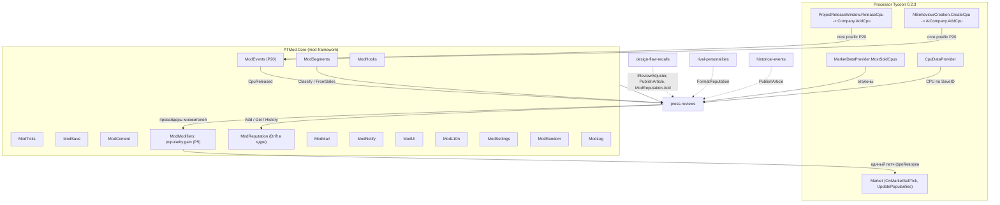
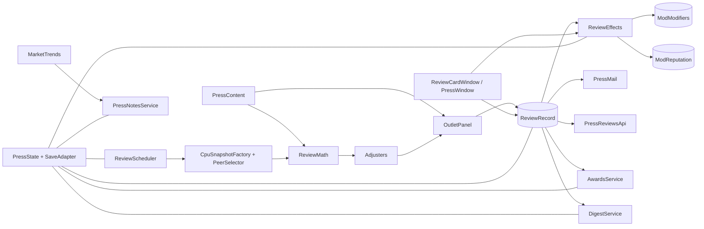
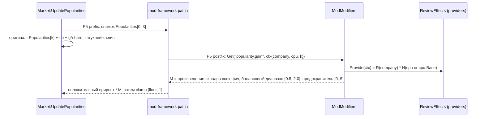
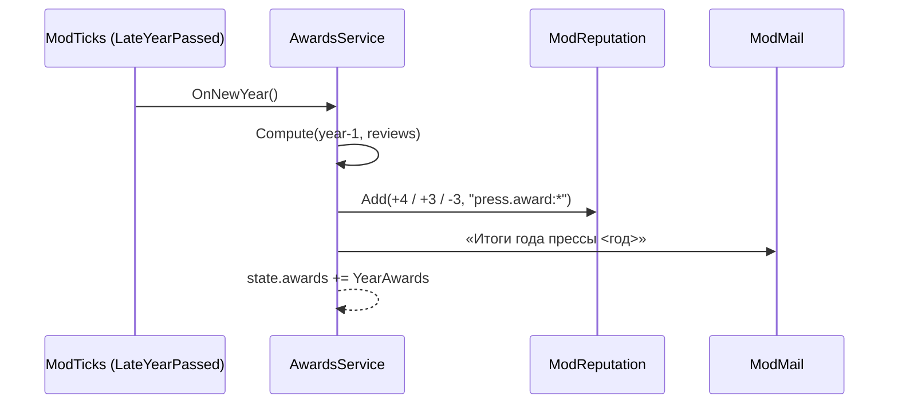
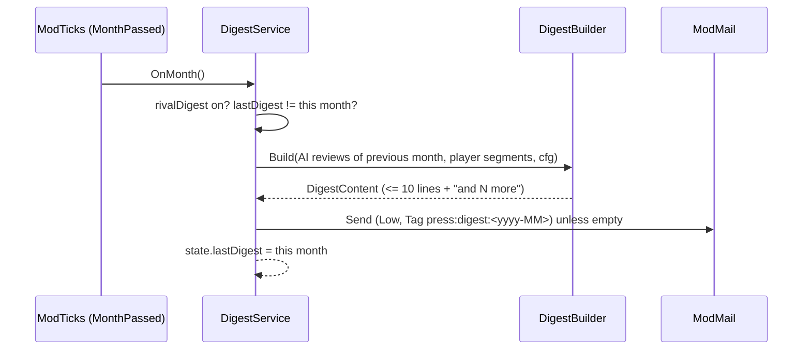
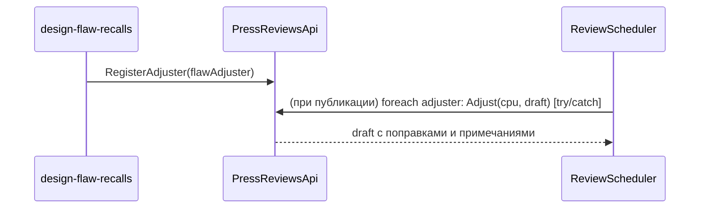

# Design: press-reviews

## Document Information

- **Feature Name**: press-reviews — обзоры и бенчмарки в прессе, репутация бренда
- **Version**: 0.2
- **Date**: 2026-10-10
- **Author**: Dex719
- **Status**: Draft v0.2 — одобрено к реализации владельцем 2026-10-10
- **Reviewers**: владелец проекта
- **Related Documents**:
  - `.kiro/specs/press-reviews/requirements.md`
  - `.kiro/specs/press-reviews/tasks.md`
  - `.kiro/steering/context.md` (контракт `PTMod.Core`)
  - `.kiro/steering/owner-decisions.md` (решения владельца)
  - `.kiro/specs/mod-framework/design.md` (`ModReputation`, каналы `ModModifiers`, `ModUI`, `ModMail`, `ModEvents`, `ModSegments`)
  - `.kiro/specs/design-flaw-recalls/`, `.kiro/specs/rival-personalities/` (потребители API)
  - `pt-modding/CODEMAP.md`, разделы «Market simulation and contracts», «Hardware»

## Overview

Фича — конвейер «выпуск → очередь → обзор → эффекты → отображение»:

1. Подписка на событие ядра `ModEvents.CpuReleased` (CPU игрока и ИИ) ставит CPU в очередь обзоров с задержкой 7–21 день. Собственных патчей на `Company.AddCpu` и `AICompany.AddCpu` нет: один postfix ядра P20 даёт единое правило «не при загрузке, не чаще раза на CPU».
2. Пока CPU игрока ждёт обзора, фича каждый день копит его продажи по сегментам. Так определяется, в каком классе его будут сравнивать.
3. В день публикации чистая функция `ReviewMath` считает четыре оси относительно топ-5 продаваемых CPU сегмента. `Ips` эталонов приводится к текущей дате темпом эпохи, поэтому планка растёт по годам. Строгость зависит от сложности, слабейшая ось ограничивает итог.
4. `OutletPanel` превращает базовую оценку в оценки 2–4 вымышленных изданий (акценты, смещение, шум) и метаоценку.
5. `ReviewEffects` переводит метаоценку в:
   - изменение `ModReputation` компании;
   - множитель «ажиотажа» этого CPU (затухает за 365 дней).

   Оба множителя отдаёт один провайдер стандартного канала `popularity.gain`. Канал поддерживает области «компания», «CPU» и «сегмент». Для CPU компании провайдер возвращает `R(репутация компании) × H(ажиотаж CPU)`. Единый патч `mod-framework` (P5 на `Market.UpdatePopularities`) применяет значение к положительному дневному приросту популярности; произведение вкладов всех фич ограничено балансовым диапазоном ядра [0,5; 2,0].
6. Письма (обзоры CPU игрока — по одному, обзоры соперников — ежемесячным дайджестом `Low`), карточка обзора, окно «Пресса» (обзоры, репутация, итоги, статьи), годовые итоги и квартальные заметки делают это видимым.

Обзоры не входят в рейтинг (`Market.CalculateRatings`). Производительность и цена там уже учтены, и обзор на входе рейтинга посчитал бы их дважды. Единственная точка влияния — прирост популярности: он моделирует узнаваемость. Репутацию к 50 возвращает ядро (`ModReputation.Drift`), эта фича дрейфом не занимается.

### Design Goals
- Оценка понятна и предсказуема для игрока, но формулы скрыты: в UI только слова и оси.
- Планка растёт со временем и с конкурентами без абсолютных таблиц IPS по годам. Самокалибровка по рынку и темпу эпохи.
- Одна точка влияния на продажи (прирост популярности), симметрично для игрока и ИИ.
- Ноль патчей формул рынка и ноль патчей `AddCpu` в этой фиче — только каналы `ModModifiers` и события ядра.
- Расширяемость: другие фичи публикуют статьи и вносят поправки в обзоры через API.
- Почта не перегружается: ядро ограничивает доставку, поэтому обзоры соперников собраны в дайджест.

### Key Design Decisions

| # | Решение | Обоснование | Отвергнутые альтернативы |
|---|---|---|---|
| D1 | Эффект обзора — на прирост популярности (канал `popularity.gain`), а не на рейтинг | Рейтинг уже содержит производительность и цену. Обзор как множитель рейтинга даёт двойной счёт (предупреждение в IDEAS). Популярность в игре и есть «узнаваемость» | Постфикс `Market.CalculateRatings`: двойной счёт, конфликт с каналом `market.rating.cpu` (`platform-generations`). Разовая прибавка к `Popularities`: правит игровое состояние, не затухает |
| D2 | Эталон — топ-5 по продажам сегмента за 3 полных месяца у других компаний; `Ips` приводится темпом эпохи `g^(τ·возраст)` | Сравнение с тем, что реально покупают. Поправка на возраст даёт растущую планку без абсолютной кривой IPS (реальные значения IPS по годам неизвестны) | Абсолютная кривая IPS по годам: значения не откалиброваны, ломается при моде на баланс. Сравнение со всеми CPU: старые CPU тянут планку вниз |
| D3 | Сегмент CPU игрока — по продажам за время ожидания (`ModSegments.FromSales`), иначе по цене (`ModSegments.Classify`). ИИ — `Strategy.TargetMarket` | У CPU игрока нет целевого сегмента. Продажи показывают, где он реально конкурирует. Правило «по цене» одно на все фичи (ядро), копий нет | Только по цене: дешёвый High End CPU сравнили бы с Low End. Свой `SegmentInference` |
| D4 | Ограничение итога слабейшей осью (`min + 30`) | Требование IDEAS: «очень слабая ось ограничивает итог, а не усредняется» | Чистое среднее: перегретый быстрый CPU получает «Отлично» |
| D5 | Несколько изданий с акцентами и детерминированным шумом `ModRandom` → метаоценка | Живость прессы, разные точки зрения. Детерминизм после загрузки | Одна оценка: сухо. `UnityEngine.Random`: невоспроизводимо |
| D6 | Вариант CPU (`isVariant`, то есть `Base != null`) не рецензируется отдельно, наследует ажиотаж базового | Варианты — отбраковка того же кристалла. Иначе на один запуск придёт 2–4 письма (решение владельца: отдельных обзоров вариантов нет) | Отдельные обзоры вариантов: шум в почте и архиве |
| D7 | Один провайдер стандартного канала `popularity.gain`. Он читает `ModifierContext` (компания + CPU) и возвращает `R × H` | Канал в `mod-framework` уже `perCompany` + `perCpu` + `perSegment`. Ажиотаж относится к продукту, репутация — к бренду, и обе части вычисляются в одном вызове | Новый канал `popularity.gain.cpu`: дублирует стандартный. Две записи `ModModifiers.Add` на каждый CPU: тысячи сохраняемых записей вместо вычисления на лету |
| D8 | Дрейф репутации к 50 (3 %/мес.) делает ядро (`ModReputation.Drift`), не эта фича | Решение владельца: дрейф в ядре, без записи в историю. Иначе 12 записей в год на компанию вытесняют значимые (обзор, брак, поглощение) из истории в 50 записей | Дрейф через `ModReputation.Add` с причиной `press.drift` (v0.1): засоряет историю и дублирует ядро |
| D9 | Всё состояние — в `ModSave` (`IModSaveParticipant`), ключ CPU — `SaveID`; версию секции ведёт ядро (`_schema`) | Решение 0004. IDEAS предлагал поля на `CpuBase` — контракт запрещает | Поля `CpuBase`: ломает ванильную загрузку и другие версии мода. Своё поле `schema` в данных фичи |
| D10 | Обзоры только вне перемотки и загрузки (`duringFastForward`, `IsLoading`). Репутация всех компаний стартует с 50 | Политика владельца: фичи нейтральны в перемотке. В перемотке игрок не видит прессу | Ретро-обзоры при `FastForwardEnded`: сотни писем и спорная стартовая репутация |
| D11 | Обзоры CPU соперников приходят одним ежемесячным письмом-дайджестом `Low`; отдельных уведомлений на каждый нет | Решение владельца. Ядро доставляет не больше 3 писем в день на игру и 2 на фичу; обзор на каждый CPU соперников съел бы почту (замечание `modmail-global-daily-limit`) | `ModNotify` на каждый громкий обзор: шум и лимит 5 в день на фичу |
| D12 | Вклад в `popularity.gain` — один провайдер `R × H`, а общий предел ставит ядро [0,5; 2,0] на CPU | Решение владельца: ажиотаж складывается с другими вкладами мультипликативно, но в общем пределе. Фича указывает максимум своего вклада (0,42…1,95) | Собственный клип в провайдере: расходится с пределом ядра и скрывает «(ограничено)» в `Explain` |

## Architecture

### System Context



### High-Level Architecture



### Technology Stack

| Слой | Технология | Обоснование |
|-------|------------|-----------|
| Патчи | Harmony 2 через `ModHooks` | только `HardwareWindow.ShowMarket` (Could); патчей на `AddCpu` нет — события ядра |
| Логика | чистый C# без `UnityEngine` в `Features/PressReviews/Logic/`: `ReviewMath`, `OutletPanel`, `EffectMath`, `DigestBuilder`, `MarketTrends`; общее подмножество API .NET Framework 4.8 и mscorlib Unity (без `init`, `record`, `Index`, `Range`) | юнит-тесты мини-раннером в `mod/tests/PTMod.Tests/PressReviews/` без игры (`python mod/build.py --tests`), каждый публичный тип в `[Covers]` |
| Контент | JSON через `ModContent` | решение 0006 |
| Состояние | секция `ModSave` (`IModSaveParticipant`) | решение 0004; версия секции — `_schema` ядра |
| UI | `ModUI` | решение 0005 |

### Используемые сервисы PTMod.Core

| Сервис | Для чего |
|---|---|
| `ModEvents` | подписка на `CpuReleased(owner, cpu, isVariant, duringFastForward)`: очередь обзоров. `CpuTransferred` обзора не создаёт |
| `ModSegments` | `FromSales` и `Classify(cpu)` для сегмента обзора CPU игрока; тип `Segment` |
| `ModHooks` | `Guard` вокруг обработчиков и тиков; `HardwareWindow.ShowMarket` — Could (патч под флагом после спайка) |
| `ModTicks` | фазы `TickPhase.DayPassed` (учёт продаж очереди, публикация, обновление ажиотажа), `MonthPassed` (дайджест соперников, квартальные заметки), `LateYearPassed` (итоги года). Подписка через `FeatureContext.OnTick`; `ModTicks.GameReady` (подключение `FlawBridge`) |
| `ModSave` | секция `press-reviews` (`SchemaVersion = 1`, `_schema` пишет ядро) |
| `ModContent` | `outlets.json`, `review-config.json`, `notes.json` |
| `ModModifiers` | один провайдер канала `popularity.gain` (`RegisterProvider`, регистрируется один раз в `Register`), значение = репутация компании × ажиотаж CPU; `Explain` показывает вклад (причина `press.review`) |
| `ModCompanies` | ключи компаний `"player"` / `"ai:<UniqueID>"` |
| `ModReputation` | `Get`, `Add` с причинами `press.*`, `History`, событие `Changed`. Дрейф к 50 ведёт ядро |
| `ModMail` | письма: обзор CPU игрока (`Normal`), дайджест соперников и заметки (`Low`), итоги года и статьи (`Normal`); действия «Открыть обзор/итоги» (`ModMailAction`), `Tag` `press:<…>` |
| `ModUI` | карточка обзора, окно «Пресса», строка репутации в хабе (`ctx.HubPage`) |
| `ModL10n` | все тексты `press.*` |
| `ModSettings` | вкл/выкл (хаб), параметры `instantReviews`, `rivalDigest`, `reputationAffectsAI` (`ctx.Param`); отладочный флаг `debug.verbose` (только отладочная сборка) |
| `ModRandom` | поток `ModRandom.Stream("press-reviews")`: задержка, шум изданий, выбор цитат и заметок, бросок `revealChance` |
| `ModLog` | `[PTMod] [press-reviews]` |

`ModNotify` для обзоров соперников не используется (дайджест, D11). Своих счётчиков ошибок фича не ведёт (`ModHooks.Guard` / `ReportFault`).

## Components and Interfaces

Пространство имён — `PTMod.Features.PressReviews`. Сигнатуры сервисов ядра (`IModFeature`, `ModModifiers.RegisterProvider`, `ModReputation`, `ModEvents`, `ModSegments`) — по `mod-framework/design.md`.

### Component 1: PressReviewsFeature

Точка входа по контракту ядра: `[ModFeature] sealed class … : IModFeature`.

```csharp
namespace PTMod.Features.PressReviews
{
    [ModFeature]
    public sealed class PressReviewsFeature : IModFeature
    {
        public const string FeatureId = "press-reviews";
        public string Id => FeatureId;
        public string NameKey => "press.feature.name";
        public string DescriptionKey => "press.feature.desc";
        public string[] DependsOn => new string[0];   // only hard dependencies; soft links: design-flaw-recalls, rival-personalities, historical-events
        public bool EnabledByDefault => true;
        public bool SupportsHotToggle => true;
        public void Register(FeatureContext ctx);     // ctx.OnTick(TickPhase.X, ...), ctx.SaveParticipant, ctx.Param(instantReviews | rivalDigest | reputationAffectsAI),
                                                      // ctx.HubPage("press.hub.button", ...), ctx.Patch(typeof(MarketColumnPatch)) (Could, behind a flag);
                                                      // ModEvents.CpuReleased += OnCpuReleased (once; ModHooks.Raise skips the handler while the feature is not Enabled);
                                                      // ModModifiers.RegisterProvider(FeatureId, ModChannels.PopularityGain, Provide) (once);
                                                      // ModMail.RegisterActionHandler(FeatureId, ...)
        public void OnEnabled();                      // resume queue
        public void OnDisabled();                     // queue frozen, state kept; the provider is neither removed nor recreated (the core skips it while disabled)
    }
}
```

Связь с `design-flaw-recalls` (`FlawBridge`) подключается на `ModTicks.GameReady` и при `ModFeatures.StateChanged`, потому что порядок `Register` фич без жёсткой зависимости не определён.

### Component 2: PressContent

```csharp
public sealed class PressContent
{
    public ReviewConfig Config { get; }
    public IReadOnlyList<Outlet> Outlets { get; }
    public IReadOnlyList<NoteTemplate> Notes { get; }
    public static ValidationReport Validate(OutletsFile o, ReviewConfig c, NotesFile n); // pure
}
```

### Component 3: ReviewScheduler

**Purpose**: очередь обзоров, учёт продаж ожидающих CPU игрока, публикация в срок.

```csharp
public sealed class ReviewScheduler
{
    // Subscribed to ModEvents.CpuReleased in Register (core P20: one postfix on Company.AddCpu / AICompany.AddCpu;
    // not raised while GameManager.get_IsLoading, at most once per CPU object).
    public void OnCpuReleased(ICompany owner, Cpu cpu, bool isVariant, bool duringFastForward);   // body wrapped in ModHooks.Guard
    public void Enqueue(Cpu cpu);           // dedupe by SaveID
    public void DailyTick();                // accumulate SoldLastDayBy* for pending player CPUs; publish due
    public IReadOnlyList<PendingReview> Pending { get; }
}
```

Защиты в обработчике (загрузка и однократность уже обеспечены ядром):
- `!duringFastForward` (политика владельца: в перемотку обзоров нет);
- `!isVariant` (варианты не рецензируются);
- `cpu.IsReleased`;
- `SaveID` ещё не в очереди или архиве.

Патчей на `Company.AddCpu` и `AICompany.AddCpu` нет: `ModHooks` отклонил бы их (служба `ModEvents`). Перенос CPU (`ModEvents.CpuTransferred`) обзор не создаёт.

### Component 4: CpuSnapshotFactory, PeerSelector

**Purpose**: перевести объекты игры в чистые DTO для `ReviewMath`.

```csharp
public struct CpuSnapshot          // pure DTO, no Unity refs
{
    public int SaveId; public string CompanyKey; public string Name;
    public float Ips, Price, PowerConsumption, Temperature, SafeTemperature;
    public float ReleaseYearFraction;   // e.g. 1994.5 (review record date if known, else Year + 0.5)
    public Segment Segment;              // PTMod.Core.Segment: HighEnd 0 … Industries 3
}

public sealed class PeerSelector
{
    // MarketDataProvider.Instance.MostSoldCpus(15, periodMonths, seg==0, seg==1, seg==2, seg==3, false)
    // -> other company, !IsRetired, sold in segment over last full months > 0 -> first 5
    public IReadOnlyList<CpuSnapshot> SelectPeers(Cpu reviewed, Segment segment);
    public CpuSnapshot? PreviousOwnCpu(Cpu reviewed, Segment segment);   // fallback
}

// Segment of the reviewed CPU (no feature-local classifier):
//   AI:     cpu.Strategy.TargetMarket
//   player: ModSegments.FromSales(sum of SoldLastDayBy* during the wait, 4 ints); Segment.Any (all zero) or instant mode -> ModSegments.Classify(cpu)
```

### Component 5: ReviewMath (чистая логика)

```csharp
public enum Axis { Performance = 0, Value = 1, Efficiency = 2, Thermal = 3 }

public sealed class ReviewInput
{
    public CpuSnapshot Cpu;
    public IReadOnlyList<CpuSnapshot> Peers;      // may be empty
    public CpuSnapshot? OwnPrevious;               // fallback
    public float NowYearFraction;                  // e.g. 1995.21
    public int Difficulty;                         // Player.DifficultyLevel
}

public sealed class ReviewDraft
{
    public float[] AxisScores = new float[4];
    public float BaseScore;         // weighted
    public float CappedScore;       // after weakest-axis cap
    public bool NoAnalog;
    public List<string> Notes = new List<string>();  // L10n keys from adjusters
    public float OverallAdjustment;                  // from adjusters
}

public static class ReviewMath
{
    public static float TrendFactor(float yearsAge, float g, float tau);           // g^(tau*age)
    public static float EraGrowth(int year, ReviewConfig cfg);                      // 1.35/1.45/1.30/1.15
    public static float AxisFromRatio(float ratio, float strictness, CurveConfig c); // clamp(65+35*ln(r/s)/ln1.5)
    public static float ThermalAxis(float temperature, float safeTemperature, ThermalConfig t);
    public static ReviewDraft Compute(ReviewInput input, ReviewConfig cfg);
    public static float ApplyCap(float baseScore, float[] axes, float[] weights, CapConfig cap);
}
```

### Component 6: OutletPanel (чистая логика)

```csharp
public struct OutletScore { public string OutletId; public int Score; public string QuoteKey; }

public static class OutletPanel
{
    public static IReadOnlyList<Outlet> ActiveFor(int year, Segment segment, IReadOnlyList<Outlet> outlets); // + fallback
    public static OutletScore ScoreBy(Outlet outlet, ReviewDraft draft, Segment segment, ReviewConfig cfg, IRandomSource rng);
    public static int Metascore(IReadOnlyList<OutletScore> scores);           // round(mean)
    public static string VerdictKey(int metascore, ReviewConfig cfg);
    public static string PickQuoteKey(Outlet outlet, ReviewDraft draft, IRandomSource rng);
}

public interface IRandomSource { float NextGaussian(); int Range(int minInclusive, int maxExclusive); } // adapter over IModRng (ModRandom.Stream)
```

### Component 7: ReviewEffects

**Purpose**: репутация (изменения от обзоров), провайдер канала, снимки. Дрейф репутации к 50 здесь не реализуется: его ведёт ядро.

```csharp
public sealed class ReviewEffects
{
    public void OnReviewPublished(ReviewRecord record);   // ModReputation.Add(company, Δ, "press.review:<SaveID>"), hype entry
    public float HypeMultiplier(Cpu cpu);                 // uses cpu.Base for variants; 1.0 if no review
    public float ReputationMultiplier(ICompany company);  // 1 + 0.3*(rep-50)/50; respects reputationAffectsAI
    public float Provide(ModifierContext ctx);            // provider of popularity.gain: R(ctx.Company) * H(ctx.Cpu)
    public void DailyRefresh();                           // recompute hype + reputation caches, drop expired
}

public static class EffectMath // pure
{
    public static float Hype(int metascore, int daysSincePublish, HypeConfig c);    // clamp(1+0.5*(M-65)/35*decay, .6, 1.5)
    public static int ReputationDelta(int metascore, RepDeltaConfig c);              // clamp(round((M-65)/5), -6, 6)
    public static float ReputationEffect(float reputation, float strength);          // 1 + 0.3*(rep-50)/50
    public static float MaxContribution(HypeConfig h, float repStrength);           // (1-s)*hypeMin .. (1+s)*hypeMax: 0.42 .. 1.95
}
```

Регистрация провайдера (API `mod-framework/design.md`, раздел ModModifiers) выполняется один раз в `Register`; при выключении и включении фичи он не пересоздаётся, ядро просто пропускает провайдер выключенной фичи:

```csharp
ModModifiers.RegisterReasonedProvider(FeatureId, ModChannels.PopularityGain, ctx => effects.ProvideWithReason(ctx));
// ProvideWithReason: ctx.Cpu == null -> R(ctx.Company); otherwise R(ctx.Company) * H(ctx.Cpu); ReasonKey "press.review" (+ args: metascore).
// ctx.Segment is ignored (same multiplier for all 4 segments). The exception in the provider = ×1 + fault counter of the feature (core).
```

Ядро кэширует результат до конца игрового дня по ключу (канал, компания, CPU, сегмент, контракт). Провайдер сам держит кэш `SaveID → H` и `companyKey → R`, пересчитываемый в `DailyRefresh`; при изменении репутации чужой фичей (`ModReputation.Changed`) кэш компании сбрасывается и вызывается `ModModifiers.Invalidate("popularity.gain", companyKey)`. Ежемесячный дрейф ядро учитывает само (`ModReputation.Drifted` сбрасывает кеш каналов).

**Вклад в общий предел (`popularity.gain`, балансовый диапазон [0,5; 2,0], предохранитель [0; 5]).** Репутация даёт `R` ∈ [0,7; 1,3], ажиотаж — `H` ∈ [0,6; 1,5]; максимум вклада этой фичи — от 0,42 до 1,95 на CPU. Итог после перемножения со всеми фичами ограничивает ядро; `ModModifiers.Explain` дописывает «(ограничено)». В тестах эффектов учитывать ограничение: при `R × H < 0,5` ядро вернёт 0,5.

### Component 8: AwardsService

```csharp
public sealed class AwardsService
{
    public YearAwards Compute(int year, IReadOnlyList<ReviewRecord> reviewsOfYear, ReviewConfig cfg); // pure part
    public void OnNewYear();   // TickPhase.LateYearPassed: compute for year-1, ModReputation.Add, mail, archive
}
```

### Component 8a: DigestService и DigestBuilder (дайджест обзоров соперников)

```csharp
public static class DigestBuilder // pure
{
    // reviews of AI CPUs published in the previous month -> up to maxLines lines, sorted by |metascore - 65| descending;
    // notable: metascore >= notifyHigh (85) or <= notifyLow (40) or segment in playerSegments; the rest -> "and N more in the archive"
    public static DigestContent Build(IReadOnlyList<ReviewRecord> aiReviewsOfMonth, ISet<Segment> playerSegments, DigestConfig cfg);
}

public sealed class DigestService
{
    public void OnMonth();   // TickPhase.MonthPassed: if rivalDigest and state.lastDigest != this month -> Build -> PressMail.SendDigest; state.lastDigest = "yyyy-MM"
}
```

Письмо не отправляется, если подходящих строк нет (`DigestContent.IsEmpty`). `lastDigest` защищает от дубля после загрузки и пакетного прогона месяца.

### Component 9: PressNotesService и MarketTrends

```csharp
public static class MarketTrends // pure over snapshots
{
    public static float LeaderIpsGrowth(IReadOnlyList<CpuSnapshot> leadersNow, IReadOnlyList<CpuSnapshot> leadersYearAgo);
    public static float MedianPriceChange(IReadOnlyList<float> pricesNow, IReadOnlyList<float> pricesYearAgo);
    public static string Qualitative(float value);   // "около +40 %" rounding to 10 %
}

public sealed class PressNotesService
{
    public void OnQuarter();   // months 1,4,7,10: evaluate notes.json conditions, pick <= 2, mail
    public void YearlySnapshot(); // store leader Ips and median prices per segment (for YoY)
}
```

### Component 10: UI — ReviewCardWindow, PressWindow, PressMail

```csharp
public static class ReviewCardWindow { public static void Open(int cpuSaveId); }
public static class PressWindow
{
    public enum PressTab { Reviews, Reputation, Awards, Articles }
    public static void Open(PressTab tab = PressTab.Reviews);
}
internal static class PressMail
{
    // all mails: ModMail.Send, FeatureId "press-reviews", Tag "press:<kind>:<key>", actions via ModMailAction + ModMail.RegisterActionHandler
    public static void SendReview(ReviewRecord r);                       // Normal, Tag press:review:<cpuSaveId>, action openReview
    public static void SendDigest(DigestContent d);                      // Low, Tag press:digest:<yyyy-MM>, no actions
    public static void SendAwards(YearAwards a);                         // Normal, Tag press:awards:<year>, action openAwards
    public static void SendNotes(IReadOnlyList<RenderedNote> notes);     // Low, Tag press:notes:<yyyy-MM>
    public static void SendArticle(PressArticle a);                      // Normal, Tag press:article:<n>
}
```

Возвращённый `ModMail.Send` ID письма хранится в `ReviewRecord.mailId` (для игрока); блоков ID писем нет, письма различаются по `Tag`. `ModNotify` обзоры не используют.

### Component 11: PressReviewsApi

```csharp
public interface IReviewAdjuster
{
    string Id { get; }
    // called before outlet aggregation; must be fast and side-effect free
    void Adjust(Cpu cpu, ReviewDraft draft);   // may change draft.AxisScores (+-30 each), draft.OverallAdjustment (+-20), add draft.Notes
}

public sealed class PressArticle
{
    public string SourceFeature; public string TitleKey; public string BodyKey; public object[] Args;
    public string CompanyKey;  // optional
}

public static class PressReviewsApi
{
    public static bool IsEnabled { get; }
    public static event Action<ReviewRecord> ReviewPublished;
    public static void PublishArticle(PressArticle article);
    public static void RegisterAdjuster(IReviewAdjuster adjuster);
    public static void UnregisterAdjuster(string id);
    public static ReviewRecord GetReview(int cpuSaveId);           // null if none
    public static string FormatReputation(ICompany company);        // "68 — Уважаемый"
    public static string GetReputationLevelKey(ICompany company);   // press.rep.*
}
```

### Component 12: FlawBridge (мягкая связь с design-flaw-recalls)

```csharp
internal sealed class FlawBridge
{
    public void Attach();                        // on ModTicks.GameReady and ModFeatures.StateChanged("design-flaw-recalls"):
                                                 // if ModFeatures.IsActive("design-flaw-recalls"): subscribe FlawRegistry.OnFlawStateChanged
    public void Detach();
    public void OnReviewPublished(ReviewRecord r); // roll flawReveal.chance -> FlawRegistry.TryReveal(r.cpuSaveId, DiscoverySource.External)
}
```

- Брак не раскрывается игроку через обзор напрямую. Есть ли скрытый брак, решает `design-flaw-recalls`, и она же публикует последствия.
- Пресса только пишет статью при публичном браке (`OnFlawStateChanged`).
- `FlawRegistry` — API фичи `design-flaw-recalls` (design-flaw-recalls/TSK-020); без неё мост не подключается.

### Component 13: PressState и SaveAdapter
`PressSaveParticipant : IModSaveParticipant` (`SectionId = "press-reviews"`, `SchemaVersion = 1`; `Write()` возвращает данные без `_schema`, версию секции пишет и читает ядро). DTO — в Data Models.

## Патчи Harmony

| Цель (класс.метод игры) | Тип | Что меняет | Порядок / конфликты |
|---|---|---|---|
| `HardwareWindow.ShowMarket()` (private) | postfix (Could, после спайка, `Optional`) | дописывает ячейку «Пресса» в строки `spreadsheetMarket` | Только эта фича. Риск: заголовок колонки задаётся префабом |

**Патчей на `Company.AddCpu` и `AICompany.AddCpu` нет.** Выпуск CPU приходит событием ядра `ModEvents.CpuReleased` (P20): единый postfix ядра с правилом «не при загрузке, не чаще раза на объект CPU»; `ModHooks` отклонил бы собственный патч фичи на эти методы (служба `ModEvents`).

**Формулы рынка эта фича не патчит.** Прирост популярности меняется только через стандартный канал `popularity.gain`. Его применяет единый патч `mod-framework` P5 на `Market.UpdatePopularities`; метод зарезервирован каналом, `ModHooks.IsReservedByChannel`.

## Новые каналы ModModifiers

Не требуются. Используется стандартный канал `popularity.gain` из реестра ядра (`perCompany`, `perCpu`, `perSegment`, предохранитель [0; 5], балансовый диапазон [0,5; 2,0] на CPU). P5 умножает на `M(popularity.gain, company, cpu, k)` положительный дневной прирост `Popularities[k] += b + g × SoldByK/sum_k`. Затухание старых CPU (`−0.0005`) и клип [floor, 1.0] не затрагиваются.

Вклад этой фичи — провайдер `R(company) × H(cpu)`: максимум 0,42…1,95. Он перемножается с вкладами других фич в тот же канал: `market-shocks` `ms.launch_hype`, испытания `scenarios-achievements`, `ModifierTimed` событий. Перемножение и ограничение делает ядро; мультипликативное сложение одобрено владельцем.

## Подписки на события

| Событие | Обработчик | Защиты |
|---|---|---|
| `ModEvents.CpuReleased` | `ReviewScheduler.OnCpuReleased` → `Enqueue` | ядро не поднимает при загрузке и не чаще раза на CPU; обработчик отсекает `duringFastForward` и `isVariant`. Подписка один раз в `Register` |
| `ModTicks` `TickPhase.DayPassed` (`ctx.OnTick`) | `ReviewScheduler.DailyTick`: накопление `SoldLastDayByHighEnd/MidRange/LowEnd/Industries` для ожидающих CPU игрока, публикация обзоров со сроком ≤ сегодня; `ReviewEffects.DailyRefresh` | по умолчанию (не в перемотке, не при загрузке). Значения `SoldLastDayBy*` в `DayPassed` — продажи текущего дня (рынок уже отработал в `OnMarketSellTick`). Сроки — по разности дат `ModTicks.Today` |
| `TickPhase.MonthPassed` | `DigestService.OnMonth` (дайджест соперников за прошлый месяц); в месяцы 1/4/7/10 — `PressNotesService.OnQuarter` | по умолчанию. Дрейфа репутации здесь нет — его ведёт ядро в `LateMonthPassed` |
| `TickPhase.LateYearPassed` | `AwardsService.OnNewYear`; `PressNotesService.YearlySnapshot` | по умолчанию. Срабатывает после игрового письма Year Summary |
| `ModSave` (`IModSaveParticipant.Read` / `ModSave.AfterRead`) | восстановление очереди и архива, сброс кэшей провайдера | один раз на загрузку |
| `ModMail.RegisterActionHandler(FeatureId, …)` | действия `openReview`, `openAwards` | письмо остаётся открытым |
| `ModFeatures.StateChanged` / `ModSettings.Changed` | `OnEnabled`/`OnDisabled`; режимы; подключение `FlawBridge` | — |
| `ModReputation.Changed` | сброс кэша `R` для компании и `ModModifiers.Invalidate("popularity.gain", companyKey)` (новое значение действует со следующего запроса) | только чтение; событие приходит от `Add`/`Set`, дрейф его не поднимает |
| `ModReputation.Drifted` | ничего (ядро само сбрасывает кеш каналов) | — |
| `FlawRegistry.OnFlawStateChanged` (`design-flaw-recalls`, если включена) | статья «Пресса: дефект в <CPU>» и примечание к обзору (FR-11 п. 7) | подписка через `FlawBridge` на `GameReady` и при `ModFeatures.IsActive("design-flaw-recalls")` |
| `ThemeManager.Instance.OnThemeChanged` | перерисовка открытых окон | только при открытом окне |

## Data Models

### Записи обзоров и состояние (ModSave)

```csharp
[Serializable] public sealed class PressState     // IModSaveParticipant.SchemaVersion = 1; поля версии в данных нет: _schema пишет и читает ядро
{
    public List<PendingReview> pending = new List<PendingReview>();
    public List<ReviewRecord> reviews = new List<ReviewRecord>();      // newest last; compact after 2000
    public List<YearAwards> awards = new List<YearAwards>();
    public List<ArticleRecord> articles = new List<ArticleRecord>();   // last 200
    public List<NoteCooldown> noteCooldowns = new List<NoteCooldown>();
    public List<SegmentYearStat> yearStats = new List<SegmentYearStat>(); // for notes YoY (last 3 years)
    // reputation trend and causes are read from ModReputation.History(companyKey), not stored here
    // (the monthly drift to 50 belongs to the core and is not recorded in the history)
    public string lastDigest;                                          // "yyyy-MM": month of the last rival digest
}

// Поля segment — индекс (int)Segment: 0 HighEnd, 1 MidRange, 2 LowEnd, 3 Industries.
[Serializable] public sealed class PendingReview
{
    public int cpuSaveId; public string companyKey; public string releasedOn; public string publishOn;
    public int[] soldBySegment = new int[4]; public int attempts;
}

[Serializable] public sealed class ReviewRecord
{
    public int cpuSaveId; public string cpuName; public string companyKey; public string companyName;
    public string releasedOn; public string publishedOn; public int segment;
    public float[] axes = new float[4];      // empty when compact
    public int metascore; public string verdictKey; public bool noAnalog;
    public List<OutletLine> outlets;         // null when compact
    public List<int> peerSaveIds;            // null when compact
    public List<string> notes;               // adjuster notes (L10n keys)
    public int reputationDelta; public float hypeAtPublish;
    public int mailId;                       // ModMail id of the player's review mail (0 for AI reviews)
    public bool compact;
}

[Serializable] public sealed class OutletLine { public string outletId; public int score; public string quoteKey; }
[Serializable] public sealed class YearAwards
{
    public int year; public List<AwardLine> cpuOfYear; public string companyOfYearKey; public float companyOfYearAvg;
    public int disappointmentCpuSaveId; public int disappointmentScore;
}
[Serializable] public sealed class AwardLine { public int segment; public int cpuSaveId; public string cpuName; public string companyKey; public int score; }
[Serializable] public sealed class ArticleRecord { public string date; public string source; public string titleKey; public string bodyKey; public List<string> args; }
[Serializable] public sealed class NoteCooldown { public string noteId; public string until; }
[Serializable] public sealed class SegmentYearStat { public int year; public int segment; public float leaderIps; public float medianPrice; }
```

- `companyKey`:
  - `"player"` — для игрока;
  - `"ai:<UniqueID>"` — для ИИ (`ModCompanies.KeyOf`, единый формат ядра и `event-system`).
- Секция пишется и читается через `IModSaveParticipant` (`ModJson`). Списки вместо словарей выбраны для простой привязки DTO (`ModJson.Bind`).

**Validation Rules** (чтение секции):
- `metascore` клипуется 0…100.
- `segment` вне 0…3 → запись помечается compact и исключается из итогов.
- Очередь с непарсящейся датой отбрасывается.
- Размеры списков ограничены: `reviews` ≤ 5000, сжатие старше 2000; `articles` ≤ 200; `yearStats` ≤ 3 года × 4 сегмента.
- `PendingReview`, чей CPU не найден (`CpuDataProvider.Instance.GetCpu` → null), удаляется.

### Пример секции бокового файла

Верхний `schema` — версия самого файла (`ModSave.FileSchema`), его ведёт ядро. Версию секции (`_schema`) тоже добавляет и читает ядро; в данных фичи поля версии нет.

```json
{
  "schema": 1,
  "features": {
    "press-reviews": {
      "pending": [
        { "cpuSaveId": 5120, "companyKey": "player", "releasedOn": "1995-03-01", "publishOn": "1995-03-15",
          "soldBySegment": [1200, 4300, 0, 0], "attempts": 0 }
      ],
      "reviews": [
        { "cpuSaveId": 4988, "cpuName": "K6-300", "companyKey": "ai:1", "companyName": "AMD",
          "releasedOn": "1995-01-10", "publishedOn": "1995-01-24", "segment": 1,
          "axes": [73.2, 65.0, 55.9, 62.5], "metascore": 68, "verdictKey": "press.verdict.average",
          "noAnalog": false,
          "outlets": [ { "outletId": "kilobyte", "score": 69, "quoteKey": "press.quote.performance.high.2" },
                       { "outletId": "business_pc", "score": 71, "quoteKey": "press.quote.value.high.1" },
                       { "outletId": "overclock_world", "score": 64, "quoteKey": "press.quote.efficiency.low.1" } ],
          "peerSaveIds": [4410, 4502, 4777], "notes": [], "reputationDelta": 1, "hypeAtPublish": 1.04, "mailId": 0, "compact": false }
      ],
      "awards": [ { "year": 1994, "cpuOfYear": [ { "segment": 0, "cpuSaveId": 4400, "cpuName": "P5-90",
                    "companyKey": "ai:0", "score": 86 } ],
                    "companyOfYearKey": "ai:0", "companyOfYearAvg": 79.5,
                    "disappointmentCpuSaveId": -1, "disappointmentScore": 0 } ],
      "articles": [],
      "noteCooldowns": [ { "noteId": "perf_bar_highend", "until": "1996-01-01" } ],
      "yearStats": [ { "year": 1994, "segment": 0, "leaderIps": 150.0, "medianPrice": 549.0 } ],
      "lastDigest": "1995-03"
    }
  }
}
```

### Контент: `Content/press-reviews/review-config.json`

Порог цены для сегмента (`segments.priceBand` = 1,25) принадлежит ядру (`core.json`) и здесь не дублируется. Поле `schema` в файле контента — версия формата контента (`ModContent`), а не секции сейва.

```json
{
  "schema": 1,
  "delayDays": [7, 21],
  "peers": { "count": 5, "periodMonths": 3, "candidates": 15 },
  "trend": { "tau": 0.6,
             "eras": [ { "from": 1971, "g": 1.35 }, { "from": 1985, "g": 1.45 },
                       { "from": 2000, "g": 1.30 }, { "from": 2010, "g": 1.15 } ] },
  "curve": { "parity": 65, "span": 35, "ratioAtTop": 1.5 },
  "strictness": [0.85, 0.92, 1.00, 1.08, 1.16, 1.25],
  "thermal": { "safeCap": 95, "fullMarksBelowSafe": 35, "zeroAboveSafe": 5 },
  "weights": {
    "HighEnd":    { "performance": 0.50, "value": 0.20, "efficiency": 0.15, "thermal": 0.15 },
    "MidRange":   { "performance": 0.35, "value": 0.35, "efficiency": 0.15, "thermal": 0.15 },
    "LowEnd":     { "performance": 0.25, "value": 0.45, "efficiency": 0.15, "thermal": 0.15 },
    "Industries": { "performance": 0.20, "value": 0.30, "efficiency": 0.40, "thermal": 0.10 }
  },
  "cap": { "gap": 30, "minWeight": 0.15 },
  "noAnalogPerformance": 70,
  "verdicts": [ { "min": 90, "key": "press.verdict.masterpiece" }, { "min": 80, "key": "press.verdict.excellent" },
                { "min": 70, "key": "press.verdict.good" },        { "min": 55, "key": "press.verdict.average" },
                { "min": 40, "key": "press.verdict.weak" },        { "min": 0,  "key": "press.verdict.flop" } ],
  "effects": {
    "hype": { "parity": 65, "strength": 0.5, "min": 0.6, "max": 1.5, "durationDays": 365 },
    "reputationPerReview": { "parity": 65, "divisor": 5, "min": -6, "max": 6 },
    "reputationEffect": { "strength": 0.3, "neutral": 50, "affectsAI": true }
  },
  "awards": { "cpuOfYearMin": 75, "cpuOfYearRep": 4, "companyOfYearMinReviews": 2, "companyOfYearRep": 3,
              "disappointmentMax": 45, "disappointmentRep": -3 },
  "reputationLevels": [ { "min": 80, "key": "press.rep.cult" }, { "min": 65, "key": "press.rep.respected" },
                        { "min": 36, "key": "press.rep.ordinary" }, { "min": 21, "key": "press.rep.dubious" },
                        { "min": 0, "key": "press.rep.toxic" } ],
  "digest": { "maxLines": 10, "notableHigh": 85, "notableLow": 40, "parity": 65 },
  "archive": { "maxFull": 2000, "maxTotal": 5000 },
  "adjusterLimits": { "axis": 30, "overall": 20 },
  "flawReveal": { "chance": 0.10 }
}
```

### Контент: `Content/press-reviews/outlets.json`

| id | ru / en | Годы | Сегменты | Сдвиг весов | Смещение | σ шума | fallback |
|---|---|---|---|---|---|---|---|
| `electronics_today` | Электроника сегодня / Electronics Today | 1971–1992 | все | — | 0 | 3 | до 1992 |
| `embedded_digest` | Встраиваемые системы / Embedded Digest | 1971–2030 | Low End, Industries | efficiency +0.10, performance −0.10 | +1 | 3 | — |
| `kilobyte` | КилоБайт / KiloByte Monthly | 1976–2030 | High End, Mid Range, Low End | — | 0 | 3 | 1993–1996 |
| `business_pc` | Деловой ПК / Business PC Weekly | 1982–2030 | Mid Range, Low End | value +0.15, performance −0.15 | +2 | 3 | — |
| `overclock_world` | Мир разгона / Overclock World | 1988–2030 | High End, Mid Range | performance +0.15, value −0.10, thermal −0.05 | −3 | 4 | — |
| `silicon_review` | Кремниевый обзор / Silicon Review Online | 1997–2030 | все | — | −1 | 2 | 1997–2030 |

- Колонка fallback — годы, когда издание подменяет пустое покрытие сегмента (поле `fallback: {from, to}`). Издание-fallback оценивает сегмент, даже если тот не входит в его список.
- При этом наборе в любом году 1971–2030 каждый сегмент покрыт хотя бы одним изданием, поэтому fallback — страховка для переопределённого контента.
- Сдвинутые веса нормируются на сумму 1. Отрицательные веса клипуются в 0.

```json
{
  "schema": 1,
  "outlets": [
    { "id": "overclock_world", "name": { "ru": "Мир разгона", "en": "Overclock World" },
      "years": [1988, 2030], "segments": ["HighEnd", "MidRange"],
      "weightShift": { "performance": 0.15, "value": -0.10, "thermal": -0.05 },
      "bias": -3, "noiseSigma": 4, "fallback": null },
    { "id": "electronics_today", "name": { "ru": "Электроника сегодня", "en": "Electronics Today" },
      "years": [1971, 1992], "segments": ["HighEnd", "MidRange", "LowEnd", "Industries"],
      "weightShift": {}, "bias": 0, "noiseSigma": 3, "fallback": { "from": 1971, "to": 1992 } }
  ]
}
```

### Контент: `Content/press-reviews/notes.json`

Типы условий: `leaderGrowth` (рост `Ips` лидера сегмента год к году), `medianPriceChange`, `pgaShift` (`Market.Instance.AnyCpuIsPGA()` впервые истинно в этом году), `segmentFocus` (статическая заметка о сегменте, раз в 8 кварталов), `reputationTrend` (изменение репутации игрока за 12 месяцев), `newEntrant` (новая компания с первым обзором в году).

```json
{
  "schema": 1,
  "notes": [
    { "id": "perf_bar_highend", "condition": { "type": "leaderGrowth", "segment": "HighEnd", "min": 0.25 },
      "textKey": "press.note.perfBar", "args": ["segment", "qualitativeGrowth"], "cooldownQuarters": 4, "weight": 3 },
    { "id": "price_pressure_low", "condition": { "type": "medianPriceChange", "segment": "LowEnd", "max": -0.10 },
      "textKey": "press.note.pricePressure", "args": ["segment", "qualitativeChange"], "cooldownQuarters": 4, "weight": 2 },
    { "id": "industries_efficiency", "condition": { "type": "segmentFocus", "segment": "Industries" },
      "textKey": "press.note.industriesEfficiency", "args": [], "cooldownQuarters": 8, "weight": 1 },
    { "id": "pga_shift", "condition": { "type": "pgaShift" },
      "textKey": "press.note.pgaShift", "args": [], "cooldownQuarters": 40, "weight": 5 },
    { "id": "player_rep_up", "condition": { "type": "reputationTrend", "min": 8 },
      "textKey": "press.note.playerRepUp", "args": ["companyName"], "cooldownQuarters": 4, "weight": 2 }
  ]
}
```

## Формулы и баланс

Все числа — из `review-config.json`. Обозначения: `M` — метаоценка, `rep` — репутация компании (`ModReputation`), `d` — `Player.DifficultyLevel`.

### 1. Сегмент обзора
- ИИ: `seg = cpu.Strategy.TargetMarket`.
- Игрок:
  - `seg = ModSegments.FromSales(Σ soldBySegment)` за время ожидания (сумма `SoldLastDayBy*` по дням; argmax, при равенстве — меньший индекс).
  - Если все нули (`Segment.Any`) или режим мгновенный — `ModSegments.Classify(cpu)` по цене относительно бюджетов. Правило и `segments.priceBand` = 1,25 принадлежат ядру (бюджеты `Market.get_MidRangeBudget` 249, `Market.get_LowEndBudget` 149, `Market.get_IndustriesBudget` 79 при верхнем 599; бюджеты не инфлируются, CODEMAP Gotchas):
    - High End, если `Price > 311.25`;
    - Mid Range, если `> 186.25`;
    - Low End, если `> 98.75`;
    - иначе Industries.

### 2. Эталоны и растущая планка
- `P` = первые 5 из `MarketDataProvider.MostSoldCpus(15, 3, seg==0, seg==1, seg==2, seg==3, false)`, где:
  - `Company` ≠ рецензируемая;
  - `!IsRetired`;
  - сумма `SoldBy<seg>` за 3 последних полных месяца > 0.
- Возраст эталона `age = now − release`:
  - `release` — дата из записи обзора эталона, если он рецензирован;
  - иначе `Year + 0.5`.
- Приведённый IPS: `Ips* = Ips × g(now)^(τ × age)`, `τ = 0.6`, `g` = 1.35 (1971–1984), 1.45 (1985–1999), 1.30 (2000–2009), 1.15 (2010+).
- Смысл: эталон «доращивается» до того, каким был бы его наследник сегодня. Покупатели ждут не меньше.

### 3. Оси
Общая кривая для отношений: `S(r) = clamp(65 + 35 × ln(r / s_d) / ln 1.5, 0, 100)`, `s_d` = [0.85, 0.92, 1.00, 1.08, 1.16, 1.25][d]. Ключевые точки при `s_d = 1`: `r` = 1 → 65; 1.5 → 100; 0.8 → 45.7; 0.67 → 30.4; 0.5 → 5.2.

| Ось | Отношение `r` | Эталон |
|---|---|---|
| Производительность | `Ips / max_P(Ips*)` | лучший приведённый |
| Цена/производительность | `(Ips / Price) / median_P(Ips* / Price)` | медиана |
| Энергоэффективность | `(Ips / max(Power, 0.5)) / median_P(Ips* / max(Power, 0.5))` | медиана |
| Нагрев | — (абсолютная) | `Ts = min(Package.SafeTemperature, 95)` (`IPackage.get_SafeTemperature`) |

- Нагрев: `S_T = 100 × clamp((Ts + 5 − T) / 40, 0, 1)`.
  - `T = Ts − 35` → 100;
  - `T = Ts − 15` → 50;
  - `T = Ts` → 12.5;
  - `T ≥ Ts + 5` → 0.
  - Игровая связь: при `T > Ts` растёт `FailureRate` (CODEMAP, `CpuMath.FailureRate`), то есть горячий CPU — реальный изъян.
- Цена ≤ 0 → ось цены = 0.
- Нет эталонов:
  - сравнение с предыдущим CPU своей компании в сегменте (`Ips*` по возрасту);
  - если и его нет — производительность = 70, цена и эффективность = 65, флаг «без аналогов».

### 4. Итог и ограничение слабой осью
- `B = Σ w_seg,i × S_i`. Веса — в таблице `weights` выше. Для Industries они отражают игровой вес потребления: `RatingWeights.Consumption` 30 и `CurrentConsumption` 5 в `PopulationData`.
- `Capped = min(B, min_{i: w_i ≥ 0.15}(S_i) + 30)`.
- Корректировщики (FR-11): `S_i += clamp(δ_i, −30, 30)`, затем пересчёт `B`/`Capped`; `Capped += clamp(δ, −20, 20)`.

### 5. Издания и метаоценка
- Для издания `o`: `w' = normalize(max(0, w_seg + shift_o))`. `O_o = clamp(round(Capped(w') + bias_o + σ_o × N(0,1)), 0, 100)`. Шум — `ModRandom` (поток фичи), поэтому оценки воспроизводимы после загрузки.
- `M = round(mean_o O_o)`. Вердикт: ≥ 90 «Шедевр», ≥ 80 «Отлично», ≥ 70 «Хорошо», ≥ 55 «Средне», ≥ 40 «Слабо», иначе «Провал».

### 6. Ажиотаж (меняет прирост популярности CPU в `Market.UpdatePopularities`)
- Игровая формула (CODEMAP): `Popularities[k] += b + g × SoldByK_cpu / sum_k`, где:
  - `g = 0.025 × era` (1 до 1990, 2.5 в 1990–2009, 5 с 2010);
  - `b = 5e−5 × era2` (1, 1.5, 3);
  - клип [0.05, 1.0];
  - популярность умножает число покупателей CPU в `Market.CalculatePotentialBuyers`.
- С модом: `Δ = (b + g × share) × clamp_core(R(company) × H(cpu) × вклады других фич)`, где `clamp_core` — балансовый диапазон ядра [0,5; 2,0].
- `H = clamp(1 + 0.5 × (M − 65)/35 × decay, 0.6, 1.5)`, `decay = max(0, 1 − days/365)`. Примеры: `M` 90 → 1.357 в день публикации, 1.18 через полгода; `M` 40 → 0.643; `M` 30 → 0.6.

### 7. Репутация
- От обзора: `Δrep = clamp(round((M − 65)/5), −6, +6)`. Примеры: 90 → +5; 68 → +1; 40 → −5.
- Эффект: `R = 1 + 0.3 × (rep − 50)/50`: rep 100 → 1.3; 70 → 1.12; 50 → 1.0; 20 → 0.82; 0 → 0.7.
- Дрейф 1-го числа: `rep += (50 − rep) × 0.03` делает **ядро** (`ModReputation.Drift`, `reputation.driftMonthlyRate`; без записи в историю и без `Changed`). Период полураспада отклонения ≈ 23 месяца. Фича дрейф не реализует.
- Итоги года: +4 за «Процессор года» (≥ 75), +3 «Компания года» (≥ 2 обзора, лучшее среднее), −3 «Разочарование года» (< 45, худший).
- Равновесие: компания с двумя обзорами по 85 в год (+4 за обзор, +8/год) уравновешивается дрейфом ядра при `0.03 × 12 × (rep − 50) = 8`, то есть rep ≈ 72 («Уважаемый», эффект ×1.13). С наградами «Процессор года» (+4/год) равновесие ≈ 83 («Культовый бренд», ×1.20).
- Вклад в общий предел `popularity.gain`: `R × H` ∈ [0,42; 1,95]. Ядро ограничивает итоговое произведение всех фич диапазоном [0,5; 2,0]; пример: ажиотаж 1,357 × репутация 80 (1,18) × `ms.launch_hype` 1,2 = 1,92 — в пределе; ещё ×1,3 даст 2,0 и «(ограничено)» в `Explain`.

### 8. Полный пример (High End, 1995, Normal)
- Рецензируемый CPU: `Ips` 220, `Price` 549, `Power` 18 Вт, `T` 70 °C, `Ts` 90.
- Эталоны (приведённые):
  - лучший `Ips*` 200;
  - медиана `Ips*/Price` 0.400;
  - медиана `Ips*/Power` 13.3.
- Оси:
  - производительность: `r` = 1.10 → 73.2;
  - цена: (220/549 = 0.401)/0.400 → `r` 1.0 → 65.2;
  - эффективность: (220/18 = 12.2)/13.3 → `r` 0.92 → 57.7;
  - нагрев: (90 + 5 − 70)/40 = 0.625 → 62.5.
- `B` = 0.5 × 73.2 + 0.2 × 65.2 + 0.15 × 57.7 + 0.15 × 62.5 = 67.7. Ограничение 57.7 + 30 = 87.7 не срабатывает.
- Издания:
  - «КилоБайт» 68;
  - «Мир разгона»: веса 0.65/0.10/0.15/0.10 → 69.0 − 3 = 66;
  - «Кремниевый обзор» 67;
  - «Электроника сегодня» к 1995 закрыта.
- `M` = 67 — «Средне».
- Эффекты: `Δrep` = round(0.4) = 0; `H` = 1.03.

## UI

### Карточка обзора (`ReviewCardWindow`)
- **Шаблон.** По умолчанию общий шаблон `ModUI.CreateWindow("press.card", WindowTemplate.Panel, …)` (решение по умолчанию). Объект `ReviewWindow` из `level1` (пустой скрипт) — кандидат: спайк TSK-011 проверяет, есть ли у него рамка, и результат записывается в раздел Open Issues; если он непригоден, остаётся общий шаблон.
- **Немодальное**, время не паузит.
- **Заголовок**: «<Компания> <CPU>», сегмент, дата.
- **Блок метаоценки**: крупное число `M`/100 и вердикт. Цвет: ≥ 70 — `Colors.Instance.DynamicPositiveColor`, < 55 — `DynamicNegativeColor`, иначе нейтральный цвет темы.
- **Оси**: 4 строки «Производительность — 73 — сильная сторона». Полоса — `SliderUI` в неинтерактивном режиме или `ProgressBar`, если шаблон `ModUI` его даёт. Слово по уровню: < 40 «слабо», 40–64 «средне», 65–84 «хорошо», ≥ 85 «отлично».
- **Издания**: строки `InfoText` «КилоБайт — 69 — «Цитата»».
- **Сравнение**: «Сравнивали с: P5-90 (Intel), K5-100 (AMD) …». Только имена, без формул; названия компаний берутся из игры.
- **Эффекты**: «Репутация: +1 (57 → 58)», «Популярность растёт быстрее на 4 % в течение года».
- **Примечания корректировщиков**: строки курсивом.

### Окно «Пресса» (`PressWindow`)
- **Вкладки** — ряд `ButtonUI`: «Обзоры», «Репутация», «Итоги года», «Статьи».
- **«Обзоры»**:
  - фильтры `DropdownUI`: компания, сегмент, год;
  - список строк: дата, компания, CPU, сегмент, оценка, вердикт;
  - клик открывает карточку;
  - пагинация по 50 строк.
- **«Репутация»**: таблица компаний (игрок первым) — значение, уровень, изменение за 12 мес., эффект «×1.12», 3 последние причины из `ModReputation.History` (локализованные: «обзор K6-300 +1» — префикс `press.review`, «итоги года +4» — `press.award`, «отзыв CPU −8» — префикс `dfr.` от `design-flaw-recalls`; `event:<id>` — название события; неизвестные — «прочее»). Дрейф в истории не отражается.
- **«Итоги года»**: список лет; по году — победители по сегментам, компания года, разочарование.
- **«Статьи»**: статьи других фич (`PublishArticle`).
- **Точки входа**:
  - кнопка «Пресса» в хабе «Моды» (`ctx.HubPage`);
  - строка «Репутация: 58 — Обычный» в хабе;
  - действия в письмах («Открыть обзор», «Открыть итоги» — `ModMailAction`, письмо не закрывается).

### Письма
- **Обзор CPU игрока** (`Normal`, `Tag` `press:review:<cpuSaveId>`). Тема «Обзоры: <CPU> — <M>/100». Текст: вердикт, издания с цитатами, эффекты. Действие «Открыть обзор».
- **Дайджест соперников** (`Low`, `Tag` `press:digest:<yyyy-MM>`). Тема «Пресса: обзоры соперников». До 10 строк «<Компания> <CPU> — <M>/100 (<вердикт>)» и «и ещё N обзоров в архиве». Без действий.
- **Итоги года** (`Normal`, `Tag` `press:awards:<year>`). Тема «Итоги года прессы <год>». Таблица победителей. Действие «Открыть итоги».
- **Заметки** (`Low`, `Tag` `press:notes:<yyyy-MM>`). Тема «Пресса: обзор рынка». 1–2 абзаца.
- **Статьи других фич** (`Normal`, `Tag` `press:article:<n>`). Тема из `TitleKey`.

### Ключи строк L10n (выборка)

| Ключ | ru | en |
|---|---|---|
| `press.feature.name` / `press.feature.desc` | Пресса и репутация / Обзоры процессоров, годовые рейтинги и репутация бренда. | Press and reputation / CPU reviews, yearly awards and brand reputation. |
| `press.hub.button` | Пресса | Press |
| `press.hub.reputation` | Репутация: {0} — {1} | Reputation: {0} — {1} |
| `press.mail.review.subject` | Обзоры: {0} — {1}/100 | Reviews: {0} — {1}/100 |
| `press.mail.review.open` | Открыть обзор | Open review |
| `press.mail.digest.subject` | Пресса: обзоры соперников | Press: rival reviews |
| `press.mail.digest.line` | {0} {1} — {2}/100 ({3}) | {0} {1} — {2}/100 ({3}) |
| `press.mail.digest.more` | …и ещё {0} обзоров в архиве | …and {0} more reviews in the archive |
| `press.review` | обзор {0} | review of {0} |
| `press.verdict.masterpiece` | Шедевр | Masterpiece |
| `press.verdict.excellent` | Отлично | Excellent |
| `press.verdict.good` | Хорошо | Good |
| `press.verdict.average` | Средне | Average |
| `press.verdict.weak` | Слабо | Weak |
| `press.verdict.flop` | Провал | Flop |
| `press.axis.performance` / `value` / `efficiency` / `thermal` | Производительность / Цена и производительность / Энергоэффективность / Нагрев | Performance / Value / Efficiency / Thermals |
| `press.quote.performance.high.1` | «Самый быстрый процессор, что прошёл через нашу лабораторию.» | "The fastest chip our lab has seen." |
| `press.quote.thermal.low.1` | «Под нагрузкой его можно использовать как плитку.» | "Under load it doubles as a hot plate." |
| `press.quote.value.high.1` | «Лучшее, что можно купить за эти деньги.» | "Best bang for the buck." |
| `press.quote.efficiency.low.1` | «Аппетит к ваттам не по годам.» | "Power hungry for its class." |
| `press.effects.reputation` | Репутация: {0:+0;-0;0} ({1} → {2}) | Reputation: {0:+0;-0;0} ({1} → {2}) |
| `press.effects.hype` | Популярность растёт {0} на {1} % в течение года | Popularity grows {0} by {1}% for a year |
| `press.compare.with` | Сравнивали с: {0} | Compared against: {0} |
| `press.noAnalog` | Без аналогов на рынке | No direct competitors |
| `press.rep.cult` / `respected` / `ordinary` / `dubious` / `toxic` | Культовый бренд / Уважаемый / Обычный / Сомнительный / Токсичный | Cult brand / Respected / Ordinary / Dubious / Toxic |
| `press.awards.subject` | Итоги года прессы {0} | Press awards {0} |
| `press.awards.cpuOfYear` | Процессор года ({0}): {1} — {2} | CPU of the Year ({0}): {1} — {2} |
| `press.awards.companyOfYear` | Компания года: {0} (средняя оценка {1}) | Company of the Year: {0} (avg {1}) |
| `press.awards.disappointment` | Разочарование года: {0} — {1} | Disappointment of the Year: {0} — {1} |
| `press.note.perfBar` | Покупатели {0} ждут прироста производительности {1} в год. | {0} buyers now expect {1} more performance per year. |
| `press.note.pricePressure` | Цены в {0} {1}: покупатели считают каждый доллар. | Prices in {0} are {1}: buyers count every dollar. |
| `press.note.industriesEfficiency` | Встраиваемому рынку важнее экономичность, чем мегагерцы. | Embedded buyers value efficiency over megahertz. |
| `press.note.pgaShift` | Рынок переходит на PGA: старые корпуса теряют интерес покупателей. | The market moves to PGA: old packages lose buyers. |
| `press.outlet.kilobyte` | КилоБайт | KiloByte Monthly |
| `press.window.tab.reviews` / `reputation` / `awards` / `articles` | Обзоры / Репутация / Итоги года / Статьи | Reviews / Reputation / Awards / Articles |

## Sequence Diagrams

### Выпуск → обзор → эффекты

```mermaid
sequenceDiagram
    participant PRW as ProjectReleaseWindow
    participant CO as Company (player)
    participant EV as ModEvents (core P20)
    participant SCH as ReviewScheduler
    participant TK as ModTicks
    participant PS as PeerSelector
    participant SG as ModSegments
    participant RM as ReviewMath / OutletPanel
    participant EF as ReviewEffects
    participant REP as ModReputation
    participant ML as ModMail
    PRW->>CO: ReleaseCpu -> AddCpu(cpu)
    CO-->>EV: core postfix: CpuReleased(player, cpu, false, false) (not on load)
    EV-->>SCH: OnCpuReleased -> Enqueue(cpu) publishOn = +7..21
    loop каждый день до публикации
        TK->>SCH: DayPassed: soldBySegment += SoldLastDayBy*
    end
    TK->>SCH: DayPassed (publishOn)
    SCH->>SG: FromSales(Σ sold) / Classify(cpu) if Segment.Any
    SCH->>PS: SelectPeers(cpu, seg) / PreviousOwnCpu
    PS-->>SCH: CpuSnapshot[]
    SCH->>RM: Compute(input) -> adjusters -> outlets -> M
    RM-->>SCH: ReviewRecord
    SCH->>EF: OnReviewPublished(record)
    EF->>REP: Add(company, Δ, "press.review:<id>")
    EF->>EF: hype entry H(M)
    SCH->>ML: Send письмо «Обзоры: X — M/100» (Normal, Tag press:review:<id>), игрок; для ИИ — только архив и дайджест
    SCH-->>SCH: PressReviewsApi.ReviewPublished(record)
```

### Дневной прирост популярности (патч фреймворка)



### Итоги года



### Дайджест соперников



### Корректировщик другой фичи



## Error Handling

| Ситуация | Поведение |
|---|---|
| Исключение в обработчике `ModEvents.CpuReleased` | `ModHooks.Raise` изолирует исключение и засчитывает его фиче; CPU не попадает в очередь, игра продолжается. Собственных счётчиков нет (порог `hooks.faultThreshold` ядра) |
| Исключение при расчёте обзора | лог, `attempts++`, повтор на следующий день. После 3 попыток обзор отменяется с записью в лог |
| Исключение в корректировщике | его поправка пропускается, лог с `adjuster.Id`, обзор публикуется |
| Исключение в провайдере канала | ядро засчитывает множитель ×1 и увеличивает счётчик ошибок фичи; провайдер дополнительно пишет в лог не чаще раза в день |
| Цели патчей не найдены при старте (`HardwareWindow.ShowMarket`, Could) | патч не ставится, колонка недоступна; остальная фича работает |
| Канал `popularity.gain` выключен в ядре (сбой P5) или `ModReputation` недоступна | фича работает без соответствующего эффекта (обзоры, письма, архив). Предупреждение в логе один раз |
| Битый `outlets.json` | встроенное издание-заглушка `fallback`, ошибка в лог |
| Старый сейв без секции | пустой архив, репутации — из `ModReputation` (по умолчанию 50) |
| Секция новее мода (`_schema` больше `SchemaVersion`) | ядро отдаёт `Read` значения по умолчанию и сохраняет исходную секцию как есть (passthrough); фича пишет предупреждение |
| Дайджест уже отправлялся в этом месяце (`lastDigest`) | второй не отправляется (загрузка, пакетный прогон) |
| Фича выключена посреди игры | ядро не применяет вклады выключенной фичи (провайдер остаётся зарегистрированным), провайдер дополнительно возвращает 1.0. Очередь заморожена, секция сохраняется как есть. Репутация остаётся в ядре |
| Мод удалён | сейв ванильный. Популярность CPU, накопленная с бонусом, — обычные игровые значения |

## Security Considerations
- **Без сети.** Записи только в секцию `ModSave` через ядро.
- **Валидация контента.**
  - Веса ≥ 0 нормируются; `g` ∈ [1.0, 2.0], `τ` ∈ [0, 1.5], строгость ∈ [0.5, 2.0], эффекты в пределах из таблиц.
  - Неизвестные типы условий заметок отбрасываются.
  - Строки — ключи L10n или `{ru,en}`. Подстановка только индексных аргументов `{0}`, без форматирования из контента.
- **Валидация сейва.** Клипы, лимиты размеров списков, строгий парсинг дат.
- **Корректировщики.** Их поправки клипуются лимитами `adjusterLimits`. Корректировщик не может изменить эффекты напрямую.

## Performance Considerations

| Точка | Частота | Работа | Бюджет |
|---|---|---|---|
| Обработчик `ModEvents.CpuReleased` | редкие | проверка словаря + добавление в очередь | < 0.05 мс |
| `ReviewScheduler.DailyTick` | день | O(pending) ≤ 20 (сложение 4 int) + публикация в срок | < 0.02 мс без публикаций |
| Публикация обзора | ~2–6 в месяц | `MostSoldCpus` (O(всех CPU), LINQ игры) + O(15) | ≤ 2 мс |
| Провайдер `popularity.gain` | CPU × 4 сегмента × день (ядро кэширует по ключу на день) | два словаря: `SaveID → H`, `companyKey → R`, пересчёт раз в день | < 0.001 мс на вызов |
| `ReviewEffects.DailyRefresh` | день | O(активных ажиотажей) ≤ ~200 | < 0.05 мс |
| Месячные задачи | месяц | дайджест O(обзоров месяца) + заметки O(CPU) раз в квартал | < 3 мс |

Аллокаций в дневном пути нет: кэши переиспользуются. Отладочный замер — среднее время фичи на день раз в месяц в `ModLog`.

## Testing Strategy

### Unit Testing (`mod/tests/PTMod.Tests/PressReviews/`)

Тесты — мини-раннер на .NET Framework 4.8 (`python mod/build.py --tests`): атрибуты `[Test]` и `[Covers(typeof(X))]`, `Assert.True/False/Equal/Near/InRange/Throws<T>`; каждый публичный тип `Features/PressReviews/Logic/` указан в `[Covers]`. Классификатор сегмента тестируется в ядре (`SegmentRuleTests`, mod-framework/TSK-055); дрейф репутации — в `ReputationTests` ядра.

| Тест | Что проверяет |
|---|---|
| `ReviewMathTests` | `AxisFromRatio`: 1.0 → 65; 1.5 → 100; 0.8 → 45.7; 0.5 → 5.2 (при `s` 1). Строгость 1.25 сдвигает 1.0 → 45.7. `TrendFactor(1, 1.45, 0.6)` = 1.2497. Нагрев: `Ts − 35` → 100, `Ts − 15` → 50, `Ts + 5` → 0. Пример AC-2.1 (оси 73.2/65.0/55.9/62.5, `B` 67.4). Ограничение AC-2.4 (≤ 40). «Без аналогов» → 70. Цена 0 → ось 0 |
| `OutletPanelTests` | активные издания по годам и сегментам (1990 High End → 3), fallback, нормировка сдвигов, детерминизм шума при одном сиде, метаоценка и вердикты на границах 90/80/70/55/40 |
| `EffectMathTests` | `Hype` (90 → 1.357, 90 при 183 днях → 1.178, 30 → 0.6, 365 дней → 1.0). `ReputationDelta` (90 → +5, 40 → −5, 100 → +6 клип). `ReputationEffect` (70 → 1.12). `MaxContribution` (0.42 … 1.95). Произведение с другими вкладами проверяется как «вход» в ограничение ядра [0,5; 2,0] (ядро: `BalanceTests`) |
| `DigestTests` | `DigestBuilder`: до 10 строк, порядок по `|M − 65|`, обзоры ≥ 85 / ≤ 40 и сегменты игрока, остальные → «и ещё N»; пустой месяц → письма нет; `lastDigest` не допускает дубля |
| `AwardsTests` | процессор года ≥ 75 по сегментам, компания года при ≥ 2 обзорах, разочарование < 45, пустой год → без писем |
| `MarketTrendsTests` | рост лидера, медиана цен, качественное округление (0.42 → «около +40 %») |
| `ContentValidationTests` | битые записи изданий, отрицательные веса, неизвестные условия заметок, диапазоны |
| `PressStateSerializationTests` | round-trip, сжатие архива после 2000, лимиты, клипы, неизвестные поля, в данных нет поля версии |
| `AdjusterPipelineTests` | клип поправок ±30/±20, исключение корректировщика не ломает обзор |
| `CalibrationTests` | синтетический рынок: 5000 случайных CPU вокруг эталонов (лог-нормальный разброс ±25 % по осям) при Normal. Медиана 55–70, доля ≥ 85 ≤ 15 %, доля < 40 ≤ 15 % |

### Самопроверка на старте
- Цель патча `HardwareWindow.ShowMarket` найдена (только если колонка включена, Could). Патчей на `Company.AddCpu` / `AICompany.AddCpu` нет.
- Контент валиден: ≥ 1 издание на каждый сегмент в каждом году 1971–2030 с учётом fallback.
- Канал `popularity.gain` объявлен в реестре ядра и активен (`ModModifiers.IsDeclared`, `HasAny` после регистрации провайдера). `ModReputation` и `ModEvents` доступны.
- Теги писем начинаются с `press:`, ключи L10n — с `press.` (`ModIds`).
- Итоговая строка: `[PTMod] [press-reviews] INFO self-check OK (0 patches, 6 outlets, 5 notes, channels OK, reputation OK)` (1 патч с включённой колонкой).

### Ручные сценарии в игре (выполняет владелец)

Отладочный флаг `press-reviews.debug.verbose` (только отладочная сборка) пишет в лог оси, эталоны и множители каналов для CPU игрока. Сценарий 5 использует его.

1. **Обзор своего CPU.**
   - Шаги: новая игра 1985, Normal. Спроектировать и выпустить CPU по цене около 250.
   - Ожидание:
     - через 7–21 день письмо «Обзоры: <CPU> — N/100» с 2–3 изданиями;
     - действие «Открыть обзор» открывает карточку, письмо остаётся открытым;
     - в логе оси и эталоны;
     - сегмент в карточке совпадает с тем, где CPU продавался.
   - Отдельно: во время перемотки новой игры в логе нет строк об обзорах.
2. **Мгновенный режим.**
   - Шаги: включить «Мгновенные обзоры», выпустить CPU.
   - Ожидание: письмо в тот же игровой день.
3. **Обзоры соперников (дайджест).**
   - Шаги: прожить 2–3 года.
   - Ожидание: 1-го числа месяца приходит одно письмо «Пресса: обзоры соперников» (если были громкие обзоры ≥ 85 / ≤ 40 или CPU в ваших сегментах), без отдельных уведомлений на каждый обзор; в «Пресса → Обзоры» есть записи соперников, фильтры работают. Выключить «Дайджест обзоров соперников» — письма прекращаются, архив пополняется.
4. **Репутация.**
   - Шаги: после 2–3 обзоров открыть «Пресса → Репутация» и хаб «Моды».
   - Ожидание: значения и уровни; изменения соответствуют письмам (90 → +5); строка в хабе; ежемесячный дрейф к 50 в истории не виден (его ведёт ядро).
5. **Ажиотаж и популярность.**
   - Шаги: с `debug.verbose` выпустить CPU с ожидаемой высокой оценкой. Проследить в логе множитель `H` и в таблице рынка (`HardwareWindow`) рост популярности.
   - Ожидание: `H` ≈ 1.2–1.4 сразу после публикации, затем убывает. Популярность растёт быстрее, чем у CPU того же класса с оценкой около 55. `Explain("popularity.gain")` показывает вклад `press-reviews` и «(ограничено)» при превышении [0,5; 2,0].
6. **Итоги года.**
   - Шаги: дожить до 1 января.
   - Ожидание: письмо «Итоги года прессы <год>»; при победе — +4 к репутации; вкладка «Итоги года» заполнена.
7. **Заметки.**
   - Шаги: дожить до 1 апреля, 1 июля.
   - Ожидание: письмо «Пресса: обзор рынка» с 1–2 заметками, без формул и коэффициентов.
8. **Сохранение и загрузка с очередью.**
   - Шаги: выпустить CPU, через 3 дня сохранить, загрузить.
   - Ожидание: обзор приходит в исходную дату; оценки изданий те же, что пришли бы без загрузки (детерминизм).
9. **Выключение посреди игры.**
   - Шаги: выключить фичу.
   - Ожидание: новые обзоры не приходят; популярность растёт по ванильной формуле (вклад не применяется, провайдер остаётся зарегистрированным); архив при повторном включении на месте, ажиотаж продолжается с прежним сроком.
10. **Старый сейв и ванилла.**
    - Шаги: загрузить сейв без бокового файла; затем сохранить с модом, удалить мод, загрузить в ванильной игре.
    - Ожидание: оба сейва загружаются без ошибок.
11. **Производительность.**
    - Шаги: скорость ×12, 2 года после 2000.
    - Ожидание: среднее время фичи ≤ 0.2 мс/день (лог), без подтормаживаний.
12. **Баланс.**
    - Шаги: 1980–2000, Normal, без вмешательства (наблюдать соперников).
    - Ожидание: в годовой отладочной сводке медиана метаоценок 55–70, ≥ 85 не больше 15 %, < 40 не больше 15 %. Иначе — правка `review-config.json` (`τ`, `g`).

### Совместимость сейвов
Юнит round-trip; сценарии 8 и 10; тест миграции при первой смене версии секции (в `Read(section, schema)`).

## Migration and Compatibility

- **Секция.** `SchemaVersion = 1`, поле `_schema` пишет и читает ядро. Нет секции → пустое состояние. Обзоры получают только CPU, выпущенные после установки мода. Миграции — внутри `Read(section, schema)`.
- **Удаление мода.** Сейв ванильный. Значения `ModReputation` хранит ядро в своём боковом файле — при удалении мода они не важны.
- **Совместимость с другими фичами.**
  - `rival-personalities` подписывается на `ModEvents.CpuReleased` независимо (только чтение); читает `FormatReputation`.
  - `design-flaw-recalls`:
    - бьёт по `ModReputation` сам — эффект появится в провайдере `popularity.gain` со следующего дня;
    - может регистрировать `IReviewAdjuster` и публиковать статьи об отзывах;
    - пресса вызывает `FlawRegistry.TryReveal(..., DiscoverySource.External)` с шансом 0.10 на обзор и подписана на `FlawRegistry.OnFlawStateChanged`.
  - `historical-events` публикует статьи через `PublishArticle`.
  - `platform-generations` и `cpu-architectures` могут добавлять примечания к обзорам (например, «экосистема ПО») через корректировщики. Их эффекты на рейтинг идут через свои каналы.
  - `scenarios-achievements` может использовать `ReviewPublished` для достижений («Процессор года»).
  - `market-shocks` (`ms.launch_hype` ×1.2) и `ModifierTimed` событий перемножаются с вкладом прессы в общем пределе ядра [0,5; 2,0].
  - `gpu-product-line`: рынок GPU читает `popularity.gain`, поэтому репутация действует на GPU; рецензий на GPU нет.
- **Версии игры.** Самопроверка целей (`HardwareWindow.ShowMarket`, если колонка включена).

## Open Issues (сверка с другими спеками)
- Как `FlawRegistry` (`design-flaw-recalls`) доступен другим фичам — экземпляр через API фичи (design-flaw-recalls/TSK-020). Уточнить при реализации TSK-016.
- Шаблон окна карточки (`ReviewWindow` из `level1` или общий) — спайк в TSK-011; по умолчанию общий шаблон `ModUI.CreateWindow`.
- Рецензирование GPU (запрос из `gpu-product-line`) — вне скоупа этой версии.

## Трассировка FR → компоненты, патчи, задачи

| FR | Компоненты | Патчи / подписки / каналы | Задачи |
|---|---|---|---|
| FR-1 | ReviewScheduler | `ModEvents.CpuReleased`, `TickPhase.DayPassed` | TSK-007 |
| FR-2 | ReviewMath, PeerSelector, CpuSnapshotFactory | `ModSegments.FromSales` / `Classify`, `MarketDataProvider.MostSoldCpus` (чтение) | TSK-004, TSK-006, TSK-021 |
| FR-3 | OutletPanel, PressContent | `ModRandom` | TSK-002, TSK-003, TSK-005 |
| FR-4 | PressMail, DigestService, DigestBuilder, ReviewCardWindow | `ModMail` (`Normal`/`Low`, `ModMailAction`, `Tag`), `ModUI`, `TickPhase.MonthPassed` | TSK-010, TSK-011, TSK-023 |
| FR-5 | ReviewEffects, EffectMath | провайдер канала `popularity.gain` (часть `H`, CPU-контекст), предел ядра [0,5; 2,0] | TSK-009 |
| FR-6 | ReviewEffects, EffectMath | `ModReputation.Add`, провайдер `popularity.gain` (часть `R`); дрейф — ядро (`ModReputation.Drift`) | TSK-008 |
| FR-7 | PressWindow (Репутация), PressReviewsApi | `ModUI`, хаб | TSK-008, TSK-013 |
| FR-8 | AwardsService | `TickPhase.LateYearPassed` | TSK-014 |
| FR-9 | PressWindow (Обзоры) | `ModUI` | TSK-012 |
| FR-10 | PressNotesService, MarketTrends | `TickPhase.MonthPassed` | TSK-003, TSK-015 |
| FR-11 | PressReviewsApi, FlawBridge | `FlawRegistry.TryReveal`, `FlawRegistry.OnFlawStateChanged` (API `design-flaw-recalls`) | TSK-016 |
| FR-12 | PressState, SaveAdapter | `ModSave`, `ModSettings` | TSK-001, TSK-018 |
| FR-13 | MarketColumnPatch | `HardwareWindow.ShowMarket` | TSK-020 |
| NFR-1, NFR-2 | все | самопроверка, замеры | TSK-019 |
| NFR-3 | PressState | `ModSave` | TSK-018 |
| NFR-4 | все тексты | `ModL10n` | TSK-017 |
| NFR-5 | ReviewCardWindow, PressMail | — | TSK-010, TSK-011 |
| Все | — | — | TSK-022 (ручная проверка) |
