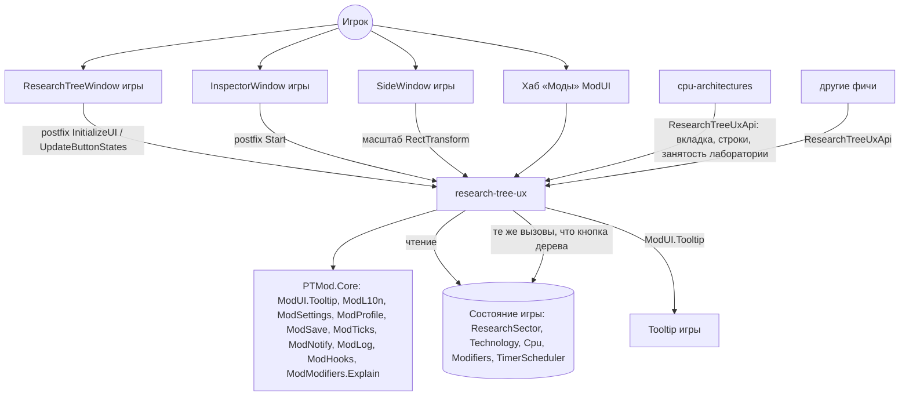
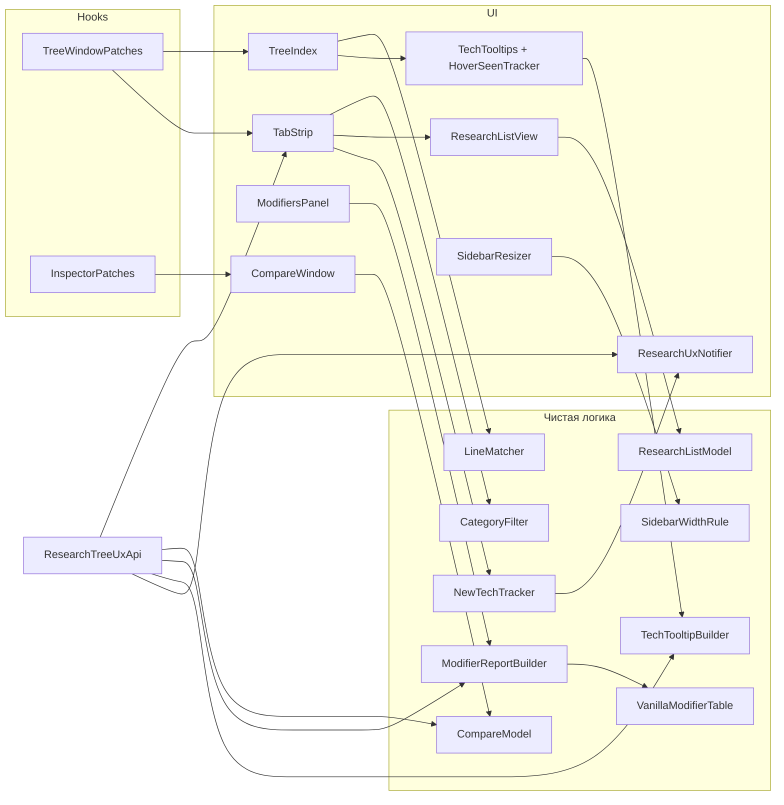
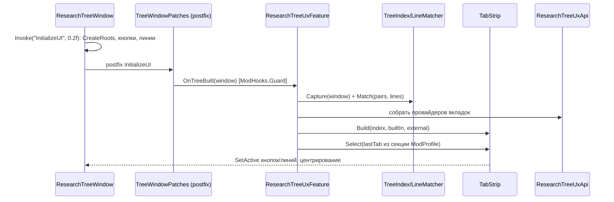
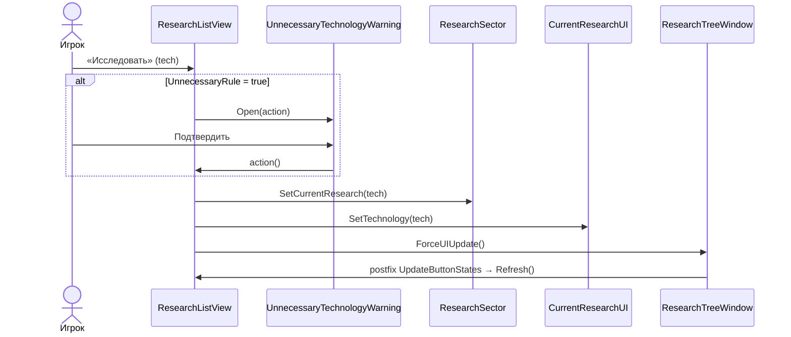
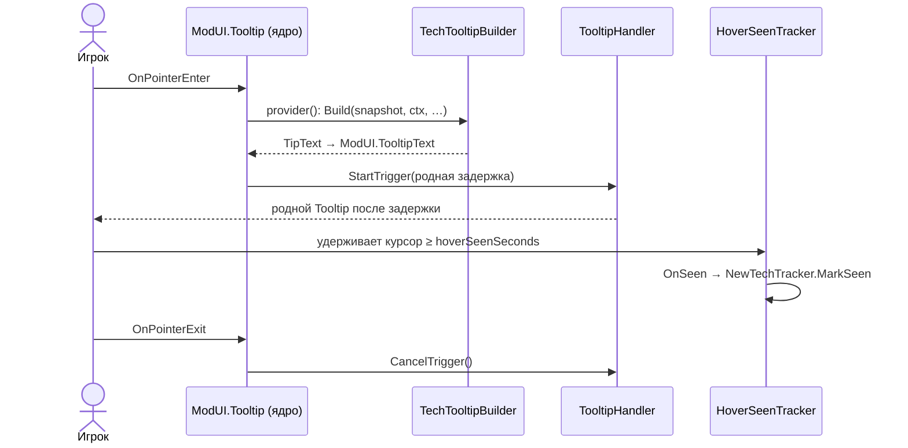
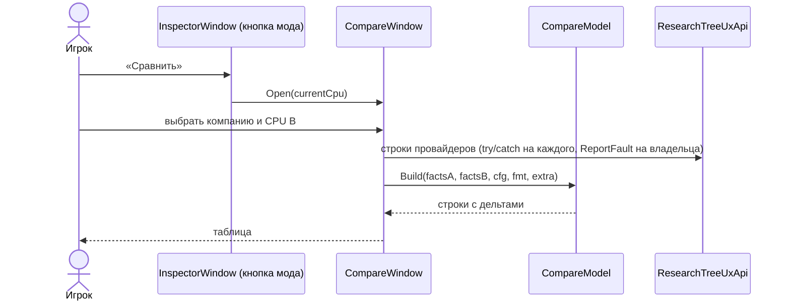

# Design: research-tree-ux

## Document Information

- **Feature Name**: research-tree-ux
- **Version**: 0.2
- **Date**: 2026-10-10
- **Author**: Dex719
- **Status**: Draft v0.2 — одобрено к реализации владельцем 2026-10-10
- **Reviewers**: владелец проекта
- **Related Documents**: `requirements.md` (FR-1…FR-10, NFR-1…NFR-8), `tasks.md`, `.kiro/steering/context.md`, `.kiro/steering/owner-decisions.md`, решения `0002`–`0006`; ядро — `.kiro/specs/mod-framework/design.md`; потребитель API — `.kiro/specs/cpu-architectures/`

## Overview

Фича — чистый UI-слой поверх четырёх окон игры: дерева исследований (`ResearchTreeWindow` + `ResearchButton`), инспектора CPU (`InspectorWindow` + `CpuUI`), боковой панели (`SideWindow`, Could) и системы подсказок (`TooltipHandler`/`Tooltip`, доступна через `ModUI.Tooltip` ядра). Она не меняет ни одной формулы. Все числа в подсказках берутся из методов игры (`ResearchSector.TimeLeftOf`, `Technology.Time`, `ResearchMath.ResearchSpeed`, `Modifiers.GetModifier`). Ванильная часть модификаторов вычисляется чистой копией таблицы `Modifiers.GetModifier`, чтобы отделить вклад модов; сам вклад по источникам берётся из `ModModifiers.Explain`.

Точка входа — `[ModFeature] sealed class ResearchTreeUxFeature : IModFeature`: в `Register(FeatureContext)` она объявляет патчи, тики, участника сейва, параметры и страницу хаба. Постфикс `ResearchTreeWindow.InitializeUI` строит индекс кнопок и линий игры, полосу вкладок, панель списка, метки и подсказки. Постфикс `InspectorWindow.Start` добавляет кнопку «Сравнить». Всё остальное — сервисы `PTMod.Core`. Через `ResearchTreeUxApi` другие фичи добавляют вкладки, строки и признак занятой лаборатории.

### Design Goals

- Ноль изменений баланса (NFR-3): только чтение состояния и те же публичные вызовы, что у родных кнопок.
- Раскладка дерева игры не перестраивается: фильтр только скрывает объекты (D1).
- Каждая часть (вкладки, список, подсказки, сравнение, боковая панель) деградирует независимо, если не нашлась её цель (NFR-2).
- Чистая логика (фильтры, модели списка и сравнения, тексты подсказок) отделена от Unity и от типов игры, покрыта тестами мини-раннера.
- Одна точка патча окна исследований для всех фич (FR-7, NFR-7).
- Никаких собственных механизмов, дублирующих ядро: мост подсказок, разбивка модификаторов, профиль, тики и счётчики ошибок — сервисы `PTMod.Core` (NFR-8).

### Key Design Decisions

- **D1. Вкладка = скрытие кнопок и линий, раскладка сохраняется.** Кнопки чужих категорий и линии с хотя бы одним скрытым концом получают `SetActive(false)`. Ряды `Offset` у разных типов разные (память — ряд 2, L1 — ряд 3, техпроцесс — ряд −4…), поэтому вкладка и так показывает 1–2 ряда.
  - *Отвергнуто:* пересборка дерева на вкладку (`CreateRoots`/`CreateDependencyLines` приватные, риск рассинхрона с `UpdateButtonStates`); сжатие пустых рядов (нужно перестраивать линии) — решение владельца: не делаем.
- **D2. Своя полоса вкладок из `ButtonUI`.** Активная вкладка — `Interactable = false`, как в `ButtonTabGroup.Tab.SetActive`.
  - *Отвергнуто:* клон `ButtonTabGroup` — модель «вкладка ↔ свой Content» не подходит для фильтра одной области, `BackgroundVariant` привязан к окнам Analysis/FactoryManagement, список `tabs` сериализован.
- **D3. Список — строки из компонентов `ModUI`.**
  - *Отвергнуто:* клоны `ResearchButton` (крупная карточка, не «компактно», зависит от приватных полей); клоны `ResearchList` — их `Start` подписывается на `DateController.OnDayPassed` без отписки, после `Destroy` обработчик бросит исключение внутри тика игры.
- **D4. Подсказки — `ModUI.Tooltip` ядра.** Мост к `TooltipHandler` (runtime `TooltipData`, родная задержка, позиционирование, безопасность при `TooltipHandler.Instance == null`) один на все фичи и живёт в `ModUI`; фича только отдаёт текст `Func<TooltipText>`, строящийся при наведении. Для отметки «просмотрено» (FR-3.4) используется отдельный лёгкий компонент `HoverSeenTracker`, который `TooltipHandler` не трогает.
  - *Отвергнуто:* собственный класс моста к `TooltipHandler` внутри фичи (решение владельца: мост в ядре); свой виджет подсказки (чужеродный вид); прямой вызов `Tooltip.Open` (`TooltipHandler.CurrentTooltip` приватный, обходит задержку).
- **D5. Сравнение — своя таблица с дельтами.**
  - *Отвергнуто:* два клона `CpuUI` — нет колонки разницы, около 25 приватных `InfoText`, вёрстка под один CPU.
- **D6. «Ванильная» часть модификаторов — чистая копия таблицы `Modifiers.GetModifier`**, итог — вызов игры (уже с постфиксом `ModModifiers`); вклад модов по источникам — `ModModifiers.Explain`.
  - *Отвергнуто:* Harmony reverse-patch оригинала (лишняя сложность); показ только итога (не объясняет «откуда»); отдельный запрос к ядру на разбивку (не нужен: `Explain` уже отдаёт `AppliedModifier`).
- **D7. Реестр расширений `ResearchTreeUxApi` с отложенной регистрацией.**
  - *Отвергнуто:* каждая фича патчит `ResearchTreeWindow` сама — конфликты порядка патчей и дубли UI.
- **D8. «Просмотренные» — в `ModSave` (на сейв, решение владельца), предпочтения вида — в `ModProfile` (глобально).** `ModSettings` хранит только параметры `ParamSpec` типов Bool/Int/Float (флаги напоминаний), строкового хранилища в нём нет.
  - *Отвергнуто:* `SaveObject.PlayerSettings` игры (поля в классы игры не добавляем); всё в `ModSettings` (метки «новое» зависят от сейва, вид — строки); свой файл профиля (единственный писатель `ptmod_profile.json` — ядро).
- **D9. Линии зависимостей сопоставляются геометрически.** Середина линии = (позиция `ExitNode` зависимости + позиция `EnterNode` технологии) / 2, допуск 0,5 px. Вычисляется сразу после `InitializeUI`, пока узлы на своих местах.
  - *Отвергнуто:* сопоставление по порядку итерации `DataFinder.FindAllTechnologies()` — порядок `FindObjectsOfType` не гарантирован между вызовами.
- **D10. Занятая лаборатория — интерфейс `ILabOccupancySource`.** Владелец решил, что архитектуры (`cpu-architectures`) исследуются в общей лаборатории: пока идёт исследование архитектуры, `ResearchSector.CurrentResearch()` = null, но лаборатория не простаивает. Источник сообщает `IsLabBusy()` и `BusyText()`; фича использует их в списке (строка «Лаборатория занята») и в напоминании о простое.
  - *Отвергнуто:* проверять состояние `cpu-architectures` напрямую (жёсткая связь); считать простоем всё, где `CurrentResearch()` = null (ложные напоминания).
- **D11. Исключения провайдеров API записываются на фичу-владельца провайдера** (`ModHooks.ReportFault(ModFeatures.FeatureOfType(provider.GetType()), …)`), а не на `research-tree-ux`.
  - *Отвергнуто:* `Guard` с идентификатором `research-tree-ux` (чужая ошибка довела бы эту фичу до `Faulted`).
- **D12. Ширина боковой панели (Could) — масштаб `RectTransform` `SideWindow` и пересчёт его позиций.**
  - *Отвергнуто:* пересоздание панели (её содержимое строят `ProjectUIInstantiator` и `CpuSalesUIInstantiator`); патч `SideWindow.UpdateWindowVisibility`.

## Architecture

### System Context



### High-Level Architecture



### Technology Stack

| Слой | Технология | Обоснование |
|---|---|---|
| Патчи | Harmony 2.3.6 через `ModHooks` (`[ModPatch]`, `ModHooks.Guard`) | решение 0002; изоляция ошибок по фиче |
| UI | `ModUI` (клоны шаблонов игры: `ButtonUI`, `ToggleUI`, `DropdownUI`, `InfoText`, `ProgressBar`, TMP) | решение 0005; родной вид и темы |
| Подсказки | `ModUI.Tooltip` (мост ядра к `TooltipHandler`) | родная задержка и вид; один мост на все фичи |
| Состояние | `ModSave` (секция `research-tree-ux`, `IModSaveParticipant`), `ModProfile` (вид), `ModSettings` (`ParamSpec`) | решения 0004; версию секции пишет ядро |
| Контент | `ModContent` (`Content/research-tree-ux/ui.json`) | решение 0006: числа — в JSON |
| Тексты | `ModL10n` (`ru`, `en`), префикс ключей `rtux.` | конвенция проекта |
| Тесты | `mod/tests/PTMod.Tests/Features/ResearchTreeUx/` на мини-раннере .NET Framework 4.8 (`[Test]`, `[Covers]`) | `context.md`: автоматически проверяются только тесты чистой логики |

### Используемые сервисы PTMod.Core

`ModHooks` (регистрация патчей фичи через `FeatureContext.Patch`, `Guard`, `ReportFault`, самопроверка целей и приватных полей), `ModTicks` (подписки `FeatureContext.OnTick` на `TickPhase.DayPassed` и `TickPhase.MonthPassed`; `ModTicks.GameReady`; `ModTicks.IsFastForwarding`), `ModSave` (участник `IModSaveParticipant`, секция `research-tree-ux`), `ModProfile` (вид, `Section`/`MarkDirty`), `ModSettings` (`ParamSpec`, флаг фичи), `ModUI` (шаблоны окна и компонентов, хаб «Моды», тема, `Tooltip`, `Confirm`), `ModL10n` (`L("key", args)`), `ModNotify` (напоминания FR-9), `ModModifiers` (чтение: `Explain`), `ModContent` (`ui.json`), `ModLog`, `ModFeatures` (`FeatureOfType`, `StateChanged`, `IsActive`).

## Components and Interfaces

Пространство имён — `PTMod.Features.ResearchTreeUx`. Каталог — `mod/src/PTMod/Features/ResearchTreeUx/`; чистая логика — `.../Logic/` (без `UnityEngine` и без типов игры: тип технологии и тип модификатора — целые значения `TechnologyType` и `ModifierType`).

### Component 1: ResearchTreeUxFeature

**Purpose**: точка входа фичи по контракту ядра: объявление патчей, тиков, участника сейва, параметров и страницы хаба; включение и выключение.

```csharp
namespace PTMod.Features.ResearchTreeUx
{
    [ModFeature]
    public sealed class ResearchTreeUxFeature : IModFeature
    {
        public const string FeatureId = "research-tree-ux";
        public string Id => FeatureId;
        public string NameKey => "rtux.feature.name";
        public string DescriptionKey => "rtux.feature.desc";
        public string[] DependsOn => new string[0];     // жёстких зависимостей от других фич нет
        public bool EnabledByDefault => true;
        public bool SupportsHotToggle => true;          // FR-8.3: выключение без перезагрузки сцены

        public void Register(FeatureContext ctx);       // см. ниже
        public void OnEnabled();                        // строит UI, если окно уже построено
        public void OnDisabled();                       // FR-8.3: снимает UI, возвращает видимость, закрывает окна

        public static ResearchTreeUxFeature Instance { get; }
        public UxParts Parts { get; }                   // какие части прошли самопроверку
        internal void OnTreeBuilt(ResearchTreeWindow window);      // из постфикса InitializeUI
        internal void OnInspectorStarted(InspectorWindow window);  // из постфикса Start
    }

    [System.Flags]
    public enum UxParts { None = 0, Tabs = 1, List = 2, Tooltips = 4, Modifiers = 8, Compare = 16, Notify = 32, Sidebar = 64 }
}
```

`Register(FeatureContext ctx)` делает:

| Вызов | Что объявляет |
|---|---|
| `ctx.Patch(typeof(TreeWindowPatches))` | postfix `ResearchTreeWindow.InitializeUI`, postfix `ResearchTreeWindow.UpdateButtonStates` |
| `ctx.Patch(typeof(InspectorPatches))` | postfix `InspectorWindow.Start` |
| `ctx.OnTick(TickPhase.DayPassed, OnDay)` | пересчёт непросмотренных, обновление списка, счётчик простоя лаборатории |
| `ctx.OnTick(TickPhase.MonthPassed, OnMonth)` | напоминание о новых исследованиях |
| `ModTicks.GameReady += OnGameReady` | `NewGame` / `Loaded`: инициализация «просмотренных» (FR-3.5, FR-3.7) |
| `ctx.SaveParticipant(new ResearchUxSaveParticipant())` | секция `research-tree-ux` бокового файла |
| `ctx.Param(...)` | `notifyNewTech`, `notifyIdleLab` (Bool, по умолчанию true) |
| `ctx.HubPage("rtux.hub.title", BuildHubPage)` | страница хаба: кнопка «Сравнить CPU» (FR-6.9) |

**Responsibilities**: координация компонентов; перестроение UI на новой сцене (загрузка сейва перезагружает сцену, ядро сообщает `SceneLeaving`); перехват исключений на границе каждого хука через `ModHooks.Guard`. Подписок на `DateController`, `Player.OnNewGame`, `SaveHandler.*` и собственных счётчиков ошибок у фичи нет.

### Component 2: TreeIndex + LineMatcher

**Purpose**: снимок кнопок и линий дерева игры после построения.

```csharp
internal sealed class TreeIndex
{
    public ResearchTreeWindow Window { get; }
    public IReadOnlyList<ResearchButton> Buttons { get; }          // AccessTools: ResearchTreeWindow.researchButtons
    public IReadOnlyList<UnityEngine.UI.Image> Lines { get; }      // AccessTools: ResearchTreeWindow.dependencyLines
    public RectTransform TreeContent { get; }                      // ResearchTreeWindow.cpuTab
    public CurrentResearchUI CurrentResearchUi { get; }            // ResearchTreeWindow.currentResearchUI
    public ResearchButton ButtonOf(int technologyId);
    public IReadOnlyList<LineLink> LineLinks { get; }              // результат LineMatcher
    public static TreeIndex Capture(ResearchTreeWindow window);   // вызывается в постфиксе InitializeUI
}

public readonly struct LineLink { public readonly int LineIndex, FromTechId, ToTechId; } // From = зависимость, To = технология

public static class LineMatcher // чистая логика
{
    // pairs: (depId, techId, exitPos(dep), enterPos(tech)); lines: (index, anchoredPosition)
    public static IReadOnlyList<LineLink> Match(IReadOnlyList<DependencyPair> pairs,
                                                IReadOnlyList<LineGeom> lines, float tolerancePx = 0.5f);
}
```

**Implementation Notes**: постфикс выполняется после `InitializeUI`, когда игра уже вернула узлы `EnterNode`/`ExitNode` внутрь кнопок (`ResearchButton.ResetNodes`) и выключила их. Поэтому `LineMatcher` получает позиции узлов в системе координат `cpuTab` пересчётом `RectTransform.TransformPoint` → `cpuTab.InverseTransformPoint` (выключенный объект сохраняет позицию). Линии лежат под `linesParent`; их `anchoredPosition` переводится в ту же систему координат. Несопоставленные линии — «всегда видимы» (NFR-2).

### Component 3: CategoryFilter + TabStrip

**Purpose**: модель вкладок и их применение к дереву.

```csharp
public enum TechCategory { All = -1, Package = 0, Lithography = 1, Memory = 2, Frequency = 3, CacheSize = 4, WaferSize = 5, Multicore = 6 }

public static class CategoryFilter // чистая логика
{
    public static bool IsVisible(int technologyType, TabDefinition tab);   // technologyType = значение TechnologyType
    public static bool IsLineVisible(LineLink link, System.Func<int, bool> isTechVisible);
    public static int? FocusTarget(IReadOnlyList<TechSnapshot> techsOfTab); // FR-1.4: первая доступная по году, иначе последняя исследованная
}

internal sealed class TabStrip
{
    public string ActiveTabId { get; }
    public void Build(TreeIndex index, IReadOnlyList<TabDefinition> builtIn, IReadOnlyList<IResearchTabProvider> external);
    public void Select(string tabId);       // применяет фильтр или показывает контент провайдера
    public void SetBadge(string tabId, int count);
    public void Destroy();                  // FR-8.3
}

public sealed class TabDefinition { public string Id; public string TitleKey; public int[] Types; public int Order; }
```

**Implementation Notes**: центрирование (FR-1.4) двигает `ResearchTreeController.controller` (приватное поле, `AccessTools`) так, чтобы целевая кнопка попала в центр вьюпорта с учётом масштаба `scaler.transform.localScale.x`. Если контроллер не найден — центрирование пропускается. Полоса вкладок перестраивается на `ModFeatures.StateChanged` (появление и исчезновение вкладок фич-провайдеров).

### Component 4: ResearchListModel + ResearchListView

```csharp
public sealed class TechSnapshot
{
    public int Id; public string Name; public int Type; public int Year;      // Type = значение TechnologyType
    public float BaseTime; public float Time; public float MonthlyCost;
    public bool IsResearched; public bool IsLocked; public bool IsCurrent; public bool IsUnnecessary;
    public float Progress; public int EtaDays;          // -1 = «∞»
    public int[] DependencyIds; public int[] UnlocksIds;
}

public sealed class ListFilter { public bool OnlyAvailable = true; public bool HideResearched = true; public bool HideUnnecessary; public ListSort Sort = ListSort.Year; }
public enum ListSort { Year, Eta, Cost }

public static class ResearchListModel // чистая логика
{
    public static IReadOnlyList<ListGroup> Build(IReadOnlyList<TechSnapshot> techs, TabDefinition tab, ListFilter filter);
}
public sealed class ListGroup { public int Type; public int Researched; public int Total; public List<TechSnapshot> Rows; }

public static class UnnecessaryRule // копия ResearchButton.TechnologyIsUnnecessary
{
    public static bool IsUnnecessary(int technologyType, bool isFabless, bool isFoundry);
}

internal static class TechSnapshotReader // единственное место, читающее игру
{
    public static List<TechSnapshot> ReadAll(ICompany player);   // ResearchDataProvider.Instance.GetAllTechnologies(), ResearchSector.*
}

internal sealed class ResearchListView
{
    public void Show(); public void Hide();
    public void Refresh();          // раз в день или по смене фильтра
    public void Select(int technologyId); // FR-2.5
}
```

**Implementation Notes**: `Select` — тот же путь, что лямбда `ResearchTreeWindow.<>c__DisplayClass27_0`: при `UnnecessaryRule` → `UnnecessaryTechnologyWarning.Instance.Open(action)`; `action` = `ResearchSector.SetCurrentResearch(Technology)` + `CurrentResearchUI.SetTechnology(Technology)` + `ResearchTreeWindow.ForceUIUpdate()`. Строки создаются один раз (до 97 + заголовки), дальше переиспользуются. Над списком — строка «Лаборатория занята: …», если зарегистрированный `ILabOccupancySource` сообщает `IsLabBusy()` (FR-2.9).

### Component 5: NewTechTracker

```csharp
public sealed class NewTechTracker // чистая логика
{
    public IReadOnlyCollection<int> Seen { get; }
    public IReadOnlyCollection<int> Unseen(IReadOnlyList<TechSnapshot> techs); // доступные и не в Seen
    public void MarkSeen(IEnumerable<int> ids);
    public void InitializeAllAvailableAsSeen(IReadOnlyList<TechSnapshot> techs); // новая игра или старый сейв
    public ResearchUxSave ToSave(); public static NewTechTracker FromSave(ResearchUxSave save, int technologyCount);
}

internal sealed class ResearchUxSaveParticipant : IModSaveParticipant   // адаптер к ModSave
{
    public string SectionId => "research-tree-ux";
    public int SchemaVersion => 1;                     // версию пишет и читает ядро (_schema)
    public void ResetToDefaults();                     // пустое множество, флаг «нужна инициализация»
    public void Read(Logic.Json.JsonObject section, int schema);
    public Logic.Json.JsonObject Write();              // без _schema
}
```

### Component 6: TechTooltipBuilder + подсказки через ModUI

```csharp
public sealed class ResearchContext
{
    public int CurrentYear; public float Funding; public bool InnovationEnabled;
    public float SpeedTotal;            // ResearchMath.ResearchSpeed(Funding, company)
    public float CostMultiplierTotal;   // Modifiers.GetModifier(ModifierType.ResearchCost, company)
    public float PenaltyPerYear = 3.5f; // TechnologyTimeUpdater.penaltyPerYear / 100 (контент)
    public float BonusPerYear = 0.15f;  // TechnologyTimeUpdater.bonusPerYear / 100 (контент)
}

public static class TechTooltipBuilder // чистая логика, возвращает (header, content) с rich text TMP
{
    public static TipText Build(TechSnapshot tech, ResearchContext ctx, IReadOnlyDictionary<int, TechSnapshot> byId,
                                System.Func<float, int> etaAtFunding, IReadOnlyList<string> extraLines);
}
public readonly struct TipText { public readonly string Header, Content; }

internal static class TechTooltips // адаптер к ModUI
{
    // ModUI.Tooltip(target, () => new ModUI.TooltipText { Header = t.Header, Content = t.Content }):
    // текст строится при наведении, задержка и вид — родные, TooltipHandler.Instance == null — без ошибок (гарантия ядра)
    public static void Attach(UnityEngine.GameObject target, System.Func<TipText> provider);
    public static void Detach(UnityEngine.GameObject target);    // FR-8.3
}

// Компонент на кнопках дерева и строках списка (FR-3.4): считает время под курсором, TooltipHandler не трогает
internal sealed class HoverSeenTracker : UnityEngine.MonoBehaviour,
    UnityEngine.EventSystems.IPointerEnterHandler, UnityEngine.EventSystems.IPointerExitHandler
{
    public int TechnologyId; public float Seconds;     // Seconds = hoverSeenSeconds из ui.json
    public System.Action<int> OnSeen;
}
```

**Implementation Notes**: у `ResearchButton` поле `tooltip` пустое (данные `ResearchButton.json`: `"tooltip": null`), поэтому триггер `ModUI.Tooltip` и `HoverSeenTracker` добавляются к объекту кнопки без конфликта. `ModUI.Tooltip` не позволяет задать ширину подсказки, поэтому длинные строки переносятся родным `Tooltip`; блок «Осталось при …» компактный (одна строка на уровень финансирования). Локального класса моста к `TooltipHandler` в фиче нет.

### Component 7: VanillaModifierTable + ModifierReportBuilder + ModifiersPanel

```csharp
public readonly struct CompanyFacts { public readonly bool IsIdm, IsFoundry, IsFabless, IsTcms, IsUnlucky; }

public static class VanillaModifierTable // копия Modifiers.GetModifier
{
    // type = значение ModifierType:
    // 0: 1.05 если IDM; 1: 0.5 если foundry; 2: 0.8 если foundry, −0.1 если TCMS; 3: 0.67 если fabless;
    // 4: 6.0 если «невезучая» (Cyrix без отзыва лицензии x86); 5: 0.67 если TCMS; 6: 0.25 если TCMS; иначе 1.0
    public static float Get(int type, CompanyFacts facts);
    public static string ReasonKey(int type, CompanyFacts facts); // "rtux.mod.reason.idm" и т. п.
}

public sealed class ExplainRow { public string FeatureId, ReasonKey; public string[] ReasonArgs; public float Multiplier; public int? ExpiresInDays; }
public sealed class ExplainData { public float Raw, Total; public bool IsBalanceCapped, IsFuseCapped; public List<ExplainRow> Rows; }  // снимок ModifierBreakdown

public sealed class ModifierSnapshot
{
    public CompanyFacts Facts; public float Funding; public float SpeedTotal;
    public float[] TotalByType = new float[7];         // Modifiers.GetModifier(type, player) — уже с ModModifiers
    public float FrequencyIncrease, ConsumptionReduction, DensityIncrease; // Company.ResearchModifiers
    public float CurrentTechMonthlyCost;                // Technology.Cost текущего исследования, 0 если нет
    public List<PendingProject> Pending;                // из TimerScheduler
    public ExplainData[] ExplainByType;                 // ModModifiers.Explain(канал типа, {Company = игрок}); элемент null — Explain недоступен
}
public sealed class PendingProject { public float Frequency, Consumption, Density; public int EtaDays; }

public static class ModifierReportBuilder // чистая логика
{
    public static ModifierReport Build(ModifierSnapshot s, IReadOnlyList<ModifierLineGroup> extra);
}
public sealed class ModifierReport { public List<ModifierLineGroup> Groups; public TipText ToTooltip(); }
public sealed class ModifierLineGroup { public string TitleKey; public List<ModifierLine> Lines; }
public sealed class ModifierLine { public string LabelKey; public object[] Args; public float? Multiplier; public string SourceFeatureId; public bool Capped; }

internal static class ModifierSnapshotReader // адаптер: читает игру и ModModifiers.Explain
{
    // тип → канал: 0 research.speed, 1 factory.operatingCost, 2 construction.cost, 3 development.cost,
    //              4 research.cost, 5 taxes, 6 bank.interest (константы ModChannels)
    public static ModifierSnapshot Read(ICompany player);
}
```

**Implementation Notes**: ванильное значение типа = `VanillaModifierTable.Get`; вклад модов = `ExplainData.Total` (то, что вернул бы `ModModifiers.Get`); совпадение «ваниль × Total ≈ `Modifiers.GetModifier`» проверяется самопроверкой в debug-сборке. Строки источников строит `ModifierReportBuilder` из `ExplainRow` (текст причины — ключ L10n фичи-источника с `ReasonArgs`); флаг `Capped` ставится при `IsBalanceCapped` или `IsFuseCapped` и дописывает «(ограничено)» (`core.explain.capped`). Если `ExplainByType[i]` = null, строка «Моды: ×k».

### Component 8: CompareModel + CompareWindow

```csharp
public enum Better { None, Higher, Lower }

public sealed class CpuFacts // снимок CPU для чистой логики
{
    public int SaveId; public string Company, Name, Package, Lithography, Memory;
    public int CoreCount, L1Steps, L2Steps, L3Steps, Year; public bool Smt;
    public float DieSize, Transistors, Temperature, Power, Frequency, Ipc, Ips;
    public float FailureRate, RealUnitCost, Price, AvgPopularity; public int SoldLastMonth;
}

public sealed class CompareRow
{
    public string Id; public string LabelKey; public string ValueA, ValueB;
    public float? NumA, NumB; public Better Better; public int Order;
    public string DeltaText;   // "+18 %" или "—"
    public int Winner;         // -1 = A, 0 = нет, +1 = B
}

public static class CompareModel // чистая логика
{
    public static List<CompareRow> Build(CpuFacts a, CpuFacts b, CompareConfig cfg, IFormatter fmt,
                                         IReadOnlyList<CompareRow> extraRows);
    public static float? DeltaPercent(float? a, float? b); // (b − a) / |a| × 100; null если a = 0
}

internal sealed class CompareWindow
{
    public static void Open(Cpu a, Cpu b = null);
    public void Swap(); public void Refresh(); public void Close();
}
```

`IFormatter` в игре — обёртка над `StringFormatter` (`FloatToIps`, `FloatToFrequency`, `FloatToMoney`, `CacheString`, `CoreCountString`, `FloatToPercentageString`, `FloatToString`, `FloatToIntString`), в тестах — простая реализация. `CpuFactsReader` читает те же поля `Cpu`, что игра показывает в инспекторе и окнах рынка для любой компании (FR-6.10).

### Component 9: ResearchTreeUxApi (точки расширения)

```csharp
public interface IResearchTabProvider
{
    string TabId { get; }           // уникален, напр. "cpu-architectures"
    string TitleKey { get; }        // ключ ModL10n
    int Order { get; }              // встроенные вкладки: 0..90 шагом 10
    bool IsAvailable();             // например, фича включена
    RectTransform BuildContent(RectTransform parent); // один раз, лениво
    void OnShown(); void OnHidden();
    int BadgeCount();               // счётчик на вкладке, 0 — без счётчика
}
public interface ICompareRowProvider { IEnumerable<CompareRow> GetRows(Cpu a, Cpu b); }
public interface IModifierLineSource { ModifierLineGroup GetGroup(ICompany company); }   // null — нечего показать
public interface ITechTooltipLineSource { IEnumerable<string> GetLines(Technology technology); }
public interface ILabOccupancySource             // D10: лаборатория занята исследованием не из ResearchSector
{
    bool IsLabBusy();               // для игрока; true — лаборатория не простаивает, хотя CurrentResearch() = null
    string BusyText();              // уже локализованная строка: «Архитектура x86 — 43 %»
}

public static class ResearchTreeUxApi
{
    public static bool IsActive { get; }                       // FR-7.6
    public static void RegisterTab(IResearchTabProvider provider);
    public static void RegisterCompareRows(ICompareRowProvider provider);
    public static void RegisterModifierLines(IModifierLineSource source);
    public static void RegisterTechTooltipLines(ITechTooltipLineSource source);
    public static void RegisterLabOccupancy(ILabOccupancySource source);
    public static void OpenTab(string tabId);                  // открыть дерево на нужной вкладке (вход из хаба)
}
```

Регистрации хранятся независимо от состояния фичи: пока фича выключена, `IsActive` = false и провайдеры не опрашиваются, при включении они начинают действовать (FR-7.6). Каждый вызов провайдера обёрнут в `try/catch`; ошибка записывается через `ModHooks.ReportFault` на фичу-владельца провайдера (D11), сам провайдер отключается до перезапуска. Фича-владелец определяется по пространству имён типа провайдера (`ModFeatures.FeatureOfType`).

### Component 10: ResearchUxNotifier (FR-9)

```csharp
public sealed class NotifierState { public int IdleDays; public int DaysSinceIdleNotice = int.MaxValue; public int LastNewTechNoticeMonth = -1; }
public static class NotifierPolicy // чистая логика
{
    public static bool ShouldNotifyIdle(NotifierState s, bool hasCurrent, bool labBusyBySource, int availableCount, NotifyConfig cfg);
    public static bool ShouldNotifyNew(NotifierState s, int monthIndex, int unseenCount, bool treeOpen);
}
```

Показ — `ModNotify.ShowKey("research-tree-ux", "rtux.notify.newTech", n)`; в перемотку и загрузку напоминания не генерируются (нейтральность), отложенный показ в пакетном прогоне `NextMonth` обеспечивает ядро.

### Component 11: SidebarResizer (FR-10, Could)

```csharp
public static class SidebarWidthRule // чистая логика
{
    public static float Clamp(float factor, float min, float max);                   // [1,0; 1,6]
    public static float Width(float originalWidth, float factor);
    public static float HiddenPosition(float originalHidden, float originalWidth, float factor); // панель целиком за экраном
}
internal sealed class SidebarResizer
{
    public void Attach(SideWindow window);   // AccessTools: rectTransform, visiblePosition, hiddenPosition; ручка на левом крае
    public void Detach();                    // FR-10.3: исходные значения
}
```

## Патчи Harmony

Цели не входят в зарезервированные ядром (`ModHooks.IsReserved` = false); тела патчей обёрнуты в `ModHooks.Guard`.

| Цель (`Class.Method` игры) | Тип | Что меняет | Порядок / конфликты |
|---|---|---|---|
| `ResearchTreeWindow.InitializeUI` | postfix | `TreeIndex.Capture`, `LineMatcher`, полоса вкладок, панель списка, кнопка «Модификаторы», подсказки и метки на кнопках; восстанавливает последнюю вкладку | Единственный патч на метод в проекте (NFR-7). Вызывается раз на сцену (Invoke 0,2 с). Ошибка → часть `Tabs`/`List` выключается, игра продолжает |
| `ResearchTreeWindow.UpdateButtonStates` | postfix | обновляет метки «новое», счётчики вкладок и (если виден) список; повторно скрывает кнопки, если игра их включила | Вызывается из `OnDayPassed`, при выборе исследования, `ForceUIUpdate`, теме. Первой строкой: выход при `ModTicks.IsFastForwarding` или выключенной фиче (NFR-1) |
| `InspectorWindow.Start` | postfix | клон `simpleOrDetailedButton` с текстом «Сравнить», `OnClick` → `CompareWindow.Open(currentCpu)` | Единственный патч на метод. `cpu-architectures` патчит `CpuUI.SetCpu`, а не этот метод |

Все цели существуют в `pt-modding/code/` (`ResearchTreeWindow.cs`, `InspectorWindow.cs`). Методы, которые фича только вызывает: `ResearchSector.SetCurrentResearch(Technology)`, `ResearchSector.TimeLeftOf(Technology)`, `ResearchSector.TimeLeftOf(Technology, float)`, `ResearchSector.ProgressOf`, `ResearchSector.IsUnlocked`, `ResearchSector.IsLocked`, `ResearchSector.CurrentResearch`, `ResearchSector.GetDependencies`, `ResearchSector.ResearchCountOfType`, `CurrentResearchUI.SetTechnology`, `ResearchTreeWindow.ForceUIUpdate`, `UnnecessaryTechnologyWarning.Open`, `ResearchDataProvider.GetAllTechnologies`, `ResearchMath.ResearchSpeed`, `Modifiers.GetModifier`, `TimerScheduler.GetTimedObjectsOfType`, `Project.GetResearchProject`, `DataFinder.FindAllOwnersOfCompany`, `ICompanyOwner.GetCpus`, `CompanyHelper.IsTCMS`, `CompanyHelper.IsUnluckyCompany`.

Приватные поля, читаемые через `AccessTools` (проверяются самопроверкой): `ResearchTreeWindow.researchButtons`, `.dependencyLines`, `.cpuTab`, `.linesParent`, `.currentResearchUI`; `ResearchTreeController.controller`, `.scaler`; `InspectorWindow.simpleOrDetailedButton`, `.currentCpu`; для FR-10 — `SideWindow.rectTransform`, `.visiblePosition`, `.hiddenPosition`. Свойств `TooltipData` фича не трогает (мост в ядре).

## Подписки на события

| Источник | Обработчик | Защиты (перемотка / загрузка) |
|---|---|---|
| `FeatureContext.OnTick(TickPhase.DayPassed)` | `NewTechTracker` пересчёт непросмотренных; `ResearchListView.Refresh` (если виден); `NotifierPolicy` простоя | Ядро не вызывает при `IsFastFowardSimulating` и `GameManager.IsLoading` (по умолчанию) и пока фича не `Enabled` |
| `FeatureContext.OnTick(TickPhase.MonthPassed)` | напоминание о новых исследованиях (FR-9.1) | то же |
| `ModTicks.GameReady(NewGame)` | `NewTechTracker.InitializeAllAvailableAsSeen` (FR-3.7) | после перемотки, ок |
| `ModTicks.GameReady(Loaded)` | если секции не было — всё доступное просмотрено (FR-3.5) | сцена уже новая; UI строится позже в постфиксе `InitializeUI` |
| `IModSaveParticipant.Read` / `Write` | восстановить / записать `seenAvailable` | вызывает `ModSave` на `SaveHandler.OnLoaded` и в P12 (`SaveSystem.Save`) |
| `ThemeManager.OnThemeChanged` | перекрасить полосу вкладок, список, окно сравнения (через `ModUI`) | переподписку на новой сцене делает ядро |
| `CompanyTypeUpdater.OnCompanyTypeChanged` | пересчитать «ненужные» в списке | только если UI построен |
| `ModFeatures.StateChanged` | перестроить полосу вкладок (вкладки фич-провайдеров), убрать источники строк выключенных фич | — |
| `ModSettings.Changed` (`notifyNewTech`, `notifyIdleLab`) | обновить политику напоминаний | — |
| `PTModHost.SceneLeaving` | закрыть окна фичи, сбросить ссылки на объекты сцены | подписку ведёт ядро; UI перестраивается постфиксом `InitializeUI` новой сцены |

Включение и выключение фичи (`OnEnabled`/`OnDisabled`) вызывает ядро по переключателю хаба.

## Data Models

### ModSave: секция `research-tree-ux`

```csharp
public sealed class ResearchUxSave    // DTO для ModJson.Bind / ModJson.From; поля версии нет — _schema пишет ядро
{
    public List<int> seenAvailable = new List<int>(); // Technology.ID, отсортированы
}
```

```json
{
  "schema": 1,
  "modVersion": "0.1.0",
  "features": {
    "research-tree-ux": {
      "seenAvailable": [12, 31, 44, 58, 71]
    }
  }
}
```

Поле версии секции (`_schema`) ядро дописывает при записи и читает само; в DTO и примере фичи его нет. Правила: ID вне `0..Count−1` отбрасываются при загрузке с предупреждением; не больше 512 элементов; дубликаты схлопываются; секция без `_schema` читается ядром как версия 1; секция новее мода → ядро вызывает `ResetToDefaults` и записывает исходную секцию как есть (FR-3.5 даёт значения по умолчанию).

### ModProfile: предпочтения вида (глобально, не в сейв)

```csharp
internal sealed class ResearchUxPrefs   // читается из ModProfile.Section("research-tree-ux", 1), запись — Store() + MarkDirty
{
    public string LastTab = "all";
    public string ViewMode = "tree";        // "tree" | "list"
    public bool ListOnlyAvailable = true;
    public bool ListHideResearched = true;
    public bool ListHideUnnecessary = false;
    public string ListSort = "year";        // "year" | "eta" | "cost"
    public float SidebarWidthFactor = 1.0f; // FR-10
}
```

```json
{ "schema": 1, "features": { "research-tree-ux": { "lastTab": "cache", "viewMode": "list", "listOnlyAvailable": true,
  "listHideResearched": true, "listHideUnnecessary": false, "listSort": "eta", "sidebarWidthFactor": 1.2 } } }
```

Запись профиля идёт через `ModProfile.MarkDirty` (троттлинг 2 с), принудительная — на выходе и смене сцены; файл ведёт только ядро.

### ModSettings: параметры

Флаг фичи хранит ядро (`ModSettings.IsFeatureEnabled`). Остальное — `ParamSpec` типа Bool, объявленные через `ctx.Param`:

| Ключ | Тип | По умолчанию | Назначение |
|---|---|---|---|
| `notifyNewTech` | Bool | true | напоминание о новых исследованиях (FR-9.1) |
| `notifyIdleLab` | Bool | true | напоминание о простое лаборатории (FR-9.2) |

```json
{ "features": { "research-tree-ux": { "enabled": true, "params": { "notifyNewTech": true, "notifyIdleLab": true } } } }
```

### Контент: `Content/research-tree-ux/ui.json`

```json
{
  "schema": 1,
  "tabs": [
    { "id": "all",         "titleKey": "rtux.tab.all",         "types": [0,1,2,3,4,5,6], "order": 0 },
    { "id": "package",     "titleKey": "rtux.tab.package",     "types": [0], "order": 10 },
    { "id": "lithography", "titleKey": "rtux.tab.lithography", "types": [1], "order": 20 },
    { "id": "memory",      "titleKey": "rtux.tab.memory",      "types": [2], "order": 30 },
    { "id": "frequency",   "titleKey": "rtux.tab.frequency",   "types": [3], "order": 40 },
    { "id": "cache",       "titleKey": "rtux.tab.cache",       "types": [4], "order": 50 },
    { "id": "wafer",       "titleKey": "rtux.tab.wafer",       "types": [5], "order": 60 },
    { "id": "multicore",   "titleKey": "rtux.tab.multicore",   "types": [6], "order": 70 }
  ],
  "timeRescale": { "penaltyPerYear": 3.5, "bonusPerYear": 0.15, "bonusCap": 0.75 },
  "tooltipFundings": [0.5, 2.0, 5.0],
  "hoverSeenSeconds": 0.5,
  "notifications": { "idleLabDays": 7, "idleCooldownDays": 30, "newTechPerMonth": 1 },
  "sidebar": { "widthMin": 1.0, "widthMax": 1.6 },
  "compare": {
    "deltaHighlightPercent": 2.5,
    "rows": [
      { "id": "ips",         "better": "higher", "order": 10 },
      { "id": "ipc",         "better": "higher", "order": 20 },
      { "id": "frequency",   "better": "higher", "order": 30 },
      { "id": "cores",       "better": "higher", "order": 40 },
      { "id": "power",       "better": "lower",  "order": 50 },
      { "id": "temperature", "better": "lower",  "order": 60 },
      { "id": "yield",       "better": "higher", "order": 70 },
      { "id": "unitCost",    "better": "lower",  "order": 80 },
      { "id": "price",       "better": "none",   "order": 90 },
      { "id": "margin",      "better": "higher", "order": 100 },
      { "id": "ipsPerWatt",  "better": "higher", "order": 110 },
      { "id": "ipsPerDollar","better": "higher", "order": 120 },
      { "id": "popularity",  "better": "higher", "order": 130 },
      { "id": "soldLastMonth","better": "higher","order": 140 },
      { "id": "dieSize",     "better": "none",   "order": 150 },
      { "id": "transistors", "better": "none",   "order": 160 },
      { "id": "l1",          "better": "higher", "order": 170 },
      { "id": "l2",          "better": "higher", "order": 180 },
      { "id": "l3",          "better": "higher", "order": 190 },
      { "id": "year",        "better": "none",   "order": 200 }
    ]
  }
}
```

Поле `schema` в файле контента — версия формата контента для `ModContent` (не версия секции сейва). Валидация: `types` — значения 0…6; `id` вкладок уникальны; `order` — целые; `better` ∈ {higher, lower, none}; `deltaHighlightPercent` ∈ [0; 50]; `hoverSeenSeconds` ∈ [0; 5]; `sidebar.widthMin` ≥ 1,0 и `widthMax` ≤ 2,0. Битая запись пропускается с записью в лог (решение 0006); если файл целиком невалиден — используются встроенные значения по умолчанию (те же числа).

## Формулы и баланс

Фича **не меняет** ни одной формулы и константы игры. Ниже — формулы отображения, повторяющие игру, с указанием источника.

| Показатель | Формула | Источник в игре |
|---|---|---|
| Текущее время технологии | `Time` читается как есть | `TechnologyTimeUpdater.UpdateTechnologyTimes` (ежедневно) |
| Штраф за опережение, % | `(Time / BaseTime − 1) × 100`, если `Year > текущий год`; ожидаемо `3,5 × DaysUntilYear(Year) / 365 × 100` | `TechnologyTimeUpdater.penaltyPerYear` = 350 |
| Бонус за отставание, % | `(1 − Time / BaseTime) × 100`, если `Year < текущий год`; ожидаемо `min(75, max(0, (DaysSince(1 янв. Year) − 365) / 365 × 15))` | `TechnologyTimeUpdater.bonusPerYear` = 15, предел 0,75 |
| Оставшееся время, дн. | `ResearchSector.TimeLeftOf(tech)` = round((1 − Progress) × Time / (√Funding × M0)) | `ResearchSector.Research.TimeLeft` |
| Время при другом финансировании | `ResearchSector.TimeLeftOf(tech, F′)`, F′ ∈ {0,5; 2; 5} (5 — только с инновациями) | то же |
| Скорость исследований | `ResearchMath.ResearchSpeed(F, company)` = √F × M0 | `ResearchMath.ResearchSpeed` |
| Ванильный M0 | 1,05 для IDM, иначе 1,0 | `Modifiers.GetModifier`, тип 0 |
| Вклад модов в скорость | `Explain(research.speed).Total`; строки — `AppliedModifier` (фича, причина, множитель, срок); «(ограничено)» при `IsBalanceCapped`/`IsFuseCapped` | итог `Modifiers.GetModifier` уже включает постфикс P1 ядра: ваниль = итог / `Total` |
| Стоимость в день | `Cost × M4 / 30 × F` (без обслуживания: `MaintainanceCost` = 0 в игре) | `ResearchSector.Team.GetTotalCost` |
| Остаток затрат | `стоимость в день × оставшееся время` | оценка; прямого метода в игре нет |
| Частота от проектов | `+FrequencyIncrease` к максимальной частоте (формат `StringFormatter.FloatToFrequency`) | `CreatorCpu.UpdateUI`: maxFrequency = `Company.MaxFrequency` + `FrequencyIncrease` |
| Снижение потребления | множитель делителя `Rc = max(1, ConsumptionReduction)`; при частоте ≤ максимальной мощность × `1/Rc²` (показываем ≈ −(1 − 1/Rc²) × 100 %) | `CpuMath.Consumption`: P = (0,005·f/(k·Rc))^(2+e)… |
| Рост плотности | транзисторы × `max(1, DensityIncrease)` | `CpuMath.TransistorCount` |
| Разница в сравнении, % | `(B − A) / |A| × 100`; «—» при A = 0; подсветка при |Δ| ≥ 2,5 % | — |
| IPS на ватт | `Ips / clamp(PowerConsumption, 0,5, 9999)` | клэмп как в `Market.CalculateRatings` |
| IPS на доллар | `Ips / Price`; «—» при Price ≤ 0 | — |
| Выход годных | `clamp(1 − FailureRate, 0, 1)` | `CpuUI.SetCpu` (`MathHelper.ReversePercentageScale`) |
| Продано за прошлый месяц | `CpuBase.MarketData.Sold[Count − 2] + CpuBase.MarketData.SoldByContracts[Count − 2]` | `CpuBase.MarketData`, окно «последний полный месяц» как в `MarketDataProvider` |
| Ширина боковой панели | `Width = Width₀ × clamp(k, 1,0; 1,6)`; скрытая позиция сдвигается на прирост ширины | `SideWindow.visiblePosition` / `hiddenPosition` (только интерфейс) |

Пример (AC-5.1): IDM, F = 1,5 → √1,5 = 1,2247; × 1,05 = 1,286 → «×1,29».

## UI

### Окна и элементы

| Элемент | Где | Компоненты `ModUI` | Поведение |
|---|---|---|---|
| Полоса вкладок | верх окна `ResearchTreeWindow`, над областью дерева (`cpuTab`), внутри маски; горизонтальная прокрутка при переполнении | `ButtonUI` (клон шаблона кнопки), TMP-текст, фон `Themeable*` | FR-1, FR-3.2, FR-7 |
| Переключатель «Дерево / Список» | справа на полосе вкладок | `ButtonUI` ×2 | FR-2.1 |
| Кнопка «Модификаторы» | справа на полосе вкладок | `ButtonUI` + `ModUI.Tooltip` | FR-5 |
| Панель списка | поверх области дерева (дерево скрыто) | прокручиваемый список `ModUI`, `ToggleUI` ×3, `DropdownUI` (сортировка), строки: TMP-тексты, `ProgressBar`, `ButtonUI` «Исследовать» | FR-2 |
| Строка «Лаборатория занята» | над списком | `Text` | FR-2.9, D10 |
| Метка «НОВОЕ» | дочерний TMP-текст в правом верхнем углу `ResearchButton` и в строке списка | TMP с цветом темы | FR-3 |
| Подсказка технологии | родной `Tooltip` | `ModUI.Tooltip` + `HoverSeenTracker` | FR-4 |
| Панель «Все модификаторы» | закреплённое немодальное окно `ModUI` | `InfoText`-строки, заголовки групп | FR-5 |
| Кнопка «Сравнить» | `InspectorWindow`, рядом с `simpleOrDetailedButton` | клон `ButtonUI` | FR-6.1 |
| Окно сравнения | немодальное окно `ModUI` 2 колонки + разница | `DropdownUI` ×4 (компания/CPU для A и B), `ButtonUI` «Поменять», `InfoText`-строки, цвета `Colors` | FR-6 |
| Страница хаба «Моды» | страница фичи (`ctx.HubPage`) и автоматические параметры | `ToggleUI` (напоминания, строит ядро), `ButtonUI` «Сравнить CPU» | FR-8, FR-6.9 |
| Ручка ширины боковой панели | левый край `SideWindow` | `RectTransform` с обработчиком перетаскивания | FR-10 (Could) |

Модальные окна фича не создаёт, поэтому `PauseTrigger` не используется.

### Ключи строк `ModL10n` (примеры)

| Ключ | ru | en |
|---|---|---|
| `rtux.feature.name` | Удобное дерево исследований | Research tree UX |
| `rtux.feature.desc` | Вкладки, список, подсказки, панель модификаторов и сравнение CPU | Tabs, list, tooltips, modifiers panel and CPU comparison |
| `rtux.hub.title` | Дерево исследований | Research tree |
| `rtux.hub.compare` | Сравнить CPU | Compare CPUs |
| `rtux.param.notifyNewTech` | Напоминать о новых исследованиях | Remind about new research |
| `rtux.param.notifyIdleLab` | Напоминать о простое лаборатории | Remind about idle lab |
| `rtux.tab.all` | Все | All |
| `rtux.tab.package` | Корпуса | Packages |
| `rtux.tab.lithography` | Техпроцесс | Lithography |
| `rtux.tab.memory` | Память | Memory |
| `rtux.tab.frequency` | Частота | Frequency |
| `rtux.tab.cache` | Кэш | Cache |
| `rtux.tab.wafer` | Пластины | Wafers |
| `rtux.tab.multicore` | Ядра | Cores |
| `rtux.tab.badge` | {0} ({1}) | {0} ({1}) |
| `rtux.view.tree` / `rtux.view.list` | Дерево / Список | Tree / List |
| `rtux.list.onlyAvailable` | Только доступные | Available only |
| `rtux.list.hideResearched` | Скрыть исследованные | Hide researched |
| `rtux.list.hideUnnecessary` | Скрыть ненужные | Hide unnecessary |
| `rtux.list.sort.year` / `.eta` / `.cost` | По году / По времени / По стоимости | By year / By time / By cost |
| `rtux.list.research` | Исследовать | Research |
| `rtux.list.empty` | Нет исследований по фильтру | No research matches the filter |
| `rtux.lab.busy` | Лаборатория занята: {0} | The lab is busy: {0} |
| `rtux.badge.new` | НОВОЕ | NEW |
| `rtux.status.researched` / `.available` / `.current` / `.locked` | Исследовано / Доступно / В работе {0} / Заблокировано | Researched / Available / In progress {0} / Locked |
| `rtux.tip.time` | Время: {0} базовое → {1} сейчас | Time: {0} base → {1} now |
| `rtux.tip.penalty` | штраф за опережение +{0} % (+350 % за год) | ahead-of-time penalty +{0}% (+350% per year) |
| `rtux.tip.bonus` | бонус за отставание −{0} % | catch-up bonus −{0}% |
| `rtux.tip.instant` | мгновенно | instant |
| `rtux.tip.eta` | Осталось при {0}: {1} | Left at {0}: {1} |
| `rtux.tip.cost` | Стоимость: {0}/мес, осталось ≈ {1} | Cost: {0}/mo, remaining ≈ {1} |
| `rtux.tip.deps` | Требует: {0} | Requires: {0} |
| `rtux.tip.unlocks` | Открывает: {0} | Unlocks: {0} |
| `rtux.tip.unnecessary.fabless` | Не нужна fabless-компании: нет своего производства | Not needed for fabless: no own fab |
| `rtux.mod.title` | Все модификаторы | All modifiers |
| `rtux.mod.speed` | Скорость исследований ×{0} | Research speed ×{0} |
| `rtux.mod.funding` | Финансирование {0}: ×{1} | Funding {0}: ×{1} |
| `rtux.mod.reason.idm` | бонус IDM | IDM bonus |
| `rtux.mod.reason.fabless` | fabless | fabless |
| `rtux.mod.mods` | Моды: ×{0} | Mods: ×{0} |
| `rtux.mod.source` | {0}: ×{1} — {2} | {0}: ×{1} — {2} |
| `rtux.compare.button` | Сравнить | Compare |
| `rtux.compare.title` | Сравнение CPU | CPU comparison |
| `rtux.compare.swap` | Поменять местами | Swap |
| `rtux.notify.newTech` | Доступны новые исследования: {0} | New research available: {0} |
| `rtux.notify.idle` | Лаборатория простаивает {0} дн. | The lab has been idle for {0} days |

Ключ «(ограничено)» для разбивки — `core.explain.capped` (ядро), не `rtux.*`. «IDM» в ключах скорости и причин — тип компании (компания со своим производством и разработкой), а не ИИ-соперник IBM.

## Sequence-диаграммы

### Построение UI после загрузки сцены



### Выбор исследования из списка



### Подсказка технологии



### Сравнение CPU



## Error Handling

| Ситуация | Поведение |
|---|---|
| Исключение в постфиксе или обработчике | `ModHooks.Guard` на границе хука: счётчик, `ModLog.Error` с ID фичи и circuit breaker ведёт ядро; исключение не уходит в игру (NFR-2) |
| Не найдено приватное поле или цель патча при самопроверке | отключается только зависимая часть (`UxParts`), запись в лог; остальное работает |
| `LineMatcher` не сопоставил линию | линия видима во всех вкладках, одно предупреждение на сцену |
| Провайдер API бросил исключение | `ModHooks.ReportFault` на фичу-владельца провайдера, провайдер отключается до перезапуска (FR-7.3) |
| `ModModifiers.Explain` бросил исключение | для этого канала строка «Моды: ×k», одно предупреждение (FR-5.7) |
| Старый сейв без секции | значения по умолчанию, все доступные — просмотренные (FR-3.5) |
| Битая секция `ModSave` | предупреждение, неверные значения отброшены, исходная секция не теряется |
| Секция новее мода | ядро: `ResetToDefaults`, исходная секция записывается как есть |
| Фича выключена посреди игры | `OnDisabled`: удалить созданные объекты, вернуть `SetActive(true)` всем кнопкам и линиям, закрыть окна, снять `HoverSeenTracker` и подсказки `ModUI.Tooltip`, вернуть `SideWindow` (FR-8.3) |
| Битый `ui.json` | пропуск битых записей; при полном отказе — встроенные значения по умолчанию |
| Загрузка сейва при открытом окне сравнения | окно уничтожается вместе со сценой (`SceneLeaving`); ссылки на CPU не переживают сцену |
| `TooltipHandler.Instance` = null (меню) | подсказки не показываются, без ошибок (гарантия `ModUI.Tooltip`) |

## Security

- Фича не обращается к сети и не читает файлы, кроме `ModContent`, `ModSave`, `ModProfile` и `ModSettings` через сервисы ядра.
- Контент `ui.json` валидируется: диапазоны чисел, известные типы, длина списков (не больше 32 вкладок и 64 строк сравнения), строки — только ключи `ModL10n`.
- `seenAvailable` из сейва: только целые в диапазоне ID технологий, не больше 512 элементов; лишнее отбрасывается.
- Текст из контента не интерпретируется как код; rich-text TMP формирует только сам мод.

## Performance

| Операция | Бюджет | Как обеспечивается |
|---|---|---|
| Дневной тик при закрытом окне | ≤ 0,1 мс | один проход по 97 записям `ResearchSector`, без аллокаций (переиспользуемые массивы) |
| Постфикс `UpdateButtonStates` во время перемотки | ≈ 0 | ранний выход по `ModTicks.IsFastForwarding` |
| Переключение вкладки | ≤ 5 мс | заранее вычисленные списки кнопок/линий по вкладкам; только `SetActive` |
| Обновление списка | ≤ 3 мс | строки создаются один раз, обновляются тексты; обновление раз в день |
| Подсказка / панель модификаторов | ≤ 1 мс | ленивое построение при наведении; `StringBuilder` переиспользуется; `Explain` — 7 вызовов при открытии панели |
| Построение UI на сцену | ≤ 30 мс (один раз) | после `InitializeUI`, вне игрового тика |

Замеры — `ModLog` в режиме отладки (`ModSettings.Debug`).

## Testing Strategy

### Юнит-тесты чистой логики (`mod/tests/PTMod.Tests/Features/ResearchTreeUx/`, мини-раннер)

Запуск — `python mod/build.py --tests`; каждый публичный тип `Features/ResearchTreeUx/Logic/**` указан в `[Covers]`.

| Тест | Что проверяет |
|---|---|
| `CategoryFilterTests` | видимость по типам, линии с одним скрытым концом, «Все», `FocusTarget` (первая доступная по году; при отсутствии — последняя исследованная) |
| `LineMatcherTests` | точное сопоставление, допуск 0,5 px, несопоставленные линии, две линии с одной серединой (берётся ближайшая по направлению) |
| `UnnecessaryRuleTests` | IDM / fabless / foundry × 7 типов, совпадение с `ResearchButton.TechnologyIsUnnecessary` |
| `ResearchListModelTests` | фильтры, три сортировки, ничьи по ID, пустая группа, счётчики (исследовано/всего) |
| `NewTechTrackerTests` | непросмотренные, отметка, инициализация «всё доступное просмотрено», сериализация, отбрасывание неверных ID |
| `TechTooltipBuilderTests` | штраф (DDR6 в 1990 → +13 300 %), бонус (130nm в 2005 → −45 %), BaseTime = 0, Funding ≈ 0, ненужная, дополнительные строки |
| `VanillaModifierTableTests` | все 7 типов × флаги, совпадение с `Modifiers.GetModifier` по коду |
| `ModifierReportBuilderTests` | строки источников из `ExplainData`, «(ограничено)», `Explain` недоступен → «Моды ×k», проекты в работе, внешние группы |
| `CompareModelTests` | дельты, «—» при A = 0, порог подсветки, направление, внешние строки, A = B |
| `NotifierPolicyTests` | 7 дней простоя, интервал 30 дней, раз в месяц, окно открыто, лаборатория занята источником |
| `ApiRegistryTests` | регистрация до и после построения, дубль `TabId`, отключение провайдера, `IsActive`, `ILabOccupancySource` |
| `SidebarWidthRuleTests` | зажим [1,0; 1,6], позиция скрытого состояния (Could) |
| `SaveSectionTests` | нет секции, пустая, ID вне диапазона, дубликаты, > 512 элементов, `ResetToDefaults` |
| `L10nKeysTests` | каждый ключ из кода есть в `ru.json` и `en.json` |
| `ContentSchemaTests` | валидный и битый `ui.json` |

### Самопроверка на старте

`ModHooks` проверяет существование целей патчей (`ResearchTreeWindow.InitializeUI`, `ResearchTreeWindow.UpdateButtonStates`, `InspectorWindow.Start`) и приватных членов из списка выше. Результат — `UxParts` и строка в `Player.log`: `[PTMod] [research-tree-ux] INFO Tabs, List, Tooltips, Modifiers, Compare OK`.

### Ручные сценарии в игре (выполняет владелец)

| # | Шаги | Ожидаемый результат |
|---|---|---|
| M1 | Новая игра 1971, IDM. Открыть «Исследования» | Полоса вкладок над деревом, активна «Все», дерево как в ванили |
| M2 | Нажать «Память», затем «Кэш», затем «Все» | Видны только кнопки и линии категории; вид центрирован на доступной; «Все» возвращает всё |
| M3 | Навести курсор на «DDR6» в 1971 | Подсказка: базовое 240 дн., текущее ≈ 48 100 дн. (1 + 3,5 × 57 лет = ×200,5), штраф ≈ +19 950 %, стоимость 400M/мес |
| M4 | Переключить на «Список», включить/выключить фильтры, сменить сортировку | Список меняется сразу; «Исследовать» у доступной делает её текущей (подсветка в дереве, панель текущего исследования) |
| M5 | Стать fabless (продать производство), в списке нажать «Исследовать» у техпроцесса | Штатное предупреждение игры о ненужной технологии |
| M6 | Дождаться завершения исследования | У новых доступных — «НОВОЕ», у вкладки счётчик; уход с вкладки снимает метки; сохранить → загрузить — меток нет |
| M7 | Навести на «Модификаторы» при финансировании 150 % (при необходимости добавить запись `research.speed` фичи-примера) | Скорость ×1,29 (компания типа IDM), строки источников из `Explain`; «Моды ×1,00», если нет других модов |
| M8 | Инспектор → выбрать свой CPU → «Сравнить» → выбрать CPU Intel | Таблица, разница в %, лучшая сторона подсвечена; «Поменять местами» работает |
| M9 | Хаб «Моды» → выключить research-tree-ux при открытом дереве на вкладке «Кэш» | Полоса вкладок исчезла, все кнопки и линии видны; кнопка «Сравнить» пропала; включить снова — UI вернулся |
| M10 | Загрузить сейв, сделанный без мода; затем удалить мод и загрузить сейв, сделанный с модом | Оба загружаются без ошибок; в первом нет меток «НОВОЕ» на старте |
| M11 (Could) | Потянуть левый край боковой панели, перезагрузить сцену, закрыть панель | Ширина до 1,6 × запоминается, закрытая панель целиком за экраном |

### Совместимость сейвов

Тесты `SaveSectionTests` и участника сейва: секция отсутствует, пустая, ID вне диапазона, дубликаты, `ResetToDefaults` при секции новее (поведение ядра проверяет `mod-framework`, TSK-016/025). Ручной сценарий M10.

## Migration and Compatibility

- **Старые сейвы**: секции нет → всё доступное считается просмотренным; иных данных фича не требует.
- **Удаление мода**: сейв игры не затрагивается; боковой файл игнорируется ванильной игрой.
- **Выключение фичи**: секция `research-tree-ux` сохраняется ядром как есть и возвращается при включении.
- **Русификатор**: тексты фичи — через `ModL10n`; названия технологий и компаний берутся из игры (их переводит русификатор); строки игры фича не патчит.
- **Другие фичи**: `cpu-architectures` использует `RegisterTab`, `RegisterCompareRows`, `RegisterModifierLines`, `RegisterTechTooltipLines` и `RegisterLabOccupancy`; `gpu-product-line` может зарегистрировать вкладку мини-дерева GPU. Ни одна фича не должна патчить `ResearchTreeWindow.InitializeUI` и `InspectorWindow.Start` (NFR-7).
- **Будущие версии игры**: при смене имён приватных полей самопроверка отключит соответствующие части.

## Трассировка FR → компоненты / патчи / задачи

| FR | Компоненты | Патчи / подписки | Задачи |
|---|---|---|---|
| FR-1 | `TreeIndex`, `LineMatcher`, `CategoryFilter`, `TabStrip` | postfix `ResearchTreeWindow.InitializeUI`; `ModProfile` | TSK-002, TSK-003, TSK-004 |
| FR-2 | `ResearchListModel`, `UnnecessaryRule`, `TechSnapshotReader`, `ResearchListView` | postfix `ResearchTreeWindow.UpdateButtonStates`; `TickPhase.DayPassed` | TSK-002, TSK-008, TSK-009 |
| FR-3 | `NewTechTracker`, `ResearchUxSaveParticipant`, `HoverSeenTracker`, `TabStrip` (счётчики) | `ModSave`; `ModTicks.GameReady`; postfix `UpdateButtonStates` | TSK-005, TSK-006 |
| FR-4 | `TechTooltipBuilder`, `TechTooltips` (`ModUI.Tooltip`) | — | TSK-006, TSK-007 |
| FR-5 | `VanillaModifierTable`, `ModifierReportBuilder`, `ModifierSnapshotReader` (`ModModifiers.Explain`), `ModifiersPanel` | — | TSK-010, TSK-011 |
| FR-6 | `CompareModel`, `CompareWindow` | postfix `InspectorWindow.Start` | TSK-012, TSK-013 |
| FR-7 | `ResearchTreeUxApi` и интерфейсы (включая `ILabOccupancySource`) | `ModFeatures.StateChanged`; `ModHooks.ReportFault` | TSK-014 |
| FR-8 | `ResearchTreeUxFeature`, `ResearchUxPrefs`, `ParamSpec` | `ModProfile`, `ModSettings`, `ModFeatures` | TSK-001, TSK-016 |
| FR-9 | `ResearchUxNotifier`, `NotifierPolicy` | `TickPhase.DayPassed`, `TickPhase.MonthPassed`; `ModNotify` | TSK-015 |
| FR-10 | `SidebarResizer`, `SidebarWidthRule` | `ModProfile` | TSK-021 |
| NFR-1…8 | все | — | TSK-001, TSK-017, TSK-018, TSK-019, TSK-020 |
