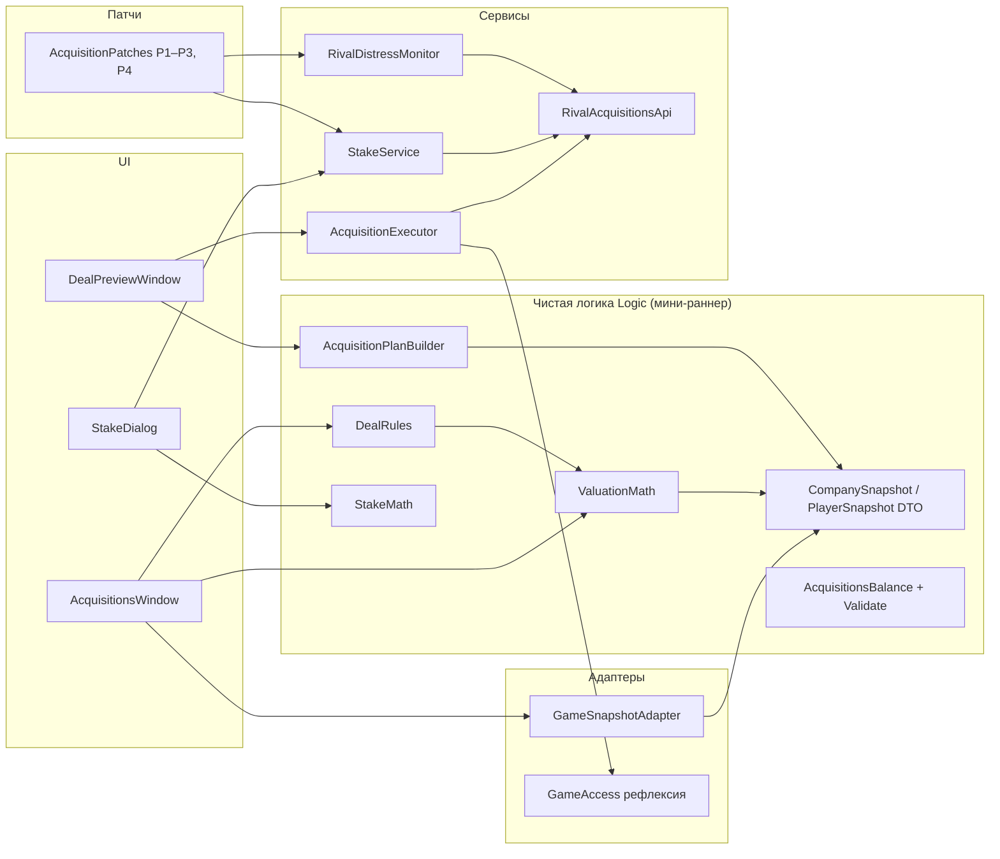
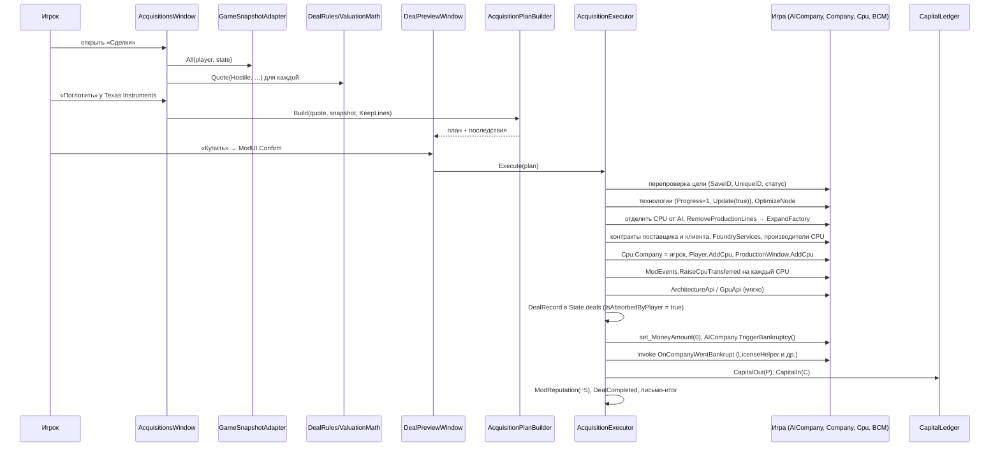
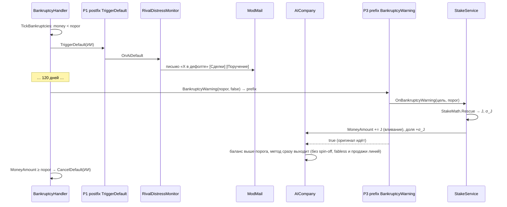
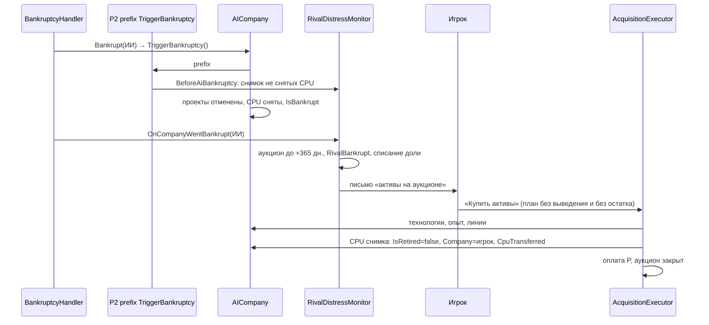
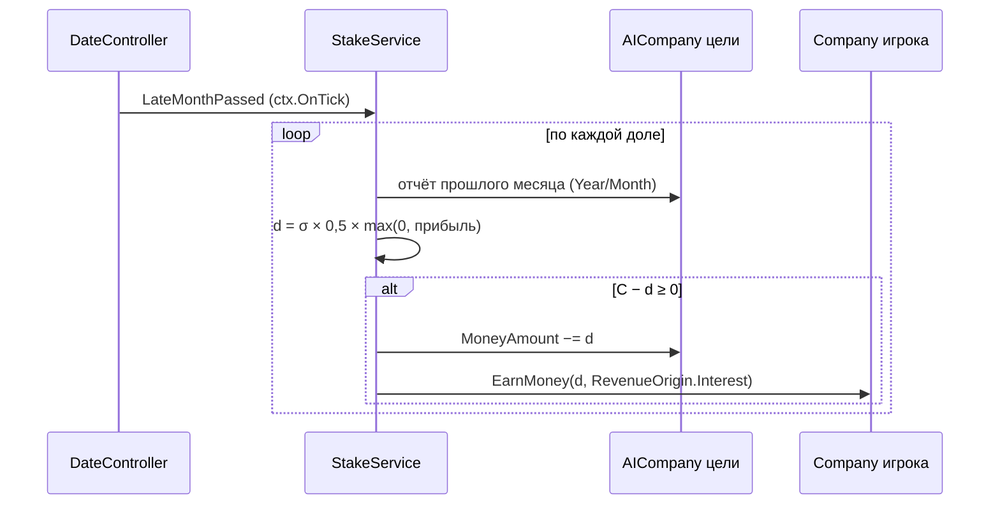
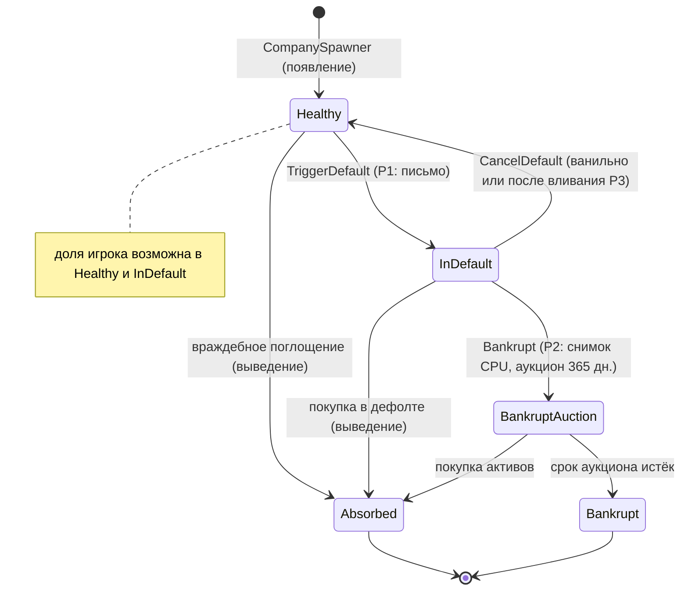

# Design: rival-acquisitions

## Document Information

- **Feature Name**: rival-acquisitions (I06)
- **Version**: 0.3
- **Date**: 2026-10-11
- **Author**: Dex719
- **Status**: Draft v0.3 — одобрено к реализации владельцем 2026-10-10; правки по итогам QA 2026-10-11: срок аукциона (AC-3.1), результаты спайков (статическая проверка), отладочные действия и спайк-код, отступления реализации, открытые вопросы владельца
- **Reviewers**: владелец проекта; автор `mod-framework` (сигнатуры Core, канал `acquisition.price`, `ModEvents`, `ModCredit`); автор `bankruptcy-recovery` (`CapitalLedger`, общий патч `TriggerDefault`); автор `rival-personalities` (события сделок); авторы `cpu-architectures` и `gpu-product-line` (передача состояния)
- **Related Documents**: `requirements.md`, `tasks.md` этой спеки; `.kiro/specs/bankruptcy-recovery/design.md`; `.kiro/specs/mod-framework/design.md`; `.kiro/steering/context.md`; `.kiro/steering/owner-decisions.md`; решения `0002`, `0003`, `0004`, `0005`, `0006`; `pt-modding/CODEMAP.md` (CompanySystem, Bank, Production, Save)

## Overview

Фича живёт в `PTMod.Features.RivalAcquisitions`. Она даёт игроку четыре сделки с компаниями ИИ:

| Сделка | Когда доступна | Цена | Деньги цели | Что с целью |
|---|---|---|---|---|
| Покупка активов банкрота | аукцион 365 дней после банкротства | `0,4 × E` | не переходят (долг остаётся у банкрота) | уже банкрот; остаётся банкротом |
| Покупка компании в дефолте | `IsInDefault`, не банкрот | `0,7 × (E + C⁺)`, не ниже `C⁺ + E_min` | переходят (обычно долг) | выводится банкротством |
| Враждебное поглощение | не в дефолте, не банкрот, кулдаун 365 дней | `1,5 × (E + C⁺)` (`1,75`, если доля цели больше), не ниже `C⁺ + E_min` | переходят (обычно кэш) | выводится банкротством |
| Покупка доли (спасение) | не банкрот | `σ × max(E_min, E + C) × (1,0 или 0,6)` | вливание в цель | продолжает работать под своим брендом |

`E` — оценка операционных активов для игрока (завод, технологии в разрыве, CPU, премия за долю рынка), нижняя граница — `E_min = 0,25 × D_цели`; `C` — денежный остаток цели, `C⁺ = max(0, C)`. Все цены умножаются на канал `acquisition.price` цели и на `(1 − σ_игрока)` для полных покупок. Для сделок с принятием остатка цены считаются **от капитала** (`E + C⁺`) и ограничены снизу значением `C⁺ + E_min`, поэтому итог для баланса игрока `NetCash = −P + C` всегда отрицателен: арбитраж «купить компанию дешевле её кэша» невозможен.

Архитектурный принцип — **«план, потом исполнение»**: чистая функция строит план сделки по снимку состояния (что перейдёт, что снимется, какие предупреждения); исполнитель выполняет шаги по плану; оплата — последним шагом после выведения цели. Поглощённая компания не удаляется: она переводится в банкроты штатным `AICompany.TriggerBankruptcy`, поэтому все ссылки по `UniqueID`, `SaveID` и `Name` остаются целыми, а сейв хранит результат сделки сам.

> Сервисы Core используются по контракту `mod-framework/design.md`: `FeatureContext`, `TickPhase`, `ModTicks`, `ModSave`/`IModSaveParticipant`, `ModUI`, `ModMail`, `ModNotify`, `ModModifiers`, `ModReputation`, `ModCredit`, `ModEvents`, `ModHooks`, `ModContent`, `ModSettings`, `ModL10n`, `ModLog`. Денежные операции игрока идут через `CapitalLedger` из `bankruptcy-recovery`. Названия компаний — реальные (Intel, AMD, Texas Instruments, GlobalFoundries, TSMC, Cyrix; в коде игры Inlet, EMD, Texas, SolarFoundries, TCMS, Cyrux): отображаемое имя берётся из игры, в контенте компании указываются по `UniqueID`.

### Design Goals

- **Ничего не сломать:** объект `AICompany`, его `UniqueID`, `SaveID`, `Name` неприкосновенны; сценарные проверки `CompanyHelper` и загрузка сейва работают как раньше.
- **Результат сделки живёт в ванильном сейве:** линии, технологии, CPU и контракты принадлежат игроку в объектах игры; `ModSave` хранит только журнал, доли, аукционы, снимки и поручения.
- **Прозрачная цена:** каждая составляющая оценки и каждое последствие видны до подтверждения.
- **Нет бесплатных денег:** для полных покупок `NetCash < 0` при любых входных данных (инвариант проверяется тестами).
- **Последствия для истории игры наступают ванильно** (x86-лицензия, GlobalFoundries) — через штатное банкротство цели, а не через отдельную логику мода.
- **Чистая логика тестируема без Unity** (`ValuationMath`, `DealRules`, `AcquisitionPlanBuilder`, `StakeMath`).

### Key Design Decisions

- **D1. Выведение цели — штатное банкротство.** После переноса активов: `ICompany.set_MoneyAmount(0)`, затем `AICompany.TriggerBankruptcy()` (отменяет проекты через `TimerScheduler.Unschedule`, снимает оставшиеся CPU, ставит `IsBankrupt`). Контроллеры ИИ проверяют `IsBankrupt` (`AIBehaviourController`) и останавливаются; `BusinessContractManager.CheckForExpiredContracts` удаляет контракты с банкротами; `CompanyDataProvider` исключает банкротов из списков; флаг сохраняется ванильно (`SaveObjectInstantiator.InstantiateToSave` → `IsBankrupt`, `AICompany.LoadBankruptcyState`).
  - *Отвергнуто:* `Object.Destroy` объекта — ломает `DataFinder.FindCompany(SaveID)` для CPU, проектов и контрактов, загрузку сейва (`CompanySpawner.SpawnCompanyFromSave(UniqueID, …)`) и проверки `CompanyHelper` (`(company as AICompany).UniqueID`).
  - *Отвергнуто:* свой флаг «заморожена» с охраной всех подписок ИИ — нужны патчи на десятки обработчиков (`AIBehaviour*`, фабричные лямбды `AICompany.InitializeFactory`, исследования), состояние надо восстанавливать после загрузки (контроллеры не сохраняются), охват всё равно неполный.
  - *Отвергнуто:* переименование `Name` («X (поглощена)») — `SaveHandler.Save` собирает CPU через `DataFinder.FindOwnerOfCompany(Name)`.
- **D2. Оповещение подписчиков `OnCompanyWentBankrupt` после выведения, но после пометки «поглощена».** Ванильный `TickBankruptcies` вызывает это событие только для своих банкротств. Мод вызывает делегат события через рефлексию, чтобы `LicenseHelper` отозвал x86-лицензию сразу (а не только после перезагрузки сейва, где он сканирует банкротов на `OnLastLoadedTick`), и чтобы другие фичи узнали о выбывании соперника. Запись сделки добавляется в `State.deals` до вызова, поэтому `RivalAcquisitionsApi.IsAbsorbedByPlayer` уже возвращает `true`, и `scenarios-achievements` не засчитывает поглощение как банкротство соперника.
  - *Отвергнуто:* не оповещать — рассинхрон: последствия наступят только после перезагрузки.
- **D3. Оценка «для игрока».** Технологии оцениваются только из разрыва (есть у цели, нет у игрока): игрок платит за то, что получит.
  - *Отвергнуто:* полная стоимость всех технологий цели — переплата за то, что у игрока уже есть.
- **D4. Деньги цели переходят (кроме аукциона банкрота), а цена считается от капитала.** Цена берётся за операционные активы и положительный кэш: `m × (E + C⁺)`; денежный остаток `C` принимается отдельно (кэш — плюс, долг — минус). Нижняя граница цены `C⁺ + E_min` гарантирует `NetCash ≤ −E_min < 0` даже при скидках `acquisition.price × (1 − σ_p)` и положительном балансе цели в «застрявшем» дефолте. Превью показывает «Цена», «Принимаемый остаток» и «Итог».
  - *Отвергнуто:* цена только за операционные активы `m × E` при передаче `C` игроку — у богатой кэшем компании с малыми активами сделка приносила деньги (арбитраж, повторяемый раз в 365 дней).
  - *Отвергнуто:* цена за «капитал» `E + C` без передачи остатка — при больших долгах цена падает до нуля, а долг исчезает (эксплойт).
- **D5. CPU переносятся семействами, база первой.** `DataConverter.SaveObjectToCpu` ищет базу по `BaseID` через `DataFinder.FindCpu` в порядке загрузки CPU, а сейв пишет CPU по владельцам (игрок первым). Если перенести вариант без базы, при загрузке база может ещё не существовать. Поэтому переходит всё семейство (снятая база тоже), база добавляется игроку раньше вариантов. Каждый перенос сообщается ядру `ModEvents.RaiseCpuTransferred` (подписчики: платформы, обзоры, характеры); `CpuReleased` не поднимается.
  - *Отвергнуто:* перенос по одному CPU.
  - *Отвергнуто:* собственный патч на `Company.AddCpu` / `AICompany.AddCpu` — цели закрыты ядром (резерв «служба»); `Player.AddCpu` и так идёт мимо этих методов.
- **D6. Спасение — доля с вливанием капитала.** Деньги игрока идут на счёт цели (`set_MoneyAmount`), игрок получает долю и дивиденды; компания живёт под своим брендом с ванильным ИИ.
  - *Отвергнуто:* безвозмездная субсидия (у игрока нет выгоды); полная покупка (бренд исчезает).
- **D7. Поручение на спасение — prefix `AICompany.BankruptcyWarning`.** Метод вызывается из `BankruptcyHandler.TickBankruptcies` на 120-й день дефолта, и при `MoneyAmount ≤ negativeBalanceLimit` сам делает необратимое: у AMD-IDM вызывает `CompanyEventHandler.TriggerSolarFoundriesSpinOff`, у остальных — `ConsiderGoingFabless` (продажа производства) или `SellProductionLinesToAvoidBankruptcy`. Вливание в prefix поднимает баланс цели выше порога **до** этих действий: оригинал при `MoneyAmount > negativeBalanceLimit` сразу выходит, а ванильная проверка в `TickBankruptcies` вызывает `CancelDefault`. Порог — аргумент `negativeBalanceLimit` (равен `ModCredit.ThresholdOf(цель)`: ядро уже учло P10), база вливания — `ModCredit.DebtLimitOf(цель)`.
  - *Отвергнуто:* postfix `BankruptcyWarning` — к моменту вливания доля игрока теряет главный актив (линии проданы или цель стала fabless), а историческое выделение GlobalFoundries срабатывает зря.
  - *Отвергнуто:* prefix `BankruptcyHandler.Bankrupt` с отменой — событие банкротства всё равно сработает (см. D3 в `bankruptcy-recovery`).
- **D8. План, потом исполнение; оплата последней.** Все проверки — до первого изменения. Шаги исполнителя изолированы `ModHooks.Guard`; ошибка шага помечает сделку «частичной» в журнале, но не бросает исключение в игру.
- **D9. Денежные операции игрока — через `CapitalLedger`** (`bankruptcy-recovery`): цена и принимаемый остаток — капитальные операции мимо отчёта о прибылях (не облагаются налогом как выручка); дивиденды — доход через `EarnMoney(Interest)`; выручка от продажи линий — `EarnMoney(Sales)`, как в ванили. Вызовы идут с `featureId = "rival-acquisitions"` и попадают только в `ModLog` и журнал сделок этой фичи.
- **D10. Контракты цели переносятся.** Контракты цели-поставщика переназначаются на игрока (FR-9 п. 1); контракты цели-клиента литейщика-третьей стороны — тоже, вместе со сроком, наценкой, штрафами и эксклюзивностью, если у игрока нет конфликтующего эксклюзивного контракта. Если у цели был флаг `Divisions.FoundryServices`, он включается игроку, иначе контракты поставщика не работают.
- **D11. Смежные фичи получают состояние явными вызовами, а не хуками.** `ArchitectureApi.TransferCompanyState` и `GpuApi.TransferVendorProducts` вызываются из исполнителя под `ModFeatures.IsActive` — жёсткой зависимости (`DependsOn`) нет. GPU-линейка передаётся **до** выведения цели, иначе фича GPU уберёт вендора вместе с банкротом.
- **D12. Точка входа — `[ModFeature]`, подписки через ядро.** `RivalAcquisitionsFeature : IModFeature` объявляет патчи, тики, участника сейва и страницу хаба. Подписка на `BankruptcyHandler.OnCompanyWentBankrupt` (событие синглтона сцены) ставится на `ModTicks.GameReady` и сбрасывается на `PTModHost.SceneLeaving`; прямых подписок на `Player.OnNewGame` и `SaveHandler.OnLastLoadedTick` нет.

## Architecture

### System Context

```mermaid
graph TB
    subgraph Game["Игра (Assembly-CSharp)"]
        BH[BankruptcyHandler<br/>TriggerDefault / OnCompanyWentBankrupt]
        AIC[AICompany<br/>BankruptcyWarning / TriggerBankruptcy / RemoveProductionLines]
        AI[AI : ICompanyOwner<br/>GetCpus / GetBaseCpus / CpusOrderedByProfit]
        CO[Company игрока<br/>ExpandFactory / OptimizeNode / EarnMoney]
        RS[ResearchSector<br/>TechnologyAsResearch / Update]
        CPU[Cpu<br/>Company / SetNewManufacturer / TriggerRetirement]
        BCM[BusinessContractManager / BusinessContract]
        PM[ProductionMath / MarketDataProvider]
        LH[LicenseHelper]
        CSW[CompaniesSpreadsheetWindow]
    end
    subgraph Core["PTMod.Core"]
        MH[ModHooks]
        MT[ModTicks<br/>OnTick / GameReady]
        MS[ModSave]
        MU[ModUI + хаб]
        MM[ModMail / ModNotify]
        MMod[ModModifiers acquisition.price]
        MR[ModReputation]
        MCr[ModCredit]
        ME[ModEvents CpuTransferred]
        MC[ModContent / ModSettings / ModL10n / ModLog]
    end
    BR[bankruptcy-recovery: CapitalLedger]
    RA[PTMod.Features.RivalAcquisitions]
    ARCH[cpu-architectures: ArchitectureApi]
    GPU[gpu-product-line: GpuApi]
    RP[rival-personalities / scenarios-achievements]
    MH -->|патчи| BH
    MH -->|патчи prefix| AIC
    MH -->|патч Could| CSW
    BH -->|OnCompanyWentBankrupt| RA
    MT --> RA
    RA --> AIC
    RA --> AI
    RA --> CO
    RA --> RS
    RA --> CPU
    RA --> BCM
    RA -->|читает| PM
    RA -->|invoke делегата| LH
    RA --> BR
    RA --> MS
    RA --> MU
    RA --> MM
    RA --> MMod
    RA --> MR
    RA -->|порог цели| MCr
    RA -->|RaiseCpuTransferred| ME
    RA --> MC
    RA -.->|мягко| ARCH
    RA -.->|мягко| GPU
    RA -.->|DealCompleted| RP
```



### High-Level Architecture



### Используемые сервисы PTMod.Core и других фич

| Сервис | Для чего |
|---|---|
| `FeatureContext` / `ModFeatures` | Точка входа `IModFeature`: `ctx.Patch`, `ctx.OnTick`, `ctx.SaveParticipant`, `ctx.HubPage`; `ModFeatures.IsActive` для мягких зависимостей |
| `ModHooks` | Патчи P1–P4, самопроверка целей и членов рефлексии, `Guard` на шагах исполнителя и телах патчей; счётчик ошибок и `Faulted` — на стороне ядра |
| `ModTicks` | `ctx.OnTick(TickPhase.LateMonthPassed, …)`: дивиденды, закрытие истёкших аукционов; `ModTicks.GameReady`; `IsLoading` / `IsFastForwarding` в патчах |
| `ModSave` | Секция `rival-acquisitions` через `IModSaveParticipant`; версию (`_schema`) ведёт ядро |
| `ModContent` | `Content/rival-acquisitions/balance.json` |
| `ModSettings` | Вкл/выкл фичи (хаб) и флаг отладки — на стороне ядра |
| `ModUI` | Окно «Сделки», превью сделки, диалог доли, `ModUI.Confirm`, `ModUI.Tooltip`; страница хаба «Сделки» |
| `ModMail` / `ModNotify` | Письма о дефолте и банкротстве соперников, итоги сделок, списание доли, неудача поручения (`Normal`, теги `acq:*`, многоразовые действия) |
| `ModModifiers` | Чтение канала `acquisition.price` (объявлен реестром ядра, по компании-цели); фича записей и провайдеров в него не регистрирует |
| `ModReputation` | `Add(игрок, −5, "acq.reputation.hostile")`, `Add(игрок, +3, "acq.reputation.rescue")` |
| `ModCredit` | `ThresholdOf(цель)`, `DebtLimitOf(цель)` — порог дефолта цели для `E_min` и вливания |
| `ModEvents` | `RaiseCpuTransferred` на каждый перенесённый CPU |
| `ModL10n` / `ModLog` | Строки (префикс `acq.`); лог `[PTMod] [rival-acquisitions] …` |
| `CapitalLedger` (`bankruptcy-recovery`) | Оплата сделок, принятие остатка цели |
| `ArchitectureApi`, `GpuApi` (мягко) | Передача состояния при покупке |

### Technology Stack

| Слой | Технология | Обоснование |
|---|---|---|
| Логика | C# latest, Roslyn `csc` (решение 0003); `Logic` — общее подмножество API .NET Framework 4.8 и `mscorlib` Unity | Сборка `PTMod.dll` через `python mod/build.py` |
| Патчи | Harmony 2.3.6 (решение 0002) | `TriggerDefault` (private), `TriggerBankruptcy`, `BankruptcyWarning`, `ShowCompanies` (private) |
| Рефлексия | `HarmonyLib.AccessTools` | Делегат `OnCompanyWentBankrupt`, `Cpu.manufacturer`, `Cpu.currentContract`, `ResearchSector.temporarilySupressPopup` |
| UI | `ModUI` (решение 0005) | Родной вид и темы |
| Хранилище | `ModSave` (решение 0004) + ванильный сейв | Активы — в ванильном сейве |
| Контент | `ModContent` (решение 0006) | Баланс без пересборки |
| Тесты | Свой мини-раннер на .NET Framework 4.8 (`[Test]`, `[Covers]`, `Assert.*`), `python mod/build.py --tests` | Чистая логика без Unity; xUnit не используется |

## Components and Interfaces

Пространство имён: `PTMod.Features.RivalAcquisitions` (чистая логика — `….Logic`). Каталог: `mod/src/PTMod/Features/RivalAcquisitions/` (логика — `…/Logic/`). Тесты — `mod/tests/PTMod.Tests/Features/RivalAcquisitions/`. Все типы `Logic` публичные и перечислены в `[Covers]`.

### RivalAcquisitionsFeature

```csharp
[ModFeature]
public sealed class RivalAcquisitionsFeature : IModFeature
{
    public const string FeatureId = "rival-acquisitions";
    public string Id => FeatureId;
    public string NameKey => "acq.feature.name";
    public string DescriptionKey => "acq.feature.description";
    public string[] DependsOn => new string[0];     // жёстких нет: CapitalLedger работает без включённой bankruptcy-recovery
    public bool EnabledByDefault => true;
    public bool SupportsHotToggle => true;

    internal static RivalAcquisitionsFeature Instance { get; private set; }
    internal AcquisitionsBalance Balance { get; private set; }
    internal AcquisitionsState State { get; private set; }
    internal AICompany ExecutingTarget { get; set; }   // защита собственных хуков во время сделки

    public void Register(FeatureContext ctx)
    {
        ctx.Patch(typeof(AcquisitionPatches));                          // P1–P3 (+P4 Could)
        ctx.OnTick(TickPhase.LateMonthPassed, MonthlyTicks.OnMonth);    // дивиденды, закрытие аукционов
        ctx.SaveParticipant(new AcquisitionsSaveParticipant(this));
        ctx.HubPage("acq.hub.title", AcquisitionsHubPage.Build);        // раздел «Сделки»
        ModTicks.GameReady += OnGameReady;                              // подписка на OnCompanyWentBankrupt; NewGame: backfillDone; Loaded: сверка и бэкфилл
        PTModHost.SceneLeaving += OnSceneLeaving;                       // сброс ссылки на BankruptcyHandler
    }

    public void OnEnabled();   // возобновление: подписка на событие банкротства; доли и аукционы уже в секции
    public void OnDisabled();  // ничего не откатывает: активы уже в ванильном сейве, обязательств перед модом нет
    void OnGameReady(GameReadyReason reason);
}
```

**Implementation Notes**:
- Первый шаг каждого обработчика и патча — `ModFeatures.IsActive(FeatureId)`; тела — в `ModHooks.Guard`.
- На `GameReady(Loaded)`: проверка, что все «поглощённые» — банкроты (иначе предупреждение в лог), бэкфилл аукционов при `backfillDone = false`. На `GameReady(NewGame)`: сброс состояния, `backfillDone = true` (банкроты перемотки — без аукционов; состояние ИИ к старту фича не создаёт).

### RivalAcquisitionsApi (публичный)

```csharp
public static class RivalAcquisitionsApi
{
    public static IReadOnlyList<DealRecord> Deals { get; }
    public static double GetPlayerShare(int uniqueId);           // 0…0,49
    public static bool IsAbsorbedByPlayer(int uniqueId);         // есть сделка BankruptAssets / Distressed / Hostile по этой цели; true уже внутри OnCompanyWentBankrupt
    public static void OpenWindow(int focusUniqueId = -1);

    public static event Action<DealRecord> DealCompleted;         // rival-personalities, scenarios-achievements
    public static event Action<int, double> StakeChanged;         // uniqueId, новая доля
    public static event Action<int> RivalDefaulted;               // uniqueId
    public static event Action<int> RivalBankrupt;                // uniqueId (не вызывается для выведения модом)
}

public enum DealType { BankruptAssets, Distressed, Hostile, Stake, RescueOrder }
```

События API поднимаются самой фичей: обработчики вызываются по одному в `try/catch` (ошибка подписчика не мешает остальным). Публикации через `EventBus` нет: `event-system` не нужна.

### Снимки (чистые DTO)

```csharp
public sealed class CompanySnapshot
{
    public int UniqueId, SaveId; public string Name;
    public CompanyStatus Status;              // Healthy | InDefault | BankruptAuction | Bankrupt | Absorbed
    public int DaysInDefault;
    public double Money;                      // C
    public double DebtLimit;                  // ModCredit.DebtLimitOf(цель)
    public double ManufacturingDivisionValue; // ProductionMath.ManufacturingDivisionValue(цель)
    public List<WaferLinesSnapshot> Lines;    // по пластинам: waferId, value(мм), lines, saleCost
    public List<TechSnapshot> TechGap;        // id, Cost, Time, Type
    public List<TechProgressSnapshot> PartialTech;  // id, progress цели > прогресса игрока
    public List<NodeSnapshot> Nodes;          // узел, опыт цели, опыт игрока
    public List<CpuSnapshot> Cpus;            // не снятые (или из снимка банкрота)
    public List<ContractSnapshot> ProviderContracts, ClientContracts;   // ClientContracts: провайдер — третья сторона
    public int PlayerCpusMadeByTarget;
    public double MarketShare, FoundryMarketShare;
    public bool IsFoundry, IsFabless, HasOtherFoundry, HadFoundryServices;
}
public sealed class CpuSnapshot
{
    public int SaveId, BaseSaveId; public string Name;
    public bool IsRetired, IsOutsourced, MadeInHouseByTarget; public int OutsourcedId;
    public double Price, RealUnitCost, Income12;   // Σ CpuBase.MarketData.Income за 12 мес.
    public int OemContracts;
}
public sealed class ContractSnapshot
{
    public int ProviderId, ClientId; public bool IsExclusive; public double ProviderFines;
    public int CapacityPercent, MarkupPercent; public string TerminatesOn;
}
public sealed class PlayerSnapshot
{
    public double Money, DebtLimit, MarketShare; public bool InDefault, IsBankrupt;
    public bool IsCpuCompany, IsFabless, IsFoundry, HasExclusiveClientContract; public int Capacity;
    public List<int> KnownWaferIds; public DateTime Today; public double OperatingCostPerMonth;
}
```

### GameSnapshotAdapter

```csharp
internal static class GameSnapshotAdapter
{
    public static PlayerSnapshot Player();
    public static CompanySnapshot Of(AICompany target, PlayerSnapshot p, AcquisitionsState s);
    public static List<CompanySnapshot> All(PlayerSnapshot p, AcquisitionsState s); // DataFinder.FindAllAICompanies(true)
}
```

Источники: `AICompany.MoneyAmount`, `AICompany.Factory.AmountOfLines(WaferSize)`, `AICompany.WaferSizes`, `ProductionMath.ManufacturingDivisionValue`, `ProductionMath.SaleCost`, `DataFinder.FindAllTechnologies` + `ResearchSector.IsUnlocked` / `ResearchSector.ProgressOf` у цели и игрока, `AICompany.CurrentNodeLearningProgress` / `Company.CurrentNodeLearningProgress`, `AICompany.Owner.GetCpus()`, `CpuBase.MarketData.Income`, `Cpu.RealUnitCost`, `BusinessContractManager.GetSignedContracts(цель)`, `BusinessContractManager.HasAnyExclusivityDeal(игрок)`, `Divisions.FoundryServices`, `MarketDataProvider.Instance.MarketShare` / `FoundryMarketShare`, `CompanyDataProvider.GetFoundryCompanies`, `ModCredit.DebtLimitOf`.

### Чистая логика

```csharp
public static class ValuationMath
{
    public static Valuation Evaluate(CompanySnapshot t, PlayerSnapshot p, ValuationConfig c);
}
public struct Valuation { public double AFab, ATech, ACpu, Share, E, EMin; }

public static class DealRules
{
    public static DealQuote Quote(DealType type, CompanySnapshot t, PlayerSnapshot p,
                                  AcquisitionsState s, AcquisitionsBalance b, double priceChannel);
}
public struct DealQuote
{
    public DealType Type; public bool Available; public string ReasonKey; public string ReasonArg;
    public Valuation Valuation; public double Multiplier, Price, AssumedCash, NetCash, MoneyAfter;
    public int ReputationDelta;
}

public static class AcquisitionPlanBuilder
{
    public static AcquisitionPlan Build(DealQuote q, CompanySnapshot t, PlayerSnapshot p, PlanOptions o);
}
public sealed class PlanOptions { public bool KeepLines = true; public bool ConsequencesAcknowledged; }
public sealed class AcquisitionPlan
{
    public List<int> TechUnlockIds; public List<TechProgressSnapshot> TechProgress;
    public List<NodeSnapshot> NodeRaises;
    public List<LineMove> LineMoves;            // waferIdFrom → waferIdTo, lines (KeepLines)
    public List<LineSale> LineSales;            // waferId, lines, saleCost (!KeepLines)
    public List<CpuFamily> TransferFamilies;    // база первой
    public List<int> RetireCpuIds;
    public List<int> RepointProviderContractIds;   // цель — поставщик → игрок
    public List<int> RepointClientContractIds;     // цель — клиент третьей стороны → игрок как клиент
    public List<int> DroppedClientContractIds;     // конфликт эксклюзивности или нет переносимых CPU: расторгаются
    public bool EnableFoundryServices;             // KeepLines + у цели был флаг
    public List<int> PlayerCpusToInHouse;
    public List<Consequence> Consequences;      // x86, GlobalFoundries, Intel foundry, GF→AMD контракт, IDM-смена
    public double OpexDeltaPerMonth;
    public List<string> BlockingErrors;         // пусто → можно исполнять
}

public static class StakeMath
{
    public static double StakePrice(double share, Valuation v, double money, bool inDefault, StakeConfig c, double channel);
    public static double Dividend(double share, double prevMonthProfit, double targetMoney, StakeConfig c);
    public static RescueDecision Rescue(double targetMoney, double targetDebtLimit, double ownedShare,
                                        Valuation v, double playerMoney, double maxAmount, StakeConfig c);
}
public struct RescueDecision { public bool Ok; public double Injection, ShareBought; public string ReasonKey; }
```

### AcquisitionExecutor

```csharp
internal sealed class AcquisitionExecutor
{
    public DealRecord Execute(AcquisitionPlan plan, DealQuote quote, AICompany target);
}
```

**Шаги** (каждый в `ModHooks.Guard`, ошибка → `partial = true`, запись в `ModLog`, продолжение безопасных шагов):

1. **Перепроверка**: цель найдена `DataFinder.FindCompany(SaveId)`, `UniqueID` совпадает, статус не изменился, баланс игрока ≥ требуемого (`money + NetCash ≥ minCashAfter`). Иначе — отмена без изменений.
2. `ExecutingTarget = target`.
3. **Технологии**: `ResearchSector.temporarilySupressPopup = true` у игрока (рефлексия); `TechUnlocks` идут по возрастанию глубины зависимостей (внутри уровня по `Id`): для каждой технологии `TechnologyAsResearch(t).Progress = 1`, после каждого уровня — `ResearchSector.Update(true)` (один проход открывает один уровень зависимостей, цепочки до 26, см. «Результаты спайков»); затем не более `techUnlockMaxPasses` добивочных проходов (предохранитель, если данные удивили); для `TechProgress` — `Progress = max(игрок, цель)`, строго меньше 1; флаг возвращается.
4. **Опыт техпроцессов**: `Company.OptimizeNode(узел, опыт_цели − опыт_игрока)` для общих узлов.
5. **Отделение CPU от ИИ** (до банкротства цели, иначе `AICompany.TriggerBankruptcy` их снимет): по семействам — `Owner.GetCpus().Remove`, `GetBaseCpus().Remove`, `CpusOrderedByProfit().Remove`.
6. **Линии**: для каждой пластины цели `AICompany.RemoveProductionLines(N, W)`; затем `Company.ExpandFactory(N, 0, waferIdTo)` (если `KeepLines`) или `CapitalLedger.Revenue("rival-acquisitions", SaleCost, Sales, …)`; в конце `CompanyTypeUpdater.Instance.TriggerUpdate(true)`.
7. **Производственные связи и контракты** (если `KeepLines`): контракты поставщика — `BusinessContract.Initialize(игрок, клиент)`; CPU клиентов с `OutsourcedID` цели — `Cpu.SetNewManufacturer(игрок)`; CPU игрока, делавшиеся у цели, — `OutsourcedID = −1`, сброс `Cpu.manufacturer` и `Cpu.currentContract` (рефлексия); если `EnableFoundryServices` — `Player.Instance.Company.Divisions.FoundryServices = true` и `ProductionWindow.SetFoundryServicesToggle(true)`. **Контракты цели-клиента** (независимо от `KeepLines`, если переносятся CPU, сделанные у этого поставщика): `RepointClientContractIds` — `BusinessContract.Initialize(поставщик, игрок)`, срок, наценка, штрафы и эксклюзивность не меняются; `DroppedClientContractIds` не трогаются (ванильный менеджер удалит их, когда цель станет банкротом).
8. **Присоединение CPU к игроку**: база первой, затем варианты; `Cpu.Company = игрок`; если CPU делался у цели — `OutsourcedID = −1` и сброс кеша производителя; для снимка банкрота — `IsRetired = false`; `Player.Instance.AddCpu(cpu)`; если не снят — `ProductionWindow.Instance.AddCpu(cpu)`; `CpuDataProvider.Instance.OnNewCpu?.Invoke()`; затем `ModEvents.RaiseCpuTransferred(FeatureId, цель, игрок, cpu)` (не во время загрузки; `CpuReleased` не поднимается).
9. **Состояние смежных фич** (FR-16, до выведения цели): если `ModFeatures.IsActive("cpu-architectures")` — `ArchitectureApi.TransferCompanyState(цель, игрок, true)`; если `ModFeatures.IsActive("gpu-product-line")`, цель жива (FR-4/FR-5) и `GpuApi.IsDivisionFounded(цель)` — `GpuApi.TransferVendorProducts(цель, игрок)`, `false` → пометка в журнале сделки. Ошибка шага → `partial`.
10. **Запись сделки в память**: черновик `DealRecord` добавляется в `State.deals` — теперь `RivalAcquisitionsApi.IsAbsorbedByPlayer(цель.UniqueID)` возвращает `true`.
11. **Выведение цели** (не для аукциона, где цель уже банкрот): `set_MoneyAmount(0)` (остаток `C` запомнен в плане), `AICompany.TriggerBankruptcy()`, вызов делегата `BankruptcyHandler.OnCompanyWentBankrupt(цель)` через рефлексию.
12. **Оплата**: `CapitalLedger.CapitalOut("rival-acquisitions", Price, "acq.price", …)`; остаток: `C > 0` → `CapitalIn(C)`, `C < 0` → `CapitalOut(−C)` (кроме аукциона). Итог всегда уменьшает баланс игрока (`NetCash < 0`).
13. **Завершение**: `DealRecord` дополняется (`partial`, что перешло); закрыть аукцион/долю/поручение; `lastHostileOn`; `ModReputation.Add`; `DealCompleted`; письмо-итог (тег `acq:deal:<dealId>`).
14. `ExecutingTarget = null`.

### StakeService

```csharp
internal sealed class StakeService
{
    public void Buy(AICompany target, double share);          // CapitalOut(P), target.MoneyAmount += P
    public void SetRescueOrder(int uniqueId, double maxAmount, bool active);
    public void OnMonth();                                     // дивиденды по отчёту прошлого месяца (Year/Month)
    public bool OnBankruptcyWarning(AICompany target, float negativeBalanceLimit); // из P3 (prefix): true — вливание выполнено
    public void OnRivalBankrupt(AICompany target);             // списание доли
}
```

### RivalDistressMonitor

```csharp
internal sealed class RivalDistressMonitor
{
    public void OnAiDefault(AICompany c);                       // из P1: письмо (1 раз за эпизод), RivalDefaulted
    public void BeforeAiBankruptcy(AICompany c);                // из P2: снимок не снятых CPU
    public void OnCompanyWentBankrupt(ICompany c);              // событие: аукцион, RivalBankrupt, списание доли
    public void BackfillAuctions();                             // первый запуск на сейве
    public void OnMonth();                                      // закрытие истёкших аукционов
}
```

### Патчи Harmony

| # | Цель `Class.Method` | Тип | Что меняет | Порядок / конфликты |
|---|---|---|---|---|
| P1 | `BankruptcyHandler.TriggerDefault` | postfix | Если `!company.IsPlayer` и не загрузка/перемотка (`ModTicks.IsLoading`, `ModTicks.IsFastForwarding`): `RivalDistressMonitor.OnAiDefault` (письмо, событие); пометка «письмо эпизода» снимается, когда компания выходит из дефолта (проверка в `OnMonth`) | `bankruptcy-recovery` ставит postfix на тот же метод для ветки `IsPlayer`; ветки не пересекаются, порядок не важен |
| P2 | `AICompany.TriggerBankruptcy` | prefix (возвращает `true`) | Если `__instance != ExecutingTarget` и не перемотка/загрузка: снимок `SaveID` не снятых CPU и дата → `AcquisitionsState.auctions` (черновик) | Другие спеки этот метод не патчат |
| P3 | `AICompany.BankruptcyWarning` | **prefix** (возвращает `true`) | Если у цели активное поручение, `negativeBalanceLimit < 0`, цель в дефолте и `MoneyAmount ≤ negativeBalanceLimit` (иначе оригинал выходит сам): `StakeService.OnBankruptcyWarning` — вливание по `StakeMath.Rescue`. После вливания `MoneyAmount > negativeBalanceLimit`, оригинал сразу выходит (без выделения GlobalFoundries, `ConsiderGoingFabless`, продажи линий), а ванильный `TickBankruptcies` затем вызывает `CancelDefault`. При неудаче — письмо, оригинал идёт как обычно | `Priority.High`; `rival-personalities` может патчить `AIBehaviour*`, но не этот метод; при появлении — согласовать приоритет. Единственный другой вызов `BankruptcyWarning` — отладочный `AICompany.DebugTriggerFabless` с лимитом 0: игнорируется условием `negativeBalanceLimit < 0` |
| P4 (Could) | `CompaniesSpreadsheetWindow.ShowCompanies` | postfix | Замена отметки «банкрот» на «поглощена игроком» для поглощённых | — |

Патчи на `Company.AddCpu` / `AICompany.AddCpu` фича не ставит (ядро отклонит с подсказкой про `ModEvents.CpuReleased`). Каждый патч — первой строкой `ModFeatures.IsActive`, тело в `ModHooks.Guard`; prefix при сбое возвращает `true` (ванильный путь).

**Члены игры через рефлексию** (самопроверка; спайки TSK-003/TSK-004):

| Член | Вид | Зачем |
|---|---|---|
| `BankruptcyHandler.OnCompanyWentBankrupt` | backing-поле делегата события | Оповестить подписчиков о выведении цели (D2) |
| `Cpu.manufacturer` | private field `ICompany` | Сброс кэша производителя при переводе в собственное производство |
| `Cpu.currentContract` | private field `BusinessContract` | Сброс кэша контракта при смене производителя |
| `ResearchSector.temporarilySupressPopup` | private field `bool` | Без окон «Исследование завершено» при переносе технологий (так делает `ResearchSector.UnlockNodeTechnology`) |

Порог `BankruptcyHandler.defaultTimeLimit` фиче не нужен: P3 опирается на аргумент `negativeBalanceLimit` и состояние `IsInDefault`.

### Подписки и тики

| Источник | Обработчик | Защиты |
|---|---|---|
| `BankruptcyHandler.OnCompanyWentBankrupt` | `RivalDistressMonitor.OnCompanyWentBankrupt` | Игрок → игнор; `ExecutingTarget` → игнор (своё выведение); загрузка и перемотка → игнор; подписка ставится на `ModTicks.GameReady` и на `ModFeatures.StateChanged` (включение), ссылка сбрасывается на `PTModHost.SceneLeaving` (синглтон сцены) |
| `ctx.OnTick(TickPhase.LateMonthPassed, …)` | `StakeService.OnMonth`, `RivalDistressMonitor.OnMonth` | Перемотка и загрузка пропускаются ядром; фича выключена → выход |
| `ModTicks.GameReady` (`Loaded`) | `RivalAcquisitionsFeature.OnGameReady`: проверка, что все «поглощённые» — банкроты (иначе предупреждение в лог), бэкфилл аукционов при `backfillDone = false` | Только после полной загрузки |
| `ModTicks.GameReady` (`NewGame`) | сброс состояния, `backfillDone = true` (банкроты перемотки — без аукционов) | — |
| `IModSaveParticipant.Read` / `Write` | `AcquisitionsSaveParticipant` | Версию секции (`_schema`) ведёт ядро |

## Data Models

### Состояние (секция ModSave)

Участник `AcquisitionsSaveParticipant : IModSaveParticipant` (`SectionId = "rival-acquisitions"`, `SchemaVersion = 1`) переводит DTO в `JsonObject` и обратно через `ModJson.From`/`ModJson.Bind`. Поля версии (`schema`) в DTO нет: `_schema` пишет и читает ядро.

```csharp
[Serializable] public sealed class AcquisitionsState      // …Logic
{
    public List<DealRecord> deals = new List<DealRecord>();
    public List<StakeData> stakes = new List<StakeData>();
    public List<AuctionData> auctions = new List<AuctionData>();
    public List<RescueOrderData> rescueOrders = new List<RescueOrderData>();
    public List<int> defaultMailSentForSaveIds = new List<int>();
    public string lastHostileOn = "";
    public bool backfillDone;
    public int nextDealId = 1;
    // не поле секции (приватный сеттер, ModJson его не видит): public bool OffersClosed { get; private set; } — сейв записан более новой версией мода, сделок не предлагается (NFR-3)
}

[Serializable] public sealed class DealRecord
{
    public int id; public string type;                     // DealType
    public int targetUniqueId; public int targetSaveId; public string targetName;
    public string date; public double price; public double assumedCash; public double share;
    public bool keptLines; public List<WaferLines> lines = new List<WaferLines>();
    public int techCount; public List<int> cpuSaveIds = new List<int>();
    public List<int> retiredCpuSaveIds = new List<int>();
    public int providerContracts; public int clientContracts;
    public bool partial; public string notes = "";
}
[Serializable] public sealed class WaferLines { public int waferId; public int lines; }

[Serializable] public sealed class StakeData
{ public int targetUniqueId; public int targetSaveId; public double share; public double invested; public double dividendsPaid; public double lastDividend; public string since; }

[Serializable] public sealed class AuctionData
{ public int targetUniqueId; public int targetSaveId; public string bankruptOn; public string until; public List<int> snapshotCpuSaveIds = new List<int>(); public bool closed; }

[Serializable] public sealed class RescueOrderData
{ public int targetUniqueId; public int targetSaveId; public double maxAmount; public bool active; }
```

**Validation Rules**: `share` 0…0,49; суммы конечны и ≥ 0 (кроме `assumedCash`); даты `yyyy-MM-dd`; запись, чья компания не найдена по `SaveID` или чей `UniqueID` не совпадает, — помечается «устаревшей» и игнорируется (не удаляется). Секцию новее мода ядро отдаёт как значения по умолчанию и сохраняет исходную без изменений.

**Relationships**: компании — по паре (`UniqueID`, `SaveID`), CPU — по `SaveID`, пластины — по `WaferSize.ID`. ID писем не хранится: письма ищутся по тегу (`ModMail.Find`).

### Пример секции бокового файла

Ядро добавляет в секцию служебное поле версии (`_schema`); в DTO фичи его нет.

```json
{
  "schema": 1,
  "modVersion": "0.1.0",
  "features": {
    "rival-acquisitions": {
      "deals": [
        { "id": 1, "type": "Hostile", "targetUniqueId": 3, "targetSaveId": 412, "targetName": "Texas Instruments",
          "date": "1985-03-01", "price": 696888000.0, "assumedCash": 30000000.0, "share": 0.0,
          "keptLines": true, "lines": [ { "waferId": 46, "lines": 40 } ],
          "techCount": 3, "cpuSaveIds": [ 1201, 1207 ], "retiredCpuSaveIds": [],
          "providerContracts": 0, "clientContracts": 1, "partial": false, "notes": "" }
      ],
      "stakes": [
        { "targetUniqueId": 10, "targetSaveId": 388, "share": 0.25, "invested": 116150000.0,
          "dividendsPaid": 3000000.0, "lastDividend": 1000000.0, "since": "1986-01-01" }
      ],
      "auctions": [
        { "targetUniqueId": 7, "targetSaveId": 355, "bankruptOn": "1987-05-03", "until": "1988-05-02",
          "snapshotCpuSaveIds": [ 980, 991, 1015 ], "closed": false }
      ],
      "rescueOrders": [ { "targetUniqueId": 10, "targetSaveId": 388, "maxAmount": 100000000.0, "active": true } ],
      "defaultMailSentForSaveIds": [],
      "lastHostileOn": "1985-03-01",
      "backfillDone": true,
      "nextDealId": 2
    }
  }
}
```

`waferId` и `SaveID` в примере условные: реальные ID выдаёт игра (`WaferSize.ID`, `SaveIDHandler`).

### Контент: `Content/rival-acquisitions/balance.json`

Версия `schema` здесь — версия файла контента (`ModContent.LoadConfig(…, supportedSchema)`), а не секции сейва. Формулы цены зафиксированы в коде (`DealRules`), в JSON лежат множители.

```json
{
  "schema": 1,
  "valuation": {
    "kFab": 2.0,
    "kTech": 0.5,
    "kCpu": 1.0,
    "cpuIncomeMonths": 12,
    "kShare": 1.0,
    "floorDebtLimitShare": 0.25,
    "bankruptSnapshotCpuFactor": 0.5,
    "roundTo": 1000
  },
  "deals": {
    "bankrupt":   { "multiplier": 0.4, "assumeCash": false, "auctionDays": 365 },
    "distressed": { "multiplier": 0.7, "assumeCash": true },
    "hostile":    { "multiplier": 1.5, "biggerTargetMultiplier": 1.75, "cooldownDays": 365, "assumeCash": true },
    "minCashAfter": 0
  },
  "stake": {
    "options": [0.10, 0.25, 0.49],
    "maxShare": 0.49,
    "healthyMultiplier": 1.0,
    "distressedMultiplier": 0.6,
    "payoutRatio": 0.5,
    "rescueTargetDebtLimitShare": -0.5
  },
  "reputation": { "hostile": -5, "rescue": 3, "distressed": 0, "bankrupt": 0 },
  "techUnlockMaxPasses": 20
}
```

| Поле | Допустимо | Что задаёт |
|---|---|---|
| `valuation.k*` | 0…10 | Коэффициенты оценки |
| `cpuIncomeMonths` | 1…60 | Окно выручки CPU |
| `floorDebtLimitShare` | 0…10 | `E_min` в долях `ModCredit.DebtLimitOf(цель)` |
| `deals.*.multiplier` | 0…10 | Множитель цены сделки (`m`) |
| `auctionDays`, `cooldownDays` | 0…3650 | Сроки |
| `stake.options` | значения в (0; `maxShare`] | Варианты доли |
| `maxShare`, `payoutRatio` | 0…1 (`maxShare` < 0,5) | Миноритарная доля, доля прибыли в дивиденды |
| `rescueTargetDebtLimitShare` | −0,9…0 | До какого баланса доводить цель при спасении (строго выше порога `−1`) |
| `reputation.*` | −100…100 | Изменение `ModReputation` |
| `roundTo` | 1…1 000 000 | Округление цены **вверх** до этого шага |

## Формулы и баланс

Обозначения: `D = ModCredit.DebtLimitOf(цель)` (порог дефолта цели без знака; ориентиры значений — в design `bankruptcy-recovery`); `C = AICompany.MoneyAmount` цели, `C⁺ = max(0, C)`; `Ch = ModModifiers.Get(ModChannels.AcquisitionPrice, {Company = цель})` (по умолчанию 1, предохранитель [0,5; 3,0]); `σ_p` — доля игрока в цели.

### Оценка (`ValuationMath`)

- **Завод:** `A_fab = kFab × ProductionMath.ManufacturingDivisionValue(цель)`. Ванильно `ManufacturingDivisionValue = Σ_W ProductionMath.SaleCost(lines_W, W)`, `SaleCost = 0,15 × ExpansionCost(L, W, null)`, `ExpansionCost = 20 024 316 × L × (1 − 0,015 × clamp(L − 1, 0, 20)) × Inflation × W.ConstructionCostMultiplier`. При `kFab = 2` действующий завод стоит 30 % цены постройки (ванильная продажа — 15 %).
- **Технологии:** `A_tech = kTech × Σ_{t ∈ разрыв} t.Cost × t.Time / 30`. `Technology.Cost` — месячные затраты при финансировании 1 (`ResearchSector.Research.AddProgress` начисляет `Cost × M4 / 30` в день), `Time` — дни, поэтому `Cost × Time / 30` — полная цена исследования.
- **CPU:** `A_cpu = kCpu × Σ_{cpu} Σ_{последние 12 мес.} CpuBase.MarketData.Income[m] × clamp((Price − RealUnitCost) / Price, 0, 1)`. Для CPU из снимка банкрота — × `bankruptSnapshotCpuFactor` (0,5).
- **Доля рынка:** `s = max(MarketDataProvider.MarketShare(цель), MarketDataProvider.FoundryMarketShare(цель))`; для банкрота `s = 0`.
- **Итог:** `E = (A_fab + A_tech + A_cpu) × (1 + kShare × s)`; `E_min = 0,25 × D`.

### Цены сделок (`DealRules`)

- Банкрот: `P = ceil1000(max(E_min, 0,4 × E) × Ch)`; остаток цели не принимается (`NetCash = −P`). **Срок аукциона:** `until = дата банкротства + auctionDays` календарных дней (`DateTime.AddDays`), последний день включительно (аукцион открыт, пока сегодня ≤ `until`; `DistressRules.Until`, `CompanyStatusRules.IsAuctionOpen`). Банкротство 1987-05-03 → `until = 1988-05-02` (между датами 29 февраля 1988), в обычный год — та же дата следующего года.
- Дефолт: `P_f = max(E_min, 0,7 × (E + C⁺)) × Ch × (1 − σ_p)`; `P = ceil1000(max(P_f, C⁺ + E_min))`; принимается `C`.
- Враждебное: `m = s_цели > s_игрока ? 1,75 : 1,5`; `P_f = max(E_min, m × (E + C⁺)) × Ch × (1 − σ_p)`; `P = ceil1000(max(P_f, C⁺ + E_min))`; принимается `C`; доступно, если с `lastHostileOn` прошло ≥ 365 дней.
- Итог для баланса: `NetCash = −P + (assumeCash ? C : 0)`; доступно, если `money + NetCash ≥ minCashAfter` (0) и игрок не в дефолте.
- **Инвариант:** для Distressed и Hostile `NetCash = C − P ≤ C − C⁺ − E_min ≤ −E_min < 0`. Нижняя граница `C⁺ + E_min` обязана срабатывать при положительном `C` (кэш больше цены по формуле) и при скидках `Ch × (1 − σ_p)` до `0,5 × 0,51`. Округление идёт вверх (`ceil`), поэтому инвариант не нарушается и после него.
- Рыночный вклад: фича не меняет `market.rating.cpu` и `popularity.gain` (вклад 0).

### Доля и спасение (`StakeMath`)

- Цена доли: `P_σ = σ × max(E_min, E + C) × m_s × Ch`, `m_s = 1,0` (здорова) / `0,6` (в дефолте); `σ_p + σ ≤ 0,49`. Здесь `C` со знаком: долг уменьшает цену, пол даёт `E_min`; деньги уходят на счёт цели, а не игроку, поэтому арбитража нет.
- Дивиденд (начало месяца): `d = σ_p × 0,5 × max(0, TotalRevenues − TotalExpenses)` отчёта цели за прошлый месяц (по `Year`/`Month`); выплата, если `C − d ≥ 0`.
- Поручение (P3, prefix): целевой баланс `B_r = −0,5 × D` (`rescueTargetDebtLimitShare × D`), строго выше порога `−D`; `J = B_r − C`; доля `σ_J = J / (max(E_min, E + C) × 0,6 × Ch)`; исполнить, если `J ≤ maxAmount`, `money_игрока − J ≥ minCashAfter`, `σ_p + σ_J ≤ 0,49`. `D` берётся из `ModCredit.DebtLimitOf(цель)` (совпадает с `−negativeBalanceLimit`).

### Пример (1985, `D ≈ 111,3 млн`, инфляция ≈ 2,5)

- 40 линий на 100 мм: `ExpansionCost = 20 024 316 × 40 × 0,7 × 2,5 × 0,7 ≈ 981,2 млн` → `SaleCost ≈ 147,2 млн` → `A_fab ≈ 294,4 млн`.
- Разрыв: 3 технологии по `Cost = 400 000`, `Time = 600` → по 8 млн → `A_tech = 0,5 × 24 = 12 млн`.
- 2 CPU по 10 млн выручки в месяц, маржа 40 % → `A_cpu = 2 × 120 × 0,4 = 96 млн`.
- Доля 8 % → `E = 402,4 × 1,08 ≈ 434,6 млн`; `E_min ≈ 27,8 млн`.
- Враждебное (`C = +30 млн`, доля игрока 20 %): `P = 1,5 × (434,6 + 30) ≈ 696,9 млн`, итог −666,9 млн (≈ 6,0 `D`).
- В дефолте (`C = −60 млн`): `C⁺ = 0`, `P ≈ 0,7 × 434,6 ≈ 304,2 млн`, итог −364,2 млн.
- В «застрявшем» дефолте с кэшем (`E = 100 млн`, `C = +900 млн`): `P_f = 700 млн`, но `C⁺ + E_min = 927,8 млн` → `P = 927,8 млн`, итог −27,8 млн.
- Скидки (`Ch = 0,5`, `σ_p = 0,49`, `E = 200 млн`, `C = +1 000 млн`): `P_f = 459 млн` < кэша → `P = 1 027,8 млн`, итог −27,8 млн.
- Банкрот (CPU снимка × 0,5, `s = 0`): `E ≈ 354,4 млн` → `P ≈ 141,8 млн`.
- Доля 25 % у здоровой: `0,25 × (434,6 + 30) ≈ 116,15 млн`.
- Поручение (`D = 111 млн`, `C = −150 млн`, `E = 600 млн`): `B_r = −55,5 млн`, `J = 94,5 млн`, `σ_J = 94,5 / ((600 − 150) × 0,6) ≈ 35 %`.

### Какие формулы игры меняются

Ни одна. Мод только читает ванильные формулы (`ProductionMath.ManufacturingDivisionValue`, `SaleCost`, `ExpansionCost`, `OperatingCost`, `MarketDataProvider.MarketShare`) и порог через `ModCredit`, и перемещает объекты между компаниями. Новые числа — только цены сделок в контенте.

## UI

`ModUI` строит окна клоном шаблона окна игры; тема — `ThemeManager.Instance`; модальность — `PauseTrigger`; подтверждения — `ModUI.Confirm`; подсказки — `ModUI.Tooltip` (своих мостов к `TooltipHandler` нет); деньги — `StringFormatter.FloatToMoney`.

### Окно «Сделки» (`AcquisitionsWindow`)

- Вкладки (`ButtonUI`): «Компании», «Мои доли», «История».
- **Компании:** таблица — цвет и название (из игры), статус, деньги, линии, CPU, доля рынка, оценка `E`, доля игрока; у выбранной строки — кнопки сделок (`ButtonUI`) с ценой; неактивные — с причиной (`ModUI.Tooltip`).
- **Мои доли:** доля, вложено, дивиденды всего, последний дивиденд, `ToggleUI` «Поручение на спасение» + `SliderUI` лимита.
- **История:** журнал сделок (дата, тип, цель, цена, «частичная»).
- Открытие: страница фичи в хабе «Моды» (`ctx.HubPage`) или действие «Сделки» в письме.

### Превью сделки (`DealPreviewWindow`)

- Блок «Оценка»: `A_fab`, `A_tech` (список технологий в подсказке), `A_cpu` (по CPU), премия за долю, `E`, множитель сделки, канал, доля игрока, **цена** (с пометкой, если сработала нижняя граница `C⁺ + E_min`).
- Блок «Деньги»: цена, принимаемый остаток `C`, итог, баланс после.
- Блок «Что переходит»: линии по пластинам с `ToggleUI` «Забрать линии / Продать линии» (если не обязательно), прирост расходов на завод в месяц, смена типа компании; технологии (число); CPU (список) и OEM-контракты; контракты поставщика и контракты клиента (переходят), флаг литейных услуг; состояние архитектур и GPU-линейка (если смежные фичи включены).
- Блок «Что снимается/расторгается»: CPU под снятие, расторгаемые контракты (в том числе эксклюзивный контракт клиента при конфликте).
- Блок «Последствия» (FR-12) с `ToggleUI` «Я понимаю последствия».
- Кнопки: «Купить» → `ModUI.Confirm` «Купить X за Y?» → исполнение; «Отмена».

### Диалог доли (`StakeDialog`)

`DropdownUI` вариантов доли, цена, вливание в компанию, ожидаемый дивиденд (по прошлому месяцу), `ToggleUI` «Поручение на спасение» и `SliderUI` лимита; «Купить долю» → подтверждение.

### Письма и уведомления

Все письма — `Normal`, с тегами `acq:*`, действия многоразовые (`ModMailAction`, письмо не закрывается; обработчик — `ModMail.RegisterActionHandler`).

- «X в дефолте» (FR-11, тег `acq:default:<uniqueId>`) — действия «Сделки», «Поручение на спасение» (если есть доля).
- «X обанкротилась: активы на аукционе до ДАТА» (тег `acq:auction:<uniqueId>`) — действие «Сделки».
- «Сделка завершена» (тег `acq:deal:<dealId>`) — итог (что перешло).
- «Доля в X списана» (`acq:stakeLost:<uniqueId>`), «Спасти X не удалось: …» (`acq:rescueFailed:<uniqueId>`).
- `ModNotify`: «Дивиденды от X: +Y».

### Ключи строк (`mod/src/PTMod/L10n/ru/rival-acquisitions.json`, `…/en/rival-acquisitions.json`; префикс `acq.`)

| Ключ | ru | en |
|---|---|---|
| `feature.name` | Сделки с соперниками | Rival deals |
| `feature.description` | Покупка, поглощение и спасение компаний-соперников | Buy, take over and rescue rival companies |
| `hub.title` | Сделки | Deals |
| `window.title` | Сделки | Deals |
| `tab.companies` / `tab.stakes` / `tab.history` | Компании / Мои доли / История | Companies / My stakes / History |
| `status.healthy` | Здорова | Healthy |
| `status.default` | Дефолт: {0} дн. | Default: {0} days |
| `status.auction` | Банкрот: аукцион до {0} | Bankrupt: auction until {0} |
| `status.absorbed` | Поглощена игроком ({0}) | Acquired by you ({0}) |
| `deal.bankrupt` | Купить активы за {0} | Buy assets for {0} |
| `deal.distressed` | Купить компанию (дефолт) за {0} | Buy company (in default) for {0} |
| `deal.hostile` | Поглотить за {0} | Take over for {0} |
| `deal.stake` | Купить долю | Buy a stake |
| `reason.playerDefault` | Ваша компания в дефолте | Your company is in default |
| `reason.cooldown` | Доступно с {0} | Available from {0} |
| `reason.noCash` | Не хватает {0} | Short by {0} |
| `preview.valuation` | Оценка: завод {0}, технологии {1}, CPU {2}, премия за долю {3} | Valuation: fab {0}, tech {1}, CPUs {2}, share premium {3} |
| `preview.net` | Цена {0}, остаток компании {1}, итог {2}, баланс после {3} | Price {0}, company cash {1}, net {2}, balance after {3} |
| `preview.cashFloor` | Цена не ниже кэша компании и минимальной платы ({0}) | Price is not below the company's cash plus the minimum fee ({0}) |
| `preview.keepLines` | Забрать линии | Keep the lines |
| `preview.sellLines` | Продать линии (+{0}) | Sell the lines (+{0}) |
| `preview.opex` | Расходы на завод: +{0} в месяц | Factory upkeep: +{0} per month |
| `preview.becomesIdm` | Компания станет IDM: скидка fabless на разработку пропадёт | You become an IDM: the fabless development discount is lost |
| `preview.foundryFlag` | Будут включены литейные услуги | Foundry services will be enabled |
| `preview.clientContract` | Контракт клиента {0} с {1} переходит к вам | {0}'s client contract with {1} moves to you |
| `preview.contractDropped` | Контракт {0} будет расторгнут (конфликт эксклюзивности) | Contract with {0} will be terminated (exclusivity conflict) |
| `consequence.x86` | x86-лицензия будет отозвана и к вам не перейдёт, Cyrix избавится от патентного штрафа | The x86 license will be revoked and will not pass to you; Cyrix loses its patent penalty |
| `consequence.globalFoundries` | Выделение GlobalFoundries не произойдёт | The GlobalFoundries spin-off will not happen |
| `consequence.intelFoundry` | Intel не откроет литейные услуги | Intel will not open foundry services |
| `consequence.ack` | Я понимаю последствия | I understand the consequences |
| `reputation.hostile` | Враждебное поглощение | Hostile takeover |
| `reputation.rescue` | Спасение компании | Company rescue |
| `mail.action.deals` | Сделки | Deals |
| `mail.action.rescueOrder` | Поручение на спасение | Rescue order |
| `mail.default.subject` | {0} в дефолте | {0} is in default |
| `mail.default.body` | Банкротство примерно через {1} дн. Можно купить компанию или долю. | Bankruptcy in about {1} days. You can buy the company or a stake. |
| `mail.auction.subject` | {0}: активы на аукционе | {0}: assets up for auction |
| `stake.dividend` | Дивиденды от {0}: +{1} | Dividends from {0}: +{1} |
| `stake.rescueFailed` | Спасти {0} не удалось: {1} | Could not rescue {0}: {1} |

### Sequence: враждебное поглощение



### Sequence: дефолт соперника → поручение на спасение



### Sequence: банкротство соперника → аукцион → покупка



### Sequence: дивиденды



### State: статус компании ИИ для сделок



## Error Handling

| Ситуация | Поведение | Видно игроку |
|---|---|---|
| Исключение в патче P1–P4 или обработчике | `ModHooks.Guard`: перехват, `ModLog`, счётчик ядра; после `hooks.faultThreshold` фича `Faulted` до перезапуска; prefix при сбое возвращает `true` | Уведомление ядра «Фича отключена из-за ошибки» |
| Ошибка шага исполнителя | Шаг пропущен, сделка `partial = true`, оплата — только если активы перенесены (шаги 3–8 без ошибок), иначе цена не списывается | Письмо-итог с пометкой «частично»; запись в журнале |
| Цель не найдена / `UniqueID` не совпадает / статус изменился | Отмена до первого шага | Сообщение в окне |
| Спайк показал, что перенос CPU ломает сейв | FR-8 выключается настройкой контента; CPU снимаются вместе с целью | Превью: «CPU будут сняты» |
| Делегат `OnCompanyWentBankrupt` не найден | Выведение выполняется без оповещения; `ModLog`; последствия наступят после перезагрузки | — |
| Смежная фича (`ArchitectureApi`, `GpuApi`) выключена или шаг упал | Вызов пропущен или шаг `partial`; сделка не блокируется | Пометка в журнале сделки |
| Старый сейв без секции | Значения по умолчанию, бэкфилл аукционов | — |
| Секция с `_schema` новее мода | Ядро сохраняет секцию как есть и отдаёт фиче значения по умолчанию | Строка в хабе |
| Запись `ModSave` ссылается на исчезнувшую компанию | Запись «устаревшая», игнорируется | — |
| Фича выключена посреди игры | Сделки, дивиденды, поручения, письма не работают; перенесённые активы остаются; доли, аукционы, поручения хранятся в секции | Хаб: «выключена» |
| Мод удалён | Ванильный сейв: активы у игрока, поглощённые — банкроты | README |

**Logging Strategy**: `[PTMod] [rival-acquisitions] INFO deal #N <тип> <цель>: step <k> …` (формат `ModLog`); при флаге отладки — полный план сделки в лог.

## Security Considerations

- Валидация контента и `ModSave` по таблицам выше; ID сверяются с живыми объектами перед любым действием.
- Рефлексия ограничена четырьмя членами из таблицы, все проверяются самопроверкой.
- Нет сети, нет файлов, кроме бокового файла и настроек Core.
- Кнопки сделки блокируются на время исполнения (защита от двойного клика).
- Инвариант `NetCash < 0` для полных покупок защищает от денежных эксплойтов; тесты перебором.

## Performance Considerations

| Где | Работа | Бюджет |
|---|---|---|
| Ежедневно | ничего (кроме ванильных событий банкротства → P1–P3, O(1)) | ≈ 0 |
| `LateMonthPassed` | доли (≤ 13), аукционы (≤ 13) | ≤ 0,5 мс |
| Открытие окна | 13 снимков: CPU (≤ 60 × 12 месяцев), технологии (≤ 250 × 2 проверки), контракты | ≤ 50 мс |
| Исполнение сделки | разовое; `Update(true)` ≤ 20 проходов | ≤ 200 мс, игра на паузе |

## Результаты спайков (TSK-003, TSK-004)

**Статус.** Игру агент не запускает, поэтому спайки идут в два этапа. (1) **Статическая проверка по декомпилированному коду игры** (`pt-modding/code`) — сделана, итоги ниже; они не заменяют прогон в игре. (2) **Прогон в игре на копии сейва** — за владельцем. Инструмент прогона — спайк-код `Debug/SpikeCpuTransfer.cs` (TSK-003) и `Debug/SpikeAssets.cs` (TSK-004): отладочная сборка, флаги `acqActions` и `acqSpikes` в разделе `debug` файла `ptmod_settings.json`, кнопки в блоке «Отладка» на странице фичи в хабе, результаты — в `Player.log` строками `debug: spike 003: …` и `debug: spike 004: …`. Спайк-код написан отдельно от исполнителя (простые вызовы шагов design, без сделки вокруг), чтобы ответ был про игру, а не про наш код; после спайков владелец удаляет эти два файла и вносит итоги в таблицу ниже. Задачи TSK-003 и TSK-004 остаются открытыми до прогона.

**Совпало с design (по коду):**

- *Технологии без окон.* `ResearchSector.UpdateResearchCompletion` вызывает `company.AddTechnology(tech, showPopup)`, где `showPopup = company.IsPlayer && !isInitializing && !temporarilySupressPopup`; `temporarilySupressPopup` — `private bool`. Ванильный `UnlockNodeTechnology` делает то же самое (флаг, `Research.Progress = 1`, `Update(true)`, флаг обратно).
- *Банкротство ИИ снимает CPU.* `AICompany.TriggerBankruptcy` вызывает `Cpu.TriggerRetirement()` для всех `GetCpus()` (`IsRetired = true`, `ContractManager.BreakAllContracts`, `StorageMath.SellStock`), поэтому семейства отделяются ДО банкротства (шаг 5 раньше шага 11).
- *Контракты.* `BusinessContractManager.CheckForExpiredContracts` ежедневно удаляет контракты с `!IsActive`; `IsActive` включает `!Provider.IsBankrupt && !Client.IsBankrupt`, поэтому контракты цели переназначаются до `TriggerBankruptcy` (шаг 7 раньше шага 11). `BusinessContract.Initialize(provider, client)` публичный и ставит `ProviderID`/`ClientID` и ссылки.
- *Сейв CPU.* `DataConverter.CpuToSaveObject` пишет `CompanyID = cpu.Company.SaveID` и `BaseID`; при загрузке `Base = DataFinder.FindCpu(BaseID)` ищет по `GetCpus()` всех владельцев в момент чтения, поэтому в списке игрока база стоит перед вариантами, а база семейства переходит вместе с ним.
- *Кеши CPU.* `Cpu.manufacturer` и `Cpu.currentContract` — private-поля; геттер `Manufacturer` кеширует (`OutsourcedID != -1` → `FindCompany(OutsourcedID)`, иначе `Company`), поэтому при смене владельца кеши сбрасываются рефлексией; `MarkupPrice` у чужого (outsourced) CPU без активного контракта литейных услуг даёт 2,0.
- *`Company.AddCpu` игрока* = `Player.AddCpu` + `OnNewCpu` + `OnNewHardware` + `ProductionWindow.AddCpu` + `MarketEventHandler.TriggerPgaEvent`; шаг 8 (отдельные вызовы) обходит PGA-событие и патч ядра P20 на `AddCpu` (`CpuReleased`).
- *Оповещение о банкротстве.* `BankruptcyHandler.OnCompanyWentBankrupt` — полевое событие, вызвать его можно только рефлексией; единственный ванильный подписчик — `LicenseHelper` (для Intel и AMD ставит `X86LicenseHasBeenRevoked` и поднимает `OnX86LicenseRevoked` → `AIBehaviourController.ReformCyrux(true)` → «Cyrux no longer has patent issues!», не при загрузке и перемотке). Баннер банкротства ИИ рисует приватный `BankruptcyHandler.Bankrupt`, которого наш путь не вызывает.
- *P3.* `AICompany.BankruptcyWarning(float, bool)` первой строкой выходит, если `MoneyAmount > negativeBalanceLimit`; без этого выхода идут `TriggerSolarFoundriesSpinOff` (только EMD+IDM), `ConsiderGoingFabless`, `SellProductionLinesToAvoidBankruptcy`. `TickBankruptcies` вызывает его на последний день дефолта и, если `MoneyAmount >= лимит`, затем `CancelDefault`. Цель не зарезервирована ядром (заняты `TickBankruptcies` — P10 и `UpdateUI` — P11).

**Находки, изменившие реализацию:**

1. *Проходов `Update(true)` может не хватить.* Один проход открывает один уровень зависимостей; в сцене 97 технологий, самая длинная цепочка — 26 (процессы 10 µm → 1 nm). Поэтому разблокировка идёт по уровням глубины с `Update(true)` после каждого уровня, а `techUnlockMaxPasses` (20) — только предохранитель добивочных проходов (шаг 3).
2. *`Company.ExpandFactory(int, float, int waferId)`* берёт пластину через `Where(ID == waferId).First()` и бросает `InvalidOperationException`, если у игрока нет такой пластины, причём `ProductionCapacity` к этому моменту уже увеличена; `operatingCostIncrease` игнорируется. `Factory.AddLinesToWafer` молча ничего не делает без группы линий. План отображает отсутствующую пластину на наибольшую меньшую известную, а исполнитель сверяет `Factory.AmountOfLines` до и после (расхождение → `partial`).
3. *`Divisions.FoundryServices`* читают только выбор литейщика (`CompanyDataProvider.GetFoundryCompanies`, `HardwareSelectorWindow`) и ИИ; в путях производства игрока флаг не читается. Контракт поставщика, перенесённый на игрока, по коду работает и без флага; флаг нужен, чтобы игрока выбирали литейщиком. `ProductionWindow.SetFoundryServicesToggle(true)` включает флаг.
4. *`ContractValues[2]`* — число линий в абсолютном виде; `LinesPercentage()` пересчитывается от мощности поставщика сама, абсолютное число исполнитель не «поправляет».
5. *Чужие (outsourced) CPU* AI-завод производит только при существующем контракте литейных услуг (`GetFoundryServicesContract(this, cpu.Company)`): CPU клиента без контракта у литейщика-цели не производился бы.

**Прогон в игре (заполняет владелец; копия сейва, кнопки спайков):**

| Пункт Acceptance | Кнопка спайка | Результат |
|---|---|---|
| TSK-003: семейство (база + вариант) от ИИ к игроку по шагам 5 и 8: CPU в окне производства, продаётся, OEM-контракты платят игроку | «Перенести семейство игроку» | не проверено |
| TSK-003: `CpuTransferred` на каждый CPU, `CpuReleased` ни одного | строка `events:` того же итога | не проверено |
| TSK-003: сохранить → загрузить: CPU у игрока, `Cpu.Base` найден, ошибок в `Player.log` нет | «Проверить CPU игрока (после загрузки)» | не проверено |
| TSK-003: CPU, производившийся у литейщика без контракта | строки `after:` (наценка `markup`) | не проверено |
| TSK-003: контракт цели-клиента на игрока, CPU производится по контракту | «Контракт цели-клиента → игроку», затем окно производства через день | не проверено |
| TSK-003: сброс `Cpu.manufacturer`/`currentContract` рефлексией работает | строки `before:` и `after:` (`maker`, `markup`) | не проверено |
| TSK-003: вывод для FR-8 — «как в design» или «снятие с компенсацией» (решение владельца) | — | не принято |
| TSK-004: 5+ технологий с зависимостями без окон «Исследование завершено» | «Открыть N технологий цели» (N ≥ 5) | не проверено |
| TSK-004: `ExpandFactory` на известной пластине добавляет линии; на неизвестной бросает исключение | «ExpandFactory: известная / неизвестная пластина» | не проверено |
| TSK-004: контракт поставщика на игрока производит CPU клиента — с флагом литейных услуг и без | «Контракт поставщика цели → игроку», «Флаг … включить / выключить», «Отчёт: CPU клиентов на заводе игрока» (через день) | не проверено |
| TSK-004: `OnCompanyWentBankrupt` для Intel даёт «У Cyrix больше нет проблем с патентами!» | «Вызвать OnCompanyWentBankrupt для цели» | не проверено |
| TSK-004: prefix P3 в живом `TickBankruptcies` (выход без fabless, продажи линий и spin-off) | отдельной кнопки нет: сценарий M5 с действиями «Цель: баланс…», «Цель: DaysInDefault…» | не проверено |

## Testing Strategy

### Юнит-тесты (`mod/tests/PTMod.Tests/Features/RivalAcquisitions/`; мини-раннер ядра, `python mod/build.py --tests`, для одной фичи `python mod/build_feature.py rival-acquisitions --tests`)

Атрибуты `[Test]`, `[Covers(typeof(X))]`, проверки `Assert.True/False/Equal/NotEqual/Near/InRange/Throws<T>/Fail`; каждый публичный тип `Logic` указан в `[Covers]`.

- `ValuationMathTests`: пример 1985 (`E ≈ 434,6 млн`); `E_min` при пустой компании; маржа отсечена в [0; 1]; CPU снимка × 0,5; доля рынка — максимум из двух.
- `DealRulesTests`: доступность по статусу (здорова/дефолт/банкрот/аукцион истёк/поглощена); кулдаун 365 дней; `minCashAfter`; игрок в дефолте → всё недоступно; множитель 1,75 для большей цели; учёт `σ_p`; канал `acquisition.price`; цены из примеров (696,9 / 304,2 / 141,8 млн); нижняя граница `C⁺ + E_min` (927,8 и 1 027,8 млн); округление вверх; **инвариант `NetCash < 0`** для Distressed и Hostile перебором сетки `E ∈ {0, 1e6, 1e8, 1e9}`, `C ∈ {−1e9, −1e6, 0, 1e6, 1e8, 1e10}`, `σ_p ∈ {0, 0,25, 0,49}`, `Ch ∈ {0,5, 1, 3}`, `D ∈ {1e6, 1e8}`.
- `AcquisitionPlanBuilderTests`: семейства CPU (база первой, снятая база включена); «Продать линии» → CPU, сделанные у цели, в `RetireCpuIds`; обязательное «Забрать линии», если цель делает CPU игрока; игрок-литейщик → CPU не переносятся; отображение пластины, которой нет у игрока, на меньшую; последствия для `UniqueID` 0, 1, 8; `OpexDeltaPerMonth`; контракты клиента цели: переход, конфликт эксклюзивности → в расторгаемые, игрок-литейщик → не переносятся; `EnableFoundryServices` только при `KeepLines` и флаге у цели.
- `StakeMathTests`: цена доли (здорова/дефолт); дивиденд 0 при убытке и при нехватке денег у цели; поручение: пример `J = 94,5 млн`, `σ ≈ 35 %`, баланс цели после строго выше порога; отказ при превышении 49 %, лимита или денег игрока; `rescueTargetDebtLimitShare` вне (−1; 0] отклоняется валидатором.
- `AcquisitionsBalanceTests`, `AcquisitionsStateSerializationTests`: валидация, round-trip DTO ↔ `JsonObject` без поля версии, устаревшие записи; случаи `_schema` проверяет ядро (mod-framework/TSK-016).
- `DistressRulesTests`: письмо дефолта раз за эпизод; аукцион `дата + 365 дней` с последним днём включительно (AC-3.1: 1987-05-03 → 1988-05-02, AC-3.3: 1988-05-03 уже «Банкрот»); бэкфилл.
- `AcqDebugMathTests` (только отладочная сборка), `DebugActionsSourceTests` (отладочный код целиком под `PTMOD_DEBUG`, список действий, журнал `debug:` у успешного действия и у отказа, спайки не трогают книги и исполнитель).

### Самопроверка на старте

Цели P1–P4 и члены рефлексии из таблицы; также `AICompany.RemoveProductionLines`, `Company.ExpandFactory`, `Company.OptimizeNode`, `ResearchSector.TechnologyAsResearch`, `ResearchSector.Update`, `BusinessContract.Initialize`, `BusinessContractManager.HasAnyExclusivityDeal`, `Cpu.SetNewManufacturer`, `Player.AddCpu`, `ProductionWindow.AddCpu`, `ProductionWindow.SetFoundryServicesToggle`, `CompanyTypeUpdater.TriggerUpdate`, `ProductionMath.ManufacturingDivisionValue`, `MarketDataProvider.MarketShare`; `ModHooks` не отклоняет prefix на `AICompany.BankruptcyWarning`.

### Ручные сценарии в игре (выполняет владелец)

Подготовка: отладочная сборка (обычный `python mod/build.py`; в `--release` отладочного кода нет) и флаг `"acqActions": true` в разделе `debug` файла `ptmod_settings.json` (`ModSettings.Debug("debug.acqActions")`). Тогда на странице фичи в хабе под кнопкой «Сделки» появляется блок «Отладка» (TSK-021, `Debug/AcquisitionsDebugActions.cs`): ползунок и кнопка «Дать игроку N млн» (100…5000, по умолчанию 2000); выпадающий список цели (все соперники, статус и дни дефолта в подписи) и строка с её балансом, лимитом `D` и днями в дефолте; «Цель: баланс = k × D» (ползунок `k` от −2 до 2, по умолчанию −1,2; `D = ModCredit.DebtLimitOf`); «Цель: DaysInDefault = N» (0…119, по умолчанию 119); «Цель: обанкротить» (ванильный путь: баланс −100 × D и 119 дней в дефолте, банкротство объявит сама игра на следующий день; −1,2 × D было бы мало: на последний день дефолта ИИ с заводом продаёт линии по одной, пока баланс не вернётся к −0,75 × D (`AIBehaviourController.SellProductionLinesToAvoidBankruptcy`), и выходит из дефолта). Сверх Acceptance два действия для проверок владельца: «Цель: закончить аукцион» (последний день аукциона банкрота становится вчерашним — проверка «после срока сделок нет», не ждать год) и «Сбросить срок между поглощениями» (несколько враждебных поглощений подряд для «10 сделок разных типов»). Каждое действие пишет в `Player.log` строку `[PTMod] [rival-acquisitions] INFO debug: …` и показывает короткое уведомление; отказ (нет цели, лимита `D`, открытого аукциона, игровой даты, денежных операций модов) тоже оставляет строку `debug: refused: …` с причиной — уведомление об отказе отсылает именно к ней; книги фичи меняют только эти два дополнительных действия. Для спайков TSK-003/TSK-004 добавляется флаг `"acqSpikes": true` (кнопки спайков в том же блоке, см. «Результаты спайков»). Действия есть только в отладочной сборке и только при флаге.

- **M1. Враждебное поглощение.** 1) Новая игра «нормально», 1985. 2) Отладка: «Дать игроку 2 000 млн». 3) «Сделки» → самая маленькая здоровая компания → «Поглотить». **Ожидается:** превью с составляющими оценки, ценой, остатком, списком CPU и линий; итог для баланса отрицательный. 4) Подтвердить. **Ожидается:** баланс изменился на «итог»; линии добавились (окно управления линиями); CPU цели — в окне производства игрока; цель в таблице компаний — банкрот; письмо-итог; репутация −5. 5) Сохранить, загрузить. **Ожидается:** всё на месте, `Player.log` без `[PTMod]`-ошибок.
- **M2. Покупка в дефолте.** 1) Отладка: «Цель: баланс = −1,2 × D». 2) Пройти 1 день. **Ожидается:** письмо «X в дефолте». 3) Действие письма → «Купить компанию (дефолт)». **Ожидается:** в превью отрицательный остаток (долг) и итог. 4) Подтвердить. **Ожидается:** баланс = прежний − цена + долг.
- **M3. Аукцион банкрота.** 1) Отладка: «Цель: обанкротить» (через ванильный путь — баланс −100 × D и `DaysInDefault = 119`; при −1,2 × D на последний день дефолта ИИ с заводом продаёт линии по одной, пока баланс не вернётся к −0,75 × D (`AIBehaviourController.SellProductionLinesToAvoidBankruptcy`), и выходит из дефолта). 2) Пройти 1 день. **Ожидается:** ванильный тост банкротства ИИ, письмо об аукционе. 3) «Купить активы». **Ожидается:** CPU, бывшие активными, снова в производстве у игрока; долг банкрота не перешёл.
- **M4. Доля и дивиденды.** 1) Купить 25 % у прибыльной компании. **Ожидается:** с игрока списано, у цели прибавилось. 2) Промотать до 1-го числа. **Ожидается:** уведомление о дивидендах, в отчёте игрока доход «Проценты».
- **M5. Поручение на спасение.** 1) Доля 10 % + поручение с лимитом. 2) Отладка: «Цель: баланс = −1,5 × D», «Цель: DaysInDefault = 119». 3) Пройти 1 день. **Ожидается:** цель не обанкротилась, баннер ИИ-банкротства не появился, доля выросла, письмо-итог; линии цели на месте (не проданы), цель не ушла в fabless. 4) Повторить на AMD-IDM (`UniqueID` 1) до 2009 года. **Ожидается:** выделение GlobalFoundries не сработало. 5) Поручение с лимитом ниже нужной суммы. **Ожидается:** письмо «Спасти не удалось», ванильное банкротство.
- **M6. Intel и x86.** 1) Игра 1990, поглотить Intel. **Ожидается:** в превью блок «Последствия», кнопка активна только после галочки. 2) После сделки — ванильное уведомление «У Cyrix больше нет проблем с патентами!» (`AIBehaviourController.ReformCyrux`).
- **M7. Литейщик и клиент литейщика.** 1) Поглотить литейщика с клиентами, «Забрать линии». **Ожидается:** контракты поставщика в окне бизнеса игрока, флаг литейных услуг включён (если был у цели), CPU клиентов производятся у игрока. 2) Повторить на копии сейва с «Продать линии». **Ожидается:** контракты исчезли, выручка `SaleCost` получена. 3) Поглотить fabless-клиента литейщика с эксклюзивным контрактом. **Ожидается:** контракт переназначен на игрока, CPU цели производятся по контракту; при уже имеющемся эксклюзивном контракте клиента — контракт цели расторгнут (виден в превью).
- **M8. Выключение фичи.** 1) Выключить фичу при активной доле. 2) Промотать месяц. **Ожидается:** дивидендов нет, ошибок нет. 3) Включить. **Ожидается:** дивиденды со следующего месяца.
- **M9. Без мода.** 1) Удалить мод (`install.py` restore), загрузить сейв после M1. **Ожидается:** сейв грузится; перешедшие линии и CPU у игрока; поглощённая — банкрот.

### Совместимость сейвов (автоматически)

Round-trip секции, пример из этого документа, устаревшие записи, сохранность чужих секций (через `ModSave`).

## Отступления реализации от первоначального дизайна и открытые вопросы

**Отступления (внесены в это описание; код за ними уже стоит).**

- `StakeData.lastDividend` — последний выплаченный дивиденд для вкладки «Мои доли» (сейв без поля читает 0).
- Публичные типы `DealType`, `DealRecord`, `WaferLines` лежат в `Api/Contracts/` (их читают другие фичи, а сборка фичи-потребителя берёт только `Api/` зависимостей). Обе сборки тестов (`build.py: build_tests`, `build_feature.py: build_feature_tests`) компилируют `Api/Contracts` рядом с `Logic/` через `build.pure_api_folders` (`PURE_API_FOLDERS = Model, Dto, Contracts`), поэтому `Logic` фичи собирается под тестами с настоящими типами; файла-копии `Logic/Model/ContractStubs.cs` в дереве нет и быть не должно (иначе CS0101). Корневой `Api/RivalAcquisitionsApi.cs` (статический фасад на `ModHooks` и `ModFeatures`) в тестовые сборки не входит. Запрос к интегратору (`mod/requests/rival-acquisitions.md`, п. 1) закрыт.
- Поля снимков называются `CreditLimit`, а не `DebtLimit`: тест ядра запрещает запись `.DebtLimit` вне классов кредита.
- В чистую логику вынесены: порядок шагов и частичность (`DealExecution`, `IDealWorld`), правила дефолтов и аукционов (`DistressRules`), книга долей (`StakeBook`), чтение и запись секции (`AcquisitionsSection`: `Read`, `Write`, `IsNewerThanSupported`), модели окон (`Logic/Ui/*`), правила передачи состояния смежных фич (`RelatedStateTransfer`, `RelatedStatePlan`, `IRelatedFeatures`). Игровая сторона шага 9 — `Services/GameRelatedFeatures`: API `cpu-architectures` и `gpu-product-line` вызываются по имени (`Assembly.GetType` + `MethodInfo`), без compile-time ссылок, потому что `feature_deps.json` не знает этих зависимостей; нет типа или метода — вызов пропускается, в журнале сделки пометка, сделка не блокируется; при старте в лог пишется, найдены ли три метода.
- Сейв новее мода (NFR-3): ядро отдаёт пустую секцию, но не говорит, чья секция новее; на `ModSave.AfterRead` при статусе `Newer` фича читает боковой файл, сверяет `_schema` своей секции и вызывает `AcquisitionsState.CloseOffers()`; `DealRules.Quote` для всех видов сделок отвечает `acq.reason.saveNewer`.
- Самопроверка целей P1–P3 и членов рефлексии пишет находки в лог фичи (`AcquisitionPatches.CheckTargets`), а не в `ModSelfCheck`: у ядра нет API для строк самопроверки от фич.
- Блок «Что переходит» превью получил строки о смежных фичах (`acq.preview.relatedArch`, `acq.preview.relatedGpu`) и предупреждение для банкрота (`acq.preview.gpuNotPassed`); ключей в таблицах ru/en теперь 281 (таблица «Ключи строк» выше — подмножество).
- Заметки `DealRecord.notes` вкладка «История» показывает только у частичных сделок.
- Отладка (TSK-017, TSK-021 и спайки): `Debug/ApiEventProbe.cs`, `Debug/AcquisitionsDebugActions.cs`, `Debug/SpikeCpuTransfer.cs`, `Debug/SpikeAssets.cs` и `Logic/AcqDebugMath.cs` целиком под `#if PTMOD_DEBUG`; флаги — раздел `debug` файла `ptmod_settings.json`: `acqApiProbe`, `acqApiProbeThrow`, `acqActions`, `acqSpikes`.

**Открытые вопросы владельца (код ведёт себя по design; без решения владельца не менять).**

1. **Арбитраж «Продать линии».** Завод в оценке стоит `kFab × ManufacturingDivisionValue = 2 × SaleCost`, поэтому цена его части — `m × 2 × SaleCost × Ch × (1 − σ_p)`, а продажа линий возвращает игроку `1,0 × SaleCost` отдельно (инвариант `NetCash < 0` её не учитывает). Для аукциона банкрота `0,4 × 2 = 0,8 < 1`: купить завод и сразу продать линии выгодно на `0,2 × SaleCost` (при `Ch = 0,5` — на `0,6`), если нижняя граница `E_min` не выше. При максимальных скидках (`Ch = 0,5`, `σ_p = 0,49`, то есть `Ch × (1 − σ_p) = 0,255`) цена части завода против `1,0 × SaleCost` выручки от продажи линий: дефолт — около `0,36 × SaleCost`, враждебное поглощение — около `0,77 × SaleCost` (около `0,89`, если доля рынка цели больше вашей); без скидок эти две сделки выше `1,0`. Это противоречит смыслу решения «арбитраж закрыт». Варианты: (A) при «Продать линии» поднимать нижнюю границу цены до `C⁺ + SaleIncome + E_min` (план знает `SaleIncome`); (B) оценивать завод для продажи не ниже `SaleCost`; (C) оставить как есть. Подробности и числа — `mod/requests/rival-acquisitions.md`, п. 5 и п. 10.
2. **Вывод по FR-8/FR-9** после прогона спайков: «как в design» или «снятие CPU с компенсацией».
3. **`techUnlockMaxPasses`.** Спайк рекомендует 30 при цепочке до 26; сейчас 20, исполнитель открывает технологии по уровням глубины, поэтому параметр — предохранитель. Поднимать ли значение по умолчанию.

## Migration and Compatibility

- **Старые сейвы:** секции нет → состояние по умолчанию; на `GameReady(Loaded)` — бэкфилл аукционов существующим банкротам (без снимка CPU), `backfillDone = true`.
- **Новая игра:** банкротства во время перемотки аукционов не дают (`backfillDone = true` на `GameReady(NewGame)`).
- **Удаление мода:** результаты сделок в ванильном сейве остаются; доли, поручения, аукционы пропадают.
- **Миграции схемы:** версию хранит и сверяет ядро (`_schema`, `SchemaVersion = 1`); будущие миграции — внутри `Read(section, schema)` участника.
- **Обновление игры:** самопроверка; при несовпадении фича `Unavailable`.
- **Совместимость с фичами:** `bankruptcy-recovery` — общий `CapitalLedger` и общий таргет `TriggerDefault` (разные ветки); `rival-personalities` — слушает `DealCompleted` (и сама переводит выведенную цель в спящий режим через `SetDormant`), регистрирует провайдер `acquisition.price`; `scenarios-achievements` — слушает `DealCompleted`, читает `RivalAcquisitionsApi.Deals` и `IsAbsorbedByPlayer` (поглощение не считается банкротством соперника); `historical-events` — может регистрировать провайдер `acquisition.price` и слушать сделки для антимонопольных событий; `platform-generations`, `press-reviews` — получают `ModEvents.CpuTransferred`; `cpu-architectures` и `gpu-product-line` — получают состояние явными вызовами (FR-16); `event-system` — не используется.

## Новые каналы ModModifiers

Фича не объявляет каналов: `acquisition.price` уже есть в реестре ядра (`core.json`, владелец — `rival-acquisitions`), `DeclareChannel` не вызывается.

| Канал | Область | Границы (предохранитель) | Кто читает | Кто может писать |
|---|---|---|---|---|
| `acquisition.price` | компания-цель (`ICompany` ИИ) | [0,5; 3,0], по умолчанию 1,0 | `DealRules`, `StakeMath` этой фичи (не формулы игры) | `rival-personalities` (сопротивление/лояльность; регистрируется в `OnEnabled`/`GameReady`, порядок `Register` не важен), `historical-events` и контент `event-system` (`ModifierTimed`) |

Вклад фичи в `market.rating.cpu` и `popularity.gain` — 0.

## Трассировка FR → компоненты / патчи / задачи

| FR | Компоненты | Патчи / подписки | Задачи |
|---|---|---|---|
| FR-1 | `ValuationMath`, `GameSnapshotAdapter` | — | TSK-005, TSK-006 |
| FR-2 | `AcquisitionsWindow`, `DealRules` | — | TSK-005, TSK-007, TSK-015 |
| FR-3 | `DealRules`, `RivalDistressMonitor`, `AcquisitionExecutor` | P2, `OnCompanyWentBankrupt` | TSK-007, TSK-012, TSK-013, TSK-016 |
| FR-4 | `DealRules`, `AcquisitionExecutor` | — | TSK-007, TSK-012, TSK-016 |
| FR-5 | `DealRules`, `AcquisitionExecutor` | — | TSK-007, TSK-012, TSK-016 |
| FR-6 | `StakeMath`, `StakeService`, `StakeDialog` | P3 (prefix), `LateMonthPassed` | TSK-009, TSK-014, TSK-017 |
| FR-7 | `AcquisitionPlanBuilder`, `AcquisitionExecutor` (шаги 3, 4, 6) | — | TSK-004, TSK-008, TSK-010, TSK-016 |
| FR-8 | `AcquisitionPlanBuilder`, `AcquisitionExecutor` (шаги 5, 8) | `ModEvents.RaiseCpuTransferred` | TSK-003, TSK-008, TSK-011, TSK-016 |
| FR-9 | `AcquisitionPlanBuilder`, `AcquisitionExecutor` (шаг 7) | — | TSK-003, TSK-004, TSK-008, TSK-011, TSK-016 |
| FR-10 | `AcquisitionExecutor` (шаги 10–11) | рефлексия `OnCompanyWentBankrupt` | TSK-004, TSK-012 |
| FR-11 | `RivalDistressMonitor` | P1, P2, `OnCompanyWentBankrupt` | TSK-013, TSK-017 |
| FR-12 | `AcquisitionPlanBuilder` (последствия), `DealPreviewWindow` | — | TSK-007, TSK-008, TSK-016 |
| FR-13 | `RivalAcquisitionsApi` | — | TSK-012, TSK-017 |
| FR-14 | `AcquisitionsBalance`, `RivalAcquisitionsFeature`, вкладка «История» | `ModSave` | TSK-001, TSK-002, TSK-015, TSK-020 |
| FR-15 | — | P4 | TSK-019 |
| FR-16 | `AcquisitionExecutor` (шаг 9) | `ArchitectureApi`, `GpuApi` (мягко) | TSK-024 |
| NFR-1…7 | все | все | TSK-018, TSK-020, TSK-022, TSK-023 |
