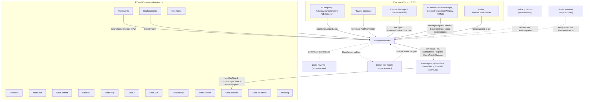
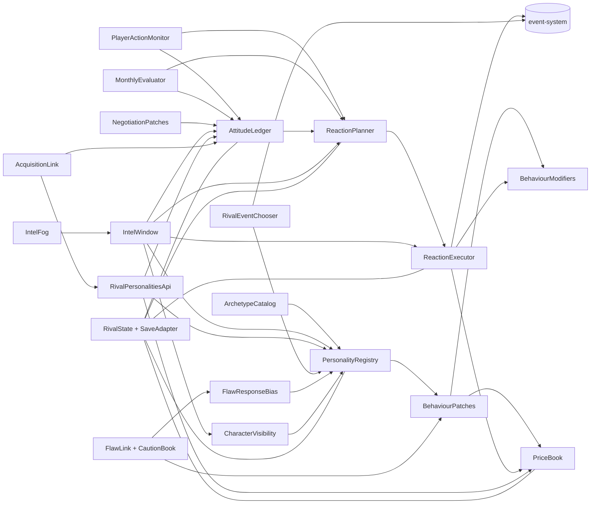
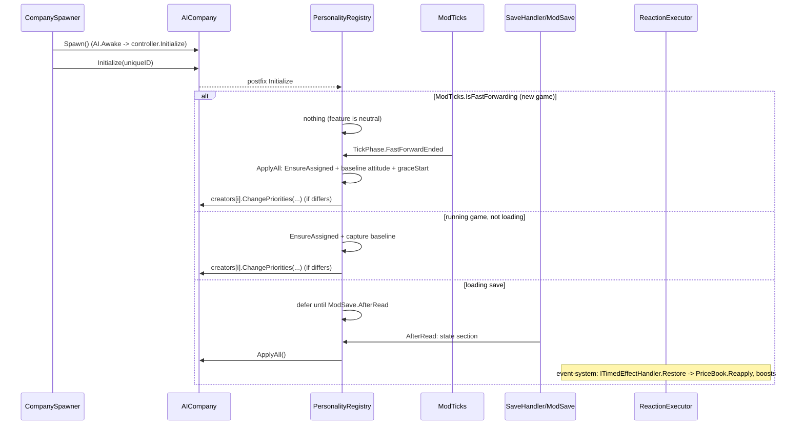
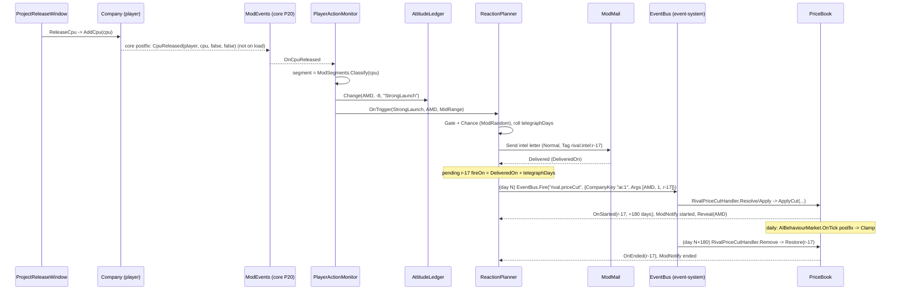

# Design: rival-personalities

## Document Information

- **Feature Name**: rival-personalities — характеры соперников и реакции на игрока
- **Version**: 0.2
- **Date**: 2026-10-10
- **Author**: Dex719
- **Status**: Draft v0.2 — одобрено к реализации владельцем 2026-10-10
- **Reviewers**: владелец проекта
- **Related Documents**:
  - `.kiro/specs/rival-personalities/requirements.md`
  - `.kiro/specs/rival-personalities/tasks.md`
  - `.kiro/steering/context.md` (архитектурный контракт `PTMod.Core`)
  - `.kiro/steering/owner-decisions.md` (решения владельца)
  - `.kiro/specs/event-system/design.md` (API событий)
  - `.kiro/specs/mod-framework/design.md` (каналы `ModModifiers`, `ModReputation`, `ModUI`, `ModEvents`, `ModSegments`, `ModMail`)
  - `pt-modding/CODEMAP.md`, раздел «AI competitors and business deals»

## Overview

Фича состоит из трёх слоёв:

1. **Характер.** Это статическая конфигурация архетипа. После перемотки новой игры (`TickPhase.FastForwardEnded`), при появлении компании и после каждой загрузки она накладывается на поведение ИИ; во время перемотки фича нейтральна. Несколько точечных патчей меняют темп выпуска CPU, финансирование исследований, стартовые цены, фокус дизайна и допустимый брак после скандала. Игровая логика `AIBehaviour*` остаётся прежней, меняются только её входы и выходы. Сам характер скрыт от игрока, пока соперник не выполнит первую реакцию.
2. **Отношение.** Число от −100 до +100 на каждого соперника. Его меняют наблюдаемые действия игрока: запуски, цены, доля рынка, тендеры, технологии, бизнес-контракты. Раз в месяц оно дрейфует к базовому уровню архетипа.
3. **Реакции.**
   - Триггер действия игрока плюс отношение, сложность и лимиты честности определяют, будет ли ответный ход.
   - Ход сначала телеграфируется письмом разведки, а через 14–45 дней после его доставки исполняется как событие `event-system`.
   - Нестандартные эффекты (ценовой удар, ответный запуск) реализует сама фича через `EventEffects.Register`. Стандартные (`ModifierTimed` по каналам `contract.signChance`, `research.speed`, эффект `Reputation` для `Smear`) исполняет движок событий.

Панель разведки показывает всё это игроку. Состояние хранится в секции `rival-personalities` бокового файла `ModSave`. Фича также владеет ценовыми войнами (публичный `ApplyPriceCut` / `RestorePriceCut`) и даёт `design-flaw-recalls` множители реакции на брак и осторожность ИИ после скандала.

### Design Goals
- **Узнаваемость.** Характер должен быть виден по продуктам и ценам соперника, а не только по подписи; сама подпись раскрывается после первой реакции.
- **Честность.** Каждый враждебный ход предсказуем: о нём предупреждают заранее (от доставки письма), он ограничен по силе и частоте и обратим.
- **Минимальное вмешательство.** Не трогаем формулы рынка и компиляторные лямбды игры. Опираемся на публичные методы и на естественную динамику цен ИИ.
- **Устойчивость к загрузке.** Конфигурация ИИ перечитывается из префаба, поэтому любое применение идемпотентно и повторяется после загрузки (`ModSave.AfterRead`).
- **Данные вместо кода.** Все числа лежат в `Content/rival-personalities/*.json`.
- **Ядро вместо копий.** Выпуск CPU — `ModEvents`, сегмент — `ModSegments`, письма — `ModMail`, версия секции — `_schema` ядра; своих патчей на `Company.AddCpu` / `AICompany.AddCpu`, классификатора сегмента и счётчиков ошибок у фичи нет.

### Key Design Decisions

| # | Решение | Обоснование | Отвергнутые альтернативы |
|---|---|---|---|
| D1 | Характер применяется в постфиксе `AICompany.Initialize(int)` (вне перемотки и загрузки). Повторное применение — после `ModSave.AfterRead`, в постфиксе `AIBehaviourController.ReformCyrux(bool)` и один раз для всех компаний на `TickPhase.FastForwardEnded` | `Initialize` вызывается на всех трёх путях появления: `CompanySpawner.SpawnCompanies`, `CompanySpawner.SpawnCompany`, `CompanySpawner.SpawnCompanyFromSave`. К этому моменту `AI.Awake` уже инициализировал контроллер и дизайнеров. `ReformCyrux` перезаписывает приоритеты Cyrix. Компании, появившиеся в перемотке, получают характер на `FastForwardEnded` | Событие `CompanySpawner.OnCompanySpawned` не поднимается в `SpawnCompanyFromSave`. Патч `AI.Awake` срабатывает раньше, чем известен `UniqueID` |
| D2 | Порог одобрения дизайна меняется множителем результата `AIBehaviourCreation.OnTick` (постфикс) | Контроллер сравнивает `NeedOfANewCpu = OnTick()` с `cpuRatingToApproveDesign`. Умножить рейтинг на `k` — то же, что разделить порог на `k`. Метод публичный и стабильный | Писать в `cpuRatingToApproveDesign`: лямбда `<Initialize>b__1` перезаписывает его каждый день. Транспайлер лямбды: имя компиляторное, нестабильное |
| D3 | Цены меняются через `Strategy.TargetPrice` и разовое снижение `Price` в постфиксе `AIBehaviourMarket.OnTick` | Игра сама опускает цену к `TargetPrice` на 5 в день (`ChangePrices`), поднимает при дефиците и не опускает ниже `MinimumPrice` (`HandleUnprofitableCpus`). Удар остаётся «рыночным»: при дефиците у соперника он слабеет сам. Ценовыми войнами других фич (`historical-events`) тоже владеет `PriceBook` через публичный API | Патч `ConsiderReducingPrices`: работает только при сложности ≥ 3, логика на константах. Жёсткое удержание `Price` ломает реакцию ИИ на дефицит. Прямая запись цен из других фич: два владельца `TargetPrice` |
| D4 | Реакции исполняются событиями `event-system`. Планирование и телеграфирование — внутри фичи | Журнал, окно выбора с таймером и стандартные эффекты уже есть в движке. Связь с конкретным действием игрока и честные лимиты — ответственность этой фичи | Исполнять без движка: дублируются окно выбора, журнал и `ModifierTimed`. `DailyChance`-события не привязаны к действиям игрока |
| D5 | OEM-натиск и переманивание делаются только стандартными каналами: `contract.signChance` и `research.speed` через `ModifierTimed`, бонус соперника — через `ModModifiers.Add`; `Smear` — стандартным эффектом `Reputation` | Формулы шанса OEM (P8, `Contract.CpuOffer.DefineChance`) и скорости исследований (P1, `Modifiers.GetModifier`) принадлежат `mod-framework` и зарезервированы каналами (`ModHooks.IsReservedByChannel`). Записи `ModModifiers` создаются движком и этой фичей один раз, при выключении фичи не удаляются | Свой патч `Contract.ChooseCpu`: конфликт с `contract-transparency` и каналом ядра |
| D6 | Отношение влияет на поле `Interest` (и скидка литейного партнёра на поле `Price`) в `AIMath.GetProviderScores`/`AIMath.GetClientScores`, но только в scope `ContractNegotiationWindow.UpdateScores` | Окно переговоров — единственный путь подсчёта очков для сделок с игроком. `GetProviderScores` не получает второй стороны, поэтому контекст задаёт scope. ИИ-ИИ сделки остаются ванильными. Очко `Price` равно одному проценту наценки, поэтому прибавка к нему — буквально скидка | Патч `UpdateSignButton`/`acceptanceScore`: строки очков в UI разойдутся с итогом. Глобальный патч `AIMath`: изменит ИИ-ИИ сделки. Изменение `markupPrice` в контракте: затрагивает `BusinessContract` |
| D7 | Сегмент CPU игрока определяет ядро: `ModSegments.Classify(cpu)` | Сегмент нужен в день запуска, когда продаж ещё нет. У CPU игрока нет `Strategy.TargetMarket`. Одно правило для всех фич (было: `SegmentClassifier` здесь и `SegmentInference` в `press-reviews`) | По продажам за месяц: триггер запаздывает на месяц и теряет связь с запуском. Своя копия классификатора |
| D8 | Лимиты честности — жёсткие правила в чистой `ReactionMath`, числа — в `config.json` | Тестируемо и настраивается без сборки | Только вероятности: возможны серии ударов подряд |
| D9 | Всё состояние, включая исходные `TargetPrice`, хранится в `ModSave` (`IModSaveParticipant`, версию секции ведёт ядро в `_schema`) | Сохраняет ли игра `CpuBase.Strategy`, не проверено (CODEMAP Uncertain). Поля в классы игры не добавляем (решение 0004) | Поля на `SaveObject.Company`: запрещено контрактом. Своё поле `schema` в данных фичи: нарушает контракт ядра |
| D10 | Во время перемотки новой игры фича нейтральна: характеры не применяются, триггеры и реакции не создаются. Назначение и применение — один раз на `TickPhase.FastForwardEnded` | Политика владельца №1: состояние ИИ к старту инициализируется на `OnFastFowardEnded`. `FastForwardEnded` приходит после сброса `IsFastFowardSimulating`, поэтому патчи работают штатно | Применять характеры в перемотке: история 1971 → старт отражала бы характеры, но нарушает общую политику перемотки |
| D11 | Характер скрыт, пока соперник не выполнит первую реакцию (или отношение ≥ +20); параметр `hiddenCharacters` включён по умолчанию | Решение владельца: реакции становятся «разведданными». Порог +20 раскрывает литейщиков, у которых враждебных реакций нет | Всегда показывать (v0.1): теряется интрига |
| D12 | Срок телеграфа отсчитывается от фактической доставки письма (`ModMail.Delivered`), приоритет письма `Normal` | Ядро ограничивает доставку 3 письмами в день и 2 на фичу; отсчёт от планирования мог бы сократить предупреждение. Если письмо не доставлено за 30 дней — реакция отменяется | `Critical` для всех писем разведки: съедает обход лимита ядра. Отсчёт от планирования: нарушает честность |
| D13 | Осторожность ИИ после брака и множители `IFlawResponseBias` живут здесь; политику выбора реакции ИИ на брак ведёт `design-flaw-recalls` | Решение владельца (design-flaw-recalls): осторожность ИИ — в `rival-personalities`. Патч `AcceptableFailureRate` — `Optional` | Патч в `design-flaw-recalls`: дублирует владельца поведения ИИ |
| D14 | «Туманность» — чистая функция показа (`IntelFog`), игровые значения не меняются | Should по решению владельца; не влияет на логику и баланс | Менять сами данные: усложняет проверку |

## Architecture

### System Context



### High-Level Architecture



### Technology Stack

| Слой | Технология | Обоснование |
|-------|------------|-----------|
| Патчи | Harmony 2 через `ModHooks` | решение 0002; изоляция ошибок на патч |
| Логика | C# latest, чистые статические классы без `UnityEngine` в `Features/RivalPersonalities/Logic/`; общее подмножество API .NET Framework 4.8 и mscorlib Unity (без `init`, `record`, `Index`, `Range`) | юнит-тесты мини-раннером в `mod/tests/PTMod.Tests/RivalPersonalities/` без запуска игры (`python mod/build.py --tests`) |
| Контент | JSON через `ModContent` | решение 0006; правка баланса без сборки |
| Состояние | секция `ModSave` (`IModSaveParticipant`) | решение 0004; версия секции — `_schema` ядра |
| UI | `ModUI` (клон окна игры + `ButtonUI`, `InfoText`, `Themeable*`) | решение 0005 |
| События | `event-system` | единый движок реакций, выбор с таймером, журнал |

### Используемые сервисы PTMod.Core

| Сервис | Для чего |
|---|---|
| `ModHooks` | регистрация патчей из таблицы (12 целей, одна `Optional`), самопроверка целей, `ModHooks.Guard` вокруг тел патчей и обработчиков |
| `ModTicks` | фазы `TickPhase.DayPassed` (планировщик), `LateMonthPassed` (месячная оценка, дрейф), `YearPassed` (сброс годового счётчика) через `FeatureContext.OnTick`; защиты от перемотки и загрузки по умолчанию; `TickPhase.FastForwardEnded` (назначение и применение характеров, начало льготного периода); `ModTicks.GameReady` (переподписка на синглтоны сцены); `ModTicks.IsBatchRun` — только для справки (ядро откладывает письма и уведомления) |
| `ModEvents` | подписка на `CpuReleased` (триггер `StrongLaunch` и замыкание `CounterLaunch`); `CpuTransferred` триггером не является |
| `ModSegments` | `Classify(cpu)` — сегмент CPU игрока по цене; `Segment` — единый тип сегмента |
| `ModCompanies` | ключи `"player"` / `"ai:<UniqueID>"` во всех записях состояния и событиях |
| `ModSave` | секция `rival-personalities` (`SchemaVersion = 1`, `_schema` пишет ядро) |
| `ModContent` | `archetypes.json`, `assignments.json`, `config.json`, `events.json` |
| `ModMail` | письма разведки (`Normal`, `Tag` `rival:intel:<id>`, `ModMailAction` «Открыть разведку»), «ответный удар», предложение партнёрства (`Low`); `Delivered` задаёт дату исполнения |
| `ModNotify` | смена уровня отношения, начало и конец реакций, раскрытие характера |
| `ModUI` | окно разведки (`CreateWindow`), кнопка «Соперники» в хабе «Моды» (`ctx.HubPage`), `Tooltip` |
| `ModL10n` | все строки (`rival.*`) |
| `ModSettings` | вкл/выкл (хаб), параметры `randomCharacters`, `hiddenCharacters`, `intelFog` (`ctx.Param`); отладочный флаг `debug.forceReactions` (только отладочная сборка) |
| `ModRandom` | поток `ModRandom.Stream("rival-personalities")`: броски реакций, сроки телеграфа, случайные назначения |
| `ModModifiers` | `ModifierTimed` движка событий (`contract.signChance`, `research.speed`); `ModModifiers.Add` для бонуса соперника; провайдер `acquisition.price` (Could) |
| `ModConditions` | регистрация предикатов `rival.*` (FR-13) |
| `ModReputation` | только через стандартный эффект `Reputation` (реакция `Smear`) и чтение для показа |
| `ModLog` | лог с префиксом `[PTMod] [rival-personalities]` |

### Вклад в общие каналы (максимальный)

| Канал | Диапазон канала | Вклад этой фичи | Откуда |
|---|---|---|---|
| `market.rating.cpu` | балансовый [0,5; 2,0], предохранитель [0; 5] | нет | — |
| `popularity.gain` | балансовый [0,5; 2,0], предохранитель [0; 5] | нет | — |
| `contract.signChance` | [0,0; 5,0] по компании и CPU | ×1,5 соперника на 365 дней (`OemPush`); тип реакции не накладывается сам на себя (FR-6 п. 8) | `ModifierTimed` |
| `research.speed` | [0,25; 4,0] по компании | игрок ×0,85 и соперник ×1,10 на 120 дней (`Poach`); не более двух одновременных враждебных реакций (≥ ×0,72 игроку) | `ModifierTimed`, `ModModifiers.Add` |
| `acquisition.price` | [0,5; 3,0] по компании-цели | от ×1,0 до ×1,5 (`1 + max(0, −a)/200`, Could) | провайдер |

## Components and Interfaces

Пространство имён — `PTMod.Features.RivalPersonalities`. Интерфейс регистрации фичи (`IModFeature`) и сигнатуры сервисов ядра задаются в `mod-framework/design.md`. Ниже показано, как фича их использует.

### Component 1: RivalPersonalitiesFeature

**Purpose**: точка входа фичи по контракту ядра (`[ModFeature] sealed class … : IModFeature`).

**Responsibilities**:
- регистрирует контент, патчи, тики, секцию сохранения, параметры, страницу хаба, обработчики эффектов и предикаты;
- подписывается на события ядра (`ModEvents.CpuReleased`, `ModMail.Delivered`, `ModTicks.GameReady`, `ModFeatures.StateChanged`) один раз в `Register`: `ModHooks.Raise` пропускает обработчики неактивных фич и изолирует исключения;
- реагирует на включение и выключение в хабе.

```csharp
namespace PTMod.Features.RivalPersonalities
{
    [ModFeature]
    public sealed class RivalPersonalitiesFeature : IModFeature
    {
        public const string FeatureId = "rival-personalities";
        public string Id => FeatureId;
        public string NameKey => "rival.feature.name";
        public string DescriptionKey => "rival.feature.desc";
        public string[] DependsOn => new string[0];     // only hard dependencies; soft: event-system, press-reviews, rival-acquisitions, design-flaw-recalls
        public bool EnabledByDefault => true;
        public bool SupportsHotToggle => true;

        public void Register(FeatureContext ctx);       // ctx.Patch(typeof(...)), ctx.OnTick(TickPhase.X, ...), ctx.SaveParticipant(...),
                                                        // ctx.Param(randomCharacters | hiddenCharacters | intelFog), ctx.HubPage("rival.hub.button", ...),
                                                        // EventEffects.Register(...), EventAi.AddChooser(...), ModConditions.Register("rival.*", ...),
                                                        // ModMail.RegisterActionHandler(FeatureId, ...), ModModifiers.RegisterProvider(... "acquisition.price" ...)
        public void OnEnabled();                        // apply personalities to all live AI (if game ready)
        public void OnDisabled();                       // revert behaviour, restore prices, drop boosts, keep state;
                                                        // ModModifiers entries and providers are neither removed nor recreated
    }
}
```

Тики (все через `ctx.OnTick`, защиты ядра от перемотки и загрузки включены по умолчанию): `DayPassed` (планировщик, окно), `LateMonthPassed` (месячная оценка), `YearPassed` (сброс годового счётчика), `FastForwardEnded` (начальное назначение и применение). Отладочный флаг `rival-personalities.debug.forceReactions` читается через `ModSettings.Debug` и в релизной сборке всегда выключен. Своих счётчиков ошибок фича не ведёт (`ModHooks.Guard` / `ReportFault`).

### Component 2: ArchetypeCatalog

**Purpose**: загрузить, провалидировать и выдать архетипы, назначения и глобальный конфиг.

**Interfaces**:
- **Input**: `ModContent` (встроенные ресурсы + переопределения).
- **Output**: `Archetype`, `RivalConfig`.
- **Dependencies**: `ModContent`, `ModLog`.

```csharp
public sealed class ArchetypeCatalog
{
    public RivalConfig Config { get; }
    public IReadOnlyList<Archetype> All { get; }
    public bool TryGet(string archetypeId, out Archetype archetype);
    public string DefaultArchetypeFor(int uniqueId);        // assignments.json (key uniqueId), fallback "conservative"
    public static ValidationReport Validate(ArchetypesFile file, AssignmentsFile assignments, RivalConfig config); // pure
}
```

### Component 3: PersonalityRegistry

**Purpose**: хранить назначения `UniqueID → архетип`, снимать исходные (префабные) параметры дизайнеров, применять и откатывать характер, помнить раскрытые характеры.

```csharp
public sealed class PersonalityRegistry
{
    public string GetArchetypeId(int uniqueId);
    public void EnsureAssigned(AICompany company);           // first sight -> state.assignments (not during fast-forward)
    public void Apply(AICompany company);                    // idempotent; no-op while ModTicks.IsFastForwarding
    public void Revert(AICompany company);                   // restore captured baseline
    public void ApplyAll();                                  // ModCompanies.All (AI); called on TickPhase.FastForwardEnded and ModSave.AfterRead
    public bool IsApplied(int uniqueId);                     // false until Apply ran for this company (patches return 1.0 before that)
    public CreatorBaseline[] GetBaseline(AICompany company); // runtime cache, not saved
    public bool IsRevealed(int uniqueId);                    // CharacterVisibility, see FR-11
    public void Reveal(int uniqueId);                        // state.revealed + ModNotify rival.notify.revealed
}

public struct CreatorBaseline
{
    public int MarketFocus;          // AIBehaviourCreation.MarketFocus
    public int DesignFocus;          // private designFocus (reflection)
    public int PowerFocus;           // private powerConsumptionFocus
    public int SimulationPriority;   // private simulationPriority
}
```

**Implementation Notes**:
- Дизайнеры берутся из приватного списка `creators` у `AIBehaviourController` (рефлексией, `AccessTools`): там есть и дизайнер, добавленный `ReformCyrux`. Список `behaviourCreations` его не содержит.
- `ChangePriorities` вызывает `Initialize` дизайнера: кэш дизайнов сбрасывается, RNG пересоздаётся. Поэтому `Apply` вызывает его только если целевые значения отличаются от текущих.
- Дизайнеры с исходным `designFocus`, равным значению Inlet (2) или EMD (3) перечисления `CpuDesignFocus` (идентификаторы кода игры), не получают `designFocusOverride`.
- Литейщики (`IsFoundry`) пропускаются: `AIBehaviourCreation.OnTick` у них всегда возвращает 0.
- Во время перемотки (`ModTicks.IsFastForwarding`) `EnsureAssigned` и `Apply` ничего не делают; компании, появившиеся в перемотке, обрабатывает `ApplyAll` на `TickPhase.FastForwardEnded`. Назначение при `randomCharacters` выполняется там же (`RandomAssignment`, поток `ModRandom` `rival-personalities/assign`).

### Component 4: BehaviourPatches и BehaviourModifiers

**Purpose**: Harmony-патчи поведения ИИ и источник множителей для них.

```csharp
public sealed class BehaviourModifiers
{
    // archetype multiplier x active reaction boosts, per company and segment; 1.0 while ModTicks.IsFastForwarding
    // or until PersonalityRegistry.IsApplied(company)
    public float ApprovalMultiplier(AICompany company, Segment marketFocus);   // AIBehaviourCreation.MarketFocus index == Segment
    public float ResearchFundingMultiplier(AICompany company);
    public float LaunchPriceMultiplier(AICompany company);
    public void AddBoost(ReactionBoost boost);               // from CounterLaunch
    public void RemoveBoost(string reactionId);
}

public struct ReactionBoost
{
    public string ReactionId; public int UniqueId; public Segment Segment;
    public float ApprovalBoost; public float FundingBoost;
}

internal static class BehaviourPatches
{
    [ModPatch(typeof(AIBehaviourCreation), "OnTick", PatchKind.Postfix)]
    static void CreationOnTick(AIBehaviourCreation __instance, AICompany ___company, ref float __result);

    [ModPatch(typeof(AIBehaviourResearch), "GetMaxFunding", PatchKind.Postfix)]
    static void ResearchFunding(AICompany ___company, ref float __result);

    [ModPatch(typeof(AIBehaviourMarket), "OnTick", PatchKind.Prefix)]
    static void MarketPrefix(AI ___ai, out List<Cpu> __state);                     // CPUs with TargetPrice<=0 or Price<=0

    [ModPatch(typeof(AIBehaviourMarket), "OnTick", PatchKind.Postfix)]
    static void MarketPostfix(AI ___ai, AICompany ___company, List<Cpu> __state);  // launch price + price-cut clamp
}
```

Атрибут `ModPatch(target, method, PatchKind)` и применение задаёт `ModHooks` (mod-framework). Тела патчей обёрнуты в `ModHooks.Guard`. Имена полей с `___` — соглашение Harmony для приватных полей экземпляра.

### Component 5: PriceBook

**Purpose**: учёт исходных `TargetPrice` под ценовыми ударами, применение удара и возврат цен. Один механизм обслуживает и реакцию `PriceCut`, и публичный API ценовых войн (`ApplyPriceCut` / `RestorePriceCut`, Component 12).

```csharp
public sealed class PriceBook
{
    public int ApplyCut(string reactionId, AICompany rival, Segment segment, float depth, float floorMargin); // returns CPUs affected; 0 if bankrupt/dormant
    public void Clamp(AICompany rival);         // called from MarketOnTickPatch.Postfix
    public void Restore(string reactionId);     // end of reaction / feature off / bankruptcy / dormant
    public void RestoreAll();
    public void ExpireExternal(DateTime today); // entries of external callers (reactionId not "r-<n>") older than priceCut.externalMaxDays (400)
}

public static class PriceCutMath // pure
{
    public static float CutPrice(float price, float realUnitCost, float depth, float floorMargin);
    // max(price * (1 - depth), realUnitCost * (1 + floorMargin)), never above price
}
```

### Component 6: AttitudeLedger и AttitudeMath

**Purpose**: шкала отношения, история изменений, уровни, дрейф.

```csharp
public sealed class AttitudeLedger
{
    public float Get(int uniqueId);
    public AttitudeLevel GetLevel(int uniqueId);
    public void Change(int uniqueId, float delta, string reason); // x sensitivity, clamp, history (20), level notify
    public void MonthlyDrift();                                    // to archetype baseline, rate from config
    public IReadOnlyList<AttitudeEntry> History(int uniqueId);
    public event Action<int, AttitudeLevel, AttitudeLevel> LevelChanged;
}

public static class AttitudeMath // pure
{
    public static float Apply(float current, float delta, float sensitivity);  // clamp [-100, 100]
    public static float Drift(float current, float baseline, float rate);
    public static AttitudeLevel LevelOf(float attitude, AttitudeThresholds t);  // -60/-20/20/60
    public static float ReactionMultiplier(float attitude);                      // clamp(1 - a/100, 0.25, 2.0)
    public static int InterestBonus(float attitude, int divisor);                // round(a / divisor), clamp -20..+20
    public static int DiscountPoints(float attitude, int divisor, int maxPoints); // clamp(round(a / divisor), 0, maxPoints): foundry_partner markup discount
}

public enum AttitudeLevel { Hostile = 0, Rivalry = 1, Neutral = 2, Respect = 3, Partnership = 4 }
```

### Component 7: PlayerActionMonitor и MonthlyEvaluator

**Purpose**: превратить действия игрока в триггеры (FR-5).

```csharp
public enum TriggerType { StrongLaunch, PriceUndercut, ShareGain, OemLoss, TechLead }

public struct PlayerTrigger
{
    public TriggerType Type; public int UniqueId; public Segment Segment; public string Detail; // e.g. CPU name
}

public sealed class PlayerActionMonitor
{
    // subscribed to ModEvents.CpuReleased in Register; ignores non-player owners, isVariant and duringFastForward
    public void OnCpuReleased(ICompany owner, Cpu cpu, bool isVariant, bool duringFastForward);
    public void OnPlayerTechnology(Technology technology);    // from Company.AddTechnology postfix
    public void OnOemContractActivated(Contract contract);    // from ContractManager.PromoteContractToActive postfix
    public void OnPlayerSignedBusinessContract(BusinessContract contract);   // BusinessContractManager.OnPlayerSignedContract, re-subscribed on ModTicks.GameReady
    public void OnBusinessContractBroken(ICompany breaker, ICompany other);
    public event Action<PlayerTrigger> TriggerRaised;
}

public sealed class MonthlyEvaluator
{
    public void Run();   // TickPhase.LateMonthPassed: shares, undercut, contract bonus, attitude drift, partnership roll, PriceBook.ExpireExternal
}

// Segment of the player's CPU: ModSegments.Classify(cpu) (mod-framework). Segment.Any -> no trigger, warning in the log.
// There is no feature-local classifier.

public static class ShareCalculator // pure
{
    // rows: (companyKey, soldBySegment[4]) for last full month; returns share[4] per company key (index = (int)Segment)
    public static Dictionary<string, float[]> Shares(IEnumerable<SalesRow> rows);
}
```

### Component 8: ReactionPlanner и ReactionMath

**Purpose**: решить, будет ли реакция; применить лимиты; запланировать с телеграфом.

```csharp
public sealed class ReactionPlanner
{
    public void OnTrigger(PlayerTrigger trigger);           // roll + gates + schedule + intel mail (ModMail.Send, Normal, Tag "rival:intel:<id>")
    public void DailyTick();                                 // fire due reactions via ReactionExecutor; cancel pending without delivered mail after 30 days
    public void OnMailDelivered(ModMailRecord record);       // ModMail.Delivered: fireOn = DeliveredOn + telegraphDays (rolled at planning)
    public IReadOnlyList<PendingReaction> Pending { get; }
    public void CancelFor(int uniqueId, string reason);      // bankruptcy / dormant / feature off
}

public static class ReactionMath // pure
{
    public static float Chance(float baseChance, float attitude, int difficulty, RivalConfig cfg);
    public static GateResult Gate(in GateInput input);
}

public struct GateInput
{
    public bool Hostile; public bool AnyAttitude; public float Attitude;
    public int DaysSinceGraceStart; public int DaysSinceLastReactionOfRival; public int CooldownDays;
    public int ActiveOrPendingHostile; public int HostileExecutedThisYear;
    public bool SameTypeActiveOrPending;                     // same reaction type already planned/active for this rival
    public bool RivalBankrupt; public bool RivalDormant; public bool EventSystemAvailable;
}

public enum GateResult { Allowed, GracePeriod, Cooldown, ConcurrentCap, YearlyCap, AttitudeTooHigh, SameTypeActive, Bankrupt, Dormant, NoEventSystem }
```

Письмо разведки уходит с приоритетом `Normal` (`Critical` не нужен: срок отсчитывается от доставки). `ModMailMessage`: `FeatureId` = `rival-personalities`, `Tag` = `rival:intel:<reactionId>`, `Actions` = [`openIntel`, `Repeatable = true`]. Обработчик действия регистрируется `ModMail.RegisterActionHandler(FeatureId, ...)` и открывает `IntelWindow.Open(uid)`. Возвращённый `Send` ID письма хранится в `PendingReaction.mailId`; блоков ID писем нет.

### Component 9: ReactionExecutor и обработчики эффектов

**Purpose**: исполнить реакцию через `EventBus.Fire`, реализовать нестандартные эффекты, отслеживать сроки, вернуть всё по окончании.

```csharp
public sealed class ReactionExecutor
{
    // EventBus.Fire("rival.<type>", new EventFireContext {
    //     CompanyKey = target,                 // "ai:<UniqueID>" (PriceCut, CounterLaunch, OemPush) or "player" (Poach, Smear)
    //     Args = new[] { rivalName, segmentIndex, reactionId, rivalKey } })   // segmentIndex = (int)Segment
    public EventFireResult Fire(PendingReaction reaction);
    public IReadOnlyList<ActiveReaction> Active { get; }      // mirror for UI/history; durations are owned by event-system
    internal void OnStarted(string reactionId, string endDate); // called from handlers' Apply/Restore; first start of a rival -> PersonalityRegistry.Reveal
    internal void OnEnded(string reactionId);                   // called from handlers' Remove
}

// Custom effect types, registered via EventEffects.Register(type, handler) (event-system/design.md).
// Timed ones implement ITimedEffectHandler: Resolve -> Apply -> (Tick) -> Remove; Restore after load / re-enable.
internal sealed class RivalPriceCutHandler : ITimedEffectHandler        // "RivalPriceCut": value = depth; textArgs = [segment, reactionId]
{
    public string Type => "RivalPriceCut";
    public bool Validate(EventEffect spec, IList<string> errors);
    public AppliedEffect Resolve(EventEffect spec, EventContext ctx);  // depth from archetype of ctx.Company; segment (Segment) from ctx.Instance.Data.args
    public void Apply(AppliedEffect effect, EventContext ctx);         // PriceBook.ApplyCut
    public void Tick(AppliedEffect effect, EventContext ctx);          // no-op (clamp lives in MarketOnTick postfix)
    public void Remove(AppliedEffect effect, EventContext ctx);        // PriceBook.Restore
    public void Restore(AppliedEffect effect, EventContext ctx);       // PriceBook.Reapply from saved entries
    public EffectText Describe(AppliedEffect effect);
}
internal sealed class RivalCounterLaunchHandler : ITimedEffectHandler   { /* "RivalCounterLaunch": BehaviourModifiers.AddBoost / RemoveBoost */ }
internal sealed class RivalResearchBoostHandler : IEventEffectHandler   { /* "RivalResearchBoost": ModModifiers.Add(FeatureId, ModChannels.ResearchSpeed,
                                                                            ModifierScope.Company(rivalKey), 1.10f, 120, "rival.reason.poach", null) */ }
internal sealed class RivalPoachCounterOfferHandler : IEventEffectHandler { /* "RivalPoachCounterOffer": Company.SpendMoney(C, ExpenseOrigin.Research) */ }
internal sealed class RivalAttitudeHandler : IEventEffectHandler        { /* "RivalAttitude": AttitudeLedger.Change(rivalKey, value, ...) */ }
```

Записи `ModModifiers.Add` (бонус `Poach`) создаются один раз и не удаляются при выключении фичи: ядро хранит запись и не применяет её, пока фича выключена; срок `ExpiresOn` сохраняется. Причины для `ModModifiers.Explain`: `rival.reason.oemPush` (OEM-натиск), `rival.reason.poachLoss` (потеря инженеров игроком), `rival.reason.poach` (бонус соперника).

- **Цель события.**
  - `PriceCut`, `CounterLaunch`, `OemPush`: цель — соперник (`EventFireContext.CompanyKey = "ai:<UniqueID>"`). Стандартный `ModifierTimed` со `scope: Target` действует на него.
  - `Poach`, `Smear`: цель — игрок (`"player"`). Соперник передаётся в `Args`, эффекты на соперника — через `RivalResearchBoost`.
- **Параметры удара** (глубина, бусты) обработчики берут из архетипа соперника и `config.json`, а не из события. Так одно описание события подходит всем архетипам.
- **Сроки** (`durationDays`) задаются в `events.json`. Истечение, снятие при выключении и восстановление после загрузки делает `event-system` через `ITimedEffectHandler`.

### Component 10: NegotiationPatches

**Purpose**: добавить отношение к `Interest` ИИ-стороны в переговорах с игроком, а литейному партнёру — скидку на наценку (очки `Price`).

```csharp
internal static class NegotiationPatches
{
    [ModPatch(typeof(ContractNegotiationWindow), "UpdateScores", PatchKind.Prefix)]
    static void ScopeEnter(ICompany ___currentProvider, ICompany ___currentClient); // NegotiationScope.Enter(ai side)

    [ModPatch(typeof(ContractNegotiationWindow), "UpdateScores", PatchKind.Finalizer)]
    static Exception ScopeExit(Exception __exception);                              // NegotiationScope.Exit(); pass-through

    [ModPatch(typeof(AIMath), "GetProviderScores", PatchKind.Postfix)]
    static void Provider(ICompany provider, ref AIScores __result);   // Interest += round(a/5) (not -1000); Price += discount for archetype.negotiationDiscount

    [ModPatch(typeof(AIMath), "GetClientScores", PatchKind.Postfix)]
    static void Client(ICompany client, ref AIScores __result);       // Interest += round(a/5) (not -1000)
}
// Bonus arithmetic: AttitudeMath.InterestBonus (round(a/5)) and AttitudeMath.DiscountPoints (clamp(round(a/10), 0, 10)).

internal static class NegotiationScope // pure-ish, [ThreadStatic] not needed: main thread only
{
    public static bool Active { get; }
    public static ICompany AiSide { get; }
    public static void Enter(ICompany provider, ICompany client);
    public static void Exit();
}
```

### Component 11: IntelWindow

**Purpose**: панель разведки (FR-9).

```csharp
public sealed class IntelWindow
{
    public static void Open(int? selectUniqueId = null);   // from hub page button or mail action "openIntel"
    public void Refresh();                                  // on open, DayPassed while open, OnThemeChanged
}
// Built with ModUI.CreateWindow("rival.intel", WindowTemplate.Panel, "rival.window.title", new Vector2(900, 560)),
// ModUI.ScrollView / VerticalList / Button / Info / Text / Tooltip.

public static class CharacterVisibility // pure
{
    // hiddenCharacters off -> true; on -> revealed (first started reaction) or attitude >= revealAttitude (20)
    public static bool IsVisible(bool hiddenMode, bool revealed, float attitude, float revealAttitude);
}

public static class IntelFog // pure, display only (FR-16)
{
    public static float RoundShare(float share, float stepPp);            // 0.173, 5 pp -> 0.15
    public static float RoundSignificant(float value, int digits);        // 123, 2 -> 120
    public static string FormatShare(float share, bool fog);              // "≈ 15 %" / "17 %"
    public static string FormatIps(float ips, bool fog);                  // "≈ 120" / "123"
}
```

Видимость и туманность читают параметры `hiddenCharacters` и `intelFog` через `ModSettings.GetBool`. Деньги и проекты соперников окно не показывает.

### Component 12: RivalPersonalitiesApi

**Purpose**: публичный API для других фич (FR-13).

```csharp
public interface IRivalPersonalitiesApi
{
    bool IsEnabled { get; }
    float? GetAttitude(ICompany company);
    AttitudeLevel? GetAttitudeLevel(ICompany company);
    string GetArchetypeId(ICompany company);
    void ChangeAttitude(ICompany company, float delta, string reason);
    void SetDormant(ICompany company, bool dormant);        // rival-acquisitions
    event Action<int, string> ReactionStarted;              // uniqueId, reaction type

    // Price wars (historical-events and others): the same PriceBook as the PriceCut reaction.
    // reactionId — caller's own id "<prefix>:<name>" (internal ids look like "r-<n>"); returns CPUs affected, 0 when disabled/bankrupt/dormant.
    int ApplyPriceCut(string reactionId, ICompany rival, Segment segment, float depth, float floorMargin);
    void RestorePriceCut(string reactionId);                // returns the captured base TargetPrice; unknown id -> no-op
}

public static class RivalPersonalities
{
    public static IRivalPersonalitiesApi Api { get; }        // null-object when feature is disabled: IsEnabled == false, reads -> null, ApplyPriceCut -> 0
}

// FR-13 п. 5: bias for the design-flaw-recalls AI policy (interface of that spec, design-flaw-recalls/TSK-015).
// Order of multipliers: Recall, Stepping, Patch, Ignore; from archetypes.json "flawResponseBias".
internal sealed class FlawResponseBias : IFlawResponseBias
{
    public float[] Multipliers(ICompany company, bool isPublic);   // null for player / unknown -> 1.0; clamp 0.5..2.0
}
```

Прямое изменение цен ИИ в других фичах допустимо только при `RivalPersonalities.Api.IsEnabled == false` (фолбэк `historical-events`). Внешний удар без вызова `RestorePriceCut` снимает `PriceBook.ExpireExternal` через `priceCut.externalMaxDays` (400) дней.

### Component 13: RivalEventChooser (FR-14)

**Purpose**: решения ИИ в событиях `event-system` по характеру.

```csharp
internal sealed class RivalEventChooser : IEventAiChooser
{
    // Registered once: EventAi.AddChooser(this, priority: 100) — list in descending priority, the first non-null answer wins
    // (historical-events has priority 10 and gets only what this chooser leaves as null).
    public string Choose(EventInstance instance, ChoiceOption[] options, ICompany company, IModRng rng);
    // eventStyle neutral or company is player -> null (next chooser / default policy)
    // cost_i = options[i].Cost (computed by the engine from Money effects); unavailable options (Available == false) are never picked
    // spend: max-cost available option AiWeight x1.5; save: min-cost available option AiWeight x1.5; then rng.WeightedIndex
}
```

### Component 14: AcquisitionLink (FR-15, Could)

```csharp
internal sealed class AcquisitionLink
{
    // Register (once, lazy binding to the channel owned by rival-acquisitions; registration order does not matter):
    //   ModModifiers.RegisterProvider(FeatureId, ModChannels.AcquisitionPrice, ctx => 1 + max(0, -a(ctx.Company))/200, "rival.reason.acquisitionPrice")
    public void Attach();   // on ModTicks.GameReady / ModFeatures.StateChanged, if ModFeatures.IsActive("rival-acquisitions"):
                            //   RivalAcquisitionsApi.DealCompleted += OnDeal
    public void Detach();
    void OnDeal(DealRecord deal);   // deal.type == "Hostile" -> other rivals attitude -10; deal.targetUniqueId -> SetDormant(true) when removed/transferred
                                    // (RivalAcquisitionsApi.IsAbsorbedByPlayer(uid) is also checked on load)
}
```

### Component 15: FlawLink и CautionBook (FR-13 п. 5, FR-17)

**Purpose**: мягкая связь с `design-flaw-recalls`: отдать множители реакции на брак и применить осторожность ИИ после публичного брака.

```csharp
internal sealed class FlawLink
{
    public void Attach();   // on ModTicks.GameReady and ModFeatures.StateChanged("design-flaw-recalls"), if ModFeatures.IsActive("design-flaw-recalls"):
                            //   FlawRegistry.SetResponseBias(flawResponseBias); FlawRegistry.OnFlawStateChanged += OnFlawChanged
    public void Detach();   // OnDisabled / dependency off: SetResponseBias(null), unsubscribe
    void OnFlawChanged(FlawRecordView flaw);   // AI company, flaw.State == Public, Severity Major|Critical, new flaw id -> CautionBook.Start(uid, flawId)
}

public static class CautionMath // pure
{
    public static float Factor(bool active, float cautionFactor);              // active ? cautionFactor : 1
    public static DateTime UntilDate(DateTime today, int months);              // today + months
}
// CautionBook: state.cautions {uid, flawId, until}; Start is idempotent per (uid, flawId); expired entries are dropped on LateMonthPassed.
```

Патч: `[ModPatch(typeof(AIBehaviourCreation), "AcceptableFailureRate", PatchKind.Postfix, Optional = true)] static void Caution(AICompany ___company, ref float __result)` — `__result *= CautionBook.FactorFor(company)` (0.85 при действующей осторожности; 1 при выключенной `design-flaw-recalls`, банкротстве, спящем режиме и в перемотке). Умножения других фич на этот результат коммутативны, порядок постфиксов не важен.

## Патчи Harmony

| Цель (класс.метод игры) | Тип | Что меняет | Порядок / конфликты |
|---|---|---|---|
| `AICompany.Initialize(int)` | postfix | `EnsureAssigned` + `Apply` характера. Вне перемотки и загрузки — сразу; в перемотке (`ModTicks.IsFastForwarding`) — ничего (обработает `FastForwardEnded`); при загрузке (`ModTicks.IsLoading`) — отложено до `ModSave.AfterRead`, потому что нужна секция с назначениями | Только эта фича. `rival-acquisitions` патчит банкротство, не `Initialize` |
| `AIBehaviourController.ReformCyrux(bool)` | postfix | повторное `Apply` для Cyrix после смены приоритетов и вставки High End дизайнера | Только эта фича |
| `AIBehaviourCreation.OnTick()` | postfix | `__result × ApprovalMultiplier` (архетип × бусты `CounterLaunch`). Если `__result` NaN, ≤ 0 или < 1.05 — без изменений. Итог ≤ 10 | Только эта фича. Приоритет Harmony `Normal` |
| `AIBehaviourCreation.AcceptableFailureRate(ProcessNode)` (private) | postfix, `Optional` | `__result × CautionBook.FactorFor(company)` (0.85 при осторожности после публичного брака, FR-17) | Умножения других фич коммутативны; `design-flaw-recalls` этот метод не патчит (решение владельца) |
| `AIBehaviourResearch.GetMaxFunding()` (private) | postfix | `__result × ResearchFundingMultiplier`, clamp 0.01–5.0 | Только эта фича |
| `AIBehaviourMarket.OnTick()` | prefix + postfix | prefix запоминает CPU без цены. Postfix: `launchPriceMult` для них и удержание `TargetPrice` активных ударов (`PriceBook.Clamp`) | Вызывается и из `AIBehaviourController.TriggerPriceUpdate` (при `AICompany.AddCpu`). `market-shocks`/`historical-events` цены ИИ напрямую не трогают: ценовые войны идут через `ApplyPriceCut` (фолбэк `historical-events` — только при выключенной фиче) |
| `Company.AddTechnology(Technology, bool)` | postfix | триггер `TechLead` (только игрок, вне загрузки и перемотки, тип Lithography/Frequency/Multicore) | Только чтение |
| `ContractManager.PromoteContractToActive(Contract)` | postfix | триггер `OemLoss` для соперников из `OffersIDs`, если выбран CPU игрока | `contract-transparency` может читать тот же метод; оба только читают |
| `BusinessContractManager.BreakContract(ICompany, ICompany, BusinessContract)` | postfix | отношение −25, если `breaker` — игрок, а другая сторона — ИИ | Только чтение |
| `ContractNegotiationWindow.UpdateScores()` (private) | prefix + finalizer | вход и выход из `NegotiationScope` | Только эта фича |
| `AIMath.GetProviderScores(ICompany, int, int, int, bool)` | postfix | в scope и если `provider` — ИИ-сторона: `Interest += round(a/5)`, кроме −1000; для архетипа с `negotiationDiscount` ещё `Price += clamp(round(a/10), 0, 10)` | `rival-acquisitions` может давать бонусы своим дочерним компаниям; складываются аддитивно |
| `AIMath.GetClientScores(ICompany, ICompany, int, int, int, bool)` | postfix | то же для `client` (только `Interest`) | как выше |

Всего 12 целей (11 обязательных, одна `Optional`). **Патчей на `Company.AddCpu` и `AICompany.AddCpu` у фичи нет:** `ModHooks` отклонил бы их (служба `ModEvents`, FR-2 п. 6 ядра), выпуск CPU приходит событием `ModEvents.CpuReleased`. Все патчи регистрируются в `ModHooks` с id фичи (`ptmod.rival-personalities`). Тело каждого патча обёрнуто в `ModHooks.Guard`: при исключении — лог и выход без изменения `__result`.

## Подписки на события

| Событие | Обработчик | Защиты |
|---|---|---|
| `ModEvents.CpuReleased` (игрок) | `PlayerActionMonitor.OnCpuReleased` → триггер `StrongLaunch`, сегмент `ModSegments.Classify(cpu)` | ядро не поднимает событие при загрузке; обработчик отсекает `isVariant` и `duringFastForward`. Подписка один раз в `Register` |
| `ModEvents.CpuReleased` (соперник) | `CounterLaunchWatcher.OnCpuReleased`: CPU в сегменте активного ответного удара → письмо «Ответный удар» | то же. `CpuTransferred` не обрабатывается |
| `BusinessContractManager.Instance.OnPlayerSignedContract` | `PlayerActionMonitor.OnPlayerSignedBusinessContract` (+15) | пропуск при `ModTicks.IsLoading`: `AddContract` вызывается при загрузке. Переподписка на каждом `ModTicks.GameReady` (сначала отписка от предыдущего экземпляра), без дублей |
| `TickPhase.DayPassed` (`ctx.OnTick`) | `ReactionPlanner.DailyTick` (исполнение запланированных по дате `ModTicks.Today`, отмена без доставленного письма за 30 дней), обновление открытого окна | защиты `ModTicks` по умолчанию (перемотка, загрузка) |
| `TickPhase.LateMonthPassed` | `MonthlyEvaluator.Run` (доли, демпинг, бонус контракта, дрейф отношения, бросок партнёрства, `PriceBook.ExpireExternal`, чистка осторожности) | по умолчанию. Выполняется после игровых обработчиков `Market` (кэши) и `CompanyFinance` (новый отчёт) |
| `TickPhase.YearPassed` | сброс `hostileExecutedThisYear` | по умолчанию |
| `TickPhase.FastForwardEnded` | `PersonalityRegistry.ApplyAll` (назначения, отношение = baseline, `graceStart = ModTicks.Today`) | один раз на новую игру; приходит после сброса `IsFastFowardSimulating` |
| `ModSave.AfterRead` (после `IModSaveParticipant.Read`) | `RivalState` → `PersonalityRegistry.ApplyAll`. Активные удары и бусты восстанавливает `event-system` через `ITimedEffectHandler.Restore` | одно применение на загрузку |
| `ModTicks.GameReady(NewGame \| Loaded)` | переподписка на синглтоны сцены; `FlawLink.Attach`, `AcquisitionLink.Attach` | один раз на сцену |
| `ModMail.Delivered` | `ReactionPlanner.OnMailDelivered`: `fireOn = DeliveredOn + telegraphDays` для писем с `Tag` `rival:intel:*` | только свои письма (`FeatureId`) |
| `ModMail.RegisterActionHandler(FeatureId, ...)` | действия `openIntel`, `openNegotiation` | письмо остаётся открытым |
| `ModFeatures.StateChanged` / `ModSettings.Changed` | `OnEnabled` / `OnDisabled`; `FlawLink`/`AcquisitionLink` при смене состояния `design-flaw-recalls` / `rival-acquisitions`; режимы | — |
| `ThemeManager.Instance.OnThemeChanged` | `IntelWindow.Refresh` | только при открытом окне |
| `EventEffects.Register(...)` (при регистрации фичи) | 5 обработчиков эффектов | повторная регистрация — no-op |
| `EventAi.AddChooser(...)` | `RivalEventChooser` (FR-14) | только при доступной `event-system` |
| `EventBus.OnChoiceResolved` | для `rival.poach` — запись в историю (`counterOffer` / `letGo`, авто или нет) | только события категории `rival` |
| `RivalAcquisitionsApi.DealCompleted` (Could) | `AcquisitionLink.OnDeal` | только при активной `rival-acquisitions` |
| `FlawRegistry.OnFlawStateChanged` (мягко) | `FlawLink.OnFlawChanged` → осторожность (FR-17) | только при активной `design-flaw-recalls` |

## Data Models

### DTO состояния (ModSave)

```csharp
[Serializable] public sealed class RivalState      // IModSaveParticipant.SchemaVersion = 1; поля версии в данных нет: _schema пишет и читает ядро
{
    public string graceStart;                       // "yyyy-MM-dd"
    public List<AssignmentEntry> assignments = new List<AssignmentEntry>();
    public List<int> revealed = new List<int>();     // uid of rivals whose archetype is shown (FR-11)
    public List<AttitudeRecord> attitudes = new List<AttitudeRecord>();
    public ShareSnapshot shareSnapshot = new ShareSnapshot();
    public List<UndercutCooldown> undercutCooldowns = new List<UndercutCooldown>();
    public List<PendingReaction> pending = new List<PendingReaction>();
    public List<ActiveReaction> active = new List<ActiveReaction>();
    public List<PriceBookEntry> priceBook = new List<PriceBookEntry>();
    public List<CautionEntry> cautions = new List<CautionEntry>();   // FR-17
    public Counters counters = new Counters();
    public List<HistoryEntry> history = new List<HistoryEntry>();   // last 100
    public List<int> dormant = new List<int>();
    public int nextReactionSeq = 1;
}

// Поля segment — индекс (int)Segment: 0 HighEnd, 1 MidRange, 2 LowEnd, 3 Industries.
[Serializable] public sealed class AssignmentEntry { public int uid; public string archetype; }
[Serializable] public sealed class AttitudeRecord  { public int uid; public float value; public List<AttitudeEntry> history; }
[Serializable] public sealed class AttitudeEntry   { public string date; public float delta; public string reason; }
[Serializable] public sealed class ShareSnapshot   { public int monthIndex; public List<ShareRow> rows; }
[Serializable] public sealed class ShareRow        { public string key; public float[] s = new float[4]; } // "player" | "ai:<UniqueID>"
[Serializable] public sealed class UndercutCooldown{ public int uid; public int segment; public string until; }
[Serializable] public sealed class PendingReaction { public string id; public int uid; public string type; public int segment; public string trigger;
                                                      public string plannedOn; public int mailId; public int telegraphDays; public string fireOn; } // fireOn empty until ModMail.Delivered
[Serializable] public sealed class ActiveReaction  { public string id; public int uid; public string type; public int segment; public string start; public string end; }
[Serializable] public sealed class PriceBookEntry  { public int cpuSaveId; public int uid; public string reactionId; public float baseTargetPrice; public float cutTarget;
                                                      public string startedOn; } // external callers (id not "r-<n>") expire after priceCut.externalMaxDays
[Serializable] public sealed class CautionEntry    { public int uid; public int flawId; public string until; }
[Serializable] public sealed class Counters        { public int year; public int hostileExecutedThisYear; public List<LastReaction> lastByUid; }
[Serializable] public sealed class LastReaction    { public int uid; public string date; }
[Serializable] public sealed class HistoryEntry    { public int uid; public string date; public string type; public int segment; public string outcome; } // planned|started|ended|cancelled|counterLaunchDone|revealed
```

Словари не используются: `JsonUtility` их не умеет (решение 0006). Ключи — списки записей.

**Validation Rules** (при чтении секции):
- `value` отношения ограничивается [−100; 100]; `NaN` → baseline архетипа.
- Записи с неизвестным `uid` (нет компании и нет назначения) сохраняются, но не используются.
- `pending`/`active` с непарсящейся датой отбрасываются с предупреждением (пустая `fireOn` у `pending` допустима: письмо ещё не доставлено).
- `priceBook` для CPU, которого больше нет (`CpuDataProvider.Instance.GetCpu` вернул null), удаляется.
- Неизвестный `archetype` → `conservative`.
- Размеры: `cautions` ≤ 50, `revealed` ≤ 13 (уникальные).

### Пример секции бокового файла

Верхний `schema` — версия самого файла (`ModSave.FileSchema`), его ведёт ядро. Версию секции (`_schema`) тоже добавляет и читает ядро; в данных фичи поля версии нет.

```json
{
  "schema": 1,
  "features": {
    "rival-personalities": {
      "graceStart": "1980-01-01",
      "assignments": [
        { "uid": 0, "archetype": "hegemon" },
        { "uid": 1, "archetype": "price_warrior" },
        { "uid": 10, "archetype": "fast_follower" }
      ],
      "revealed": [ 0 ],
      "attitudes": [
        { "uid": 1, "value": -25.4, "history": [
          { "date": "1984-03-12", "delta": -10.4, "reason": "StrongLaunch:1" }
        ] }
      ],
      "shareSnapshot": { "monthIndex": 158, "rows": [
        { "key": "player", "s": [0.10, 0.04, 0.0, 0.02] },
        { "key": "ai:0",   "s": [0.60, 0.35, 0.0, 0.05] }
      ] },
      "undercutCooldowns": [ { "uid": 1, "segment": 1, "until": "1984-06-01" } ],
      "pending": [
        { "id": "r-17", "uid": 1, "type": "PriceCut", "segment": 1, "trigger": "StrongLaunch",
          "plannedOn": "1984-03-12", "mailId": 100231, "telegraphDays": 33, "fireOn": "1984-04-20" }
      ],
      "active": [
        { "id": "r-12", "uid": 0, "type": "CounterLaunch", "segment": 0, "start": "1983-11-02", "end": "1984-04-01" }
      ],
      "priceBook": [],
      "cautions": [ { "uid": 4, "flawId": 3, "until": "1986-02-01" } ],
      "counters": { "year": 1984, "hostileExecutedThisYear": 1,
                    "lastByUid": [ { "uid": 0, "date": "1983-11-02" } ] },
      "history": [ { "uid": 0, "date": "1983-11-02", "type": "CounterLaunch", "segment": 0, "outcome": "started" } ],
      "dormant": [],
      "nextReactionSeq": 18
    }
  }
}
```

### Контент: `Content/rival-personalities/archetypes.json`

Схема записи:

| Поле | Тип | Диапазон | Изменяемая формула игры |
|---|---|---|---|
| `id` | string | уникальный | — |
| `name`, `description` | ключ `ModL10n` или `{ru,en}` | — | — |
| `behaviour.approvalBias` | float | 0.8–1.3 | рейтинг одобрения дизайна `AIBehaviourCreation.OnTick` → сравнение с `cpuRatingToApproveDesign` (1.4 / 1.3 / 1.25 / 1.15; 2.0 на сложности 1; 3.0 на сложности 0) |
| `behaviour.researchFundingMult` | float | 0.7–1.3 | `AIBehaviourResearch.GetMaxFunding` |
| `behaviour.launchPriceMult` | float | 0.85–1.15 | стартовая цена из `AIBehaviourMarket.HandleInitialPrice` (диапазоны 419–599 / 219–279 / 109–159 / 59–79) |
| `behaviour.designFocusOverride` | `null` \| `HighPerformance` \| `LowUnitCost` | — | `AIBehaviourCreation.ChangePriorities` (кроме значений Inlet/EMD перечисления `CpuDesignFocus`) |
| `behaviour.powerFocusOverride` | `null` \| `Irrelevant` \| `LowConsumption` | — | `AIBehaviourCreation.ChangePriorities` (лимит потребления в `SimulateCpus`) |
| `behaviour.negotiationDiscount` | bool (по умолчанию false) | — | очки `Price` ИИ-поставщика в `AIMath.GetProviderScores` (скидка на наценку, FR-8 п. 5); true только у `foundry_partner` |
| `attitude.baseline` | float | −50…+50 | — |
| `attitude.sensitivity` | float | 0.3–2.0 | множитель дельт триггеров |
| `cooldownDays` | int | 60–720 | — |
| `reactions.<Trigger>[]` | `{type, base, anyAttitude?}` | `base` 0–0.9 | — |
| `reactionParams.<Type>` | объект | см. `config.json` | переопределяет дефолты реакции (глубина, бусты; сроки — в `events.json`) |
| `eventStyle` | `spend` \| `save` \| `neutral` | — | выбор ИИ в событиях `event-system` (FR-14): вес варианта × 1.5 |
| `flawResponseBias` | `[Recall, Stepping, Patch, Ignore]` | каждый 0.5–2.0 | веса политики ИИ `design-flaw-recalls` (FR-13 п. 5) |

Пример (две записи из семи):

```json
{
  "schema": 1,
  "archetypes": [
    {
      "id": "price_warrior",
      "name": "rival.archetype.price_warrior.name",
      "description": "rival.archetype.price_warrior.desc",
      "behaviour": { "approvalBias": 1.00, "researchFundingMult": 0.95, "launchPriceMult": 0.92,
                     "designFocusOverride": "LowUnitCost", "powerFocusOverride": null },
      "attitude": { "baseline": -15, "sensitivity": 1.3 },
      "cooldownDays": 150,
      "reactions": {
        "StrongLaunch":  [ { "type": "PriceCut", "base": 0.40, "anyAttitude": true },
                           { "type": "CounterLaunch", "base": 0.10 } ],
        "PriceUndercut": [ { "type": "PriceCut", "base": 0.50, "anyAttitude": true } ],
        "ShareGain":     [ { "type": "PriceCut", "base": 0.35, "anyAttitude": true } ],
        "OemLoss":       [ { "type": "OemPush",  "base": 0.10 } ]
      },
      "reactionParams": { "PriceCut": { "depth": 0.15 } },
      "eventStyle": "save",
      "flawResponseBias": [0.8, 1.0, 1.3, 1.1]
    },
    {
      "id": "hegemon",
      "name": "rival.archetype.hegemon.name",
      "description": "rival.archetype.hegemon.desc",
      "behaviour": { "approvalBias": 1.05, "researchFundingMult": 1.10, "launchPriceMult": 1.05,
                     "designFocusOverride": null, "powerFocusOverride": null },
      "attitude": { "baseline": -10, "sensitivity": 1.2 },
      "cooldownDays": 180,
      "reactions": {
        "StrongLaunch":  [ { "type": "CounterLaunch", "base": 0.30 }, { "type": "OemPush", "base": 0.20 } ],
        "ShareGain":     [ { "type": "OemPush", "base": 0.30 }, { "type": "Smear", "base": 0.10 } ],
        "OemLoss":       [ { "type": "OemPush", "base": 0.35 } ],
        "TechLead":      [ { "type": "Poach", "base": 0.15 } ],
        "PriceUndercut": [ { "type": "PriceCut", "base": 0.15 } ]
      },
      "reactionParams": { "PriceCut": { "depth": 0.08 } },
      "eventStyle": "spend",
      "flawResponseBias": [0.9, 1.2, 1.0, 1.2]
    }
  ]
}
```

Полная таблица архетипов (значения по умолчанию в контенте):

| Параметр | hegemon | price_warrior | fast_follower | engineer | conservative | niche_specialist | foundry_partner |
|---|---|---|---|---|---|---|---|
| approvalBias | 1.05 | 1.00 | 1.12 | 0.92 | 0.90 | 1.00 | 1.00 |
| researchFundingMult | 1.10 | 0.95 | 1.00 | 1.20 | 0.90 | 0.95 | 1.00 |
| launchPriceMult | 1.05 | 0.92 | 0.96 | 1.08 | 1.03 | 1.00 | 1.00 |
| designFocusOverride | — | LowUnitCost | — | HighPerformance | — | — | — |
| powerFocusOverride | — | — | — | — | — | LowConsumption | — |
| negotiationDiscount | — | — | — | — | — | — | да |
| attitude.baseline | −10 | −15 | 0 | 0 | +10 | +5 | +20 |
| attitude.sensitivity | 1.2 | 1.3 | 1.0 | 0.8 | 0.6 | 0.8 | 0.5 |
| cooldownDays | 180 | 150 | 150 | 240 | 300 | 200 | 365 |
| StrongLaunch | CounterLaunch .30, OemPush .20 | PriceCut .40*, CounterLaunch .10 | CounterLaunch .45 | CounterLaunch .25 | CounterLaunch .10 | CounterLaunch .15 | — |
| PriceUndercut | PriceCut .15 | PriceCut .50* | PriceCut .15 | — | PriceCut .10 | PriceCut .30* | — |
| ShareGain | OemPush .30, Smear .10 | PriceCut .35* | — | CounterLaunch .15 | — | PriceCut .25* | — |
| OemLoss | OemPush .35 | OemPush .10 | — | — | OemPush .10 | — | — |
| TechLead | Poach .15 | — | Poach .10 | Poach .25 | — | — | — |
| PriceCut depth | 0.08 | 0.15 | 0.08 | 0.08 | 0.08 | 0.10 | — |
| eventStyle | spend | save | neutral | spend | save | save | neutral |
| flawResponseBias (Recall/Stepping/Patch/Ignore) | 0.9/1.2/1.0/1.2 | 0.8/1.0/1.3/1.1 | 1.0/1.0/1.2/1.0 | 1.0/1.4/0.9/0.7 | 1.5/1.0/0.9/0.6 | 1.0/1.0/1.2/1.0 | 1.0/1.0/1.0/1.0 |

`*` — `anyAttitude: true` (разрешено при отношении выше −20).

Смысл `flawResponseBias`:
- `conservative` предпочитает отзыв (×1.5) и избегает игнора (×0.6);
- `engineer` — ревизию (stepping ×1.4);
- `price_warrior` — дешёвую программную заплатку (×1.3);
- `hegemon` склонен «пересидеть» (игнор ×1.2).

Множители применяет политика ИИ `design-flaw-recalls` к своим весам.

### Контент: `assignments.json` — назначение 13 компаниям

Названия — реальные, как в русификаторе (игровое пародийное имя: Inlet, EMD, Cyrux, Pilog, Texas Increments, IDM, Phairchild, Koshiba, Morotola, SolarFoundries, TCMS, IVA Technologies; «Digital Devices» русификатор не заменяет). В контенте компания задана `uniqueId` и ключом исторической компании `key`; отображаемое имя берётся из игры (`AICompany.Name`).

| UniqueID | Компания (key) | Тип (данные) | Дизайнеры (MarketFocus/designFocus/power/priority) | Архетип | Почему |
|---|---|---|---|---|---|
| 0 | Intel (`intel`) | IDM, 85M | 0/2/0/0, 1/2/0/3, 2/2/0/3 | `hegemon` | лидер x86, защищает долю и OEM |
| 1 | AMD (`amd`) | IDM, 75M | 0/3/0/0, 1/3/0/3, 2/3/0/3 | `price_warrior` | вечный претендент, отвечает ценой |
| 2 | Zilog (`zilog`) | fabless, 100M | 3/1/1/1 | `niche_specialist` | встраиваемые решения |
| 3 | Texas Instruments (`texas_instruments`) | IDM, 75M | 3/1/1/0 | `conservative` | калькуляторы, осторожный |
| 4 | IBM (`ibm`) | IDM, 2.5B | 0/0/0/0 | `engineer` | богатая инженерная корпорация |
| 5 | Fairchild (`fairchild`) | IDM, 150M | 3/1/1/2 | `conservative` | пионер отрасли, не рискует |
| 6 | Toshiba (`toshiba`) | IDM, 125M | 3/1/1/2 | `fast_follower` | конгломерат, быстро копирует |
| 7 | Motorola (`motorola`) | IDM, 125M | 3/1/1/2 | `engineer` | сильная инженерная школа |
| 8 | GlobalFoundries (`globalfoundries`) | foundry, 0 | 3/1/1/0 (не проектирует) | `foundry_partner` | литейщик |
| 9 | TSMC (`tsmc`) | foundry, 500M | 3/1/1/0 (не проектирует) | `foundry_partner` | литейщик |
| 10 | Cyrix (`cyrix`) | fabless, 500M | 1/0/0/1, 2/0/0/1 (+0/0/0/0 после реформы) | `fast_follower` | клоны чужих хитов |
| 11 | VIA Technologies (`via`) | fabless, 500M | 3/1/1/1 | `price_warrior` | бюджетные решения |
| 12 | Digital Devices (`digital_devices`) | IDM, 100M | 3/1/1/1 | `niche_specialist` | сигнальные процессоры, экономичность |

Здесь «IDM» в колонке «Тип» — тип компании (интегрированный производитель), а не название IBM.

Данные из `pt-modding/data/ProcessorTycoon.AISystem.AIBehaviourController.json` и CODEMAP («Data assets»). Фактические изменения дизайнеров при назначениях по умолчанию:
- Motorola: `designFocus` LowUnitCost → HighPerformance.
- Cyrix: остаётся HighPerformance, так как `fast_follower` не задаёт override.
- VIA: уже LowUnitCost.
- Zilog и Digital Devices: уже LowConsumption.

`simulationPriority` ни один архетип по умолчанию не меняет (NFR-1).

```json
{
  "schema": 1,
  "assignments": [
    { "uniqueId": 0,  "key": "intel",             "archetype": "hegemon" },
    { "uniqueId": 1,  "key": "amd",               "archetype": "price_warrior" },
    { "uniqueId": 2,  "key": "zilog",             "archetype": "niche_specialist" },
    { "uniqueId": 3,  "key": "texas_instruments", "archetype": "conservative" },
    { "uniqueId": 4,  "key": "ibm",               "archetype": "engineer" },
    { "uniqueId": 5,  "key": "fairchild",         "archetype": "conservative" },
    { "uniqueId": 6,  "key": "toshiba",           "archetype": "fast_follower" },
    { "uniqueId": 7,  "key": "motorola",          "archetype": "engineer" },
    { "uniqueId": 8,  "key": "globalfoundries",   "archetype": "foundry_partner" },
    { "uniqueId": 9,  "key": "tsmc",              "archetype": "foundry_partner" },
    { "uniqueId": 10, "key": "cyrix",             "archetype": "fast_follower" },
    { "uniqueId": 11, "key": "via",               "archetype": "price_warrior" },
    { "uniqueId": 12, "key": "digital_devices",   "archetype": "niche_specialist" }
  ]
}
```

Ключ записи — `uniqueId`; поле `key` — стабильное машинное имя исторической компании для читаемости контента и переопределений. Имена из игры в контент не копируются, самопроверка их с контентом не сравнивает (имя зависит от того, установлен ли русификатор).

### Контент: `config.json` (глобальные числа)

```json
{
  "schema": 1,
  "difficultyMultipliers": [0.4, 0.7, 1.0, 1.2, 1.4, 1.6],
  "chanceCap": 0.9,
  "graceDays": 180,
  "maxConcurrentHostile": 2,
  "maxHostilePerYear": 4,
  "telegraphDays": [14, 45],
  "mailWaitDays": 30,
  "attitude": { "thresholds": [-60, -20, 20, 60], "monthlyDrift": 0.10, "historySize": 20,
                "hostileGate": -20, "negotiationDivisor": 5, "discountDivisor": 10, "discountMaxPoints": 10,
                "revealAttitude": 20 },
  "triggerDeltas": { "StrongLaunch": -8, "ShareGain": -5, "PriceUndercut": -4, "OemLoss": -6, "TechLead": -3,
                     "BusinessSigned": 15, "BusinessBrokenByPlayer": -25, "BusinessActiveMonthly": 2 },
  "triggerThresholds": { "strongLaunchIpsRatio": 1.15, "shareGainPp": 3.0,
                         "undercutPriceRatio": 0.85, "undercutIpsRatio": 0.90, "undercutCooldownDays": 90,
                         "minApprovalForBoost": 1.05,
                         "techLeadTypes": ["Lithography", "Frequency", "Multicore"] },
  "reactions": {
    "PriceCut":      { "depth": 0.08, "floorMargin": 0.08 },
    "CounterLaunch": { "approvalBoost": 1.35, "fundingBoost": 1.25 },
    "Poach":         { "rivalResearchSpeed": 1.10, "rivalBoostDays": 120,
                       "minCost": 250000, "researchMonths": 2, "underfundedChanceMult": 1.5 },
    "Partnership":   { "minAttitude": 40, "monthlyChance": 0.10, "repeatMonths": 6 }
  },
  "priceCut": { "externalMaxDays": 400 },
  "flawCaution": { "factor": 0.85, "months": 24, "minSeverity": "Major" },
  "intelFog": { "shareStepPp": 5, "ipsSignificantDigits": 2 },
  "eventChooser": { "styleWeight": 1.5, "priority": 100 },
  "acquisition": { "hostilePriceDivisor": 200, "hostileDealAttitude": -10 },
  "launchPriceFloorMargin": 0.05
}
```

Порог цены для сегмента (`segments.priceBand` = 1,25) принадлежит ядру (`core.json`) и в `config.json` не дублируется.

Сроки и множители стандартных эффектов лежат в `events.json`:
- `PriceCut` — 180 дней;
- `CounterLaunch` — 150 дней;
- `OemPush` — `contract.signChance` ×1.5 на 365 дней;
- `Poach` — таймер выбора 10 дней, `research.speed` игрока ×0.85 на 120 дней;
- `Smear` — репутация −3 (эффект `Reputation`, причина `event:rival.smear`).

### Контент: `events.json` (формат `event-system`)

```json
{
  "schema": 1,
  "events": [
    { "id": "rival.priceCut", "category": "rival",
      "title": { "key": "rival.event.priceCut.title" }, "text": { "key": "rival.event.priceCut.text" },
      "trigger": { "type": "Manual" }, "targets": { "type": "Specific" }, "notifyPlayer": true,
      "effects": [ { "type": "RivalPriceCut", "params": {}, "durationDays": 180 } ] },
    { "id": "rival.counterLaunch", "category": "rival",
      "title": { "key": "rival.event.counterLaunch.title" }, "text": { "key": "rival.event.counterLaunch.text" },
      "trigger": { "type": "Manual" }, "targets": { "type": "Specific" }, "notifyPlayer": true,
      "effects": [ { "type": "RivalCounterLaunch", "params": {}, "durationDays": 150 } ] },
    { "id": "rival.oemPush", "category": "rival",
      "title": { "key": "rival.event.oemPush.title" }, "text": { "key": "rival.event.oemPush.text" },
      "trigger": { "type": "Manual" }, "targets": { "type": "Specific" }, "notifyPlayer": true,
      "effects": [ { "type": "ModifierTimed", "params": { "channel": "contract.signChance", "multiplier": 1.5, "scope": "Target" },
                     "durationDays": 365 } ] },
    { "id": "rival.poach", "category": "rival", "important": true,
      "title": { "key": "rival.poach.title" }, "text": { "key": "rival.poach.body" },
      "trigger": { "type": "Manual" }, "targets": { "type": "Specific" },
      "timerDays": 10, "defaultChoice": "letGo",
      "choices": [
        { "id": "counterOffer", "textKey": "rival.poach.choice.counter",
          "effects": [ { "type": "RivalPoachCounterOffer", "params": {} } ] },
        { "id": "letGo", "textKey": "rival.poach.choice.letGo",
          "effects": [
            { "type": "ModifierTimed", "params": { "channel": "research.speed", "multiplier": 0.85, "scope": "Target" }, "durationDays": 120 },
            { "type": "RivalResearchBoost", "params": {} }
          ] }
      ] },
    { "id": "rival.smear", "category": "rival",
      "title": { "key": "rival.event.smear.title" }, "text": { "key": "rival.event.smear.text" },
      "trigger": { "type": "Manual" }, "targets": { "type": "Specific" },
      "effects": [ { "type": "Reputation", "params": { "delta": -3 } } ] }
  ]
}
```

- Пакет регистрируется через `EventRegistry.RegisterPack("rival-personalities", "rival-personalities", options)`, `SettingsFeatureId = "rival-personalities"`.
- Цель (`Specific`) задаётся при вызове: `EventFireContext.CompanyKey`. Для `priceCut`/`counterLaunch`/`oemPush` это `"ai:<UniqueID>"`, для `poach`/`smear` — `"player"`.
- В `Args` передаются `[имя соперника, сегмент, reactionId, ключ соперника]` — для текстов и для обработчиков (`ctx.Instance.Data.args`).
- Поля по формату `EventDefinition` из `event-system/design.md`.

## Формулы и баланс

Обозначения: `a` — отношение соперника, `b` — baseline архетипа, `s` — sensitivity, `d` — множитель сложности по `Player.DifficultyLevel`.

1. **Рейтинг одобрения дизайна** (меняет «CPU design rating» и «CPU approval threshold» из CODEMAP; `AIBehaviourCreation.UpdateRating` → `AIBehaviourCreation.OnTick`).
   `R' = R` if `R` is NaN or `R < 1.05`; else `R' = min(10, R × approvalBias × Π approvalBoost)`.
   Эффективный порог: `T_eff = T / (approvalBias × Πboost)`, где `T` = 1.4 / 1.3 (с 1990) / 1.25 (с 2000) / 1.15 (с 2015) на сложности ≥ 2.
   Пример, 1995 год, Normal (`T` = 1.3):
   - `engineer` (0.92): `T_eff` = 1.413 — новый CPU нужен на 41 % быстрее текущего;
   - `fast_follower` (1.12): `T_eff` = 1.161;
   - `fast_follower` + `CounterLaunch` (1.12 × 1.35): `T_eff` = 0.86. Нижняя отсечка `R ≥ 1.05` не даёт выпускать CPU слабее текущего.
2. **Максимальное финансирование исследований ИИ** (`AIBehaviourResearch.GetMaxFunding`, «AI research funding cap»).
   `F' = clamp(F × researchFundingMult × Π fundingBoost, 0.01, 5.0)`. Дальше игра сама снижает финансирование в `AvaliateFunding`, если оно не по карману.
   Пример: IBM (`engineer` 1.2), Normal, деньги < 5e9 → база 1.5, кап 3.5 → `F'` = 1.8. С `CounterLaunch` (×1.25) — 2.25.
3. **Стартовая цена ИИ** (`AIBehaviourMarket.HandleInitialPrice`, диапазоны `PriceRange`).
   `TP' = max(TP × launchPriceMult, RealUnitCost × 1.05)`, `Price' = TP'`.
   Пример: AMD, Mid Range, выпало 249 → 229.08.
4. **Ценовой удар** (`AIBehaviourMarket.ChangePrices` опускает цену на 5 в день к `TargetPrice` при отсутствии недопродаж; `HandleUnprofitableCpus` поднимает до `MinimumPrice`). Те же формулы действуют для публичного `ApplyPriceCut` (ценовые войны других фич).
   Для каждого CPU соперника (`Strategy.TargetMarket == сегмент`, не на пенсии, `SellOnMarket`):
   `cut = max(Price × (1 − depth), RealUnitCost × (1 + floorMargin))`, `floorMargin` = 0.08;
   `Price := min(Price, cut)`;
   `TargetPrice := min(TargetPrice, cut)`.
   180 дней (для реакции) после каждого `AIBehaviourMarket.OnTick`: `TargetPrice := min(TargetPrice, cut)`. В конце `TargetPrice := baseTargetPrice` из `PriceBook`. Внешний удар без `RestorePriceCut` снимается через 400 дней.
   Пример: AMD, CPU Mid Range, `Price` 239, `RealUnitCost` 120, depth 0.15 → `cut` = max(203.15, 129.6) = 203.15.
5. **Отношение.**
   - `a' = clamp(a + δ × s, −100, 100)`;
   - месячный дрейф: `a' = a + (b − a) × 0.10`;
   - уровни: ≤ −60 Вражда; ≤ −20 Соперничество; < +20 Нейтралитет; < +60 Уважение; иначе Партнёрство.
6. **Шанс реакции.** `p = clamp(base × f(a) × d, 0, 0.9)`, где `f(a) = clamp(1 − a/100, 0.25, 2.0)`, а `d` = [0.4, 0.7, 1.0, 1.2, 1.4, 1.6] для сложности 0…5.
   Для `Poach`, если `Player.Instance.Company.ResearchSector.Funding < 1.0` («урезанное финансирование»): `p × 1.5` (до клипа).
7. **Лимиты.** Враждебные реакции разрешены, если выполнены все условия:
   - `daysSinceGrace ≥ 180`;
   - `daysSinceLastReaction(rival) ≥ cooldownDays`;
   - `activeOrPendingHostile < 2`;
   - `hostileExecutedThisYear < 4`;
   - `a ≤ −20`, либо у реакции `anyAttitude`;
   - реакция того же типа для этого соперника ещё не запланирована и не действует (вклады в `contract.signChance` и `research.speed` не накладываются сами на себя).
   Дата исполнения: `fireOn = DeliveredOn письма разведки + telegraphDays` (14–45, бросок при планировании). Нет доставки за 30 дней — реакция отменяется.
8. **Переговоры** (`AIMath.GetProviderScores`/`AIMath.GetClientScores`; принятие — `Sum > 0` в `ContractNegotiationWindow.UpdateScores`).
   `Interest' = Interest == −1000 ? −1000 : Interest + round(a / 5)`.
   Скидка литейного партнёра (архетип с `negotiationDiscount`, ИИ — поставщик): `Price' = Price + clamp(round(a / 10), 0, 10)`. В игре `Price = markupPrice − 75` (один пункт — один процент наценки), поэтому +N к `Price` равносильно скидке N п. п. на наценку при том же итоге.
   Пример: TSMC при `a` = +40 даёт +8 к `Interest` и +4 к `Price`. Типичная сумма очков ванильной сделки — от −20 до +30, так что вместе +12 заметно, но не решает всё. При `a` = −30 скидка 0, `Interest` −6.
9. **Стоимость контрпредложения `Poach`.**
   `C = max(250 000 × InflationHandler.Instance.Inflation, 2 × Reports[Count − 2].ExpenseByResearch)` у `Player.Instance.Company.Finance`. Если `Reports.Count < 2` — только первый член.
   Списывается через `Company.SpendMoney(C, ExpenseOrigin.Research)`, поэтому попадает в отчёты.
10. **Переманивание** (канал `research.speed` поверх `ModifierType.ResearchSpeed`; патч ядра P1 на `Modifiers.GetModifier`; игровая формула `progress += sqrt(funding) × GetModifier(0) / Technology.Time` в `ResearchMath.ResearchSpeed`): игрок × 0.85, соперник × 1.10 на 120 дней. ETA текущего исследования игрока растёт в 1/0.85 ≈ 1.18 раза.
11. **OEM-натиск** (канал `contract.signChance`; игровая формула `Chance_i = clamp(round(100 × Ips_i / ΣIps), 1, 100)`). Патч ядра P8 на `Contract.CpuOffer.DefineChance`: `Chance = clamp(round(ipsShare × 100 × M), 1, 100)`. Предложения соперника × 1.5 на 365 дней. Пример: доля IPS 30 % → шанс 45 вместо 30.
12. **Триггеры.**
    - `StrongLaunch`: `Ips_new ≥ 1.15 × max(Ips CPU соперника в сегменте)`.
    - `PriceUndercut`: `Ips_p ≥ 0.9 × Ips_r` и `Price_p ≤ 0.85 × Price_r`, где `r` — лучший по `Ips` CPU соперника в сегменте.
    - `ShareGain`: `share_player(t) − share_player(t−1) ≥ 0.03` и `share_rival(t) < share_rival(t−1)`.
    - Доля сегмента `k` = `Σ SoldByK[Count−2]` по CPU компании / `Σ` по всем CPU (как `MarketDataProvider`, последний полный месяц).
13. **Сегмент CPU игрока** — `ModSegments.Classify(cpu)` (правило и `segments.priceBand` = 1,25 принадлежат ядру; бюджеты `Market.get_MidRangeBudget`, `Market.get_LowEndBudget`, `Market.get_IndustriesBudget`; при бюджетах 599 / 249 / 149 / 79):
    - High End, если `Price > 311.25`;
    - Mid Range, если `Price > 186.25`;
    - Low End, если `Price > 98.75`;
    - Industries — в остальных случаях;
    - `Segment.Any` (рынок не создан, цена NaN) — триггер не фиксируется.
14. **Видимость характера.** `IsVisible = !hiddenMode || revealed || a ≥ 20`. `revealed` ставится при первом старте реакции соперника (`ReactionExecutor.OnStarted`) и сохраняется.
15. **Туманность** (только показ): доля `s` → `round(s / 0.05) × 0.05` с «≈»; `Ips` → два значащих разряда с «≈» (`123 → 120`, `1480 → 1500`). Отношение, угрозы и эффекты — точные.
16. **Осторожность после брака (FR-17).** Публичный брак `Major` или `Critical` у ИИ-компании → `until = Today + 24 мес.`; пока `Today < until`: `AcceptableFailureRate' = AcceptableFailureRate × 0.85`. Игровые пороги допустимого брака (`AIBehaviourCreation.AcceptableFailureRate`, до 2017 года / с 2017 года): High End 0.5 / 0.65, Mid Range 0.3 / 0.55, Low End 0.2 / 0.35, Industries 0.15; для сегментов, кроме Industries, из порога вычитается смещение техпроцесса. Эффект осторожности — процентное снижение итогового значения, а не абсолютное.

**Ожидаемая частота.** Активный игрок даёт примерно 1–2 `StrongLaunch` и 1–3 месячных триггера в год на каждого соперника в своих сегментах. С шансами 0.3–0.6 и лимитами (≤ 2 одновременно, ≤ 4 в год, кулдауны 150–300 дней) получается 1–4 враждебные реакции в год. Это укладывается в метрику requirements (3–10 за 10 лет на Normal при умеренной активности). Калибровка — в ручной проверке (TSK-025).

## UI

### Окно «Разведка: соперники» (IntelWindow)

- **Шаблон**: окно `ModUI.CreateWindow(…, WindowTemplate.Panel, …)` — клон окна игры (рамка, заголовок, `ThemeableTopBar`, `ButtonClose`, `WindowDrag`). Немодальное, время не паузит.
- **Левая колонка**: список компаний — строки `ButtonUI`, выделение выбранной.
  - В строке: имя, архетип (или «Характер неизвестен», пока он скрыт — `CharacterVisibility`), отношение числом, цвет уровня (`Colors.Instance.DynamicPositiveColor`/`DynamicNegativeColor`, нейтральный — цвет темы).
  - Банкроты внизу, серым.
- **Правая панель** (`InfoText`-блоки):
  1. Заголовок: имя, архетип и его описание (если раскрыт), иначе «Характер неизвестен».
  2. «Отношение»: значение, уровень, «вклад в переговоры: +8» (и «скидка литейного партнёра: до N п. п. наценки» для архетипа с `negotiationDiscount`); подсказка `ModUI.Tooltip`.
  3. «Рынок»: сегменты, доля рынка, последний CPU (имя, год, IPS); при включённой туманности доля и IPS округлены («≈»); при `press-reviews` — репутация. Деньги и проекты соперников не показываются.
  4. «Угрозы»: телеграфированные реакции «Тип, сегмент, ожидается через N–M недель». Точная дата не раскрывается: показывается диапазон телеграфа.
  5. «Действует»: активные реакции с датой окончания; строка «Осторожен после брака до <дата>» (FR-17).
  6. «История»: последние 10 записей (дата, событие, Δ отношения).
- **Точки входа**: кнопка «Соперники» на странице хаба «Моды» (`ctx.HubPage`); действие «Открыть разведку» в письмах фичи (`ModMailAction`, письмо не закрывается).
- **Событие `Poach`** — окно выбора с таймером строит `event-system`. Оно модальное и паузит время своим `PauseTrigger`.
- **Отладочная страница** (только отладочная сборка): выпадающие списки «Компания» и «Тип реакции» и кнопка «Запланировать» (`ReactionPlanner` с шансом 1.0 и телеграфом 1 день); нужна ручным сценариям 2, 4, 11.

### Ключи строк L10n (выборка; полный список — в `L10n/ru.json`, `L10n/en.json`)

| Ключ | ru | en |
|---|---|---|
| `rival.feature.name` / `rival.feature.desc` | Характеры соперников / Соперники получают характер, замечают ваши ходы и отвечают на них. | Rival personalities / Rivals get a character, notice your moves and answer them. |
| `rival.hub.button` | Соперники | Rivals |
| `rival.window.title` | Разведка: соперники | Intel: Rivals |
| `rival.window.unknownCharacter` | Характер неизвестен | Character unknown |
| `rival.window.fog` | ≈ {0} | ≈ {0} |
| `rival.window.discountHint` | Литейный партнёр даёт скидку на наценку: до {0} п. п. | The foundry partner offers a markup discount of up to {0} pp |
| `rival.window.caution` | Осторожен после брака до {0} | Cautious after a defect until {0} |
| `rival.notify.revealed` | {0}: характер раскрыт — {1} | {0}: character revealed — {1} |
| `rival.mail.open` | Открыть разведку | Open intel |
| `rival.mail.intel.smear` | {0} готовит кампанию против вашей репутации. Ожидаем в течение {1}–{2} недель. | {0} is preparing a campaign against your reputation. Expected within {1}–{2} weeks. |
| `rival.event.smear.title` / `text` | {0} порочит вашу компанию / Конкурент пустил в прессу порочащие слухи. Репутация снижена. | {0} smears your company / A competitor leaked damaging rumours. Your reputation drops. |
| `rival.mail.partner.subject` / `body` | Предложение партнёрства от {0} / Литейный партнёр готов обсудить условия. | Partnership offer from {0} / Your foundry partner is ready to talk terms. |
| `rival.mail.partner.open` | Открыть переговоры | Open negotiations |
| `rival.reason.oemPush` / `poach` / `poachLoss` / `acquisitionPrice` | OEM-натиск соперника / Бонус соперника после переманивания / Потеря инженеров / Отношение соперника | Rival OEM push / Rival bonus after poaching / Engineers lost / Rival attitude |
| `rival.archetype.hegemon.name` | Гегемон | Hegemon |
| `rival.archetype.hegemon.desc` | Лидер рынка. Защищает долю ответными разработками и эксклюзивными OEM-сделками. | Market leader. Defends its share with counter-launches and exclusive OEM deals. |
| `rival.archetype.price_warrior.name` | Ценовой боец | Price Warrior |
| `rival.archetype.price_warrior.desc` | Дешёвые запуски. На угрозы отвечает снижением цен. | Cheap launches. Answers threats with price cuts. |
| `rival.archetype.fast_follower.name` | Быстрый последователь | Fast Follower |
| `rival.archetype.engineer.name` | Инженерная школа | Engineering House |
| `rival.archetype.conservative.name` | Консерватор | Conservative |
| `rival.archetype.niche_specialist.name` | Нишевик | Niche Specialist |
| `rival.archetype.foundry_partner.name` | Литейный партнёр | Foundry Partner |
| `rival.level.hostile` / `rivalry` / `neutral` / `respect` / `partnership` | Вражда / Соперничество / Нейтралитет / Уважение / Партнёрство | Hostile / Rivalry / Neutral / Respect / Partnership |
| `rival.notify.level` | {0}: отношение к вам — «{1}» | {0}: attitude towards you is now "{1}" |
| `rival.mail.intel.subject` | Разведка: {0} | Intel: {0} |
| `rival.mail.intel.priceCut` | Источники в {0} сообщают: компания готовит снижение цен в сегменте {1}. Ожидаем в течение {2}–{3} недель. | Sources inside {0} report a price cut being prepared in the {1} segment. Expected within {2}–{3} weeks. |
| `rival.mail.intel.counterLaunch` | {0} перебрасывает инженеров на ответ вашему процессору в сегменте {1}. Новинку стоит ждать в ближайшие месяцы. | {0} is moving engineers to answer your {1} processor. Expect a new product in the coming months. |
| `rival.mail.intel.oemPush` | {0} ведёт закрытые переговоры с OEM-производителями. Ваши шансы в тендерах могут снизиться. | {0} is in closed talks with OEM makers. Your tender odds may drop. |
| `rival.notify.started.priceCut` | {0} снизила цены в {1} на {2}% | {0} cut prices in {1} by {2}% |
| `rival.notify.ended` | {0}: «{1}» закончилось | {0}: "{1}" has ended |
| `rival.mail.counterLaunchDone` | {0} выпустила {1} — ответ на ваш запуск в сегменте {2}. | {0} released {1} in response to your {2} launch. |
| `rival.poach.title` | {0} переманивает ваших инженеров | {0} is poaching your engineers |
| `rival.poach.body` | Ведущие инженеры получили предложение от {0}. Удержать их будет стоить {1}. | Your lead engineers got an offer from {0}. Keeping them will cost {1}. |
| `rival.poach.choice.counter` | Сделать контрпредложение ({0}) | Counter-offer ({0}) |
| `rival.poach.choice.letGo` | Отпустить | Let them go |
| `rival.window.negotiationHint` | Отношение даёт {0} к интересу в переговорах | Attitude adds {0} to negotiation interest |
| `rival.window.threats` / `active` / `history` | Угрозы / Действует / История | Threats / Active / History |
| `rival.trigger.StrongLaunch` | ваш сильный запуск ({0}) | your strong launch ({0}) |
| `rival.segment.0`…`3` | как в русификаторе для High End / Mid Range / Low End / Industries | High End / Mid Range / Low End / Industries |

## Sequence Diagrams

### Применение характера при появлении и загрузке



### Сильный запуск игрока → ценовой удар



### Переманивание инженеров (событие с выбором)

```mermaid
sequenceDiagram
    participant PLN as ReactionPlanner
    participant ES as event-system
    participant UI as Окно выбора (event-system)
    participant H as RivalPoachCounterOfferHandler
    participant MM as ModModifiers
    PLN->>ES: EventBus.Fire("rival.poach", {CompanyKey "player", Args [IBM, -, r-21, ai:4]})
    ES->>UI: показать выбор, таймер 10 дней (important: модальное, PauseTrigger)
    alt игрок: «Контрпредложение»
        UI->>H: RivalPoachCounterOffer.Apply -> Company.SpendMoney(C, Research)
    else таймер истёк / «Отпустить»
        UI->>MM: ModifierTimed research.speed x0.85 (цель — игрок), 120 дней
        UI->>MM: RivalResearchBoost -> ModModifiers.Add(research.speed, Company(ai:4), 1.10, 120)
    end
    ES-->>PLN: EventLog запись; history "started"
```

### Переговоры с учётом отношения

```mermaid
sequenceDiagram
    participant W as ContractNegotiationWindow
    participant S as NegotiationScope
    participant M as AIMath
    participant L as AttitudeLedger
    W->>S: prefix UpdateScores: Enter(provider, client)
    W->>M: GetProviderScores(provider...)
    M-->>S: postfix: provider == AiSide?
    S->>L: Get(uid) -> a
    S-->>W: Interest += round(a/5) (unless -1000); Price += clamp(round(a/10), 0, 10) for negotiationDiscount archetype
    W->>M: GetClientScores(client, provider...)
    W->>S: finalizer: Exit()
```

## Error Handling

| Ситуация | Поведение |
|---|---|
| Исключение в теле патча или обработчика события ядра | `ModHooks.Guard` / `ModHooks.Raise`: try/catch, `ModLog.Error` с целью и стеком, `__result` не меняется, игра продолжает. По достижении `hooks.faultThreshold` (5 за сессию) фича переходит в `Faulted` с уведомлением в хабе. Своих счётчиков ошибок нет |
| Исключение в обработчике тика | ловится `ModTicks`, лог, следующий тик продолжается |
| Цель патча не найдена при старте (другая версия игры) | самопроверка `ModHooks` помечает фичу «отключена», игра работает ванильно. Исключение: `AIBehaviourCreation.AcceptableFailureRate` — `Optional`, без неё не работает только FR-17 |
| `event-system` отсутствует или выключена | `GateResult.NoEventSystem`. Отношение и поведение работают, реакции не планируются. Один лог за сессию |
| `design-flaw-recalls` или `rival-acquisitions` отсутствуют | `FlawLink` / `AcquisitionLink` не подключаются, множители реакции на брак и осторожность не действуют, цена поглощения не меняется |
| `ModSegments.Classify` вернул `Segment.Any` | триггер не фиксируется, предупреждение в лог |
| Письмо разведки не доставлено за 30 дней | реакция отменяется (история `cancelled`), строка в логе |
| Битый `archetypes.json` / `assignments.json` | битые записи пропускаются. Если не осталось ни одного архетипа — фича выключается с логом |
| Старый сейв без секции | состояние по умолчанию, `graceStart` = дата загрузки |
| Секция новее мода (`_schema` больше `SchemaVersion`) | ядро отдаёт `Read` значения по умолчанию и сохраняет исходную секцию как есть (passthrough); фича пишет предупреждение. Миграция старых версий — внутри `Read(section, schema)` |
| Фича выключена посреди игры | `OnDisabled`: `PriceBook.RestoreAll`, `Revert` всех компаний, снятие бустов поведения, `FlawLink.Detach` (`SetResponseBias(null)`). Записи `ModModifiers` (бонус соперника от `Poach`) **не удаляются и не пересоздаются**: ядро хранит запись и не применяет её, срок сохраняется. Запланированное остаётся в секции, но не исполняется. Эффекты пакета `rival-personalities` в `event-system` выключаются вместе с паком (`PackOptions.SettingsFeatureId`): движок вызывает `ITimedEffectHandler.Remove`, стандартные `ModifierTimed` пака перестают применяться |
| Мод удалён | сейв загружается ванильно. `TargetPrice`, изменённые ударом, остаются игровыми значениями |
| Соперник обанкротился с активными реакциями | `CancelFor(uid)`: `PriceBook.Restore` (CPU и так выводятся игрой), бусты сняты, история «cancelled» |
| `GetCpu(saveId)` вернул null для записи `PriceBook` | запись удаляется |
| Внешний ценовой удар не снят вызвавшей фичей | `PriceBook.ExpireExternal` снимает его через 400 дней |

## Security Considerations

- **Без сети.** Фича не открывает соединений и не пишет файлов, кроме секции `ModSave` (через ядро).
- **Валидация контента.**
  - Типы и диапазоны всех полей проверяются, значения вне диапазона клипуются.
  - Неизвестные `type`/`trigger` отбрасываются.
  - Строки — только ключи `ModL10n` или `{ru,en}`, без форматирования из контента.
- **Валидация сейва.**
  - Числа клипуются, даты парсятся строго (`yyyy-MM-dd`).
  - Размер списков ограничен: история ≤ 100, история отношения ≤ 20 на компанию, `pending` ≤ 20, `active` ≤ 20, `cautions` ≤ 50, `revealed` ≤ 13. Лишнее отбрасывается.
  - Внешние вызовы API (`ApplyPriceCut`): `depth` клипуется в 0…0.5, `floorMargin` — в 0…0.5, `reactionId` — непустая строка до 64 символов; число одновременных внешних ударов ≤ 20.
- **Никаких денег мимо учёта.** Единственное списание — контрпредложение через `Company.SpendMoney(..., ExpenseOrigin.Research)`.

## Performance Considerations

| Точка | Частота | Работа | Бюджет |
|---|---|---|---|
| `AIBehaviourCreation.OnTick` postfix | ~20 дизайнеров × день | lookup архетипа по `UniqueID` (массив 13) + произведение бустов (≤ 2) | < 0.002 мс на вызов |
| `AIBehaviourResearch.GetMaxFunding` postfix | ≤ 13 × день | то же | < 0.002 мс |
| `AIBehaviourMarket.OnTick` prefix/postfix | 13 × день + при `AddCpu` | проход по CPU ИИ (≤ ~40), список без аллокаций (пул) | < 0.02 мс на компанию |
| `ReactionPlanner.DailyTick` | день | O(pending) ≤ 20; сроки активных эффектов ведёт `event-system` | < 0.01 мс |
| `MonthlyEvaluator.Run` | месяц | O(все CPU) ≈ 300–1000 строк ledger | < 3 мс |
| Обработчик `ModEvents.CpuReleased` / постфиксы `AddTechnology`, `PromoteContractToActive` | редкие | O(CPU соперников); `ModSegments.Classify` O(1) | < 0.5 мс |
| Патч `AIBehaviourCreation.AcceptableFailureRate` | ≤ 13 × день при дизайне | lookup словаря осторожности | < 0.002 мс |

- Отражение (`FieldInfo` для `creators`, `designFocus` и т. д.) кэшируется при регистрации через `AccessTools.FieldRefAccess`.
- Никакого LINQ в дневных патчах.
- Замер: `ModLog` в отладочном режиме пишет среднее время фичи на день раз в игровой месяц.

## Testing Strategy

### Unit Testing (`mod/tests/PTMod.Tests/RivalPersonalities/`)
Тесты — мини-раннер на .NET Framework 4.8 (`python mod/build.py --tests`): атрибуты `[Test]` и `[Covers(typeof(X))]`, `Assert.True/False/Equal/Near/InRange/Throws<T>`. Каждый публичный тип `Features/RivalPersonalities/Logic/` указан в `[Covers]`. Покрываются чистые классы без `UnityEngine`: `AttitudeMath`, `ReactionMath`, `PriceCutMath`, `ShareCalculator`, `PoachMath`, `CharacterVisibility`, `IntelFog`, `CautionMath`, `ArchetypeCatalog.Validate`, сериализация `RivalState`, `NegotiationScope`. Классификатор сегмента тестируется в ядре (`SegmentRuleTests`, mod-framework/TSK-055); здесь только проверка, что фича не содержит собственного.

| Тест | Что проверяет |
|---|---|
| `AttitudeMathTests` | `Apply` с клипом ±100; дрейф 10 % (−40 → −36 при b = 0); границы уровней −60/−20/20/60; `InterestBonus` (40 → 8, −37 → −7, −1000 не используется); `DiscountPoints` (40 → 4, 100 → 10, −30 → 0) |
| `ReactionMathTests` | `Chance` (base 0.4, a = −50, d = 1.0 → 0.6; клип 0.9); таблица сложности; все `GateResult` (льготный период, кулдаун, 2 одновременно, 4 в год, `AttitudeTooHigh`, `SameTypeActive`, `anyAttitude`) |
| `PriceCutMathTests` | 239/120/0.15/0.08 → 203.15; пол `RealUnitCost × 1.08`; цена уже ниже пола — без изменений |
| `ShareCalculatorTests` | пустой месяц → доли 0; деление на 0 исключено; сумма долей = 1 |
| `PoachMathTests` | `Reports.Count < 2` → минимум `250 000 × Inflation`; иначе `max` со вторым членом |
| `CharacterVisibilityTests` | режим выключен → виден; включён: скрыт без реакции и при a < 20; раскрыт после реакции; виден при a ≥ 20 |
| `IntelFogTests` | `RoundShare` (0.173 → 0.15), `RoundSignificant` (123 → 120, 1480 → 1500), `FormatShare`/`FormatIps` с туманностью и без |
| `CautionMathTests` | множитель 0.85 при осторожности, 1 без неё; `UntilDate` (+24 месяца); идемпотентность `Start` по (uid, flawId) |
| `ContentValidationTests` | нет `id` → пропуск; `launchPriceMult` 0.5 → 0.85 + предупреждение; неизвестная реакция → пропуск; назначение на несуществующий архетип → `conservative`; ключи `key` присутствуют |
| `RivalStateSerializationTests` | round-trip через сериализатор `ModSave`; нет поля версии в данных; неизвестные поля не теряются; клипы при чтении; лимиты размеров списков; `pending` с пустым `fireOn` допустим |
| `NegotiationScopeTests` | вне scope бонус 0; в scope только ИИ-сторона; −1000 сохраняется; скидка только у архетипа с `negotiationDiscount` и только при поставщике-ИИ |
| `EventChooserTests` | `neutral` и игрок → `null`; `save` выбирает дешёвый вариант чаще (вес ×1.5) на 10 000 бросках с фиксированным сидом; недоступные варианты (`Available = false`) не выбираются |
| `AcquisitionLinkTests` | множитель цены: a = −60 → 1.3, a = +40 → 1.0, a = −100 → 1.5; враждебная сделка даёт −10 × sensitivity остальным, цели — `Dormant` |
| `FlawBiasTests` | для игрока и неизвестных — `null`; значения по архетипу из контента; клип 0.5–2.0; порядок Recall, Stepping, Patch, Ignore |
| `PriceBookTests` | внешний удар не накладывается на тот же CPU дважды; `ExpireExternal` через 400 дней; `Restore` возвращает базовую цену |

### Самопроверка на старте
- `ModHooks` проверяет, что существуют все 12 целей из таблицы патчей (одна `Optional`): тип, метод, сигнатура, приватные поля `___company`, `___ai`, `___currentProvider`, `___currentClient`, `creators`, `designFocus`, `powerConsumptionFocus`, `simulationPriority`.
- Контент валиден. Для каждого `uniqueId` 0–12 есть архетип; поле `key` присутствует. Имена компаний из игры с контентом не сравниваются.
- Типы эффектов `RivalPriceCut`, `RivalCounterLaunch`, `RivalResearchBoost`, `RivalPoachCounterOffer`, `RivalAttitude` зарегистрированы в `event-system`. Если `event-system` есть, пак `rival-personalities` с 5 событиями `rival.*` загружен, выбор ИИ (`EventAi.AddChooser`) установлен.
- Предикаты `rival.*` приняты `ModConditions.Register` (префикс `rival.`); теги писем начинаются с `rival:` (`ModIds`).
- Итог — одна строка в логе: `[PTMod] [rival-personalities] INFO self-check OK (12 patches, 7 archetypes, 13 assignments, 5 events)`.

### Ручные сценарии в игре (выполняет владелец)

Для сценариев 2–5 и 11–12 нужна отладочная сборка: в `ModSettings` есть флаг `rival-personalities.debug.forceReactions` (шанс реакции 1.0, телеграф 1 день, льготный период 0) и отладочная страница хаба «Запланировать реакцию» (компания, тип). В релизной сборке флаги выключены.

1. **Характеры скрыты, отношение на baseline.**
   - Шаги: новая игра, 1980, Normal → хаб «Моды» → «Соперники».
   - Ожидание: все появившиеся компании (Intel, AMD, Texas Instruments, Toshiba, Motorola, Zilog, Fairchild, Digital Devices) показаны с «Характер неизвестен», отношение = baseline из таблицы (Intel −10, AMD −15 …). В логе нет `applied …` до окончания перемотки и по одной строке на компанию после. Выключить «Скрытые характеры» в хабе — архетипы появились.
2. **Сильный запуск → ценовой удар → раскрытие характера.**
   - Шаги: включить отладочный флаг. Выпустить CPU с ценой 230 и IPS выше лучшего CPU AMD в Mid Range на 20 %+.
   - Ожидание:
     - уведомление о смене отношения AMD (−10.4);
     - письмо разведки о снижении цен в Mid Range (с действием «Открыть разведку», письмо не закрывается);
     - через ~1 день после доставки письма `ModNotify` «AMD снизила цены в Mid Range на 15%» и «AMD: характер раскрыт — Ценовой боец»;
     - в таблице рынка цены CPU AMD этого сегмента снизились.
3. **Сохранение посреди удара.**
   - Шаги: после шага 2 сохранить, выйти в меню, загрузить.
   - Ожидание: на панели разведки у AMD «Действует: ценовой удар до <дата>»; характер остаётся раскрытым; цены остаются сниженными. После даты окончания цены начинают возвращаться (по 5 в день).
4. **Переманивание.**
   - Шаги: с отладочной страницей запланировать `Poach` от IBM (или исследовать техпроцесс, которого нет у IBM).
   - Ожидание: окно выбора «IBM переманивает ваших инженеров» с таймером, время на паузе.
   - Ветка А: «Контрпредложение» — деньги уменьшились на указанную сумму; в отчёте расходов это «Исследования».
   - Ветка Б: подождать 10 дней — ETA текущего исследования выросло примерно на 18 % (1/0.85).
5. **Переговоры и скидка.**
   - Шаги: игрок fabless. Открыть переговоры с TSMC, записать сумму очков. В отладочной консоли мода (или через подписание контракта: +15, затем +2 в месяц) поднять отношение TSMC до +40, переоткрыть окно.
   - Ожидание: сумма очков выросла на 8 (`Interest`) плюс на 4 (`Price`, скидка); `Explain`/подсказка панели разведки объясняет вклад.
6. **Выключение посреди удара.**
   - Шаги: при активном ударе выключить фичу в хабе «Моды».
   - Ожидание: `TargetPrice` CPU AMD вернулись к исходным; в логе `OnDisabled: restored N prices`. Бонус `research.speed` соперника от `Poach` (если был) после повторного включения продолжает действовать с оставшимся сроком.
7. **Старый сейв.**
   - Шаги: загрузить сейв, сделанный без мода.
   - Ожидание: загрузка без ошибок; отношения на baseline; 180 дней нет реакций (даже при триггерах).
8. **Без мода.**
   - Шаги: сохранить с модом, удалить мод (`install.py` restore), загрузить в ванильной игре.
   - Ожидание: сейв загружается, игра идёт.
9. **Производительность.**
   - Шаги: скорость ×12 (индекс 3), 2 игровых года на сейве после 2000 года; «Следующий месяц» (пакетный прогон).
   - Ожидание: в логе среднее время фичи на день ≤ 0.3 мс; визуально без подтормаживаний по сравнению с выключенной фичей; письма и уведомления пришли после окончания пакета.
10. **Баланс.**
    - Шаги: без отладочного флага сыграть 10 лет на Normal, активно выпуская CPU.
    - Ожидание: 3–10 враждебных реакций, не больше 4 за год (журнал истории на панели); перед каждой, кроме `Poach`, письмо разведки не меньше чем за 14 дней.
11. **Smear, туманность и ценовые войны.**
    - Шаги: отладочной страницей запланировать `Smear` от Intel; включить и выключить «Туманность»; из отладочной консоли вызвать `ApplyPriceCut` для AMD и затем `RestorePriceCut`.
    - Ожидание: репутация игрока −3 с причиной `event:rival.smear` в `ModReputation.History`; при туманности доля и IPS показаны с «≈»; цены AMD снижены и после `RestorePriceCut` вернулись.
12. **Осторожность после брака.**
    - Шаги: при включённой `design-flaw-recalls` принудительно сделать у ИИ-компании публичный брак `Critical`.
    - Ожидание: на панели разведки «Осторожен после брака до <дата>»; допустимый процент брака этой компании снижен на 15 % (по логу отладки); при выключенной `design-flaw-recalls` осторожности нет.

### Совместимость сейвов
- Тест round-trip секции (юнит).
- Ручные сценарии 3, 7, 8.
- При смене версии секции — тест миграции v1 → v2 в `Read(section, schema)` в момент изменения.

## Migration and Compatibility

- **Новые и старые сейвы.** `SchemaVersion = 1`, поле `_schema` пишет и читает ядро. Нет секции → состояние по умолчанию. Миграции — внутри `Read(section, schema)`.
- **Удаление мода.** Сейв ванильный. Последствие: `TargetPrice` CPU соперника, сниженные ударом на момент сохранения, остаются. Игра продолжает управлять ценами сама (`ChangePrices`). Это задокументировать в README.
- **Совместимость с другими фичами.**
  - `press-reviews` подписывается на `ModEvents.CpuReleased` независимо; обе фичи только читают, порядок не важен.
  - `contract-transparency` читает `ContractManager.PromoteContractToActive` и `Contract.ChooseCpu` — без конфликтов.
  - `rival-acquisitions` вызывает `SetDormant` для купленных или спасённых компаний; сама поднимает `ModEvents.CpuTransferred` (триггером здесь не является).
  - `event-system` — нужна для реакций; список выбирающих ИИ (`EventAi.AddChooser`): `rival-personalities` (100), затем `historical-events` (10).
  - `design-flaw-recalls` получает `IFlawResponseBias` через `FlawRegistry.SetResponseBias` и сообщает о публичном браке; патч `AcceptableFailureRate` принадлежит этой фиче.
  - `historical-events` запускает ценовые войны через `RivalPersonalities.Api.ApplyPriceCut` / `RestorePriceCut`; прямой фолбэк допустим только при `Api.IsEnabled == false`.
  - `scenarios-achievements` использует предикаты `rival.*`.
- **Версии игры.** Самопроверка целей. При несовпадении фича выключается без влияния на игру.

## Open Issues (сверка с другими спеками)
- `event-system`: подтвердить, что `EventBus.Fire` для события без выбора и без `DelayDays` применяет эффекты синхронно. Тогда `ReactionExecutor` сразу получает `OnStarted`; иначе — по `EventBus.OnEventFired`.
- `event-system`: поведение таймерных эффектов пака при выключении фичи-владельца (`SettingsFeatureId`). Ожидается вызов `ITimedEffectHandler.Remove`.
- `event-system`: переименование `EventAi.SetChooser` → `EventAi.AddChooser(chooser, priority)` и тип ГСЧ `IModRng` (решение владельца и замечание кросс-ревью `rp-api-signature-mismatch`, `eventai-chooser-semantics`).
- `design-flaw-recalls`: интерфейс `IFlawResponseBias.Multipliers(ICompany, bool)` (порядок Recall, Stepping, Patch, Ignore) и метод `FlawRegistry.SetResponseBias`; FR-17 (осторожность) передан этой фиче — убрать дублирующий патч из той спеки.
- `historical-events`: вызывать `RivalPersonalities.Api.ApplyPriceCut` / `RestorePriceCut` вместо `PriceBook` (замечание `pricebook-not-in-public-api`).
- `rival-acquisitions`: `DealRecord.type` (строка `DealType`) и `DealRecord.targetUniqueId` для `AcquisitionLink` — подтверждено в design.md той спеки.

## Трассировка FR → компоненты, патчи, задачи

| FR | Компоненты | Патчи / подписки | Задачи |
|---|---|---|---|
| FR-1 | ArchetypeCatalog | — | TSK-002, TSK-003 |
| FR-2 | PersonalityRegistry, RivalState | `AICompany.Initialize`, `AIBehaviourController.ReformCyrux`, `TickPhase.FastForwardEnded`, `ModSave.AfterRead` | TSK-003, TSK-007 |
| FR-3 | PersonalityRegistry, BehaviourModifiers, PriceBook | `AIBehaviourCreation.OnTick`, `AIBehaviourResearch.GetMaxFunding`, `AIBehaviourMarket.OnTick` | TSK-007, TSK-008, TSK-009 |
| FR-4 | AttitudeLedger, AttitudeMath | `TickPhase.LateMonthPassed` | TSK-004, TSK-010, TSK-012 |
| FR-5 | PlayerActionMonitor, MonthlyEvaluator, ShareCalculator | `ModEvents.CpuReleased`, `ModSegments.Classify`, `Company.AddTechnology`, `ContractManager.PromoteContractToActive`, `BusinessContractManager.BreakContract`, `OnPlayerSignedContract` | TSK-006, TSK-011, TSK-012 |
| FR-6 | ReactionPlanner, ReactionMath | `TickPhase.DayPassed`, `TickPhase.YearPassed` | TSK-005, TSK-013 |
| FR-7 | ReactionExecutor, обработчики эффектов, PriceBook, BehaviourModifiers, CounterLaunchWatcher | `EventBus.Fire`, `EventEffects.Register`, `EventRegistry.RegisterPack`, `ModEvents.CpuReleased` (соперник), `ModMail.Delivered` | TSK-003, TSK-008, TSK-009, TSK-013, TSK-014, TSK-015, TSK-016 |
| FR-8 | NegotiationPatches, AttitudeLedger | `ContractNegotiationWindow.UpdateScores`, `AIMath.GetProviderScores`, `AIMath.GetClientScores` | TSK-017 |
| FR-9 | IntelWindow | `ThemeManager.Instance.OnThemeChanged`, `ModUI`, `ModMailAction` | TSK-018, TSK-019, TSK-029 |
| FR-10 | RivalState, SaveAdapter, PriceBook, PersonalityRegistry | `ModSave`, `ModSettings` | TSK-001, TSK-010, TSK-013, TSK-023 |
| FR-11 | PersonalityRegistry, CharacterVisibility, IntelWindow, RandomAssignment | `ModSettings`, `TickPhase.FastForwardEnded` | TSK-021, TSK-028 |
| FR-12 | MonthlyEvaluator, PartnershipOffer | `ContractNegotiationWindow.Open`, `ModMailAction` | TSK-022 |
| FR-13 | RivalPersonalitiesApi, FlawResponseBias, PriceBook | `ModConditions.Register`, `FlawRegistry.SetResponseBias` | TSK-020 |
| FR-14 | RivalEventChooser | `EventAi.AddChooser` | TSK-026 |
| FR-15 | AcquisitionLink | канал `acquisition.price` (провайдер), `RivalAcquisitionsApi.DealCompleted` | TSK-027 |
| FR-16 | IntelFog, IntelWindow | `ModSettings` (`intelFog`) | TSK-029 |
| FR-17 | FlawLink, CautionBook, CautionMath | `AIBehaviourCreation.AcceptableFailureRate`, `FlawRegistry.OnFlawStateChanged` | TSK-030 |
| NFR-1, NFR-2 | все | самопроверка, замеры | TSK-024 |
| NFR-3 | RivalState | `ModSave` | TSK-023 |
| NFR-4 | все тексты | `ModL10n` | TSK-019 |
| NFR-5 | ReactionPlanner, IntelWindow | `ModMail.Delivered` | TSK-013, TSK-018 |
| Все | — | — | TSK-025 (ручная проверка) |
