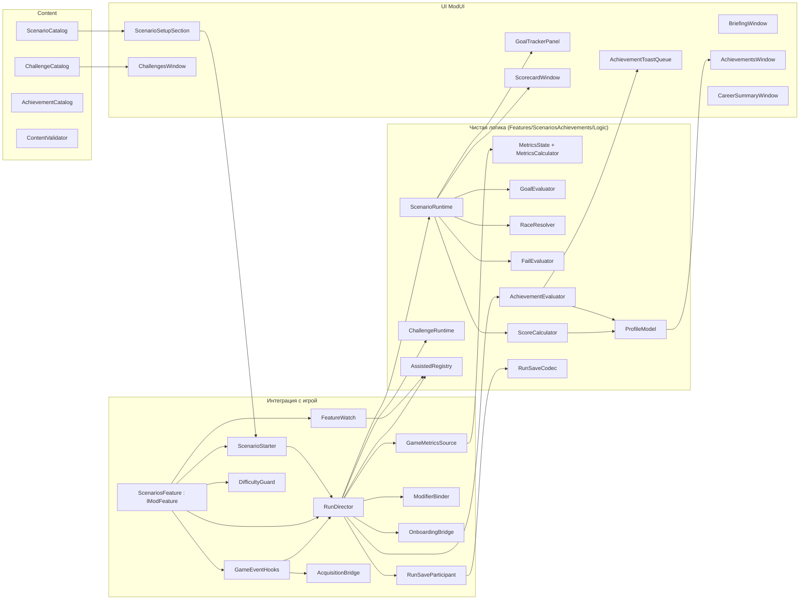
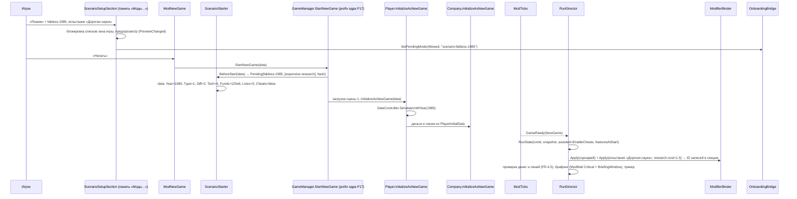

# Design: scenarios-achievements

## Document Information

- **Feature Name**: scenarios-achievements (I18)
- **Version**: 0.2
- **Date**: 2026-10-10
- **Author**: Dex719
- **Status**: Draft v0.2 — одобрено к реализации владельцем 2026-10-10
- **Reviewers**: владелец (Dex719); авторы `mod-framework` (`ModNewGame`, `ModProfile`, `ModEvents`, `ModModifiers`, `ModCredit`, `ModUI` в сцене 0), `first-year-onboarding` (`OnboardingService`), `rival-acquisitions` (`RivalAcquisitionsApi.IsAbsorbedByPlayer`)
- **Related Documents**: `requirements.md` (эта папка), `.kiro/steering/context.md`, `.kiro/steering/owner-decisions.md`, `.kiro/specs/mod-framework/design.md`, решения 0004–0006, `pt-modding/CODEMAP.md` (разделы «Core», «Save/load, menus, game setup…», «Market simulation and contracts», «Time, bank…»), `.kiro/specs/first-year-onboarding/design.md`

## Overview

Фича делится на три слоя.

1. **Контент** (JSON через `ModContent`): 8 сценариев, 8 испытаний, 37 достижений. Валидатор отбрасывает битые записи.
2. **Чистая логика** (без Unity, покрыта юнит-тестами):
   - метрики прогона (окна долей за 30 дней, серии, счётчики);
   - оценка целей, гонок и провалов;
   - счёт и медали;
   - испытания;
   - оценка достижений;
   - флаг assisted;
   - кодек секции `ModSave`;
   - модель профиля (обёртка над `JsonObject` секции `ModProfile`).
3. **Интеграция с игрой** — через сервисы ядра, собственных патчей два:
   - **сервисы ядра**: `ModNewGame` (секция панели «Моды…», `PreviewChanged`, `BeforeStart` — применение старта до перемотки), `ModTicks` (`GameReady`, `DayPassed`, `LateMonthPassed`, `YearPassed`, `IsBatchRun`, `BatchEnded`), `ModEvents` (`CpuReleased`, `CpuTransferred`), `ModModifiers`, `ModMail`, `ModSave`, `ModProfile`, `ModFeatures.StateChanged`;
   - **патчи**: постфикс `ContractManager.PromoteContractToActive` даёт событие OEM-контракта; префикс `GameplaySettingsWindow.ChangeDifficulty` запрещает понижать сложность во время сценария;
   - **подписки** на события игры, которые ядро не оборачивает: `BankruptcyHandler.OnCompanyWentBankrupt`, `BusinessContractManager.OnPlayerSignedContract` (ставятся в обработчике `ModTicks.GameReady`, потому что игра обнуляет эти события при смене сцены);
   - **окна `ModUI`**: секция в панели «Моды…», испытания, брифинг, трекер, итоги, достижения.

Все модификаторы идут только через стандартные каналы `ModModifiers` (новых каналов нет). `GameDefines.EndYear` не меняется: у сценария свой дедлайн. Точка входа — `[ModFeature] sealed class ScenariosFeature : IModFeature` (`Id = scenarios-achievements`).

### Design Goals
- **Честный старт.** Параметры сценария применяются до перемотки, ровно как в JSON.
- **Устойчивость к сохранению и загрузке.** Снимок сценария и накопители метрик — в `ModSave`, профиль — вне сейва.
- **Дёшево по тикам.** Одна выборка метрик в день, оценка целей и достижений по снимку.
- **Расширяемость.** Новые сценарии и достижения добавляются JSON-файлами.

### Ключевые решения

- **D1. Сценарий — JSON-файл; при старте прогона его снимок кладётся в `ModSave`.**
  - Отвергнуто: ссылаться только на ID — правка контента меняла бы правила идущей игры.
- **D2. Старт применяется в `ModNewGame.BeforeStart(PlayerInitialData)`.** Обработчик правит `Year`, `CompanyType`, `DifficultyLevel`, `StartingTechnology`, `StartingFunds`, `FactorySize`, `EnableCheats` до `DateController.SimulateUntilYear`: `GameManager.StartNewGame` замыкает тот же объект и передаёт его в `Player.InitializeAsNewGame`. Деньги и линии применяются в `Company.InitializeAsNewGame` после перемотки, поэтому правка не теряется.
  - Отвергнуто: собственные патчи `Player.InitializeAsNewGame`, `GameManager.StartNewGame`, `MenuGameSetup.InitializeUI`, `MenuGameSetup.UpdateInitialData` — ядро закрыло их за службой `ModNewGame` (резерв «служба»), а патч-копия дублировала бы P17/P22.
  - Отвергнуто: только UI-предпросмотр в `MenuGameSetup` — неизвестно, вызывает ли `DropdownUI.SetSelected` обработчики (CODEMAP, «Uncertain»).
  - Отвергнуто: правка после `ModTicks.GameReady(NewGame)` — год и стартовые технологии к тому моменту уже применены.
  - Отвергнуто: подмена данных `MenuGameSetup.difficulties` — меняет и свободную игру.
- **D3. Годы старта — только годы меню (1975–2000, шаг 5).** Именно они проверены игрой (`MenuGameSetup.UpdateStartingYear`). Произвольные годы — после спайка (открытый вопрос 1).
- **D4. Свой дедлайн, `GameDefines.EndYear` не трогаем.** Константа блокирует исследовательские проекты (`ResearchProjectWindow.UpdateLockedState`) и ИИ (`AIBehaviourResearchProject`) до 2030 года и управляет `EndGameWindow`.
- **D5. Доли рынка — по штукам за скользящие 30 дней.** Определение то же, что в `MarketDataProvider.MarketShare` (`SoldLastDay`), но окно сглаживает дневной шум.
  - Отвергнуто: однодневная `MarketShare` — цель «моргала» бы.
  - Отвергнуто: месячный реестр `CpuBase.Market.Sold` — отклик раз в месяц.
- **D6. Цели оценивает свой `GoalEvaluator` над снимком метрик.** Произвольные условия делегируются в `ModConditions` (вид `condition`). Так цели тестируются без Unity, а общий язык условий остаётся у фреймворка.
- **D7. Гонки — по событию ядра `ModEvents.CpuReleased(owner, cpu, isVariant, duringFastForward)`** с датой игры. Единое правило «не при загрузке» держит ядро (событие при `IsLoading` не поднимается), перемотку отсекает фича (`duringFastForward`).
  - Отвергнуто: собственные постфиксы `Company.AddCpu` и `AICompany.AddCpu` — отклоняются ядром (резерв «служба»), у пяти спек защиты были разные.
  - Отвергнуто: ежедневный скан по `CpuBase.Year` — точность до года, первенство внутри года не определить.
  - CPU, полученные игроком переносом (`ModEvents.CpuTransferred`, `rival-acquisitions`), не считаются выпущенными и не входят в метрики характеристик; их SaveID хранит секция прогона.
- **D8. Профиль — секция `ModProfile.Section("scenarios-achievements", 1)`** в файле `ptmod_profile.json`, который единолично ведёт ядро (атомарная запись, `.bak`, троттлинг 2 с, восстановление при порче).
  - Отвергнуто: собственный `ProfileStore` и свой путь к файлу — два независимых писателя перезаписывали бы файл целиком и теряли изменения друг друга.
  - Отвергнуто: достижения в `ModSave` — пропадают с удалением сейва.
  - Отвергнуто: `settings.txt` игры — его перезаписывает `GameSettingsWindow.Save`.
- **D9. Флаг assisted «липкий» на прогон, с причинами.** Достижения в assisted-прогоне открываются с пометкой; рекорды не обновляются. Строгий режим — настройка (`strictAssisted`, по умолчанию выключен). Причины: `cheats.enabled` (читы на старте) и `feature.disabled:<id>` (выключение фич посреди сценария); понижение сложности не помечается, а запрещено (D14); «Следующий месяц» и спасение `bankruptcy-recovery` не помечаются (решения владельца).
- **D10. Испытания — только стандартные каналы `ModModifiers` плюс правила провала.** Бонус к счёту аддитивный (1 + Σ бонусов): игроку проще посчитать, и счёт не взлетает при сочетании многих испытаний.
- **D11. Вставка в окно новой игры — секция `ModNewGame.RegisterSection`** на общей панели «Моды…» (порядок 10; у `first-year-onboarding` — 20). Предпросмотр обновляется по `ModNewGame.PreviewChanged` и меняет только тексты секции; `PlayerInitialData` правится лишь в `BeforeStart`. Блокировка списков самого окна игры идёт чтением его приватных полей (`AccessTools`), а не патчами.
- **D12. Сравнение компаний на экране итогов — по последнему полному месяцу реестра `CpuBase.Market.Sold` (индекс Count−2) и `CompanyFinance.Reports`.** Данные есть у всех компаний без нашей выборки. Отвергнуто: вести 30-дневные окна для каждой ИИ — лишняя работа каждый день.
- **D13. После итогов игра продолжается как свободная.** Результат уже в профиле, повторного поражения нет.
- **D14. Понижать сложность во время сценария нельзя** (решение владельца). Префикс `GameplaySettingsWindow.ChangeDifficulty` при активном сценарии возвращает список и `Player.DifficultyLevel` и показывает уведомление; assisted не ставится. Повышение разрешено.
- **D15. Модификаторы добавляются один раз.** Записи `ModModifiers.Add` на старте прогона хранит и восстанавливает ядро; секция прогона хранит только ID записей (для `Remove` провалившегося испытания). Заново после загрузки они не регистрируются, а выключенная фича их не удаляет: записи не применяются, пока фича не включена (FR-12 п. 8 ядра).
- **D16. Выключение фич посреди сценария ставит assisted** (решение владельца). Подписка на `ModFeatures.StateChanged`; набор фич на старте прогона хранится в секции. Включение фич не помечается.

## Architecture

### System Context

```mermaid
graph TB
    U[Игрок] --> SA[scenarios-achievements]
    subgraph Game[Processor Tycoon 0.2.3]
        MGS[MenuGameSetup: поля списков]
        GM[GameManager.QuitToMenu]
        CMP[ContractManager.PromoteContractToActive]
        BH[BankruptcyHandler.OnCompanyWentBankrupt]
        BCM[BusinessContractManager.OnPlayerSignedContract]
        GSW[GameplaySettingsWindow.ChangeDifficulty]
        DATA[CpuDataProvider, CompanyFinance.Reports, ContractHelper, DataFinder]
    end
    subgraph Core[PTMod.Core]
        FC[FeatureContext / ModFeatures]
        HK[ModHooks]
        TK[ModTicks]
        EV[ModEvents]
        NG[ModNewGame]
        SV[ModSave]
        PRF[ModProfile]
        MOD[ModModifiers]
        CRD[ModCredit]
        CND[ModConditions]
        ML[ModMail]
        NT[ModNotify]
        UI[ModUI]
        LN[ModL10n]
        ST[ModSettings]
        CT[ModContent]
        LG[ModLog]
    end
    ONB[first-year-onboarding: OnboardingService]
    ACQ[rival-acquisitions: RivalAcquisitionsApi]
    FC --> SA
    SA -->|2 патча: CMP, GSW| HK
    HK --> CMP
    HK --> GSW
    NG -->|RegisterSection, PreviewChanged, BeforeStart| SA
    NG --> MGS
    SA -->|подписка в GameReady| BH
    SA -->|подписка в GameReady| BCM
    TK -->|GameReady, DayPassed, LateMonthPassed, YearPassed, BatchEnded| SA
    EV -->|CpuReleased, CpuTransferred| SA
    SV <--> SA
    PRF <--> SA
    SA --> MOD
    SA --> CRD
    SA --> CND
    SA --> ML
    SA --> NT
    SA --> UI
    SA --> LN
    SA --> ST
    SA --> CT
    SA --> DATA
    SA --> GM
    SA -->|SetPendingMode, Completed| ONB
    SA -->|IsAbsorbedByPlayer| ACQ
```



### High-Level Architecture



### Используемые сервисы PTMod.Core

| Сервис | Для чего |
|---|---|
| `FeatureContext` / `ModFeatures` | точка входа `[ModFeature]`, `ctx.OnTick`, `ctx.Patch` (2 патча), `ctx.SaveParticipant`, `ctx.Param`, `ctx.HubPage`; `ModFeatures.StateChanged` (assisted при выключении фич) |
| `ModHooks` | `Guard` на всех входах (счётчики ошибок ведёт ядро), `Raise` для событий ядра; 2 патча фичи (таблица ниже), самопроверка |
| `ModTicks` | `GameReady(NewGame\|Loaded)` (старт и восстановление прогона), `TickPhase.DayPassed` (дневные метрики, цели, достижения), `LateMonthPassed` (месячные), `YearPassed` (2030 год), `IsBatchRun` / `BatchEnded` (отложенное окно итогов) |
| `ModEvents` | `CpuReleased` (цели, гонки, достижения), `CpuTransferred` (исключение перенесённых CPU) |
| `ModNewGame` | секция панели «Моды…» (`RegisterSection`), `PreviewChanged`, `BeforeStart` (применение старта) |
| `ModSave` | секция `scenarios-achievements` (`IModSaveParticipant`); версию (`_schema`) ведёт ядро |
| `ModProfile` | секция профиля `scenarios-achievements` (достижения, рекорды, история): `Section`, `MarkDirty`, `Save`, `Status` |
| `ModModifiers` | модификаторы сценариев и испытаний по стандартным каналам: `Add` один раз, `Remove` по ID, `IsDeclared` для валидатора |
| `ModCredit` | `IsPerCompanyActive` — доступность испытания «Жёсткий кредит» |
| `ModConditions` | цели и провалы вида `condition` (`ICondition` ядра) |
| `ModMail` | брифинг (`Critical`) и письмо-итог (`Normal`), теги `scn:briefing:<runId>`, `scn:result:<runId>`; ID выдаёт ядро |
| `ModNotify` | уведомления о целях, провалах, достижениях |
| `ModUI` | все окна фичи, в том числе в сцене 0 (меню); `Confirm` для «В главное меню» и сброса профиля |
| `ModL10n` | ключи `scn.*`, `chl.*`, `ach.*` |
| `ModSettings` | параметры `strictAssisted`, `trackerAutoOpen`, `toastsEnabled` (`ParamSpec`); включение фичи — `IsFeatureEnabled` |
| `ModContent` | `scenarios-achievements/scenarios.json`, `challenges.json`, `achievements.json` (`records[]`), `config.json` |
| `ModLog` | диагностика |

## Components and Interfaces

Пространство имён — `PTMod.Features.ScenariosAchievements` (`ModFeatures.FeatureOfType` определяет фичу по нему). Чистая логика лежит в `mod/src/PTMod/Features/ScenariosAchievements/Logic/` (пространство `…ScenariosAchievements.Logic`, тесты — `mod/tests/PTMod.Tests/ScenariosAchievements/`), адаптеры к игре и UI — рядом (`Integration/`, `UI/`, `Content/`).

### ScenariosFeature (точка входа)

```csharp
namespace PTMod.Features.ScenariosAchievements
{
    [ModFeature]
    public sealed class ScenariosFeature : IModFeature
    {
        public const string FeatureId = "scenarios-achievements";
        public string Id => FeatureId;
        public string NameKey => "scn.feature.name";
        public string DescriptionKey => "scn.feature.desc";
        public string[] DependsOn => new string[0];     // жёстких зависимостей нет; first-year-onboarding и rival-acquisitions — мягкие связи
        public bool EnabledByDefault => true;
        public bool SupportsHotToggle => true;

        public void Register(FeatureContext ctx);
        public void OnEnabled();      // переоткрыть трекер активного прогона; записи ModModifiers не пересоздаются
        public void OnDisabled();     // закрыть окна, остановить проверки; assisted (feature.disabled:scenarios-achievements), если идёт сценарий или испытание
    }
}
```

`Register(FeatureContext ctx)` делает:
- `ctx.Param(…)` для `strictAssisted` (Bool, по умолчанию нет), `trackerAutoOpen` (Bool, да), `toastsEnabled` (Bool, да);
- `ctx.Patch(typeof(ScenarioPatches))` — два патча: `ContractManager.PromoteContractToActive` (postfix) и `GameplaySettingsWindow.ChangeDifficulty` (prefix);
- три подписки `ctx.OnTick`: `TickPhase.DayPassed`, `TickPhase.LateMonthPassed`, `TickPhase.YearPassed` — подписчики по умолчанию молчат при перемотке и загрузке;
- `ctx.SaveParticipant(new RunSaveParticipant())`;
- `ModNewGame.RegisterSection(FeatureId, ScenarioSetupSection.Build, order: 10)`, `ModNewGame.PreviewChanged += …`, `ModNewGame.BeforeStart += ScenarioStarter.OnBeforeStart`;
- `ModTicks.GameReady += RunDirector.OnGameReady`, `ModEvents.CpuReleased += …`, `ModEvents.CpuTransferred += …`, `ModTicks.BatchEnded += …`, `ModFeatures.StateChanged += FeatureWatch.OnStateChanged`;
- `ctx.HubPage("scn.hub.title", …)`: трекер, «Достижения», «Показать итоги», статус профиля (`ModProfile.Status`).

Обработчики событий ядра ядро вызывает через `ModHooks.Raise` (неактивные фичи пропускаются, исключение засчитывается фиче); тела патчей и подписок на события игры дополнительно оборачиваются в `ModHooks.Guard`.

### Контент

Файлы контента — формат `ModContent`: `scenarios.json`, `challenges.json`, `achievements.json` содержат массив `records[]` (переопределение и отключение по `id`), `config.json` — параметры (`challengeYears`). Поле `schema` в файле — схема файла контента. Отображение `JsonObject → …Definition` (`ContentMapper`) лежит в Logic; обёртки `…Record : IContentRecord` — в `Content/`.

```csharp
namespace PTMod.Features.ScenariosAchievements.Logic
{
    public sealed class ScenarioDefinition
    {
        public string Id;                     // [a-z0-9-]{3,40}
        public int Order;
        public string TitleKey, DescKey, BriefingKey;
        public ScenarioStart Start;
        public string Onboarding;             // "allowed" | "forcedOn" | "forcedOff"
        public ModifierSpec[] Modifiers;
        public string Deadline;               // yyyy-MM-dd, > start
        public int TimeBonusMax;              // 0..2000
        public GoalSpec[] Goals;              // >= 1 required
        public FailSpec[] Fail;
        public MedalThresholds Medals;        // bronze < silver < gold
        public string[] AllowedChallenges;
        public string ContentHash;            // computed on load (SHA-1 of canonical JSON), not in file
        public bool IsCustom;                 // override differs from built-in
    }

    public sealed class ScenarioStart
    {
        public int Year;                      // 1975|1980|1985|1990|1995|2000
        public string CompanyType;            // "idm" | "fabless" | "foundry" -> CompanyType 0|1|2
        public int DifficultyLevel;           // 0..5 (5 only with idm)
        public int StartingTechnology;        // StartingTechnology enum value: 0,1,2,3,4
        public float StartingFunds;           // -1e9..1e11
        public int FactorySize;               // 0..1000
        public bool AllowCheats;
        public int TechYear;                  // 0 = not used; else 1971..2030
    }

    public sealed class GoalSpec
    {
        public string Id;                     // unique in scenario
        public bool Required;
        public int Points;                    // 0..10000
        public string TitleKey;
        public CheckSpec Check;
        public string By;                     // optional intermediate deadline
        public ProgressSpec Progress;         // optional: metric + target + format
    }

    public sealed class CheckSpec
    {
        public string Kind;      // metric | cpuReleased | race | event | condition | profile | all
        public string Metric; public string Op; public double Value;
        public int HoldDays;                  // 0..3650
        public CpuFilter Cpu;                 // cpuReleased, race
        public bool FailOnLose;               // race
        public string Event; public int Count; // event
        public ConditionRef Condition;        // выражение ModConditions ({type, …}, all/any/not); Compiled — ICondition ядра, кеш Unity-слоя
        public CheckSpec[] All;               // all-of
        public RequireSpec Require;           // extra preconditions (difficulty, notBankrupt, companyType)
        public string Cadence;                // daily | monthly | event
    }

    public sealed class CpuFilter
    {
        public float MinFrequency;            // kHz (1 000 000 = 1 GHz)
        public int MinCores;
        public float MaxPower;                // W, 0 = ignore
        public bool RequireSmt;
        public string CompanyTypeAtRelease;   // optional: "fabless"
    }

    public sealed class ConditionRef { public JsonNode Node; public object Compiled; }   // using PTMod.Core.Logic.Json; Compiled заполняет Unity-слой через ModConditions.Parse
    public sealed class FailSpec { public string Id; public string TextKey; public CheckSpec Check; }
    public sealed class ModifierSpec { public string Channel; public float Multiplier; public string AppliesTo; } // player | ai | all -> ModifierScope.Player | AIOnly | AllCompanies
    public sealed class MedalThresholds { public int Bronze, Silver, Gold; }

    public sealed class ChallengeDefinition
    {
        public string Id; public string TitleKey, DescKey;
        public float ScoreBonus;              // 0..1
        public ModifierSpec[] Modifiers;
        public FailSpec[] Fail;
        public string[] RequiresCompanyType;  // optional
    }

    public sealed class AchievementDefinition
    {
        public string Id; public string Category; public bool Hidden; public int Points;
        public string TitleKey, DescKey;
        public CheckSpec Check;
        public bool CountsOnlyNewGames;       // ignore legacy runs (e.g., run.days based)
    }

    public static class ContentValidator
    {
        public static ValidationResult ValidateScenario(ScenarioDefinition s, IValidationContext ctx);
        public static ValidationResult ValidateChallenge(ChallengeDefinition c, IValidationContext ctx);
        public static ValidationResult ValidateAchievement(AchievementDefinition a, IValidationContext ctx);
    }

    public interface IValidationContext
    {
        bool IsKnownMetric(string id);
        bool IsKnownEvent(string id);
        bool IsKnownChannel(string channel);  // ModModifiers.IsDeclared (реестр ядра)
        bool ValidateCondition(JsonNode node, IList<string> errors, string path);   // ModConditions.Parse; в тестах — фейк
        bool HasString(string key);
        bool IsKnownChallenge(string id);
    }
}
```

### Метрики

```csharp
public sealed class MetricsState              // persisted in ModSave
{
    public RollingWindow ShareWindow;         // 30 days x (player[5], total[5]): [0] — все сегменты, [1 + (int)Segment] — HighEnd..Industries (тип PTMod.Core.Segment)
    public int ProfitStreakMonths;
    public int SolventStreakDays, NegativeStreakDays, MissedZeroStreakDays, IpsLeaderStreakDays;
    public float MinMoney;
    public long SalesTotal;
    public int OemSignedTotal, RivalsBankrupt, DefaultRecovered;
    public bool WasInDefaultYesterday;
    public int RunDays;
    public Dictionary<string, int> EventCounts; // serialized as list of pairs
}

public interface IGameMetricsSource
{
    DateTime Today { get; }
    DaySample SampleDay();                    // one pass over CPUs + player company
    MonthSample SampleLastFullMonth();        // CompanyFinance.Reports lookup by Year/Month
    IList<CpuInfo> PlayerReleasedCpus();
    ComparisonRow[] BuildComparison(int maxAi);
}

public static class MetricsCalculator
{
    public static void ApplyDay(MetricsState state, DaySample day);
    public static void ApplyMonth(MetricsState state, MonthSample month);
    public static MetricsSnapshot Snapshot(MetricsState state, DaySample lastDay, MonthSample lastMonth);
}

public sealed class MetricsSnapshot { public double Get(string metricId); public bool Has(string metricId); }
```

**Метрики** (известные валидатору ID):

| ID | Смысл | Вычисление (API игры) | Частота | В `ModSave` |
|---|---|---|---|---|
| `money` | деньги игрока | `ICompany.get_MoneyAmount` | день | — |
| `money.min` | минимум денег за прогон | min(`money`) | день | да |
| `money.solventStreakDays` / `money.negativeStreakDays` | дни подряд ≥ 0 / < 0 | серия | день | да |
| `profit.lastMonth` | прибыль прошлого месяца | отчёт `CompanyFinance.Reports` с (Year, Month) прошлого месяца: `TotalRevenues − TotalExpenses` | месяц | — |
| `profit.streakMonths` | прибыльных месяцев подряд | серия по `profit.lastMonth > 0` | месяц | да |
| `revenue.last12m` | выручка за 12 полных месяцев | Σ `TotalRevenues` 12 последних полных отчётов | месяц | — |
| `revenue.clients.last12m` | выручка от foundry-клиентов | Σ `RevenueByClients` | месяц | — |
| `share.total.avg30` | доля рынка, 30 дней | Σ30 `SoldLastDay` CPU игрока / Σ30 `SoldLastDay` всех CPU (`CpuDataProvider.GetAllCpus`) | день | окно |
| `share.highend.avg30`, `share.midrange.avg30`, `share.lowend.avg30`, `share.industries.avg30` | доля по сегменту, 30 дней | то же по `SoldLastDayByHighEnd` / `ByMidRange` / `ByLowEnd` / `ByIndustries` | день | окно |
| `share.minSegment.avg30` | минимальная из 4 сегментных долей | min | день | — |
| `sales.total` | продано штук на рынке за прогон | Σ `SoldLastDay` CPU игрока | день | да |
| `cpu.released.count` | выпущено CPU (включая снятые), без полученных переносом | `Player.GetCpus()` с `IsReleased`, минус SaveID из `transferredCpuIds` (`ModEvents.CpuTransferred`) | день | — |
| `cpu.maxFrequency` / `cpu.maxCores` / `cpu.hasSmt` | лучшие характеристики выпущенных CPU, без полученных переносом | `CpuBase.Frequency` (кГц), `CoreCount`, `Smt` | день / событие | — |
| `popularity.max` | макс. популярность CPU игрока | max `Cpu.Popularities[k]` | день | — |
| `oem.active.count` | активных OEM-контрактов | `ContractHelper.PlayerContracts().Count` | день | — |
| `oem.signed.total` | подписано OEM за прогон | постфикс `ContractManager.PromoteContractToActive` (CPU игрока; не при загрузке и перемотке) | событие | да |
| `foundry.clients.active` | активных клиентов-литейщиков | `BusinessContractManager.Instance.GetSignedContracts(player)` с `Provider == player && IsActive` | день | — |
| `foundry.asClient.count` | контрактов, где игрок — клиент | то же с `Client == player && IsActive` | день | — |
| `factory.lines` | линии фабрики | `ICompany.get_Factory().ProductionCapacity` | день | — |
| `missed.zeroStreakDays` | дни подряд с продажами > 0 и `MissedSalesLastDay` = 0 | серия | день | да |
| `ips.leaderStreakDays` | дни подряд, когда самый быстрый (`Ips`) выпущенный неснятый CPU на рынке — игрока | max по `CpuDataProvider.GetAllCpus` | день | да |
| `rivals.bankruptCount` | банкротств ИИ после старта | `BankruptcyHandler.OnCompanyWentBankrupt` (не игрок, не загрузка или перемотка; компания не поглощена игроком: `RivalAcquisitionsApi.IsAbsorbedByPlayer(uniqueId)` через `AcquisitionBridge`, при неактивной `rival-acquisitions` фильтра нет) | событие | да |
| `default.recoveredCount` | выходов из дефолта | вчера `IsInDefault`, сегодня нет и не `IsBankrupt` | день | да |
| `run.days` | дней с начала прогона | `DateController.DaysSince(start)` | день | — |
| `run.difficulty` | текущая сложность | `Player.Instance.DifficultyLevel` | день | — |

### Цели, гонки, провалы, сценарий

```csharp
public enum GoalStatus { Open, Done, Failed }
public enum ScenarioStatus { None, Active, Won, Lost }

public sealed class GoalEvaluator
{
    public GoalStatus Evaluate(GoalSpec goal, GoalState state, MetricsSnapshot m, DateTime today,
                               IConditionAdapter conditions, RaceBook races);
    public double Progress(GoalSpec goal, MetricsSnapshot m);   // 0..1
}

public sealed class RaceResolver
{
    // Called on every ModEvents.CpuReleased after run start (player or AI), duringFastForward == false
    public void OnCpuReleased(RaceBook book, IList<GoalSpec> raceGoals, CpuInfo cpu, bool isPlayer,
                              string companyName, DateTime date);   // companyName — имя из игры (ICompany.get_Name)
}

public sealed class FailEvaluator
{
    public FailSpec FirstTriggered(IList<FailSpec> fails, FailState state, MetricsSnapshot m,
                                   IConditionAdapter conditions, EventBook events);
}

public sealed class ScenarioRuntime
{
    public ScenarioRuntime(ScenarioDefinition snapshot, ScenarioState state, GoalEvaluator ge, FailEvaluator fe, ScoreCalculator sc);
    public ScenarioStatus Status { get; }
    public IList<ScenarioOutcomeEvent> EvaluateDay(MetricsSnapshot m, DateTime today, EventBook events); // goal done/failed, won/lost
    public void OnPlayerBankrupt(DateTime today);
    public ScenarioResult Result { get; }      // after Won/Lost
}

public sealed class ScoreCalculator
{
    public ScoreBreakdown Compute(ScenarioDefinition s, ScenarioState st, DateTime finishedOn, IList<ChallengeDefinition> challenges);
    public string Medal(ScenarioDefinition s, int score);   // gold|silver|bronze|completed
}
```

### Испытания, достижения, assisted

```csharp
public sealed class ChallengeRuntime
{
    public IList<ChallengeEvent> EvaluateDay(IList<ChallengeDefinition> active, ChallengeStates st,
                                             MetricsSnapshot m, bool freePlay, int challengeYears);
}

public sealed class AchievementEvaluator
{
    // returns newly satisfied achievement ids (not yet in profile)
    public IList<string> Evaluate(string cadence, MetricsSnapshot m, EventBook events, ProfileView profile,
                                  RunInfo run, IConditionAdapter conditions);
    public IList<string> OnEvent(string eventId, EventBook events, MetricsSnapshot m, ProfileView profile, RunInfo run);
}

public static class AssistedRegistry
{
    public static bool IsAssisted { get; }
    public static IList<string> Reasons { get; }
    public static void Mark(string reason);     // public API for other features: cheats.enabled, feature.disabled:<id>, …
    internal static void Reset(RunState run);
}
```

Пометки assisted ставят: `cheats.enabled` — `RunDirector` на `GameReady(NewGame)` (`PlayerInitialData.EnableCheats` / `Player.EnableCheats`); `feature.disabled:<id>` — `FeatureWatch` (подписка на `ModFeatures.StateChanged`); остальные фичи — через `Mark`. Читы доступны только при `Player.EnableCheats`, поэтому отдельных пометок за вызовы окна читов нет; `DateController.NextMonth` и спасение `bankruptcy-recovery` не помечаются.

### Профиль

Профиль ведёт `ModProfile` (единственный писатель `ptmod_profile.json`: атомарная запись, `.bak`, троттлинг 2 с, восстановление при порче). У фичи — только модель над живым `JsonObject` секции:

```csharp
// Logic/Profile/ProfileModel.cs — чистая логика над JsonObject, без файлов и Unity
public sealed class ProfileModel
{
    public ProfileModel(JsonObject section);            // = ModProfile.Section("scenarios-achievements", 1); поле _schema ведёт ядро
    public ProfileView View { get; }                    // чтение для AchievementEvaluator: получено, рекорды, пройденные испытания
    public bool Unlock(string achievementId, AchievementEntry entry);   // false, если уже получено
    public bool RecordResult(ScenarioResult result);    // обновляет лучший результат только для не-assisted/не-custom; история ≤ 50
    public void RecordChallenge(string challengeId, int years);
    public void Clear();                                // «Сбросить профиль»: очищает секцию
    public int Revision { get; }                        // растёт при изменении (для MarkDirty)
}
```

Адаптер Unity-слоя `ProfileGate` вызывает `ModProfile.MarkDirty(FeatureId)` после изменений (`Revision`), `ModProfile.Save()` — при показе итогов и после сброса, и отдаёт `ModProfile.Status` для страницы хаба.

### Интеграция

```csharp
internal sealed class RunDirector                  // обычный класс; подписки ставит ScenariosFeature.Register
{
    internal void OnGameReady(GameReadyReason reason);   // NewGame: PendingRun → RunState, ModModifiers.Add, брифинг, трекер; Loaded: legacy при отсутствии секции, трекер
                                                          // оба случая: подписка на BankruptcyHandler.OnCompanyWentBankrupt и BusinessContractManager.OnPlayerSignedContract сцены
    internal void OnDayPassed();                       // ctx.OnTick(TickPhase.DayPassed)
    internal void OnLateMonthPassed();                 // ctx.OnTick(TickPhase.LateMonthPassed)
    internal void OnYearPassed();                      // ctx.OnTick(TickPhase.YearPassed): EndYear
    internal void OnBatchEnded();                      // ModTicks.BatchEnded: открыть отложенные окна итогов
    internal void OnCpuReleased(ICompany owner, Cpu cpu, bool isVariant, bool duringFastForward);   // ModEvents.CpuReleased
    internal void OnCpuTransferred(ICompany from, ICompany to, Cpu cpu);                              // ModEvents.CpuTransferred
    internal void OnOemSigned(Contract contract);      // postfix ContractManager.PromoteContractToActive
    internal void OnCompanyBankrupt(ICompany company);
    internal void OnBusinessContractSigned(BusinessContract contract);
}

internal sealed class RunSaveParticipant : IModSaveParticipant     // SectionId = "scenarios-achievements", SchemaVersion = 1
{
    public void ResetToDefaults();                     // нет прогона; на GameReady(Loaded) из этого состояния рождается legacy
    public void Read(JsonObject section, int schema);  // RunSaveCodec; миграции при schema < SchemaVersion
    public JsonObject Write();                         // без поля версии — _schema добавляет ядро
}

internal static class ScenarioStarter
{
    internal static PendingRun Pending;                       // static, survives scene 0 -> 1
    internal static void OnBeforeStart(PlayerInitialData data);   // ModNewGame.BeforeStart: фиксирует Pending и применяет ScenarioStart
}

public sealed class PendingRun { public string ScenarioId; public string[] Challenges; public string ContentHash; public bool IsCustom; }

internal static class DifficultyGuard
{
    // prefix GameplaySettingsWindow.ChangeDifficulty (___difficultySettings — DropdownUI):
    // активный сценарий и ___difficultySettings.Value < Player.Instance.DifficultyLevel →
    //   ___difficultySettings.SetSelected(Player.Instance.DifficultyLevel), уведомление scn.difficulty.locked, return false
    internal static bool Prefix(DropdownUI ___difficultySettings);
}

internal static class FeatureWatch
{
    internal static void OnStateChanged(string featureId, FeatureState state);   // Disabled + фича из featuresAtStart + активен сценарий/испытание → Mark("feature.disabled:<id>")
}

internal sealed class ModifierBinder
{
    internal IList<string> Apply(string ownerKey, IList<ModifierSpec> specs);    // ModModifiers.Add (один раз), возвращает ID записей
    internal void Remove(IList<string> entryIds);                                // ModModifiers.Remove (провал испытания в свободной игре)
}

internal static class OnboardingBridge
{
    // direct call into PTMod.Features.FirstYearOnboarding.OnboardingService (same assembly);
    // no-op if that feature is disabled
    internal static void ApplyScenarioMode(string mode);          // OnboardingService.SetPendingMode(ForcedOn|ForcedOff|Allowed, "scenario:<id>"); вызывается при выборе сценария и сбрасывается при «Свободная игра»
    internal static void SubscribeCompleted(Action<bool> onCleanCompletion);
}

internal static class AcquisitionBridge
{
    // direct call into PTMod.Features.RivalAcquisitions.RivalAcquisitionsApi (same assembly); false, если фича не активна
    internal static bool IsAbsorbedByPlayer(int uniqueId);
}
```

Для вычисления `featuresAtStart` `RunDirector` на `GameReady(NewGame)` берёт список активных фич из `ModFeatures.All` (кроме служебной `framework-sample`).

## Патчи Harmony

Фича ставит два патча (`ctx.Patch`, Harmony ID `ptmod.scenarios-achievements`); оба — не из зарезервированных целей ядра, оба в `ModHooks.Guard`; патч `ChangeDifficulty` помечен `Optional` (при сбое фича остаётся доступной, а понижение сложности просто не блокируется):

| Цель (класс.метод игры) | Тип | Что меняет | Порядок / конфликты |
|---|---|---|---|
| `ContractManager.PromoteContractToActive` | postfix | Если `ChosenCpuID` указывает на CPU игрока (`CpuDataProvider.GetCpu`): `oem.signed.total++`, событие `oem.signed`. Пропуск при `ModTicks.IsLoading` и `IsFastForwarding`. | `contract-transparency` может патчить соседние методы; этот постфикс только читает. |
| `GameplaySettingsWindow.ChangeDifficulty` | prefix | Приватный метод; поле `difficultySettings` приходит инъекцией `___difficultySettings`. При активном сценарии и `difficultySettings.Value < Player.Instance.DifficultyLevel`: возвращает значение списка (`SetSelected`), показывает уведомление `scn.difficulty.locked`, `return false`. Иначе `true` (оригинал выполняется). Если `SetSelected` повторно вызывает `ChangeDifficulty`, значение уже равно уровню, и оригинал отрабатывает штатно. | Других патчей на метод нет. Повышение сложности и свободная игра не затрагиваются. |

Прежние патчи заменены сервисами ядра (они закрыты для фич, `ModHooks` отклонит такой патч с подсказкой):

| Прежний патч | Чем заменён |
|---|---|
| `MenuGameSetup.InitializeUI`, `MenuGameSetup.UpdateInitialData` | `ModNewGame.RegisterSection`, `ModNewGame.PreviewChanged` |
| `GameManager.StartNewGame`, `Player.InitializeAsNewGame` | `ModNewGame.BeforeStart` (единственное место правки `PlayerInitialData`) |
| `Company.AddCpu`, `AICompany.AddCpu` | `ModEvents.CpuReleased` (и `CpuTransferred` для переноса) |
| `DateController.NextMonth` | `ModTicks.IsBatchRun` / `BatchEnded`; пометка assisted не нужна («Следующий месяц» — не чит) |
| `Cheats.AddMoney` | `cheats.enabled` на старте (читы доступны только при `Player.EnableCheats`) |

Патчей на формулы нет. Модификаторы идут через `ModModifiers` (его патчи на формулы — в `mod-framework`).

## Подписки на события

| Событие | Обработчик | Защиты |
|---|---|---|
| `ModNewGame.BeforeStart` | `ScenarioStarter.OnBeforeStart`: зафиксировать `PendingRun`, применить `ScenarioStart` к `PlayerInitialData` | До перемотки; единственное место правки `PlayerInitialData`. При исключении поля восстанавливаются из копии (FR-4.4). |
| `ModNewGame.PreviewChanged` | обновить тексты секции по `ModNewGame.Preview` | Только чтение; `PlayerInitialData` не меняется. |
| `ModTicks.GameReady(NewGame)` | `RunDirector.OnGameReady`: новый `RunState`, `ModModifiers.Add`, брифинг, трекер; подписки на события игры | Ядро поднимает событие после перемотки, один раз на сцену. Нет `PendingRun` → прогон без сценария. |
| `ModTicks.GameReady(Loaded)` | восстановление прогона по секции, трекер; `legacy` при отсутствии секции | Модификаторы заново не регистрируются (записи восстановило ядро). До события проверки не идут. |
| `TickPhase.DayPassed` (`ctx.OnTick`) | дневные метрики → цели, провалы, испытания, достижения (`daily`) | Подписчики фаз молчат при перемотке и загрузке; в пакетном прогоне проверки идут по дням, окна ждут `BatchEnded`. |
| `TickPhase.LateMonthPassed` | месячные метрики → достижения (`monthly`) и финансовые цели | Отчёт прошлого месяца ищется по (Year, Month), а не по индексу: порядок подписчиков `CompanyFinance` и наш не важен. |
| `TickPhase.YearPassed` | при `Year == GameDefines.EndYear` и без активного сценария — «Итоги карьеры», событие `endyear.reached` | — |
| `ModTicks.BatchEnded` | открыть отложенные окна итогов и сводные уведомления | Один раз после `DateController.NextMonth`. |
| `ModEvents.CpuReleased` | цели `cpuReleased`, гонки, событие `cpu.released.player\|ai` | Игнор при `duringFastForward`; при загрузке ядро событие не поднимает. |
| `ModEvents.CpuTransferred` | при `to == игрок` запомнить SaveID в `transferredCpuIds` | CPU исключаются из метрик характеристик и целей «выпущен». |
| `ModFeatures.StateChanged` | `FeatureWatch`: `Disabled` + фича из `featuresAtStart` + активен сценарий или испытание → `Mark("feature.disabled:<id>")` | Включение фич не помечается. |
| `ModSave` чтение / запись | `RunSaveParticipant.Read` / `Write` | Нет секции или она новее → `ResetToDefaults()`, на `GameReady(Loaded)` создаётся `legacy`-прогон; новейшую секцию ядро сохраняет как есть. |
| `BankruptcyHandler.OnCompanyWentBankrupt` | игрок → поражение сценария; ИИ → `rivals.bankruptCount++` (если не поглощён игроком) | Подписка ставится на `GameReady` (игра обнуляет события при смене сцены); игнор при `IsLoading` или перемотке (E13). |
| `BusinessContractManager.OnPlayerSignedContract` | событие `foundry.signed` для достижений | Подписка на `GameReady`; игнор при загрузке. |
| `OnboardingService.Completed` | событие `onboarding.completed.clean`, если обучение не пропущено и не прервано | Только если `first-year-onboarding` включена. |

## Data Models

### Секция ModSave `scenarios-achievements`

Секция `features.scenarios-achievements` в `<save>.ptmod.json`. Версию секции (`_schema`) пишет и читает ядро (`IModSaveParticipant.SchemaVersion = 1`); в DTO и примере её нет.

```json
{
  "run": {
    "runId": "4f6c1a8e-2d1b-4c55-9c0e-3a7b9e2f1d10",
    "origin": "newGame",
    "startDate": "1985-01-01",
    "difficultyAtStart": 2,
    "assisted": false,
    "assistedReasons": [],
    "custom": false,
    "featuresAtStart": ["first-year-onboarding", "event-system", "scenarios-achievements"],
    "challenges": ["expensive-research"],
    "challengeStates": { "expensive-research": { "status": "active", "failedOn": null, "entryIds": ["m-000021"] } },
    "scenarioEntryIds": [],
    "transferredCpuIds": [],
    "briefingMailId": 100001,
    "resultMailId": 0
  },
  "scenario": {
    "id": "fabless-1985",
    "status": "Active",
    "definition": { "id": "fabless-1985", "...": "полный снимок JSON-записи сценария" },
    "contentHash": "9b1e0f3c",
    "goals": {
      "g1": { "status": "Done", "doneOn": "1985-09-01", "holdDays": 0 },
      "g2": { "status": "Open", "doneOn": null, "holdDays": 0 },
      "g3": { "status": "Open", "doneOn": null, "holdDays": 0 },
      "g4": { "status": "Open", "doneOn": null, "holdDays": 0 }
    },
    "races": {},
    "fail": null,
    "result": null
  },
  "metrics": {
    "shareWindow": { "head": 12, "days": 30, "player": [[0,0,0,0,0]], "total": [[0,0,0,0,0]] },
    "profitStreakMonths": 2,
    "solventStreakDays": 241,
    "negativeStreakDays": 0,
    "missedZeroStreakDays": 0,
    "ipsLeaderStreakDays": 0,
    "minMoney": 118500000.0,
    "salesTotal": 412000,
    "oemSignedTotal": 0,
    "rivalsBankrupt": 0,
    "defaultRecovered": 0,
    "wasInDefaultYesterday": false,
    "eventCounts": [["cpu.released.player", 1]]
  },
  "achievementsThisRun": ["first-cpu", "first-sale"]
}
```

`shareWindow.player`/`total` — 30 строк по 5 чисел (всего, High End, Mid Range, Low End, Industries — индекс `1 + (int)Segment`); в примере сокращено до одной. `scenarioEntryIds` и `entryIds` — ID записей `ModModifiers`, добавленных на старте прогона (для `Remove`); `transferredCpuIds` — SaveID CPU, полученных игроком переносом; `featuresAtStart` — основа правила `feature.disabled:<id>`; `briefingMailId` / `resultMailId` — ID писем, возвращённые `ModMail.Send` (0 — не отправлено).

### Профиль: секция `scenarios-achievements` в `ptmod_profile.json`

Файл целиком пишет `ModProfile`; фича владеет только содержимым секции (поле `_schema` ядро добавляет само):

```json
{
  "achievements": {
    "first-cpu": { "unlockedAt": "2026-10-10T18:22:05Z", "gameDate": "1975-08-14", "company": "Garage CPU Inc.", "runId": "4f6c…", "assisted": false }
  },
  "scenarioRecords": {
    "garage-1975": { "attempts": 3, "wins": 1, "best": { "score": 600, "medal": "silver", "runId": "4f6c…", "finishedOn": "1977-01-01", "challenges": [] } }
  },
  "challengeRecords": { "no-debt": { "passed": 1, "bestYears": 10 } },
  "history": [
    { "scenarioId": "garage-1975", "outcome": "Won", "score": 600, "medal": "silver", "assisted": false, "custom": false, "realDate": "2026-10-10T19:01:00Z" }
  ],
  "stats": { "runsStarted": 4, "scenariosWon": 1, "scenariosLost": 2 }
}
```

История хранит последние 50 записей (обрезает `ProfileModel`). Название компании игрока в записи — то, что ввёл игрок.

### Контент: сценарий (пример записи)

`mod/src/PTMod/Content/scenarios-achievements/scenarios.json` — файл `ModContent`, массив `records[]` из 8 записей (ниже запись `fabless-1985`; файл обёрнут в `{ "schema": 1, "records": [ … ] }`; запись оборачивается в `ScenarioRecord : IContentRecord`, `id` — ключ переопределения):

```json
{
  "id": "fabless-1985",
  "order": 30,
  "titleKey": "scn.fabless-1985.title",
  "descKey": "scn.fabless-1985.desc",
  "briefingKey": "scn.fabless-1985.briefing",
  "start": {
    "year": 1985, "companyType": "fabless", "difficultyLevel": 2, "startingTechnology": 4,
    "startingFunds": 125000000, "factorySize": 0, "allowCheats": false, "techYear": 0
  },
  "onboarding": "allowed",
  "modifiers": [],
  "deadline": "1991-01-01",
  "timeBonusMax": 300,
  "goals": [
    { "id": "g1", "required": true, "points": 100, "titleKey": "scn.fabless-1985.g1",
      "check": { "kind": "metric", "metric": "foundry.asClient.count", "op": ">=", "value": 1 } },
    { "id": "g2", "required": true, "points": 300, "titleKey": "scn.fabless-1985.g2",
      "check": { "kind": "metric", "metric": "share.total.avg30", "op": ">=", "value": 0.10 },
      "progress": { "metric": "share.total.avg30", "target": 0.10, "format": "percent" } },
    { "id": "g3", "required": true, "points": 200, "titleKey": "scn.fabless-1985.g3",
      "check": { "kind": "metric", "metric": "revenue.last12m", "op": ">=", "value": 300000000, "cadence": "monthly" },
      "progress": { "metric": "revenue.last12m", "target": 300000000, "format": "money" } },
    { "id": "g4", "required": false, "points": 100, "titleKey": "scn.fabless-1985.g4",
      "check": { "kind": "cpuReleased", "cpu": { "minFrequency": 20000 } } }
  ],
  "fail": [
    { "id": "bankrupt", "textKey": "scn.fail.bankrupt", "check": { "kind": "event", "event": "player.bankrupt", "count": 1 } },
    { "id": "fabless-rule", "textKey": "scn.fail.fablessRule", "check": { "kind": "metric", "metric": "factory.lines", "op": ">", "value": 0 } }
  ],
  "medals": { "bronze": 600, "silver": 800, "gold": 940 },
  "allowedChallenges": ["tight-credit", "expensive-research", "fickle-market", "taxman", "strong-rivals", "no-oem", "no-debt"]
}
```

Цель вида `condition` использует выражение `ModConditions` (`{ "type": "…" }`, `all`/`any`/`not`), в том числе предикаты других фич по их префиксам (`pg.*`, `gpu.*`, `rival.*`, `es.*`, `hist.*`); при неактивной фиче-владельце предиката цель недоступна, а валидатор пишет предупреждение.

Гоночная цель (из записи `mhz-race-1990`):

```json
{ "id": "g1", "required": true, "points": 400, "titleKey": "scn.mhz-race-1990.g1",
  "check": { "kind": "race", "cpu": { "minFrequency": 100000 }, "failOnLose": true } }
```

**Validation Rules (сценарий):**
- `id` уникален; `start.year` ∈ {1975, 1980, 1985, 1990, 1995, 2000}; `deadline` > 1 января `start.year`; `by` в интервале (старт, дедлайн].
- `difficultyLevel` 0..5; 5 допустим только с `companyType = idm` (так делает `MenuGameSetup`); `startingTechnology` ∈ {0, 1, 2, 3, 4}.
- `startingFunds` −1e9..1e11; `factorySize` 0..1000; при `fabless` — `factorySize = 0`.
- Хотя бы одна обязательная цель; ID целей уникальны; метрики, события и каналы известны; `multiplier` 0,1..10.
- `bronze < silver < gold`; `bronze ≤ Σ points` обязательных целей + `timeBonusMax` + Σ необязательных.
- `allowedChallenges` ссылаются на существующие испытания.

### Контент: испытания `challenges.json` и `config.json`

Файл `challenges.json` — формат `ModContent` (`records[]`, переопределение по `id`); `config.json` — параметры фичи (`challengeYears`, по умолчанию 10).

| ID | Название (ru) | Модификаторы (канал × множитель, кому) | Провал | Бонус | Ограничение |
|---|---|---|---|---|---|
| `tight-credit` | Жёсткий кредит | `bank.creditLimit` × 0,5, игрок (`ModifierScope.Player`) | — | +15% | недоступно при `ModCredit.IsPerCompanyActive == false` |
| `expensive-research` | Дорогая наука | `research.cost` × 1,5, игрок | — | +15% | — |
| `fickle-market` | Капризный рынок | `popularity.gain` × 0,7, игрок | — | +10% | — |
| `taxman` | Налоговый пресс | `taxes` × 1,5, игрок | — | +10% | — |
| `strong-rivals` | Сильные соперники | `research.speed` × 1,2, все ИИ (явно, по правилу контекста) | — | +20% | — |
| `no-oem` | Без OEM | — | `oem.active.count ≥ 1` | +20% | не для `foundry` |
| `fabless-purist` | Только fabless | — | `factory.lines > 0` | +20% | только `fabless` |
| `no-debt` | Без долгов | — | `money.negativeStreakDays ≥ 31` | +25% | — |

`config.json`:

```json
{ "schema": 1, "challengeYears": 10 }
```

`challenges.json` (часть файла):

```json
{
  "schema": 1,
  "records": [
    { "id": "no-debt", "titleKey": "chl.no-debt.title", "descKey": "chl.no-debt.desc", "scoreBonus": 0.25,
      "modifiers": [],
      "fail": [ { "id": "debt", "textKey": "chl.no-debt.fail",
                  "check": { "kind": "metric", "metric": "money.negativeStreakDays", "op": ">=", "value": 31 } } ] },
    { "id": "strong-rivals", "titleKey": "chl.strong-rivals.title", "descKey": "chl.strong-rivals.desc", "scoreBonus": 0.20,
      "modifiers": [ { "channel": "research.speed", "multiplier": 1.2, "appliesTo": "ai" } ], "fail": [] }
  ]
}
```

Причины для `Explain` берутся из ключей L10n испытания (`reasonKey = chl.<id>.title`) и сценария (`scn.<id>.title`).

### Контент: достижения `achievements.json`

`achievements.json` — формат `ModContent` (`records[]`, переопределение по `id`):

```json
{
  "schema": 1,
  "records": [
    { "id": "first-cpu", "category": "career", "hidden": false, "points": 10,
      "titleKey": "ach.first-cpu.title", "descKey": "ach.first-cpu.desc",
      "check": { "kind": "event", "event": "cpu.released.player", "count": 1 } },
    { "id": "ghz-2-fabless", "category": "tech", "hidden": false, "points": 40,
      "titleKey": "ach.ghz-2-fabless.title", "descKey": "ach.ghz-2-fabless.desc",
      "check": { "kind": "cpuReleased", "cpu": { "minFrequency": 2000000, "companyTypeAtRelease": "fabless" } } },
    { "id": "phoenix", "category": "money", "hidden": true, "points": 50,
      "titleKey": "ach.phoenix.title", "descKey": "ach.phoenix.desc",
      "check": { "kind": "all", "cadence": "daily", "all": [
        { "kind": "metric", "metric": "money.min", "op": "<=", "value": -10000000 },
        { "kind": "metric", "metric": "money", "op": ">=", "value": 100000000 } ] } },
    { "id": "impossible-decade", "category": "meta", "hidden": false, "points": 100, "countsOnlyNewGames": true,
      "titleKey": "ach.impossible-decade.title", "descKey": "ach.impossible-decade.desc",
      "check": { "kind": "metric", "metric": "run.days", "op": ">=", "value": 3650,
                 "require": { "difficultyLevel": 5, "notBankrupt": true } } }
  ]
}
```

**37 достижений** (TSK-004):

| # | ID | Название (ru) | Условие | Кат. | Скрыто |
|---|---|---|---|---|---|
| 1 | `first-cpu` | Первый кремний | событие `cpu.released.player` ×1 | career | |
| 2 | `first-sale` | Первая продажа | `sales.total ≥ 1` | career | |
| 3 | `first-oem` | Первый заказчик | `oem.signed.total ≥ 1` | career | |
| 4 | `first-profit` | В плюсе | `profit.lastMonth > 0` (monthly) | career | |
| 5 | `tutorial-graduate` | Выпускник | событие `onboarding.completed.clean` | career | |
| 6 | `cash-100m` | Сто миллионов | `money ≥ 100 000 000` | money | |
| 7 | `cash-1b` | Миллиардер | `money ≥ 1 000 000 000` | money | |
| 8 | `profit-streak-12` | Стабильность | `profit.streakMonths ≥ 12` | money | |
| 9 | `no-debt-5y` | Без долгов | `money.solventStreakDays ≥ 1825` | money | |
| 10 | `survivor` | Выжил | `default.recoveredCount ≥ 1` | money | |
| 11 | `phoenix` | Феникс | `money.min ≤ −10 млн` ∧ `money ≥ 100 млн` | money | да |
| 12 | `mhz-100` | Сто мегагерц | выпущен CPU ≥ 100 000 кГц | tech | |
| 13 | `ghz-1` | Гигагерц | выпущен CPU ≥ 1 000 000 кГц | tech | |
| 14 | `ghz-2-fabless` | 2 ГГц без фабрики | CPU ≥ 2 000 000 кГц, компания fabless в момент выпуска | tech | |
| 15 | `dual-core` | Двуглавый | CPU с ≥ 2 ядрами | tech | |
| 16 | `smt` | Два потока | CPU с SMT | tech | |
| 17 | `octa-core` | Восемь ядер | CPU с ≥ 8 ядрами | tech | |
| 18 | `performance-crown` | Корона производительности | `ips.leaderStreakDays ≥ 365` | tech | |
| 19 | `ahead-of-time` | Опережая время | CPU ≥ 1 ГГц выпущен до 01.01.2000 | tech | да |
| 20 | `share-10` | Заметный игрок | `share.total.avg30 ≥ 0,10` | market | |
| 21 | `share-50` | Монополист | `share.total.avg30 ≥ 0,50` | market | |
| 22 | `all-segments` | Во всех нишах | `share.minSegment.avg30 ≥ 0,10` | market | |
| 23 | `industry-standard` | Промышленный стандарт | `share.industries.avg30 ≥ 0,40` | market | |
| 24 | `peoples-cpu` | Народный процессор | `popularity.max ≥ 0,999` | market | да |
| 25 | `oem-magnate` | OEM-магнат | `oem.active.count ≥ 10` | market | |
| 26 | `foundry-hub` | Кузница | `foundry.clients.active ≥ 3` | business | |
| 27 | `megafab` | Гигафабрика | `factory.lines ≥ 100` | business | |
| 28 | `zero-missed` | Без упущенных | `missed.zeroStreakDays ≥ 90` | business | |
| 29 | `outlived-rival` | Пережил конкурента | `rivals.bankruptCount ≥ 1` | business | |
| 30 | `last-standing` | Последний герой | `rivals.bankruptCount ≥ 5` | business | да |
| 31 | `scenario-first` | Сценарист | событие `scenario.won` | meta | |
| 32 | `scenario-gold` | Золотая медаль | событие `scenario.gold` | meta | |
| 33 | `scenario-all-gold` | Золотой стандарт | профиль: золото во всех 8 стандартных сценариях | meta | |
| 34 | `challenger` | Испытатель | событие `challenge.passed` | meta | |
| 35 | `masochist` | Мазохист | событие `scenario.won` с ≥ 3 испытаниями | meta | |
| 36 | `end-of-era` | Конец эпохи | событие `endyear.reached` без банкротства | meta | |
| 37 | `impossible-decade` | Невозможное возможно | `run.days ≥ 3650` при `DifficultyLevel = 5`, без банкротства | meta | |

События (`IsKnownEvent`): `cpu.released.player`, `cpu.released.ai`, `oem.signed`, `foundry.signed`, `player.bankrupt`, `rival.bankrupt`, `scenario.won`, `scenario.gold`, `scenario.lost`, `challenge.passed`, `challenge.failed`, `onboarding.completed.clean`, `endyear.reached`. Это внутренние имена событий фичи (не ID событий `event-system`, префикс не требуется).

Правила: `cpu.released.player` и `cpu.released.ai` поднимаются из `ModEvents.CpuReleased` (не при `duringFastForward`, не для CPU, полученных переносом); `rival.bankrupt` и метрика `rivals.bankruptCount` не учитывают компании, поглощённые игроком (`AcquisitionBridge.IsAbsorbedByPlayer`) — достижения «Пережил конкурента» и «Последний герой» нельзя нафармить поглощениями; `onboarding.completed.clean` приходит из `OnboardingService.Completed`.

## Формулы и баланс

### Стартовые параметры сценариев

Ванильный старт (`MenuGameSetup.UpdateInitialData`): `StartingFunds = InitialStats[idx].Funds × m`, `FactorySize = InitialStats[idx].FactorySize × k`, где m = 1 (CPU), 5 (Fabless, Foundry), k = 1 (CPU), 0 (Fabless), 5 (Foundry), idx = (год − 1975) / 5. Базовые значения — `MenuGameSetup.difficulties` (данные сцены, CODEMAP «Data assets»).

Сценарий пишет готовые значения в `PlayerInitialData.StartingFunds` и `FactorySize` (в `ModNewGame.BeforeStart`, до перемотки). Значения применяются в `Company.InitializeAsNewGame`. `StartingTechnology` задаёт год разблокировки технологий в `Company.InitializeAsNewGame`: StartYear + 5 (код 0), −1 (код 1, сдвиг техпроцесса 1), −3 (код 4, сдвиг 3), −4 (код 2, сдвиг 4), −10 (код 3).

| Сценарий | Год | Тип | Сложность | StartingTechnology | Деньги | Линии | Ванильный старт того же года и сложности | Обоснование отклонения |
|---|---|---|---|---|---|---|---|---|
| `garage-1975` | 1975 | IDM | 2 Normal | 4 | $2 500 000 | 10 | $500 000, 5 линий | Обучающий: деньги уровня Easy-1975 ($2,5 млн), линии ×2 — запас на ошибки новичка; ИИ — Normal |
| `pc-boom-1980` | 1980 | IDM | 2 Normal | 4 | $4 000 000 | 15 | $4 000 000, 15 | Ванильный старт; сложность в целях |
| `fabless-1985` | 1985 | Fabless | 2 Normal | 4 | $125 000 000 | 0 | $125 000 000 (25 млн × 5), 0 | Ванильный старт fabless |
| `comeback-1985` | 1985 | IDM | 2 Normal | 2 | −$20 000 000 | 30 | $25 000 000, 30 | Кризис: долг $20 млн и технологии «Behind»; кредитный лимит 1985 ≈ $111 млн (`CentralBank.UpdateCreditLimit`: 10 млн × 2,5² × (1,5 + 14/25) − 17,5 млн), дефолта на старте нет |
| `foundry-1990` | 1990 | Foundry | 3 Hard | 2 | $250 000 000 | 125 | $250 000 000 (50 млн × 5), 125 (25 × 5) | Ванильный старт литейщика Hard |
| `mhz-race-1990` | 1990 | IDM | 3 Hard | 2 | $50 000 000 | 25 | $50 000 000, 25 | Ванильный Hard; технологии отстают на 4 года (1986: 15 МГц), до 100 МГц три шага (20 → 40 → 100) |
| `ghz-race-1995` | 1995 | IDM | 2 Normal | 4 | $150 000 000 | 75 | $150 000 000, 75 | Ванильный Normal; старт с 40 МГц (1992) |
| `power-wall-2000` | 2000 | IDM | 3 Hard | 2 | $100 000 000 | 50 | $100 000 000, 50 | Ванильный Hard |

Модификаторы сценариев: только `comeback-1985` — `bank.interest` × 1,5 для игрока. Это ставка по долгу в `CentralBank.TaxInterest` (базовая 25% годовых → 37,5%); канал читает патч формулы из `mod-framework`. Первый год стоит ≈ $7,5 млн процентов.

### Цели, дедлайны, медали

Пороги медалей по правилу: бронза = R (сумма очков обязательных целей), серебро = R + 0,5 × E, золото = R + 0,85 × E, где E = Σ необязательных очков + `timeBonusMax`. Золото требует почти всех необязательных целей и ранней победы.

| Сценарий | Дедлайн (дней) | Обязательные цели (очки) | Необязательные (очки) | Провал (кроме банкротства и дедлайна) | timeBonusMax | Бронза / серебро / золото |
|---|---|---|---|---|---|---|
| `garage-1975` | 01.01.1978 (1096) | g1 выпустить CPU до 01.07.1976 (100); g2 `profit.lastMonth > 0` (100); g3 `money ≥ 5 000 000` (200) | g4 `oem.signed.total ≥ 1` (100) | — | 300 | 400 / 600 / 740 |
| `pc-boom-1980` | 01.01.1986 (2192) | g1 `share.midrange.avg30 ≥ 0,15` (300); g2 `oem.signed.total ≥ 3` (200); g3 `profit.streakMonths ≥ 6` (200) | g4 `share.lowend.avg30 ≥ 0,10` (100) | — | 300 | 700 / 900 / 1040 |
| `fabless-1985` | 01.01.1991 (2191) | g1 `foundry.asClient.count ≥ 1` (100); g2 `share.total.avg30 ≥ 0,10` (300); g3 `revenue.last12m ≥ 300 млн` (200) | g4 CPU ≥ 20 000 кГц (100) | `factory.lines > 0` | 300 | 600 / 800 / 940 |
| `comeback-1985` | 01.01.1989 (1461) | g1 `money ≥ 0` (300); g2 `profit.streakMonths ≥ 6` (300) | g3 `money ≥ 50 000 000` (200) | `money < −80 000 000` | 200 | 600 / 800 / 940 |
| `foundry-1990` | 01.01.1996 (2191) | g1 `foundry.clients.active ≥ 3` (300); g2 `revenue.clients.last12m ≥ 200 млн` (300) | g3 `factory.lines ≥ 200` (100) | — | 300 | 600 / 800 / 940 |
| `mhz-race-1990` | 01.01.1996 (2191) | g1 гонка: CPU ≥ 100 000 кГц, `failOnLose` (400); g2 `share.highend.avg30 ≥ 0,20` (300) | g3 `profit.streakMonths ≥ 12` (100) | проигрыш гонки | 300 | 700 / 900 / 1040 |
| `ghz-race-1995` | 01.01.2003 (2922) | g1 гонка: CPU ≥ 1 000 000 кГц, `failOnLose` (500); g2 `share.highend.avg30 ≥ 0,25` (300) | g3 CPU с SMT (100) | проигрыш гонки | 300 | 800 / 1000 / 1140 |
| `power-wall-2000` | 01.01.2008 (2922) | g1 CPU: ≥ 2 ядра, ≥ 2 000 000 кГц, ≤ 65 Вт (400); g2 `share.industries.avg30 ≥ 0,20` (200); g3 `profit.streakMonths ≥ 12` (200) | g4 `share.highend.avg30 ≥ 0,15` (100) | — | 300 | 800 / 1000 / 1140 |

Режим обучения: `garage-1975` — `forcedOn` (стартовый сценарий из идеи I01), остальные — `allowed`.

**Опоры баланса (данные игры):**
- **Частоты** (год технологии, `Technology.Year`): 3 МГц 1975, 7 МГц 1978, 10 МГц 1980, 15 МГц 1984, 20 МГц 1987, 40 МГц 1990, 100 МГц 1993, 250 МГц 1996, 500 МГц 1998, 1,5 ГГц 2001, 2,75 ГГц 2006, 3,4 ГГц 2009. Разгон в конструкторе — ×1,5 к `MaxFrequency` (`CreatorCpu`, overclock). Отсюда:
  - 100 МГц — с 1993 года, или раньше через исследовательские проекты частоты (`ResearchMath.Frequency`: прибавка = база × 0,05 × бюджет / 1e9);
  - 1 ГГц — с 500 МГц × 1,5 = 750 МГц плюс проекты, реально 1999–2001; ИИ берёт его с технологией 1,5 ГГц в 2001 году;
  - 2 ГГц — с 2001 года (1,5 ГГц × 1,5).
- **Ядра и SMT**: SMT 1996, Dual Core 2005, Quad Core 2008, Hexa 2012, Octa 2015 (`Technology.Year`). Поэтому цель «≥ 2 ядра» в `power-wall-2000` достижима с 2005 года, за 3 года до дедлайна.
- **Ёмкость рынка** (`PopulationData`: BaseSize × множитель десятилетия / год, бюджет):
  - 1985–1990: High End ≈ 6 млн шт. × $599, Mid Range ≈ 4 млн × $249, Low End ≈ 0,4 млн × $149, Industries ≈ 9 млн × $79;
  - итого ≈ 19 млн шт. и ≈ $4,8 млрд в год;
  - 10% доли (по штукам) ≈ 1,9 млн шт. ≈ $300 млн выручки — отсюда g3 в `fabless-1985`.
- **Литейщик**: после 1990 года, если существует литейщик, каждый IDM-ИИ ежемесячно рассматривает переход в fabless (`CompanyEventHandler`, `AICompany.ConsiderGoingFabless`). Литейщик-игрок сам порождает клиентов, поэтому 3 клиента к 1996 году выглядят достижимыми. Требует плейтеста.

### Счёт

```
timeBonus = round(timeBonusMax × daysLeft / totalDays)      // daysLeft = DaysUntil(deadline) at win; 0 on loss
base      = Σ points(goal.status == Done)                   // required + optional
score     = round((base + timeBonus) × (1 + Σ challenge.scoreBonus))   // 0 on loss
medal     = gold if score ≥ gold; silver if ≥ silver; bronze if ≥ bronze; else "completed"
```

Пример (AC-8.1): `garage-1975`, победа 01.01.1977, все 4 цели. base = 500, timeBonus = round(300 × 365 / 1096) = 100, score = 600 → серебро.

### Испытания и формулы игры

Записи добавляет `ModModifiers.Add(featureId, channel, scope, multiplier, 0, reasonKey)` один раз на старте прогона (область: `Player` — игрок, `AIOnly` — все ИИ, `AllCompanies` — все). Каналы объявлены реестром ядра; фича новых каналов не вводит.

| Канал | Множитель | Какую формулу игры меняет (через патч `ModModifiers` в `mod-framework`) |
|---|---|---|
| `research.cost` | 1,5 | поверх `ModifierType.ResearchCost` (`Modifiers.GetModifier(4, company)`): стоимость дня исследования в `ResearchSector.Team.GetTotalCost` и `ResearchSector.Research.AddProgress` |
| `research.speed` (ИИ) | 1,2 | поверх `ModifierType.ResearchSpeed`: прогресс `√Funding × ResearchSpeed / Time` в `ResearchSector.Research.AddProgress` |
| `taxes` | 1,5 | налог в `TaxationHandler.HandleTaxes` (25% × множитель `Modifiers.GetModifier(5)`) |
| `bank.interest` | 1,5 | процент по долгу в `CentralBank.TaxInterest` |
| `bank.creditLimit` | 0,5 | порог дефолта игрока: −`CentralBank.DebtLimit` × M (патч P10 ядра); читается через `ModCredit.ThresholdOf(player)`. Без применённого P10 (`ModCredit.IsPerCompanyActive == false`) множитель действовал бы только глобально, поэтому испытание «Жёсткий кредит» запрещено |
| `popularity.gain` | 0,7 | прирост популярности в `Market.UpdatePopularities` для CPU игрока |

### Вклад в общий предел `market.rating.cpu` и `popularity.gain`

Общий балансовый диапазон [0,5; 2,0] на CPU ставит ядро (решение владельца); каждая спека-поставщик указывает свой вклад:

| Канал | Вклад фичи | Минимум / максимум |
|---|---|---|
| `market.rating.cpu` | нет | 1,0 / 1,0 |
| `popularity.gain` | испытание «Капризный рынок»: ×0,7 для CPU игрока (только при выбранном испытании) | 0,7 / 1,0 |

В тестах эффектов испытания учитывается ограничение ядра: при совместном действии с `press-reviews`, `market-shocks` и событиями итог по CPU не ниже 0,5 («(ограничено)» в `Explain`). Остальные каналы фичи (`research.cost`, `research.speed`, `taxes`, `bank.interest`, `bank.creditLimit`) балансового диапазона не имеют; их границы — предохранители реестра ядра.

## UI

Все окна — клоны окон игры через `ModUI`, тема через `ThemeManager.Instance`, модальные — с `PauseTrigger`.

| Окно | Где | Шаблон / компоненты | Содержимое |
|---|---|---|---|
| `ScenarioSetupSection` | панель «Моды…» окна новой игры, секция `ModNewGame.RegisterSection` (порядок 10) | `ModUI.Dropdown`, `ModUI.Info`, `ModUI.Button` | «Режим» (Свободная игра + сценарии со значком лучшей медали), описание (≤ 6 строк), цели с очками, дедлайн, лучший результат; кнопки «Испытания (N)…», «Достижения»; блок предпросмотра (деньги, линии, технология сценария, обновляется по `PreviewChanged`) |
| `ChallengesWindow` | меню (сцена 0) | клон окна-шаблона `ModUI`, `ToggleUI` | список испытаний: название, описание, бонус, причина недоступности; итог «Бонус к счёту: +X%» |
| `BriefingWindow` | рабочий стол, модальное | шаблон `ModUI`, `ButtonUI` | название, текст брифинга, цели, дедлайн, испытания; кнопка «К делу» |
| `GoalTrackerPanel` | рабочий стол, немодальное | шаблон `ModUI`, `InfoText` | цели с прогрессом («9,4% / 15%»), гонки (лучший CPU игрока и соперников), дедлайн, значки assisted/custom; кнопка свернуть |
| `ScorecardWindow` | рабочий стол, модальное | шаблон `ModUI`, TMP-строки таблицы | исход, причина, цели ✓/✗ с датами, разбивка счёта, медаль, флаги, достижения прогона, таблица сравнения (до 7 строк); «Продолжить игру», «В главное меню» (`ModUI.Confirm`, без автосейва). Если результат определён в пакетном прогоне месяца, открывается после `BatchEnded` |
| `AchievementsWindow` | меню и хаб «Моды», модальное в игре | шаблон `ModUI`, вкладки `ButtonUI` | «Достижения N / 37» по категориям, «???» для скрытых, пометка «с помощью»; вкладка «Рекорды»; «Сбросить профиль» (два подряд `ModUI.Confirm`) |
| `CareerSummaryWindow` | рабочий стол, 01.01.2030 | как `ScorecardWindow` без счёта | таблица сравнения, достижения прогона, испытания |
| Уведомления | рабочий стол | `ModNotify` | «Цель выполнена: …», «Цель провалена: …», «Достижение: …», «и ещё N» |

Таблица сравнения: игрок + до 6 ИИ по доле последнего полного месяца. Колонки:
- «Компания» — `ICompany.get_Name`;
- «Деньги» — `get_MoneyAmount`;
- «Выручка 12 мес» — `CompanyFinance.Reports`;
- «Доля рынка» — `CpuBase.Market.Sold[Count−2]` по CPU владельца (`ICompany.get_Owner().GetCpus()`);
- «CPU» — число выпущенных;
- «Макс. частота» — `StringFormatter.FloatToFrequency`;
- «Банкрот» — `get_IsBankrupt`.

ИИ берутся из `DataFinder.FindAllAICompanies(true)`.

### Ключи ModL10n (примеры)

| Ключ | ru | en |
|---|---|---|
| `scn.feature.name` | Сценарии и достижения | Scenarios and achievements |
| `scn.feature.desc` | Сценарии с целями, испытания и достижения в глобальном профиле. | Goal-driven scenarios, challenges and achievements in a global profile. |
| `scn.hub.title` | Сценарии и достижения | Scenarios and achievements |
| `scn.mode.label` | Режим | Mode |
| `scn.mode.free` | Свободная игра | Free play |
| `scn.garage-1975.title` | Гаражный стартап (1975) | Garage startup (1975) |
| `scn.garage-1975.desc` | Первый процессор, первая прибыль, первые $5 млн. Рекомендуется с обучением. | First CPU, first profit, first $5M. Recommended with the tutorial. |
| `scn.fabless-1985.title` | Без фабрики (1985) | Fabless (1985) |
| `scn.fabless-1985.g2` | Доля рынка от 10% | Market share of 10% or more |
| `scn.mhz-race-1990.g1` | Первым выпустить CPU на 100 МГц | Be first to ship a 100 MHz CPU |
| `scn.fail.bankrupt` | Банкротство | Bankruptcy |
| `scn.fail.fablessRule` | Нарушено правило fabless: построена фабрика | Fabless rule broken: a fab was built |
| `scn.fail.deadline` | Время вышло | Time is up |
| `scn.fail.raceLost` | Гонку выиграла {0} ({1}) | {0} won the race ({1}) |
| `scn.difficulty.locked` | Во время сценария сложность понижать нельзя | Difficulty can't be lowered during a scenario |
| `scn.badge.assisted.feature` | С помощью: отключена фича «{0}» | Assisted: feature "{0}" was turned off |
| `chl.tight-credit.unavailable` | Порог дефолта игрока не меняется в этой сборке | The player's default threshold isn't adjustable in this build |
| `scn.result.won` | Сценарий выполнен | Scenario complete |
| `scn.result.lost` | Сценарий провален | Scenario failed |
| `scn.medal.gold` / `.silver` / `.bronze` / `.completed` | Золото / Серебро / Бронза / Пройдено | Gold / Silver / Bronze / Completed |
| `scn.button.continue` | Продолжить игру | Keep playing |
| `scn.button.menu` | В главное меню | Main menu |
| `scn.badge.assisted` | С помощью | Assisted |
| `chl.button` | Испытания ({0})… | Challenges ({0})… |
| `chl.no-debt.title` | Без долгов | No debt |
| `chl.no-debt.desc` | Провал, если деньги ниже нуля больше 30 дней подряд. +25% к счёту. | Fail if cash stays below zero for over 30 days. +25% score. |
| `ach.window.title` | Достижения: {0} / {1} | Achievements: {0} / {1} |
| `ach.first-cpu.title` | Первый кремний | First silicon |
| `ach.first-cpu.desc` | Выпустите свой первый процессор. | Release your first CPU. |
| `ach.hidden` | ??? | ??? |
| `ach.toast` | Достижение: {0} | Achievement: {0} |
| `ach.toast.more` | И ещё {0} | And {0} more |

## Sequence-диаграммы

### Старт сценария



### Дневная оценка

```mermaid
sequenceDiagram
    participant TK as TickPhase.DayPassed
    participant RD as RunDirector
    participant GS as GameMetricsSource
    participant MC as MetricsCalculator
    participant SR as ScenarioRuntime
    participant CR as ChallengeRuntime
    participant AE as AchievementEvaluator
    participant PS as ProfileModel + ModProfile
    participant TQ as AchievementToastQueue
    TK->>RD: OnDayPassed
    RD->>GS: SampleDay() (один проход по CpuDataProvider.GetAllCpus)
    GS-->>RD: DaySample
    RD->>MC: ApplyDay(state, day) → Snapshot
    RD->>SR: EvaluateDay(snapshot, today, events)
    SR-->>RD: goal g2 Done (+300)
    RD->>CR: EvaluateDay(...)
    RD->>AE: Evaluate("daily", ...)
    AE-->>RD: ["share-10"]
    RD->>PS: unlock share-10 (assisted=false), ModProfile.MarkDirty
    RD->>TQ: enqueue (≤ 3 за проверку; ModNotify откладывает показ в пакетном прогоне)
```

### Гонка

```mermaid
sequenceDiagram
    participant AI as AICompany.AddCpu
    participant P20 as postfix ядра P20
    participant EV as ModEvents.CpuReleased
    participant RD as RunDirector
    participant RR as RaceResolver
    participant SR as ScenarioRuntime
    participant SW as ScorecardWindow
    AI->>P20: CPU 100 МГц компании Intel
    P20->>P20: IsLoading? → события нет (иначе duringFastForward = false)
    P20->>EV: CpuReleased(owner, cpu, isVariant, duringFastForward)
    EV->>RD: OnCpuReleased(owner, cpu, false, false) через ModHooks.Raise
    RD->>RD: duringFastForward? → выход; CPU, полученный переносом? → не считается
    RD->>RR: OnCpuReleased(book, raceGoals, cpu, isPlayer=false, "Intel", 1994-03-14)
    RR-->>RD: g1 lost (winner Intel)
    RD->>SR: failOnLose → Lost("scn.fail.raceLost")
    SR->>SW: открыть итоги (пауза; при IsBatchRun — после BatchEnded)
```

### Загрузка сейва

```mermaid
sequenceDiagram
    participant SH as SaveHandler
    participant SV as ModSave
    participant SP as RunSaveParticipant
    participant MOD as ModModifiers
    participant T as ModTicks
    participant RD as RunDirector
    SH-->>SV: OnLoaded
    SV->>SP: Read(section, _schema) | ResetToDefaults()
    SV->>MOD: восстановить записи модификаторов (ядро)
    alt нет секции или она новее
        SP->>SP: нет прогона
    else есть
        SP->>SP: восстановить снимок сценария, метрики, статусы, ID записей
    end
    T-->>RD: GameReady(Loaded)
    RD->>RD: нет прогона → RunState{origin=legacy, start=сегодня, assisted=Player.EnableCheats}
    RD->>RD: подписки на BankruptcyHandler и BusinessContractManager сцены; открыть трекер (если активен и trackerAutoOpen)
    Note over RD,MOD: модификаторы заново не добавляются
```

## Error Handling

| Ситуация | Поведение |
|---|---|
| Исключение в `ScenarioStarter.OnBeforeStart` | Исходные поля `PlayerInitialData` восстанавливаются из копии, сделанной в начале обработчика; `Pending` сбрасывается; игра стартует ванильно; уведомление «Сценарий не удалось запустить» после загрузки (`GameReady`). |
| Исключение в обработчиках событий ядра, патчах и подписках | `ModHooks.Guard` / `Raise` перехватывают; событие теряется; запись в лог; `hooks.faultThreshold` (5 за сессию) → фича `Faulted` до перезапуска (собственных счётчиков нет). |
| Поля `MenuGameSetup` для блокировки списков не найдены | Блокировка пропускается (предупреждение в лог и в самопроверку); `BeforeStart` всё равно записывает параметры сценария. |
| Ошибка в дневной оценке | try/catch вокруг каждого блока (метрики, сценарий, испытания, достижения) отдельно: падение одного не останавливает остальные. |
| Битый файл сценария, испытания, достижения | Запись отбрасывается (FR-1.2); сценарий с испытанием, которого нет, теряет это испытание из `allowedChallenges` с предупреждением. |
| Секция `ModSave` новее кода | Ядро отдаёт `ResetToDefaults()` и сохраняет секцию без изменений (passthrough); сценарий не оценивается; достижения проверяются (на `GameReady(Loaded)` создаётся `legacy`-прогон в памяти, поверх секции он не пишется). |
| Нет метрики в снимке (контент новее кода) | Цель с такой метрикой считается `Open` навсегда, предупреждение раз за сессию; в трекере «недоступно». |
| Профиль повреждён | Восстановление из `.bak` или пустой профиль делает `ModProfile` (`Status`), уведомление и переименование в `*.corrupt-*` — тоже ядро; страница хаба показывает статус. |
| Ошибка записи профиля (диск, права) | Обрабатывает `ModProfile` (повтор при следующем `MarkDirty`/`Save`); данные секции живут в памяти; игра не страдает. |
| Фича выключена посреди игры | Проверки и окна останавливаются; секция сохраняется; записи `ModModifiers` хранит ядро, но не применяет, пока фича не включена; при активном сценарии или испытании ставится `feature.disabled:scenarios-achievements` (assisted). |
| `ModModifiers` не знает канал | Валидатор ловит это при загрузке (`ModModifiers.IsDeclared`); запись контента отбрасывается. |
| Порог дефолта игрока не множится (`ModCredit.IsPerCompanyActive == false`) | Испытание «Жёсткий кредит» не выбирается, причина `chl.tight-credit.unavailable`; ранее начатый прогон с ним (сейв с другой сборки) продолжается, множитель действует глобально. |
| `GameplaySettingsWindow.difficultySettings` не найден | Самопроверка сообщает об ошибке; патч не ставится (all-or-nothing не нужен: патч помечен `Optional`); понижение сложности тогда не блокируется, assisted не ставится. |

## Security

- Без сети. Своих файлов фича не пишет: профиль — секция `ModProfile` (файл, `.bak`, `.corrupt-*` ведёт ядро), состояние прогона — секция `ModSave`, контент — только чтение.
- Валидация контента: диапазоны чисел (NFR-7), белые списки метрик, событий и каналов, длина строк ≤ 2000, ID по маске `[a-z0-9-]`.
- Валидация секции и профиля: неизвестные поля игнорируются, перечисления с неизвестными значениями — по умолчанию; даты — `DateTime.TryParseExact`; история профиля ≤ 50 записей.
- `AssistedRegistry.Mark` принимает только строку причины длиной ≤ 64; снять флаг API не позволяет.

## Performance

| Операция | Частота | Бюджет | Как обеспечено |
|---|---|---|---|
| `GameMetricsSource.SampleDay` | день | ≤ 0,3 мс при 400 CPU | Один проход по `CpuDataProvider.GetAllCpus(reusableList)` без аллокаций: суммы по сегментам, лидер по `Ips`, макс. популярность игрока; компания игрока читается напрямую. |
| Оценка целей, провалов, испытаний | день | ≤ 0,05 мс | Снимок метрик в массиве по индексам, без словарей в горячем пути. |
| Достижения | день / месяц | ≤ 0,1 мс | Проверяются только неполученные; событийные — только по событию. |
| Месячные метрики | месяц | ≤ 2 мс | Поиск отчёта по (Year, Month) с конца списка `CompanyFinance.Reports`, 12 итераций. |
| Таблица сравнения | при открытии итогов | ≤ 50 мс | `DataFinder.FindAllAICompanies` (скан сцены) — один раз. |
| Запись профиля | ≤ 1 раз в 2 с реального времени | вне тика | `ModProfile.MarkDirty` — троттлинг и запись делает ядро. |
| Перемотка новой игры | — | 0 | Подписчики фаз при перемотке не вызываются; `CpuReleased` с `duringFastForward = true` и постфикс OEM выходят первой строкой. |

## Testing Strategy

### Юнит-тесты (мини-раннер, `mod/tests/PTMod.Tests/ScenariosAchievements/`, без Unity; запуск `python mod/build.py --tests`; каждый публичный тип `Features/ScenariosAchievements/Logic` указан в `[Covers]`)
- `ContentValidatorTests`: каждый пункт Validation Rules; 8 стандартных сценариев, `challenges.json`, `achievements.json` проходят; неизвестный канал (`IsKnownChannel`) отклоняется; условие `condition` с неизвестным предикатом отклоняется (фейковый `IValidationContext`).
- `RollingWindowTests`: заполнение, кольцевой сдвиг, доля при нулевом знаменателе = 0, сериализация.
- `MetricsCalculatorTests`: серии (прибыль, платёжеспособность, отрицательные дни, без упущенных, лидер IPS), `money.min`, восстановление после дефолта, `share.minSegment`.
- `GoalEvaluatorTests`: `metric` с `holdDays`; `by` (провал в дату); `cpuReleased` с фильтром (частота, ядра, Вт, SMT, тип компании); `event`; `all`; прогресс.
- `RaceResolverTests`: игрок первым; ИИ первым; одновременно в один день (игрок выигрывает, если его событие пришло раньше; иначе ИИ — порядок событий дня); выпуски до старта не считаются.
- `ScenarioRuntimeTests`: победа по обязательным целям раньше дедлайна; поражение по дедлайну; банкротство; провал по `fail[]`; после итогов статус не меняется (E8).
- `ScoreCalculatorTests`: пример AC-8.1 (600, серебро); бонус испытаний аддитивный; поражение = 0; пороги на границах.
- `ChallengeRuntimeTests`: провал в свободной игре снимает испытание (команда `Remove` по сохранённым ID записей); прохождение через 10 лет; несовместимость с типом компании; «Жёсткий кредит» при `IsPerCompanyActive == false` недоступно.
- `AchievementEvaluatorTests`: каждый вид проверки; `hidden`; `require`; `countsOnlyNewGames` для `legacy`; ограничение 3 уведомлений + «и ещё N»; повторно не открывается; перенесённые CPU (`transferredCpuIds`) не открывают `ghz-1`; поглощённая компания не увеличивает `rivals.bankruptCount`.
- `AssistedRegistryTests`: «липкость», причины без дублей, `strictAssisted` блокирует открытие; `feature.disabled:<id>` ставится только для фичи из `featuresAtStart` при активном сценарии или испытании.
- `RunSaveCodecTests`: круговая сериализация примера секции; нет секции → прогон отсутствует (на `GameReady(Loaded)` — `legacy`); в записанной секции нет поля версии; неизвестный статус → значение по умолчанию.
- `ProfileModelTests` (над `JsonObject` без файлов): `Unlock` не открывает повторно; `RecordResult` не обновляет лучший результат для assisted/custom; история обрезается до 50; `Clear` очищает секцию; `Revision` растёт только при изменении.
- `DifficultyGuardTests` (чистая функция решения): активный сценарий и понижение → откат; повышение, свободная игра, завершённый сценарий → оригинал.

### Самопроверка на старте
- Цели патчей: `ContractManager.PromoteContractToActive`, `GameplaySettingsWindow.ChangeDifficulty`.
- Поля `MenuGameSetup` (для блокировки списков чтением): `companyTypeDropdown`, `difficultyDropdown`, `startDateDropdown`, `enableCheatsToggle`; поле `GameplaySettingsWindow.difficultySettings`; метод `GameManager.QuitToMenu`.
- Членов ядра: `ModNewGame.RegisterSection`, `ModEvents.CpuReleased`, `ModProfile.Section` (проверяет ядро); другие фичи не патчат зарезервированные цели.
- Контент валиден; ключи `scn.*`, `chl.*`, `ach.*` есть в `ru`; каналы модификаторов объявлены в реестре ядра (`ModModifiers.IsDeclared`).

### Ручная проверка в игре (выполняет владелец)

| № | Шаги | Ожидаемый результат |
|---|---|---|
| S1 | Открыть «Новая игра» | Есть «Режим», «Испытания (0)…», «Достижения» (AC-2.1). |
| S2 | Выбрать `mhz-race-1990`, затем «Свободная игра» | Списки блокируются с CPU/Hard/1990, затем возвращаются (AC-3.1, AC-3.2). |
| S3 | Начать `comeback-1985` | Деньги −$20 млн, 30 линий, 01.01.1985, брифинг, трекер (AC-4.1). |
| S4 | Начать `fabless-1985` | «CPU, Fabless», 0 линий, $125 млн (AC-4.2). |
| S5 | `garage-1975`: выпустить CPU, сохранить, загрузить | Цель g1 выполнена до и после загрузки; трекер тот же (AC-16.1). |
| S6 | `fabless-1985`: построить расширение фабрики | Поражение «Нарушено правило fabless», окно итогов (AC-7.1). |
| S7 | `garage-1975`: довести до победы | Окно итогов, медаль, таблица ≥ 2 строк, пауза; «Продолжить игру» (AC-9.1). |
| S8 | `mhz-race-1990`: ускорить время, дать ИИ выиграть | Поражение с именем победителя и датой (AC-6.1). |
| S9 | Свободная игра с читами, выпустить CPU | «Первый кремний» с пометкой «с помощью» (AC-15.2). |
| S10 | Сценарий без читов, понизить сложность в настройках игры | Значение возвращается, уведомление «Во время сценария сложность понижать нельзя», значка assisted нет (AC-15.1). |
| S11 | Получить 5 достижений, удалить все сейвы | Окно достижений показывает те же 5 (AC-13.1). |
| S12 | Обрезать `ptmod_profile.json` вручную | Загружен `.bak` (делает ядро), предупреждение, статус на странице хаба (AC-13.2). |
| S13 | Загрузить ванильный сейв | Ошибок нет; `legacy`-прогон; достижения проверяются (AC-16.2). |
| S14 | Свободная игра с «Без долгов», уйти в минус на 31 день | Испытание провалено, игра продолжается (AC-11.1). |
| S15 | Выбрать 2 испытания | «Испытания (2)», «Бонус к счёту: +25%» (AC-3.3). |
| S16 | Свободная игра до 01.01.2030 (сейв близко к концу) | «Итоги карьеры» + окно игры; «Конец эпохи» (AC-17.1). |
| S17 | Сценарий в процессе: выключить `event-system` в хабе «Моды»; нажать «Следующий месяц» | Значок assisted (`feature.disabled:event-system`); после «Следующего месяца» новых пометок нет, окна и уведомления появились после прогона (AC-15.3, AC-15.4). |

### Совместимость сейвов
- Сценарий в процессе → выключить фичу → сохранить → удалить `PTMod.dll` (`install.py --restore`) → загрузить: игра грузится, модификаторов нет.
- Вернуть мод → загрузить тот же сейв (боковой файл цел) → сценарий продолжается, записи модификаторов восстановлены ядром.

## Migration and Compatibility

- **Секция `ModSave`**: версию (`_schema`) пишет и читает ядро (`SchemaVersion = 1`); миграции — в `RunSaveParticipant.Read(section, schema)` (`schema` < текущей → миграция внутри `RunSaveCodec`).
- **Профиль**: версию секции (`_schema`) ведёт `ModProfile`; новые поля добавляются со значениями по умолчанию; неизвестные секции фич ядро сохраняет как есть.
- **Контент**: `schema = 1` в каждом файле контента. Снимок сценария в сейве делает идущий прогон независимым от обновлений контента.
- **Связь с `first-year-onboarding`**: прямой вызов `OnboardingService` (одна сборка), обёрнутый в `OnboardingBridge`. Если фича обучения выключена — вызовы ничего не делают. `scenarios-achievements` можно реализовать без обучения: достижение `tutorial-graduate` тогда просто не открывается.
- **Связь с `bankruptcy-recovery`**: банкротство игрока определяется событием игры `BankruptcyHandler.OnCompanyWentBankrupt`. Если меню спасения отменит банкротство, события не будет, и сценарий продолжится. Спасение assisted не ставит (решение владельца).
- **Связь с `rival-acquisitions`** (мягкая): `AcquisitionBridge` читает `RivalAcquisitionsApi.IsAbsorbedByPlayer`; перенос CPU приходит как `ModEvents.CpuTransferred`. Без активной фичи фильтров нет.
- **Связь с `rival-personalities`, `platform-generations`, `gpu-product-line`, `event-system`**: цели вида `condition` могут использовать их предикаты (`rival.*`, `pg.*`, `gpu.*`, `es.*`); зависимости в `DependsOn` нет.
- **`GameDefines.EndYear`** не меняется: окно `EndGameWindow` работает как в ванили.

## Трассировка FR → компоненты → патчи и сервисы ядра → задачи

| FR | Компоненты | Патчи / сервисы ядра / подписки | Задачи |
|---|---|---|---|
| FR-1 | `ScenarioDefinition`, `ContentValidator`, `ScenarioCatalog`, снимок в `RunState` | `ModContent.LoadRecords`, `ModModifiers.IsDeclared` | TSK-002, TSK-014, TSK-019 |
| FR-2 | записи `scenarios.json`, тексты | — | TSK-003, TSK-005, TSK-031 |
| FR-3 | `ScenarioSetupSection`, `ChallengesWindow`, `OnboardingBridge` | `ModNewGame.RegisterSection`, `PreviewChanged`, `BeforeStart`; `ModCredit.IsPerCompanyActive` | TSK-021, TSK-022 |
| FR-4 | `ScenarioStarter`, `ModifierBinder`, `OnboardingBridge`, `BriefingWindow` | `ModNewGame.BeforeStart`, `ModTicks.GameReady(NewGame)`, `ModModifiers.Add`, `ModMail.Send` | TSK-019, TSK-020, TSK-023 |
| FR-5 | `MetricsCalculator`, `GameMetricsSource`, `GoalEvaluator`, `ScenarioRuntime` | `TickPhase.DayPassed`, `TickPhase.LateMonthPassed`, `ModEvents.CpuReleased`, `ModEvents.CpuTransferred` | TSK-006, TSK-007, TSK-009, TSK-016, TSK-017 |
| FR-6 | `RaceResolver` | `ModEvents.CpuReleased` | TSK-008, TSK-017 |
| FR-7 | `FailEvaluator`, `ScenarioRuntime` | `BankruptcyHandler.OnCompanyWentBankrupt` (подписка на `GameReady`) | TSK-009, TSK-017, TSK-024 |
| FR-8 | `ScoreCalculator` | — | TSK-010 |
| FR-9 | `ScorecardWindow`, `GameMetricsSource.BuildComparison` | `ModUI.Confirm`, `GameManager.QuitToMenu` (вызов), `ModTicks.BatchEnded`, `ModMail.Send` | TSK-016, TSK-023, TSK-025 |
| FR-10 | `GoalTrackerPanel` | — | TSK-024 |
| FR-11 | `ChallengeDefinition`, `ChallengeRuntime`, `ChallengesWindow`, `ModifierBinder` | `ModModifiers.Add` / `Remove`, `ModCredit.IsPerCompanyActive` | TSK-002, TSK-004, TSK-011, TSK-022 |
| FR-12 | `AchievementDefinition`, `AchievementEvaluator`, `AchievementToastQueue`, `AcquisitionBridge` | `ContractManager.PromoteContractToActive` (postfix), `BusinessContractManager.OnPlayerSignedContract`, `OnboardingService.Completed` | TSK-004, TSK-012, TSK-017, TSK-027 |
| FR-13 | `ProfileModel`, `ProfileGate` | `ModProfile.Section` / `MarkDirty` / `Save` | TSK-015, TSK-026 |
| FR-14 | `AchievementsWindow` | — | TSK-026 |
| FR-15 | `AssistedRegistry`, `FeatureWatch`, `DifficultyGuard` | `GameplaySettingsWindow.ChangeDifficulty` (prefix), `ModFeatures.StateChanged` | TSK-013, TSK-018 |
| FR-16 | `RunState`, `RunSaveCodec`, `RunSaveParticipant`, `RunDirector` | `ModSave`, `ModTicks.GameReady(Loaded)` | TSK-014, TSK-019 |
| FR-17 | `CareerSummaryWindow` | `TickPhase.YearPassed` | TSK-028 |
| NFR-1 | `GameMetricsSource` | — | TSK-016, TSK-030 |
| NFR-2 | `ModHooks.Guard` в `RunDirector`, откат в `ScenarioStarter` | `ModHooks` | TSK-019, TSK-020, TSK-029 |
| NFR-3 | `RunSaveCodec` | `ModSave` | TSK-014, TSK-032 |
| NFR-4 | `ProfileModel` | `ModProfile` | TSK-015 |
| NFR-5 | тексты | — | TSK-005, TSK-029 |
| NFR-7 | `ContentValidator` | — | TSK-002 |
| NFR-8 | контент-JSON | — | TSK-003, TSK-004, TSK-031 |
