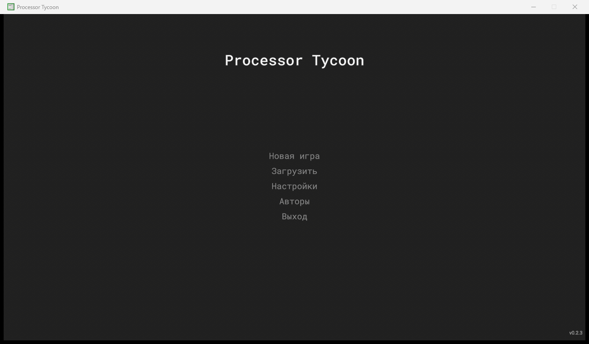

# Processor Tycoon — русификатор

Неофициальный русский перевод игры **Processor Tycoon** (v0.2.3) от CoffeeHeaven. Пародийные названия компаний и процессоров заменены на реальные: Intel, AMD, Core, Pentium, Athlon, Ryzen и т. д.



> Репозиторий **не содержит файлов игры**. Установщик патчит вашу собственную копию игры и сохраняет резервную копию оригинала.

## Что переведено

- Интерфейс: меню, окна, вкладки, кнопки, подсказки, справка, выпадающие списки.
- Тексты контрактов, письма, уведомления, события, описания сложности и рынков.
- Строки, которые игра собирает в коде: статусы, единицы измерения (`/мес.`, `Вт`, `мм`), подписи таблиц и графиков.
- Шаблоны вида «#company выпустила новый процессор» переведены с учётом рода и падежа подставляемых слов.
- Если русский текст не помещается, кнопки с фиксированной шириной расширяются, а в тесных полях шрифт уменьшается автоматически.

### Реальные бренды

| В оригинале | В переводе |
|---|---|
| Inlet / Integrated Electronics | Intel / Intel Corporation |
| EMD / Enhanced Micro Devices | AMD / Advanced Micro Devices |
| Cyrux, Pilog, Phairchild, IDM, Morotola | Cyrix, Zilog, Fairchild, IBM, Motorola |
| Texas Increments, TCMS, Koshiba | Texas Instruments, TSMC, Toshiba |
| SolarFoundries, IVA Technologies | GlobalFoundries, VIA Technologies |
| Pear, Tell, HB, Lenuevo, Asos | Apple, Dell, HP, Lenovo, ASUS |
| Macrosoft, Zony, Mintendo, Gesa, Akari | Microsoft, Sony, Nintendo, Sega, Atari |
| Pentum, Kore, Athon, Phaenom, Dorun, Semprion, Rozan | Pentium, Core, Athlon, Phenom, Duron, Sempron, Ryzen |
| PX-, MT-68000, сокеты EM | FX-, MC68000, сокеты AM |
| DoorOS | Windows |

### Что намеренно оставлено на английском

- Названия технологий (`45nm`, `PGA 1990`, `DDR5`, `L2 512 KB`): игра использует их как ключи.
- Сгенерированные названия компаний-клиентов (вроде «Quantum Labs»).
- Отладочные сообщения разработчика.
- `Digital Devices`: у неё нет однозначного реального прототипа.

## Установка (Windows)

1. Установите [Python 3.9+](https://www.python.org/downloads/). При установке отметьте «Add python.exe to PATH».
2. Скачайте этот репозиторий: **Code → Download ZIP** и распакуйте, либо `git clone`.
3. Перетащите папку игры (где лежит `Processor Tycoon.exe`) на `install.bat`. Можно просто запустить `install.bat` и вставить путь к папке.

Из командной строки:

```bash
pip install -r requirements.txt
```

```bash
python install.py "C:\Games\Processor Tycoon"
```

Установщик:
- проверяет версию игры по хэшам файлов;
- сохраняет оригиналы в папку `_original_en` рядом с игрой;
- собирает переведённые `Processor Tycoon_Data\data.unity3d` и `Processor Tycoon_Data\Managed\Assembly-CSharp.dll`.

Повторный запуск безопасен: перевод всегда собирается заново из сохранённых оригиналов.

## Удаление перевода

```bash
python install.py "C:\Games\Processor Tycoon" --restore
```

Либо вручную скопируйте файлы из `_original_en` обратно на свои места.

## Моды

Вместе с переводом установщик ставит **моды**: дополнения к геймплею. Мод — это библиотека `PTMod.dll` вместе с `0Harmony.dll` (Harmony 2.3.6, лицензия MIT). Игра загружает её сама при старте. Моды не пересобирают `Assembly-CSharp.dll` и не меняют строки перевода. Они рассчитаны на версию игры **0.2.3**, как и перевод.

### Установка

Перевод и моды сразу:

```bash
python install.py "C:\Games\Processor Tycoon" --with-mods
```

Только моды, без перевода. Английская игра останется английской, а уже установленный перевод не тронется:

```bash
python install.py "C:\Games\Processor Tycoon" --with-mods --mods-only
```

Перевод и моды можно ставить в любом порядке: установка перевода не трогает файлы мода. Повторный запуск безопасен, записи в JSON не дублируются.

Установщик:
- проверяет версию игры по хэшу `Assembly-CSharp.dll`. Если версия неизвестна, он останавливается и ничего не меняет. С `--force` моды ставятся с предупреждением, и часть их функций может работать неправильно;
- ищет `PTMod.dll` и `0Harmony.dll` в таком порядке: папка из `--mod-dir`, `mod\build\`, папка рядом с `install.py`. Если файлов нет, но найден Roslyn `csc.exe`, собирает мод сам. Если нет ни файлов, ни компилятора, останавливается с подсказкой скачать GitHub Release и не трогает игру;
- копирует DLL в `Processor Tycoon_Data\Managed\`, добавляет записи в `ScriptingAssemblies.json` и `RuntimeInitializeOnLoads.json`, а оригиналы этих файлов сохраняет в `_original_en\`;
- создаёт папку `Processor Tycoon\PTMod\` с подпапками `content` и `l10n` и записывает манифест `_original_en\ptmod_install.json`. По манифесту потом снимаются моды;
- сеть не использует и сейвы не трогает.

Если установка модов сорвалась, всё, что мод успел записать, откатывается. Перевод при этом может уже стоять (при `--with-mods` он ставится первым), и установщик напишет «Перевод установлен, моды — нет».

> **Закройте игру** перед установкой и удалением модов. Пока игра запущена, её DLL заняты: установщик откатит сделанное и попросит закрыть игру.

### Где взять PTMod.dll и 0Harmony.dll

**Готовые файлы.** Архив `PTMod-<версия>.zip` содержит `PTMod.dll`, `0Harmony.dll`, `Harmony.LICENSE` и `SHA256SUMS.txt`. Такие архивы выкладываются на странице [Releases](https://github.com/Dex719/processor-tycoon-ru/releases), если там есть нужная версия. Распакуйте архив в отдельную папку и укажите её:

```bash
python install.py "C:\Games\Processor Tycoon" --with-mods --mod-dir "C:\Downloads\PTMod"
```

Установщик сверит DLL с `SHA256SUMS.txt`. Если хэши не совпали, он остановится: файл повреждён или заменён. Продолжить можно с `--force`, но только если вы уверены в файлах, например сами собрали их. Если в `--mod-dir` нужных файлов нет, установка останавливается, другие папки не проверяются.

**Своя сборка.** Нужны Visual Studio 2022 Build Tools (достаточно компонента MSBuild) и файл `mod\lib\0Harmony.dll`. В репозитории его нет, способ получить его описан в [mod/lib/README.md](mod/lib/README.md). Из папки репозитория:

```bash
python mod\build.py --game-dir "C:\Games\Processor Tycoon" --release
```

Результат: `mod\build\PTMod.dll`, `mod\build\0Harmony.dll` и архив `mod\build\release\PTMod-<версия>.zip`. Флаг `--release` исключает служебную фичу `framework-sample`, которая нужна только разработчикам. Если `csc.exe` не находится сам, укажите его: `--csc "C:\Program Files (x86)\Microsoft Visual Studio\2022\BuildTools\MSBuild\Current\Bin\Roslyn\csc.exe"`.

Сборка читает DLL игры только как ссылки и ничего не копирует в репозиторий. Вручную собирать не обязательно: если `mod\build\` пуста, а `csc` найден, `install.py --with-mods` соберёт мод сам. Установщик берёт DLL из `mod\build\` как есть, поэтому отладочная сборка, если она там лежит, попадёт в игру.

### Удаление модов

Снять только моды. Перевод, сейвы и ваши правки остаются:

```bash
python install.py "C:\Games\Processor Tycoon" --remove-mods
```

Вернуть английскую игру без перевода и модов:

```bash
python install.py "C:\Games\Processor Tycoon" --restore
```

`--restore` сначала снимает моды, затем возвращает оригиналы `data.unity3d` и `Assembly-CSharp.dll` из `_original_en`. Если мод ставили с `--mods-only`, оригиналов перевода нет: `--restore` снимет только моды и напишет, что перевод не ставился.

> **Перед снятием мода выключите его фичи в окне «Моды».** У некоторых фич есть незакрытые обязательства, например долги, которые мод выдал игроку. При выключении фичи (после подтверждения) они переходят в обычный долг игры. Если мод снять без этого, такие данные пропадут вместе с боковым файлом сейва.

- `--remove-mods` удаляет `PTMod.dll` и `0Harmony.dll` по манифесту и возвращает оба JSON Unity в исходный вид. Файлы, которые вы изменили после установки, без `--force` не удаляются.
- Если мод ставили вручную, без `install.py`, манифеста нет, и установщик откажет. С `--force` он снимет записи мода и `PTMod.dll`, а `0Harmony.dll` оставит, потому что его могут использовать другие моды. `--force` также удаляет файлы, изменённые после установки. Не удаляйте `_original_en\ptmod_install.json` вручную: без манифеста снятие возможно только с `--force`.
- Сейвы с модом грузятся и без него. Игра читает обычный `<имя>.txt`, а данные мода из бокового файла не используются.

### Сейвы и боковые файлы

Состояние модов хранится в боковом файле `<имя>.ptmod.json` рядом с сейвом. Сам сейв `<имя>.txt` остаётся ванильным.

Папка данных мода: `%USERPROFILE%\AppData\LocalLow\CoffeeHeaven\Processor Tycoon\`. Это та же папка, где лежит `Player.log`. Путь можно вставить в адресную строку Проводника.

| Файл | Где лежит | Что хранит |
|---|---|---|
| `<имя>.ptmod.json` | `Saves\`, рядом с `<имя>.txt` | состояние модов этого сейва |
| `ptmod_settings.json` | папка данных | включённые фичи, их настройки, `verboseLog` |
| `ptmod_profile.json` и `.bak` | папка данных | данные для всех сейвов: достижения, отметки обучения |

- **Копируйте сейв вместе с `.ptmod.json`.** Это два файла одного сейва: `<имя>.txt` и `<имя>.ptmod.json`. Без бокового файла сейв загрузится, но фичи будут со значениями по умолчанию. Профиль с сейвом не копируется: он общий для всех сейвов.
- Сейв, сделанный до установки мода, загружается без ошибок. В окне «О моде» будет написано «Нет файла модов (старый сейв)».
- Удаление сейва в окне загрузки удаляет и его `.ptmod.json`.
- Повреждённый боковой файл не мешает загрузке. Мод переименует его в `<имя>.ptmod.json.corrupt-<дата>` и покажет уведомление.
- После `--remove-mods` боковые файлы, `ptmod_settings.json` и `ptmod_profile.json` остаются. Для ванильной игры они безвредны. Когда мод не нужен, их можно удалить вручную. Удаление `ptmod_profile.json` сбрасывает достижения.

### Хаб «Моды»

В игре, не в главном меню, на панели задач появится кнопка **«Моды»** рядом с кнопкой-«дверью». Окно модальное: пока оно открыто, время стоит. Если кнопка на панели не нашлась, хаб открывается из меню паузы, а во вкладке «Диагностика» появится предупреждение.

- **Фичи.** Для каждой фичи видны название, описание, состояние и переключатель. Состояние: «Включена», «Выключена», «Ошибка — отключена до перезапуска» или «Недоступна: причина». У фич с параметрами есть кнопка «Настройки»; значения сохраняются в `ptmod_settings.json`. Если фича не выключается на ходу, хаб пишет «Изменение вступит в силу после загрузки сейва». Некоторые фичи просят подтверждение «Выключить фичу?». Если отказаться, фича останется включённой.
- **Диагностика.** Отчёт самопроверки, патчи и их статус, последние 50 ошибок, время по фазам, очередь писем. Если самопроверка нашла проблемы, в игре появится уведомление с подсказкой «Моды → Диагностика».
- **О моде.** Версии мода, игры и Harmony, статус бокового файла текущего сейва («Загружен», «Нет файла модов (старый сейв)», «Повреждён, использованы значения по умолчанию», «Создан более новой версией мода»), пути к настройкам, профилю и папке переопределений.

В окне новой игры есть кнопка «Моды…». Она появляется, только если какая-то фича предлагает опции для новой игры.

### Финансы и спасение от банкротства

Фича **«Спасение от банкротства»** (раздел «Финансы» в окне «Моды», включена по умолчанию) превращает банкротство игрока из таймера в цепочку решений с ценой. Она работает только с вашей компанией: ИИ-компании банкротятся по обычным правилам игры, а пороги и формулы банка мод не меняет. Подробности и точные формулы: [требования](.kiro/specs/bankruptcy-recovery/requirements.md), [дизайн](.kiro/specs/bankruptcy-recovery/design.md), [задачи](.kiro/specs/bankruptcy-recovery/tasks.md).

Три обозначения в тексте ниже:
- **дефолт** — баланс ниже порога; на 120-й день дефолта игра объявляет банкротство;
- **`D`** — порог дефолта (лимит долга, который банк определяет для вашей компании);
- **`D_L`** — база лимитов мода: `D`, а если он слишком мал (ранние годы), то `2 000 000 $`, умноженные на инфляцию. **`R_3`** — ваша выручка от продаж и контрактов за последние три полных месяца.

**Как открыть меню спасения.** Три входа: действие «Меню спасения» в письмах «Риск дефолта» и «Компания в дефолте» (письмо остаётся, действие можно нажимать снова); кнопка «Меню спасения» в окне предупреждения о дефолте (игра показывает это окно один раз после загрузки сцены, поэтому основной вход — письмо); страница «Финансы» фичи в окне «Моды» (доступна в любой момент, в том числе вне дефолта). Меню модальное: пока оно открыто, время стоит. Вкладки: «Сводка» (баланс, порог, дефицит или запас, дни до банкротства, долг по кредитам мода, ближайший платёж), «Активы», «Кредиты», «Журнал» (последние 50 операций; в сейве хранятся 200).

**Письма.** «Риск дефолта» приходит, когда баланс падает ниже `−0,75·D`. Второй раз в том же падении оно не повторяется, а после подъёма выше `−0,5·D` может прийти снова. «Компания в дефолте» приходит в день начала дефолта.

Каждая операция с деньгами идёт в два шага: настройка и превью на вкладке, затем вопрос с суммой, побочными эффектами и балансом после. Недоступные опции неактивны, причина в подсказке.

| Опция | Где | Цена и условия |
|---|---|---|
| Продать линии | «Активы» | Выручка по ванильной цене окна «Управление линиями», мощность падает. Остаётся минимум 1 линия. Если мощность станет меньше линий под контракты, до подтверждения будет предупреждение о штрафах |
| Распродать склад CPU | «Активы» | Ванильная цена, 29 $ за штуку; склад обнуляется |
| Снять CPU с производства | «Активы» | Штраф по контрактам этого CPU плюс выручка за склад; CPU уходит из производства. Список отсортирован по дневной марже, самые убыточные сверху |
| Продать производство (fabless) | «Активы» | Открывает ванильное окно линий и показывает ожидаемую сумму. Неактивна для литейщиков, без линий и на сложности «Невозможно» |
| Стартовая кредитная линия | «Кредиты» | Первые 3 года от основания компании. Лимит `a·D_L + 0,5·R_3`, не больше `3·D_L`; `a` — от 1,5 на самой лёгкой сложности до 0,25 на «Невозможно». 10 % годовых (с множителем ставки банка), проценты раз в месяц одной строкой «Проценты». Каждый месяц, если баланс положителен, `25 %` баланса (не больше долга) гасят линию. По истечении срока выборка закрывается, остаток становится срочным кредитом на 24 месяца под 15 %. «Автозаём» (включён по умолчанию): если баланс ниже `−0,9·D`, линия сама берёт сумму, возвращающую его к `−0,6·D`, до ежедневной проверки банкротства |
| Бридж-кредит | «Кредиты» | Доступен, когда баланс ниже `−0,75·D` или компания в дефолте, нет другого бридж-кредита и прошло 180 дней с погашения предыдущего. Сумма до `D_L + 0,25·R_3` (ползунок 25–100 %). Комиссия 5 % списывается сразу, кредит на 12 месяцев под 30 % годовых (с множителем ставки банка), платёж 1-го числа |
| Последний шанс | окно в день банкротства | На последнем дне дефолта вместо банкротства открывается окно (время стоит). Сумма `B = 0,25·D − баланс`, после спасения баланс `+0,25·D`. Вариант 1: кредит спасения на 36 месяцев под 40 % годовых. Вариант 2: 30 % положительной чистой прибыли каждого месяца в течение 60 месяцев, всего не больше `3·B` (статья «Роялти»); договор с инвестором в каждый момент один. Любое спасение снижает репутацию на 10. Спасений за партию: 2 / 1 / 1 / 1 / 1 / 0 по сложностям от самой лёгкой до «Невозможно» (на «Невозможно» спасения нет). Закрытие окна крестиком не отказ: оно откроется снова на следующем дне. «Отказаться» (с вопросом) приводит к обычному банкротству |

**Досрочный выход из дефолта.** Если баланс 7 дней подряд не ниже порога, дефолт снимается сразу. В ванильной игре он снимался бы только на 120-й день.

**Настройки.** На странице «Настройки» фичи в окне «Моды» пять переключателей: предупреждение, стартовая линия, бридж-кредит, последний шанс, досрочный выход. Каждый запрещает только **новые** операции своей части; уже взятые кредиты продолжают погашаться. Числа баланса лежат в `mod\src\PTMod\Content\bankruptcy-recovery\balance.json` и переопределяются файлом `PTMod\content\bankruptcy-recovery\balance.json` в папке игры (см. «Свои правки контента и текстов»). Ошибочное число заменяется значением по умолчанию с записью в `Player.log`.

**Выключение фичи.** Выключайте её в окне «Моды». Если за вами числятся обязательства (кредиты мода, выбранное по линии, остаток договора с инвестором), мод спросит: покажет сумму, баланс после и предупредит, если баланс окажется ниже порога дефолта. «Отмена» оставит фичу включённой, график платежей не изменится. «Выключить и перевести в долг» списывает остаток с баланса одной операцией («Перевод в обычный долг» в журнале), закрывает кредиты, линию с долгом и договор с инвестором и показывает уведомление. Баланс может уйти в минус, дальше на него начисляет проценты банк по обычной ставке игры. По договору с инвестором переводится остаток его потолка (потолок минус уже выплаченное), поэтому выключение не дешевле выполнения договора. Деньги при этом не возвращаются: при повторном включении закрытые кредиты и линия не восстанавливаются, число использованных спасений и пауза бридж-кредита (180 дней) сохраняются.

> **Выключайте фичу именно в окне «Моды».** Если выключить её правкой `ptmod_settings.json` вне игры, мод не работает и ничего перевести не может: кредиты остаются в боковом файле без платежей и процентов и продолжатся, когда фичу включат. Если фича остановлена из-за ошибок («Ошибка — отключена до перезапуска»), платежи и проценты тоже стоят до перезапуска игры.

> **Перед удалением мода выключите эту фичу в окне «Моды».** Кредиты и линия существуют только в моде. Если снять мод без выключения, игра их не узнает: долги исчезнут вместе с боковым файлом, а полученные деньги останутся у вас.

**Боковой файл сейва.** Кредиты, линия, договор с инвестором, счётчик спасений, журнал и отметки о выключении фичи лежат в `<имя>.ptmod.json` рядом с сейвом (разделы `bankruptcy-recovery` и `mod-framework`). Копируйте сейв **вместе с** этим файлом: без него сейв загрузится, но все обязательства мода в нём исчезнут. Сейв, сделанный до установки мода, загружается без ошибок: стартовая линия откроется на остаток первых трёх лет, если они ещё не прошли.

### Прозрачность контрактов (`contract-transparency`)

Фича включена по умолчанию (окно «Моды»). Она ничего не меняет в расчётах игры: показывает, что игра считает при подписании контрактов, и просит подтверждение перед рискованным предложением.

- **«Почему?»** В окне контрактов под полем «Вероятность:» появились кнопки «Почему?» и «Журнал». «Почему?» открывает разбор выбранного CPU: три требования контракта (IPS с допуском 75 %,
  потребление, корпус) с числами и недостающей величиной, таблицу предложений компаний в порядке розыгрыша, множители других модов с причинами, подсказки вроде «для шанса 50 % нужен IPS ...» и оценку
  возможных участников до даты рассмотрения.
- **Фактическая вероятность.** Игра берёт предложения от самого мощного по IPS к слабому, каждое с вероятностью, равной его шансу, и повторяет круг, пока кто-то не выбран. Поэтому процент в окне -
  не вероятность выиграть тендер. Пример: у конкурента шанс 60 %, у вас 40 %, он идёт первым; вы выигрываете в 0,4 × 0,4 / (1 − 0,4 × 0,6) ≈ 21 % случаев, конкурент - в 79 %. Мод дописывает результат
  к полю: «Вероятность: 40 % (факт. 21 %)».
- **Подтверждение предложения.** Перед отправкой предложения открывается экран проверки: контракт и CPU, объём, оплата, нужные линии, прибыль, штраф за разрыв и найденные риски. Режимы (параметр в хабе):
  «Всегда», «Только рискованные» (по умолчанию: не хватает линий, убыток, маржа ниже порога автоподписания, низкая вероятность, штраф больше денег, автоотмена предложений снимет предложение) и «Никогда».
  Кнопки «Предложить» и «Отозвать» остаются прежними; предложения автоматики и ИИ экран не открывают. Подпись сделки между компаниями тоже спрашивает подтверждение (в режимах «Всегда» и
  «Только рискованные»).
- **Журнал.** Мод записывает предложения (отправленные и отменённые на экране проверки), решения «Автоподписания контрактов» за 31 декабря (что отправлено и почему пропущено остальное), предложения,
  снятые автоотменой предложений, подписанные сделки и итоги тендеров: победителя, шансы и причину поражения. Итоги приходят одним письмом «Итоги тендеров» (и уведомлением при проигрыше). Журнал хранится
  в боковом файле сейва (до 500 записей, не больше 256 КБ) и открывается кнопкой «Журнал» в окне контрактов или со страницы фичи в хабе; вкладка «Предпросмотр автоматики» показывает заранее, что будет
  отправлено 31 декабря.
- **Настройки** (хаб «Моды» → «Прозрачность контрактов»): подтверждение предложения (0 - всегда, 1 - только рискованные, 2 - никогда), показ фактической вероятности, уведомление о проигранных тендерах,
  журнал автоматики. Числа правил (допуск, пороги, вместимость журнала) лежат в `rules.json`; своё переопределение кладётся в `Processor Tycoon\PTMod\content\contract-transparency\rules.json`.
- **Для других модов:** события `ContractTransparencyEvents.OfferSent` и `TenderResolved` и условия `ct.offersSent` / `ct.tendersWon` с параметром `atLeast`.
- **Диагностика.** При старте фича проверяет 25 членов игры, на которые опирается (шесть методов патчей и приватные поля); находки - в `Player.log`, строки `[contract-transparency] selfcheck: ...`.
  С включённым подробным журналом (`verboseLog`) в лог идут замеры времени `time: ...`.

### Поколения платформ

Фича `platform-generations` даёт платформам историю: сокеты и память собраны в поколения с анонсом, запуском и сроком жизни. Мод считает установленную базу каждой компании на каждом сокете, награждает ранний переход, наказывает слишком частую смену сокета и учитывает интерес OEM-заказчиков к новым платформам. Для игрока и для ИИ правила одинаковые.

Окно «Платформы» открывается на странице фичи в окне «Моды». В нём три вкладки: «Поколения», «Установленная база» и «Мои CPU». В настройках фичи три переключателя: эффекты на рейтинг, эффекты на контракты (OEM), уведомления и письма. Когда эффекты выключены, игра не меняется, а хронология платформ ведётся дальше.

#### Установленная база

Установленная база — это CPU компании на сокете, которыми покупатели ещё пользуются: продажи за последние 60 мес. с затуханием, контрактные продажи идут с весом 50 %. База сокета повышает рейтинг CPU на нём: до +10 % при доле от 40 % всей базы рынка, при меньшей доле — пропорционально меньше. На стандартном сокете к вашей базе добавляется 25 % базы других компаний на нём, на своём сокете считается только ваша. Для «Промышленности» эффекты на рейтинг действуют на 50 % от обычного. Пример: ваша доля в базе рынка — 30 %, бонус к рейтингу = +10 % × 30 / 40 = +7.5 %.

#### Ранний переход

Мест для ранних последователей — 3. Кто выпустит CPU на новой платформе в числе первых, пока идёт окно после запуска поколения (у каждого поколения оно своё, обычно 24 мес.), получает +6 % к рейтингу CPU этого поколения; бонус затухает за 60 мес. Самый первый становится первопроходцем. Об анонсах, запусках и ваших местах вы узнаете из писем и уведомлений.

#### Смена сокета

Если вы переходите на новый сокет, а ваш основной сокет (с самой большой вашей базой) поддерживается меньше 36 мес. и его база составляет не меньше 2 % рынка, рейтинг CPU на новом сокете снижается: штраф до −10 % равен 10 % × (1 − возраст сокета / 36) и затухает за 24 мес. Например, основной сокет прожил 12 из 36 мес.: −6.7 %. Свой сокет на той же базе и пары совместимых сокетов штрафа не дают. Окно выпуска CPU предупредит об этом заранее.

#### Заказчики OEM

У каждого контракта на компьютеры и консоли заказчик предпочитает своё поколение платформы: это решается один раз, когда контракт появляется, и зависит от того, насколько платформу уже принял рынок. CPU на предпочитаемой платформе или новее повышает шанс подписать контракт на 20 %, отставание на одно поколение снижает его на 25 %, на два и больше — на 50 %. Контракты на калькуляторы не затрагиваются. Большая установленная база добавляет лояльность заказчика: до +10 % при доле от 40 %. Если в расчёте нет контракта, берётся среднее по предпочтениям рынка.

#### Полная платформа

Если память CPU входит в стандарты поколения его сокета, платформа полная, и шанс подписать контракт выше ещё на 5 %. Например, для поколения LGA 775 / Socket 939 это память DDR, DDR2.

#### Поколения

| Поколение | Сокеты игры | Память | Анонс | Устаревает |
|---|---|---|---|---|
| DIP-40 | DIP 1970, DIP 1975 | DIP SRAM | 1971 | 1987 |
| PLCC-68 | PLCC 1980 | DRAM | 1980 | 1991 |
| PGA-132 | PGA 1985 | DRAM | 1985 | 1995 |
| Socket 1–3 | PGA 1990 | SDR | 1990 | 2000 |
| Socket 5/7 | PGA 1995 | SDR | 1995 | 2005 |
| LGA 775 / Socket 939 | LGA 2000, PGA 2000 | DDR, DDR2 | 2000 | 2013 |
| LGA 1156 / AM3 | LGA 2010, PGA 2010 | DDR3 | 2010 | 2020 |
| LGA 1151 / AM4 | LGA 2015, PGA 2015 | DDR4 | 2015 | 2026 |
| LGA 1700 / AM5 | LGA 2020 A, LGA 2020 B | DDR4, DDR5 | 2020 | 2034 |
| LGA 2030 A/B | LGA 2030 A, LGA 2030 B | DDR6 | 2030 | — |

Числа в тексте — значения по умолчанию из `balance.json`. Свои значения и свои поколения кладутся в папку `PTMod\content\platform-generations\` рядом с игрой (см. «Свои правки контента и текстов» в README репозитория).

### Сделки с соперниками

Фича «Сделки с соперниками» (`rival-acquisitions`) позволяет покупать активы банкротов, покупать компании в дефолте, враждебно поглощать здоровых соперников, брать в них доли и поручать моду спасать компанию от банкротства. Окно «Сделки» открывается со страницы фичи в хабе «Моды» и из писем о дефолте или банкротстве соперника. Пока окно открыто, время стоит. Перед любой покупкой показывается просмотр сделки: из чего сложилась цена, что перейдёт к вам, что будет снято или расторгнуто и какие последствия. Подтверждение двухшаговое. Пока ваша компания в дефолте, все сделки закрыты. Фичу можно выключить в хабе: уже перенесённые активы остаются у вас, а доли, аукционы и поручения ждут в боковом файле до включения.

**Виды сделок**

| Сделка | Когда доступна | Цена |
|---|---|---|
| Покупка активов банкрота | После банкротства соперника, в течение 365 дней (аукцион) | 40 % оценки, но не меньше нижней границы. Деньги и долги банкрота остаются у него |
| Покупка компании в дефолте | Соперник в дефолте, но ещё не банкрот | 70 % от суммы оценки и его денег (если они есть). Его долг переходит к вам |
| Враждебное поглощение | Здоровый соперник; не чаще раза в 365 дней | 150 % от суммы оценки и его денег (175 %, если у цели доля рынка больше вашей). Его деньги переходят к вам. Репутация −5 |
| Доля 10, 25 или 49 % | Любой соперник, кроме банкрота | Доля от стоимости компании (в дефолте на 40 % дешевле). Деньги идут на счёт компании, а не продавцу, и могут вывести её из дефолта. В 1-е число вы получаете дивиденд: половину прибыли компании за прошлый месяц, умноженную на вашу долю, если у компании хватает денег |
| Поручение на спасение | Компания, в которой вы хотите защитить вложение | Когда компания дойдёт до банкротства, мод сам вольёт деньги и даст долю, если сумма не больше вашего лимита, у вас хватает денег и доля не превысит 49 %. Иначе придёт письмо «Спасти не удалось», и всё пойдёт как в обычной игре |

Если у вас уже есть доля в компании, которую вы потом покупаете целиком, цена уменьшается на вашу долю, а доля и поручение закрываются вместе со сделкой.

**Как считается цена.** Сначала мод оценивает операционные активы цели:

- завод: вдвое больше, чем игра платит при продаже его линий (около 30 % цены постройки);
- технологии: половина полной цены исследования тех технологий, которые есть у цели и которых нет у вас;
- CPU: выручка каждого CPU за последние 12 полных месяцев, умноженная на его маржу (долю цены сверх себестоимости, от 0 до 100 %). CPU банкрота учитываются с коэффициентом 0,5;
- всё вместе умножается на (1 + доля рынка цели). У банкрота доля рынка считается равной нулю.

У оценки есть нижняя граница: 25 % порога дефолта цели. Затем оценка умножается на множитель сделки (см. таблицу), на модификатор цены от других модов и событий и на (1 − ваша доля в цели). Цена округляется вверх до тысячи долларов.

**Почему полная покупка всегда дороже денег цели.** Цена компании в дефолте и враждебного поглощения никогда не бывает ниже её денег плюс нижняя граница оценки, какие бы скидки ни действовали. К вам вместе с компанией переходят её деньги (или её долг), поэтому итог для вашего баланса, «цена минус её деньги», всегда отрицательный. Заработать на покупке компании с большим счётом нельзя. Покупать в долг тоже нельзя: после сделки на счёте должно остаться не меньше нуля.

**Что переходит к вам.**

- Технологии цели, которых у вас нет (без окон «Исследование завершено»), прогресс начатых исследований и опыт техпроцессов.
- Линии цели. Вы выбираете: «Забрать линии» (они переезжают на ту же пластину; если вы её не знаете, то на ближайшую меньшую, а содержание завода растёт на показанную сумму) или «Продать линии» (вы получаете игровую цену продажи). Если цель производит ваши CPU, линии нужно забрать.
- CPU цели вместе с вариантами и контрактами OEM. Если вы не разрабатываете CPU, CPU цели просто снимаются с производства.
- Контракты литейных услуг: если цель была литейщиком, вы становитесь поставщиком её клиентов; если цель была клиентом чужого литейщика, контракт переходит к вам (эксклюзивный контракт расторгается, если у вас уже есть такой). Флаг литейных услуг включается, если он был у цели.
- Если включены фичи «Архитектуры CPU» и «Видеокарты», к вам переходят исследованные семейства архитектур (поддержка берётся максимальная) и линейка видеокарт компании. У банкрота линейка видеокарт не переходит: его вендор ушёл с рынка вместе с ним.

Купленная компания выбывает из игры как банкрот. Её название, номер и данные остаются на месте, поэтому сейв остаётся обычным сейвом игры. В таблице компаний игры у неё стоит «Поглощена игроком».

**Intel, AMD, GlobalFoundries.** Их покупать можно. Последствия показаны в просмотре, и кнопка покупки включается только после галочки «Я понимаю последствия»:

- при покупке Intel или AMD игра по своим правилам отзывает x86-лицензию, а Cyrix избавляется от патентных ограничений. Лицензия к вам **не переходит**;
- покупка AMD до появления GlobalFoundries отменяет её выделение; покупка Intel, когда в игре ещё нет литейщиков, означает, что Intel не откроет литейные услуги; при покупке GlobalFoundries к вам переходит её эксклюзивный контракт с AMD (его клиент и условия не меняются);
- если вы разрабатываете CPU без собственного завода (fabless) и забираете линии, вы становитесь IDM и теряете скидку fabless на разработку.

**Что остаётся после удаления мода.** Перенесённые линии, технологии, CPU и контракты хранятся в обычном сейве игры и остаются у вас. Купленные компании остаются банкротами. Пропадает то, что хранится только в боковом файле: ваши доли, открытые аукционы, поручения и журнал сделок. Деньги, вложенные в доли, не возвращаются. Сейв, сделанный более новой версией мода, загрузится, но сделок в нём мод не предложит.

Числа баланса лежат в `mod\src\PTMod\Content\rival-acquisitions\balance.json`; их можно переопределить файлом `Processor Tycoon\PTMod\content\rival-acquisitions\balance.json`. Подробности и формулы: [.kiro/specs/rival-acquisitions](.kiro/specs/rival-acquisitions) (`requirements.md`, `design.md`, `tasks.md`).

### Видеокарты

Фича **«Видеокарты»** (`gpu-product-line`) добавляет линейку видеокарт рядом с процессорами: своё подразделение, лабораторию, конструктор, производство на общих линиях фабрики и рынок с соперниками. Она включена по умолчанию. Чистому литейщику (компании без CPU-подразделения) подразделение недоступно.

**Как начать**

1. Откройте хаб **«Моды»**, найдите фичу «Видеокарты» и нажмите кнопку **«Видеокарты»** на её странице. Ярлыка на рабочем столе нет. Окно не останавливает время.
2. Основайте подразделение: **«Открыть GPU-подразделение»**. Оно стоит 25 млн (с поправкой на инфляцию) и бесплатно открывает узлы дерева, год которых не позже текущего года минус три. Основать нельзя до 1981 года, если после списания денег компания уйдёт за порог дефолта, и литейщику без CPU.
3. Во вкладке **«Исследования»** изучайте архитектуры, видеопамять и охлаждение. Узел может ждать технологию игры, например `DDR2`: она названа в подсказке. Узлы будущих лет открываются дорого и надолго.
4. Во вкладке **«Конструктор»** задайте архитектуру, техпроцесс, площадь кристалла, частоту, память и охлаждение, затем нажмите **«Разработать»**. Проект оплачивается ежедневно, по готовности откроется окно выпуска.
5. В окне выпуска назначьте цену и число линий (или число карт в день, если компания fabless) и нажмите **«Выпустить»**. Карты едут с линий вашей фабрики, а продаёт их общий рынок.
6. Вкладка **«Линейка»** показывает карты: цену, запас, линии, режим «Авто», итоги прошлого месяца. Вкладка **«Рынок»** показывает сегменты, спрос, лучшие карты и вашу долю. Письма о новых эпохах, производителях и лидерах рынка приходят в почту игры.

**Сейвы.** Данные видеокарт лежат в боковом файле сейва, в секции `gpu-product-line` файла `<имя>.ptmod.json`.

- **Копируйте сейв вместе с `<имя>.ptmod.json`.** Без бокового файла сейв загрузится, но подразделение будет не основано, а карты, проекты и исследования начнутся заново. Рынок для текущего года мод создаст заново.
- Сейв из ванильной игры или из партии, где фичи не было, загружается без ошибок: подразделения нет, а на рынке уже есть соперники и фоновые карты нужного года.
- Если выключить фичу или снять мод, сейв загрузится в ванильной игре, а линии фабрики освободятся со следующего дня. Секция остаётся в боковом файле без изменений, поэтому при следующем включении карты и исследования на месте.
- Сейв, записанный более новой версией мода, мод читает с пустым состоянием и сохраняет секцию как есть.

**Переключатели** (хаб «Моды» → «Видеокарты» → «Настройки»):

| Переключатель | По умолчанию | Что делает |
|---|---|---|
| «Соперники на рынке видеокарт» | вкл. | Именные производители (NVIDIA, ATI, 3dfx, Matrox, S3, а с привязкой к компаниям игры AMD и Intel) выпускают свои карты. Выключено: на рынке только безымянный фон и вы |
| «Синергия процессоров и видеокарт» | вкл. | Доля на одном рынке помогает другому: рейтинг процессоров до +8 %, рейтинг видеокарт до +10 %. Линии карт на техпроцессе ускоряют его освоение для процессоров |
| «Новости рынка видеокарт» | вкл. | Письма о новом лидере сегмента. Письма об эпохах, выходе, уходе и слиянии производителей приходят всегда |
| «Консольные заказы» | вкл. | Производители консолей присылают письмом долгие заказы на ваши карты. Выключено: новые предложения не приходят, принятые заказы идут своим чередом |
| «Процессоры в приоритете» | выкл. | Режим линий, см. ниже |

**Режим «Процессоры в приоритете».** Карты и процессоры делят линии одной фабрики. По умолчанию первыми линии берут видеокарты (**«GPU в приоритете»**): карты резервируют линии до того, как фабрика производит процессоры, а процессорам достаётся остаток. На экране производства это видно по пометке «(+N GPU)». Если включить переключатель, карты занимают только то, что процессоры оставили: линии процессоров никогда не урезаются. Когда линий не хватает, карта получает меньше, чем просила, и в «Линейке» появляется предупреждение «Не хватает линий: X из Y». Компании fabless (без своей фабрики) режим не нужен: карты заказываются у литейщика штуками.

**Консольные заказы** (Could). С 1998 года в почту приходит письмо производителя консоли (Sony, Microsoft, Nintendo) с предложением: столько-то карт в день по твёрдой цене на несколько лет. Принять можно, если у вас есть карта не медленнее 60 % лучшей карты сегмента с нужными функциями; иначе кнопка «Принять» серая с причиной. За ответ даётся 60 дней, без ответа письмо считается отказом. Карты идут со склада карты раньше розницы. Если за 90 дней не поставлено больше 25 % объёма, заказ расторгается и репутация падает. То же случится, если снять карту с производства или выключить фичу (хаб спросит подтверждение).

**Свои правки.** Балансные числа, архитектуры, память, сегменты рынка, производителей и консольные предложения можно менять JSON-файлами без пересборки. Формат и примеры: [mod/src/PTMod/Content/gpu-product-line/README.md](mod/src/PTMod/Content/gpu-product-line/README.md). Общие правила переопределения описаны ниже, в разделе «Свои правки контента и текстов».

### Свои правки контента и текстов

Установщик создаёт папки `Processor Tycoon\PTMod\content\` и `Processor Tycoon\PTMod\l10n\`, в каждой лежит `README.txt`. Ваши файлы кладите туда. Установщик и `--remove-mods` их не трогают, поэтому они переживают переустановку и снятие модов.

- **Контент.** JSON по тому же пути, что у встроенного файла: `content\<фича>\<файл>.json`. Встроенный контент лежит в репозитории, в `mod\src\PTMod\Content\<фича>\`. Запись с тем же `id` заменяет встроенную, запись с новым `id` добавляется, запись с `"disabled": true` убирается.
- **Тексты.** `l10n\ru.json`, `l10n\en.json` или `l10n\<язык>\<фича>.json`. Ключ из этой папки заменяет встроенный. Если ключа нет, берётся встроенный текст.
- Файлы читаются при запуске игры. Неверная запись пропускается, остальные работают. Причина видна во вкладке «Диагностика» и в `Player.log`.

Команда `python install.py --check` проверяет исходники мода в репозитории, а не ваши файлы в папке игры.

### Как прислать Player.log

1. Откройте `%USERPROFILE%\AppData\LocalLow\CoffeeHeaven\Processor Tycoon\` и найдите `Player.log`.
2. Строки мода начинаются с `[PTMod]`. Приложите весь файл, а не только эти строки.
3. Сохраните файл сразу после ошибки. При следующем запуске игры `Player.log` перезаписывается, а прошлый сеанс Unity сохраняет как `Player-prev.log`.
4. Для подробного журнала закройте игру и в `ptmod_settings.json` поставьте `"verboseLog": true`. После проверки верните `false`.
5. Создайте issue в [репозитории проекта](https://github.com/Dex719/processor-tycoon-ru), приложите файл и опишите, что вы делали перед ошибкой.

### Для разработчиков

- `python install.py --check` проверяет файлы перевода и исходники мода (`mod\src\PTMod`): JSON, уникальность `id`, ключи ru и en, префиксы. Игра не нужна.
- `python mod\build.py --tests` запускает тесты чистой логики, `python -m unittest discover -s mod\tests\installer` запускает тесты установщика. Для первого нужен `csc`.
- Отладочная сборка (без `--release`) включает `framework-sample` и флаги `debug.*` в `ptmod_settings.json`. Релизная сборка их не содержит.
- `python mod\build.py`, затем `python mod\tools\audit.py` без запуска игры проверяют собранный `PTMod.dll`: у каждой фичи один класс `[ModFeature]` с уникальным id, каждый патч Harmony находит свою цель в игре (имена и типы параметров, поля `___x`, зарезервированные цели), видны перекрытия патчей разных фич, ресурсы и перекрёстные ссылки контента. Нужна папка игры (читаются только DLL).
- `python moduild.py`, затем `python mod	oolsudit.py` без запуска игры проверяют собранный `PTMod.dll`: у каждой фичи один класс `[ModFeature]` с уникальным id, каждый патч Harmony находит свою цель в игре (имена и типы параметров, поля `___x`, зарезервированные цели), перекрытия патчей разных фич, ресурсы и перекрёстные ссылки контента. Нужна папка игры (читаются только DLL).

## Как это работает

- `data.unity3d` распаковывается. Строки в компонентах TextMeshPro и игровых данных заменяются по точной раскладке полей, вычисленной из метаданных сборок игры. Затем архив собирается заново, без сжатия, поэтому файл становится около 76 МБ вместо 7 МБ. На работу игры это не влияет.
- В `Assembly-CSharp.dll` строковые литералы подменяются точечно, в конкретных местах кода. Так строки, которые игра использует как ключи, остаются нетронутыми. Новые строки дописываются в отдельную секцию с метаданными.
- Динамическим шрифтам игры (Roboto) включается дополнительная страница атласа, чтобы все кириллические глифы помещались.

## Ограничения

- Перевод сделан для версии **0.2.3**. На другой версии он применится по совпадению текста, и часть строк может остаться на английском. Установщик об этом предупредит.
- После обновления игры перевод нужно установить заново.

## Как помочь с переводом

- Тексты интерфейса и данных лежат в `translation/ui.json` (английский → русский). Строки из кода — в `translation/code.json`. Термины — в [docs/GLOSSARY.md](docs/GLOSSARY.md).
- Что сохранять без изменений: плейсхолдеры `{0}`, токены `#company`, теги `<style=Bold>`/`<color=…>`, пробелы по краям строки и переносы `\n`. Иначе игра сломается.
- Перед коммитом проверьте файлы:

```bash
python install.py --check
```

Игра Processor Tycoon принадлежит её авторам. Это фанатский проект, не связанный с разработчиком.
